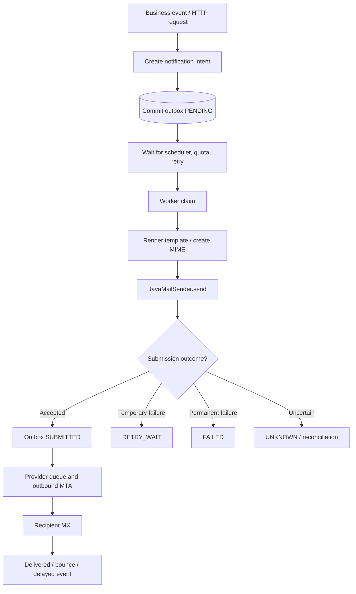

# Measuring Throughput, Latency, and Success Rate Together

A Spring Boot system uses `JavaMailSender` to send order confirmation emails, OTP codes, and invoices. After scaling mail workers from 4 to 20, dashboards show `send(...)` calls per second doubled. Looked at in isolation, the optimization looks successful. Yet customers receive OTPs more slowly, the SMTP provider begins returning rate-limit errors, the queue grows, and some accepted emails later bounce. **Higher throughput does not mean higher useful email delivery capacity.**

Another team optimizes latency by measuring only succeeded emails. Their p95 for `send(...)` drops sharply because timed-out or heavily retried requests are excluded from the dataset. Dashboards display "better latency" while recipients wait longer.

To accurately evaluate **Spring Framework Mail** performance, measure **throughput, latency, and success rate together**, across the **same business boundary**, with transparent units and denominators. Add supporting signals such as queue depth/age, retries, provider quotas, and asynchronous delivery outcomes.

This lesson belongs to the **Performance and Limits** chapter. It covers per-stage email measurement models, formulas and statistical pitfalls, instrumenting `JavaMailSender` with Micrometer, Prometheus queries, dashboards/SLOs, load testing, bottleneck analysis, and operating procedures when the three metrics move in opposite directions.

## 1. Three quantities answer three different questions

| Quantity | Question | Example units | Common mistake |
|---|---|---|---|
| **Throughput** | How much work does the system complete per unit of time? | recipient units/second, submissions/minute, notifications/minute | Counting attempts instead of accepted notifications |
| **Latency** | How long must one item wait? | ms/attempt, seconds to submission, minutes to delivery | Counting only SMTP socket time and ignoring queue wait |
| **Success rate** | What share of evaluated items reach the desired outcome? | % attempts accepted, % notification intents submitted, % delivered | Using the wrong denominator or equating accepted with delivered |

The three metrics complement one another:

- High throughput with low success rate may simply be a **retry storm**.
- Low transport latency with high queue latency can indicate **insufficient capacity or blocked quotas**.
- High success rate with very low throughput can leave **thousands of notifications waiting past SLA**.
- Rising throughput alongside rising latency under growing load can signal **saturation**.
- High overall success rate can mask failures in a critical tenant, provider, or email class.

A rigorous performance report states explicitly: **where it measures, what it counts, over which window, for which email type, and what counts as success**.

### 1.1. Throughput is not "CPU speed"

Suppose the system calls `JavaMailSender.send(...)` 200 times per minute yet the SMTP relay accepts only 120. **Attempt** throughput is 200/minute; **accepted submission** throughput is 120/minute. They are not interchangeable.

### 1.2. Latency is not "one method's call duration"

An email may spend 70 ms building MIME, 8 minutes waiting on quota, 1.2 seconds calling SMTP, and 3 minutes sitting in the provider queue. Depending on SLA, the latency metric might be:

- 70 ms: message preparation time.
- 1.2 seconds: SMTP attempt latency.
- About 8 minutes: dispatch wait time.
- Over 8 minutes: time-to-submission.
- Over 11 minutes: time-to-delivery if the provider emits reliable delivery events.

One timer around `send(...)` cannot represent all of these.

### 1.3. Success rate is rarely a single ratio

Success at SMTP submission means the first relay accepted responsibility per protocol response; it does not guarantee the recipient MX accepted it, much less Inbox placement.

Multiple success levels match different contracts:

1. Notification intent **persisted durably**.
2. SMTP relay/provider **accepted submission**.
3. Receiving system **accepted delivery**.
4. Message **placed in mailbox** according to verifiable data.
5. Recipient **read or acted** if the product is authorized to track it.

Each level uses different data sources and confirmation timestamps.

## 2. Tracing the true path of an email

Suppose the system uses a transactional outbox and asynchronous mail workers:



Each segment forms a distinct **measurement boundary**:

| Point | Timestamp / event | Used to measure |
|---|---|---|
| Business event occurs | `eventOccurredAt` | Full use-case latency if needed |
| Intent commit | `createdAt` or `committedAt` with clear semantics | When durable work begins waiting |
| Worker claim | `claimedAt` | Queue wait and scheduling delay |
| Submission start | `attemptStartedAt` | Transport attempt start time |
| Submission end | `attemptFinishedAt` | SMTP/API attempt latency, result |
| Provider confirms acceptance | `acceptedAt` | Time-to-submission |
| Provider reports delivered | `deliveredAt` | Time-to-delivery |
| Bounce/complaint event | `eventTimestamp` and `receivedAt` | Post-submission failure and webhook lag |

Not every timestamp must sit on one row; you can use a `mail_attempt` table, delivery events, tracing, and metrics. Every field must have unambiguous semantics.

### 2.1. Without an outbox

A service calling `JavaMailSender.send` synchronously inside an HTTP request has fewer queue layers, yet still must distinguish:

- HTTP request duration.
- Content rendering time.
- Thread/connection limit wait time.
- SMTP attempt duration.
- Accepted result.
- Delayed delivery events.

Synchronous code does not make HTTP 200 equivalent to email delivered.

### 2.2. When calling an ESP HTTP API

Replace `SMTP transport` with an HTTP client. Then:

- HTTP 2xx may represent accepted/queued depending on contract.
- HTTP 429 reflects API rate limits.
- Use `Retry-After` only when present and semantically valid.
- HTTP request latency differs from downstream delivery latency.
- The API may offer dedicated idempotency keys or status APIs.

The three-metric model still applies, with outcome taxonomy aligned to the provider's contract.

## 3. Choosing the work unit: message, recipient, or intent?

Provider limits may count **recipients**, not MIME messages. Meanwhile, business SLOs typically measure **notification intents**.

Example:

```text
Notification N-1: 1 recipient, 1 MIME message, 1 attempt
Notification N-2: 3 recipients, 1 MIME message, 2 attempts
Notification N-3: 1 recipient, 1 MIME message, 0 attempts (waiting)
```

From the same data, we have:

- 3 notification intents.
- 5 logical recipient units if the provider bills all recipients.
- 3 started SMTP attempts.
- 1 untried notification.
- Total **attempted** recipients can differ from logical recipients due to retries.

Never lump all of these under one metric named `mail_sent_total`.

### 3.1. Suggested taxonomy

| Metric concept | Unit | Meaning |
|---|---|---|
| `intents_created` | Unique intents | Durably persisted notifications |
| `attempts_started` | Transport calls | Call attempts, including retries |
| `attempts_accepted` | Accepted attempts | Attempts confirmed accepted by provider |
| `attempted_recipient_units` | Recipient attempts | Total recipient cost across attempts |
| `accepted_recipient_units` | Recipient units accepted | Volume accepted by provider when measurable |
| `unique_intents_submitted` | Unique intents | Intents reaching submitted for the first time |
| `unique_intents_delivered` | Unique intents | Intents with delivery confirmation |
| `outstanding_intents` | Intents | Work without a terminal outcome yet |

In multi-recipient designs, define explicitly whether **outcome is per message** or **per recipient**. If recipient A is accepted while B is rejected, one boolean success per message is insufficient.

### 3.2. Never switch units mid-dashboard

If the ESP limit is 100 recipients/minute, a chart of 100 messages/minute is not directly comparable when messages carry multiple recipients. Keep one consistent cost model and state the counting method.

## 4. A running example: same data, different conclusions

In a cohort of **1,000 notification intents** created in the same time window, at evaluation time:

| Intent state | Intent count |
|---|---:|
| Accepted by SMTP provider | 900 |
| Permanently failed, unaccepted | 50 |
| Waiting for retry / not yet due | 30 |
| Unknown submission outcome | 20 |
| **Total** | **1,000** |

During processing, workers executed **1,200 attempts**: 900 accepted, 210 temporary failures, 60 permanent failures, and 30 unknown outcomes. Failed attempts may belong to intents that succeeded on later retries; therefore you cannot simply add attempt outcomes to deduce each intent's final status.

Assume the 900 accepted intents yielded 800 delivery confirmations, 50 bounces, and 50 still awaiting downstream reports.

### 4.1. Attempt success rate

```text
Attempt acceptance rate
    = accepted attempts / all completed attempts
    = 900 / 1,200
    = 75%
```

The 75% figure measures **attempt** health, reflecting retries and network/provider issues; it does not mean 75% of notifications succeeded.

### 4.2. Intent submission success at snapshot time

```text
Accepted intents / all created intents
    = 900 / 1,000
    = 90%
```

This 90% snapshot includes 30 pending and 20 unknown intents. It differs from the "terminal outcomes" ratio:

```text
Accepted / (accepted + permanently failed)
    = 900 / (900 + 50)
    ≈ 94.74%
```

A terminal-only ratio **never replaces** the full-cohort ratio: if backlog grows, a terminal-only metric looks deceptively rosy. Always display pending/unknown shares alongside cohort age.

### 4.3. Delivery at snapshot time

```text
Confirmed delivered / accepted intents
    = 800 / 900
    ≈ 88.89%
```

This figure is also affected by provider event lag. The 50 messages without a delivery event yet cannot automatically be treated as delivered or bounced. Delivery analysis requires a **mature cohort** and late-event handling.

### 4.4. Lesson from the example

All three statements below are true, yet describe **three different phenomena**:

- "75% of attempts were accepted by the provider."
- "90% of cohort intents were submitted by measurement time."
- "88.89% of accepted intents had delivery confirmation at observation time."

When building dashboards, never cherry-pick the prettiest number and label it "email success rate."

## 5. Defining throughput at every stage

Throughput is work completed at a boundary during a measurement interval:

\[
\text{Throughput} = \frac{\text{work units completed}}{\text{elapsed time}}
\]

Example over 60 seconds:

- 300 intents created -> **5 intents/s** (arrival rate).
- 240 attempts started -> **4 attempts/s**.
- 210 attempts accepted, one recipient each -> **3.5 accepted recipients/s**.
- 180 provider delivery events arriving in that minute -> **3 delivery events/s**.

You cannot divide 180 delivery events from that minute by 300 newly created intents and call it delivery success rate. The two groups likely belong to **different cohorts** because delivery arrives later.

### 5.1. Arrival rate and service rate

Let:

- \(\lambda\): arrival rate of new intents (intents/second).
- \(\mu\): rate at which the system resolves intents out of the queue cleanly (intents/second).
- \(B(t)\): backlog at time \(t\).

Approximately over an interval without other state changes:

\[
\Delta B \approx (\lambda-\mu)\Delta t
\]

If \(\lambda>\mu\) persists, backlog grows. Adding threads helps little if \(\mu\) is capped by provider quotas.

### 5.2. Attempt throughput vs. useful throughput

Counting an SMTP transport attempt as "processed" even when it hits 451 and schedules a retry can inflate attempts/second. **Useful throughput** should count recipient units confirmed accepted by the provider or unique intents advancing to the next stage.

A strategy that curbs a retry storm can cause:

- Attempt throughput to **drop**.
- Acceptance rate to **rise**.
- Accepted throughput to **rise or stabilize**.
- Queue latency to **gradually decline**.

That is a solid optimization even though requests/second dropped.

### 5.3. Throughput by notification priority

Never merge OTPs with marketing when requirements differ:

- OTP: percentage submitted within 30 or 60 seconds.
- Invoices: batch submission time.
- Marketing: sustained accepted recipients/minute at reasonable cost.

A high combined chart can hide a transactional queue blocked behind a campaign.

## 6. Measure latency per stage, not just global averages

### 6.1. Latency components

For a notification intent:

```text
t0 = intent committed / eligible
t1 = worker claimed
t2 = MIME rendering started
t3 = SMTP send started
t4 = SMTP send completed (accepted/error)
t5 = provider confirmed delivered
```

Intervals:

```text
Queue wait          = t1 - t0
Prepare latency     = t3 - t2
SMTP attempt time   = t4 - t3
Time to submission  = t4 - t0     (if accepted)
Time to delivery    = t5 - t0     (if event is reliable)
```

With retries, `t4` of the final accepted attempt can sit minutes after `t0`. Intent-to-acceptance latency **includes retry waits** and directly reflects user experience.

### 6.2. Distinguish queue wait from transport wait

Queue wait can arise from:

- `nextAttemptAt` not yet reached.
- Provider quota/rate gates.
- Worker capacity shortage.
- Database claim/lock contention.
- Priority scheduling.
- Open circuit breakers.
- Intentional retry backoff.

Transport latency can arise from:

- DNS resolution and TCP connect.
- TLS/STARTTLS handshake.
- SMTP AUTH.
- MAIL FROM / RCPT TO / DATA exchange.
- Payload/attachment size.
- Server response delay.
- Network timeouts.

Measure these two groups separately to avoid misdiagnosis.

### 6.3. Use monotonic time for in-process durations

Inside one JVM, to time `send(...)`, `System.nanoTime()` or `Timer.Sample` is preferable to subtracting two `Instant.now()` calls because wall clocks can be adjusted by NTP.

For cross-process latencies, use UTC timestamps with clear semantics and monitor clock skew. If skew yields a negative duration, **never silently clamp it to 0 and pretend nothing is wrong**; record timestamp/skew anomalies and guard dashboards per policy.

### 6.4. Can "time to Inbox" actually be measured?

Usually **no** using `JavaMailSender` alone. Providers may report delivered after the recipient MX accepts the message, without knowing Inbox vs. Spam placement or when the user sees it.

Call the metric `time_to_delivery` when backed by provider delivery events; never call it `time_to_inbox` without valid inbox-placement data.

## 7. Mean, median, p95, p99, and histograms

### 7.1. Means hide the tail

Example of 100 SMTP attempts:

- 95 attempts: 200 ms.
- 5 attempts: 10 seconds.

Mean:

```text
(95 × 0.2 + 5 × 10) / 100
= 0.69 seconds
```

A 690 ms mean may lull operators into thinking wait times are low, while 5% of customers wait 10 seconds for the SMTP attempt alone.

Inspect the distribution:

- **p50 (median):** half of observations have latency at or below this value per quantile definition.
- **p95:** roughly 95% of observations fall at or below the p95 threshold.
- **p99:** reflects the slowest 1% tail.
- **Max:** window maximum, sensitive to a single outlier.
- **Histogram buckets:** observation counts per latency range, enabling aggregation and quantiles.

### 7.2. Never sum stage p95s to deduce total p95

If:

```text
Queue p95   = 8 seconds
SMTP p95    = 2 seconds
MIME p95    = 100 ms
```

you cannot claim:

```text
End-to-end p95 = 8 + 2 + 0.1 = 10.1 seconds
```

Because each percentile can belong to **different notifications**, summing p95s does not yield total p95. Measure end-to-end duration on **each notification** or compute the distribution of the actual sum.

### 7.3. Measure latency of failed attempts too

If you only record the timer after `send(...)` returns normally:

```java
sender.send(message);
timer.record(duration); // Only runs when no exception is thrown.
```

then attempts that timed out after waiting 10–30 seconds vanish from the latency distribution. Record duration inside `finally` with the appropriate outcome tag.

Track:

- p95/p99 latency for **all attempts**.
- p95/p99 latency for **accepted attempts**.
- p95/p99 latency for **temporary/permanent failures** when sample size permits.
- Time-to-submission across cohort intents (including retry waits).
- Queue wait for active/processed intents.

Note that latency of completed attempts alone ignores currently hung calls. Also monitor `active_attempts` and age of in-flight attempts.

## 8. Success rate: choosing meaningful denominators

### 8.1. Attempt success rate

\[
R_{\text{attempt}} =
\frac{\text{accepted attempts}}{\text{completed attempts}}
\]

Tracks transport health, throttling, network, and retry ratios.

Possible states:

- `accepted`.
- `temporary_rejection`.
- `permanent_rejection`.
- `unknown`.
- `client_preparation_failure`.
- `not_attempted_local_gate` — **not** part of completed transport attempts.

If an attempt starts, crashes, and never writes an outcome, use `IN_FLIGHT_STALE` or recovery reconciliation. Never let it vanish from metrics merely because no finish event fired.

### 8.2. Intent submission success

\[
R_{\text{intent-submission}} =
\frac{\text{unique intents accepted}}
     {\text{eligible intents in cohort}}
\]

Cohorts are typically grouped by `createdAt` or eligibility time. Define **eligible** clearly: does it exclude validly cancelled notifications, missing consent, initially expired items, or validation errors?

Never arbitrarily exclude inconvenient failures just to polish the ratio. SLOs must reflect the real business experience you commit to.

### 8.3. Time-bounded success

For OTPs, what matters most may be:

\[
R_{\le 60s} =
\frac{\text{eligible intents accepted within 60 seconds}}
     {\text{eligible intents old enough to evaluate}}
\]

An OTP accepted by an SMTP relay after 15 minutes may count as "submitted successfully" at transport level, yet **fails the time-bounded SLO**.

A time-bounded SLI combines success and latency in one outcome, preventing situations where throughput looks high yet emails arrive too late.

### 8.4. Delivery success rate

\[
R_{\text{delivery}} =
\frac{\text{intents confirmed delivered}}
     {\text{mature accepted intents with an evaluated outcome}}
\]

Define cohort and "mature" explicitly: for example, submissions past a window long enough for SLAs and provider reporting. Late or lost webhook events can skew results. Without reliable delivery events, **never compute delivery success from `send()`**.

### 8.5. Ratios that must never be conflated

| Metric | Numerator | Denominator | Question |
|---|---|---|---|
| Attempt acceptance | Accepted attempts | Completed attempts | How are transport attempts performing? |
| Intent submission | Unique intents accepted | Eligible intents in cohort | Are logical jobs getting submitted? |
| On-time submission | Intents accepted before deadline | Eligible intents mature enough to evaluate | Are user SLAs being met? |
| Provider delivery | Intents with delivered event | Explicitly defined cohort | Did it reach the downstream destination? |
| Bounce rate | Bounced messages/recipients | Appropriate submission set | What is recipient/policy quality? |

## 9. Cohorts and delayed outcomes: the "right censoring" trap

During minute one, the system creates 1,000 intents yet processes only 300 due to rate limits. If at that instant you compute:

```text
success = accepted / created = 300/1000 = 30%
```

you get an **accepted-as-of-now ratio**, not the final failure rate. The remaining 700 waiting intents are not permanently failed.

Conversely, if you compute:

```text
success = accepted / completed = 300/300 = 100%
```

the number looks spotless yet hides a 700-intent backlog.

### 9.1. The solution is showing multiple facets of the same cohort

For a cohort created during `10:00–10:05`, track:

- Eligible intent count.
- Accepted count.
- Permanently failed count.
- Pending / retry-wait count.
- Unknown count.
- Policy-expired or cancelled count.
- p95 time-to-submission for accepted intents.
- % accepted within SLA out of all intents **old enough to evaluate**.

When scoring a 60-second SLO, wait at least 60 seconds from each intent's start time before evaluating it, avoiding misclassifying intents created 5 seconds ago.

### 9.2. Avoid dividing two mismatched time windows

Never compute:

- Numerator = delivered events arriving in the "last 5 minutes".
- Denominator = intents created in the "last 5 minutes".

Today's delivery events can correspond to submissions from 15 minutes earlier. That ratio can exceed 100% or fluctuate nonsensically.

If you plot wall-clock event rates, show them as **two separate throughput series** rather than dividing them into a faux cohort success rate.

## 10. Combining all three in one quick-read table

A useful metric set per provider and notification type:

| Signal | Meaning | Alert when |
|---|---|---|
| Accepted recipients/second | Useful throughput | Dropping while arrivals/backlog grow |
| Attempt recipients/second | Load sent to provider | Spiking without matching accepted throughput |
| Attempt acceptance rate | Transport efficiency | Falling due to 4xx, 5xx, network errors |
| p95 SMTP attempt | Transport latency | Rising, especially alongside timeouts |
| p95 queue wait | Scheduling/quota delay | Rising even while SMTP attempts stay fast |
| p95 time-to-submission | End-to-end pipeline experience | Climbing past SLA |
| On-time intent submission rate | Business SLI | Dropping below objective |
| Oldest pending age | Backlog risk | Climbing continuously or nearing expiry |
| Retries per accepted intent | Retry overhead | Rising without accepted throughput improving |
| Provider throttle rate | Quota/rate feedback | Rising while local limits fail to slow down |
| Unknown submission count | Outcome uncertainty | Climbing after timeouts/crashes |
| Delivery/bounce status | Downstream outcomes | Acceptance high yet bounces rising |

### 10.1. Many charts alone are not enough

Metrics placed side by side must share **consistent dimensions and definitions**. Plotting total traffic throughput next to OTP-only latency and accepted-only success rate misleads readers.

Maintain synchronized filters by provider, account, notification class, environment, and time window, and label units explicitly.

## 11. Case 1: throughput rises, success rate drops

Suppose before optimization:

```text
Attempts: 100/minute
Accepted: 95/minute
Attempt acceptance: 95%
p95 attempt latency: 0.9s
```

After adding workers:

```text
Attempts: 250/minute
Accepted: 100/minute
Attempt acceptance: 40%
p95 attempt latency: 4.5s
```

Attempt throughput jumped 2.5x, yet useful throughput rose only 5.3%. Latency worsened and the provider is likely throttling.

**Investigation steps:**

1. Inspect SMTP response codes/enhanced codes and provider quotas.
2. Check concurrency against connection limits.
3. Compare accepted recipients/s rather than attempts/s alone.
4. Check for retry storms and local rate limiters.
5. Lower concurrency/rate to a level the provider accepts steadily.
6. Watch queue age instead of blindly adding more workers.

The right optimization may be **reducing attempts** to raise acceptance rates and stabilize SLAs.

## 12. Case 2: low SMTP p95 yet high time-to-submission

Example:

```text
p95 SMTP attempt:           0.3 seconds
p95 queue wait:             12 minutes
p95 time-to-submission:     13 minutes
Attempt acceptance:         99%
Oldest pending:             28 minutes
```

Transport is healthy; the bottleneck sits before `send(...)`. Possible causes:

- Rate limiter throttling due to quota.
- Scheduler polling only every few minutes.
- Undersized worker pool.
- Slow database claim queries.
- A marketing queue monopolizing dispatch capacity.
- Circuit breaker staying open too long.
- Overly aggressive retry backoff.
- Tenant fairness causing starvation.

Do not optimize MIME rendering or TLS handshakes before inspecting queue scheduling and quotas.

### 12.1. Latency of unfinished emails

A p95 time-to-submission computed solely over accepted intents ignores pending items. As backlog grows, accepted p95 can look artificially good because the slowest notifications **have not entered the sample yet**.

To avoid the trap:

- Track `oldest_pending_age`.
- Track `pending_age` distribution.
- Use time-bounded SLIs on mature cohorts.
- Track `expired_total` and `pending_count`.
- Never plot only completed-submission latency.

## 13. Case 3: high success rate, low throughput

Suppose a provider caps throughput at 20 recipients/minute while the app creates 300 intents/minute:

```text
Accepted / attempted: 100%
Accepted throughput: 20/minute
Arrival rate: 300/minute
Backlog growth: ~280/minute
```

Looking solely at the 100% acceptance rate makes everything look fine. Meanwhile the queue explodes and recipients miss deadlines.

**Investigation steps:**

- Per-account/region quotas, remaining allowance, and reset windows.
- Capacity allocation across notification classes.
- Are marketing and OTP sharing the same queue?
- Options to raise quotas or curb new arrivals.
- Which SLAs are about to breach?
- Should non-essential batch ingestion pause?

That is why success rate must sit next to accepted throughput and backlog.

## 14. Case 4: throughput and success both rise, yet delivery drops

The SMTP provider may accept every request while recipient MX servers bounce or defer later. Example:

```text
Submission accepted rate: 98%
Accepted recipients:       10,000/day
Provider delivered:        8,200/day
Hard bounces:              rising
```

Inspect:

- Units/cohorts of the delivered rate.
- Recipient list quality and suppression.
- SPF/DKIM/DMARC.
- PTR/forward DNS and IP/domain reputation.
- Provider-specific throttling at downstream MX servers.
- Content, attachments, links, and policies.
- Webhook event lag or loss.

**Never increase throughput simply because the ESP accepts requests**; email infrastructure must evaluate post-submission outcomes using proper data sources.

## 15. Case 5: p95 rises while success rate stays flat

Providers may slow down before hitting timeouts. This is an early warning sign of saturation or network delay:

```text
Accepted success rate: 99%
p95 SMTP latency: 0.5s -> 5s
Active submissions: rising
Queue wait: slightly rising
```

Waiting until 4xx/timeouts spike before alerting allows a large pile-up of in-flight requests. Tail latency serves as an early warning, especially paired with active connection counts and queue trends.

Latency can also rise from larger attachments or shifting payload mixes; segment by message-size band and notification type rather than comparing completely different workloads via one average line.

## 16. Defining events and states to avoid double counting

An outbox lifecycle can look like:

```text
PENDING
  |
  +-- Local rate gate denied --> PENDING / nextAttemptAt
  |
  +-- Attempt #1 --> TEMPORARY_FAILURE -> RETRY_WAIT
  |
  +-- Attempt #2 --> UNKNOWN -> reconciliation
  |
  +-- Attempt #3 --> SUBMITTED -> DELIVERED (provider event)
```

Each transition must specify which counters increment:

| Event | Counter/Gauge update |
|---|---|
| Intent inserted into DB | `intents_created_total +1` once |
| Local limiter DENIED | `local_rate_denials_total +1`; do not increment attempts |
| Attempt started | `attempts_started_total +1` |
| Attempt ended with temporary failure | `attempts_total{result="temporary"} +1` |
| Attempt ended unknown | `attempts_total{result="unknown"} +1` |
| Provider accepted | `attempts_total{result="accepted"} +1` |
| Intent transitions to `SUBMITTED` first time | `intents_submitted_total +1` |
| Delivery webhook first recorded | `intents_delivered_total +1` with uniqueness check |
| Notification expired before sending | `intents_expired_total +1` |
| Pending count/age | Gauge from current state |

### 16.1. Counters and events during process crashes

In-memory counters can be lost or reset on process restart. Prometheus handles counter resets under `rate()` when scraping cleanly, yet **metric counters are not transactional audit logs**.

When exact business accounting per intent and cohort is required, durable state typically lives in the database/outbox/attempt events. Metrics give fast operational visibility, while reconciliation relies on durable state and logs.

### 16.2. Avoid incrementing unique intent counters on retries

If workers process the same notification three times, `attempts_total` increments three times. `intents_submitted_total` should increment **only when the logical state first transitions to `SUBMITTED`**; enforce persistence transaction guards so two workers cannot double-count the transition.

A unique idempotency key protects intent creation, but does not resolve duplicate acceptance after an unknown SMTP outcome.

## 17. Instrumenting JavaMailSender with Micrometer

In Spring Boot, Micrometer records counters, timers, and gauges and exports them through configured observability backends such as Prometheus. The example below instruments **a single SMTP attempt** for one `MimeMessage`.

### 17.1. A simple adapter

```java
package com.example.mail;

import io.micrometer.core.instrument.MeterRegistry;
import io.micrometer.core.instrument.Timer;

import jakarta.mail.internet.MimeMessage;

import org.springframework.mail.MailException;
import org.springframework.mail.javamail.JavaMailSender;

public final class InstrumentedMailSubmitter {

    private final JavaMailSender sender;
    private final MeterRegistry meters;
    private final String providerKey;

    public InstrumentedMailSubmitter(
            JavaMailSender sender,
            MeterRegistry meters,
            String providerKey) {
        this.sender = sender;
        this.meters = meters;
        this.providerKey = providerKey;
    }

    public void submitOnce(MimeMessage message) {
        Timer.Sample sample = Timer.start(meters);
        String result = "unknown";

        meters.counter(
                "mail.submission.attempts.started",
                "provider", providerKey).increment();

        try {
            sender.send(message);
            // For a successful send(MimeMessage):
            // the transport call reported no error at this boundary.
            result = "accepted";
        } catch (MailException ex) {
            result = MailFailureCategories.classify(ex);
            throw ex;
        } finally {
            sample.stop(
                    Timer.builder("mail.submission.attempt.duration")
                            .description(
                                    "Elapsed time of one submission attempt")
                            .tag("provider", providerKey)
                            .tag("result", result)
                            .publishPercentileHistogram()
                            .register(meters));

            meters.counter(
                    "mail.submission.attempts",
                    "provider", providerKey,
                    "result", result).increment();
        }
    }
}
```

`MailFailureCategories.classify(ex)` here is an **application-defined helper**, not a built-in Spring API. It must return a small bounded set of categories such as `temporary_rejection`, `permanent_rejection`, `connectivity`, `authentication`, and `unknown`; never use raw exception messages as labels.

### 17.2. What this example establishes

- `Timer.Sample` uses Micrometer's timing mechanism suited for elapsed duration.
- `finally` records the timer on both success and exception.
- `result` is assigned before emitting metrics.
- The method does not retry internally; one invocation equals one attempt.
- The timer stops right when the transport call completes, excluding queue wait.
- `accepted` here only means a single-message send returned without exception under the transport contract; it does not imply a provider delivery event.
- Do not instrument the same attempt a second time via AOP advice unless you intend double counting.

**Limitation:** in production code, classifying partial failures, timeouts after DATA, and batched `send(MimeMessage[])` calls requires inspecting nested exceptions, failed messages, and SMTP stage. Do not collapse every `MailException` into a simple failure boolean when recipient-level reconciliation is needed.

### 17.3. Illustrative classifier

```java
import org.springframework.mail.MailAuthenticationException;
import org.springframework.mail.MailException;
import org.springframework.mail.MailParseException;

public final class MailFailureCategories {

    private MailFailureCategories() {}

    public static String classify(MailException ex) {
        if (ex instanceof MailAuthenticationException) {
            return "authentication";
        }
        if (ex instanceof MailParseException) {
            return "preparation";
        }
        // Real implementations should inspect the cause chain,
        // MessagingException.nextException, SMTP replies, and DATA stage.
        return "unknown";
    }
}
```

This is a **very conservative** example classifier, not a rule saying "retry whatever you don't recognize." An `unknown` classification must trigger cautious handling at the application/outbox layer.

### 17.4. Configuring MeterRegistry for latency histograms

With Micrometer and Prometheus, histograms can be enabled via `publishPercentileHistogram()` as shown above or through `MeterFilter`/distribution statistics configuration.

If SMTP request latencies span tens of milliseconds to tens of seconds, pick histogram boundaries/SLO buckets grounded in real distributions. Do not enable all default buckets blindly if doing so explodes time-series cost.

Check exported metric names carefully. Micrometer translates names like `mail.submission.attempt.duration` into backend conventions; for instance, Prometheus typically emits `mail_submission_attempt_duration_seconds_bucket`, `_sum`, and `_count`. Never assume suffix names when exporters or versions customize conventions.

## 18. Instrumenting end-to-end notification intent latency

### 18.1. Use persisted timestamps instead of in-memory objects

A worker processes a committed outbox row:

```java
record OutboxNotification(
        UUID id,
        Instant createdAt,
        String notificationType,
        String providerKey) {
}
```

Once the provider accepts and the DB commits `SUBMITTED`, record:

```java
Duration elapsed =
        Duration.between(notification.createdAt(), acceptedAt);

meters.timer(
        "mail.intent.time.to.submission",
        "provider", notification.providerKey(),
        "type", notification.notificationType()
).record(elapsed);
```

This assumes `notification`, `acceptedAt`, and `meters` are provided; import `java.time.Duration` and `Instant`.

Key notes:

- `createdAt` must represent the chosen business start point (such as intent committed/ready), not an arbitrary timestamp captured before a long transaction.
- `acceptedAt` is when the app learned transport accepted, not delivery time.
- Timestamps across hosts can skew; synchronize clocks and define a policy for invalid durations.
- **Record only once per unique intent when transitioning to `SUBMITTED`.**
- Never rely solely on an accepted-intent timer as your only SLO; pair it with pending age and time-bounded cohorts to see unfinished intents.
- Multi-recipient messages must decide whether time-to-submission is tracked per message or per recipient.

### 18.2. Distinguish retry waiting time

If attempt #1 fails and waits 5 minutes, and attempt #2 is accepted in 200 ms:

```text
Attempt 2 latency = 200 ms
Time-to-submission = > 5 minutes
```

Both are true. Looking only at attempt latency misleads you into thinking delivery is fast.

### 18.3. When to use @Timed?

`@Timed` or an observation framework can be convenient for instrumenting methods, provided you ensure:

- Proper AOP/interceptor wiring so the annotation actually takes effect.
- The method boundary matches your intended contract.
- Timeouts and exceptions are still recorded.
- Recipients or `messageId` are never added as tags.
- No double counting with explicit timers.
- Method-level timers are not bypassed via self-invocation/proxy boundaries.

In this lesson, explicit `Timer.Sample` clarifies exact start and end boundaries for each transport attempt.

## 19. Monitoring queues: counts, age, and scheduling delay

### 19.1. Pending counts are necessary but not sufficient

A queue with 10,000 marketing messages may be expected for a scheduled campaign. Yet 50 OTPs pending for 4 minutes seriously degrades user experience.

Track:

- `mail_outbox_pending_count` by provider/type.
- `mail_outbox_retry_wait_count`.
- `mail_outbox_processing_count`.
- `mail_outbox_unknown_count`.
- `mail_outbox_oldest_pending_age_seconds`.
- `mail_outbox_expiring_soon_count`.
- `mail_outbox_due_count`: due yet unclaimed.
- `mail_claim_delay_seconds`: from eligible to worker claim.

### 19.2. SQL for oldest pending age

In PostgreSQL, the idea is:

```sql
SELECT
    provider_key,
    notification_type,
    EXTRACT(
        EPOCH FROM (
            CURRENT_TIMESTAMP - MIN(created_at)
        )
    ) AS oldest_pending_age_seconds
FROM mail_outbox
WHERE status IN ('PENDING', 'RETRY_WAIT')
GROUP BY provider_key, notification_type;
```

This illustrative query measures **age since `createdAt`**. To measure "dispatch overdue" lag, use `next_attempt_at`/eligible timestamps and separate intentional retry waits. Never treat every `RETRY_WAIT` row as scheduler lag; a row whose `next_attempt_at` lies in the future is not due yet.

### 19.3. Gauges and DB queries have cost

Never run `SELECT COUNT(*)` or `MIN(created_at)` across a massive table every 100 ms just to refresh dashboards. Consider:

- Polling at reasonable intervals.
- Proper indexes on status/`next_attempt_at`/`created_at`.
- Materialized/aggregate counters with periodic reconciliation.
- Querying read replicas if replication lag and consistency allow.
- Sampling if observational accuracy does not require sub-second precision.

Remember snapshot gauges can lag real state and must never serve as quota locks.

## 20. Prometheus queries: throughput, latency, and success

Suppose Micrometer exports series following this convention:

```text
mail_submission_attempts_total{provider,result}
mail_submission_attempt_duration_seconds_bucket{provider,result,le}
mail_submission_attempt_duration_seconds_sum{provider,result}
mail_submission_attempt_duration_seconds_count{provider,result}
mail_intent_time_to_submission_seconds_bucket{provider,type,le}
mail_intent_time_to_submission_seconds_count{provider,type}
mail_outbox_pending_count{provider,type}
mail_outbox_oldest_pending_age_seconds{provider,type}
```

These names are merely an **illustrative telemetry schema**; verify against your actual exporter endpoint.

### 20.1. Attempt throughput by provider

```promql
sum by (provider) (
  rate(mail_submission_attempts_total[5m])
)
```

Unit: attempts/second.

### 20.2. Accepted attempt throughput

```promql
sum by (provider) (
  rate(mail_submission_attempts_total{
    result="accepted"
  }[5m])
)
```

Unit: accepted attempts/second, **not necessarily recipient units/second** if an attempt sends to multiple recipients.

### 20.3. Attempt acceptance rate

```promql
sum by (provider) (
  rate(mail_submission_attempts_total{
    result="accepted"
  }[5m])
)
/
clamp_min(
  sum by (provider) (
    rate(mail_submission_attempts_total[5m])
  ),
  0.000001
)
```

Multiply by 100 on dashboards to display %. When no attempts occur, avoid letting a tiny clamped denominator produce a fake "100%" success rate. Show N/A or require minimum sample volume before interpreting the ratio.

If accepted throughput is 0 and attempts are also 0, do not jump to concluding the provider is failing. The system may simply have no traffic to send.

### 20.4. p95 attempt latency on histograms

```promql
histogram_quantile(
  0.95,
  sum by (le, provider) (
    rate(mail_submission_attempt_duration_seconds_bucket[5m])
  )
)
```

This query requires histogram bucket series with the `le` label. The result is interpolated from buckets, **not an exact percentile of every raw sample**.

If the histogram includes a `result` tag, the sum above blends accepted and failed attempts. To view p95 for accepted attempts:

```promql
histogram_quantile(
  0.95,
  sum by (le, provider) (
    rate(mail_submission_attempt_duration_seconds_bucket{
      result="accepted"
    }[5m])
  )
)
```

Plot both lines side by side when investigating latency bias.

### 20.5. Average attempt latency

```promql
sum by (provider) (
  rate(mail_submission_attempt_duration_seconds_sum[5m])
)
/
clamp_min(
  sum by (provider) (
    rate(mail_submission_attempt_duration_seconds_count[5m])
  ),
  0.000001
)
```

Mean is helpful for trends and resource cost, though it never replaces p95/p99.

### 20.6. p95 time-to-submission for accepted intents

```promql
histogram_quantile(
  0.95,
  sum by (le, provider, type) (
    rate(mail_intent_time_to_submission_seconds_bucket[15m])
  )
)
```

Note: this is the percentile of intents **accepted and recorded within the window**, not representing pending or expired items. Inspect alongside queue age and on-time cohort success.

### 20.7. Comparing arrival rate with accepted throughput

If you export:

```text
mail_intents_created_total{provider,type}
mail_intents_submitted_total{provider,type}
```

then the two panels:

```promql
sum by (provider, type) (
  rate(mail_intents_created_total[5m])
)
```

and:

```promql
sum by (provider, type) (
  rate(mail_intents_submitted_total[5m])
)
```

show real-time arrival rate and completion rate. **Never divide these two rates and call the quotient a cohort success rate**, because intents submitted in this window may have been created much earlier.

## 21. Histogram aggregation and sampling pitfalls

### 21.1. Compute percentiles after aggregating buckets

Across multiple pods, never average each pod's individual p95:

```text
System-wide p95 != average(pod A p95, pod B p95, ...)
```

To approximate the global percentile using histograms, sum bucket rates matching boundaries and labels first, then apply `histogram_quantile`.

### 21.2. Histogram buckets must match

If service A uses buckets `0.1s, 1s, 10s` while service B uses a different set, aggregation can break or lose semantics. Standardize histogram configuration across metric groups.

### 21.3. Percentile accuracy depends on bucket boundaries

If every request between 2 and 10 seconds falls into one wide bucket, the p95 estimate becomes coarse. Place boundaries around relevant SLO thresholds, such as `0.1s`, `0.25s`, `0.5s`, `1s`, `2s`, `5s`, `10s`, `30s`, `60s` — purely illustrative.

Do not grow bucket/label counts unboundedly because time-series costs escalate quickly.

### 21.4. At low volume, p99 easily misleads

With only 12 attempts in 5 minutes, p99 hugs the max and swings wildly. Display sample counts, pick wider windows, and avoid strict p99 paging when volume is too low.

### 21.5. Never mix SMTP and HTTP API latency

The two transports have different connection/setup semantics. When comparing, tag the channel and compare equivalent boundaries, such as "provider accepted response latency," never mixing with end-to-end delivery.

## 22. SLOs: combining quality with deadlines

A user-meaningful SLO is usually **on-time delivery/submission** rather than merely "every email eventually sends."

### 22.1. Example OTP SLO

> At least 99% of eligible OTP notifications are accepted by the SMTP provider within 60 seconds of intent commit, evaluated over a defined evaluation window.

Definitions to make explicit:

- **Eligible:** OTP valid at creation time, recipient eligible.
- **Start:** intent commit timestamp.
- **Success:** provider confirms submission before the 60-second deadline.
- **Failure:** rejected, expired, still pending past 60 seconds, or unverified unknown outcome at deadline.
- **Observation:** score only intents given at least 60 seconds to finish.
- **Exclusions:** if business cancellations or synthetic traffic are excluded, document clearly and apply consistently.

This SLO pairs success with time-to-submission and reflects user experience far better than `MailSendException` rates alone.

### 22.2. Example invoice SLO

Invoices may not need 60 seconds, yet demand durability:

> 99.9% of eligible invoice notification intents are accepted by the provider within 15 minutes, with zero lost intents after business transaction commit.

Part of this is a **time-bounded submission SLO**, and part is a **durability invariant** requiring integration tests and operational checks.

### 22.3. An SLO is not an Inbox guarantee

If business truly requires recipients to see the email within a timeframe, secure provider SLAs and real delivery/inbox-placement telemetry. Never rename `time_to_submission` to "time user receives mail."

### 22.4. Error budget

With a 99% on-time submission SLO, the error budget for a cohort of 100,000 eligible notifications is:

```text
Allowed misses = 1% × 100,000 = 1,000 notifications
```

Depending on definition, a miss can be late, permanently failed, or still unknown past deadline. If a dashboard counts both a late email and a permanent failure as two misses for the same intent, the error budget gets double-counted. Give each intent one clear outcome at the deadline.

## 23. Forecasting backlog and capacity limits

### 23.1. Net drain rate

Suppose:

```text
Arrival rate:                120 intents/minute
Accepted completion capacity: 90 intents/minute
```

Expected backlog growth:

```text
120 - 90 = 30 intents/minute
After 30 minutes -> ~900 added intents in backlog
```

This assumes all intents stay eligible without cancellations, expiries, or requeues altering counts. If 15% of attempts fail and retry, effective capacity measured in **unique accepted intents** can be lower than total attempts executed by workers.

### 23.2. Backlog drain time

With a 6,000-intent backlog, accepted completion capacity of 150 intents/minute, and 50 new arrivals/minute:

```text
Net drain = 150 - 50 = 100 intents/minute
Estimated drain time ≈ 6,000 / 100 = 60 minutes
```

This is an idealized approximation subject to remaining daily quota, provider pacing, message sizes, failures, and workload mix. If provider rate limits cap throughput below 150/minute, adding workers will not raise net drain.

### 23.3. Little's Law

In a stable system under appropriate assumptions:

\[
L = \lambda W
\]

where:

- \(L\): average work items in the system.
- \(\lambda\): average completion throughput of the stable system.
- \(W\): average time an item spends in the system.

Do not apply Little's Law mechanically when backlog is growing unboundedly, traffic is unstable, or the system silently drops many uncounted requests.

It helps sanity-check concurrency, throughput, and latency metrics when workloads are relatively steady.

### 23.4. True capacity is bound by the tightest bottleneck

Simultaneous constraints can include:

- CPU/template rendering.
- Database claim/outbox throughput.
- Worker concurrency.
- SMTP connections.
- Provider recipients/second.
- Provider daily quota.
- Network throughput for attachments.
- Recipient MX throttling.

Whenever you adjust one variable, measure all three metrics to see whether the bottleneck shifted.

## 24. Load tests must measure the right target

A "500 emails/second" benchmark means nothing without specifying whether that is 500 calls, 500 recipients, or 500 accepted submissions, plus retry rates, payload sizes, and concurrency.

### 24.1. Prepare representative workloads

Example segmentation:

| Traffic class | Payload | Characteristics |
|---|---|---|
| OTP/reset | Small text + HTML, single recipient | Short deadline, low latency needed |
| Order confirmation | HTML + text, single recipient | Steady stream, transactional |
| Invoice | PDF attachment with realistic size distribution | Higher CPU/serialization/bandwidth |
| Marketing batch | Large HTML, many intents | Throughput, queueing, and consent |
| Retry/recovery | Temporary failures, backoff | Raises attempts without adding new intents |

Never test only tiny ASCII emails and extrapolate performance to multi-MB PDF emails.

### 24.2. Open-loop vs. closed-loop tests

- **Open-loop arrival:** generates work on a schedule largely independent of processing speed. Useful for observing queue growth as the system hits limits.
- **Closed-loop clients:** wait for each request to finish before sending the next; when the server slows down, arrival rate drops automatically, masking saturation if misinterpreted.

For outbox-based systems, measure **arrival rate into the queue** and **effective accepted completion rate** separately. If the generator hits unintended backpressure, actual created intents may fall short of the target without testers noticing.

### 24.3. Coordinated omission

If a load generator waits for server replies before issuing the next request, slow server stalls are undersampled, making latency histograms look artificially clean.

State the load model explicitly, compare scheduled arrival time against actual handling time, and instrument queue delay. In async apps, measuring time from intent commit to acceptance also helps avoid hiding waits.

### 24.4. Never load-test against real people's mailboxes

Use a fake SMTP provider, Mailpit, GreenMail, or an authorized test relay with explicit traffic limits; never spam real ESPs or recipient MX servers to test concurrency. If real provider quota verification is needed, use approved accounts, conditions, and authorization.

## 25. Incremental load-test scenarios

A test plan can include:

1. **Baseline:** load below safe provider rate; measure accepted throughput, p95/p99, and queue age.
2. **Step load:** raise arrival rate in steps; find where the queue starts growing continuously.
3. **Burst:** sharp spike followed by drop; observe token buckets and recovery.
4. **Sustained load:** hold near safe target long enough to expose quota-window or concurrency pressure.
5. **Throttling:** fake provider returns controlled 4xx rate limits; measure adaptive backoff and accepted throughput.
6. **Timeouts:** fake provider stalls or drops connections at multiple stages; measure tail latency and `UNKNOWN`.
7. **Attachment mix:** raise the ratio of PDF emails; watch CPU, network, and memory.
8. **Recovery:** provider returns to normal; verify backlog drains smoothly without a thundering spike.
9. **Mixed priorities:** marketing flood alongside OTPs; verify transactional SLO compliance.
10. **Restart:** worker crash/restart; confirm zero lost intents and zero double-counted business outcomes.

### 25.1. Data to record per phase

```text
Scenario name:
Arrival rate (intents/s):
Attempt rate (attempts/s):
Accepted rate (unique intents/s; recipients/s):
Attempt acceptance rate:
p50/p95/p99 SMTP attempt:
p95 time-to-submission:
Oldest pending age:
Pending/retry/unknown counts:
Active submissions:
Provider throttles:
CPU/memory/DB load:
Duration and ramp schedule:
```

Having only "sends/s" and CPU % is not enough data to draw conclusions about recipient experience.

## 26. Testing the metrics instrumentation contract

### 26.1. Unit testing counters and timers

A test can pass a `SimpleMeterRegistry`, mock `JavaMailSender`, and invoke the adapter:

```java
SimpleMeterRegistry meters = new SimpleMeterRegistry();
JavaMailSender sender = mock(JavaMailSender.class);

InstrumentedMailSubmitter adapter =
        new InstrumentedMailSubmitter(
                sender, meters, "primary-esp");

MimeMessage message = new MimeMessage(
        Session.getInstance(new Properties()));

adapter.submitOnce(message);

verify(sender, times(1)).send(message);

double attempts = meters.get("mail.submission.attempts")
        .tag("provider", "primary-esp")
        .tag("result", "accepted")
        .counter()
        .count();

assertThat(attempts).isEqualTo(1.0);
```

Corresponding imports include Micrometer `SimpleMeterRegistry`, Mockito, Jakarta Mail `Session`/`MimeMessage`, and `java.util.Properties`.

This verifies counters increment when the mock sender succeeds; it **does not verify real network SMTP acceptance**.

### 26.2. Unit testing that failed attempts still record duration

Stub:

```java
doThrow(new MailSendException("SMTP unavailable"))
        .when(sender)
        .send(any(MimeMessage.class));
```

Assert:

- Service rethrows `MailSendException` per contract.
- `attempts_total` increments with result `unknown` or the appropriate category.
- Timer `mail.submission.attempt.duration` has count 1 for that result.
- No accepted-attempt increment occurred.
- One invocation creates exactly one observation, not two.

### 26.3. Do not assert exact durations in unit tests

Elapsed duration of a mock call may be microseconds or milliseconds and vary by machine. Unit tests should verify **timer count, non-negative `totalTime`, and tags**, never `duration == 7 ms`.

If testing timestamp-based duration arithmetic directly, inject a controlled clock/time source.

### 26.4. Integration tests with an SMTP test server

Use a controlled SMTP catcher to verify:

- Real `JavaMailSender` connects and sends messages with `From`/`To`/`Subject`.
- Instrumentation records duration and results accurately.
- Temporarily down servers raise errors while still recording timers.
- Timeouts/read delays classify by stage.
- Multi-recipient requests account for cost accurately.
- Accepted submissions do not fabricate delivered events without provider events.
- Retrying workers reuse the same notification ID and do not re-increment intents created.

No emails ever need to reach real customers.

## 27. Delivery events: counting final success with deduplication

When an ESP sends webhooks:

```json
{
  "eventId": "evt-123",
  "providerMessageId": "msg-456",
  "type": "delivered",
  "occurredAt": "2026-11-12T08:03:00Z"
}
```

This is a hypothetical payload not tied to a specific provider. To compute accurate delivery rates:

1. Verify webhook signatures per provider contract.
2. Map `providerMessageId` to the notification/recipient.
3. Deduplicate `eventId` or the provider's equivalent key.
4. Store `occurredAt` and `receivedAt` separately.
5. Update the state machine under an event ordering policy.
6. Never increment delivered count twice if the provider retries the webhook.
7. Handle late or out-of-order delivery events.
8. Monitor webhook lag and missing events.

### 27.1. Multi-recipient messages

An ESP may emit per-recipient events. If one MIME message targets three recipients and only two are delivered, a message-level boolean success hides the third recipient's bounce.

Choose recipient-level status when the business contract requires precision. Never count "1 delivered message" as proof that all three recipients received it.

### 27.2. Delivered does not mean opened

Open tracking is affected by privacy protections, image proxies, client blocking, and consent. Never use open rates as a substitute for delivery success or transport health.

## 28. Attaching traces to analyze latency

Distributed tracing helps when a notification flows through HTTP → domain service → outbox → worker → SMTP.

Example logical spans:

```text
HTTP POST /orders/{id}/confirm
  └── order.confirm transaction
       └── outbox.insert

[Async trace/link via notificationId]

mail.worker.claim
  └── mail.prepare
       └── mail.smtp.submit
```

At async boundaries, use trace links or propagated context to connect a notification intent with attempts; you do not have to keep a single massive trace open across days of retries.

### 28.1. Traces complement metrics; they do not replace them

- Traces reveal where one slow instance spent time.
- Histograms/metrics show distributions across all requests.
- Outbox DB stores durable state.
- Provider events provide delivery outcomes.

If tracing samples only 1% of attempts, never compute system-wide success rates straight from sampled traces without valid statistical weighting.

### 28.2. Protecting sensitive information

Never place email bodies, attachments, SMTP passwords, full recipient emails, or password-reset tokens into span attributes. Use notification type, provider key, failure category, and controlled trace IDs.

## 29. Difference between event-time and processing-time metrics

A message is accepted by the provider at 10:00, the delivered webhook arrives at 10:08, and the provider sets `occurredAt=10:04`.

There are at least two clocks:

- **Event time:** when the provider says the event happened.
- **Processing/received time:** when your system received and processed the webhook.

If a dashboard buckets the delivered event at 10:08, that shows **webhook processing** throughput; if bucketed at 10:04, it shows provider-reported **event occurrence** throughput. Both are useful, but never mix them.

Add a `webhook_delivery_lag_seconds = receivedAt - occurredAt` metric, handling clock/source trust and anomalies. If lag climbs, processing-time delivery rate may dip and later spike as queued events arrive, without reflecting any real change in the SMTP pipeline.

## 30. Grouping metrics properly

### 30.1. Valuable dimensions

- Provider/account class.
- Region when quotas or endpoints are truly separate.
- Notification type.
- Channel (SMTP/HTTP).
- Result/error category.
- Message size band (`small`/`medium`/`large`) when needed.
- Tenant tier or class, **not** arbitrary per-tenant IDs.
- Recipient domain class (if bounded to a few groups and operationally needed).

### 30.2. Avoid high-cardinality labels

Never include:

- Recipient addresses.
- Notification ID / event ID.
- Raw SMTP response text.
- Arbitrary subjects or template parameters.
- `Message-ID` or `providerMessageId`.
- Full URLs or tracking tokens.
- Unnormalized user-supplied domains.
- Concrete timestamps as labels.

These blow up time-series cardinality and risk leaking sensitive data. Use structured logs, audit databases, and traces to investigate individual notifications.

### 30.3. Simpson's paradox in dashboards

Suppose traffic mix shifts: before an optimization, traffic was 90% lightweight OTPs and 10% PDF invoices; afterward it is 20% OTPs and 80% PDFs. Overall mean latency rises even though latency for **each individual type** dropped. This trap arises from shifting group proportions.

Conversely, overall success rate can rise merely because traffic shifted toward a more permissive provider while another provider degrades.

Always look at both the **overall view** and **meaningful dimensional breakdowns**, avoiding claims about application performance changes from aggregates alone.

## 31. Alerting when the three signals diverge

### 31.1. Suggested alert signal combinations

| Situation | Combined signals | Response |
|---|---|---|
| Provider throttling | Attempt rate rising, acceptance rate dropping, queue age rising | Reduce concurrency/rate; inspect quota |
| Insufficient capacity | Arrival rate > accepted rate, attempt success still high, pending rising | Scale up capacity if bottleneck is internal |
| Slow transport | SMTP p95 rising, active calls rising, accepted throughput dropping | Check DNS/TCP/TLS/provider latency |
| Retry storm | Attempts spiking sharply, unique submitted rate flat | Backoff + jitter, classifier/circuit breaker |
| Pipeline scheduling issue | SMTP latency low, queue wait high, oldest due rising | Check worker claim/poller/DB/limiters |
| Downstream deliverability | Submission accepted high, bounces/deferrals rising | Check ESP events, DNS/auth/list quality |
| Metric blind spot | Latency improves strangely while timeouts spike | Check whether timers record failures/active attempts |
| Cohort backlog | Terminal success high, many pending past deadline | Score on-time SLI on mature cohorts |
| Webhook lag | Delivered events low, webhook lag high | Inspect event pipeline before blaming provider |

### 31.2. Never alert on a single isolated metric

An SMTP p95 of 2 seconds may be normal for one provider yet abnormal for low-latency OTPs. A 90% success rate can be severe at high volume, whereas with only 3 attempts you must check sample size.

Actionable alerts combine:

- SLO/on-time success rate.
- Minimum volume.
- Adequate evaluation window.
- Queue age/deadlines.
- Error categories.
- Provider/notification dimensions.
- Trend against baseline.

### 31.3. Alert over a channel independent of the failing system

During an SMTP provider outage, incident alerts sent through that same provider may be blocked. Use an independent reliable alerting channel such as a monitoring notification service or pager per org policy.

## 32. Runbook when throughput drops

1. **Confirm the definition:** is accepted recipients/s or attempts/s dropping?
2. **Check arrival rate:** is new work actually arriving?
3. **Check backlog:** are pending, due, and oldest age rising?
4. **Check attempt acceptance:** 4xx/5xx, timeouts, or local `DENIED`?
5. **Check latency:** SMTP attempt p95, queue wait p95, active calls.
6. **Check quota:** provider remaining, snapshot age, concurrency/rate caps.
7. **Isolate scope:** one provider/account, notification type, region, or tenant class?
8. **Check deploys/config:** pool sizes, executor queues, DB migrations, JVM/runtime, DNS/TLS.
9. **Act at the right layer:** lower pacing if throttled; add workers if DB/CPU aren't saturated and provider headroom exists; fix schedulers if due rows go unclaimed.
10. **Monitor recovery:** accepted throughput, on-time SLI, queue age, and failures together.

Never add workers solely because accepted throughput dropped; locate where it is bottlenecked first.

## 33. Runbook when latency rises

### 33.1. Start by asking "which latency?"

- HTTP request latency?
- Outbox queue wait?
- MIME preparation latency?
- SMTP attempt latency?
- Time-to-submission?
- Provider delivery latency?

### 33.2. If SMTP attempt p95 rises

- Inspect connection/read/write timeouts.
- Check size distribution and attachment mix.
- Check concurrency, thread pools, and resource contention.
- Check DNS/TCP/TLS/AUTH stages if instrumented.
- Check provider outages/quotas and SMTP diagnostics.
- Never disable TLS verification to shave handshake time.

### 33.3. If queue wait rises

- Compare due rows against worker claim rate.
- Check quota limiter `DENIED`/`nextAttemptAt`.
- Inspect database locks and claim queries/indexes.
- Check priority starvation and marketing bursts.
- Check whether retry backoff is applied overly aggressively.
- Compare accepted throughput against arrival rate.

### 33.4. If time-to-delivery rises

- Inspect ESP events and downstream MX deferrals.
- Check webhook lag before concluding delivery itself slowed.
- Check recipient-domain reputation and throttling.
- Do not automatically resend accepted messages just because delivery events haven't arrived yet while the provider is retrying.

## 34. Runbook when success rate drops

### 34.1. Identify the success boundary

"Lower success" could mean:

- Lower attempt acceptance.
- Lower on-time intent submission.
- Lower provider delivery.
- Higher permanently failed unique intents.
- Webhook data loss dropping delivered events.

Never start remediating before knowing which layer the metric measures.

### 34.2. Failure classification

| Category | Common signals | Response |
|---|---|---|
| TCP/DNS/connectivity | Connect timeout/refused, `UnknownHost` | Check network/host/port |
| TLS/Trust | PKIX, hostname mismatch | Fix CA/server certificates; never trust-all |
| Authentication | SMTP 535, auth failures | Fix credentials/account policy |
| Rate limiting | Provider-specific temporary throttle | Backoff, pacing, quota reconciliation |
| Permanent recipient failure | 5xx/DSN hard bounce | Suppression, validation |
| MIME/size | Invalid addresses, oversized attachments | Fix data/formatting/size |
| Submission unknown | Timeout after DATA / crash | Reconcile, duplicate-aware handling |
| Downstream deferral | ESP MX 4xx events | Watch provider queue/reputation |
| Missing webhook | Event lag/loss | Fix event pipeline before judging delivery rate |

### 34.3. Do not treat every failure as retryable

Blind retries raise attempt throughput while driving attempt success rate even lower. Failures unrecoverable under the same configuration must halt or alert operators. Temporary failures need max attempts, max age, backoff/jitter, and idempotency.

## 35. Testing failure and recovery scenarios

### 35.1. Temporary SMTP 4xx

Fake SMTP server returns temporary rejections for 30% of attempts. Measure:

- Attempts/s.
- Accepted/s.
- Attempt acceptance ratio.
- p95 latency of accepted and failed attempts.
- Retry wait queue.
- Time-to-submission of intents eventually accepted.

A test asserting only `send` call counts will not reveal how the system behaves under throttling.

### 35.2. SMTP timeouts

Fake server stalls past the read timeout:

- Timers still record duration on exceptions.
- Active submissions do not grow unboundedly.
- Retry policies do not trigger an attempt-rate explosion.
- Unknown outcomes classify by stage.
- Workers release/claim leases according to policy.

### 35.3. Provider quota exhausted

Local limiter denies admission:

- Zero transport attempts when connections weren't opened.
- Intents stay pending/`nextAttemptAt`.
- Attempt metrics do not inflate falsely.
- Queue age rises and metrics reflect it accurately.
- OTP capacity reservation stays protected.
- Once refilled, dispatch recovers without an over-quota burst.

### 35.4. Crash after acceptance

Simulate a worker receiving accepted and crashing before committing state:

- Intents remain recoverable.
- Attempt metrics may record a call while the DB hasn't marked submitted.
- Never treat bare counters as source of truth.
- Never claim exactly-once semantics.
- Transition to `UNKNOWN`/reconcile or perform controlled retry per policy.

### 35.5. Duplicate provider webhooks

Send the same `delivered` event twice:

- Deduplication prevents double-incrementing the delivered-intent counter.
- Time-to-delivery is not recorded twice.
- Event lag maintains clean semantics when providers retry webhook delivery.

## 36. Performance tuning by bottleneck

### 36.1. If MIME rendering dominates CPU

Potential fixes:

- Cache valid template compilations.
- Avoid re-rendering static data within an attempt when safe.
- Reduce large attachment buffer copies.
- Review `ByteArrayResource`/stream creation.
- Separate mail rendering from business transactions.
- Benchmark with realistic message sizes.

However, **never** strip HTML escaping, validation, or security checks just to save a few milliseconds.

### 36.2. If connection setup consumes time

- Measure connect/TLS/AUTH separately if instrumentation supports it.
- Inspect DNS and network paths.
- Follow SMTP provider guidance on connection reuse and concurrency.
- Never assume `JavaMailSenderImpl` automatically maintains a durable connection pool across calls.
- If building custom pooling, verify thread-safety, lifecycle, and connection caps.
- Never disable TLS hostname verification to reduce latency.

### 36.3. If database outbox claiming is slow

- Index by status, due time, and provider.
- Use bounded batching.
- Measure query durations and locks.
- Avoid transactions holding locks during SMTP sends.
- Inspect contention when multiple workers claim concurrently.
- Use leases and fencing tokens to block stale worker overwrites.
- Consider partitioning and retention if the table grows too large.

### 36.4. If provider rate is the bottleneck

- Use a distributed rate limiter sharing account capacity.
- Leave headroom and prioritize transactional mail.
- Request higher quotas when demand and compliance justify it.
- Eliminate duplicate attempts caused by misclassified retries.
- Pace campaigns.
- Monitor recipient-domain deferrals and reputation.

Adding workers here will not increase accepted throughput.

## 37. Writing a proper performance change report

Suppose a pull request increases worker counts. Before concluding anything, compare **under matching workload mixes over a sufficiently long window**:

| Metric | Before | After | Interpretation |
|---|---:|---:|---|
| Arrival rate (intents/minute) | 150 | 150 | Equivalent workload |
| Attempt rate (attempts/minute) | 140 | 210 | More requests hitting SMTP |
| Accepted unique intents/minute | 130 | 135 | Useful throughput barely rose |
| Attempt acceptance | 92.9% | 64.3% | Retries/throttling surged |
| p95 SMTP attempt | 1.0s | 3.5s | Transport slowed down |
| p95 time-to-submission | 25s | 75s | Worse user experience |
| Oldest due age | 45s | 180s | Queue accumulating |
| Provider throttle events/minute | 2 | 55 | Signals limit saturation |

These numbers are illustrative. In this situation, you cannot claim "performance improved 50%" simply because attempt rate rose from 140 to 210.

A solid report states:

1. What changed in code/configuration?
2. Were workload, payload sizes, quotas, and providers equivalent?
3. How much did useful throughput increase?
4. How did p50/p95/p99 latency and time-bounded SLIs change?
5. Did failures, retries, unknowns, and bounces rise or fall?
6. Were queue ages and deadlines satisfied?
7. How did resource usage and cost shift?
8. Is the trade-off acceptable or does the change need rollback?

## 38. Common measurement mistakes

### 38.1. Counting `send()` calls as delivered emails

`send()` does not prove Inbox/delivery; separate provider acceptance from downstream events.

### 38.2. Mistaking attempt throughput for productive throughput

Retry storms generate massive attempt volume with few accepted notifications.

### 38.3. Timing only successful attempts

Timed-out calls drop out of the sample, making p95/mean artificially low. Record timers in `finally`.

### 38.4. Watching only p95 of accepted intents

Pending items can stall indefinitely without entering latency metrics. Pair with queue age and on-time cohort SLIs.

### 38.5. Dividing this minute's delivery events by this minute's created intents

The two groups may belong to different cohorts. Track cohorts by event/intent identity or plot separate event rates.

### 38.6. Mixing messages and recipients

Provider quotas often count recipients. One multi-recipient `MimeMessage` is not one recipient unit.

### 38.7. Dividing accepted attempts by created intents

Attempts and intents have different units; ratios can exceed 100% or skew due to retries.

### 38.8. Reporting 100% success when the denominator is 0

Zero traffic is not proof of health. Display no-data/N/A and track heartbeats/health separately.

### 38.9. Measuring only mean latency

A handful of slow requests can ruin OTPs even with a clean mean. Use percentiles and thresholds.

### 38.10. Averaging per-pod p95s

Percentiles do not add or average cleanly. Aggregate compatible histogram buckets instead.

### 38.11. Trusting p99 blindly on tiny samples

p99 over 5 requests is unstable. Display sample volumes and windows alongside percentiles.

### 38.12. Scaling workers while forgetting provider concurrency/quotas

Attempt rates climb while acceptance plunges and retries and latency worsen.

### 38.13. Ignoring window resets and snapshot age

Stale quota usage or rolling windows skew forecasts and cause unexpected throttling.

### 38.14. Using high-cardinality metric labels

Recipients, email IDs, and message IDs do not belong in Prometheus labels. Keep them in secured logs/traces.

### 38.15. Counting delivered events multiple times

Providers can retry webhooks. Deduplicate before counting unique delivered intents.

### 38.16. Conflating event time with processing time

Delayed webhooks create artificial spikes in processing-time delivery throughput.

### 38.17. Treating post-DATA SMTP timeouts as guaranteed failures

Outcomes can be unknown. Retries risk duplicates and muddy quota accounting.

### 38.18. Hiding SLO sample and exclusion rules

Ratios can look rosy by dropping pending/expired items. SLOs need transparent eligible cohorts.

### 38.19. Sharing one p95 across OTP and marketing

Workloads, SLAs, attachments, and priorities differ. Break them out separately.

### 38.20. Running uncontrolled load tests on production ESPs

This risks reputation damage, extra charges, and customer impact. Use fake/test SMTP and coordinate with providers when required.

## 39. Practice exercises

### Exercise 1 — Pick the right metric boundaries

Diagram the path from `OrderConfirmed` to outbox → SMTP relay → recipient MX. Attach timestamps and define queue wait, attempt latency, time-to-submission, and time-to-delivery.

### Exercise 2 — Distinguish units

A message is sent to 3 recipients and retried twice. Enumerate intents, MIME messages, transport attempts, and recipient attempt units under explicit assumptions.

### Exercise 3 — Compute attempt success

Over 10 minutes there are 2,000 SMTP attempts: 1,600 accepted, 300 temporary failures, and 100 unknown. Calculate attempt acceptance rate and explain why intent success rate cannot be deduced without distinct intent IDs.

### Exercise 4 — Cohort success

A cohort has 1,000 intents: 900 accepted, 50 permanently failed, 30 pending, and 20 unknown. Compute both the accepted-as-of-now ratio and the terminal-only ratio. Explain what information each omits.

### Exercise 5 — Per-stage latency

A notification waits in the queue for 5 minutes, renders in 100 ms, and completes an accepted SMTP attempt in 2 seconds. State approximate attempt latency and time-to-submission; explain why two stage p95s cannot simply be summed into total p95.

### Exercise 6 — Instrument exceptions

Write an `InstrumentedJavaMailSender` wrapper or adapter calling `JavaMailSender.send` and using `Timer.Sample` to record duration in `finally` across both successes and exceptions.

### Exercise 7 — Micrometer unit test

Use `SimpleMeterRegistry` and a mock `JavaMailSender` to verify counters/timers for an accepted attempt. Then stub `MailSendException` and confirm the timer still records an observation.

### Exercise 8 — Prometheus success query

Write PromQL for accepted attempts/second and attempt acceptance ratio by provider. Explain what happens when there are zero samples.

### Exercise 9 — Histogram p95

Write a `histogram_quantile(0.95, ...)` query over SMTP attempt buckets by provider. Why must you never average per-pod p95s?

### Exercise 10 — Queue aging

Write PostgreSQL SQL for oldest pending age and contrast age measured from `createdAt` against overdue delay measured from `nextAttemptAt` while rows sit in `RETRY_WAIT`.

### Exercise 11 — Throttle scenario

Attempt rate jumps from 100 to 300/minute, accepted rate stays 100/minute, and attempt p95 climbs from 0.8s to 5s. Identify likely causes and an investigation order without blindly recommending more workers.

### Exercise 12 — Time-bounded SLO

Define an "OTP accepted within 60 seconds" SLI including eligibility, numerator, denominator, and maturity window. Classify pending, unknown, and expired items at the deadline.

### Exercise 13 — Downstream webhooks

A provider delivers two duplicate `delivered` webhooks sharing the same `eventId` for one message. Design deduplication and once-only `time-to-delivery` recording.

### Exercise 14 — Capacity planning

Arrivals are 120 intents/minute and accepted capacity is 90 intents/minute for 30 minutes. Compute idealized backlog growth and propose checks for quota, queue age, and SLAs.

### Exercise 15 — Load-test models

Compare closed-loop and open-loop load tests. Explain coordinated omission and how to measure queue wait time.

### Exercise 16 — Mixed workloads

One test batch has 80% OTPs and 20% PDF invoices; another has 20% OTPs and 80% invoices. Why is overall average latency insufficient to compare optimizations?

### Exercise 17 — Partial failures

An SMTP batch has 3 recipients: two accepted and one rejected. Design status/metrics precise enough to avoid calling the whole batch fully accepted or duplicating deliveries to already-accepted recipients.

### Exercise 18 — Crash window

A worker receives SMTP accepted and crashes before writing `SUBMITTED`. Explain how attempt metrics, DB outbox status, and provider events diverge, and describe a reconciliation plan.

### Exercise 19 — Dashboard

Design a dashboard displaying accepted throughput, attempt success, p95 attempt, p95 time-to-submission, oldest pending, throttle rate, and remaining provider quota with shared filters.

### Exercise 20 — Incident triage

In production, SMTP p95 is low and attempt success is 99.5%, yet OTPs are delayed 10 minutes. Write a runbook isolating queue wait, rate gates, worker scheduling, database claiming, and quotas.

### Exercise 21 — Sampling

A system samples 1% of traces. Explain why sampled trace counts cannot serve as the success-rate denominator and what events, counters, or database state to use instead.

### Exercise 22 — Evaluating a change

After adding 8 workers, attempts/s rise 50%, accepted intents/s rise 2%, and p95 queue wait triples. Propose a keep-or-rollback evaluation grounded in SLOs and real effectiveness rather than attempt throughput alone.

## 40. Key takeaways and references

When **measuring throughput, latency, and success rate together** in Spring Framework Mail:

1. Define clear **measurement boundaries**: intent created, SMTP attempt, provider accepted, or delivered.
2. Separate **attempts**, **unique notification intents**, **messages**, and **recipient units**.
3. Measure **accepted throughput**, not merely `send(...)` call counts; retry storms artificially inflate attempts.
4. Measure **SMTP attempt latency** alongside **queue wait** and **time-to-submission**; fast transport does not prove users receive emails quickly.
5. Record latency for **failed attempts too**, never dropping timeouts from histograms.
6. Track means together with p50/p95/p99 and sample counts; never average per-pod p95s.
7. Define success by target contract: accepted at the SMTP boundary differs from delivered by provider events.
8. Compute success rates using the **right denominator and cohort**, avoiding dividing two event streams from different windows.
9. Use **time-bounded SLOs** for deadline-sensitive mail, especially OTPs and password resets.
10. Monitor **pending age, queue depth, retry waits, and unknown submissions** to avoid survivorship bias from completed-only metrics.
11. Use Micrometer counters, timers, and histograms with low-cardinality tags; use Prometheus `rate`, `histogram_quantile`, and group by provider/type.
12. Keep durable events and DB state as the reconciliation source; in-memory counters never replace transactional audits.
13. Distinguish submission-time provider throttling from downstream MX deferrals; either quota or reputation can be the bottleneck.
14. Whenever increasing concurrency, always evaluate **accepted throughput + latency tails + success + backlog** rather than CPU or sends/sec alone.
15. Account for webhook lag, duplicate events, and unknown outcomes; never assume exactly-once delivery.
16. Benchmark using realistic workloads, MIME sizes, providers/accounts, and notification classes; avoid comparing mismatched traffic mixes.
17. Alert on **SLO impact** and combined signals instead of isolated metrics.
18. Run bounded load tests using SMTP sinks/fake providers and throttling/retry/crash scenarios to validate the full pipeline.

Technical references worth consulting:

- **Spring Framework Reference — Email:** `JavaMailSender`, `MimeMessageHelper`, and email-sending mechanics.
- **Spring Framework API — `MailSendException`, `MailAuthenticationException`:** distinguishing outcomes and error classes at the SMTP adapter.
- **Spring Boot Reference — Actuator and Metrics:** monitoring setup and exporting application telemetry.
- **Micrometer Reference:** `MeterRegistry`, `Timer.Sample`, counters, timers, histograms, service-level objectives, and tag cardinality.
- **Prometheus documentation — Querying:** `rate`, `sum by`, `histogram_quantile`, histogram buckets, counters, and alerting rules.
- **OpenTelemetry Semantic Conventions / Tracing:** measurement boundaries and span links for asynchronous workflows.
- **RFC 5321 — SMTP:** submission stages, accepted replies, and temporary/permanent errors.
- **RFC 3463 — Enhanced Mail System Status Codes:** email system status code classification.
- **Jakarta Mail / Eclipse Angus Mail SMTP provider documentation:** transport, timeouts, and exception chains.
- **Transactional Outbox pattern:** durable intents and worker retries decoupled from business transactions.
- **Idempotent Consumer pattern:** deduplication of events and intents.
- **Your ESP's quota, rate-limit, and delivery-event documentation:** acceptance boundaries, provider usage accounting, webhook semantics, and latency.
- **SRE / SLO engineering references:** latency distributions, error budgets, overload/backpressure, and capacity management.

**An email-sending system only truly improves when more useful work is completed faster and more reliably.** Put accepted throughput, per-stage latency, and cohort-based success rates on the same dashboard, correlated with backlog, quotas, and delivery events. Only when all measurements tell one coherent story can you optimize Spring Mail without mistaking retry churn for success, hiding queue waits, or turning "the SMTP relay accepted the message" into a false promise that the customer actually saw the email.
