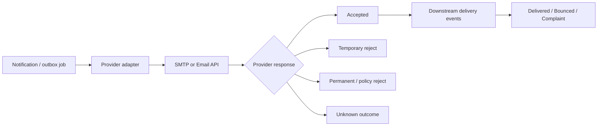
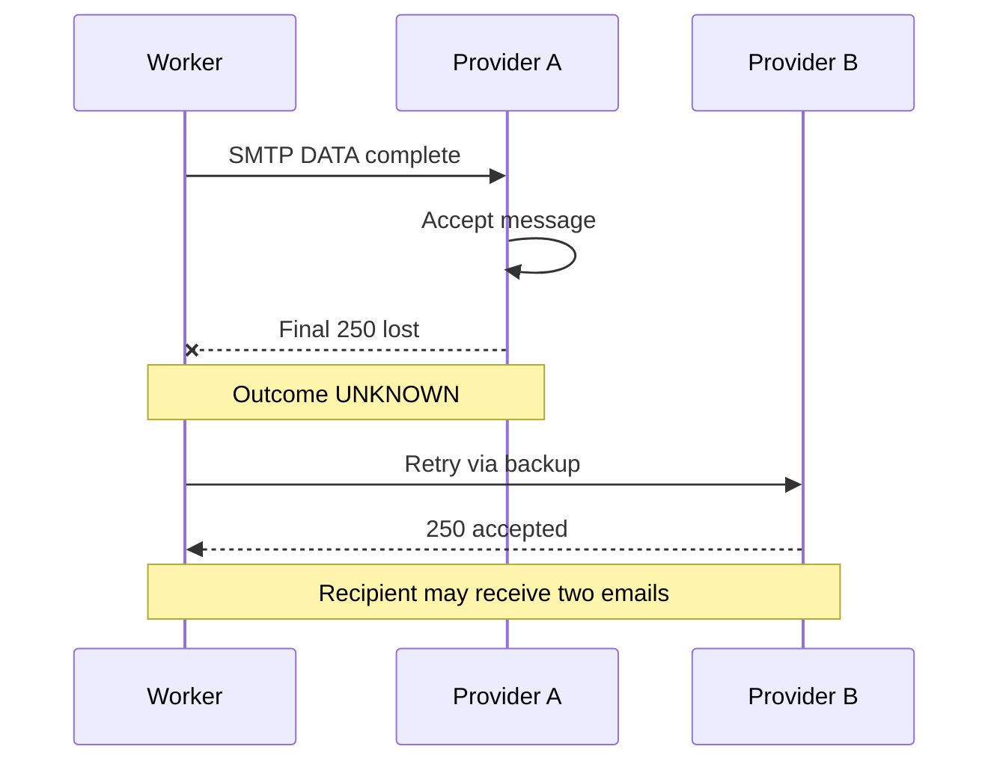
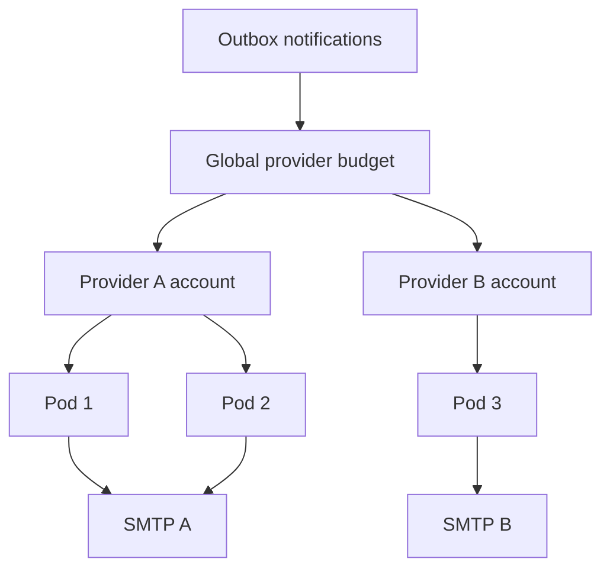

# Differences in Error Codes and Limits Across Providers

A Spring Framework Mail application may send email through multiple SMTP relays or email services: one provider dedicated to transactional mail, one serving campaigns, an enterprise relay, or a fallback service. At the API level, the operations look the same: construct a `MimeMessage`, call `JavaMailSender.send(...)`, and handle `MailException`. In real operations, however, **two providers do not necessarily share the same error-code policies, rate limits, authentication methods, sender identities, retry behaviors, or delivery reporting**.

For example, under the same rate-limiting condition, provider A might temporarily reject with SMTP `421`, provider B return `451 4.7.0`, provider C reject a recipient with `452` plus a quota message, while an API provider returns HTTP `429` with a retry timestamp. The business meaning may all be "temporarily not accepted," yet **the codes and technical metadata are not the same**. Conversely, the same `550` code can indicate a nonexistent recipient, an unauthorized sender, or an anti-abuse policy; you should not automatically add every recipient returning `550` to a suppression list.

To build a reliable multi-provider mail system, you need a two-layer architecture:

1. **Provider adapters** that understand the technical language and limits of each SMTP relay/API.
2. **The application**, which receives a normalized outcome to decide retries, provider switching, outbox updates, alerts, or manual intervention.

This lesson in the *Multiple Providers* chapter of Spring Framework Mail focuses directly on **differences in error codes and limits across providers**: how to read primary/enhanced SMTP status codes, provider-specific errors, quotas, rate/concurrency limits, size limits, sandboxes, sender verification, per-provider `JavaMailSender` configuration, error classification, routing, safe retry/failover, observability, and contract testing. The illustrative examples use Java 21, Spring Framework 6.x / Spring Boot 3.x, and Jakarta Mail; limit numbers are hypothetical for learning calculations, **not current limits of any specific provider**.

## 1. "Same SMTP" Does Not Mean "Same Policy"

SMTP defines commands and reply groups that systems understand. Yet many aspects depend on provider configuration or policy decisions:

| Aspect | Relatively standardized | May differ by provider |
|---|---|---|
| SMTP command | EHLO, STARTTLS, AUTH, MAIL FROM, RCPT TO, DATA | Supported extensions, command requirements, per-phase policies |
| Primary reply code | Three digits, 2xx/3xx/4xx/5xx groups | Specific code chosen for quotas, sender restrictions, recipient rejections |
| Enhanced status code | `x.y.z` format explaining cause categories | Which extended codes the provider emits and level of detail |
| Reply text | Descriptive text after the code | Language, internal codes, help URLs, queue IDs |
| AUTH | Negotiated SMTP AUTH mechanism | Password, app password, OAuth, token, IP allowlist |
| TLS | STARTTLS/implicit TLS depending on endpoint | Port, required TLS version, hostname and certificate policies |
| Sending limits | No universal Internet-wide "SMTP quota" | Connections, messages/s, recipients/s, daily, size, burst, tenant |
| Sender identity | MAIL FROM, header From, DKIM/DMARC | Domain verification, custom return-path, sender pools |
| Successful intake | SMTP relays typically return `250` after DATA | IDs, tracking, webhook latency, suppression |
| Post-submission | Delivery/bounce/complaint observable via add-on systems | Event schemas, states, webhook signatures, dashboards, retention |

A proper adapter does not try to make every provider look identical at the wire-protocol level. It **preserves enough raw evidence for investigation** while emitting **stable semantics** for application decision-making.

### 1.1. Distinguishing Three Result Layers



- **Attempt outcome:** was the SMTP/API call accepted, rejected, or uncertain?
- **Notification status:** is the intent in the outbox QUEUED, SENDING, SENT, FAILED, or DEAD_LETTER?
- **Downstream delivery status:** has the provider or destination mailbox delivered, deferred, bounced, complained, or provided no information yet?

Do not treat `JavaMailSender.send(...)` returning normally as `DELIVERED_TO_INBOX`. When an SMTP relay returns the final `250` after DATA, what can be recorded is **relay accepted at the submission boundary**. It does not yet guarantee downstream delivery or inbox placement.

## 2. Read the Primary SMTP Reply Code First

Most SMTP responses begin with three digits. The first digit carries general meaning:

| Group | Meaning at SMTP level | Initial guidance |
|---|---|---|
| `2xx` | Command accepted/completed | Proceed to next phase or record accepted if right after DATA |
| `3xx` | Server asks client to continue supplying information | Not yet the final outcome of the message |
| `4xx` | Temporary failure | Consider retry with backoff, TTL, quotas, and error cause |
| `5xx` | Cannot complete the current request | Distinguish recipient, sender, policy, config; do not blindly retry forever |

**Business decisions cannot rely solely on the first digit.** For instance, a provider may return 4xx during maintenance, or also use it for multi-hour quota exhaustion. A 5xx code may require fixing sender configuration before resending; it does not necessarily mean the recipient address does not exist.

### 2.1. Same Code, Different Phase

In an SMTP session:

```text
S: 220 smtp.provider.test ESMTP
C: EHLO mail-app.example.test
S: 250-SIZE 26214400
S: 250 STARTTLS
C: MAIL FROM:<bounce@example.test>
S: 250 2.1.0 Sender accepted
C: RCPT TO:<recipient@example.test>
S: 250 2.1.5 Recipient accepted
C: DATA
S: 354 Start mail input
C: [MIME bytes omitted]
S: 250 2.0.0 Message queued
```

This is a redacted illustrative transcript; `C:`/`S:` are labels added for readability.

A `250` line replying to EHLO, MAIL FROM, or RCPT TO **does not have the same meaning** as `250` after DATA completes. And `354` only grants permission to begin DATA, not final acceptance.

### 2.2. Common Reply Codes

| Code | Common context | What to verify |
|---|---|---|
| `220` | Server ready or ready to start TLS | Position in session |
| `221` | Server closing session | Normal close or after an error? |
| `235` | Authentication succeeded | AUTH in the current session |
| `250` | Command accepted | Which phase? Is it after DATA? |
| `354` | Client may start sending DATA | No final result yet |
| `421` | Service unavailable/closing connection | Relay overloaded, maintenance, connection policy |
| `450` | Mailbox/action temporarily unavailable | Retry window, recipient state |
| `451` | Temporary processing error | Provider outage, throttling, greylisting, policy |
| `452` | Insufficient capacity or temporary limit | Quota, recipient count, provider-specific reason |
| `530` | Authentication or a policy condition must be met | AUTH/TLS/permission per phase |
| `535` | Authentication rejected | Credentials, AUTH mechanism, account state |
| `550` | Mailbox/policy rejection | Enhanced code: address, sender, relaying, or policy? |
| `552` | Storage/message size limit | MIME size, quota |
| `553` | Address/mailbox name not accepted | Address syntax, sender/recipient policy |
| `554` | Transaction/policy refusal | Content, filter, or relay rules |

Provider message text and enhanced codes are key evidence for interpreting each code. The table above shows **common interpretations**, not a promise that every relay uses the exact same code for the same root cause.

## 3. Enhanced Status Codes: Why Read x.y.z?

Many SMTP relays also return extended codes, for example:

```text
550 5.1.1 Recipient address rejected
550 5.7.1 Relaying denied
451 4.3.0 Temporary server problem
421 4.7.0 Rate limit temporarily exceeded
```

Codes like `5.1.1` or `4.7.0` are **enhanced status codes**; they classify causes more precisely than the primary reply. For compatibility, receivers may still omit enhanced codes or emit provider-specific messages outside standard structure.

### 3.1. Same Primary 550, Two Different Handling Paths

```text
C: RCPT TO:<recipient@example.test>
S: 550 5.1.1 User unknown
```

Usually requires checking the destination address and evaluating whether to suppress per policy. However:

```text
C: RCPT TO:<recipient@example.test>
S: 550 5.7.1 Relaying denied
```

usually requires checking SMTP account permissions, verified domains, IP allowlists, or sender identity. **Suppressing the recipient immediately** can mask a wide-scale configuration error. Both scenarios return 550 yet have completely different causes.

### 3.2. 4.7.x Does Not Automatically Mean "Retry Immediately"

Some relays use `4.7.x` codes for policy/rate limits. If an account is throttled, retrying immediately across all workers can trigger a retry storm, spike connections, and prolong throttling. You need provider-specific backoff, per-account pacing, jitter, and dispatcher pausing capability.

### 3.3. Error Data Models Should Not Store Just One String

Instead of:

```text
error = "Send email failed: 550"
```

store distinct structured fields:

```text
providerId       = smtp-primary
transport        = SMTP
smtpCommandPhase = RCPT_TO
primaryCode      = 550
enhancedCode     = 5.7.1
safeReason       = RELAY_NOT_AUTHORIZED
attemptId        = ...
occurredAt       = ...
```

Complete data helps separate errors by tenant/provider and choose different retry actions. The `safeReason` string is an application-normalized code, **not** a verbatim copy of `exception.getMessage()` into logs, since the message may contain addresses or sensitive data.

## 4. Provider-Specific Messages: Informational Source, Not an Immutable Contract

Two SMTP relays may respond differently for the same type of failure:

```text
# Hypothetical Provider A
451 4.7.0 Temporary throttling; reduce sending rate

# Hypothetical Provider B
421 4.3.2 Too many simultaneous sessions

# Hypothetical Provider C
452 4.2.2 Recipient quota exceeded
```

The snippets above are **simulated scenarios**, not attributed to any real named vendor and not a guarantee of emitted codes. The adapter should read:

1. Command phase.
2. Primary SMTP code.
3. Enhanced status code (if present).
4. Provider-specific machine-readable code (if documentation/SDK supports it).
5. Context: account, region, tenant, sender stream.
6. Retry/rate-limit guidance published by the provider.

Free-form text helps investigation, yet providers may change punctuation, wording, product names, or URLs; do not build all retry logic around `message.contains("too many")`.

### 4.1. Avoid Global Regexes Across All Providers

Anti-pattern:

```java
if (exception.getMessage().contains("550")) {
    suppressionService.hardBounce(recipient);
}
```

This approach is dangerous because:

- "550" can appear in many parts of an exception message.
- A batch can contain multiple recipients with different responses.
- 550 can mean sender restriction, relaying denied, or content policy.
- The message can contain nested exceptions rather than a single reply.
- Providers can change text formatting.

Instead, the adapter extracts structured codes when provided by the library, along with phase and provider policy; when unclear, classify as `UNCLASSIFIED` and preserve redacted evidence for operations.

## 5. Distinguishing SMTP, Email HTTP APIs, and Provider Webhooks

A company might use provider A over SMTP, provider B over a REST API, and have both push delivery events via webhooks. That creates **three error namespaces**:

| Source | Example | Semantics to verify |
|---|---|---|
| SMTP reply | `451 4.7.0` | An SMTP command/transaction temporarily rejected |
| HTTP status | `429 Too Many Requests` | API request rate-limited, per endpoint contract |
| HTTP status | `400/401/403/413` | Validation/auth/permission/payload size; API-specific |
| Provider error code | `RATE_LIMIT_EXCEEDED` (illustrative) | Provider-internal code, not a standard SMTP code |
| Webhook event | `delivered`, `bounce`, `complaint` | Post-intake result per the provider's definition |

**Do not mechanically map `HTTP 200` to `SMTP 250`.** An API returning 200/202 may mean the request was accepted for processing while downstream status remains unknown. Likewise, a `delivered` webhook does not guarantee the Inbox, and events can arrive late or duplicated.

### 5.1. How the Application Normalizes at the Outcome Layer

It can return:

```text
SUBMISSION_ACCEPTED
TEMPORARY_REJECTION
PERMANENT_REJECTION
AUTH_OR_CONFIGURATION_ERROR
RATE_LIMITED
UNKNOWN_OUTCOME
```

while still preserving the source:

```text
sourceTransport = SMTP | HTTP_API
rawCodeType     = SMTP_PRIMARY | HTTP_STATUS | PROVIDER_CODE
rawCode         = ...
providerId      = ...
phase           = ...
```

This unifies business semantics without losing the original signals needed to troubleshoot differing provider failures.

## 6. Provider Limits Go Beyond Emails per Day

Saying "provider A gives 10,000 emails/day" overlooks many other limits that can cause failures **before hitting the daily quota**:

| Limit | Unit | Design impact |
|---|---|---|
| Messages per second | Messages/sec or requests/sec | Token bucket, account-wide throttling |
| Recipients per second | Recipients/sec | Multi-To/Cc/Bcc batches still consume multiple quota units |
| Messages/recipients per day | Units per rolling/fixed window | Quota accounting, campaign scheduling |
| Concurrent SMTP connections | Concurrent connection count | Semaphore/connection pool cap |
| Requests per minute | API requests/min | API rate limiter, Retry-After handling |
| Burst capacity | Short-term spike requests allowed | Burst token bucket |
| Max message size | MIME bytes or provider-defined size | Validate attachments and encoding overhead |
| Recipient count per message | To/Cc/Bcc count per SMTP envelope | Batch partitioning, avoiding partial success |
| Attachment count/type | Count/format | MIME validation, alternate delivery |
| Authentication/session policy | Login/account/IP/region | Sender config, connection lifecycle |
| Sandbox restriction | Permitted destination domains/recipients | Test/prod access, verification |
| Domain/sender verification | Domain, From, MAIL FROM, DKIM | DNS + provider registration |
| Event/webhook quota | Event throughput and retention | Receiver backpressure, reconciliation |

A provider may meter limits by **account, region, sender identity, IP pool, or tenant**. Thresholds can also differ between new accounts and approved accounts, and adjust dynamically based on reputation. Never hardcode a "default vendor limit" in code without knowing the specific account.

### 6.1. Time-Window Quotas and Concurrency Are Two Different Things

Suppose a test provider permits:

```text
maxConcurrentConnections = 5
messagesPerSecond        = 12
dailyMessageQuota        = 50_000
maxMimeBytes             = 12_000_000
```

**All values are hypothetical.** An application with 5 concurrent connections can still exceed 12 messages/second if each connection sends rapidly. Conversely, a 12/s token bucket does not stop 100 connections from piling up against a slow server. You need both a **rate limiter** and a **concurrency cap** if the provider enforces both.

### 6.2. Batching Can Skew Quota Units

A MIME email with 1 From and 200 recipients may count as 1 message under one metric, yet 200 recipients under another quota, or be blocked by a recipients/message limit. When scheduling:

- Read the provider's **billing/quota unit** contract.
- Distinguish `messageCount`, `recipientCount`, and `attemptCount`.
- Determine whether retries or failed attempts count against quota.
- Be careful with Bcc privacy and partial success.

Do not optimize by packing all recipients into one giant Bcc without checking quotas, metadata-leak risk, and per-recipient retry needs.

### 6.3. On-the-Wire MIME Size Exceeds Original Attachment Size

Attachments are typically Base64-encoded along with headers/boundaries and line folding, making the SMTP payload larger than the raw file. If a provider caps **MIME messages** at 12 MB, a 12 MB raw file already exceeds the ceiling. When defining validation:

- Check file/attachment sizes early.
- Reserve headroom for encoding and HTML/inline parts.
- Verify which bytes the provider measures: raw payload or encoded MIME.
- Do not load huge attachments completely into RAM just to "see if the relay accepts it."
- For large documents, consider authenticated HTTPS links instead of attachments if business and security rules allow.

## 7. Limits Can Differ by Account, Region, and Operational Stage

Example within the same provider:

```text
account=trial    region=R1  sandbox=true  quota=Q1
account=paid     region=R1  sandbox=false quota=Q2
account=paid     region=R2  sandbox=false quota=Q3
```

Do not assume `Q2 = Q3` or that an account newly promoted to production immediately gets the target quota. Retrieve these values from actual configuration/governance/account telemetry kept aligned with provider policies.

### 7.1. Sandbox Is Not Equivalent to Production

Some services restrict sandboxes to sending only to verified recipients or domains. A passing test to one verified address does not prove production access is open for all recipients. When switching environments, check:

1. Is the sender identity/domain verified?
2. What are the current account limits?
3. Did the region/provider endpoint change?
4. Are the API key/SMTP credential permissions correct?
5. Are separate domain DNS, DKIM, or custom MAIL FROM records required?
6. Does the provider enforce limits on new accounts or warm-up?

### 7.2. Do Not Infer Quotas from a Single Error Message

If a provider returns `421` "temporarily throttled," that does not prove a fixed 10/s quota. Throttling can be dynamic by IP, destination domain, volume, reputation, or system state. Combine documentation, dashboards, and telemetry rather than guessing official limits from one error.

## 8. AUTH, TLS, and Sender Verification Across Providers

Using the same `JavaMailSenderImpl` does not mean every SMTP endpoint shares the same setup:

- Port 587 with STARTTLS and SMTP AUTH.
- Port 465 with implicit TLS.
- SMTP username/password, application password, or dedicated token.
- OAuth/SASL mechanisms depending on provider/client support.
- Relays relying on IP allowlists inside a trusted network.
- Verified domains/sender identities.
- Authorization to send using a specific `From` header or envelope `MAIL FROM`.

Do not infer "AUTH succeeded so any From address works." A provider can authenticate the account at AUTH yet reject `MAIL FROM` because the domain is unverified.

### 8.1. AUTH Succeeds, MAIL FROM Still Fails

```text
C: AUTH [REDACTED]
S: 235 2.7.0 Authentication successful
C: MAIL FROM:<billing@example.test>
S: 550 5.7.1 Sender not authorized
```

Here, **there is no evidence of a wrong password** since AUTH succeeded. Check sender registration, verified domain, custom MAIL FROM, account policy, or IP. Do not fix it by retrying the same message repeatedly.

### 8.2. STARTTLS Differs from Implicit TLS

| Connection method | Common port | Characteristics |
|---|---:|---|
| SMTP submission + STARTTLS | 587 | Begins with plain SMTP, then upgrades to TLS |
| SMTP submission + implicit TLS | 465 | TLS handshake immediately after TCP connect |
| SMTP relay/server-to-server | 25 | STARTTLS policy depends on endpoint; clouds often block egress |
| Custom endpoint | Provider-specific | Follow documentation; do not guess TLS mode from port |

With mandatory STARTTLS:

```properties
mail.smtp.starttls.enable=true
mail.smtp.starttls.required=true
```

With implicit TLS in common Jakarta Mail SMTP providers:

```properties
mail.smtp.ssl.enable=true
```

Do not randomly enable both modes and treat errors as "SMTP server down." Configure proper certificate validation and hostname verification. Never disable TLS checks in production to "fix" a provider error.

### 8.3. AUTH Failure Is a Configuration/Account Error

Providers may use `530`, `535`, or other codes depending on phase and policy. Widespread failures may indicate a locked account, secret rotation, wrong AUTH mechanism, TLS requirement, or provider outage. **Do not suppress recipients** and do not retry every job indefinitely.

Never log raw AUTH exchanges. Base64-encoded data is not security; Jakarta Mail protocol debug can print to stdout outside SLF4J. Enable debug only under strict control and never log credentials.

### 8.4. SPF, DKIM, and DMARC Must Be Configured on the New Route Too

Provider A might sign DKIM with `d=example.test`, while provider B initially signs only with its shared vendor domain. Both emails may be SMTP accepted, yet DKIM alignment with the `From` header can differ.

- SPF governs allowed sending sources for the envelope domain.
- DKIM governs signing domain `d=` and valid cryptographic signatures.
- DMARC requires SPF or DKIM to **pass and align** with the `From` header.

When switching providers, verify SPF (if envelope domain/sending source changes), DKIM selectors/keys, custom MAIL FROM, and DMARC alignment. Changing `spring.mail.host` alone does not complete sender-identity migration.

## 9. Per-Provider SMTP Configuration

A multi-provider configuration must declare endpoints, security modes, timeouts, and limits **independently**:

```yaml
app:
  mail:
    providers:
      primary:
        host: smtp-primary.example.test
        port: 587
        username: ${MAIL_PRIMARY_USERNAME}
        password: ${MAIL_PRIMARY_PASSWORD}
        tls-mode: STARTTLS_REQUIRED
        envelope-from: bounce@example.test
        connect-timeout-ms: 5000
        read-timeout-ms: 10000
        write-timeout-ms: 10000
        max-connections: 4
        messages-per-second: 8
      backup:
        host: smtp-backup.example.test
        port: 465
        username: ${MAIL_BACKUP_USERNAME}
        password: ${MAIL_BACKUP_PASSWORD}
        tls-mode: IMPLICIT_TLS
        envelope-from: bounce-backup@example.test
        connect-timeout-ms: 7000
        read-timeout-ms: 12000
        write-timeout-ms: 12000
        max-connections: 2
        messages-per-second: 4
```

The hosts, timeouts, and quotas above are **hypothetical values**. The `app.mail.providers` namespace is custom application configuration; Spring Boot will not automatically turn it into multiple senders unless you write matching binding/factory code.

### 9.1. Do Not Mutate One Singleton JavaMailSender Across All Providers

A dangerous anti-pattern is changing `setHost(...)`, `setUsername(...)`, and JavaMail properties on the same sender used concurrently by multiple requests. Two threads can race over configuration, causing tenant A to send accidentally through account B.

Instead:

- Build separate senders per provider/account with fixed configuration after initialization.
- Keep senders in a registry and select by verified policy.
- Never let HTTP clients arbitrarily specify providers holding another tenant's credentials.
- When rotating secrets, replace config/senders via a rollout/versioned mechanism rather than mutating mid-send.
- Isolate rate limiters/concurrency caps per provider account, not merely per sender object.

### 9.2. Example Factory for Two TLS Modes

```java
package com.example.mail.provider;

public enum SmtpTlsMode {
    STARTTLS_REQUIRED,
    IMPLICIT_TLS
}

public record SmtpProviderSettings(
        String id,
        String host,
        int port,
        String username,
        String password,
        String envelopeFrom,
        SmtpTlsMode tlsMode,
        int connectTimeoutMs,
        int readTimeoutMs,
        int writeTimeoutMs
) {}
```

```java
package com.example.mail.provider;

import java.util.Properties;
import org.springframework.mail.javamail.JavaMailSenderImpl;

public final class SmtpSenderFactory {

    private SmtpSenderFactory() {}

    public static JavaMailSenderImpl create(SmtpProviderSettings cfg) {
        JavaMailSenderImpl sender = new JavaMailSenderImpl();
        sender.setHost(cfg.host());
        sender.setPort(cfg.port());
        sender.setProtocol("smtp");
        sender.setUsername(cfg.username());
        sender.setPassword(cfg.password());
        sender.setDefaultEncoding("UTF-8");

        Properties p = sender.getJavaMailProperties();
        p.put("mail.smtp.auth", "true");
        p.put("mail.smtp.connectiontimeout",
                Integer.toString(cfg.connectTimeoutMs()));
        p.put("mail.smtp.timeout",
                Integer.toString(cfg.readTimeoutMs()));
        p.put("mail.smtp.writetimeout",
                Integer.toString(cfg.writeTimeoutMs()));
        p.put("mail.smtp.ssl.checkserveridentity", "true");

        if (cfg.tlsMode() == SmtpTlsMode.STARTTLS_REQUIRED) {
            p.put("mail.smtp.starttls.enable", "true");
            p.put("mail.smtp.starttls.required", "true");
            p.put("mail.smtp.ssl.enable", "false");
        } else {
            p.put("mail.smtp.starttls.enable", "false");
            p.put("mail.smtp.ssl.enable", "true");
        }

        if (cfg.envelopeFrom() != null
                && !cfg.envelopeFrom().isBlank()) {
            p.put("mail.smtp.from", cfg.envelopeFrom());
        }

        return sender;
    }
}
```

This example targets endpoints using username/password SMTP. Providers using IP authentication, OAuth, or HTTP APIs need a different adapter/factory; never hardcode `mail.smtp.auth=true` for every endpoint.

Jakarta Mail properties like `mail.smtp.from` and `mail.smtp.ssl.checkserveridentity` depend on the implementation. A managed service may manage custom MAIL FROM in its dashboard instead of letting clients choose it. Always verify real behavior against the provider.

### 9.3. Registry Instead of Global Mutable Configuration

```java
package com.example.mail.provider;

import java.util.Map;
import org.springframework.mail.javamail.JavaMailSender;

public final class MailSenderRegistry {

    private final Map<String, JavaMailSender> senders;

    public MailSenderRegistry(Map<String, JavaMailSender> senders) {
        this.senders = Map.copyOf(senders);
    }

    public JavaMailSender require(String providerId) {
        JavaMailSender sender = senders.get(providerId);
        if (sender == null) {
            throw new IllegalArgumentException(
                    "Unknown mail provider id");
        }
        return sender;
    }
}
```

The registry can be built from `@Bean` definitions or custom configuration. With multiple `JavaMailSender` beans, injection needs explicit `@Qualifier`/registry wiring and attention to Spring Boot mail auto-configuration conditions. Provider IDs must be chosen by trusted server policy, never taken arbitrarily from user input.

### 9.4. Which Settings Need Rapid Updates?

Rate limits, connection caps, and circuit breakers may need adjustment when a provider raises or lowers quotas. Hosts, TLS policies, and credentials should normally be managed via a secret manager and audited rollouts. Never let an error response text from an external endpoint rewrite global config unchecked.

## 10. Creating a Normalized Error Model

Business services should not search for `"550"` inside every `MailSendException`. The provider adapter should return a meaningful outcome while preserving provider ID and original codes.

```java
package com.example.mail.provider;

public enum MailErrorCategory {
    RECIPIENT_INVALID,
    SENDER_NOT_AUTHORIZED,
    AUTH_CONFIGURATION,
    RATE_LIMITED,
    TEMPORARY_PROVIDER_FAILURE,
    PERMANENT_PROVIDER_REJECTION,
    MESSAGE_TOO_LARGE,
    CONTENT_POLICY_REJECTION,
    CONNECTION_OR_TLS,
    UNKNOWN_OUTCOME,
    UNCLASSIFIED
}

public enum SmtpPhase {
    CONNECT, EHLO, STARTTLS, AUTH,
    MAIL_FROM, RCPT_TO, DATA, AFTER_DATA, UNKNOWN
}

public record SmtpFailureObservation(
        String providerId,
        SmtpPhase phase,
        Integer primaryCode,
        String enhancedCode,
        String safeProviderCode
) {}

public record MailFailureDecision(
        MailErrorCategory category,
        boolean retryable,
        boolean suppressRecipient,
        boolean requireOperatorReview
) {}
```

`primaryCode` may be null if the failure happens at DNS, network, or TLS before receiving an SMTP reply. `safeProviderCode` is a validated/normalized code, not raw response text containing addresses.

### 10.1. Initial Evidence-Based Rule Set

```java
public final class BasicSmtpFailureClassifier {

    public MailFailureDecision classify(SmtpFailureObservation o) {
        Integer code = o.primaryCode();
        String enhanced = o.enhancedCode();

        if (o.phase() == SmtpPhase.RCPT_TO
                && Integer.valueOf(550).equals(code)
                && "5.1.1".equals(enhanced)) {
            return new MailFailureDecision(
                    MailErrorCategory.RECIPIENT_INVALID,
                    false, true, false);
        }

        if (o.phase() == SmtpPhase.AUTH
                && Integer.valueOf(535).equals(code)) {
            return new MailFailureDecision(
                    MailErrorCategory.AUTH_CONFIGURATION,
                    false, false, true);
        }

        if (code != null
                && code / 100 == 4
                && "4.7.0".equals(enhanced)) {
            return new MailFailureDecision(
                    MailErrorCategory.RATE_LIMITED,
                    true, false, false);
        }

        if (code != null && code / 100 == 4) {
            return new MailFailureDecision(
                    MailErrorCategory.TEMPORARY_PROVIDER_FAILURE,
                    true, false, false);
        }

        if (code != null && code / 100 == 5) {
            return new MailFailureDecision(
                    MailErrorCategory.PERMANENT_PROVIDER_REJECTION,
                    false, false, true);
        }

        return new MailFailureDecision(
                MailErrorCategory.UNCLASSIFIED,
                false, false, true);
    }
}
```

This classifier merely **illustrates evidenced cases**. It does not suppress all 550 codes, does not suppress on AUTH failure, and does not guess phases from exception messages. Even `4.7.0` can carry different semantics by provider: adapters should allow provider-specific overrides, and unfamiliar errors must go to `UNCLASSIFIED` instead of destructive actions.

### 10.2. Timeout After DATA Is Not "SMTP 4xx"

If the socket drops after sending DATA but before receiving the final reply, there is no SMTP code to feed into the classifier above. The result can be `UNKNOWN_OUTCOME`:

```text
phase           = AFTER_DATA
primaryCode     = null
category        = UNKNOWN_OUTCOME
retryable       = depends on duplicate-risk policy
```

Assign `AFTER_DATA` only when evidenced by instrumentation or tracing. A bare `SocketTimeoutException` can occur at EHLO, AUTH, RCPT, or DATA; if unclear, keep `phase=UNKNOWN`.

### 10.3. Add Failure Scope to Decisions

| Scope | Example | Action |
|---|---|---|
| Recipient | Destination address clearly does not exist | Suppress that specific recipient |
| Message | MIME too large | Fix payload; do not retry identical message |
| Sender/domain | From domain unverified | Pause that stream, fix identity |
| Account | Quota exhausted, credentials locked | Pause account, notify operations |
| Provider/region | Evidenced outage | Circuit breaker and conditional failover |
| Application/DB | Failed to commit state after accepted | Recovery/persistence; do not blame SMTP |

A single `retryable` boolean is insufficient when the failure affects every recipient under the same account. Retry policies need both scope and reason code.

## 11. Spring Mail Exceptions Are Not Uniform Across Providers

Spring uses `MailException` and subclasses such as `MailAuthenticationException`, `MailSendException`, `MailParseException`, and `MailPreparationException`. With Jakarta Mail, a nested `MessagingException` may hold causes via `getCause()` and chained exceptions via `getNextException()`.

SMTP provider implementations can also throw specialized subclasses holding reply codes/failed addresses; packages/types can differ between legacy JavaMail and Jakarta Mail/Angus versions.

The adapter should:

1. Identify the outer exception class.
2. Traverse the cause chain; for `MessagingException`, consider the next-exception chain while guarding against cycles.
3. Extract structured SMTP codes via implementation APIs when supported.
4. Attach provider ID, phase, account/tenant scope, and error category.
5. Fall back to `UNCLASSIFIED` if information is insufficient; do not guess from message text.

### 11.1. FailedMessages Is Not a Complete Recipient Outcome Table

`MailSendException.getFailedMessages()` can map message → exception when sending multiple messages. It does not by default represent every individual `RCPT TO` status. For a single MIME message with multiple recipients, inspect nested `SendFailedException`/provider-specific details per actual semantics.

Never dump this map to logs: keys can be `MimeMessage` objects holding headers/bodies/addresses. When exact per-recipient retry is required, it is usually cleaner to model one notification/outbox row per recipient.

### 11.2. Keep Version Dependencies in the Right Place

If the Jakarta Mail provider changes namespaces/classes across releases, `instanceof` checks inside business services can break. Isolate that logic inside adapters backed by contract tests and fallback paths rather than scattering SMTP implementation packages through business layers.

## 12. Decision Matrix: Retry, Fix Config, Pause, or Switch Providers?

A trustworthy policy evaluates **error category, scope, acceptance evidence, and safe repeatability** together.

| Signal | Initial guidance | What not to do |
|---|---|---|
| `550 5.1.1` at RCPT: recipient clearly nonexistent | Suppress recipient after verifying provider semantics | Fail over just to keep sending to that address |
| `550 5.7.1`: sender/relay permission | Fix domain, account permissions, verified sender | Suppress all recipients |
| `535` at AUTH | Pause account, alert on config/secret | Continuously retry every job |
| `451` temporary | Backoff + jitter, retry within budget | Keep worker sleeping for minutes |
| `421` from concurrent session limit | Reduce concurrent connections, check provider status | Increase pool threads |
| `452` quota/throttle per provider interpretation | Wait for quota window or pace sending | Retry at the same rate |
| `552` message too large | Shrink attachments or send an appropriate link | Retry identical payload forever |
| `554` content/policy refusal | Investigate policy, content, sender trust | Switch providers to evade policy |
| TLS certificate/hostname failure | Fix endpoint, truststore, TLS mode | Disable certificate validation |
| Connection refused before SMTP handshake | Retry with backoff, consider conditional failover | Conclude the recipient is invalid |
| Timeout after DATA, no final reply received | Record `UNKNOWN_OUTCOME`, consider reconciliation | Assert definitely not sent |
| Final SMTP `250` after DATA | Record accepted, monitor downstream | Retry because recipient has not seen Inbox |

This table is **guidance only**. `421` can mean maintenance rather than a connection limit; `550` can mean many things. Read enhanced codes and provider policies before taking high-impact actions like suppression.

### 12.1. Retry Budget and Job TTL

An outbox job should store:

```text
notificationId      = N-177
status              = QUEUED
attempts            = 2
nextAttemptAt       = 2026-11-12T14:40:00Z
expiresAt           = 2026-11-12T16:00:00Z
lastProviderId      = primary
lastOutcome         = TEMPORARY_REJECTION
```

Max attempts and TTL differ by business case: verification codes expire quickly; receipts may need resending after an outage; marketing can be paused when consent or quota is lacking. Never apply one immutable retry policy to every email type.

### 12.2. Backoff with Jitter

Hypothetical retry schedule example:

```text
Attempt 1: 451 -> around 30 seconds
Attempt 2: 451 -> around 60 seconds
Attempt 3: 451 -> around 120 seconds
Attempt 4: 451 -> around 240 seconds
```

Cap maximum wait time, add jitter, and stop once budget/TTL is exceeded. When the provider gives trustworthy retry-after guidance (such as an HTTP API header or official quota notice), incorporate it. **Never use `Thread.sleep` to hold an SMTP worker waiting to retry**: persist `nextAttemptAt` and release the thread.

### 12.3. Rate Limiting Can Affect the Entire Account

If the daily quota is exhausted, backing off for a few seconds just produces wasted attempts. The provider adapter or scheduler can:

- Set `accountPauseUntil`.
- Slow down the provider/account-level limiter.
- Defer `nextAttemptAt` on unsent jobs.
- Monitor backlog and job age against SLAs.
- Reserve remaining quota for transactional mail if contracts allow.

Restarting pods does not reset provider quotas. Never try opening extra connections or swapping accounts just to bypass anti-abuse limits.

## 13. Failover Is Not "On Exception, Send via B"

An error from `JavaMailSender.send(...)` does not always prove the relay never received the message.

### 13.1. When Failover Can Be Considered

- Cannot connect to the endpoint before an SMTP transaction and there is proof of non-submission.
- Primary provider has a clear outage, and backup is configured and authorized to send.
- Primary quota is temporarily exhausted, backup has valid quota, and routing policy permits.
- Circuit breaker at the provider/account scope is OPEN due to infrastructure failure.

You must verify domain authentication, rate quotas, sender verification, and data-processing permissions on the backup provider. Failover is a **per-notification, policy-driven decision**, not a generic `catch(Exception)`.

### 13.2. When Automatic Failover Must Not Happen

- Recipient is clearly invalid.
- Sender/domain is not verified on both routes.
- Message is too large or violates content/policy rules.
- Account is suspended for spam/complaints.
- AUTH or tenant configuration is wrong.
- Attempt outcome is `UNKNOWN_OUTCOME` after DATA while business rules disallow duplicates.

**Failover is not for evading provider anti-spam, security, or consent policies.** Fix the root cause.

### 13.3. Losing the Final Reply After DATA



SMTP has no Internet-wide idempotency. The same `Message-ID` or application idempotency key **does not make two independent SMTP relays deduplicate automatically**. Email APIs sometimes offer dedicated idempotency contracts; verify key scope, expiration window, and API behavior before relying on them.

### 13.4. Keep One Notification ID Across Attempts

```text
notificationId    = N-177
businessKey       = invoice:42:issued
preferredProvider = primary
attempts:
  A1 primary -> TEMPORARY_REJECTION
  A2 primary -> TEMPORARY_REJECTION
  A3 backup  -> SUBMISSION_ACCEPTED
```

Do not create three different business notifications just because the provider changed. Persisting attempt history reveals who sent it, where, with which code, why routing shifted, and whether duplicate risk exists.

### 13.5. Backups Must Be Prepared Before an Incident

Do not wait until provider A goes down to discover B lacks DKIM, has an unverified custom MAIL FROM, is still in sandbox mode, has tiny quotas, expired credentials, or fails data-residency rules. Test the backup route with **small, authorized test traffic**, never blindly dumping the entire production backlog onto an unverified account.

## 14. Circuit Breakers Must Know Error Scope

A circuit breaker prevents hammering a failing provider and curbs retry storms. Yet a single recipient `550 5.1.1` is not proof that the entire provider is down.

| Error type | Count toward provider health? |
|---|---|
| Widespread TCP connect failures | Yes |
| Widespread repeated 421/451 | Possibly, per provider policy |
| Continuous AUTH failures | Yes at account scope; usually needs operator |
| Recipient 550 5.1.1 | No; recipient error |
| Message 552 too large | No; message error |
| Sender 550 5.7.1 | Sender/domain/account scope |
| Timeout after DATA | Carefully, because outcome may be UNKNOWN |

Breakers typically have CLOSED, OPEN, HALF_OPEN, and bounded cooldowns/probes. Do not turn a burst of recipient rejections into a global outage. If one destination domain is delayed while others accept normally, per-route analysis may be needed instead of tripping everything.

### 14.1. HALF_OPEN Probes

When a circuit is about to close again, try a small, controlled request. Never send unsolicited real emails to users just as a health check; prefer endpoint health checks or authorized test recipients. Probes must obey the same quotas and TLS/Auth policies as the main flow.

## 15. Cluster-Level Quotas, Not Just One JVM

Suppose four pods each configure:

```text
mailExecutor maxPoolSize       = 8
local messagesPerSecond limit = 10
```

The whole cluster can generate up to **32 concurrent attempts and 40 attempts/second**, even though the SMTP account only allows 12 messages/second (hypothetical). A per-JVM limiter is not enough for a shared account.



You can choose a distributed rate limiter per account/region, a centralized dispatcher per provider, or static quota partitioning per pod when replica count is controlled. Each choice carries trade-offs around availability, consistency, and coordination failures.

### 15.1. Both Rate and Concurrency Limits Are Required

If a hypothetical provider allows `messagesPerSecond=12` and `maxConnections=5`, you must simultaneously enforce:

\[
\text{attempts/s} \leq 12,\qquad
\text{active SMTP connections} \leq 5
\]

A rate limiter alone does not guarantee at most five connections when the server is slow. A semaphore alone does not keep sending below 12/s when emails finish very fast. Separate the two permit types; have the dispatcher claim jobs only when capacity exists instead of leaving thousands of workers blocked waiting on tokens.

### 15.2. Account, Tenant, and Region

If three tenants share one provider account, the account quota is the **sum** of all three. If each tenant has its own account, the quota key needs the account ID as well. A model could be:

```text
providerId + accountId + region + trafficType
```

Depending on the provider, there may also be IP pool, sender domain, or recipient-domain limits. Never use passwords or recipient addresses as metric labels.

## 16. When Quota Is Scarce, Which Emails Get Priority?

An application may simultaneously send:

- OTP/verification: short TTL, needed quickly by the user.
- Security alerts: important, need deduplication and alert-storm protection.
- Invoices/receipts: must send reliably with audit trails.
- Marketing/bulk: typically schedulable, strictly bound by consent.

If only 100 messages of quota remain for the hour (hypothetical), do not let a bulk campaign consume them all and cause OTPs to expire waiting. You can:

1. Reserve quota for transactional streams.
2. Configure lanes/priorities with fairness so normal jobs do not starve.
3. Apply per-category rate limiters that stay beneath the global account limiter.
4. Check TTL before dispatch; never send expired verification codes.
5. Pause bulk when provider health or quota falls short.

**Priority does not increase quota.** It only changes the order in which available budget is consumed.

### 16.1. Cap the Quota Share Spent on Retries

If retries consume every permit, new notifications can starve. You can partition budget between new attempts and retries alongside jitter/backoff and circuit breakers. However, an expired OTP should not keep retrying merely to achieve "send success."

### 16.2. Large Attachments and Head-of-Line Blocking

A 20 MB email can hold an SMTP connection much longer than a text-only message. You can separate lanes by size when metrics warrant it, cap MIME size, and deliver huge files via authorized download links. Avoid splitting into too many unnecessary pools that cause total connections to exceed the ceiling.

## 17. Partial Success: One MIME Message, Multiple RCPT TOs

An SMTP transaction can have multiple recipients:

```text
C: RCPT TO:<person-a@example.test>
S: 250 2.1.5 Accepted
C: RCPT TO:<person-b@example.test>
S: 550 5.1.1 User unknown
C: RCPT TO:<person-c@example.test>
S: 451 4.3.0 Temporary error
```

A provider may accept some and reject others depending on server, SMTP client, and configuration. Do not assume:

- One `550` means **all recipients** failed.
- One `250` means **all recipients** were accepted.
- Retrying the whole batch is always safe.

### 17.1. Transport Configuration Affects Partial Sends

Jakarta Mail SMTP implementations often have properties like `mail.smtp.sendpartial` affecting how valid/invalid recipients are handled. `SendFailedException` or provider-specific subclasses may hold sent/unsent/invalid address lists. Verify the contract of your implementation and write integration tests with concrete RCPT replies.

### 17.2. One Notification per Recipient

For personalized emails and exact retries, an easier-to-operate model is:

```text
notification N1 -> recipient A -> attempt A1 -> ACCEPTED
notification N2 -> recipient B -> attempt B1 -> PERMANENT_REJECT
notification N3 -> recipient C -> attempt C1 -> TEMPORARY_REJECT
```

Retrying N3 does not need to resend to A, and B's suppression can update independently. Batching still fits certain use cases, provided recipient quotas, privacy, and partial success are handled.

### 17.3. Failover for Part of a Batch

If provider A accepted recipient A yet temporarily rejected C, shifting all recipients to provider B can duplicate A. Persist per-recipient outcomes or split intents before rerouting. If A's phase outcome is unclear, do not claim recipients definitely did not receive the message.

## 18. Delivery, Bounce, and Complaint Webhooks Also Differ

Two providers can both return SMTP accepted yet emit very different downstream events:

| Property | How it may differ |
|---|---|
| Event name | `delivered`, `delivery`, `deferred`, `bounce`, `complaint`... |
| Timestamp | Unix seconds, milliseconds, or ISO 8601 |
| Message ID | Provider ID, per-recipient ID, or per-submit ID |
| Payload schema | JSON field names/nested structures |
| Authentication | HMAC, public-key signature, token, or custom scheme |
| Retry | Webhooks may retry when receiver errors or times out |
| Ordering | Events may arrive late or out of order |
| Retention | Queryable retention window for event/message traces |
| Delivered semantics | May mean mailbox server accepted, not Inbox |

### 18.1. Normalize Events While Preserving Source

```java
public enum ProviderDeliveryEventType {
    ACCEPTED,
    DEFERRED,
    DELIVERED,
    BOUNCED,
    COMPLAINT,
    UNSUBSCRIBED,
    UNKNOWN
}

public record NormalizedProviderEvent(
        String providerId,
        String providerEventId,
        String providerMessageId,
        String notificationId,
        ProviderDeliveryEventType type,
        java.time.Instant occurredAt,
        String safeReasonCode
) {}
```

`DELIVERED` must be defined internally against the **provider contract**, not equated automatically with `INBOX`. If no events or lookup API exist, keep downstream status UNKNOWN. Never synthesize a provider delivered event merely because `JavaMailSender.send(...)` returned normally.

### 18.2. Webhook Verification and Idempotency

The webhook receiver must:

- Verify signatures using the provider's scheme and dedicated secret/public key.
- Validate payload size, schema, and timestamp/clock skew.
- Use `providerEventId` or an equivalent key to deduplicate repeated events.
- Handle out-of-order events with explicit state-transition policies.
- Link `providerMessageId` to the exact **attempt**, not merely to the email address.
- Never write raw payloads containing PII/tokens to public logs.
- Never let unauthenticated webhooks delete suppressions or flip states.

### 18.3. Bounces and Complaints Belong to Different Policies

A recipient hard bounce typically leads to policy-driven suppression; a complaint may require stopping marketing to that person. Yet providers differ in how they distinguish hard vs. soft bounces. Rely on verified codes/events and normalize carefully.

Do not suppress an entire mailing list when the error is unconfigured DKIM or exhausted account quota. Conversely, never ignore a spam complaint simply because the earlier submission succeeded.

## 19. An Outbox Model Supporting Multiple Providers

Separate the intent to send mail from any individual SMTP call:

```text
mail_notification
  id
  tenant_id
  business_key
  message_type
  recipient_ref
  payload_ref
  status
  next_attempt_at
  expires_at

mail_attempt
  id
  notification_id
  attempt_number
  provider_id
  provider_account_id
  transport
  smtp_phase
  smtp_primary_code
  smtp_enhanced_code
  provider_message_id
  normalized_outcome
  started_at
  completed_at
```

This is a conceptual schema, not complete DDL. Each notification can have multiple attempts, including attempts across different providers. A unique business key per tenant/workflow prevents duplicate enqueues, while attempt IDs distinguish each real transport call.

### 19.1. Transactional Outbox

When issuing an invoice:

1. The business transaction commits invoice state **and** the outbox intent.
2. The mail dispatcher claims due jobs using leases/fencing tokens.
3. Select a provider based on policy, quota, health, and sender verification.
4. Record the attempt start before transport.
5. Call SMTP/API outside the claim transaction.
6. Record accepted/rejected/unknown on the attempt and conditionally transition notification state.
7. If retryable, persist `nextAttemptAt` without holding a thread sleeping.

### 19.2. SMTP Does Not Participate in DB Transactions

If SMTP accepts yet updating SENT in the database fails, the email may already be sent while status stays SENDING. Lease expiry could let another worker retry. **Transactional outbox alone does not give automatic exactly-once SMTP delivery.** Design recovery, duplicate-tolerant business semantics, and reconciliation accordingly.

### 19.3. Per-Notification Provider Affinity

A notification can keep a preferred provider from enqueue time or select at dispatch time. Which is right depends on routing/region/compliance rules:

- Affinity aids investigation and avoids unexpected sender-identity changes across attempts.
- Dynamic routing leverages health/quotas yet must record the route decision.
- Never switch providers after an attempt with outcome UNKNOWN unless duplicate risk is accepted.
- Provider account/region may be part of a data-residency policy.

### 19.4. Do Not Queue Heavy Payloads

The outbox should store payload references or needed DTOs rather than holding entire MIME messages/attachment bytes in an in-memory executor queue. Workers render/read attachments at processing time from sources that can reopen for retries. When switching providers, verify content, charsets, and attachments satisfy the new provider's limits.

## 20. Example Conditional Routing Policy

A coordinator must not check only `primaryHealthy ? primary : backup`. It needs both authorization and budget:

```java
public interface ProviderRouter {
    String selectProvider(
            String tenantId,
            String messageType,
            long estimatedMimeBytes,
            String preferredProvider);
}
```

The implementation can check:

1. Is the provider permitted to serve this tenant/region?
2. Is the sender identity verified and aligned?
3. Is the message within size/recipient quotas?
4. Is the account within daily quota/rate/concurrency limits?
5. Is the circuit breaker CLOSED or is a probe permitted?
6. Does the provider accept this message type?
7. Is the notification route-locked due to an UNKNOWN attempt?

The routing decision must be persisted with the attempt before calling the provider. Never put secrets, raw HTML/bodies, or recipient emails into logs just to explain routing.

### 20.1. When Neither Provider Has Quota

Do not pick a provider and "hope it accepts." When there is no capacity:

```text
notification.status = QUEUED
notification.nextAttemptAt = nextPermittedWindow
```

Or a dedicated quota-wait status if the application defines one. If the job will expire before that window (e.g., an OTP), handle expiration per business rules. Do not fill executors with tasks that cannot be accepted.

### 20.2. When Provider A Rejects by Policy While Provider B Is Healthy

If a message is blocked due to a disallowed recipient, spam/complaint, or invalid sender identity, **do not automatically pick B just because B is healthy**. Healthy only means B can operate—not that sending is authorized or right.

## 21. Observability by Provider, Account, and Error Category

A multi-provider system needs metrics per route:

| Metric/signal | Question answered |
|---|---|
| Attempts by provider/account | How is load distributed? |
| Accepted rate | Which provider is accepting well? |
| 4xx/5xx by category/phase | Temporary, policy, or data error? |
| AUTH/TLS/connection failures | Configuration or endpoint issue? |
| p50/p95/p99 SMTP duration | Which provider is slow or has tail latency? |
| Concurrent connections | Approaching provider account caps? |
| Rate limiter denied permits | Which quota is saturated? |
| Outbox backlog/oldest due age | What delay are users seeing? |
| Provider-specific bounce/complaint | How are sending quality and deliverability? |
| Failover count and reason | Why did routing shift? Did duplicate risk rise? |
| UNKNOWN outcomes | Reconciliation workload and duplicate risk |
| Circuit breaker state | Which provider/account is paused? |

### 21.1. Structured Logging

```text
event=mail_attempt_rejected
notificationId=N-177
attemptId=A-4
providerId=primary
providerAccountId=acct-primary
phase=RCPT_TO
smtpCode=451
enhancedCode=4.7.0
category=RATE_LIMITED
retryAt=2026-11-12T15:00:00Z
```

These are example normalized fields. Never log AUTH tokens/passwords, MIME bodies, password-reset URLs, attachments, or full recipient lists. An exception/provider response may contain addresses or sensitive diagnostic data; redact before storing.

### 21.2. Avoid High-Cardinality Metrics

Labels such as `providerId`, `accountGroup`, `smtpPhase`, and `errorCategory` can be useful when values are bounded. Avoid using notification IDs, attempt IDs, recipient emails, or full provider text as Prometheus labels. They blow up cardinality and can leak data.

### 21.3. Fair Comparisons Between Providers

If one provider mostly sends OTPs and another sends large PDFs, comparing raw SMTP p95 directly can mislead. Segment by message type, size, recipient domain, and environment so workload differences are not misread as "provider B is slower."

### 21.4. When Alerts Need Scope

A `550` for one recipient can be a business WARN. Yet `535` across all attempts for an account is a configuration incident. Alerts should reflect **rate, scope, and SLA impact**, not fire ERROR on every nonexistent mailbox. When quota temporarily runs out, pace the dispatcher and watch backlog rather than adding more workers.

## 22. Contract Tests: Ensuring Adapters Understand Each Provider

Every provider-specific rule risks drifting when switching SMTP services, upgrading Jakarta Mail, or when a provider tweaks messages. Therefore you need **contract tests** verifying the adapter from error input to normalized decision.

### 22.1. Classifier Test Matrix

Example **simulated** test rows:

| Hypothetical provider | Phase | Primary/enhanced code | Expected result |
|---|---|---|---|
| A | RCPT_TO | `550 5.1.1` | RECIPIENT_INVALID, no retry, conditional suppress |
| A | RCPT_TO | `550 5.7.1` | PERMANENT/POLICY, do not suppress recipient |
| A | AUTH | `535 5.7.8` | AUTH_CONFIGURATION, pause account |
| B | RCPT_TO | `451 4.3.0` | TEMPORARY_PROVIDER_FAILURE, retry backoff |
| B | CONNECT | No SMTP code | CONNECTION_OR_TLS, retry/failover per evidence |
| B | AFTER_DATA | No final reply received | UNKNOWN_OUTCOME, no blind failover |
| C via HTTP API | N/A | HTTP 429 | RATE_LIMITED, follow quota window |
| C via HTTP API | N/A | HTTP 403 | Inspect provider error code to distinguish permission/policy |

Do not assert only `retryable=true` while ignoring `suppressRecipient` or `requireOperatorReview`. A classifier that gets retry right yet suppresses wrongly can drop emails for thousands of users.

### 22.2. JUnit Test Classifying Two 550 Codes

```java
import static org.junit.jupiter.api.Assertions.*;
import org.junit.jupiter.api.Test;

class BasicSmtpFailureClassifierTest {

    private final BasicSmtpFailureClassifier classifier =
            new BasicSmtpFailureClassifier();

    @Test
    void invalidRecipientCanBeSuppressed() {
        SmtpFailureObservation failure = new SmtpFailureObservation(
                "primary", SmtpPhase.RCPT_TO,
                550, "5.1.1", "USER_UNKNOWN");

        MailFailureDecision decision =
                classifier.classify(failure);

        assertEquals(
                MailErrorCategory.RECIPIENT_INVALID,
                decision.category());
        assertFalse(decision.retryable());
        assertTrue(decision.suppressRecipient());
    }

    @Test
    void relayingDeniedMustNotSuppressRecipient() {
        SmtpFailureObservation failure = new SmtpFailureObservation(
                "primary", SmtpPhase.RCPT_TO,
                550, "5.7.1", "RELAYING_DENIED");

        MailFailureDecision decision =
                classifier.classify(failure);

        assertFalse(decision.suppressRecipient());
        assertTrue(decision.requireOperatorReview());
    }
}
```

The second test is especially valuable: if a developer "simplifies" the rule into `all 550 => invalid recipient`, the test catches the false-suppression bug.

### 22.3. Testing Provider-Specific Overrides

Suppose provider B has a documented machine-readable code indicating the account is rate-limited despite a generic primary/enhanced SMTP code. Tests should ensure:

1. The adapter parses the code per B's contract.
2. Maps it to RATE_LIMITED at the B/account scope.
3. Does not suppress the recipient.
4. Applies wait scheduling per B's policy.
5. Provider A with the same primary code but a different extended code is **not** forced onto B's rule.

Do not codify text formats "spotted by chance in production" as contracts without verifying provider documentation.

## 23. SMTP Integration Tests Instead of Mockito Only

Mockito mocking `JavaMailSender` tests rendering/templates and simulated error branches, yet never tests what a server actually returns at MAIL FROM, RCPT TO, or DATA. Integration tests need a real running SMTP test server.

Options:

- **GreenMail:** in-process SMTP server, useful for inspecting received messages; pick a Jakarta Mail–compatible version.
- **Mailpit:** SMTP sandbox/container useful for checking message contents and submission flows.
- **Scriptable SMTP server/fault injection:** useful for actively returning 421/451/550, closing sockets, or delaying responses after DATA.

Do not assume GreenMail/Mailpit simulates every provider failure out of the box. A sandbox that accepts all recipients is still useful for MIME/SMTP-accepted tests, yet **does not** replace rejection/failover tests.

### 23.1. Normal Path Test

1. Configure a real `JavaMailSenderImpl` pointing to the test SMTP server on a controlled host/port.
2. Send a `MimeMessage` with Unicode, From/To/Subject, and a dummy attachment.
3. Verify the test server received the right message.
4. Inspect MIME body, attachment bytes, and envelope recipients if supported by the server.
5. Confirm the system recorded an accepted attempt under the test provider ID.

### 23.2. Testing Different AUTH/TLS Modes

Set up two test SMTP endpoints:

- Endpoint P1 requires STARTTLS and AUTH.
- Endpoint P2 uses implicit TLS with a valid test certificate.

Verify the registry/factory picks the right TLS mode, credentials, and port; never disable certificate validation just to make tests pass. When P1's account lacks sender permission, the test server may reject at MAIL FROM; this differs from an AUTH failure.

### 23.3. Testing RCPT and DATA Errors

A scripted relay can return:

```text
RCPT TO:<invalid@example.test>
550 5.1.1 Unknown mailbox
```

or:

```text
DATA
354 Continue
[message body]
554 5.7.1 Message rejected
```

In both cases, do not mark the rejected message SUBMISSION_ACCEPTED. Meanwhile, the classifier must distinguish an invalid recipient from a content/policy rejection.

### 23.4. Testing Timeout Outcomes as UNKNOWN

The scripted SMTP server receives full DATA, then drops the final reply. Assert:

- Attempt is recorded as UNKNOWN when there is no evidence of a received reply.
- Never automatically conclude NOT_SENT.
- Failover does not trigger automatically if duplicate-risk policy forbids it.
- Outbox retains notification intent and attempt history.
- All tasks finish or time out within the test's allowed window.

### 23.5. Testing Multi-Recipient Partial Success

Have recipient A accepted, recipient B rejected, and recipient C temporary. Observe the Jakarta Mail SMTP provider's behavior and `mail.smtp.sendpartial` policy if used. Ensure retrying B/C does not resend to A, and never treat a message-level `MailSendException` as proof that every recipient failed.

## 24. Testing Quotas and Dispatchers with a Fake Clock

To test limits, you do not need to send thousands of real emails. Use fake rate limiters/counters and a controllable clock:

```text
Provider A:
  rateLimit = 5 messages/second
  maxConcurrentConnections = 2

Provider B:
  rateLimit = 3 messages/second
  maxConcurrentConnections = 1

Input:
  20 pending notifications
  4 dispatcher instances
```

Tests should verify:

- No more than 5 attempts/s on account A and 3 attempts/s on B.
- In-flight SMTP sessions never exceed 2 on A and 1 on B.
- Limits are **global** across all four dispatcher instances.
- When no permits remain, jobs stay waiting in the outbox rather than disappearing.
- When the provider returns rate limiting, backoff reschedules rather than creating a retry storm.
- Jobs expired by TTL are not sent past their deadline.

### 24.1. Do Not Use Thread.sleep to Test Rates

A test relying on `Thread.sleep(1000)` and counting sends can be flaky in CI. Prefer a virtual clock, deterministic limiters, and dedicated test schedulers. For real concurrency integration tests, use `CountDownLatch` to hold tasks and assert permits, with explicit timeouts so the suite never hangs.

### 24.2. Testing Shared Account Quotas Across Multiple Instances

If every instance allows 5/s while the provider account only grants 5/s cluster-wide, tests must catch the 20/s aggregate violation. A single-JVM unit test cannot verify distributed quotas. Use a test coordination backend/distributed limiter with multiple simulated dispatchers, or integration-test the quota allocation mechanism.

## 25. Sample Analysis Scenarios

### Scenario A — Same 550 Code, Different Causes

```text
Provider A:
  RCPT TO -> 550 5.1.1 Recipient unknown

Provider B:
  MAIL FROM -> 550 5.7.1 Sender not authorized
```

**Assessment:** A may need recipient-level suppression if the response is reliable. B needs fixing the verified sender/permissions. Never lump both into a "recipient hard bounce" branch.

### Scenario B — Provider A Throttles, B Has Quota

```text
Provider A: 421 4.7.0 temporary throttle
Provider B: healthy, quota available
Notification: invoice-issued, no evidence of acceptance on A
```

**Assessment:** B can be considered per routing policy, sender identity/region, and cost; first confirm A genuinely rejected and did not receive the message. With temporary quota exhaustion, rescheduling on A may also be the right choice. Do not build a "must fail over immediately" default if it raises cost or violates constraints.

### Scenario C — SMTP Accepted, Webhook Bounces Later

```text
T0: JavaMailSenderImpl -> Provider A -> 250 after DATA
T1: Provider A attempts downstream delivery
T2: Provider A emits BOUNCED event
```

**Assessment:** T0 is SUBMISSION_ACCEPTED; T2 is downstream failure. Do not rewrite attempt history to "never sent." Classify the bounce per provider and handle suppression/follow-up appropriately.

### Scenario D — Backup Has a Lower Message Size Limit

```text
MIME size = 11 MiB
Provider A max MIME = 15 MiB
Provider B max MIME = 10 MiB
```

**Assessment:** All figures are hypothetical. Do not fail over to B with the same payload; check B's size limits before routing or pick an approved business alternative (such as a secure link).

### Scenario E — Backup Is in a Disallowed Region

```text
Primary: allowed region
Backup: healthy, yet region is outside tenant policy
Primary: temporary outage
```

**Assessment:** The backup is invalid for the tenant even though SMTP works technically. Never send personal/invoice data along a route violating data-residency or data-processing agreements; keep the job pending and report SLA risk.

### Scenario F — Retry After DATA Causes a Duplicate

```text
A1 -> Provider A: DATA sent, final response lost
A2 -> Provider B: accepted
Receiver: sees two equivalent emails
```

**Assessment:** A1 is UNKNOWN, not proven failed. You need duplicate-risk policies, reconciliation, and business-layer idempotency where possible; never claim a backup eliminates all risks.

### Scenario G — Account Quota Raised, Old Config Still Throttles

```text
Provider account quota recently increased
App rate limiter still uses old quota
Observed throughput below approved quota
```

**Assessment:** The provider is neither slow nor failing. Update limiter config in a controlled rollout, verify aggregate quota across pods, and watch tail latency before scaling further.

### Scenario H — Provider Changes Error Message Text

```text
Before:
451 4.7.0 Too many requests

After:
451 4.7.0 Temporarily deferred by policy
```

**Assessment:** A parser relying on `contains("Too many")` can break. Rules built on primary/enhanced codes and provider docs are far more durable; when semantics are uncertain, fall back to a safe category and investigate.

## 26. Per-Provider Failure Investigation Runbook

When failed email counts rise, follow a consistent sequence so account issues are not confused with recipient issues:

**Step 1 — Identify.** Gather notification ID, attempt ID, provider ID, account/region, message type, and timestamp. Never use the recipient email as the sole log key.

**Step 2 — Identify transport.** Is it SMTP or HTTP API? If SMTP, did it fail at CONNECT, EHLO, TLS, AUTH, MAIL FROM, RCPT TO, or DATA? If API, which endpoint, HTTP status, and provider error code?

**Step 3 — Read normalized signals.** Inspect primary/enhanced code, safe provider code, error category, and scope. Without clear evidence, keep UNCLASSIFIED/UNKNOWN instead of forcing a permanent recipient failure.

**Step 4 — Check account limits.** Compare official account/region dashboards/quotas against concurrency, rate limiters, and system backlog. Check if the account is sandboxed/restricted.

**Step 5 — Check sender identity.** Did AUTH pass? Is MAIL FROM authorized? How is DKIM/DMARC alignment on this route? Was there a new provider or recent secret rotation?

**Step 6 — Decide action.** Temporary → backoff/pacing; invalid recipient → controlled suppression; account/config → pause and fix; provider outage → conditional failover; unknown → reconcile/assess duplicates.

**Step 7 — Recover and verify.** Use a valid test recipient and dummy payload to verify the repaired route. Watch submit codes, provider events, oldest outbox age, and warning/error rates. Avoid unintended bulk test runs.

**Step 8 — Document changes.** Record timestamps, provider status evidence, policy/rate-limit adjustments, test results, and redacted root cause so future incidents do not start from scratch.

## 27. Common Design Mistakes

**"Every 550 is a hard bounce."** False; it could be relaying denied or sender policy. Check command phase, enhanced code, and provider semantics.

**"Every 4xx should retry immediately."** Retry storms worsen throttling; use backoff, quota windows, jitter, and max attempts.

**"Provider B is healthy, so fail all errors over to B."** Invalid messages, spam-blocked accounts, and UNKNOWN outcomes all require different handling.

**"One JavaMailSender can swap host/password per request."** Mutating a shared sender causes races and cross-tenant leaks; use dedicated senders/a registry.

**"With multiple pods, each pod gets the full quota."** Account quotas may apply cluster-wide; a global limiter is required.

**"Increasing the thread pool beats the rate limit."** Thread concurrency and message rate are separate limits; adding threads usually increases errors.

**"Ports 465 and 587 differ only in number."** Implicit TLS and STARTTLS use different handshakes; you cannot mix modes carelessly.

**"Passing AUTH means the sender domain is valid."** The provider can still reject MAIL FROM or sign DKIM with an unaligned domain.

**"One SMTP message with many recipients counts as one quota unit everywhere."** Providers often enforce separate recipients/message or recipients/s caps; read the billing units.

**"Switching providers does not affect deliverability."** DKIM, MAIL FROM, IP/domain reputation, and content policies can all differ.

**"Provider delivered means Inbox."** A delivered event may only confirm handoff to the destination mail server, not folder placement.

**"Same Message-ID will be deduplicated by every provider."** SMTP does not guarantee exactly-once across relays.

**"Any timeout definitely means not sent."** After DATA, outcomes can be UNKNOWN; failover can produce duplicate emails.

**"If GreenMail/Mailpit accepts it, production quotas and policies will pass too."** Sandboxes do not faithfully simulate real account AUTH/TLS/quotas/anti-spam.

**"Logging the full exception is enough for debugging."** That can leak addresses, tokens, credentials, or MIME bodies; log normalized codes and phases.

**"Any webhook saying delivered should update state regardless of source."** Verify signatures, deduplicate, check event ordering, and bind provider message IDs to the exact attempt.

## 28. Practice Exercises

### Part A — Classifying 550 Codes

Given two records:

```text
Provider A: RCPT TO -> 550 5.1.1 User unknown
Provider B: MAIL FROM -> 550 5.7.1 Sender not authorized
```

Build a table of category, scope, retryable, suppressRecipient, and operator action for both. Explain why searching for "550" in exception text is insufficient.

### Part B — Different Codes for Quotas

Simulate three providers:

```text
A -> SMTP 421 4.7.0: too many sessions
B -> SMTP 451 4.7.0: temporary throttle
C -> HTTP 429: API quota exceeded
```

Write three provider adapters that all return `RATE_LIMITED` while preserving transport/code/source. Configure independent cooldowns, account scopes, and retry policies per provider.

### Part C — Choosing STARTTLS vs. Implicit TLS

Configure sender A on port 587 with STARTTLS_REQUIRED and B on port 465 with IMPLICIT_TLS. Use corresponding SMTP test endpoints to verify the factory never mixes TLS properties or credentials.

### Part D — Domain Verification

Given a `From` header under `example.test`, provider A signs DKIM `d=example.test` while provider B signs `d=provider.test`. Analyze DMARC alignment implications and write a DNS/sender verification checklist before switching to B.

### Part E — MIME Size

Provider A has a 15 MiB max and B has a 10 MiB max (hypothetical). A notification has MIME size 11 MiB. Determine which route is valid and why you cannot fall back to B with the same payload.

### Part F — Cluster-Wide Account Quota

Deploy 4 pods with 8 workers each; the whole account allows at most 5 SMTP connections and 12 messages/second (hypothetical). Design a cluster-wide semaphore/rate limiter or quota allocation; prove neither constraint is violated when scaling replicas.

### Part G — Partial Success

Simulate an SMTP transaction where A is accepted, B is permanently rejected, and C is temporarily rejected. Use one notification per recipient or a per-recipient result model to ensure retrying C never resends to A. Calculate recipient quota accurately under the hypothetical contract.

### Part H — Timeout After DATA and Provider Failover

Provider A receives DATA yet returns no final reply; the worker hits a read timeout. Design an `UNKNOWN_OUTCOME` state and a cautious failover policy that accounts for duplicate risk. Contrast with connection refused before the SMTP handshake.

### Part I — Scoped Circuit Breaker

Inject 20 `550 5.1.1` errors from 20 nonexistent addresses, followed by a widespread `421` wave. Decide which should affect provider health and which should only update recipient-level suppression. Test that the breaker does not trip solely from bad recipient data.

### Part J — Webhook Deduplication

Receive two `BOUNCED` duplicates for the same `providerEventId`, followed by an older out-of-order event. Write a handler that verifies signatures, processes idempotently, and prevents stale events from reverting newer states.

### Part K — Provider Migration

Migrate a tenant from A to B. Build a checklist covering sender identity, DKIM/SPF/DMARC, MAIL FROM, TLS, quotas, production account access, data region, event APIs, and test recipients. Create a rollback plan that avoids duplicating UNKNOWN jobs.

### Part L — Observability

Create a per-provider/account dashboard including SMTP 4xx/5xx by error category, AUTH failures, throttled permits, p95 SMTP latency, oldest QUEUED age, failover rate, UNKNOWN outcomes, and complaint rate. Never use recipient email or attempt ID as metric labels.

### Part M — Incident Runbook

A provider reports "quota exceeded" during peak hours. Write a runbook verifying quota units, account/region, source of truth, cluster-wide concurrency/rate, retry load, and notification TTLs. Recommend pacing load rather than auto-scaling workers.

## 29. Multi-Provider Deployment Checklist

### Error Codes and Retries

- Are SMTP primary codes, enhanced codes, provider codes, and HTTP statuses distinguished?
- Are errors tagged with the right phase: CONNECT, TLS, AUTH, MAIL FROM, RCPT TO, DATA?
- Are invalid recipients distinguished from sender-not-authorized even when both return 550?
- Are 4xx errors handled with backoff, jitter, TTL, and account quotas?
- Are endless retries avoided when message size is too large or AUTH is misconfigured?
- Are timeouts after DATA recorded as UNKNOWN rather than assumed NOT_SENT?
- Are filtered provider/raw codes preserved for investigation alongside normalized outcomes?
- Do provider-specific rules have contract tests and an UNCLASSIFIED fallback?

### Limits and Configuration

- Does each account/region have current limits verified from reliable documentation/dashboards?
- Are quota units clearly defined as message, recipient, request, or attempt?
- Do rate limiters and concurrency caps operate independently?
- Are account-level quotas enforced across shared pods/tenants?
- Does MIME size calculation include encoding overhead and attachments?
- Is sandbox access clearly distinguished from production access?
- Do TLS mode/port, AUTH method, and sender identity match each provider?
- Are secrets managed separately instead of mutating a shared sender per request?
- Are SPF/DKIM/DMARC and custom MAIL FROM already configured on the backup provider?

### Routing and Failover

- Are providers chosen by tenant, region, mail type, and sender policy rather than arbitrary input?
- Does each notification keep a stable business key/idempotency intent across attempts?
- Is attempt history stored per provider/account with separate message IDs?
- Is failover permitted only with evidence and an eligible route?
- Are content/policy/invalid-recipient failures blocked from switching providers to evade blocks?
- Do UNKNOWN outcomes avoid automatic cross-provider retries that risk duplicates?
- Are circuit breakers scoped so invalid recipients never trip them?
- When quota is exhausted, are jobs durably retained in the outbox?

### Delivery and Operations

- Is SMTP accepted separated from downstream delivered and Inbox placement?
- Are each provider's webhooks signature-verified, deduplicated, and order-validated?
- Are bounces/complaints mapped to the proper suppression scope and recipient?
- Do dashboards display oldest due age, 4xx/5xx, throttling, auth failures, failover, and UNKNOWN?
- Do alerts fire on broad account failures rather than single bad recipients?
- Is the backup route tested periodically using valid test recipients?
- Does CI test MIME/SMTP and protocol errors per adapter?
- Do logs strip AUTH, passwords, tokens, full recipient lists, and MIME bodies?
- Is there a process to update quotas when providers change policies or account tiers?

## 30. Conclusion

**Email providers may both speak SMTP without sharing detailed error codes, limits, authentication schemes, or delivery policies.** Primary reply codes identify the broad result group; enhanced status codes, command phases, and provider-specific metadata distinguish invalid recipients, blocked senders, account quotas, authentication, content policies, or transient outages. No single rule like "all 550 = hard bounce" or "all 4xx = retry immediately" is safe across providers.

In Spring Framework Mail, keep a dedicated `JavaMailSender`/adapter per provider/account and never mutate a shared sender per request. A result-normalization layer returns stable error categories and scopes while retaining provider IDs, transport types, reply codes, and attempt history. Quotas must be enforced in the right units cluster-wide whenever multiple instances share an account; concurrency, rate, daily quota, and MIME size are separate constraints.

With multiple providers, **failover is only safe when enough attempt state is known and the backup route is authorized to send**. Losing the final reply after SMTP DATA can yield UNKNOWN: switching immediately to another vendor can create duplicates. Outboxes, leases, backed-off retries, properly scoped circuit breakers, verified webhooks, and per-provider/account observability form the foundation for reliable operations.

Finally, always state clearly what the system actually knows: `SUBMISSION_ACCEPTED` means the relay/provider accepted at a defined boundary, **not** that the email landed in the Inbox. Keeping these boundaries crisp helps you respond cleanly when providers alter error codes, tighten quotas, suffer outages, or require rerouting—without losing notifications or accidentally duplicating sends.


