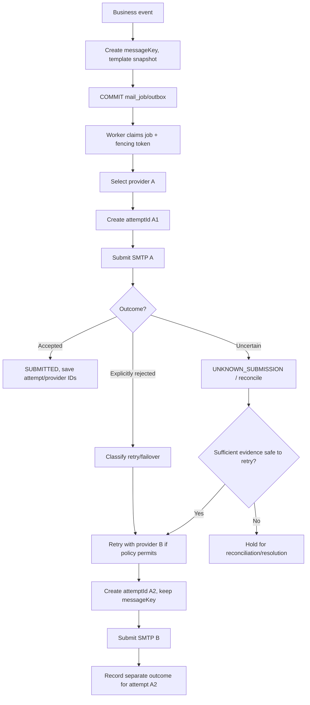

# Preserving the Message Key When Switching Providers in Spring Framework Mail

When an application uses **multiple email providers** (primary SMTP relay, backup relay, API-based sending service), switching the sending route from provider A to provider B must not lose the identity of the same send request. If the system generates a new "message key" on every failover, state data splits into separate independent jobs, making it hard to detect duplicates, hard to look up bounces/deliveries, and hard to enforce idempotency.

Core principle:

> **One email-sending intent has one stable application-managed message key; each send attempt and each provider has its own identifier. When switching providers, preserve the application-layer key, but never assume the new provider will accept or honor the old provider's idempotency key.**

Example: a user places an order and the system must send **one** confirmation email. The first attempt via SMTP provider A times out; the worker then switches to provider B. Both attempts still belong to the same mail job and the same message key, even though the MIME `Message-ID`, SMTP queue ID, and provider message ID may differ.

In Spring Framework Mail, `JavaMailSender` builds and sends messages without providing cross-provider idempotency. Therefore, the application must design the **logical message key**, job/attempt states, failover flow, provider-ID mappings, and uncertain-outcome handling.

This lesson focuses on preserving keys across sending routes, distinguishing ID types, storing state in a transactional outbox, configuring multiple `JavaMailSender` instances, checking state before failover, correlating webhooks, preventing race conditions, protecting privacy, and testing tricky edge cases.

## 1. What Is a "Message Key" and Why Distinguish It from Message-ID?

The term *message key* is often used inconsistently. In this lesson:

- **`messageKey`**: a stable logical key created and owned by the **application**, identifying *one sending intent* across its entire lifecycle, including retries or provider switches.
- **`mailJobId`**: the primary key of the job/outbox record. You may use `messageKey` itself as the UUID primary key, or keep two separate fields if business logic needs them.
- **`attemptId`**: a new identifier for **each submission trial** to a provider.
- **MIME `Message-ID`**: an RFC 5322 Internet Message header, usually generated by Jakarta Mail or processed by infrastructure; identifies one message instance on the mail stream.
- **`providerMessageId`**: a provider-specific ID returned or recorded for looking up events, not necessarily equal to the MIME Message-ID.
- **`businessEventId` / `idempotencyKey`**: a business identifier preventing two sending intents from being created when the same event is processed twice.
- **`correlationId` / `traceId`**: a tracing identifier across services, often spanning multiple mail jobs.

Different IDs have different scopes:

| ID type | Created by | Changes on retry? | Changes on provider switch? | Role |
|---|---|---|---|---|
| `messageKey` | Application | **No** | **No** | Root key linking all sends of one intent |
| `mailJobId` | Job store/application | No | No | Durable status lookup |
| `businessEventId` | Business system | No for same event | No | Prevents duplicate enqueue |
| `attemptId` | Worker/attempt store | **Yes** | **Yes** when creating a new attempt | Investigates each call's outcome |
| MIME `Message-ID` | Jakarta Mail/adapter | Possibly | Possibly | Correlates email messages |
| `providerMessageId` | Provider | Possibly | **Usually different** | Correlates provider events |
| `correlationId` | Request/workflow | Usually no | No | Traces the whole workflow |

**Do not equate header `Message-ID` with `messageKey`** just because the names sound alike. If the goal is preserving business identity across provider switches, the thing you must preserve is **`messageKey`**. Trying to keep the same MIME Message-ID is a separate choice with limitations and does not replace idempotency.

### 1.1. Example of Two Attempts

```text
messageKey = 8dbf0c30-5b9e-4ac8-b6f2-7bc7ecef01aa
mailJobId  = 8dbf0c30-5b9e-4ac8-b6f2-7bc7ecef01aa
templateId = ORDER_CONFIRMATION

attemptId = 7ce6175f-2a96-4234-bd08-cc70b6d07f4c
    provider = smtp-primary
    mimeMessageId = <first-001@mailer.example.org>
    providerMessageId = (unknown)
    outcome = UNKNOWN_SUBMISSION

attemptId = c08d1d76-4b83-485a-a3ce-b09ef0974c3f
    provider = smtp-backup
    mimeMessageId = <second-002@mailer.example.org>
    providerMessageId = backup-queue-10026
    outcome = SUBMITTED
```

Both attempts still share one `messageKey`. If provider A actually received the message before the connection dropped, switching to B can cause the recipient to see two emails. **Preserving the key helps detect and manage the incident; by itself it does not eliminate SMTP duplicate risk.**

## 2. Defining the Unique Scope of a Message Key

A key is only useful if the business clearly defines what "one message" means.

Order example:

```text
One order -> one confirmation email to customer
  messageKey = K1

One order -> one confirmation email for customer
               and one internal email for accounting
  messageKey = K1 (customer confirmation)
  messageKey = K2 (internal notification)
```

Never reuse one key for two emails with different recipients or different content/intents. If an email is cancelled and a new sending intent is created, decide whether it is a **retry of the same intent** or a **new intent**.

### 2.1. Invariants to Maintain

1. `messageKey` is created once when the application establishes the sending intent.
2. It is persisted durably **before starting SMTP submission**.
3. Retries and failovers never generate a new key for the same intent.
4. `attemptId` is created separately for each provider call that could produce side effects.
5. Each attempt's outcome is linked to `messageKey` without overwriting history.
6. Only one worker holding valid ownership may start a new attempt for a job at a time, unless business rules intentionally allow concurrency.
7. Never embed email addresses, tokens, or guessable PII in the key.
8. State `SUBMITTED` reflects only submission; delivery/bounces come next.
9. Mappings of provider-specific IDs are stored with a **provider alias** to avoid collisions.
10. When the prior attempt's outcome is uncertain, never treat failover as "exactly-once" without proof.

### 2.2. Random Key or Deterministic Key from Business Data?

Two common options:

**Random key persisted in the outbox:**

```java
UUID messageKey = UUID.randomUUID();
```

Fits when a transaction already has a unique constraint on the business event, and `messageKey` is a public-safe identifier for the job.

**Business-derived duplicate-prevention key:**

```text
tenant + businessEventId + mailPurpose + recipientAccountId
```

You can place a unique constraint on these columns; after inserting successfully, generate/store a random `messageKey` as the sending identifier. That prevents replaying the same event from spawning another intent.

Do not concatenate `recipientEmail + orderId` directly as a key put into headers/logs: it can leak PII and break when a user updates their email address.

### 2.3. When Should a New Message Key Be Created?

| Scenario | Keep old key? | Explanation |
|---|---|---|
| Provider A times out, retry via A | Yes | Same sending intent |
| Provider A fails, switch to B | Yes | Only transport route changed |
| Worker crashes and reclaims outbox job | Yes | Recovering the same job |
| Provider returns 429, scheduled later | Yes | Conditional retry |
| Order-creation request redelivered with same event ID | No duplicate intent created | Unique business event |
| User requests a new password reset | Usually **new key** | New challenge/token/deadline |
| An invoice is edited and reissued | Business-dependent; usually new | Content/version of intent changed |
| Sending notification to a second recipient | Separate key | Each intent/recipient is distinct |
| Campaign split per subscriber | Separate key per recipient/message | Track unsubscribe/bounce independently |

Do not "keep the old key" to merge distinct business actions just to reduce job count.

## 3. Multi-Provider Sending Flow with a Stable Message Key



In the diagram, **switching providers does not create a new mail job**. The worker starts a new attempt targeting `smtp-backup` while referencing the exact same `messageKey` in the job store.

### 3.1. Do Not Rely Solely on @Async

`@Async` helps offload sending from request threads, yet an in-memory executor queue is lost on process restart. When key preservation and provider-failure recovery are required, persist a durable job/outbox record holding `messageKey`, provider routing policy, and state.

### 3.2. Separate Routing from Content Rendering

An architecture with clear parts:

```text
MailIntentService
  -> MailJobStore (messageKey, business idempotency)
  -> MailWorker
       -> MailTemplateRenderer
       -> ProviderRouter
            -> smtp-primary adapter
            -> smtp-backup adapter
       -> AttemptStore / outcome reconciler
```

The template layer knows the intended content. The routing layer chooses the appropriate provider. The state store knows the attempt history. Never let a provider adapter mint a brand-new message key on each invocation.

## 4. Three Distinct Levels of Idempotency

**Idempotency is not just "having a UUID."** Consider all three layers:

| Layer | Goal | Mechanism |
|---|---|---|
| **Business enqueue** | One business event never creates two mail jobs | Unique key on tenant/event/purpose/recipient |
| **Application dispatch** | Multiple workers never send the same job concurrently | Atomic claim, lease/fencing, compare-and-set state |
| **Provider submission** | Network retries do not duplicate side effects | Provider idempotency API if supported, status lookup, unknown policy |

In standard SMTP, there is no **universal idempotency-key header** honored by every SMTP server to drop duplicate emails. Even if the application sends two emails with the same `Message-ID`, the server can accept both.

If a provider supports a REST API with an idempotency key, check scope and TTL in **that provider's** documentation. A key accepted by A does not automatically carry over to B. The system still needs a cross-provider `messageKey` to tie everything together.

### 4.1. Never Promise Exactly-Once Delivery

Consider this scenario:

```text
Worker -> SMTP provider A: DATA complete
Provider A: accepted message
Network: connection dropped before worker received 250
Worker: timeout
```

The application cannot be sure A succeeded without another reconciliation mechanism. If it immediately resends through B, both A and B may deliver the email.

Transactional outboxes, message keys, and leases support **controlled at-least-once processing**, not an atomic distributed transaction spanning the database and SMTP.

## 5. MIME Message-ID: Should You Keep It Constant Across Providers?

The RFC 5322 `Message-ID` header typically looks like:

```text
Message-ID: <unique-opaque-id@mailer.example.org>
```

It helps support teams, provider logs, and mailbox threading. Yet **it differs from the application message key**:

- A `MimeMessage` may not have an ID before `saveChanges()` or sending.
- Jakarta Mail/Spring Mail may generate or update `Message-ID` when preparing the message.
- A provider/gateway may preserve, replace, or strip the header depending on implementation and policy.
- Building a new `MimeMessage` for a retry may produce a new ID.
- There is no guarantee a provider deduplicates when `Message-ID` matches.

### 5.1. The Simple Path: Keep Application Key, Let MIME ID Vary

This is usually the least provider-coupled choice:

```text
messageKey=K-123
    attempt=A-1, provider=primary,
        mimeMessageId=<m1@mailer.example.org>
    attempt=A-2, provider=backup,
        mimeMessageId=<m2@mailer.example.org>
```

Store the per-attempt mapping. The system still knows both MIME messages came from the same sending intent K-123.

### 5.2. When You Genuinely Need a Planned MIME Message-ID

If an integration requires reconciling on MIME Message-ID, you can construct a valid, stable ID for the logical message:

```text
plannedMessageId = <opaque-unique-value@mailer.example.org>
```

However, setting the header manually must be verified against your active `JavaMailSenderImpl`/Jakarta Mail version. `MimeMessage.saveChanges()` can regenerate headers. Never inject newlines/raw headers, and never take the ID from user input. Inspect what the SMTP sink actually receives, **not just the object before sending**.

Even when keeping the exact same MIME ID across A and B, it is still **not an SMTP idempotency mechanism** and does not guarantee a single copy in the mailbox. It can also affect threading or analytics depending on clients/providers, so decide intentionally.

### 5.3. Never Use MIME Message-ID for Business Authorization

Never build an API saying "knowing the Message-ID lets you view the email content." Message-IDs appear in mail headers and get forwarded or shared. Status APIs must enforce user/tenant authorization. Logical `messageKey` is likewise only an identifier, not a bearer credential.

## 6. Provider Message IDs Differ Across Providers

Some SMTP relays include a queue ID in the response or expose it via logs/dashboards; some REST email services return an ID in the response. Meanwhile, `JavaMailSender.send(MimeMessage)` returns `void` and **has no standard API returning `providerMessageId`**.

Mapping example:

| messageKey | attemptId | Provider | MIME Message-ID | providerMessageId | Outcome |
|---|---|---|---|---|---|
| K1 | A1 | smtp-primary | m1 | Unknown | UNKNOWN |
| K1 | A2 | smtp-backup | m2 | backup-7912 | SUBMITTED |
| K2 | A3 | smtp-primary | m3 | primary-6001 | SUBMITTED |

Do not use `providerMessageId` alone as a system-wide key: two providers can emit IDs with similar formats or even collisions. At minimum store **`(providerAlias, providerMessageId)`**; if a provider has multiple accounts/regions, scope by account/region per contract as well.

### 6.1. Common Boundaries

```text
messageKey
   -> internal job
attemptId
   -> one submission call
mimeMessageId
   -> one MIME email message
providerMessageId
   -> one provider submission/delivery record
providerEventId
   -> one specific webhook/event
```

Each identifier serves one role. When analyzing bounces, never convert `providerEventId` directly into `messageKey` without a verified mapping.

## 7. Database Design to Preserve Keys and Attempt History

For safe retries/failover, the system needs a **durable source of state**. Below is a PostgreSQL reference schema. Each sending intent has one row in `mail_job`; each submission attempt has one row in `mail_attempt`.

```sql
CREATE TABLE mail_job (
    message_key         UUID PRIMARY KEY,
    tenant_id           UUID NOT NULL,
    business_event_id   UUID NOT NULL,
    mail_purpose        VARCHAR(80) NOT NULL,
    recipient_ref       UUID NOT NULL,
    template_id         VARCHAR(80) NOT NULL,
    template_version    VARCHAR(40) NOT NULL,
    payload_ref         VARCHAR(200) NOT NULL,
    state               VARCHAR(32) NOT NULL,
    attempt_count       INTEGER NOT NULL DEFAULT 0,
    next_attempt_at     TIMESTAMPTZ NOT NULL,
    expires_at          TIMESTAMPTZ,
    claim_token         UUID,
    lease_until         TIMESTAMPTZ,
    submitted_at        TIMESTAMPTZ,
    created_at          TIMESTAMPTZ NOT NULL DEFAULT NOW(),
    updated_at          TIMESTAMPTZ NOT NULL DEFAULT NOW(),
    CHECK (attempt_count >= 0),
    CONSTRAINT uq_mail_intent UNIQUE (
        tenant_id,
        business_event_id,
        mail_purpose,
        recipient_ref
    )
);

CREATE TABLE mail_attempt (
    attempt_id           UUID PRIMARY KEY,
    message_key          UUID NOT NULL
                         REFERENCES mail_job(message_key),
    attempt_no           INTEGER NOT NULL,
    provider_alias       VARCHAR(80) NOT NULL,
    state                VARCHAR(32) NOT NULL,
    mime_message_id      VARCHAR(320),
    provider_message_id  VARCHAR(320),
    failure_class        VARCHAR(80),
    started_at           TIMESTAMPTZ NOT NULL,
    completed_at         TIMESTAMPTZ,
    CONSTRAINT uq_mail_attempt_number UNIQUE (
        message_key, attempt_no
    )
);

CREATE INDEX idx_mail_attempt_lookup
    ON mail_attempt (message_key, started_at);

CREATE INDEX idx_mail_provider_message
    ON mail_attempt (provider_alias, provider_message_id)
    WHERE provider_message_id IS NOT NULL;

CREATE INDEX idx_mail_jobs_ready
    ON mail_job (next_attempt_at, created_at)
    WHERE state IN ('PENDING', 'RETRY_WAIT');
```

All tables and states in this article are a **recommended application model**, not schema auto-created by Spring Mail. If a provider ID is unique only per account/region, store and index those columns too.

### 7.1. Why Is message_key the Primary Key?

Using `message_key UUID PRIMARY KEY` directly expresses the invariant "one logical message has one durable key." Some projects prefer keeping a separate `mail_job.id` and `message_key UNIQUE`: that is also valid if code never confuses the two fields.

Every send must reference this row; never insert a new `mail_job` merely because routing switched from provider A to B.

### 7.2. Why Is a Business Unique Constraint Needed?

A random `messageKey` has negligible collision odds, yet **does not stop two consumers from processing the same business event and minting two different UUIDs**. A unique constraint on `(tenant, event, purpose, recipientRef)` ensures replaying a known event creates no duplicate intent.

If a workflow permits *intentionally* resending the same notification, there should be an appropriate new business event or revision. Do not disable the unique constraint just to "resend"; distinguish whether a manual resend is a new attempt on the old intent or a new intent per operational policy.

### 7.3. Never Overwrite Old Attempts When Switching Providers

An operation to avoid:

```sql
-- Do not merely overwrite the current provider and wipe history.
UPDATE mail_job
SET current_provider = 'backup',
    message_key = gen_random_uuid()
WHERE message_key = :old_key;
```

Instead, keep `mail_job.message_key` immutable and **INSERT another `mail_attempt`** with `provider_alias='backup'`, a new attempt ID, and the next sequence number.

### 7.4. Do Not Key Solely on providerMessageId

When receiving webhooks keyed by provider ID, establish the proper scope:

```sql
SELECT attempt_id, message_key
FROM mail_attempt
WHERE provider_alias = :provider_alias
  AND provider_message_id = :provider_message_id;
```

The query can return multiple rows if the provider does not guarantee uniqueness or has multiple accounts; production needs exact constraints/predicates matching the real contract. Do not enforce a unique index without verifying provider ID uniqueness within that scope.

## 8. Creating Mail Jobs Once via a Transactional Outbox

A common architectural mistake:

```java
try {
    primarySender.send(message);
} catch (Exception ex) {
    // Wrong: creating a new mail job with a different key just from switching providers.
    mailJobRepository.save(MailJob.newJobForBackup(...));
    backupSender.send(message);
}
```

That easily produces two independent records for the same business action, making duplicate control hard and hiding that attempt A relates to attempt B.

### 8.1. The Transaction Persists Only the Sending Intent

Abbreviated example:

```java
@Transactional
public void confirmOrder(Order order, UUID businessEventId) {
    orderRepository.save(order);

    mailJobStore.insertIfAbsent(
            UUID.randomUUID(),           // messageKey if absent
            order.getTenantId(),
            businessEventId,
            "ORDER_CONFIRMATION",
            order.getCustomerAccountId(),
            "ORDER_CONFIRMATION",
            "v7",
            order.getId().toString());
}
```

`insertIfAbsent(...)` is an application-implemented operation, not a built-in Spring API; it must use a unique constraint and **retrieve the existing key on conflict** rather than creating another job. Within a transaction, race-safe patterns include `INSERT ... ON CONFLICT DO NOTHING`, followed by selecting the existing row by the unique business key.

### 8.2. Idempotent PostgreSQL Insert

```sql
INSERT INTO mail_job (
    message_key, tenant_id, business_event_id,
    mail_purpose, recipient_ref,
    template_id, template_version, payload_ref,
    state, next_attempt_at
)
VALUES (
    :message_key, :tenant_id, :business_event_id,
    :mail_purpose, :recipient_ref,
    :template_id, :template_version, :payload_ref,
    'PENDING', NOW()
)
ON CONFLICT ON CONSTRAINT uq_mail_intent DO NOTHING;
```

Then query:

```sql
SELECT message_key, state, template_id, template_version
FROM mail_job
WHERE tenant_id = :tenant_id
  AND business_event_id = :business_event_id
  AND mail_purpose = :mail_purpose
  AND recipient_ref = :recipient_ref;
```

If the row already existed, the caller gets back **the stored message key**, not the freshly generated UUID that was skipped. Also check whether payload/template match the original intent; if the same idempotency key arrives with unauthorized content changes, treat it as a business conflict rather than silently overwriting.

### 8.3. Keep Logical Content Stable Across Providers

When switching providers, more than just the key must remain stable. Preserve:

- Approved recipient.
- Email category and template version.
- Business content reference/snapshot.
- Verification links/tokens still valid for the intent.
- Selected language/locale.
- Sending rules and expiration deadline.

Technical fields that may legitimately change per provider: SMTP credentials, return-path/bounce domain, DKIM signer, transport headers, or provider-specific metadata. However, **the email's meaning to the recipient must not unexpectedly change solely because of routing**.

Bad example: attempt A uses OTP `123456`, while attempt B generates OTP `654321` under the same `messageKey`; those are two different challenges and confuse the recipient. Establish tokens/challenges in the business layer before creating the mail job, and verify they are still valid on retry.

## 9. State Machine Separating Jobs and Individual Attempts

A job lifecycle:

```text
PENDING
  |
  v
PROCESSING
  |         \
  |          +--> RETRY_WAIT --> PROCESSING
  |          |
  |          +--> UNCERTAIN --> RECONCILING
  |                                  |
  +--> SUBMITTED <-------------------+
  |
  +--> FAILED_PERMANENT
  +--> EXPIRED
  +--> CANCELLED
```

This is an illustrative state machine; a real implementation must define all valid transitions completely. Not every state comes straight from `PROCESSING`—notably, a job may be `CANCELLED` while still waiting.

An **attempt** has its own lifecycle:

```text
CREATED
  |
  v
SUBMITTING
  |
  +--> SUBMITTED
  +--> FAILED_DEFINITE
  +--> UNKNOWN_SUBMISSION
```

Here `SUBMITTED` is a **submission-layer** event; it does not prove delivery. The provider may emit `delivered`, `bounced`, or `complained` later, and those events must be stored/governed separately.

### 9.1. Rules for Keeping the Key

Across every transition of the same job:

```text
job.messageKey = constant
job.templateId = logical template identity
job.intentSnapshot = stable for retry policy
```

Fields that vary per attempt:

```text
attempt.id = new
attempt.provider = primary | backup | ...
attempt.startedAt = new
attempt.mimeMessageId = optional/new
attempt.providerMessageId = optional/new
attempt.outcome = per-attempt
```

### 9.2. Do Not Automatically Fail Over from SUBMITTED

If provider A reported SMTP acceptance, the application should not automatically switch to B merely because no `delivered` webhook arrived within a few seconds. Delivery may be delayed or provider events may arrive late. Rerouting after a successful submission risks creating duplicate emails.

If the business has strict SLAs and accepts duplicates under defined conditions, establish an **explicit business policy**, waiting thresholds, audits, and duplicate handling—never hide it inside `catch (Exception)`.

### 9.3. Switch When Failure Definitely Occurred Before Submission

Some failures can clearly be proven pre-submission—for instance, an unconfigured provider route, validation failure before building MIME, or SMTP AUTH rejection before DATA. Still, not every library exception lets you pinpoint the exact failure point.

When there is proof of **no side effect**, retrying through another provider carries lower duplicate risk. However, content/recipient validation errors must never be "fixed" by failover: fix the input or policy first.

## 10. Atomic Claim and Fencing to Stop Two Workers from Switching Providers Concurrently

In a multi-instance system, worker A might still be submitting through primary while worker B sees an expired lease and chooses backup. If both workers send simultaneously, even with the same `messageKey`, two emails can still go out.

Therefore, alongside a stable key you need:

1. Claim jobs in an atomic transaction.
2. Store `claim_token`/lease version.
3. Only the worker holding the valid claim may start a new attempt.
4. Update state conditionally on the ownership token.
5. Bound submission duration or renew leases when needed.
6. Resolve uncertain outcomes before automatically switching providers.

### 10.1. Batch Claiming with PostgreSQL

```sql
WITH candidates AS (
    SELECT message_key
    FROM mail_job
    WHERE state IN ('PENDING', 'RETRY_WAIT')
      AND next_attempt_at <= NOW()
      AND (expires_at IS NULL OR expires_at > NOW())
    ORDER BY next_attempt_at, created_at, message_key
    FOR UPDATE SKIP LOCKED
    LIMIT :batch_size
)
UPDATE mail_job j
SET state = 'PROCESSING',
    claim_token = :new_claim_token,
    lease_until = NOW() + INTERVAL '90 seconds',
    attempt_count = attempt_count + 1,
    updated_at = NOW()
FROM candidates c
WHERE j.message_key = c.message_key
RETURNING j.*;
```

The claim transaction must be short; commit before the SMTP call. Then insert the corresponding `mail_attempt` for each job/attempt number (inside the claim transaction if appropriate) with the policy-selected provider route.

### 10.2. Finalize by Ownership

```sql
UPDATE mail_job
SET state = 'SUBMITTED',
    submitted_at = NOW(),
    updated_at = NOW(),
    claim_token = NULL,
    lease_until = NULL
WHERE message_key = :message_key
  AND claim_token = :expected_claim_token
  AND state = 'PROCESSING';
```

If `UPDATE` affects 0 rows, the worker lost ownership or state already changed; never overwrite with an unconditional UPDATE. Record the attempted submission in the attempt store and reconcile state; the email may have been accepted by the provider even though ownership changed.

### 10.3. Fencing Cannot Retract an Already-Sent SMTP Submission

Fencing prevents a stale worker from corrupting database state, yet **cannot undo an email already handed to the SMTP server**. If a lease expires while provider A accepted the message and worker B already started on B, duplicates can still happen. Size lease durations properly, renew leases, and transition to `UNCERTAIN` when ownership breaks mid-submission.

### 10.4. Do Not Pick Providers Across Unrelated Transactions

To prevent route drift mid-send, pin `provider_alias` in the attempt row when starting the attempt:

```text
attempt A1 -> provider primary
attempt A2 -> provider backup
```

If global routing config changes between steps, the worker must still record the actual provider it called. Never record `provider_alias` by reading "current config" when a webhook arrives later, because the route may have changed long ago.

## 11. Configuring Two SMTP Providers in Spring Boot

Spring Boot normally auto-configures a single `JavaMailSender` from `spring.mail.*`. When you intentionally use two SMTP accounts/providers, declare **two separate beans** and select via an adapter. Avoid mutating a single bean's configuration via setters while multiple workers send concurrently.

### 11.1. Sample Configuration

```yaml
# application.yml — contains no real secrets
app:
  mail:
    primary:
      host: ${PRIMARY_SMTP_HOST}
      port: 587
      username: ${PRIMARY_SMTP_USER}
      password: ${PRIMARY_SMTP_PASSWORD}
    backup:
      host: ${BACKUP_SMTP_HOST}
      port: 587
      username: ${BACKUP_SMTP_USER}
      password: ${BACKUP_SMTP_PASSWORD}
```

The placeholders above pull values from the environment. Secrets must be managed appropriately, such as via a secret manager. Never log usernames/passwords or dump entire configuration objects.

The backup provider must be configured and verified **before an incident**, including sending identity, quota limits, and domain authorization. Do not wait until production provider A goes down to discover B lacks permission to send the application's `From` address.

### 11.2. Two Isolated JavaMailSender Instances

```java
package com.example.mail.provider;

import java.util.Properties;
import org.springframework.beans.factory.annotation.Value;
import org.springframework.context.annotation.Bean;
import org.springframework.context.annotation.Configuration;
import org.springframework.mail.javamail.JavaMailSender;
import org.springframework.mail.javamail.JavaMailSenderImpl;

@Configuration(proxyBeanMethods = false)
public class MultipleMailSenderConfiguration {

    @Bean("primaryMailSender")
    JavaMailSender primaryMailSender(
            @Value("${app.mail.primary.host}") String host,
            @Value("${app.mail.primary.port:587}") int port,
            @Value("${app.mail.primary.username}") String username,
            @Value("${app.mail.primary.password}") String password) {
        return createSmtpSender(host, port, username, password);
    }

    @Bean("backupMailSender")
    JavaMailSender backupMailSender(
            @Value("${app.mail.backup.host}") String host,
            @Value("${app.mail.backup.port:587}") int port,
            @Value("${app.mail.backup.username}") String username,
            @Value("${app.mail.backup.password}") String password) {
        return createSmtpSender(host, port, username, password);
    }

    private static JavaMailSender createSmtpSender(
            String host,
            int port,
            String username,
            String password) {

        JavaMailSenderImpl sender = new JavaMailSenderImpl();
        sender.setHost(host);
        sender.setPort(port);
        sender.setProtocol("smtp");
        sender.setUsername(username);
        sender.setPassword(password);
        sender.setDefaultEncoding("UTF-8");

        Properties p = sender.getJavaMailProperties();
        p.put("mail.smtp.auth", "true");
        p.put("mail.smtp.starttls.enable", "true");
        p.put("mail.smtp.starttls.required", "true");
        p.put("mail.smtp.connectiontimeout", "5000");
        p.put("mail.smtp.timeout", "10000");
        p.put("mail.smtp.writetimeout", "10000");
        p.put("mail.debug", "false");
        p.put("mail.debug.auth", "false");
        return sender;
    }
}
```

This example uses SMTP submission on port 587 with STARTTLS; for implicit TLS/port 465 or OAuth/API key mechanisms, configuration and adapters must change per provider. Never copy the exact same configuration to two services without checking current documentation.

If no bean is marked `@Primary` and somewhere injects `JavaMailSender` without a qualifier, Spring will throw `NoUniqueBeanDefinitionException`. That is a helpful signal to make provider selection explicit, rather than slapping `@Primary` on one bean and accidentally sending everything through primary.

### 11.3. Do Not Mutate Configuration on a Shared Sender

Avoid:

```java
JavaMailSenderImpl sender = sharedSender;
sender.setHost(routeToBackup ? backupHost : primaryHost);
sender.setPassword(routeToBackup ? backupPassword : primaryPassword);
sender.send(message);
```

If two workers share a singleton bean, changing host/password while another worker is sending is a serious race condition. Keep **one fixed-configuration sender per provider** or separate provider clients/adapters; routing selects the client rather than mutating configuration.

## 12. A Provider-Neutral Envelope Carrying the Message Key

The routing layer should receive a payload that already holds `messageKey` and `attemptId`, never regenerating keys. An illustrative contract:

```java
package com.example.mail.provider;

import java.util.UUID;

public enum ProviderAlias {
    PRIMARY,
    BACKUP
}

public enum SubmissionState {
    SUBMITTED,
    DEFINITELY_NOT_SUBMITTED,
    UNKNOWN_SUBMISSION
}

public record OutboundMail(
        UUID messageKey,
        UUID attemptId,
        String from,
        String recipient,
        String subject,
        String plainText,
        String htmlText) {
}

public record ProviderSubmission(
        ProviderAlias provider,
        UUID messageKey,
        UUID attemptId,
        SubmissionState state,
        String mimeMessageId,
        String providerMessageId,
        String failureClass) {
}
```

The `enum`/`record` types should live in separate Java files in a project; here they are grouped into one conceptual snippet. `OutboundMail` contains recipient/body and may be sensitive: **never log the entire record**. Both IDs are pre-generated by the job store layer.

### 12.1. Why Should the Envelope Be Provider-Independent?

If `PrimaryProviderRequest` and `BackupProviderRequest` each generate their own keys, you easily end up with:

```text
business mail intent K1
  primary adapter creates K2
  backup adapter creates K3
```

That breaks correlation. Instead:

```text
MailJob K1
  -> Attempt A1 -> primary adapter, key K1
  -> Attempt A2 -> backup adapter, key K1
```

Adapters can transform the envelope into provider/API-specific payloads, yet must retain the `messageKey` reference in application outcomes/metadata.

## 13. SMTP Adapter Selecting Providers Without Changing the Message Key

Example gateway implemented with two `JavaMailSender` beans. It intentionally separates failures proven to happen before SMTP from potentially ambiguous submission errors, instead of failing over blindly inside one `catch`.

```java
package com.example.mail.provider;

import jakarta.mail.MessagingException;
import jakarta.mail.internet.MimeMessage;
import java.util.Objects;
import org.springframework.beans.factory.annotation.Qualifier;
import org.springframework.mail.MailAuthenticationException;
import org.springframework.mail.MailException;
import org.springframework.mail.javamail.JavaMailSender;
import org.springframework.mail.javamail.MimeMessageHelper;
import org.springframework.stereotype.Component;

@Component
public class MultiSmtpGateway {

    private final JavaMailSender primary;
    private final JavaMailSender backup;

    public MultiSmtpGateway(
            @Qualifier("primaryMailSender") JavaMailSender primary,
            @Qualifier("backupMailSender") JavaMailSender backup) {
        this.primary = Objects.requireNonNull(primary);
        this.backup = Objects.requireNonNull(backup);
    }

    public ProviderSubmission submit(
            ProviderAlias provider,
            OutboundMail mail) {

        JavaMailSender selected = switch (provider) {
            case PRIMARY -> primary;
            case BACKUP -> backup;
        };

        MimeMessage mime = selected.createMimeMessage();
        try {
            MimeMessageHelper helper = new MimeMessageHelper(
                    mime,
                    MimeMessageHelper.MULTIPART_MODE_MIXED_RELATED,
                    "UTF-8");

            helper.setFrom(mail.from());
            helper.setTo(mail.recipient());
            helper.setSubject(mail.subject());
            helper.setText(mail.plainText(), mail.htmlText());

            // messageKey does not belong in SMTP credentials;
            // caller/store keeps it intact when routing to backup.
        } catch (MessagingException | IllegalArgumentException ex) {
            // Failed before calling send: no SMTP side effect
            // within this attempt.
            return new ProviderSubmission(
                    provider, mail.messageKey(), mail.attemptId(),
                    SubmissionState.DEFINITELY_NOT_SUBMITTED,
                    null, null, "MIME_PREPARATION");
        }

        try {
            selected.send(mime);

            // JavaMailSender SMTP API does not return providerMessageId.
            return new ProviderSubmission(
                    provider, mail.messageKey(), mail.attemptId(),
                    SubmissionState.SUBMITTED,
                    safeMimeMessageId(mime), null, null);

        } catch (MailAuthenticationException ex) {
            // AUTH failure occurs before submitting message content.
            return new ProviderSubmission(
                    provider, mail.messageKey(), mail.attemptId(),
                    SubmissionState.DEFINITELY_NOT_SUBMITTED,
                    safeMimeMessageId(mime), null,
                    "SMTP_AUTHENTICATION");

        } catch (MailException ex) {
            // Cannot infer from a generic MailException
            // that the SMTP server definitely did not receive the message.
            return new ProviderSubmission(
                    provider, mail.messageKey(), mail.attemptId(),
                    SubmissionState.UNKNOWN_SUBMISSION,
                    safeMimeMessageId(mime), null,
                    "SMTP_TRANSPORT_UNCERTAIN");
        }
    }

    private static String safeMimeMessageId(MimeMessage mime) {
        try {
            String value = mime.getMessageID();
            if (value == null || value.length() > 320) {
                return null;
            }
            for (int i = 0; i < value.length(); i++) {
                char c = value.charAt(i);
                if (Character.isISOControl(c)) {
                    return null;
                }
            }
            return value;
        } catch (MessagingException ex) {
            return null;
        }
    }
}
```

**Contract explanation:**

- `messageKey` comes from the job store and is returned unchanged in `ProviderSubmission`.
- `attemptId` is the new attempt ID, passed into the adapter rather than generated inside it.
- Both primary and backup build `MimeMessage` from the same logical envelope.
- `MailAuthenticationException` is treated as a pre-DATA auth failure for standard SMTP flows; production should classify according to actual adapter/provider contracts.
- Generic `MailException` is conservatively classified as `UNKNOWN_SUBMISSION`. Not every `MailException` is truly uncertain, yet without safe distinguishing data you should not mark it "definitely not sent."
- `safeMimeMessageId` merely prevents recording IDs containing control characters or excessive length; for full RFC validation, use a proper validator.
- Never log exception messages, SMTP passwords, recipients, Subjects, or MIME bodies.
- When a provider returns an ID over a REST API, the REST adapter can populate `providerMessageId`; the standard SMTP adapter above returns `null`.

This example focuses on **routing and identity**. Production also requires recipient/From authorization, template escaping, timeouts, sender-identity configuration, provider quotas, attachment handling, and business-layer error control.

### 13.1. Do Not Let the Gateway Unconditionally Retry and Switch Providers

Avoid:

```java
try {
    primary.send(mime);
} catch (MailException ex) {
    backup.send(mime); // May duplicate if primary already accepted.
}
```

The gateway should return the outcome to the worker/routing policy. **The worker decides** whether to reschedule, switch routes, hold an uncertain state, or trigger reconciliation.

### 13.2. Do Not Bake Provider Selection Into the Key

Never use keys like:

```text
primary:order-123
backup:order-123
```

to represent two logical messages. Provider is an **attribute of the attempt**, not something changing the identity of the intent. If an API key scoped to a provider namespace is needed, derive it from the application key under a controlled mapping while keeping the original `messageKey` in the database.

## 14. Worker Coordinating Sends, Retries, and Provider Switches

A worker typically performs:

1. Claim the job and verify it has not expired.
2. Pick a provider based on routing policy/current health/tenant.
3. Create an attempt row linked to `messageKey` and `provider_alias`.
4. Retrieve the snapshot/recipient with appropriate authorization.
5. Call the gateway.
6. Persist the attempt outcome in a short transaction.
7. Update job state or schedule the next attempt.

Java pseudocode skeleton:

```java
void processClaimedMail(ClaimedMailJob claimed) {
    MailJob job = claimed.job();

    if (job.expiresAt() != null
            && !clock.instant().isBefore(job.expiresAt())) {
        jobStore.expireIfOwned(
                job.messageKey(), claimed.claimToken());
        return;
    }

    ProviderAlias selected = router.chooseProvider(job);
    MailAttempt attempt = attemptStore.start(
            job.messageKey(), selected, claimed.claimToken());

    OutboundMail payload = renderer.render(
            job, attempt.attemptId());

    ProviderSubmission result =
            smtpGateway.submit(selected, payload);

    attemptStore.recordResult(
            attempt.attemptId(), result);

    switch (result.state()) {
        case SUBMITTED ->
                jobStore.markSubmittedIfOwned(
                        job.messageKey(), claimed.claimToken());
        case DEFINITELY_NOT_SUBMITTED ->
                retryPolicy.scheduleOrFail(
                        job, attempt, result);
        case UNKNOWN_SUBMISSION ->
                jobStore.markUncertainIfOwned(
                        job.messageKey(), claimed.claimToken());
    }
}
```

Types like `ClaimedMailJob`, `MailJob`, `MailAttempt`, `router`, `renderer`, `jobStore`, and `retryPolicy` are project-defined APIs. This pseudocode is **not runnable standalone code**; it shows where `messageKey` is preserved, where attempts are created, and where ambiguity is handled.

### 14.1. Save Results and Update Jobs Atomically

In real deployments, place `attemptStore.recordResult` and the matching `mail_job` transition in **the same DB transaction whenever possible**, conditioned on the claim token. If recording the attempt succeeds and the process crashes before updating the job, recovery logic must detect the inconsistency and reconcile rather than blindly starting a new attempt.

### 14.2. Separate Rendering Errors from Sending Errors

If a template fails to render, no SMTP side effect occurred, so that is no reason to switch to backup. Another provider will not make a template missing a variable valid. Categorize:

- `TEMPLATE_RENDERING`/`MIME_PREPARATION`: fix data/template; may fail permanently.
- `SMTP_AUTHENTICATION`: check secrets/identity; may switch routes if policy allows and backup is authorized to send.
- `SMTP_THROTTLED`: backoff/limiter; do not flood backup beyond quota.
- `SMTP_TIMEOUT`/`UNKNOWN_SUBMISSION`: reconcile; avoid switching immediately.
- `RECIPIENT_REJECTED`: evaluate permanent vs. temporary from response codes; do not cycle through providers to bypass rejections.

### 14.3. Keep the Logical Snapshot on Retry

If a template is updated between attempts A1 and A2, workers need a clear policy:

**Keep snapshot/version** — suits intents needing fixed content for audits, transactions, or tokens.

**Re-render current data** — only when business rules allow and eligibility/expiry/consent are rechecked; a new intent may be needed if meaning changes.

Never let a silent change in a template registry turn a backup retry into a completely different email under the same key.

## 15. Failover Policy: When to Switch Providers?

A good router does not simply do "A failed so use B." It must distinguish **definitely not submitted**, **submitted**, and **uncertain outcome**.

| Attempt A outcome | Switch to B immediately? | Reason |
|---|---|---|
| Failed to build MIME due to bad template | **No** | Content issue, not provider issue |
| Provider A has no route configured pre-send | Possible | SMTP not yet called; backup must be authorized |
| A's SMTP AUTH rejected before DATA | Possible after policy check | Not submitted, yet verify sender identity/secret |
| Provider A returns explicit temporary error pre-accept | Conditional | Requires understanding response code, quota, retry rules |
| Provider A returns 429/throttled | Not by default | Backoff may beat dumping traffic onto backup |
| A permanently rejects recipient | **No** | Never use B to bypass rejections/policies |
| `JavaMailSender.send` via A succeeded | **No** | Submission occurred; never auto-send a second copy |
| Connection timeout before knowing if A accepted | **Not immediately by default** | May create duplicates |
| A later emits delivery/bounce event | Business-dependent | A bounce does not automatically permit resending via B |

### 15.1. Three Distinct Decisions

A routing policy can return:

```java
public enum FailoverDecision {
    USE_BACKUP_NOW,
    RETRY_CURRENT_PROVIDER_LATER,
    RECONCILE_BEFORE_RESEND,
    DO_NOT_RETRY
}
```

Do not conflate "retryable" with "fail over now." An error may be retryable yet still best retried on provider A after waiting; or the deadline may have passed so sending is no longer permitted.

### 15.2. Provider Health Is Not an Email's State

A circuit breaker reporting provider A unhealthy is information about the **provider**. It does not prove a message sent before the breaker opened failed. For jobs in `UNKNOWN_SUBMISSION`, per-attempt reconciliation is still required.

The router can shift **jobs never submitted** to B while keeping unknown jobs in a separate reconciliation queue. That restores throughput without automatically generating duplicates for ambiguous attempts.

### 15.3. Switching Providers Does Not Grant Infinite Quota

Each provider has its own sending limits, accounts, and domain reputation. Failing hundreds of thousands of jobs over to B can get B throttled or suspended. You need:

- Per-provider/account quota budgets and rate limiters.
- Dedicated circuit breakers and backoff.
- Attempt caps per logical message.
- Deadlines by mail type.
- Traffic ramp-up controls and policy-driven load shedding.
- Never route unconsented marketing lists just to keep throughput up.

### 15.4. Prioritization and Partitioning by Email Category

OTPs, password resets, transaction confirmations, reports, and bulk marketing do not share the same urgency. During an outage:

```text
Provider A down
  |
  +--> Unsent OTP -> B if authorized, high priority
  +--> Unsent transactional -> B, rate-limited
  +--> Newsletter -> wait / shed load per policy
  +--> Unknown job on A -> reconcile before retry
```

Preserving `messageKey` applies across all categories, while **when to fail over** can differ.

## 16. Why Is the UNKNOWN_SUBMISSION Outcome Especially Hard?

Suppose:

```text
T0: Worker A starts SMTP attempt A1 with key K1
T1: SMTP server A receives DATA
T2: Connection drops before client sees ACK
T3: Worker records UNKNOWN_SUBMISSION
T4: Router considers using provider B
```

At T3, there are two possibilities:

- A **received** the email and will deliver it.
- A **did not receive** the email and the recipient has nothing.

Choosing B risks duplicates; not choosing B risks missing SLAs. No pure provider-switching trick eliminates this trade-off on standard SMTP.

### 16.1. Reconciliation Strategy

When a provider supports querying by provider ID, request metadata, or indexed logs:

1. Read the attempt row, provider alias, timestamp, and available IDs.
2. Query **provider A specifically**, not provider B.
3. Evaluate accepted/rejected/deferred status per the provider's contract.
4. Only with strong evidence that the attempt was not received should resending be considered.
5. If accepted, mark `SUBMITTED` and monitor delivery.
6. If still unknown, decide based on mail type, deadline, duplicate risk, and support policy.

Not every SMTP relay offers a lookup API by MIME Message-ID. Without a reconciliation channel, holding unknown state can be safer than blind resending, especially for sensitive or transactional emails.

### 16.2. Intentional Policy Decisions

For an "order created" email, a duplicate may be annoying yet less harmful than certain legal or security notifications. For sensitive cases, you may need:

- Waiting through a retry window.
- Checking business state before resending.
- An authorized resend button in support tooling.
- Per-message maximum attempts.
- Duplicate-tolerant content when permitted.

This is business policy—never bury it inside a utility method named `fallback()`.

### 16.3. Persist Reasons and Evidence

A reconciliation record should capture:

```text
messageKey: K1
attemptId: A1
provider: smtp-primary
originalOutcome: UNKNOWN_SUBMISSION
reconciliationDecision: RETRY_ALLOWED
reasonCode: PROVIDER_CONFIRMED_NOT_ACCEPTED
decisionAt: timestamp
decisionBy: automated-policy-version / authorized-operator
```

Never store raw SMTP passwords, entire MIME messages, or user data in audit logs just to justify failover.

## 17. Reconciling Webhooks Across Multiple Providers

After submission, providers may emit `delivered`, `deferred`, `bounced`, `complained`, or custom statuses. If one logical message has attempts on A and B, A's webhook can arrive **after** B already submitted.

Example:

```text
K1
  A1 / provider A / unknown at 10:00
  A2 / provider B / submitted at 10:01

10:02 provider B: delivered event for A2
10:03 provider A: delivered event for A1
```

If you only stored "current provider = B" and discarded A1's history, the system might attribute A's event to the wrong attempt or miss duplicate-delivery evidence.

### 17.1. Webhook Lookup Keys Must Be Provider-Namespaced

A webhook usually carries a provider ID:

```json
{
  "eventId": "evt-109",
  "messageId": "queue-501",
  "status": "delivered"
}
```

The webhook handler must know which provider sent the request **after verifying signature/origin**. Then query:

```sql
SELECT attempt_id, message_key
FROM mail_attempt
WHERE provider_alias = :verified_provider_alias
  AND provider_message_id = :provider_message_id;
```

Never trust a self-reported `provider` field inside the payload without verifying the request truly came from that provider. Each provider has its own signature/key/authentication scheme.

### 17.2. Late Events Must Not Lose History

A buggy statement:

```java
if (!event.provider().equals(job.currentProvider())) {
    return; // Ignores all events from the previous provider.
}
```

Provider A can still finish delivering after the job switched to B. Record the event on **attempt A1** when the mapping is verified, then update aggregate outcomes appropriately, e.g.:

```text
logical message K1
    submissionAttempts = 2
    deliveredAttempts = 2
    duplicateDeliveryDetected = true
```

This matters for incident reviews and reliability metrics.

### 17.3. Deduplicate Provider Events

Providers may retry webhooks when endpoints time out, so an event can arrive multiple times. Enforce a unique key scoped to the provider:

```sql
CREATE TABLE mail_provider_event (
    provider_alias       VARCHAR(80) NOT NULL,
    provider_event_id    VARCHAR(200) NOT NULL,
    attempt_id           UUID REFERENCES mail_attempt(attempt_id),
    event_type           VARCHAR(60) NOT NULL,
    occurred_at          TIMESTAMPTZ,
    received_at          TIMESTAMPTZ NOT NULL DEFAULT NOW(),
    PRIMARY KEY (provider_alias, provider_event_id)
);
```

If a provider does not supply stable event IDs, build a deduplication policy from documented fields rather than assuming every webhook has `eventId`. You may also need provider account scoping to prevent collisions.

### 17.4. Webhooks Do Not Arrive Strictly in Order

A `delivered` webhook may arrive after `deferred`, or pipelines may reorder events. Do not overwrite a single status field as "latest event by server receipt time" while ignoring event timestamps and state precedence.

Design options:

- Store immutable redacted and verified raw event metadata.
- Normalize event types per provider.
- Enforce state-transition rules for attempt delivery status.
- Use provider event timestamps when trustworthy, alongside receipt timestamps and versions to block stale updates.
- Retain history on conflicting states rather than silently deleting evidence.

Never treat `DELIVERED` as "recipient read it." It usually only indicates the receiving system accepted the message per the provider's reporting.

### 17.5. Should messageKey Be Sent in Provider Metadata?

If a REST API provider supports `custom metadata` or `tags` echoed back in webhooks, you can pass an **opaque message key** (containing no PII) for reconciliation:

```json
{
  "to": ["customer@example.invalid"],
  "template": "ORDER_CONFIRMATION",
  "metadata": {
    "appMessageKey": "8dbf0c30-5b9e-4ac8-b6f2-7bc7ecef01aa"
  }
}
```

The JSON payload is **conceptual**, not a universal API across providers. Each provider has its own schema, metadata limits, and webhook mechanics. Check documentation and never pass tokens or customer emails in unnecessary metadata.

Do not confuse metadata echoing with a deduplication guarantee: a provider may echo `appMessageKey` purely for lookup while still letting two identical requests send.

## 18. Custom Header X-App-Message-Key: Pros and Cons

Some systems add a custom header:

```java
mime.setHeader(
        "X-App-Message-Key",
        mail.messageKey().toString());
```

If every provider forwards this header, operators can correlate raw MIME messages across systems. However, there are three major caveats:

1. **Privacy:** the header leaves the application and may appear in mailboxes, forwards, and mail gateways; never put secrets or PII in it.
2. **Portability:** providers may alter, strip, or omit headers from webhooks; never rely on it exclusively.
3. **Idempotency:** SMTP servers have no obligation to drop messages sharing `X-App-Message-Key`.

For most applications, storing `messageKey` in the job/attempt store is enough. Add the header only for a concrete integration need after verifying privacy, length, encoding, and header-injection safety.

### 18.1. Never Put Sensitive Raw Business Keys in Headers

Avoid:

```text
X-App-Message-Key: user@example.net:medical-report:12345
```

Better:

```text
X-App-Message-Key: 8dbf0c30-5b9e-4ac8-b6f2-7bc7ecef01aa
```

A random identifier carries no inline content, though access must still be controlled if personal data can be looked up through it.

### 18.2. Never Inject Headers via Raw MIME Strings

Do not construct:

```java
String raw = "X-App-Message-Key: " + clientInput + "\r\n";
```

Use `MimeMessage.setHeader` with a fixed header name and a value parsed into a policy-compliant UUID/opaque token. This protects against CRLF/header injection and stops clients from appending `Bcc`/`Reply-To`.

## 19. Preserving Sender Identity When Switching Providers

Keeping `messageKey` constant does not mean every SMTP parameter stays identical. Two providers can have different requirements for sender verification, DKIM, return-path, or SMTP authentication.

Before enabling failover, verify:

| Component | What to preserve or check |
|---|---|
| Display `From` | Domain and address permitted on both providers |
| `Reply-To` | Matches business policy; never switched to an unrelated mailbox |
| Envelope sender/MAIL FROM | May differ by provider; configure bounce routing and SPF accordingly |
| DKIM | Each provider has its own selector/key, yet domain alignment must remain valid |
| SPF | DNS must authorize the actual sending sources for the relevant domain |
| DMARC | Alignment with `From` must be verified on every route |
| TLS/AUTH | Separate credentials and transport settings, never logged |
| Link domains | Never switch to spoofed/uncontrolled hosts on failover |
| Unsubscribe | Marketing mail must keep honoring suppressions, preferences, and provider rules |
| Tracking/callbacks | If a provider swaps link/tracking domains, map and govern them explicitly |
| Quota | Backup must handle incoming load; never assume infinite capacity |

### 19.1. One Key, Two DKIM Signatures

If provider A signs with `selector=a1` and B signs with `selector=b2`, the two submitted messages have different signatures. That does not change the application's `messageKey`. Never compare raw MIME byte-for-byte to test whether two sends share an intent; headers, `Date`, `Message-ID`, boundaries, and signatures can differ.

### 19.2. Do Not Switch From to an Unverified Domain

A common mistake: the backup provider only verified its own domain, yet the adapter tries sending `From: notifications@example.org` even though provider B lacks authorization for it. The message gets rejected or fails authentication checks.

Maintain an approved sender-identity mapping:

```text
logical sender identity = transactional-example
    |
    +-- primary: verified notifications@example.org
    +-- backup:  verified notifications@example.org
```

If maintaining the same `From` is impossible due to provider limits, any change must be approved by business/security and presented consistently to recipients. Never spoof domains when switching routes.

### 19.3. Suppression Must Be System-Wide

If a recipient unsubscribed or hard-bounced, never "forget" that state when moving from provider A to B. Provider-specific suppression lists may not sync automatically.

A shared application-layer suppression/consent source should be checked **before every attempt**, including failover. Also ingest complaints/bounces from both providers to keep the central list updated per policy.

## 20. Correlation IDs and Tracing Across Failover

To trace one logical message, record:

- `correlationId`: root business workflow.
- `messageKey`: email intent.
- `attemptId`: specific submission attempt.
- `providerAlias`: provider invoked in that attempt.
- `templateId` and `templateVersion`: logical content.
- `mimeMessageId`, `providerMessageId`: when available.
- `outcome` and `failureClass`: normalized result.

Structured log examples:

```json
{
  "event": "mail_attempt_started",
  "correlationId": "2188d0b3-9cbe-46f5-ab50-b9b594312cc1",
  "messageKey": "8dbf0c30-5b9e-4ac8-b6f2-7bc7ecef01aa",
  "attemptId": "7ce6175f-2a96-4234-bd08-cc70b6d07f4c",
  "providerAlias": "smtp-primary",
  "templateId": "ORDER_CONFIRMATION",
  "templateVersion": "v7"
}
```

And when routed to backup:

```json
{
  "event": "mail_attempt_started",
  "correlationId": "2188d0b3-9cbe-46f5-ab50-b9b594312cc1",
  "messageKey": "8dbf0c30-5b9e-4ac8-b6f2-7bc7ecef01aa",
  "attemptId": "c08d1d76-4b83-485a-a3ce-b09ef0974c3f",
  "providerAlias": "smtp-backup",
  "templateId": "ORDER_CONFIRMATION",
  "templateVersion": "v7"
}
```

**Same `messageKey`, different `attemptId` and `providerAlias`.** This invariant should be asserted in tests.

### 20.1. Do Not Substitute Provider IDs for Message Keys in Logs

If provider A's logs have `providerMessageId=abc` and B's logs have `providerMessageId=xyz`, connecting them becomes hard if `messageKey` is missing from application logs. Attach the canonical key from the job and include it in every attempt event.

### 20.2. MDC Must Be Set in the Worker

`MDC` is typically thread-local; the request thread is not the worker thread. If a job runs minutes later or on another instance, correlation context disappears.

A clean scope:

```java
try (MDC.MDCCloseable m = MDC.putCloseable(
             "messageKey", job.messageKey().toString());
     MDC.MDCCloseable a = MDC.putCloseable(
             "attemptId", attempt.attemptId().toString());
     MDC.MDCCloseable p = MDC.putCloseable(
             "providerAlias", attempt.provider().name())) {

    log.info("mail event=attempt_started");
    gateway.submit(attempt.provider(), envelope);
}
```

`job`, `attempt`, and `envelope` are worker-owned variables. Never copy the entire HTTP request MDC into background tasks, as it may carry user data or auth context. Read persisted metadata from the outbox and populate allowlisted keys inside the worker.

### 20.3. Log an Event When Routing Changes

Example:

```json
{
  "event": "mail_provider_failover_decided",
  "messageKey": "8dbf0c30-5b9e-4ac8-b6f2-7bc7ecef01aa",
  "previousProvider": "smtp-primary",
  "nextProvider": "smtp-backup",
  "reasonClass": "PRIMARY_UNAVAILABLE",
  "decisionPolicy": "v3"
}
```

Never log SMTP passwords, raw Subject/body, or full `MailException.getMessage()`. The event above records the **routing decision**, not proof that B successfully sent the email.

### 20.4. Distributed Tracing

With Micrometer Tracing/OpenTelemetry, you can emit spans:

```text
mail.job.process [messageKey=K1]
  |
  +-- mail.provider.primary.submit [attempt=A1]
  |
  +-- mail.reconciliation
  |
  +-- mail.provider.backup.submit [attempt=A2]
```

Attempts can occur across different processes over long intervals; use trace links/correlation fields rather than keeping one span open for hours. Never put full recipients, tokens, or MIME bodies in span attributes.

### 20.5. Metrics Must Not Use Message Key as a Tag

`messageKey` and `attemptId` have cardinality near the number of emails/attempts. Never attach them to a Micrometer counter:

```java
// Do not do this: creates huge numbers of metric series.
registry.counter(
        "mail.provider.attempts",
        "messageKey", job.messageKey().toString())
        .increment();
```

Instead:

```java
registry.counter(
        "mail.provider.attempts",
        "provider", provider.name(),
        "mailType", job.mailType().name(),
        "outcome", outcome.name())
        .increment();
```

These labels must come from bounded sets. Use logs/job stores for per-ID lookups.

## 21. Measuring Failover Effectiveness and Detecting Duplicates

Suggested metrics:

| Metric | Purpose |
|---|---|
| `mail.jobs.created` | New sending intents |
| `mail.jobs.submitted` | Logical jobs submitted |
| `mail.attempts.total` | Attempts across all providers |
| `mail.attempts.by_provider` | Attempt volume per provider |
| `mail.provider.failover.decisions` | Routing-switch decisions |
| `mail.attempts.unknown` | Uncertain submissions |
| `mail.attempts.reconciled` | Unknowns reconciled |
| `mail.jobs.expired` | Jobs that missed their deadline before sending |
| `mail.provider.latency` | Duration per provider |
| `mail.provider.throttled` | Rate-limit responses |
| `mail.provider.webhook.unmatched` | Events failing to map to an attempt |
| `mail.provider.webhook.duplicates` | Redelivered provider events |
| `mail.logical.duplicate_submission` | Jobs with multiple accepted attempts |

Exact metric names should match your Micrometer/Prometheus conventions; the table suggests **measurement semantics**. Never use `mail.jobs.submitted` to count `JavaMailSender.send(...)` calls if a job retried multiple times.

### 21.1. Difference Between Jobs and Attempts

Example:

```text
100 mail jobs
  80 sent via primary on first try
  20 switched to backup after failure
  10 of the 20 had attempt A accepted despite timeout
```

Logical jobs stay at 100, yet SMTP attempts may be 120 and emails actually accepted by providers may exceed 100. Never report "120 customers emailed" from attempt counts alone.

### 21.2. Critical Alerts

- `UNKNOWN_SUBMISSION` spikes after a deployment.
- Failover from A to B surges suddenly.
- Both A and B show high `SMTP_AUTHENTICATION` failure rates.
- One message key has multiple `SUBMITTED` attempts or multiple delivery events.
- Old-provider webhooks fail to map because attempt records were purged too early.
- Provider B gets throttled due to sudden traffic failover.
- Jobs stay `PROCESSING` past lease or `UNCERTAIN` past reconciliation SLAs.
- Email volume rises without a matching rise in logical jobs.

A dashboard should distinguish **provider health** from **individual mail-job status**. Primary going down does not prove earlier emails were lost.

## 22. Testing Message Keys Across Provider Failover

Good tests prove **identity and state**, not just "the backup sender was called." Key scenarios:

| Scenario | Expected result |
|---|---|
| Provider A fails conclusively pre-submission | Attempt A1 fails; job keeps key K1; B creates A2 with key K1 |
| Provider A submits successfully | Do not create A2 just because delivery event has not arrived |
| A times out after sending DATA, outcome unknown | Job `UNCERTAIN`; no immediate fallback under conservative policy |
| A returns explicit AUTH error | May route to B if sender identity/quota are valid |
| B also fails | Keep key K1, attempts A1/A2, enforce retries/deadline |
| Business event replayed | Do not create a second logical job |
| Worker crashes after claim | Reclaim with fencing; preserve key K1 and attempt history |
| Two workers claim the same job | Only one valid owner; no concurrent sends by design |
| Provider A webhook arrives after B accepted | Map to attempt A1; do not drop just because current provider is B |
| Same webhook resent by provider | Do not apply business side effects twice |
| Provider ID strings collide across A and B | Map within provider namespace; never mix jobs |
| Template changes between attempts | Keep snapshot/version per policy |
| OTP expired by the time B runs | Do not send expired token |
| Suppression updated between A and B | Re-check consent/policy before B |

### 22.1. Unit Testing Router with Mock Senders

The core idea is capturing requests to both adapters and comparing `messageKey`.

An adapter-layer sending interface:

```java
public interface ProviderGateway {
    ProviderSubmission submit(
            ProviderAlias provider,
            OutboundMail mail);
}
```

Test skeleton with JUnit 5 and Mockito:

```java
@Test
void preservesMessageKeyAcrossFailoverAttempts() {
    UUID messageKey = UUID.randomUUID();
    UUID attemptA = UUID.randomUUID();
    UUID attemptB = UUID.randomUUID();

    OutboundMail first = mailFixture(
            messageKey, attemptA);
    OutboundMail second = mailFixture(
            messageKey, attemptB);

    assertEquals(first.messageKey(), second.messageKey());
    assertNotEquals(first.attemptId(), second.attemptId());

    when(providerGateway.submit(
            eq(ProviderAlias.PRIMARY), eq(first)))
            .thenReturn(new ProviderSubmission(
                    ProviderAlias.PRIMARY,
                    messageKey,
                    attemptA,
                    SubmissionState.DEFINITELY_NOT_SUBMITTED,
                    null, null, "SMTP_AUTHENTICATION"));

    when(providerGateway.submit(
            eq(ProviderAlias.BACKUP), eq(second)))
            .thenReturn(new ProviderSubmission(
                    ProviderAlias.BACKUP,
                    messageKey,
                    attemptB,
                    SubmissionState.SUBMITTED,
                    "<backup-m1@mailer.example.org>",
                    null, null));

    // In a real test, call the routing/worker service,
    // rather than calling mocks directly to fake outcomes.
    // Assert job store holds only 1 logical message,
    // while having 2 attempt records.
}
```

`mailFixture(...)` and `providerGateway` are project-defined fixtures. This snippet illustrates key assertions; to make it runnable, add JUnit/Mockito imports and invoke the real worker/routing implementation.

### 22.2. Testing No Fallback on UNKNOWN_SUBMISSION

With mock adapter A:

```java
when(providerGateway.submit(
        eq(ProviderAlias.PRIMARY), any()))
        .thenReturn(unknownPrimaryResult);

worker.process(job);

verify(providerGateway, never()).submit(
        eq(ProviderAlias.BACKUP), any());

assertEquals(
        MailJobState.UNCERTAIN,
        jobStore.get(job.messageKey()).state());
```

`MailJobState` and `unknownPrimaryResult` are defined by test fixtures. This is required for the **conservative policy** described here; if a product has a policy accepting duplicates to meet a specific SLO, tests must explicitly assert that exception policy.

### 22.3. Testing Idempotent Enqueue

```text
Given:
  same tenantId
  same businessEventId
  same mailPurpose
  same recipientAccountId

When:
  2 concurrent requests enqueue

Then:
  exactly 1 row in mail_job
  both callers can resolve the stored messageKey
  no second messageKey is treated as a new intent
```

Test against a real database engine—for example PostgreSQL Testcontainers if production uses PostgreSQL—because concurrency and unique constraint semantics are the target under test. Never mock the repository and conclude race conditions are solved.

### 22.4. Testing Claim Fencing

A scenario:

```text
Worker W1 claims K1 with token T1
Lease T1 expires
Worker W2 legally claims K1 with token T2
W1 attempts UPDATE state WHERE token=T1 -> affects 0 rows
W2 can finalize WHERE token=T2
```

Assertions must check affected row counts, not merely values on a stale entity object. This test confirms state-store ownership; it does not prove W1 never sent an email over SMTP before losing its lease.

### 22.5. Testing with Two SMTP Sinks

To verify in practice that the adapter selects both senders properly, spin up **two Mailpit or GreenMail instances** in the test environment:

```text
Spring Boot integration test
   |
   +-- primaryMailSender  --> SMTP sink A
   |
   +-- backupMailSender   --> SMTP sink B
```

Steps:

1. Inject two separate host/port pairs into the test context.
2. Use dummy data and `example.invalid` addresses.
3. Have A refuse connections or produce a clear pre-submission error under controlled test setup.
4. Have the router choose B per policy.
5. Confirm sink B captures one MIME message and A captures none in the definite-failure scenario.
6. Verify `messageKey` in the job/attempt DB did not change.
7. Verify `provider_alias` and MIME ID per attempt.
8. Do not conclude Internet deliverability merely because a sink accepted the message.

If complex SMTP response timing/partial acceptance tests are needed, use a protocol-controllable server stub or adapter mock. Default Mailpit acts primarily as a capturing SMTP sink, not a simulator of every provider error/condition.

### 22.6. Testing Two-Provider Webhooks

Simulate:

```text
Provider A event: attempt A1, delivered
Provider B event: attempt A2, delivered
Provider A duplicate event: same event ID
```

Verify:

- Both initial events attach to the exact attempts under the same key.
- Duplicate event A causes no new side effect.
- Aggregate view detects multiple deliveries for one logical intent.
- Late events are still accepted when provider signature and mapping are valid.
- An event with a forged provider ID cannot attach itself to another tenant's job.

### 22.7. Security Testing

Use sentinels:

```text
SMTP secret: TEST_SMTP_SECRET_DO_NOT_LOG
recipient: private@example.invalid
reset token: TEST_RESET_TOKEN_DO_NOT_LOG
```

Verify logs do not contain these strings when primary AUTH fails and the worker switches to B. Never use real secrets in fixtures. If provider adapters emit custom headers or metadata, confirm they carry only opaque IDs—no recipients/tokens.

## 23. Distinguishing Failover, Failback, and Requeue

When A recovers, three kinds of jobs may exist:

- **Jobs never submitted:** pick A or B per current routing policy.
- **Jobs already submitted via B:** do not resend via A just because A is healthy again.
- **Unknown jobs from A:** continue reconciling before deciding to resend.

### 23.1. Failback Is Not Resend

**Failback** generally means directing **new traffic** back to primary, not reloading every job that already went through backup. A buggy implementation:

```java
if (primaryRecovered) {
    allJobsSentViaBackup.forEach(this::sendViaPrimary);
}
```

That creates duplicates. A job already `SUBMITTED` via backup must remain in that state.

### 23.2. Do Not Treat "Current Provider" as the Source of Truth

If the system has only one `current_provider` column in the job table, after failover queries lose track of which provider handled attempt A1. Persist immutable attempts; `current_provider` may serve as latest-dispatch metadata, never as a replacement for history.

### 23.3. Requeue Does Not Create a New Intent

A retry scheduler may place the same `messageKey` back onto a queue. The broker message/queue delivery ID may change; that is a transport ID, not the logical message. Workers must read the durable job, check state, and claim before submitting.

Never call `UUID.randomUUID()` for `messageKey` in a **consumer** on each broker redelivery; create a new attempt ID only when genuinely starting a newly permitted send.

## 24. Security and Privacy for Message Keys

A random UUID normally contains no direct PII, yet still links to recipients, transactions, and email contents through the database.

Safeguards:

- Generate keys at the application boundary with a proper random source; exclude emails, usernames, OTPs, or tokens.
- Never put SMTP passwords or refresh/access tokens into custom metadata.
- Never treat a message key as a secret granting access to an email; every lookup API still needs authentication and authorization.
- Only authorized services may resolve keys to recipients/payloads.
- Log needed metadata only; never log whole `OutboundMail` records since `toString()` can expose bodies.
- Bound retention of jobs, attempts, logs, and provider event mappings per operational/legal rules.
- If a message key travels outbound in custom headers/URLs, assess cross-tracking risk by recipients or third parties.
- Never put high-cardinality keys, recipients, or provider IDs into metric tags.

### 24.1. Multi-Tenant Key Scope

A multi-tenant system must store `tenantId` on jobs and enforce authorization when querying by `messageKey`. Even though UUIDs are globally unique, callers must never view another tenant's job simply by knowing the key.

With shared provider accounts, webhook mappings must also resolve back to the right tenant through attempt records—never trust a self-asserted `tenantId` in an unauthenticated webhook body.

### 24.2. Should Message Keys Appear in URLs?

If a tracking link embeds `messageKey`:

```text
https://click.example.org/t/8dbf0c30-...
```

the ID can appear in browser history, access logs, proxies, and analytics. For tracking, consider separate tokens/aliases with expiration and access controls instead of exposing internal keys unnecessarily.

For password-reset URLs, the security token plays a separate role from the message key. Never use the message key as a reset token.

## 25. Runbook: Investigating an Email After Switching Providers

Suppose support reports "recipient got no email, yet the system says sent." Given a `messageKey`, proceed as follows:

### Step 1 — Confirm the Job Exists

```sql
SELECT message_key,
       tenant_id,
       mail_purpose,
       template_id,
       template_version,
       state,
       attempt_count,
       next_attempt_at,
       expires_at,
       submitted_at
FROM mail_job
WHERE message_key = :message_key;
```

Look up via an API/tool with tenant authorization. Avoid searching by recipient email in centralized logs whenever protected business IDs can be used.

If the job does not exist, inspect business enqueue, outbox transaction, and unique constraints before blaming SMTP.

### Step 2 — Inspect Attempts Chronologically

```sql
SELECT attempt_id,
       attempt_no,
       provider_alias,
       state,
       mime_message_id,
       provider_message_id,
       failure_class,
       started_at,
       completed_at
FROM mail_attempt
WHERE message_key = :message_key
ORDER BY attempt_no;
```

Check how many submissions occurred, which providers were called, and which outcomes are uncertain. If only A1 exists with `UNKNOWN_SUBMISSION`, never conclude "not sent."

### Step 3 — Inspect Routing Decisions

Query structured logs by:

```text
messageKey = "8dbf0c30-5b9e-4ac8-b6f2-7bc7ecef01aa"
```

Search for `mail_provider_failover_decided`, `mail_attempt_started`, `mail_submission_accepted`, `mail_attempt_failed`, and `mail_reconciliation_completed`. Event names should be standardized in the project; those shown here are a suggested convention.

### Step 4 — Reconcile Provider A and B

If `providerMessageId` exists, use the ID and matching account to query the exact provider. If only MIME Message-ID exists, check whether the provider supports searching by header.

Do not immediately resend via B just because A's dashboard has not updated within a few seconds. Provider events can arrive late or asynchronously.

### Step 5 — Read Delivery Events

Distinguish:

- `SUBMITTED`: submission side accepted.
- `DEFERRED`: delivery temporarily delayed.
- `DELIVERED`: provider reports handoff to receiving system, not necessarily Inbox.
- `BOUNCED`: rejected/returned.
- `COMPLAINED`: recipient marked spam.

If both A and B emit delivery events for the same key, investigate **duplicate delivery** rather than merely flipping `job.state` to `DELIVERED` and ignoring history.

### Step 6 — Decide Action

If conclusively not submitted and the job is still valid, retry/fail over per policy. If already submitted, do not blindly resend. If unknown, trigger reconciliation/authorized support; record decision reason and deadline.

### Step 7 — Verify Data/Secrets Did Not Leak into Logs

Avoid exporting raw SMTP transcripts, recipient lists, or entire MIME messages from provider dashboards. Use normalized IDs and failure classes; restrict access to sensitive details.

## 26. Common Mistakes When Preserving Message Keys Across Providers

| Symptom | Cause | Fix |
|---|---|---|
| Switching A to B creates two job IDs | Adapter B enqueues a new job | Create key at business/outbox; B only creates an attempt |
| Same event enqueued twice | Random key without unique business constraint | Unique constraint on tenant/event/purpose/recipient |
| Logs lose linkage after failover | Logged provider ID without message key | Log key on every attempt event |
| Backup uses a different MIME Message-ID | Built fresh message / provider rewrote header | Store mapping per attempt; do not treat as automatic bug |
| Same MIME ID kept yet two emails arrived | SMTP does not deduplicate by Message-ID | Application-layer idempotency/policy/reconciliation |
| Provider A webhook dropped when current route is B | Handler compared against current provider | Map events by attempt/provider history |
| Provider B emits identical ID to A | IDs lack provider namespace | Lookup by provider + ID/account scope |
| Timeout on A leads to duplicate via B | Immediate fallback on every exception | `UNKNOWN_SUBMISSION` and reconciliation |
| Stale worker overwrites newer worker's result | Missing fencing/claim token | Conditional update on owner token |
| Lease expires mid-SMTP call | Slow processing, lease too short | Renew lease; bound duration/ambiguity |
| Failback resends all of B's jobs | Confused route change with resend | Route only unsubmitted traffic |
| Backup suspended for quota breach | Missing per-provider/account limiter | Shed load, rate limiters, circuit breakers |
| Backup sends from wrong domain | Unverified From/DKIM/SPF/DMARC | Verify identities on both routes |
| Unsubscribed user still gets mail from B | Suppression stored only at A | Shared suppression policy checked before every attempt |
| Template/OTP mutates between retries | Re-rendering payload without snapshot | Pin intent; validate tokens and deadlines |
| One key shared across multiple recipients | Intent scope too broad | Separate keys per logical recipient/message |
| Cannot query late webhooks | Attempt mappings purged too soon | Align mapping retention with SLA/providers |
| Only SUBMITTED event exists yet support says missing | Conflated submission with delivery | Check bounce/provider events and mailbox placement |
| Logs contain bodies or tokens on failover | Dumped exception/OutboundMail record | Structured metadata; never log secrets |
| Metric cardinality explodes | Used messageKey as label | Use only bounded provider/outcome/mailType tags |

### 26.1. An Especially Dangerous Logic Bug

```java
if (job.getProvider().equals("PRIMARY")) {
    job.setMessageKey(UUID.randomUUID());
    job.setProvider("BACKUP");
}
```

This code alters the logical message's identity merely because the sending route changed. Instead, keep `messageKey` and create a new attempt:

```java
MailAttempt attempt = attemptStore.start(
        job.messageKey(),
        ProviderAlias.BACKUP);
```

`attemptStore.start(...)` must create a fresh attempt ID and enforce concurrency/ownership; the example simply shows where provider choice is recorded.

### 26.2. An Often-Overlooked Operational Bug

During provider A downtime, an operator might shift the whole queue to B. Jobs already `SUBMITTED` through A without webhooks yet may still be pending delivery. Selecting jobs merely by "not delivered" can cause the system to resend already-submitted emails.

Failover eligibility must depend on **submission attempt outcomes and policy**, not merely slow delivery webhooks.

## 27. Checklist Before Enabling Production Failover

### Data Design

- [ ] `messageKey` is generated once before SMTP and stored durably.
- [ ] Unique business intent prevents duplicate enqueues on event replay.
- [ ] Job key stays immutable across retry, failover, and failback.
- [ ] `attemptId`/provider alias are stored separately per send trial.
- [ ] MIME Message-ID and provider IDs are stored as metadata, never replacing the canonical key.
- [ ] Provider IDs have proper namespace/account scoping.
- [ ] Job/attempt state machine includes `UNKNOWN_SUBMISSION`.
- [ ] Fencing/leases prevent two workers from finalizing the same job.
- [ ] Reconciliation process and webhook-mapping retention window exist.

### Adapters and Routing

- [ ] Primary and backup have independent SMTP clients/configurations.
- [ ] Host/password on a shared sender are never mutated when switching routes.
- [ ] Backup has verified From/domain, SPF/DKIM/DMARC/TLS as required.
- [ ] Failover policy distinguishes definite failure, success, and unknown.
- [ ] Per-provider rate limiters/quotas/circuit breakers are configured.
- [ ] Validation/permanent recipient errors are never "fixed" by switching providers.
- [ ] Deadlines, suppression, and consent are rechecked before every new attempt.
- [ ] Logical content/template snapshots do not change unintentionally.
- [ ] No path resends `SUBMITTED` jobs merely due to failback or slow webhooks.

### Operations and Security

- [ ] Logs contain messageKey, attemptId, providerAlias, templateId/version, and outcome.
- [ ] Never log passwords/tokens, recipients, Subjects, raw MIME, or attachments.
- [ ] Webhooks verify signatures/origins and idempotent event IDs.
- [ ] Late webhooks from prior providers are still reconciled.
- [ ] Metrics separate logical jobs, attempts, and provider deliveries.
- [ ] Alerts cover uncertain attempts, duplicate submissions, and reconciliation backlogs.
- [ ] Key-lookup APIs enforce tenant authentication/authorization.
- [ ] Tests use two SMTP sinks or gateway mocks, never sending real emails.

## 28. Frequently Asked Questions

**Is "message key" the same as MIME Message-ID?** Not necessarily. In this lesson, message key is an application-managed logical identifier. MIME Message-ID is an RFC header that can change when messages are built/sent or pass through providers.

**Should you preserve message key when switching providers?** Yes. If it remains the same sending intent, always preserve message key; create a new attempt ID tied to the new provider.

**If backup generates a different Message-ID, is the message key lost?** No, as long as the database/outbox retains the key and attempt mappings. The new MIME ID is simply a different transport identifier.

**Should both A and B be forced to use the same Message-ID?** Only when there is a clear integration need and implementation/header handling has been verified. It does not guarantee SMTP deduplication, so it is not an anti-duplicate mechanism.

**Does `JavaMailSender.send(...)` return a provider ID?** No. The standard Spring Mail API returns `void`. For provider APIs that return response IDs, the adapter stores them per provider/attempt.

**Must the message key appear in email headers?** Not required. Keeping it in the job/attempt store usually suffices. If using a custom header, send only an opaque ID and accept that providers may modify or strip headers.

**Can one message key have multiple provider IDs?** Yes. Each attempt can have its own provider message ID; that is why you persist attempt history instead of overwriting one column.

**Can one message key involve multiple SMTP sends?** Yes, due to retries/failover. That explains why one logical key does not equate to exactly-once delivery.

**How do you avoid creating two mail jobs for one business action?** Use a unique constraint on business event/tenant/purpose/recipient and return the existing key, rather than calling `UUID.randomUUID()` blindly on every retry.

**On timeout with A, should you immediately send via B?** Not by default. The timeout may have occurred after A received the message; reconcile or apply an audited duplicate-risk policy.

**Can you guarantee zero duplicates with SMTP?** You cannot offer a universal guarantee solely via outboxes, UUIDs, or Message-IDs. Some provider APIs offer idempotency features, though you must check scope, TTL, and behavior when switching providers.

**If A reports submitted without delivered yet, should you send via B?** Not automatically. Submission and delivery are separate phases. Slow webhooks do not prove the message was not sent.

**When provider A recovers, should jobs sent by B move back to A?** No. Failback mainly affects **unsubmitted** traffic, never resending jobs already accepted by backup.

**What if the same provider ID string appears at two providers?** Look up by provider namespace, and account/region when needed. Matching ID strings do not mean two attempts are the same.

**What if A's webhook arrives after the job went to B?** Attach the event to attempt A and update aggregate outcomes; never drop it merely because the current route is B.

**What if a provider webhook retries multiple times?** Deduplicate by event key within the provider namespace, persist events idempotently, and avoid repeating business side effects.

**Should `correlationId` serve as the message key?** Not by default. One correlation ID can cover many mail jobs; each logical email needs its own message key.

**Should the recipient's email address serve as the message key?** No. One person receives many types of emails; an email address is PII and does not uniquely identify a sending intent.

**When a user requests a new OTP, should you reuse the old OTP's key?** Usually no. A new challenge/token is a new intent with its own deadline; avoid reusing keys just to reduce job counts.

**What must be stored to analyze duplicates?** Message key, each attempt ID/provider, submission outcome, MIME/provider IDs when available, timestamps, and delivery webhooks. No need to store raw MIME in operational logs.

**Should the key go into metric tags?** No. Per-message keys have very high cardinality; use logs/job stores for ID queries and bounded provider/outcome/mailType labels in metrics.

**Are two separate JavaMailSender beans needed?** Usually beneficial when using two independent SMTP accounts. Avoid mutating host/password on a singleton sender while multiple workers send concurrently.

**What if provider A supports an idempotency API while B does not?** Keep the same internal message key, apply A's idempotency per A's contract, and still use state/leases/reconciliation for B. Never assume two providers share an idempotency ledger.

**Are SPF/DKIM failures on switching to B related to message key?** They do not alter the key, yet they can get mail rejected or hurt trust. Backup needs properly configured sender authentication.

**Does using the same Message-ID make Gmail/Outlook drop duplicates automatically?** You cannot rely on that as a guarantee. Mailbox behavior varies and is outside Spring Mail/SMTP idempotency contracts.

**Does an SMTP provider returning 250 mean Inbox delivery?** No. Acceptance at one SMTP hop does not prove delivery or inbox placement. Provider events and separate testing are needed when appropriate.

## 29. Related Technical References

- **Spring Framework Mail:** `JavaMailSender`, `JavaMailSenderImpl`, `MimeMessageHelper`, `MailException`, and `MailAuthenticationException`.
- **Jakarta Mail / Eclipse Angus Mail:** `MimeMessage`, `Message-ID`, `saveChanges()`, and SMTP transport semantics.
- **RFC 5322 — Internet Message Format:** syntax and purpose of the `Message-ID` header.
- **RFC 5321 — Simple Mail Transfer Protocol:** SMTP transactions and server replies.
- **Spring Transaction Management:** `@Transactional`, `@TransactionalEventListener(AFTER_COMMIT)`, and transactional outbox.
- **PostgreSQL:** unique constraints, `ON CONFLICT`, `FOR UPDATE SKIP LOCKED`, row locks, and transaction isolation.
- **Spring Boot Configuration:** configuring multiple `JavaMailSender` beans, `@Qualifier`, externalized secrets, and profile/test configuration.
- **Micrometer / OpenTelemetry:** metrics, tracing, MDC propagation, and cardinality limits.
- **OWASP Logging Cheat Sheet:** avoiding logging secrets/PII, log-injection prevention, and retention control.
- **SPF/DKIM/DMARC:** verifying sender identity and alignment across multiple providers.
- **Individual SMTP/API provider docs:** idempotency scope/TTL, provider message IDs, webhook signatures, event schemas, retry/rate limits, and sender verification.

---

**Takeaway:** in Spring Framework Mail, **`messageKey` is the application-owned key of one sending intent**. When switching from SMTP provider A to B, **keep the key unchanged, create a new attempt ID, and record the exact provider and IDs for that send**. Never treat MIME `Message-ID` or provider IDs as substitutes for the logical key; never treat keeping the same ID as an exactly-once guarantee. Uncertain outcomes after timeouts require reconciliation rather than blind automatic fallback. Transactional outboxes, unique business intents, ownership fencing, webhook correlation, quotas, and safe logging are the pieces that keep provider switching operable and debuggable.
