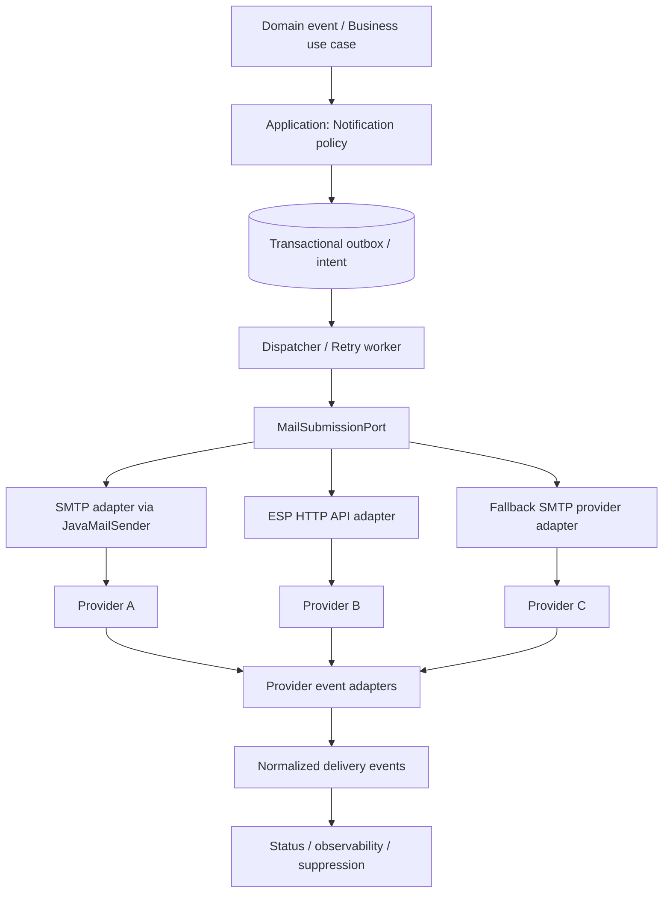

# Avoiding Proprietary Features When Unnecessary

A Spring Boot application sends OTPs, invoices, and transactional notifications through SMTP provider A. In the first version, developers used A's email template API, the `X-A-Campaign-Id` classification header, the `send_at` scheduling mechanism, and a proprietary webhook `delivered` status. A year later, the business needed to route part of its traffic to provider B to satisfy data residency requirements or outage failover. By then, domain services, DTOs, database tables, retry workers, and dashboards all depended on A's concepts. Switching providers was no longer an SMTP configuration change, but a large-scale business-logic rewrite.

Conversely, another team tries to build an abstraction framework supporting every feature of every provider, even though the product only needs plain-text and HTML emails. The result is dozens of interfaces, enums, capability flags, and fallback branches that are never used. **Portability does not mean abstracting everything**; the goal is to avoid depending on proprietary features **when business needs do not yet require them**.

In the **Multiple Providers** chapter of **Spring Framework Mail**, this lesson shows how to design the right boundaries: use SMTP/MIME standards and `JavaMailSender` for common capabilities, keep business data independent of provider SDKs, add intentional extensions only when genuinely needed, and test switchability without sacrificing security, correctness, or deliverability.

## 1. Understanding Vendor Lock-In Properly

**Vendor lock-in** is the degree to which a system is tied to one provider's behavior, data model, APIs, or operational workflows, making replacement costly or risky.

In an email system, lock-in does not live solely in the line of code calling an SDK:

- **Code:** the application imports `VendorXClient` inside application/domain layers.
- **Data:** notification tables directly store proprietary status codes such as `X_DELIVERED`.
- **Templates:** email content exists only inside a provider's dashboard.
- **Sending identity:** domains, bounce domains, DKIM, and webhook endpoints are not managed independently.
- **Observability:** metrics, alerts, and reports only understand a single ESP's status names.
- **Operations:** engineers only know how to inspect queues, quotas, and blacklists through one dashboard.
- **Behavior:** retries, batching, scheduling, or idempotency assume every provider behaves identically.
- **Processes:** there is no way to export suppression lists, bounce history, templates, and provider references during migration.

Coupling grows when a provider-specific decision **spreads across multiple layers** instead of staying inside adapters and operations.

### 1.1. What Does Switching Providers Actually Change?

A system may need to change:

1. SMTP hostname, port, credentials, and TLS mode.
2. Sending identity infrastructure, SPF/DKIM/DMARC, and Return-Path.
3. Rate/quota limits, IP pools, and warm-up.
4. API or SMTP transport and exception handling.
5. Provider-generated message IDs.
6. Webhook signatures, payloads, and event ordering.
7. Suppression, unsubscribe, and consent integration.
8. Template rendering/tracking if hosted by the provider.
9. Operational docs, dashboards, alerts, and incident runbooks.

Using `JavaMailSender` reduces coupling to **SMTP transport**, but does not automatically solve the remaining dependencies. Portability is a property of the **entire email flow**, not just the SMTP layer.

### 1.2. When Is Lock-In a Reasonable Trade-Off?

If a proprietary feature brings measurable value—such as batch personalization that cuts cost, an event API with signed webhooks meeting audit requirements, or mandatory data-residency routing—intentional coupling can be justified.

The question is not "are we allowed to use a proprietary SDK or not", but rather:

- Is that capability a **real requirement**?
- What is the benefit compared to a standard approach?
- If we drop this provider, which parts must change?
- Is there a viable replacement or degraded mode?
- Have security, data, and operational risks been accepted?

## 2. Standard Layers vs. Provider-Specific Layers

| Layer | Common Foundation | Portability | Notes |
|---|---|---|---|
| MIME message | RFC 5322, MIME RFC 2045–2049, Jakarta Mail | High for text/HTML/attachments/inline | Mail clients render differently |
| SMTP transport | SMTP, SMTP AUTH, STARTTLS/implicit TLS | High if providers offer SMTP submission | Quotas, reply text, and operations still differ |
| Spring integration | `JavaMailSender`, `MimeMessageHelper` | High inside Spring apps | Not a delivery-event abstraction |
| HTTP email API | ESP REST/JSON SDK | Lower if used directly | May offer distinct idempotency/tags/templates |
| Provider templates | Proprietary template IDs, variables, and helpers | Provider-dependent | Content can be hard to export/port |
| Analytics | Open/click, campaign metrics, reputation | Provider-dependent | Tracking semantics are inconsistent |
| Delivery events | Webhooks, DSNs, status APIs | Provider-dependent | Require normalization and deduplication |
| Sending infrastructure | IP pools, rDNS, quotas, sender verification | Account/infra-dependent | Cannot be migrated via code alone |
| Scheduling | Delayed-send endpoint / provider queue | Provider-dependent | Need clear timing and cancellation rules |

**Standards are a strong starting point, yet they do not mean every SMTP provider shares an identical contract.** They only reduce how many facets require rewriting.

### 2.1. What Does SMTP Standardize?

SMTP defines steps such as `EHLO`, `MAIL FROM`, `RCPT TO`, `DATA`, and the basic interpretation of reply codes. MIME and RFC 5322 define message formatting.

As a result, across many services providing SMTP submission, an application can reuse:

```java
JavaMailSender sender;
MimeMessage message = sender.createMimeMessage();
// Build MIME using the standard API
sender.send(message);
```

Switching providers may mainly involve changing hostname, credentials, and a few transport properties. However, SMTP has **no** standard API to ask "remaining quota", "did the email reach the Inbox", "template #42", or "best retry time for Gmail".

### 2.2. Vendor-Neutral Does Not Mean Lowest Common Denominator at All Costs

If scheduled sending is needed, you do not have to abandon scheduling just because SMTP lacks a standard scheduling command. Express the **"send no earlier than T"** requirement in the application contract and choose the implementation:

- Use an application outbox/scheduler: works across many providers.
- Use an ESP's native scheduling: only when benefits and semantics fit.
- If a scheduled email must be cancelable, design explicit cancellation authority and state confirmation.

Good abstraction expresses the **business requirement**, rather than copying one provider's API field names everywhere.

## 3. Classify Features Before Deciding to Abstract

Requirements can be grouped into four buckets:

| Group | Examples | Typical Decision |
|---|---|---|
| **Core, universal** | To/From, subject, plain/HTML, attachments | Use neutral contract + SMTP/MIME |
| **Business policy** | Consent, OTP expiry, notification type, idempotency | Keep in application/domain, never delegate authority to provider |
| **Advanced, optional** | Tags, categories, tracking, scheduled send, batch personalization | Opt-in extension/capability with support checks |
| **Specialized, mandatory** | Regulatory archive, data region, provider-specific delivery guarantees, compliance-managed templates | Allow provider-specific adapter and document lock-in |

### 3.1. Principle: "Do Not Abstract Speculatively"

If an application only sends invoices and OTPs, there is no reason to pre-design an interface like:

```java
interface AllPossibleEmailFeatures {
    void createProviderTemplate(...);
    void scheduleVendorCampaign(...);
    void triggerRecipientJourney(...);
    void provisionDedicatedIp(...);
    void queryGlobalReputationScore(...);
}
```

This mixes unrelated features that do not belong to one business contract. It blends transport, marketing, infrastructure, and analytics while locking architecture into assumptions about providers not even chosen yet.

Start with **one real, small use case**, then expand as actual requirements emerge.

### 3.2. Decision Checklist: "Do We Need a Proprietary Feature?"

Before adding a proprietary dependency, answer:

1. How is the business goal stated without naming any provider?
2. Are SMTP/MIME/outbox already sufficient?
3. Can the capability run in the application without excessive overhead?
4. Do latency/cost/compliance constraints prevent the standard approach?
5. If a provider lacks support, should the system **fail explicitly** or accept a fallback?
6. Which data and processes must move during migration?
7. Can benefits be measured via SLOs, throughput, cost, or operations?

Do not answer "maybe we'll want it someday" for every feature. Current requirements and measurable benefits must drive the choice.

## 4. Ports and Adapters Architecture Keeps Business Logic Independent

A healthy boundary:



### 4.1. Domain/Application Decides *What Must Be Sent*

The application knows:

- An order was paid.
- The recipient and applicable consent.
- Which confirmation email type is required.
- Send window and expiration deadline.
- How many notification intents one business event creates.
- Which business state must exist when creating the intent.

The application **does not need to know**:

- `vendorTemplateId`.
- Exception class names thrown by ESP A.
- ESP B's JSON field `message_id`.
- Webhook HTTP secret headers for ESP C.
- SMTP connection counts for ESP D.

### 4.2. MailSubmissionPort Decides *How Far Hand-Off Reached*

The port returns outcomes at the submission boundary without promising unobserved delivery. Example:

```java
public interface MailSubmissionPort {
    SubmissionOutcome submit(OutgoingEmail email);
}
```

The contract should clearly define:

- `submit` represents a single attempt, not the full retry lifecycle.
- `ACCEPTED` means the provider/relay accepted submission per transport signals.
- `TEMPORARY_REJECTION`/`PERMANENT_REJECTION` are used only with evidence.
- `UNKNOWN` means the message might have been accepted, though the client cannot tell.
- Never report `DELIVERED` simply because `JavaMailSender.send(...)` returned normally.

Distinguishing these certainty levels makes a portable design **far more reliable** than a `sendSuccessfully` boolean.

## 5. Designing a Provider-Neutral OutgoingEmail

An outgoing mail model should express true content and intent rather than carrying fields from any ESP API.

### 5.1. Core DTO

Java 17+ example:

```java
package com.example.notifications;

import java.time.Instant;
import java.util.List;
import java.util.Objects;
import java.util.UUID;

public record OutgoingEmail(
        UUID notificationId,
        String idempotencyKey,
        String from,
        String to,
        String replyTo,
        String subject,
        String plainText,
        String htmlText,
        List<MailAttachment> attachments,
        Instant expiresAt,
        NotificationPurpose purpose) {

    public OutgoingEmail {
        Objects.requireNonNull(notificationId);
        Objects.requireNonNull(idempotencyKey);
        Objects.requireNonNull(from);
        Objects.requireNonNull(to);
        Objects.requireNonNull(subject);
        Objects.requireNonNull(plainText);
        Objects.requireNonNull(attachments);
        Objects.requireNonNull(purpose);
        attachments = List.copyOf(attachments);
    }
}

public record MailAttachment(
        String fileName,
        String contentType,
        byte[] bytes) {

    public MailAttachment {
        Objects.requireNonNull(fileName);
        Objects.requireNonNull(contentType);
        bytes = Objects.requireNonNull(bytes).clone();
    }

    @Override
    public byte[] bytes() {
        return bytes.clone();
    }
}

public enum NotificationPurpose {
    ORDER_CONFIRMATION,
    INVOICE,
    PASSWORD_RESET,
    MARKETING
}
```

These types are shown together to explain the model; in a standard Java project, **each public top-level type** belongs in its own `.java` file matching the class name.

This model illustrates small payloads. For multi-megabyte PDFs or large attachments:

- Store an object-storage reference, content hash, content length, and MIME metadata.
- Open streams through an infrastructure abstraction.
- Control file access permissions, TTL, and lifecycle.
- Avoid holding full byte arrays in outbox rows or memory without resource bounds.
- Ensure retries read the exact snapshotted content.

### 5.2. Why Omit vendorTemplateId?

A DTO like:

```java
record OutgoingEmail(
    String to,
    String vendorTemplateId,
    Map<String, Object> vendorMergeVars,
    String vendorCampaignCategory) {}
```

forces every future provider to understand the current provider's template engine and campaign taxonomy. If the business simply wants "send invoice in Vietnamese", the right data is an **application-owned template** or a neutral notification content contract.

If native template rendering later brings clear value, a separate **extension** can be added without turning the domain DTO into an ESP JSON clone.

### 5.3. Validation at the Right Layer

A neutral model does not mean skipping validation:

- `From` belongs to an authorized sending identity.
- `To` satisfies syntax and policy rules.
- `Subject` contains no header injection.
- HTML escapes untrusted data.
- Attachment filenames and `Content-Type` values are valid.
- Notifications have not passed `expiresAt`.
- Marketing mail is blocked when consent is missing.
- Sensitive passwords/tokens never appear in logs.

Do not outsource these business checks entirely to the provider; provider rejections cannot replace a proper application contract.

## 6. Normalizing Submission Outcomes Without Losing Uncertainty

An outcome contract can look like:

```java
package com.example.notifications;

public enum SubmissionState {
    ACCEPTED_BY_RELAY,
    TEMPORARY_REJECTION,
    PERMANENT_REJECTION,
    UNKNOWN
}

public record SubmissionOutcome(
        SubmissionState state,
        String providerKey,
        String providerReference,
        String diagnosticCode) {
}
```

### 6.1. Avoid Boolean Success

`boolean send()` cannot express:

- SMTP server returning `451` (temporary failure).
- Provider returning `550` (permanent rejection for that request).
- TCP connection failing before sending.
- Timeout after SMTP DATA making the outcome unknown.
- Provider returning HTTP 202 "queued for processing".
- Partial success where some recipients are accepted and others rejected.

Not all situations should be handled identically. A neutral outcome must preserve classification and recovery capability.

### 6.2. Do Not Force Every Provider to Return Equally Rich Metadata

Standard SMTP does not always return a queryable provider message ID, whereas HTTP APIs often return a remote request/message ID. Therefore:

- Allow `providerReference` to be `null`.
- Keep `diagnosticCode` as a **normalized code**, not a raw response containing PII.
- Store provider-specific IDs in attempt metadata tables rather than leaking them into domain logic.
- Never fabricate fake provider IDs just to satisfy an overly rigid contract.

### 6.3. Accepted Is Not Delivered

`ACCEPTED_BY_RELAY` means the first relay agreed to take the job under its configured contract. Afterward it may still:

- Forward successfully.
- Delay due to the receiving MX.
- Bounce.
- Suppress under policy.
- Be blocked by the provider due to account/reputation issues.

Delivery events must travel through a separate **asynchronous** processing flow rather than being guessed from submission results.

## 7. Using JavaMailSender as a Neutral SMTP Adapter

In Spring Framework Mail, `JavaMailSender` is a suitable integration point when providers offer SMTP submission.

### 7.1. Example SMTP Adapter

```java
package com.example.notifications.smtp;

import com.example.notifications.*;
import jakarta.mail.MessagingException;
import jakarta.mail.internet.MimeMessage;
import org.springframework.core.io.ByteArrayResource;
import org.springframework.mail.MailException;
import org.springframework.mail.javamail.JavaMailSender;
import org.springframework.mail.javamail.MimeMessageHelper;

public final class SmtpMailAdapter implements MailSubmissionPort {

    private final JavaMailSender sender;
    private final String providerKey;

    public SmtpMailAdapter(
            JavaMailSender sender,
            String providerKey) {
        this.sender = sender;
        this.providerKey = providerKey;
    }

    @Override
    public SubmissionOutcome submit(OutgoingEmail email) {
        MimeMessage message = sender.createMimeMessage();

        try {
            MimeMessageHelper helper =
                    new MimeMessageHelper(message, true, "UTF-8");

            helper.setFrom(email.from());
            helper.setTo(email.to());

            if (email.replyTo() != null) {
                helper.setReplyTo(email.replyTo());
            }

            helper.setSubject(email.subject());

            if (email.htmlText() == null) {
                helper.setText(email.plainText(), false);
            } else {
                helper.setText(
                        email.plainText(),
                        email.htmlText());
            }

            for (MailAttachment attachment : email.attachments()) {
                helper.addAttachment(
                        attachment.fileName(),
                        new ByteArrayResource(attachment.bytes()),
                        attachment.contentType());
            }
        } catch (MessagingException ex) {
            // Payload construction error, not an SMTP temporary failure.
            throw new IllegalArgumentException(
                    "Cannot prepare outgoing MIME message", ex);
        }

        try {
            sender.send(message);
            return new SubmissionOutcome(
                    SubmissionState.ACCEPTED_BY_RELAY,
                    providerKey,
                    null, // Standard SMTP does not require returning a provider ID.
                    null);
        } catch (MailException ex) {
            // Example keeps the error for an external classifier.
            // Production: classify cause/SMTP stage; do not default to retry.
            throw ex;
        }
    }
}
```

This illustrates encapsulation, not a complete production implementation. `MailSubmissionPort`, `OutgoingEmail`, and outcomes were defined in earlier sections. Real systems require message-size policies, address validation, an exception taxonomy, and partial-recipient failure handling.

### 7.2. What Makes This Adapter Portable

- Business services never call `MimeMessageHelper`.
- DTOs know nothing about ESP A/B.
- Email content is prepared by the application.
- Each provider's sender is configured separately.
- SMTP-specific exceptions do not leak across application boundaries when an error translator is in place.
- Changing providers does not force edits to the `OrderConfirmed` use case.

### 7.3. Do Not Mistake a Simple Adapter for Complete Handling

`sender.send(message)` can throw `MailSendException` wrapping multiple nested exceptions, and timeouts can happen at different points. If an adapter catches `MailException` and returns `TEMPORARY_REJECTION` for everything, it can retry messages the relay already accepted.

A production classifier must inspect:

- `MailException` subtypes.
- Jakarta Mail `MessagingException.getNextException()` and cause chains.
- SMTP reply codes and enhanced status codes when provided.
- Connection, AUTH, RCPT, or DATA stage when evidence exists.
- Per-recipient partial failures.
- The ESP's retry policy.

Reserve `UNKNOWN` for cases lacking sufficient evidence. **Never use portability as an excuse to discard critical failure details.**

## 8. Configuring SMTP for Two Providers

When an application uses one provider at a time, Spring Boot binds standard properties:

```yaml
spring:
  mail:
    host: ${SMTP_HOST}
    port: ${SMTP_PORT:587}
    protocol: smtp
    username: ${SMTP_USERNAME}
    password: ${SMTP_PASSWORD}
    default-encoding: UTF-8
    properties:
      "[mail.smtp.auth]": true
      "[mail.smtp.starttls.enable]": true
      "[mail.smtp.starttls.required]": true
      "[mail.smtp.ssl.checkserveridentity]": true
      "[mail.smtp.connectiontimeout]": 5000
      "[mail.smtp.timeout]": 10000
      "[mail.smtp.writetimeout]": 10000
```

This configures a provider requiring STARTTLS on port 587. Implicit TLS on 465 requires `mail.smtp.ssl.enable=true` per provider contract rather than blindly toggling both modes. Switching providers **must never** introduce a cleartext fallback or disable hostname verification when TLS fails.

### 8.1. Multi-Provider Is Not Duplicating spring.mail.* Twice

Standard auto-configuration under `spring.mail.*` represents a single sender. To run two SMTP providers simultaneously, an application can manage two separately configured and explicitly named `JavaMailSenderImpl` beans:

```yaml
app:
  email:
    providers:
      primary:
        kind: smtp
        host: ${PRIMARY_SMTP_HOST}
        port: 587
        username: ${PRIMARY_SMTP_USERNAME}
        password: ${PRIMARY_SMTP_PASSWORD}
      secondary:
        kind: smtp
        host: ${SECONDARY_SMTP_HOST}
        port: 587
        username: ${SECONDARY_SMTP_USERNAME}
        password: ${SECONDARY_SMTP_PASSWORD}
```

The `app.email.providers.*` keys are **application-specific configuration**, not standard Spring Boot properties that automatically create two senders. You must write `@ConfigurationProperties` and create the corresponding beans/adapters.

### 8.2. Isolate Secrets per Provider

Each account should have:

- Separate SMTP credentials or API tokens.
- Separate secret rotation.
- Separate domain/identity verification.
- Accurate TLS hostname/trust configuration.
- Separate quota/account mapping.
- Audit trails and least-privilege access.

Never copy provider A's credentials to B or use a wildcard trust configuration just so "every provider works".

## 9. HTTP API Adapters Are an Implementation Branch, Not a New Domain

An ESP may offer an HTTP API with batch sends, scheduling, or idempotency keys. If business needs require it, keep `MailSubmissionPort` neutral and add an adapter:

```java
public final class HttpEspMailAdapter
        implements MailSubmissionPort {

    private final EmailProviderHttpClient client;
    private final String providerKey;

    public HttpEspMailAdapter(
            EmailProviderHttpClient client,
            String providerKey) {
        this.client = client;
        this.providerKey = providerKey;
    }

    @Override
    public SubmissionOutcome submit(OutgoingEmail email) {
        ProviderPayload payload =
                ProviderPayloadMapper.from(email);

        ProviderResponse response = client.submit(
                payload,
                email.idempotencyKey());

        return ProviderResponseMapper.toSubmissionOutcome(
                providerKey, response);
    }
}
```

`EmailProviderHttpClient`, `ProviderPayload`, and the mappers here are **adapter-defined placeholders**, not any concrete SDK. The key lies in the boundary:

- Vendor SDKs appear only under `infrastructure/providerX`.
- The application never parses vendor JSON.
- HTTP 202 follows the ESP's contract and never defaults to "delivered".
- Provider idempotency applies only if the API actually supports it with an explicit scope and TTL.
- Post-request timeouts can still yield an unknown outcome.

### 9.1. When SMTP and HTTP APIs Differ in Capabilities

An HTTP API may expose a provider ID or batch scheduling that SMTP lacks. The core contract should not demand both capabilities from every adapter.

If a use case **requires** a capability absent from SMTP, the routing policy must select a supporting adapter or fail explicitly rather than silently dropping the requirement.

## 10. Where Should Template Rendering Live?

A major source of lock-in is storing all email content inside an ESP dashboard.

### 10.1. Render Inside the Application

Example:

```text
InvoiceIssued event
     |
     v
TemplateRenderer(Thymeleaf/FreeMarker)
     |
     +--> text/plain
     +--> text/html
     +--> subject
     |
     v
OutgoingEmail
     |
     v
SMTP / HTTP adapter
```

Benefits:

- Templates are versioned alongside code/content repositories.
- Rendering logic and escaping can be verified with unit tests.
- Providers do not need matching template engines or variable syntax.
- Content parity is easy to verify across adapters.
- Template versions can be snapshotted inside the outbox.

Trade-offs:

- The application bears rendering CPU and template caching.
- Localization, branding, and asset URLs must be managed internally.
- Marketing teams may need a preview/editor tool if they edit templates directly.

### 10.2. Render Inside the Provider

Some ESPs offer managed templates with template IDs, helpers, dynamic variables, and A/B testing.

Potential benefits:

- Content teams can edit templates without redeploying the application.
- Batch personalization and campaign workflows.
- Provider-side analytics and testing.
- Smaller payloads sent from the application.

However, template IDs, helpers, and workflows may not be portable. If the business adopts them:

- Store a **logical template key** in the application, such as `INVOICE_V2`.
- Keep `logicalKey -> providerTemplateId` mappings in adapter configuration.
- Enforce explicit template versioning and publishing workflows.
- Maintain an export/migration plan.
- Verify render parity on backup providers.
- Never embed provider template IDs into domain events.

### 10.3. Template Fallbacks Must Preserve Meaning

If a native template is unavailable, falling back to application-rendered templates is acceptable **only when** the output satisfies content and audit requirements. Never substitute altered legal text, terms, or localizations just to get an email out.

When an exact legally approved template is mandatory, fallback may need to **fail closed** until an equivalent version exists.

## 11. Model Proprietary Features as Optional Capabilities

Instead of building an "everything" interface or methods packed with optional flags:

```java
submit(
    email,
    vendorCategory,
    vendorTemplateId,
    vendorCampaignId,
    vendorSendAt,
    vendorClickTracking,
    vendorUserAgentMode,
    vendorSpecialFlag
);
```

keep the core contract small and add extensions where needed.

### 11.1. Example Capability Descriptor

```java
public record ProviderCapabilities(
        boolean nativeScheduling,
        boolean nativeTemplates,
        boolean providerIdempotency,
        boolean deliveryWebhooks,
        boolean batchPersonalization,
        boolean trackingControls) {
}
```

A descriptor helps when the application must **select providers at runtime**. However:

- Values must reflect actual API versions, account tiers, regions, configs, and contracts.
- Having a capability flag does not guarantee runtime permission at every moment.
- A single boolean cannot describe constraints (e.g., scheduling capped at 72 hours).
- Do not build a massive capability matrix for unused features.

### 11.2. REQUIRED, PREFERRED, and DISABLED

For a feature with business significance, policies can express:

| Level | Meaning | When Unsupported by Provider |
|---|---|---|
| **REQUIRED** | Cannot be skipped | Do not send, or select a capable provider |
| **PREFERRED** | Beneficial but non-essential | Use an approved fallback |
| **DISABLED** | Must not be used | Adapter leaves it off |
 
For example, click tracking on a marketing email may be enabled if permitted, whereas open tracking is not required for OTPs. Conversely, "do not send before hour T" may be REQUIRED, while implementing scheduling via provider or outbox is an infrastructure choice.

### 11.3. Keep Provider Feature Names Out of Business Policies

Policies should state:

```text
sendNotBefore = 2026-11-13T08:00:00Z
purpose = MARKETING
trackingConsent = false
```

instead of:

```text
vendorSendAt = ...
vendorEnableOpenTracking = ...
```

**Business vocabulary belongs to the application**; adapters translate it into provider options when supported and permitted.

## 12. Distinguish "Unsupported" from "Unneeded"

Three very different situations exist:

1. The application does not need a capability → **do not design a dependency on it**.
2. The application requires a capability that the current provider lacks → **route/fall back or switch providers**.
3. The application requires a capability that is temporarily unavailable → **handle errors, retry, or fail over**.

Do not treat all three as "silently drop the option when sending".

Consider an email carrying a mandatory document: if a provider's active endpoint does not support attachments, **never** send the email without the attachment and count success. Select another SMTP/MIME adapter or fail cleanly.

### 12.1. Fallbacks Must Preserve Business Semantics

A safe fallback preserves:

- Recipient and consent.
- Verified From identity.
- Subject and body content.
- Mandatory attachments.
- Deadlines/expiration.
- Localization data.
- Privacy/residency requirements.
- Idempotency policy.

Optimization-only extras like an analytics tag may be omitted if business logic does not depend on them. Details that alter message meaning or validity may not.

## 13. Provider Metadata: Store on Attempts, Not in Domain Entities

A flexible data design:

```text
notification_intent
  id
  business_event_id
  purpose
  recipient_snapshot
  content_version
  idempotency_key
  created_at
  status

mail_submission_attempt
  attempt_id
  notification_id
  provider_key
  provider_account
  provider_reference_nullable
  normalized_result
  normalized_error_category
  provider_diagnostic_reference_nullable
  started_at
  finished_at
```

`provider_reference_nullable` can correlate with dashboards and webhooks, but business use cases must never treat it as a business key.

### 13.1. Why Separate Notification Identity from Provider Identity

- One notification may be attempted across multiple providers.
- One provider may emit multiple events for the same message.
- A provider may change ID formats across API versions.
- A timeout may yield no ID even if the provider accepted the message.
- Domain entities often outlive a specific account or ESP.
- Analytics group by provider, whereas business audits track notification IDs.

### 13.2. Never Rely on Provider Payloads as the Sole Source of Truth

You may keep **redacted** provider requests/responses per policy for debugging, while the source of truth for retries remains the neutral notification intent/content snapshot. If you only store ESP A's JSON, migrating to ESP B forces reverse-engineering A's fields before resending.

## 14. Webhooks and Delivery Events: Normalize Without Forcing Artificial Uniformity

Most ESPs offer different webhook/status APIs. One provider emits `delivered` upon remote MX acceptance; another uses `processed`, `deferred`, `dropped`, and `bounce` with distinct meanings.

### 14.1. Neutral Event Model

```java
public enum DeliveryEventType {
    SUBMISSION_ACCEPTED,
    DELIVERY_DEFERRED,
    DELIVERED,
    BOUNCED,
    COMPLAINT,
    SUPPRESSED,
    UNKNOWN
}

public record MailProviderEvent(
        String providerKey,
        String providerEventId,
        String providerMessageId,
        DeliveryEventType type,
        Instant occurredAt,
        Instant receivedAt,
        String normalizedReasonCode) {
}
```

In real Java projects, place public types in separate files. You may also need recipient identity, account scope, webhook version, and raw event references for multi-recipient mapping.

### 14.2. What Does the Event Adapter Do?

- Verify webhook signatures using **each provider's exact mechanism**.
- Prevent replay attacks within configured windows/policies.
- Parse payloads and versions.
- Map `providerMessageId`/recipient to notifications/attempts.
- Deduplicate by provider event ID or an accurate composite key.
- Normalize event types and reasons.
- Record `occurredAt` and `receivedAt` separately.
- Handle late or out-of-order events.
- Avoid double-counting deliveries or complaints.
- Quarantine unrecognized events instead of fabricating wrong states.

### 14.3. Do Not Create False Precision

If ESP A distinguishes `soft_bounce` from `deferred` while ESP B merges both into one status, the neutral model might only expose `DELIVERY_DEFERRED` plus a reason. When vendor-specific analysis is needed, retain provider metadata in controlled storage/logs.

Conversely, a provider **without webhooks** must never fabricate `DELIVERED` simply because `send()` succeeded. Its state must remain `SUBMITTED` or an equivalent status.

## 15. Treat Open/Click Tracking as an Extension, Not a Sending Prerequisite

Open/click tracking typically depends on:

- Tracking pixels.
- Redirect domains.
- Whether the mail client loads images.
- Privacy protection policies.
- Consent and legal requirements.
- Provider tracking IDs and webhook formats.
- Link rewriting.

If a product only sends OTPs, open/click tracking is rarely a core capability. Coupling business flows to a provider's `open_event` API creates unnecessary dependency.

### 15.1. Opens Do Not Prove a User Read the Email

Image proxies may prefetch images, while some clients block images or load them automatically. Thus "opened" is not equivalent to "human read" and must never serve as hard evidence for critical transactions.

### 15.2. When Click Analytics Are Needed

You can build a dedicated extension:

- Enable tracking deliberately and with valid consent.
- Ensure link domains belong to or are approved by the organization.
- Avoid breaking URLs, tokens, or signatures.
- Never rewrite URLs in ways that weaken security.
- Define fallback policy: if tracking is unavailable, is sending direct links allowed?
- Do not route password reset tokens or secrets through unnecessary tracking systems.

Do not confuse disabling tracking with disabling SPF/DKIM/DMARC authentication; they serve completely different roles.

## 16. Scheduling: Start With an Outbox for General Needs

Suppose the requirement is: send an appointment reminder **no earlier than 08:00 UTC** tomorrow. Even if only one ESP supports `send_at`, the application can schedule via its outbox:

```text
Notification intent
    not_before = 2026-11-13T08:00:00Z
    expires_at = 2026-11-13T09:00:00Z
    status = SCHEDULED
             |
             v
Worker scans due rows
    WHERE not_before <= now
    AND status = SCHEDULED
             |
             v
Quota/rate gate -> submit
```

This avoids relying on an ESP's scheduling API when the application already runs a reliable worker.

### 16.1. Benefits and Limits of Internal Scheduling

Benefits:

- Identical rules across every provider.
- Easy idempotency and cancellation before submission.
- Supports traffic prioritization and expiration checks.
- Audited records when rows are delayed or canceled.

Limits:

- The application is responsible for worker availability.
- Scheduling guarantees "no earlier than T", **not exact delivery at T** under quota limits or outages.
- Requires transactional claims and proper queries/indexes.
- After prolonged downtime, workers must handle stale/expired items.
- Does not automatically provide recall for already-accepted emails.

### 16.2. When Native Scheduling Helps

If an ESP supports high-scale scheduling, reliable cancellation of scheduled sends, and proven SLAs, it may be worth using. In that case, persist:

- Provider schedule reference.
- Schedule acceptance time, deadline, and cancellation status.
- Whether cancellation confirmation is guaranteed.
- Provider outage handling.
- Maximum future scheduling horizon.
- Migration strategy for un-sent schedules.

During provider migration, swapping adapters is not enough when millions of pending schedules sit inside the old provider.

## 17. Batch Personalization and Recipient Lists

Some ESPs offer batch endpoints with per-recipient merge variables:

```json
{
  "template_id": "provider-template-42",
  "personalizations": [
    {"to": "a@example.net", "variables": {"name": "An"}},
    {"to": "b@example.net", "variables": {"name": "Binh"}}
  ]
}
```

This is an **illustrative example** of a hypothetical API, not a claim about any concrete ESP schema. If a workflow sends only a few hundred transactional invoices, rendering each message locally and sending via SMTP can be easier to control.

### 17.1. Batching Does Not Automatically Save on Every Metric

Batching can cut HTTP calls, yet:

- Providers still count quotas per recipient.
- Partial failures can occur.
- One call can carry thousands of recipient identities.
- Retrying the whole batch can duplicate messages for already-accepted recipients.
- Tracking and provider message IDs may be per recipient.
- Large batches require payload bounds and privacy controls.

When batching for throughput, still give **each notification intent its own identity** and store `request -> per-recipient outcome` mappings rather than rewriting your business model into a proprietary JSON list.

### 17.2. Never Expose Recipients via To/Cc

A provider batch API may isolate personalization per recipient, whereas a single `MimeMessage` with shared To/Cc headers does not. For individual communications, never pack recipients into shared headers just to raise throughput.

## 18. Tags and Categories: Use Internal Vocabulary

If ESP A uses `category="password-reset"` while ESP B uses `tag="auth"`, the application should store:

```text
notificationPurpose = PASSWORD_RESET
notificationPriority = HIGH
tenantClass = TRANSACTIONAL
```

Adapter mapping:

| Application Concept | ESP A | ESP B |
|---|---|---|
| `PASSWORD_RESET` | category `password-reset` | tag `auth` |
| `INVOICE` | category `billing` | tag `transactional_invoice` |
| `MARKETING` | category `campaign` | tag `promotion` |

Mapping is only needed where tags genuinely support analytics or cost routing. Do not force every provider to support tags or block OTP delivery because an optional analytics tag is unavailable.

### 18.1. Avoid Injecting Arbitrary Metadata into Headers

Do not inject tenant IDs, customer IDs, internal invoice keys, or sensitive fields into `X-Custom-...` headers for analytics. Headers traverse relays and can reach recipients.

If correlation is needed, use an opaque privacy-reviewed correlation ID; store provider IDs and notification IDs in internal databases and events with proper access controls.

## 19. Quotas, Limits, and Provider Selection: Interface-Independent, Not Policy-Independent

Two providers can both accept MIME messages over SMTP yet impose completely different limits:

| Aspect | Provider A | Provider B |
|---|---|---|
| Quota unit | Recipients/24h | Messages/calendar day |
| Throughput rate | Recipients/second | Connections + burst requests |
| MIME size limit | Per account | Per endpoint |
| Reset schedule | Rolling window | Calendar window |
| Bounce handling | Detailed webhooks | Dashboard/DSN |
| SMTP submit | Yes | Yes |
| API idempotency | HTTP API only | Not supported |
| Native scheduled send | Yes | No |

This table is a hypothetical example highlighting differences, not representing real providers.

**Transport abstraction does not erase physical or commercial limits.** A shared `MailSubmissionPort` can submit via both A and B, yet the dispatcher must still enforce quotas, rates, and recipient costs per account.

### 19.1. Select Provider Before Reserving Quota

A sensible flow:

```text
Notification intent
     |
     v
Policy: region / consent / required capabilities
     |
     v
Provider selection
     |
     v
Check sender identity + account health
     |
     v
Reserve quota/rate/concurrency capacity
     |
     v
Submit through selected adapter
     |
     v
Persist attempt result
```

Do not share one global 100 requests/second limiter if each provider meters recipient units and windows differently. When failing over to B, apply B's quota policy instead of copying A's token budget.

### 19.2. Capability Does Not Equal Health

A provider may **support** attachments and scheduling, yet:

- Its account may be suspended.
- SMTP AUTH may be failing.
- Quota may be exhausted.
- Network connectivity may be broken.
- Sender identity may still be unverified.
- Its webhook endpoint may be broken.
- A region may be experiencing an outage.

Therefore, routing must separate:

- **Static capability:** whether the feature is supported in principle.
- **Configured entitlement:** whether this account currently has access.
- **Current health/availability:** whether it can serve traffic right now.
- **Policy eligibility:** whether it is allowed for this notification.
- **Remaining capacity:** whether quota and rate headroom exist now.

Never collapse all of these into `supports=true`.

## 20. A Provider Router Should Not Just Be an Error if/else

A router can select providers from neutral requirements:

```java
public record DeliveryRequirements(
        String dataRegion,
        boolean attachmentRequired,
        boolean deliveryEventsRequired,
        boolean nativeSchedulingRequired,
        NotificationPurpose purpose) {
}

public interface ProviderSelector {
    SelectedProvider select(
            OutgoingEmail email,
            DeliveryRequirements requirements);
}

public record SelectedProvider(
        String providerKey,
        MailSubmissionPort adapter) {
}
```

`ProviderSelector` consults capability inventory, account configuration, health/quota state, and policy; it does not live inside domain aggregates.

### 20.1. Principle of Determinism

To audit a notification:

- Record the provider chosen for each attempt.
- Record selection/failover reasons as structured codes.
- Never switch providers mid-attempt without persisting a new attempt.
- Reconstruct decisions from policy versions and config snapshots when needed.
- Avoid uncontrolled random selection when residency/compliance rules are strict.

Policy changes around retries must be intentional: unsent notifications can adopt new policies, while recipient, region, and content constraints must never mutate silently.

### 20.2. Start Simple First

If a product only uses one provider and redundancy is not needed yet:

```java
MailSubmissionPort port = smtpAdapter;
```

may suffice. Introducing the port interface early makes sense to decouple application code from transport. However, pre-building weighted routing, canary routing, dynamic pricing optimizers, and five mock adapters before any real need only expands the bug surface.

When adding a second provider, begin with **one clearly explainable routing rule**, then add complexity incrementally.

## 21. Failover: Portability Does Not Permit Blind Resending

A dangerous operational pattern:

```java
try {
    providerA.submit(email);
} catch (Exception ex) {
    providerB.submit(email);
}
```

This assumes every exception proves A never received the email. That assumption is **false** when a timeout strikes after request/`DATA` transmission.

### 21.1. Four Cases to Distinguish

| Primary Result | Safe for Automatic Failover? | Reason |
|---|---|---|
| Never called provider because local quota gate rejected | Possibly, if B is eligible | Primary had no submission attempt |
| Verified connection failure before sending message | Possibly per retry/failover policy | No evidence primary received the message |
| Explicit SMTP/HTTP rejection response | Depends on error type and policy | Permanent data errors cannot be fixed by swapping providers |
| Timeout after SMTP DATA or HTTP request transmitted, outcome unknown | Not by default | Primary may have accepted; secondary creates duplicates |

### 21.2. Idempotency Keys Do Not Automatically Span Two Providers

Suppose a logical notification carries key `order-confirmation:ORDER-1`.

- ESP A supports request idempotency within account A.
- ESP B supports request idempotency within account B.
- Both receive the same string key.

This **does not establish global idempotency**: A and B share no deduplication store. If A accepted before the app timed out, B can still accept the same notification and send a duplicate.

Nor is MIME `Message-ID` a standard-guaranteed deduplication mechanism across SMTP servers.

### 21.3. Outbox Is a Foundation, Not Exactly-Once SMTP

A sound design:

```text
notification_intent(id=N-1, key=K)
         |
         v
attempt #1: provider=A, outcome=UNKNOWN
         |
         +--> QUARANTINE / RECONCILE
         |
         +--> after evidence or policy decision
                   |
                   v
            attempt #2: provider=B
```

Special rules are required for duplicate-sensitive emails:

- OTPs: duplicate emails confuse users and invalidate earlier tokens/links.
- Invoices: must guarantee identical invoice versions and files.
- Marketing: generally should not resend on uncertain outcomes.
- Critical outage alerts: an organization may deliberately tolerate duplicate risk.

No single failover policy fits every category of email.

## 22. Neutral Error Taxonomy That Retains Provider Evidence

Errors can be normalized into categories:

| Normalized Category | Examples | Default Retry |
|---|---|---|
| `NETWORK_CONNECT` | DNS/connect timeout before submission | Bounded retries if proven unreceived |
| `TLS_CONFIGURATION` | PKIX, SAN mismatch, TLS version | Halt and alert |
| `AUTHENTICATION` | Invalid SMTP AUTH or API token | Halt/investigate account |
| `RATE_LIMIT` | Confirmed provider throttling | Backoff and quota control |
| `TEMPORARY_PROVIDER` | Transient 4xx/5xx per provider contract | Conditional |
| `PERMANENT_RECIPIENT` | Invalid/rejected recipient | Suppress or require data fix |
| `POLICY_REJECTION` | Sender identity, content/size policy | Fix config/content |
| `PAYLOAD_PREPARATION` | Invalid MIME/template/attachment | Do not retry unchanged |
| `SUBMISSION_UNKNOWN` | Lost response after transmission | Reconcile or duplicate-aware policy |
| `UNCLASSIFIED` | Insufficient evidence | Do not default to infinite retry |

### 22.1. Never Map Using a Single HTTP Status or SMTP Code Alone

- SMTP `4xx` usually means temporary failure; still check the stage and server explanation.
- SMTP `5xx` usually indicates permanent failure for that command, which does not mean retrying after fixing configuration is useless.
- HTTP `429` usually means rate limiting; parse `Retry-After` if provided per HTTP contract.
- HTTP `5xx` can happen **after** the provider processed the request; do not assume the message went unaccepted.
- JavaMail `MailSendException` can wrap multiple nested exceptions, including Jakarta Mail `MessagingException.getNextException()`.

Adapters should preserve a safe `providerDiagnosticReference` so operations can look up logs/case IDs without leaking raw credentials, recipient addresses, or HTML bodies into metrics.

### 22.2. Preserve Failure Stage When Known

If an adapter knows for certain an error happened during **connect** before any SMTP commands, it carries far more certainty than a socket failure after `DATA`. Normalized outcomes should convey certainty/stage or store evidence in attempt metadata.

An overly "clean" abstraction returning only `success=false` makes failover less safe.

## 23. DKIM, SPF, DMARC, and Sender Identity Are Not Portable via Code Alone

Sharing one DTO across two SMTP adapters accomplishes nothing if provider B is unauthorized to send for the domain.

Before shifting traffic:

1. Verify sending domains/identities on provider B.
2. Configure SPF for envelope sender/Return-Path per provider.
3. Configure DKIM selectors/keys and verify real message signatures.
4. Check DMARC alignment against the `From` header.
5. Verify bounce/return-path domains.
6. Verify TLS submission and account permissions.
7. Review IP pools, rDNS, and forward DNS if using dedicated outbound IPs.
8. Check current sender requirements from major mailbox providers.
9. Monitor bounces, complaints, and reputation after migration.

### 23.1. From, Reply-To, and Envelope Sender Differ

An email may carry:

```text
Header From: billing@example.com
Reply-To: support@example.com
Envelope MAIL FROM: bounce.provider.example
Provider outbound MTA EHLO: mailout1.provider.example
```

These domains do not have to match identically, yet authentication alignment and sender rules must hold.

Never hardcode `mail.smtp.from` into a domain DTO assuming all providers share one envelope policy; adapter/account config should adjust per provider contract.

### 23.2. DNS Changes Are Not Instantaneous

When updating SPF/DKIM, account for TTLs, caches, key rotation, live records, and real test-mailbox checks. Never shift 100% of traffic to B immediately after creating DNS records without verifying proper signing.

## 24. Suppression Lists and Consent Must Be Owned by the Application

This dependency is **more dangerous than code coupling**, because missing data can send email to recipients who opted out.

If only provider A knows `user@example.net` unsubscribed or hard-bounced, switching to B without syncing suppression risks emailing that address again.

### 24.1. Source of Truth Design

- Consent/preferences per notification type live in the enterprise's authoritative store.
- Provider webhooks are normalized and record suppression reasons.
- Hard bounces/permanent invalid recipients update the neutral suppression store per policy.
- Marketing unsubscribes are enforced consistently before selecting any adapter.
- When provider B maintains its own suppression list, sync in the approved direction.
- Never allow marketing sends merely because B lacks A's history.
- Data retention and export must align with applicable policies and laws.

### 24.2. Provider Suppression and Application Suppression Are Two Layers

An ESP may reject a recipient under abuse policy, while the application enforces its own internal rules. When evaluating portability, check:

- Does an export suppression API exist?
- Which events arrive via webhooks?
- Must technical reasons and timestamps be stored?
- Are suppression lists per-account, per-subaccount, or global?
- What if a recipient is eligible for transactional mail but opted out of marketing?

Do not flatten all suppression into one `blacklisted` boolean when enterprise policy distinguishes sending purposes.

## 25. Data Residency and Compliance May Require Provider-Specific Features

Maximum portability is not always the top priority. For notifications governed by data residency policies:

- Processing must stay inside approved regions.
- Attachments must never route through out-of-region endpoints.
- Providers must satisfy retention or audit requirements.
- Webhook payloads must adhere to data minimization.
- Content access requires logging and access controls.

In such cases, adapter/provider selection needs **REQUIRED constraints**. If provider B does not satisfy them, **never** automatically fail over to B just because A has an outage.

### 25.1. Do Not Hide Compliance Behind an Abstraction

A vague `supportsCompliance=true` flag is insufficient. Record auditable constraints: allowed regions, permitted data classes, retention, DPA/contracts, encryption, and document types.

Good abstractions place rules at the right layer, **never** erase critical differences between providers.

## 26. Security Settings Must Not Be Downgraded for Portability

Some "multi-provider" code attempts to work around TLS errors using:

```properties
mail.smtp.ssl.trust=*
mail.smtp.ssl.checkserveridentity=false
```

This is not a portability fix. It can cause clients to trust untrusted endpoints or skip identity verification.

Minimum requirements for each SMTP provider:

- Exact hostname/port and STARTTLS/implicit TLS mode per contract.
- For STARTTLS submission, enforce TLS where policy requires: `mail.smtp.starttls.required=true`.
- Enable hostname verification: `mail.smtp.ssl.checkserveridentity=true`.
- Trust stores containing verified CAs and valid chains.
- Provider-specific credentials, never hardcoded.
- Connection, read, and write timeouts.
- Valid sender domains and permissions.
- Never log raw SMTP credentials or uncontrolled transcripts in production.

### 26.1. Providers Requiring a Private CA

If an internal relay uses a private CA, add the out-of-band verified trust anchor, configure a proper truststore, and test negative cases. Never enable trust-all so one adapter talks to every endpoint.

### 26.2. Providers Requiring OAuth2/HTTP Tokens

If an ESP mandates OAuth2 or proprietary auth, isolate the token flow inside the infrastructure adapter/config. Domain and application layers still pass a neutral `OutgoingEmail`; credential acquisition stays out of business events.

## 27. Multi-Provider Observability: Shared Taxonomy, Preserved Dimensions

A multi-provider dashboard should include:

| Metric | Meaning |
|---|---|
| `mail_intents_created_total` | Unique committed notification intents |
| `mail_attempts_total{provider,result}` | Attempts by provider and normalized outcome |
| `mail_accepted_units_total{provider}` | Accepted recipient units per contract |
| `mail_submission_duration_seconds` | Transport latency |
| `mail_time_to_submission_seconds` | Time from intent to accepted, including queue wait |
| `mail_pending_count{provider,type}` | Backlog |
| `mail_unknown_count{provider}` | Unresolved submissions |
| `mail_provider_throttles_total{provider}` | Confirmed throttling |
| `mail_delivery_events_total{provider,event}` | Delivery/bounce/deferred events |
| `mail_webhook_lag_seconds{provider}` | Provider event delivery lag |
| `mail_quota_snapshot_age_seconds{provider}` | Freshness of quota data |
| `mail_failover_total{from,to,reason}` | Controlled provider switches |

### 27.1. Keep Label Cardinality Low

Suitable tags:

- `provider`, `account_class`, `notification_type`.
- `result`, `error_category`, `channel`.
- `region` when genuinely useful.

Never use recipient email addresses, notification UUIDs, provider message IDs, or raw exceptions as metric labels. Those belong in access-controlled logs, traces, or audit stores.

### 27.2. Never Compare Providers Using One Vague "Success" Number

Provider A emits detailed webhooks while B does not. Comparing `delivered` from A against `accepted` from B compares different layers.

Report clearly:

- Attempt acceptance rate.
- Time-to-submission.
- Cohort on-time success.
- Delivery confirmation rate **only when backed by reliable data**.
- Bounce rate and data completeness.
- Provider limits/quotas, payload mix, and recipient domain mix.

### 27.3. Compare Comparable Cohorts and Workloads

Never conclude ESP B outperforms A when B handles simple OTPs while A sends PDF attachments and marketing batches. Compare across comparable notification types, payload sizes, recipient domains, time windows, and capacity limits.

## 28. Keep Provider SDKs Out of the Application Layer

A maintainable package layout:

```text
domain/
  OrderConfirmed.java
  NotificationPurpose.java

application/
  NotificationUseCase.java
  NotificationPolicy.java
  OutgoingEmail.java
  MailSubmissionPort.java
  SubmissionOutcome.java
  ProviderSelectionPolicy.java

infrastructure/
  mail/
    smtp/
      SmtpMailAdapter.java
      SmtpSenderConfiguration.java
    provider_a/
      ProviderAHttpAdapter.java
      ProviderAEventMapper.java
      ProviderAWebhookController.java
    provider_b/
      ProviderBHttpAdapter.java
      ProviderBEventMapper.java
      ProviderBWebhookController.java
    outbox/
      MailOutboxRepository.java
      MailDispatchWorker.java
    observability/
      MailMetrics.java
      MailFailureClassifier.java
```

### 28.1. Dependency Rules

- Domain **never imports** Spring Mail, Jakarta Mail, or provider SDKs.
- Application relies on neutral interfaces and its own data models.
- Infrastructure implements ports and depends on Spring/provider SDKs.
- Webhook controllers only receive, verify, and normalize provider events.
- Outbox/workers handle retries and idempotency rather than domain entities.
- Sending configuration never lives in static mutable global state fought over by providers.

### 28.2. Do Not Hide Every Difference Inside One Giant Class

A 2,000-line `UniversalEmailSender` filled with `if(provider == A) ... else if(provider == B)...` simply creates a new lock-in point.

Keep adapters separate and the shared core small. Abstract only behaviors **proven truly common** across multiple adapters.

## 29. Designing Tests for Portability

With two adapters, test both the **core contract** and **contract-accurate provider behavior**, rather than mocking only for provider A.

### 29.1. Provider-Independent Application Unit Tests

Example fake port:

```java
public final class RecordingMailPort implements MailSubmissionPort {
    private final List<OutgoingEmail> recorded =
            new ArrayList<>();

    @Override
    public SubmissionOutcome submit(OutgoingEmail email) {
        recorded.add(email);
        return new SubmissionOutcome(
                SubmissionState.ACCEPTED_BY_RELAY,
                "fake-provider",
                null,
                null);
    }

    public List<OutgoingEmail> recorded() {
        return List.copyOf(recorded);
    }
}
```

Application tests can assert:

- One `OrderConfirmed` creates one notification intent.
- From/To/subject and plain/HTML match expectations.
- Attachments, expiry, and purpose are accurate.
- Consent/suppression rules are enforced.
- Idempotency keys stay constant across retries.
- Business logic knows nothing about ESP A or B.

Fake ports do not prove SMTP/TLS or webhooks; they strictly verify the application contract.

### 29.2. Contract Tests for Every Adapter

Each adapter must satisfy the core contract guarantees:

| Test | SMTP Adapter | HTTP Adapter |
|---|---|---|
| Builds recipient and From accurately | Real `MimeMessage`/test SMTP | Inspect payload/request |
| UTF-8 subject and HTML/text | MIME assertions | Provider payload mapping |
| Attachment bytes/filename | Decode MIME part | Verify uploaded bytes/content type |
| One attempt per submit call | Observe SMTP call | Observe HTTP call |
| Never self-marks delivered | Assert `ACCEPTED_BY_RELAY` | Assert proper accepted/queued semantics |
| Config errors classified properly | TLS/AUTH test | Invalid API token/config test |
| Ambiguous timeout not turned permanent | Stage-aware test | Post-request timeout test |
| Missing optional capabilities unused | Capability routing test | Capability routing test |

If an adapter's chosen endpoint lacks attachment support, the test must **fail explicitly** rather than silently dropping the file.

### 29.3. SMTP Integration Tests

Use GreenMail, Mailpit, or an appropriate SMTP test server:

- Connect using a real `JavaMailSenderImpl`.
- Verify UTF-8, From/To, and MIME alternatives.
- Verify attachments and inline resources.
- Configure TLS/AUTH per test requirements.
- Simulate SMTP temporary and permanent failures.
- Never send to real user mailboxes.

### 29.4. HTTP Adapter Integration Tests

Use a mock HTTP server/contract harness:

- Exact endpoint and HTTP method.
- Accurate Authorization headers/token handling without logging secrets.
- Accurate mapping of templates, attachments, and cost.
- Handling of 202/4xx/5xx/429 responses per provider docs.
- Parsing `Retry-After` when present.
- Distinguishing timeouts before, during, and after the request.
- Sending API idempotency keys only when supported by the provider.
- Storing provider response IDs in the right scope.

### 29.5. Webhook Integration Tests

For each provider:

- Valid signatures are accepted.
- Invalid signatures/replays are rejected.
- Duplicate events do not double-count.
- Out-of-order events do not regress the state machine.
- Missing provider references are quarantined.
- Bounces/complaints update suppression accurately.
- Unrecognized events are stored for investigation.

## 30. Testing Failover With a Failure Matrix

| Scenario | What to Test |
|---|---|
| A local rate gate DENIED, B has capacity | Can route to B before submission |
| A lacks REQUIRED attachment support | Select another provider or fail cleanly |
| A connection refused before DATA | Apply retry/failover per policy |
| A returns explicit temporary rejection | Backoff/routing without hammering B |
| A times out after DATA | No blind failover; record UNKNOWN |
| A SMTP accepted, webhook delayed | Do not resend merely because DELIVERED hasn't arrived |
| B lacks verified From domain | Never route to B |
| B sits outside required data region | Never route to B |
| B quota exhausted | Hold outbox without creating a new intent |
| Both providers unavailable | Backoff/circuit breaker without losing intent |
| A webhook arrives after B was tried | Correlate accurately to each provider attempt and notification |
| Worker restarts mid-switch | Recover state from outbox/attempt history |

### 30.1. An Easily Overlooked Bug: Provider Selection Race

Two workers concurrently seeing a `PENDING` notification and picking different providers can send duplicates even when both adapters work individually. Enforce:

- Transactional row claiming.
- Leases and claim tokens/fencing.
- Atomic state transitions prior to submission.
- Only the valid lease holder can record attempt outcomes.
- Idempotency policies keyed on notification identity.

Never try to prevent races via in-memory JVM flags inside adapters A/B.

## 31. Migration Playbook from Provider A to B

A safe migration is never "swap `SMTP_HOST` and deploy".

### Phase 1 — Inventory Dependencies

List:

- All imports of A's SDK/API.
- Template IDs and versions.
- Categories, tags, tracking, and links.
- Data schemas storing A-specific fields.
- Webhook endpoints and signature verification.
- Suppression lists and consent records.
- SMTP settings and secrets.
- Sender domains, DKIM, and bounce domains.
- Quota/rate policies and IP pools.
- Dashboards, alerts, runbooks, and reports.
- Outstanding scheduled messages and outbox rows.

Classify every dependency as **core to keep**, **optional to drop**, or **intentional vendor feature**.

### Phase 2 — Define Neutral Contracts

- Standardize `OutgoingEmail`.
- Isolate `MailSubmissionPort`.
- Normalize attempt outcomes with certainty levels.
- Move provider IDs into attempt storage.
- Separate webhook event mappers.
- Document required capabilities explicitly.
- Write contract tests prior to migration.

Do not cram all of A's historical statuses into a shared enum if B cannot represent them accurately.

### Phase 3 — Prepare B's Infrastructure

- Verify sender identities.
- Configure SPF/DKIM/DMARC per contract.
- Configure bounce/Return-Path domains.
- Verify SMTP TLS or HTTP credentials.
- Provision webhook secrets and signature checks.
- Sync suppression and preference records.
- Verify quotas, rate limits, message size limits, and dedicated/shared IPs.
- Confirm data residency/compliance.
- Test MIME and template rendering.

### Phase 4 — Shadow or Canary

If possible, run **non-delivering shadow mode**: render and validate B payloads without sending real emails. Never silently send the same notification through two providers "to compare".

When ready:

1. Select a small slice of eligible notifications.
2. Route **each notification** to one provider per policy.
3. Monitor acceptance rate, latency, bounces/complaints, and webhook lag.
4. Compare recipient/domain mix, payload size, and SLAs.
5. Increase B's share gradually.
6. Prepare a rollback policy that avoids duplicates.

### Phase 5 — Concurrent Operation

During transition:

- Keep both A and B webhook handlers running for already-sent messages.
- Keep A's provider references until events/DSNs finish arriving.
- Account for scheduled messages still queued inside A.
- Keep quota pacing separate per provider.
- Monitor invoice/OTP SLOs per provider.
- Never drop suppressions from A simply because traffic moved to B.
- Clean up stale configs once finished.

### Phase 6 — Decommission A

Only turn off A after:

- No pending/running attempts or scheduled sends remain.
- Unknown outcomes are resolved per policy.
- Remaining provider events have reconciled or passed retention windows.
- Suppression and consent remain intact.
- Required audit/history records are preserved.
- Secrets are revoked/rotated.
- Old DNS/provider records are removed carefully without breaking other flows.

## 32. When to Accept a Proprietary SDK

There are valid situations to adopt vendor-specific APIs:

### 32.1. Native Idempotency API

If a provider offers request idempotency with documented SLAs and retention, it can curb duplicates during retries. Still understand its scope: account, endpoint, TTL, payload equivalence, and migration impact. Keep it inside the HTTP adapter alongside internal outbox idempotency.

### 32.2. Signed Event Streams and Delivery Diagnostics

An ESP supplying detailed per-recipient delivery events improves bounce, complaint, suppression, and SLO tracking over plain SMTP. Use it where valuable, while normalizing events and keeping signature verification isolated in adapters.

### 32.3. Advanced Template Workflows

If marketing needs content editing, A/B testing, locale management, and approvals directly in the ESP, native template platforms can save substantial effort. Document export/migration paths and parity tests.

### 32.4. Dedicated IP Management, Warm-Up, and Routing

High volume may call for APIs managing IP pools, traffic shaping, and provider-managed deliverability. Keep this in an **operations adapter**, never inside every domain use case sending emails.

### 32.5. Regulatory Capabilities

A provider may offer certified audit archiving, data residency, or retention features. When required and unachievable via standard protocols, document the dependency explicitly in architectural records.

### 32.6. How to Document the Trade-Off

Record a concise architecture decision record (ADR):

```text
Decision: Use provider native template service for campaigns.
Reason: Editorial approval workflow and A/B testing.
Boundary: infrastructure/provider_a/templates.
Core fallback: transactional emails rendered in application.
Migration cost: template export, syntax conversion,
                tracking and analytics mapping.
Required tests: parity, localization, consent, HTML escaping.
Owner: Messaging Platform team.
Review trigger: second provider onboarding or API deprecation.
```

An intentional dependency with an owner and exit path is far easier to manage than accidental lock-in.

## 33. The Cost of Abstraction Must Also Be Measured

### 33.1. Over-Abstraction

Warning signs:

- An enum defines 70 capabilities while only 3 are used.
- Every method takes dozens of options nobody understands.
- Every provider has stub implementations just to "pass the interface".
- Shared contracts claim every provider supports idempotency when some do not.
- Silent fallbacks drop attachments or consent.
- Debugging any bug requires stepping through 6 wrapper layers that add zero value.

### 33.2. Under-Abstraction

Warning signs:

- Application code imports SDK classes.
- Domain entities store `providerTemplateId` as a business key.
- Use cases catch vendor-specific exceptions.
- Reports join directly against provider JSON response tables.
- Webhook controllers mutate domain state from raw provider statuses.
- Switching providers forces edits across dozens of use cases.

### 33.3. Right-Sized Abstraction

Abstract **proven, stable concepts**:

- Notification intent.
- Mail content and business metadata.
- Submission attempts/outcomes.
- Provider selection policy.
- Normalized delivery events.
- Suppression/consent.
- Retries and idempotency.

Keep provider-specific features in extensions when justified. Do not invent a brand-new email protocol abstraction just to dodge SDKs when standard Jakarta Mail already handles core needs well.

## 34. End-to-End Use Case: Multi-Provider Invoice Email

Suppose a business sends PDF invoices normally via SMTP A, keeps provider B as backup, and enforces data residency rules.

### 34.1. Creating the Intent

When an invoice is issued:

```text
InvoiceIssued(invoiceId=I-42, customerId=C-7)
          |
          v
Application determines:
    purpose = INVOICE
    verified recipient = customer email
    subject = "Invoice I-42"
    plain/HTML = rendered + escaped content
    attachment = immutable PDF reference
    idempotency key = "invoice:I-42:customer:C-7"
    region = approved-region
          |
          v
Commit notification outbox intent
```

### 34.2. Dispatch

Worker:

1. Claim a committed row.
2. Check expiration and recipient policy.
3. Read the content snapshot and PDF reference.
4. Filter providers satisfying region, attachments, and `From` identity.
5. Pick a provider by priority, quota, and health.
6. Record the attempt and reserve capacity.
7. Invoke the adapter for a single attempt.
8. Persist accepted, rejected, or unknown with evidence.
9. Schedule next attempt per policy if needed.

### 34.3. When SMTP A Accepts

Record status `SUBMITTED` and save A's reference (if any) on the attempt. Do not assume `DELIVERED` until confirmation arrives.

### 34.4. When A Times Out After DATA

Record `UNKNOWN`. Before trying B, check logs/APIs/provider references per capability and duplicate-aware policy. Never immediately resend the invoice as though A definitely failed.

### 34.5. When B Lacks Attachment or Region Support

Do not route to B. Record a clear reason, hold the intent, and alert/escalate. Never strip the PDF or cross into the wrong data region.

### 34.6. Benefit of a Neutral Contract

Business logic still simply says "invoice I-42 needs an email with a PDF to C-7". Differences between SMTP A, ESP API B, and routing/alerting rules live inside infrastructure and operations.

## 35. Runbook During a Provider Outage

### Step 1 — Identify the Failing Layer

- DNS/connectivity?
- TLS/authentication?
- Provider rate/quota?
- SMTP temporary rejection?
- Provider API outage?
- Webhook lag?
- Recipient MX deferral after acceptance?

Do not fail over every error, especially invalid sender domains or payloads.

### Step 2 — Assess Blast Radius

- Is provider A down globally or in one region?
- One account or all accounts?
- One notification type or all traffic?
- Are OTP SLAs impacted?
- Pending, retry-wait, and unknown counts?
- How many submissions did the provider already accept?

### Step 3 — Verify Provider B Eligibility

- TLS, credentials, and endpoints.
- Sender identity verification and SPF/DKIM.
- Region and compliance.
- Required MIME features.
- Quota/connection limits and IP reputation.
- Suppression sync.
- Webhook availability and diagnostics.

### Step 4 — Make Failover Decisions

- **Not yet attempted:** can switch providers if policy permits.
- **Explicit temporary failure:** retry or fail over conditionally.
- **Explicit permanent recipient/payload failure:** do not expect another provider to fix bad data.
- **UNKNOWN:** reconcile or accept duplicates per business decision.
- **Already accepted:** do not resend merely because delivery events arrive late.

### Step 5 — Recover Under Control

- Preserve notification IDs and idempotency keys.
- Pace traffic to provider B's limits.
- Prioritize transactional traffic.
- Watch accepted throughput, p95 submission latency, and queue age.
- Do not dump the entire backlog the instant B comes online.
- Watch bounces, complaints, and provider events post-switch.

### Step 6 — Post-Incident Review

- Did proprietary dependencies slow down migration unnecessarily?
- Did any fallback corrupt content?
- Did `UNKNOWN` outcomes cause duplicates?
- Were quotas and IP warm-up ready?
- Did suppression lists stay in sync?
- Did dashboards distinguish accepted from delivered?
- What updates are needed in the capability inventory, ADRs, and runbooks?

## 36. Common Mistakes

### 36.1. Using Provider SDKs Inside Domain Services

Domains should never construct `VendorRequest` objects or parse vendor statuses. Keep those inside infrastructure adapters.

### 36.2. Building Premature Abstractions

Do not model dozens of speculative features. Start from realistic `OutgoingEmail` and `MailSubmissionPort` contracts.

### 36.3. Changing SMTP Hosts and Declaring Full Multi-Provider Support

Sender verification, webhooks, quotas, DNS, suppression, reputation, and reporting still remain.

### 36.4. Assuming Every Provider Returns Identical Result Schemas

SMTP does not return every message ID or event. Allow nullable provider references and preserve accurate normalized semantics.

### 36.5. Using Boolean Success for Every Failure Type

Fails to represent temporary, permanent, `UNKNOWN`, and partial-recipient outcomes.

### 36.6. Retrying Through Provider B After A Times Out Post-DATA

Can trigger duplicates. Inspect failure stages and follow a reconciliation policy.

### 36.7. Assuming Idempotency Keys Work Across Providers

ESPs do not share idempotency stores. Internal outbox keys do not guarantee exactly-once delivery.

### 36.8. Storing A's Template IDs Inside Domain Events

Switching providers forces rewriting business logic. Use logical template keys mapped inside adapters.

### 36.9. Assuming Provider-Specific Scheduling Is Always Required

An outbox scheduler normally meets basic "no earlier than T" requirements with far less lock-in.

### 36.10. Dropping Attachments When Another Provider Lacks Capability

Alters mandatory content. `REQUIRED` features must fail explicitly.

### 36.11. Treating Open Tracking as Mandatory Business Behavior

Open tracking depends on mail clients and privacy protections. Never require it as proof a user read an email.

### 36.12. Ignoring Suppression When Switching Providers

Risks emailing recipients who already unsubscribed or hard-bounced.

### 36.13. Forgetting Data Residency in the Router

A healthy provider is not necessarily legally permitted to process every notification.

### 36.14. Disabling TLS Verification for Providers With Broken Certificates

That is a security vulnerability, not a portability solution.

### 36.15. Storing Raw Provider Statuses in Domain Tables

Makes schema migrations painful. Normalize and store raw evidence inside attempt/event adapters.

### 36.16. Treating All Webhooks as Uniform

Event labels, timestamps, recipient granularity, and signing protocols differ; write per-provider parsers and contract tests.

### 36.17. Failing to Account for Cost Per Recipient

A multi-recipient MIME message consumes quota differently than assumed. Routing needs an accurate cost model.

### 36.18. Comparing A's Acceptance Rate Against B's Delivered Rate

Those measure two different boundaries; dashboards will mislead.

### 36.19. Testing Mock Senders Without Testing Provider Adapters

Mocks never prove MIME, TLS, API, or webhook mapping. Dedicated contract and integration tests are required.

### 36.20. Switching Providers Without Readiness Verification

Missing SPF/DKIM, quotas, or suppression can degrade deliverability even though the code compiles.

### 36.21. Shadow-Testing by Sending Duplicate Emails to Users

Annoys recipients and skews metrics. Use non-delivering payload validation or controlled test mailboxes.

### 36.22. Using Arbitrary Provider Metadata as Metric Labels

Causes high cardinality and PII leaks. Stick to bounded-value tags.

### 36.23. Lacking Clear Ownership for Provider Integrations

Leaves nobody accountable for API deprecations, key rotation, template mapping, or webhook signature updates.

### 36.24. Decommissioning Provider A Too Soon

Outstanding schedules, bounce events, and unresolved attempts may be lost. Decommission according to actual lifecycle.

## 37. Practice Exercises

### Exercise 1 — Classify Features

For an app sending OTPs and invoices, classify text/plain, HTML, attachments, click tracking, native scheduling, DKIM, native templates, tags, webhook events, and IP pools as core, business policy, optional, or provider-specific. Explain your criteria.

### Exercise 2 — Detect Lock-In

Suppose `OrderService` imports `VendorXClient`, calls `VendorXTemplate(42)`, and saves `VendorXMessageId` in the `Order` entity. Redesign the port/adapter boundaries and audit data model.

### Exercise 3 — Design OutgoingEmail

Write a neutral DTO holding notification ID, from, to, subject, plain/HTML, attachments, and expiry. Specify behavior when HTML is empty or an attachment cannot be read.

### Exercise 4 — JavaMailSender Adapter

Implement `SmtpMailAdapter` using `MimeMessageHelper` to send plain/HTML and PDF attachments without importing any SDK into the domain layer.

### Exercise 5 — Two SMTP Providers

Configure two `JavaMailSenderImpl` beans for two independent SMTP accounts with proper secrets, TLS modes, and timeouts without hardcoding credentials or enabling trust-all.

### Exercise 6 — REQUIRED Capabilities

Provider A supports attachments while B does not on its current API endpoint. How must the router handle invoice emails? Why can it not omit the PDF and report success?

### Exercise 7 — Provider Template Mapping

The application stores logical template key `INVOICE_V2`. Design the mapping to A/B provider template IDs, versioning, localization tests, and fallback policy.

### Exercise 8 — Webhook Normalizer

A sends `delivered` with `message_id`, while B sends `success` with `id`. Design provider event adapters, signature checks, and normalized events with clear scope/identity.

### Exercise 9 — Suppression Portability

A user unsubscribes from marketing on A, and later the company moves to B. Design consent/suppression storage and syncing so no unwanted mail goes out.

### Exercise 10 — Pre-Connect Failover

Provider A fails at TCP connect before transmitting data. When is B eligible, and which sender-identity/quota/region checks must pass?

### Exercise 11 — Post-DATA Timeout

Provider A may have accepted the message, yet the client lost the 250 response. Why can it not immediately send via B? Design the `UNKNOWN` state and reconciliation workflow.

### Exercise 12 — API Idempotency

A offers 24-hour HTTP idempotency while B offers none. What does a logical outbox idempotency key solve, and what does it leave unsolved? Describe cross-provider duplicate risk.

### Exercise 13 — Scheduling

Design an outbox with `notBefore` and `expiresAt` to send scheduled notifications without vendor `send_at`. Which limitations remain?

### Exercise 14 — Quotas With Different Units

Provider A limits recipients/second while B limits requests/minute. Design a cost model and admission policy that avoids comparing both numbers as equal units.

### Exercise 15 — Isolate Domain From Provider DTOs

Write a test using `RecordingMailPort` proving `InvoiceIssued` builds accurate email payloads without A/B SDKs.

### Exercise 16 — Contract Tests

Build a test matrix for SMTP and HTTP adapters covering recipients, UTF-8, HTML, attachments, transport acceptance, partial failures, timeouts, and missing capabilities.

### Exercise 17 — Migration Readiness

Write an onboarding checklist for provider B covering SPF/DKIM/DMARC, verified `From`, TLS, quotas, IP reputation, suppression, webhook secrets, and provider references.

### Exercise 18 — Canary Routing

Plan routing 5% of new notifications to B such that each intent attempts only one policy-chosen primary; monitor acceptance rate, bounces, latency, and queue age.

### Exercise 19 — Portability vs. Compliance

A notification must stay in region X, whereas provider B only processes in region Y. What must the router do if provider A goes down?

### Exercise 20 — Security

A developer suggests `mail.smtp.ssl.trust=*` so both SMTP A and B connect cleanly. Explain the danger and describe proper truststore/certificate handling.

### Exercise 21 — Dashboard Parity

Provider A emits accepted+delivered webhooks while B only provides SMTP acceptance. Design a dashboard that avoids comparing success rates from different layers.

### Exercise 22 — Decommission Legacy Provider

After moving 100% of new sends to B, 2,000 A-accepted emails still await events and 300 scheduled messages remain in A. Outline the drain plan before revoking credentials.

### Exercise 23 — Proprietary Feature ADR

The business wants native template A/B testing. Write an ADR covering benefits, boundaries, migration cost, exportable data, parity tests, and review triggers.

### Exercise 24 — Evaluate Abstraction Size

An interface exposes 40 provider options while the app only uses plain/HTML + attachments. Propose a leaner contract and state when optional features should be added.

## 38. Takeaways and References

When **avoiding proprietary features unless necessary** in Spring Framework Mail:

1. **Use SMTP/MIME/Jakarta Mail standards for core needs** such as From/To, text/plain, HTML, inline resources, and attachments.
2. **Keep business logic independent** of provider SDKs, provider template IDs, webhook schemas, and raw statuses.
3. Design ports around application needs, such as `MailSubmissionPort.submit(OutgoingEmail)`; adapters handle specific transports/providers.
4. **Do not speculatively abstract every conceivable feature.** Add extensions only when real requirements and measurable benefits exist.
5. Separate **REQUIRED** from **PREFERRED**: never drop mandatory content, attachments, consent, or data residency just to send.
6. Distinguish `ACCEPTED_BY_RELAY` from `DELIVERED`; post-DATA timeouts may be **UNKNOWN**.
7. Internal outbox/idempotency does not guarantee exactly-once submission over SMTP or across two providers.
8. Never fail over blindly when the primary may have accepted.
9. Keep native template IDs, tags, scheduling, and provider message references in adapters/config/attempt tables—never in domain entities.
10. Normalize webhook events, verify signatures, prevent replays, and deduplicate without inventing statuses a provider does not emit.
11. Maintain suppression/consent in the enterprise's authoritative store rather than relying solely on provider dashboards.
12. Quotas, rates, sender verification, DNS/authentication, and regions are **real operational differences** no shared interface erases.
13. Never disable TLS certificate/hostname verification to increase portability.
14. Test core contracts separately from SMTP/HTTP adapters, provider capabilities, failover, and webhook normalization.
15. Migrate in phases: inventory → contracts → provider readiness → canary → monitoring → decommission.
16. When a proprietary feature offers substantial value, adopt it deliberately with clear ownership, an ADR, an extension boundary, and an exit plan.

Recommended reading:

- **Spring Framework Reference — Email:** `JavaMailSender`, `MimeMessageHelper`, and email structure.
- **Spring Framework API — JavaMailSender / MimeMessageHelper:** MIME sending contracts and mail handling.
- **Spring Boot Reference — Sending Email:** `spring.mail.*` and Jakarta Mail property configuration.
- **Jakarta Mail / Eclipse Angus Mail SMTP Provider Documentation:** SMTP transports, timeouts, SSL/STARTTLS, and exception behavior.
- **RFC 5321 — Simple Mail Transfer Protocol:** SMTP stages and reply code semantics.
- **RFC 5322 — Internet Message Format:** `From`, `To`, `Subject` headers, and email formatting.
- **RFC 2045–2049 — MIME:** `Content-Type`, multipart messages, attachments, and encoded content.
- **RFC 3207 — SMTP Service Extension for Secure SMTP over TLS:** STARTTLS.
- **RFC 8314 — Use of TLS for Email Submission and Access:** implicit TLS and securing submission.
- **RFC 7208 — Sender Policy Framework (SPF):** authenticating sending hosts via envelope identity.
- **RFC 6376 — DomainKeys Identified Mail (DKIM):** domain signatures.
- **RFC 7489 — DMARC:** alignment and domain policies.
- **Transactional Outbox and Idempotent Consumer patterns:** decoupling business commits from external email submission and handling redelivery.
- **Ports and Adapters / Hexagonal Architecture:** separating application contracts from infrastructure implementations.
- **Official documentation of chosen ESP/SMTP providers:** API/SMTP limits, idempotency scope, templates, webhooks, quotas, security, sender verification, and migration/export.

**The goal is not to forbid provider-specific features; the goal is to avoid turning an unnecessary convenience into a long-term architectural constraint.** Express mail intent and business logic in the application's language, rely on standards when sufficient, confine SDK/feature-specific code inside adapters, and accept lock-in only when benefits, risks, testing, and transition plans are clear.

