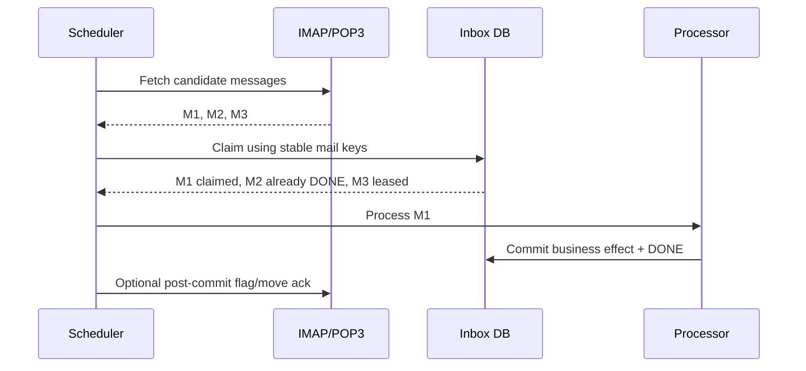
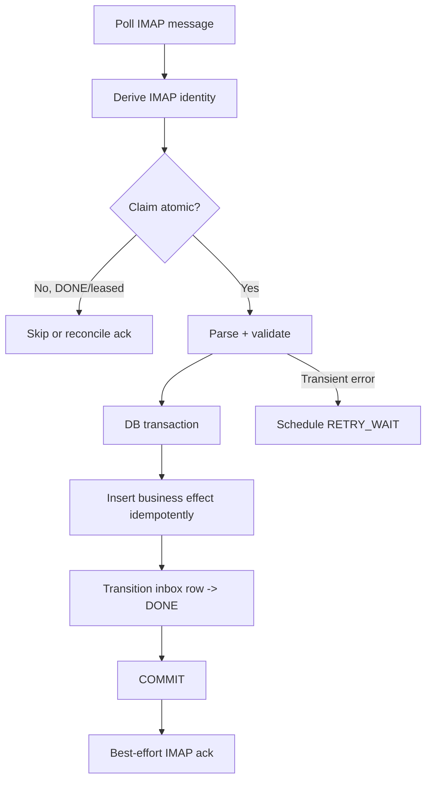

# Handling Duplicates When Polling Mailboxes

In a Spring Framework Mail application, receiving mail from an inbox is more than calling `Folder.getMessages()` or configuring an inbound mail adapter and processing each `Message`. The issue surfaces very early when a polling job runs again: **the same email can be observed multiple times**, especially after an application restart, an IMAP connection interruption, a failed mark-as-read operation, a worker timeout, or when another instance is also reading the mailbox.

If every observation creates an order, records an invoice, sends a confirmation email, or opens a new ticket, a single message can trigger **multiple business side effects**. Conversely, if an email is marked "processed" before the business transaction commits, a mid-flight crash can cause the message to be **permanently skipped**.

The solution is not simply "only read `UNSEEN` messages" or "store `Message-ID` in a `HashSet`". You must design **a durable message identity, an atomic claim mechanism, recoverable processing state, and idempotency at the point where side effects occur**. This is the lesson *Handling Duplicates When Polling Mailboxes* in the *Receiving Mail and Mailboxes* chapter of Spring Framework Mail.

The content uses Java 21, Spring Framework 6.x / Spring Boot 3.x, Jakarta Mail (`jakarta.mail` APIs), IMAP/POP3, and concepts from Spring Integration Mail. Examples use the `example.test` domain, placeholder details, and illustrative schemas. Note: **mail polling is inherently at-least-once in practice; exactly-once side effects must be achieved via transactions/idempotency at the business layer**, and cannot rely solely on the protocol.

## 1. Where Do Duplicates Occur?

Imagine a worker receiving invoices from the mailbox `billing-inbox@example.test`:

```text
08:00 Worker A polls INBOX, sees message M
08:00 Worker A parses attachment, inserts invoice I-42
08:01 Database commit succeeds
08:01 Worker A loses connection before updating IMAP \Seen
08:02 Worker B polls INBOX, still sees message M
08:02 Worker B attempts to insert invoice I-42 again
```

There is no contradiction here: the email on the server has not been marked read yet, yet the business logic has already run. If Worker B relies solely on `\Seen` or "unread messages", the invoice is created twice.

The reverse sequence is even more dangerous:

```text
08:00 Worker A polls message M
08:00 Worker A marks \Seen immediately upon reading
08:01 Worker A starts transaction to process invoice
08:01 Worker A crashes before database COMMIT
08:02 Worker B searches only UNSEEN, does not see message M
```

The system never creates the invoice, yet the message is skipped. Therefore you must separate **having seen an email**, **having claimed it for processing**, **having committed the business work**, and **having acknowledged on the mail server**.

### 1.1. Common Sources of Duplicates

| Source | What Happens | Core Safeguard |
|---|---|---|
| Periodic re-polling | Same message remains in mailbox | Persistent dedupe key |
| Worker crashes mid-flight | Job runs again after recovery | Durable state + lease |
| Processing finishes, ack fails | Server still shows email as unread | `DONE` before ack; next run skips/re-acks |
| Read then mark SEEN before commit | Message can be lost | Never treat `SEEN` as transaction acknowledgment |
| Multiple replicas | Two workers see the same message | Unique constraint + atomic claim |
| Application retries | An attempt times out and retries | Business idempotency key |
| IMAP COPY/MOVE | Message in new folder gets a new UID | Distinguish folder identity and business identity |
| Server rebuild, UIDVALIDITY changes | Old UIDs lose prior meaning | Store `UIDVALIDITY` and handle new epoch |
| POP3 re-poll | Message remains on maildrop | `UIDL` + durable dedupe |
| True duplicate from sender | Two separate emails with the same request | Business-layer idempotency, not just mailbox key |

### 1.2. Three Different Levels of "Duplicate"

1. **Duplicate observation:** the same message copy on the mail server is polled multiple times.
2. **Duplicate physical message:** the same content has multiple copies across folders, mailboxes, or sender resends.
3. **Duplicate business command:** two different emails request the same operation, such as the same invoice code or order.

IMAP/POP3 dedupe keys solve level (1). If level (2) or (3) must be handled, you must define an additional identity at the **business layer**. Do not blindly merge all emails with identical subjects: two distinct emails may carry two valid work items.

## 2. Polling Differs from Event-Driven, Yet Still Must Be Idempotent

Polling means the application actively checks the mailbox on a schedule:



IMAP IDLE or provider webhooks can lower latency compared to pure polling, but **they do not eliminate duplicates**: reconnects, replays, redeliveries, or retries can still cause a message to appear multiple times. Whether driven by schedule or events, a reliable inbound processor requires idempotency.

### 2.1. Why Not Use Message Sequence Numbers?

Jakarta Mail's `Message.getMessageNumber()` is the message's ordinal position **in the currently open folder**. IMAP sequence numbers can shift when messages are expunged or the mailbox changes. It is not a durable ID to store across polls.

A key such as:

```text
mailbox=finance, messageNumber=37
```

can point to a different message after an older email is deleted. Never use message numbers as dedupe keys.

### 2.2. Why Not Use Received Date?

`Message.getReceivedDate()` can be `null`, altered by the server, or lack sufficient resolution to distinguish messages. Two emails can arrive within the same second; an email can be copied to another folder with changed metadata. Timestamps are useful for telemetry and scan windows, not as unique identity keys.

## 3. IMAP UID: A More Reliable Identity Than Sequence Number

In IMAP, the server assigns a **UID (Unique Identifier)** to each message in a mailbox/folder. Within the folder's same `UIDVALIDITY` epoch, UIDs give clients a more stable message reference than sequence numbers.

Jakarta Mail exposes the `UIDFolder` interface with these operations:

```java
import jakarta.mail.UIDFolder;

UIDFolder uidFolder = (UIDFolder) folder;
long uidValidity = uidFolder.getUIDValidity();
long uid = uidFolder.getUID(message);
```

However, **UIDs are not globally unique across the entire mail server**. UID `2048` in `INBOX` of account A differs from UID `2048` in `Archive` or account B.

### 3.1. What Should an IMAP Key Include?

A technical key typically includes:

```text
mailboxId    = billing-inbound-prod
folderName   = INBOX
uidValidity  = 829311
uid          = 2048
```

That is:

\[
K_{\mathrm{IMAP}} =
(\mathrm{mailboxId},\mathrm{folder},\mathrm{UIDVALIDITY},\mathrm{UID})
\]

`mailboxId` is the stable configured ID of the source mailbox, **not** username/password or a host-only string if multiple accounts share a host. Scope the key to the exact boundary the application treats as one mail source.

### 3.2. What Is UIDVALIDITY?

Under IMAP semantics, `UIDVALIDITY` identifies a "generation" of UIDs in a folder. If the server changes `UIDVALIDITY`, stored UIDs from the old generation cannot be assumed comparable with the new generation. This can happen when a mailbox is rebuilt, restored/migrated, or the server reorganizes data.

Example:

```text
Before migration:
  mailbox=finance, folder=INBOX, UIDVALIDITY=100, UID=55

After migration:
  mailbox=finance, folder=INBOX, UIDVALIDITY=101, UID=55
```

The two tuples are **two distinct IMAP identities**. Never overwrite or omit `UIDVALIDITY` just because numeric UIDs collide. Still, they may represent **the same business message** restored or copied by the server. The business idempotency layer must protect against harmful replay.

### 3.3. UIDs Do Not Have to Increase Contiguously

Within a `UIDVALIDITY` epoch, UIDs increase according to IMAP allocation rules, but may **skip numbers**. Do not infer lost emails just because UIDs jump from 100 to 104. When tracking a high-water mark, never assume every intermediate UID exists or has been processed.

### 3.4. Folder Is Part of the UID Scope

When copying or moving a message from `INBOX` to `Processed`, the server can assign a new UID in the destination folder. If polling both folders:

```text
INBOX:    UIDVALIDITY=5, UID=88
Processed: UIDVALIDITY=9, UID=301
```

these are two **IMAP message identities**. If the workflow requires processing only once even when moved across folders, define an additional business-level key, or poll only one source folder per policy. A few providers offer account-wide message identifiers, which are proprietary extensions and do not replace the portable IMAP tuple.

## 4. Message-ID: Helpful, but Not Sufficient

The MIME `Message-ID` header typically looks like:

```text
Message-ID: <unique-looking-value@example.test>
```

It is added by the message creator, not assigned by the IMAP server. It can be missing, malformed, reused across copies/templates, or reused by the same sender across two different emails. Two legitimate messages can share a `Message-ID` due to software bugs; a message can be forwarded/resent with altered headers.

**Never use `Message-ID` as the sole technical key to dedupe IMAP** when guarding repeated polls of the same mailbox. It is a supplementary signal for log correlation, duplicate investigation, and supporting business matching when the sending source is controlled.

| Attribute | Scope | Can Be Missing/Changed? | Use as Primary Unique Key? |
|---|---|---|---|
| IMAP sequence number | Position in current folder | Changes on expunge | No |
| IMAP UID | Folder + `UIDVALIDITY` epoch | Can collide across folders/epochs | Yes, as full tuple |
| MIME `Message-ID` | Assigned by sender | Can be missing, duplicated, or spoofed | Should not be used alone |
| Received date | Time metadata | Can be null, duplicated, unstable | No |
| Subject/From | Content/headers | Can collide and untrusted | No |
| Attachment hash | File content | Same file can appear in valid emails | Only if business rules permit |
| Verified invoice/order ID | Business key | Depends on workflow | Can serve as business idempotency key |

### 4.1. Do Not Blindly Hash the Whole Email

A raw MIME hash easily changes when gateways add headers, rewrite links, or re-encode bodies. Even with identical bytes, multiple legitimate emails with identical content can still be distinct events. If using a content fingerprint, document its goal, scope, canonicalization, data protection, and false-positive/false-negative handling. Hashing does not make an email trustworthy or anonymize personal data.

## 5. POP3 UIDL: Similar Goal, Different Properties

POP3 lets clients list/retrieve messages in a maildrop. When the server supports the `UIDL` command, the client can fetch a unique-id for each message **within that maildrop** to recognize messages already downloaded earlier.

With POP3:

```text
K_POP3 = (mailboxId, UIDL)
```

but understand that:

- `UIDL` is a POP3 server capability and cannot be assumed present in every server/configuration.
- A `UIDL` string is meaningful within a **maildrop/account**, not across the entire Internet.
- POP3 does not provide an IMAP-like `\Seen` mechanism.
- Message numbers can shift after deletion; never use them as dedupe keys.
- Server migrations/rebuilds can affect `UIDL` depending on the implementation; plan controlled recovery.
- `DELE` behavior and committing deletions on session end do not replace business processing transactions.

### 5.1. Generic Jakarta Mail API and UIDL

The generic `jakarta.mail.Folder` API does not guarantee a portable POP3 UIDL method equivalent to IMAP's `UIDFolder.getUID(...)`. Depending on the implementation, a POP3-specific class may expose UIDL. When writing a POP3 adapter, read the documentation for your **locked Jakarta Mail/Angus version**, use the appropriate extension, and provide an explicit fallback if the server lacks UIDL support.

Never cast a POP3 `Folder` to `UIDFolder` just because IMAP worked. Without reliable UIDL, define a dedicated strategy: bounded content/metadata snapshots, mandatory configuration checks, or rejecting modes requiring exactly-once business effects. A heuristic from subject/date is not safe enough to claim absolute duplicate prevention.

### 5.2. Never Delete POP3 Messages Before Commit

A critical mistake:

```text
POP3 RETR -> process begins -> DELE -> QUIT
                                  |
                                  v
                         business DB commit fails
```

If the server actually deletes the message when the session closes, the application loses the chance to retry. The safer order is **durably persisting and committing business results first**, then executing cleanup per retention policy. If cleanup fails, the next run sees the `UIDL` and skips because it is already `DONE`.

## 6. The IMAP SEEN Flag Is Not an Idempotency Key

IMAP has flags such as `\Seen`, `\Answered`, `\Flagged`, and `\Deleted`. You can search unread messages:

```java
import jakarta.mail.Flags;
import jakarta.mail.Message;
import jakarta.mail.search.FlagTerm;

Message[] unread = folder.search(
        new FlagTerm(new Flags(Flags.Flag.SEEN), false));
```

However, `\Seen` is a **user/client state on the mailbox**, not the application's commit log:

- A user may open the email and mark it read before the worker arrives.
- Another client may toggle `Seen`.
- Reading the body via some clients/implementations can alter `Seen` depending on permissions, configuration, and server.
- Flag synchronization may fail after the DB commit.
- Two workers may both see `UNSEEN` before either sets the flag.
- An already-processed message may be marked unread again by a user.

Thus, `UNSEEN` should only serve as an **optimization filter to narrow candidates** if the workflow allows, never as the source of truth for "processed". The source of truth must be durable idempotency data managed by the application.

### 6.1. Be Careful of Body-Reading Side Effects

You cannot assume "reading headers has no side effects" or "`getContent` never changes flags" across all providers. When designing around `UNSEEN`, understand the fetch/peek mechanics of your IMAP implementation, `READ_ONLY`/`READ_WRITE` modes, and specific configuration. Best of all, never let business safety depend on whether `Seen` is updated automatically.

### 6.2. When Should Seen Be Set?

If the application owns the mailbox workflow and uses `Seen` to help operators visually track status, set it **after the business transaction commits**:

```java
message.setFlag(Flags.Flag.SEEN, true);
```

However, treat this as a **non-durable post-commit acknowledgment**: if it fails, the business outcome remains `DONE`. The next poll must recognize `DONE` in the database and may retry the ack. Never roll back a persisted invoice just because an IMAP flag update failed.

## 7. Persistent Inbox Table: The Core of Deduplication

An in-memory `HashSet` only prevents duplicates until process restart. With multiple pods, each pod also has its own `HashSet`. A durable mechanism stores message identities in a **database with a unique constraint**.

An illustrative PostgreSQL schema:

```sql
CREATE TABLE inbound_mail (
    id BIGSERIAL PRIMARY KEY,
    mailbox_id VARCHAR(120) NOT NULL,
    folder_name VARCHAR(255) NOT NULL,
    uid_validity BIGINT NOT NULL,
    imap_uid BIGINT NOT NULL,
    state VARCHAR(24) NOT NULL,
    lease_owner VARCHAR(120),
    lease_token UUID,
    lease_until TIMESTAMPTZ,
    attempts INTEGER NOT NULL DEFAULT 0,
    message_id_header VARCHAR(512),
    business_key VARCHAR(240),
    first_seen_at TIMESTAMPTZ NOT NULL DEFAULT NOW(),
    processed_at TIMESTAMPTZ,
    last_error_code VARCHAR(80),
    CONSTRAINT uq_inbound_imap_identity UNIQUE (
        mailbox_id, folder_name, uid_validity, imap_uid
    ),
    CONSTRAINT ck_inbound_mail_state CHECK (
        state IN ('DISCOVERED','PROCESSING',
                  'DONE','RETRY_WAIT','FAILED','DEAD_LETTER')
    )
);

CREATE INDEX ix_inbound_mail_reclaim
ON inbound_mail (state, lease_until, first_seen_at);
```

This schema targets **IMAP**. If POP3 is also supported, use a separate keyed table with unique `(mailbox_id, uidl)`, or a normalized `source_type/source_key` model with appropriate constraints. Never force string `UIDL` values into IMAP's `BIGINT`.

### 7.1. Unique Constraints Are Not Optional

Suppose two workers see `UID=2048` simultaneously:

```text
Worker A: SELECT to check if row exists -> no
Worker B: SELECT to check if row exists -> no
Worker A: INSERT row
Worker B: INSERT row
```

With only `SELECT` before `INSERT`, both workers can pass the check and create two rows. A database unique constraint is the race barrier. With PostgreSQL:

```sql
INSERT INTO inbound_mail (
    mailbox_id, folder_name, uid_validity, imap_uid, state
) VALUES (
    :mailboxId, :folderName, :uidValidity, :imapUid,
    'DISCOVERED'
)
ON CONFLICT (
    mailbox_id, folder_name, uid_validity, imap_uid
) DO NOTHING;
```

If the insert creates no row, **you cannot conclude the message is `DONE`**. It might be `PROCESSING` by another worker, `RETRY_WAIT`, or `FAILED`. Read the state and perform the proper transition rather than treating "row exists" as "skip forever".

### 7.2. Separating Discovered, Processing, and Done

| State | Meaning | Next Poll |
|---|---|---|
| `DISCOVERED` | Identity recorded, not yet claimed | Eligible to claim |
| `PROCESSING` | Worker holds execution lease | Do not claim while lease is valid |
| `DONE` | Business side effects committed per contract | Do not reprocess; may retry flag ack |
| `RETRY_WAIT` | Transient error, scheduled for retry | Wait until `nextAttemptAt` if schema has it |
| `FAILED` | Needs classification/investigation or policy handling | Do not retry infinitely |
| `DEAD_LETTER` | Budget exhausted, needs operational handling | Retain evidence safely for controlled replay |

A simple system might only need `NEW`/`PROCESSING`/`DONE`/`FAILED`, but with retries and multiple workers, every state must be clearly defined. **Never use IMAP `SEEN` status as a substitute for this table.**

### 7.3. Atomic Claim Using State + Lease

After inserting/discovering, a worker claims an eligible row:

```sql
UPDATE inbound_mail
SET state = 'PROCESSING',
    lease_owner = :workerId,
    lease_token = :leaseToken,
    lease_until = :leaseUntil,
    attempts = attempts + 1
WHERE id = :id
  AND (
      state = 'DISCOVERED'
      OR (
          state = 'PROCESSING'
          AND lease_until < NOW()
      )
      OR (
          state = 'RETRY_WAIT'
          AND :nextAttemptIsDue = TRUE
      )
  )
RETURNING id;
```

`:nextAttemptIsDue` here is an illustrative parameter; production should store `next_attempt_at` and compare **inside the same SQL statement**:

```sql
-- Condition for the retry branch when next_attempt_at column exists:
state = 'RETRY_WAIT' AND next_attempt_at <= NOW()
```

The goal is letting the database decide claim winners/losers **atomically**. Never read state and then overwrite unconditionally. Use database time or a consistent clock source so leases do not expire prematurely due to clock skew across pods.

### 7.4. Lease Token as a Fencing Token for State Writes

When the worker finishes, the update must be conditional:

```sql
UPDATE inbound_mail
SET state = 'DONE',
    processed_at = NOW(),
    lease_owner = NULL,
    lease_token = NULL,
    lease_until = NULL
WHERE id = :id
  AND state = 'PROCESSING'
  AND lease_token = :leaseToken;
```

If 0 rows are updated, the worker likely lost its lease or another worker claimed the row. Never allow a stale worker to overwrite a newer worker's state with `DONE`.

**Critical limitation:** a lease token protects database state updates, **not external side effects that already happened outside the database**. If Worker A loses its lease while calling an external API, Worker B may run it again. Thus business and external side effects still require idempotency.

## 8. The Inbox Pattern: Committing Business Work and DONE in One Transaction

The goal is not only avoiding duplicate rows in `inbound_mail`. We must prevent duplicate **actions** triggered by an email.

For example, an email contains invoice data; the processor needs to:

1. Parse the message sufficiently to validate data.
2. Derive the invoice key per business contract.
3. Insert the invoice or recognize it already exists.
4. Mark `inbound_mail` as `DONE`.

If step (3) commits separately and step (4) fails, a retrying worker might create the invoice a second time. A far more reliable approach is committing both changes in **one local database transaction**, if they share the same database.



### 8.1. Business Service Example with @Transactional

```java
package com.example.inbound;

import java.util.UUID;

import org.springframework.stereotype.Service;
import org.springframework.transaction.annotation.Transactional;

@Service
public class InboundInvoiceProcessor {

    private final InboundMailRepository inbound;
    private final InvoiceRepository invoices;

    public InboundInvoiceProcessor(
            InboundMailRepository inbound,
            InvoiceRepository invoices) {
        this.inbound = inbound;
        this.invoices = invoices;
    }

    @Transactional
    public ProcessingResult commitInvoice(
            long inboxRowId,
            UUID leaseToken,
            ParsedInvoice parsed) {

        if (!inbound.isOwnedBy(inboxRowId, leaseToken)) {
            return ProcessingResult.LEASE_NOT_OWNED;
        }

        invoices.insertIfAbsent(
                parsed.tenantId(),
                parsed.externalInvoiceId(),
                parsed.amount(),
                parsed.currency());

        int updated = inbound.markDoneIfOwned(
                inboxRowId, leaseToken);

        if (updated != 1) {
            // Must roll back the preceding insertInvoice too.
            throw new StaleInboundLeaseException();
        }

        return ProcessingResult.COMMITTED;
    }
}
```

`InboundMailRepository`, `InvoiceRepository`, `ParsedInvoice`, `ProcessingResult`, and `StaleInboundLeaseException` are application-defined abstractions. `insertIfAbsent(...)` requires a truly appropriate **unique business key**, such as `(tenant_id, external_invoice_id)`, and must not swallow all insert errors as "already exists".

`@Transactional` must actually be invoked through the Spring proxy/transaction manager; self-invocation may bypass the transaction. Both repositories must participate in the same transaction if atomic commit/rollback is desired. MIME parsing or network I/O should happen **outside long transactions**, keeping transactions short and focused on data writes.

### 8.2. Why Is a Business Unique Key Also Necessary?

Suppose the same invoice is sent twice, producing two emails with two different UIDs:

```text
IMAP UID 2048 -> invoice INV-2026-42
IMAP UID 2053 -> invoice INV-2026-42
```

Both IMAP keys are brand new and valid. An inbox unique key alone cannot prevent creating two invoices. If business rules dictate an external invoice ID may only be created once per tenant, the database needs a matching constraint:

```sql
CREATE UNIQUE INDEX uq_invoice_external
ON invoices(tenant_id, external_invoice_id);
```

Do not unreliably infer business keys from subjects. Verify sender/content/schema or document signatures per policy; email is spoofable input data.

### 8.3. What Exactly Does a Transaction Help With?

| Scenario | Desired Outcome |
|---|---|
| Crash before business DB commit | No DB side effect; job can be recovered |
| Business insert ran, then transaction rolls back | Insert does not exist; `DONE` does not exist |
| Business DB + `DONE` commit | Retries see `DONE`; no repeated DB side effect |
| Commit succeeds, IMAP `SEEN` update fails | DB stays `DONE`; next poll skips/re-acks |
| Duplicate email has a different UID | Business key prevents duplicate resource per policy |
| External API called before commit, then crash | Duplicate risk remains; external idempotency needed |

If email processing triggers outbound emails, payments, or other HTTP APIs, use an **outbox** to record the side-effect intent in the same DB transaction, then have a worker send/push with an idempotency key if the target system supports it. Never wrap a slow SMTP/HTTP call inside a database transaction expecting rollback to undo external side effects.

## 9. Crash Windows and Recovery Diagram

You cannot design safe deduplication while ignoring operation ordering.

### 9.1. Key Checkpoints

```text
T0: IMAP fetch message
T1: DB insert/discover key
T2: DB claim PROCESSING + lease commit
T3: Parse/validate email
T4: Business effect + inbox DONE commit
T5: IMAP ack (SEEN/MOVE) attempt
```

| Crash Window | What Remains | Next Poll |
|---|---|---|
| Before T1 | No row yet | Re-discover and process |
| After T1, before T2 | `DISCOVERED` | Worker can claim |
| After T2, before T4 | `PROCESSING` with lease | Wait for lease expiry then retry |
| During T4 transaction | Whole transaction rolls back | New worker can retry after recovery |
| After T4, before T5 | `DONE`, server unacknowledged | Skip business work; may re-ack |
| After T5 | `DONE` and mailbox acknowledged | Do not reprocess |

### 9.2. Never Ack Before Commit

Wrong order:

```text
Set IMAP \Seen -> parse -> update database -> commit
```

If parsing/DB commit fails and polling only queries `UNSEEN`, the message can vanish from processing. Better order:

```text
Poll -> claim -> parse -> commit business + DONE
     -> best-effort IMAP ack
```

Depending on configuration, fetching the body may itself affect `Seen`; therefore **never rely solely on unread-only searches** to guarantee recovery. Durable inbox tracking and reconciliation are the primary line of defense.

### 9.3. Lease Expires While Worker Is Still Running

Suppose:

```text
Worker A claims UID 2048, lease until 10:01
Worker A processes attachment very slowly
10:01 lease expires
Worker B claims same row with new token
Worker A completes and tries markDone(old token) -> 0 rows
```

To prevent duplicate business effects, both must use unique keys/transactions/fencing. For long processing, conditionally heartbeat-extend the lease, set timeouts, and cap attachment sizes. Yet heartbeats can fail too. Never treat "we hold a lease" as proof of exactly-once for external side effects.

## 10. Spring Boot IMAP Polling Example Using Jakarta Mail

The example below illustrates extracting a stable identity from the mailbox and handing it to a deduplicating processing service. This is a **skeleton with clear responsibility boundaries**; the repository, parser, and error policy are implemented by the application according to its chosen schema. It does not use `Message-ID` or `\Seen` as primary keys.

### 10.1. Test Configuration

```yaml
app:
  inbound:
    mailbox-id: billing-inbound-test
    host: imap.example.test
    port: 993
    username: ${INBOUND_IMAP_USERNAME}
    password: ${INBOUND_IMAP_PASSWORD}
    folder: INBOX
    poll-delay-ms: 10000
    max-messages-per-poll: 100
```

This is an application-defined configuration namespace. Secret variables must come from a secret manager or equivalent protection mechanism. Never commit mailbox passwords to the repository; use a dedicated mailbox with least privilege and valid TLS verification.

### 10.2. Defining IMAP Identity

```java
package com.example.inbound;

public record ImapMailKey(
        String mailboxId,
        String folderName,
        long uidValidity,
        long uid
) {
    public ImapMailKey {
        if (mailboxId == null || mailboxId.isBlank()) {
            throw new IllegalArgumentException("mailboxId required");
        }
        if (folderName == null || folderName.isBlank()) {
            throw new IllegalArgumentException("folderName required");
        }
        if (uidValidity <= 0 || uid <= 0) {
            throw new IllegalArgumentException("Invalid IMAP identity");
        }
    }
}
```

Do not normalize folder names by arbitrarily lowercasing without knowing the folder/server naming rules. Keep a consistent folder identity policy across connections; changing folder names changes key scope and causes replays.

### 10.3. Illustrative Poller

```java
package com.example.inbound;

import java.util.Properties;

import jakarta.mail.Folder;
import jakarta.mail.Message;
import jakarta.mail.MessagingException;
import jakarta.mail.Session;
import jakarta.mail.Store;
import jakarta.mail.UIDFolder;

import org.springframework.scheduling.annotation.Scheduled;
import org.springframework.stereotype.Component;

@Component
public final class ImapMailboxPoller {

    private final ImapMailboxSettings settings;
    private final InboundMessageDispatcher dispatcher;

    public ImapMailboxPoller(
            ImapMailboxSettings settings,
            InboundMessageDispatcher dispatcher) {
        this.settings = settings;
        this.dispatcher = dispatcher;
    }

    @Scheduled(
            fixedDelayString = "${app.inbound.poll-delay-ms:10000}")
    public void poll() {
        Properties props = new Properties();
        props.put("mail.store.protocol", "imaps");
        props.put("mail.imaps.connectiontimeout", "5000");
        props.put("mail.imaps.timeout", "10000");

        Session session = Session.getInstance(props);
        Store store = null;
        Folder folder = null;

        try {
            store = session.getStore("imaps");
            store.connect(
                    settings.host(),
                    settings.port(),
                    settings.username(),
                    settings.password());

            folder = store.getFolder(settings.folder());
            folder.open(Folder.READ_WRITE);

            if (!(folder instanceof UIDFolder uidFolder)) {
                throw new IllegalStateException(
                        "IMAP folder does not expose stable UID");
            }

            long uidValidity = uidFolder.getUIDValidity();
            int total = folder.getMessageCount();
            int first = Math.max(
                    1, total - settings.maxMessagesPerPoll() + 1);

            for (int sequence = first; sequence <= total; sequence++) {
                Message message = folder.getMessage(sequence);
                long uid = uidFolder.getUID(message);
                if (uid <= 0) {
                    continue;
                }

                ImapMailKey key = new ImapMailKey(
                        settings.mailboxId(),
                        folder.getFullName(),
                        uidValidity,
                        uid);

                dispatcher.handleCandidate(key, message);
            }
        } catch (MessagingException ex) {
            // Log category and mailboxId safely; schedule next poll.
            dispatcher.recordMailboxConnectionFailure(
                    settings.mailboxId(), ex);
        } finally {
            if (folder != null && folder.isOpen()) {
                try {
                    folder.close(false);
                } catch (MessagingException ignored) {
                    // Logging redacted in production.
                }
            }
            if (store != null && store.isConnected()) {
                try {
                    store.close();
                } catch (MessagingException ignored) {
                    // Avoid masking primary error with close failure.
                }
            }
        }
    }
}
```

`ImapMailboxSettings` is an immutable configuration bound and validated by the application from YAML; `InboundMessageDispatcher` is the layer handling claim/parse/commit/ack below. Enable scheduling in configuration via `@EnableScheduling`. Use `imaps` with valid TLS certificate validation; timeout properties are illustrative only and do not replace an overall deadline.

**Intentional limitation of this example:** the snippet reads the **last N messages by sequence number** to keep the lesson easy to read. For large mailboxes, scanning only the last N messages will **miss older unprocessed messages** when new arrivals exceed N or outages last long. Production must not rely on this pagination as a zero-loss guarantee; use the UID checkpoint/cursor scanning algorithm and reconciliation covered next.

### 10.4. Dispatcher Distinguishing NEW, DONE, and BUSY

A dispatcher can use this contract:

```java
public enum ClaimResult {
    CLAIMED,
    ALREADY_DONE,
    CURRENTLY_OWNED_BY_OTHER,
    NOT_DUE
}

public enum ProcessingOutcome {
    COMMITTED,
    ALREADY_DONE,
    RETRY_SCHEDULED,
    DEAD_LETTERED
}
```

Illustrative flow:

```java
public void handleCandidate(ImapMailKey key, Message message)
        throws MessagingException {

    ClaimResult claim = claimService.tryClaim(key);

    if (claim == ClaimResult.ALREADY_DONE) {
        // May re-ack when IMAP \Seen has not been updated yet.
        acknowledgeIfConfigured(message, key);
        return;
    }

    if (claim != ClaimResult.CLAIMED) {
        return; // Job is currently leased or not yet due for retry.
    }

    try {
        ParsedInboundMail parsed = parser.parse(message);

        ProcessingOutcome outcome =
                processingService.processClaimed(key, parsed);

        if (outcome == ProcessingOutcome.COMMITTED
                || outcome == ProcessingOutcome.ALREADY_DONE) {
            acknowledgeIfConfigured(message, key);
        }
    } catch (Exception failure) {
        failureHandler.recordRetryOrDeadLetter(
                key, failure);
    }
}
```

`claimService` must also return a **lease token** to the actual owner, though simplified here to focus on the flow; `processingService` must use that token when transitioning to `DONE` conditionally as shown in the database section. `parser` must enforce resource limits and never trust raw attachments. `failureHandler` must also check the lease token so stale workers cannot overwrite newer state.

In production, prefer passing an object `ClaimedInboundMail(key, inboxRowId, leaseToken)` instead of only `key`. Most importantly, follow the order **claim → parse → commit → optional ack**.

### 10.5. Do Not Retain Jakarta Mail Messages After Closing Folder

A `Message` obtained from an IMAP `Folder` is usually tied to the `Store`/`Folder` session. Once `Folder`/`Store` closes, continuing to read bodies/attachments may fail or cause unexpected network access.

**Never enqueue a `Message` into a thread pool and close the folder immediately**:

```java
// Dangerous:
executor.execute(() -> parseAndProcess(message));
folder.close(false);
```

For asynchronous processing, you can:

1. Have the poller capture the stable UID and download needed content into a bounded **durable staging store**.
2. Commit staging metadata alongside the inbound identity.
3. Have another worker process from the stored DTO/blob without retaining the `Message` object across the IMAP connection.
4. If staging fails, do not mark `DONE` and allow re-fetching by UID.

Alternatively, keep processing synchronous within the folder session using small batches and proper timeouts. Either way, control network resource lifetimes and avoid concurrent access to a single `Folder` when the provider does not guarantee thread safety.

## 11. Large Mailboxes: UID Checkpoints and Reconciliation

Reading every message in `INBOX` on every poll can be prohibitively expensive; conversely, fetching only the last few messages misses backlog. With IMAP, design a **UID-based checkpoint**.

A state record:

```text
mailboxId     = billing-inbound-prod
folderName    = INBOX
uidValidity   = 829311
scanCursorUid = 4050
lastScanAt    = ...
```

The poller queries UIDs greater than the cursor in batches within the current `UIDVALIDITY`, then advances the cursor once **the batch's identities have been reliably discovered/persisted**. Never treat the cursor as meaning "every message with a lower UID is `DONE`"; some may be in `RETRY_WAIT`, `FAILED`, or `PROCESSING`.

### 11.1. Never Advance the Cursor Before Persisting Identities

Wrong sequence:

```text
Fetch UID 4051..4150
Save scanCursorUid=4150
Crash before inserting inbound_mail rows
Next poll starts at UID 4151
```

UIDs 4051..4150 could be skipped. Proper sequence:

```text
Fetch batch identities
Persist each identity (or persist batch)
Commit cursor with discovery rows atomically
Then workers process discovered rows
```

If in the same database, discovery inserts and checkpoint updates can share a single transaction. When message content is stored outside the database, use a proper staging protocol rather than marking "discovered safely" before needed data can be re-fetched or is durable.

### 11.2. UIDFolder.getMessagesByUID and UID Gaps

Jakarta Mail `UIDFolder` supports querying by UID on IMAP implementations, e.g., a UID range:

```java
Message[] batch = uidFolder.getMessagesByUID(
        startUid, endUid);
```

There is no guarantee every value in the range corresponds to a message. When the server expunges, UIDs disappear; the response may have fewer elements than expected. Never advance the cursor based on "number of elements returned" as if UIDs were contiguous; update according to the range/UID actually scanned and persisted.

### 11.3. Checkpoints Do Not Replace Retry Tables

A message with UID 4051 was discovered, failed parsing, and entered `RETRY_WAIT`. Advancing the cursor to 4150 is fine as long as job 4051 remains in `inbound_mail` and retry workers pick it up from that table. With only a cursor and no failed-row persistence, the application can lose the chance to process it.

### 11.4. When UIDVALIDITY Changes

If the mailbox epoch changes:

1. Emit a `UIDVALIDITY_CHANGED` event with mailbox ID and folder.
2. Never use the old epoch's UID cursor in the new epoch.
3. Reset the **scan position for the new epoch** via a controlled procedure.
4. Rediscover messages in the folder; initialize new identity tuples.
5. Rely on business idempotency to prevent repeated side effects if older messages were restored.
6. Monitor surges in replays and errors.

This scenario requires investment in reconciliation and auditing—never silently truncate the inbox table to "start over from scratch".

### 11.5. Periodic Reconciliation Scans

A sound approach combines **incremental UID scans** with **periodic reconciliation** within reasonable bounds:

- Re-inspect a bounded UID/time window.
- Compare folder `UIDVALIDITY` and cursor.
- Scan inbox rows stuck in `PROCESSING` past their lease.
- Scan `RETRY_WAIT` rows past due.
- Scan `DONE` rows with `ACK_PENDING` when needed.
- Scan identities with metadata but missing staged content.

Never treat `\Seen` as the source of truth; reconciliation relies on database idempotency. Choose retention/windows based on volume and SLA, without forcing the server to re-download all attachments on every reconciliation pass.

## 12. Multiple Pollers and Distributed Coordination

When a Spring Boot application runs three replicas:

```text
Pod A polls INBOX at 08:00:00
Pod B polls INBOX at 08:00:00
Pod C polls INBOX at 08:00:01
```

You cannot rely on `@Scheduled(fixedDelay=...)` on each pod to prevent duplicates. Each process has its own scheduler; two workers can still observe the same mailbox message.

### 12.1. Two Design Choices

**Option A — Single poller owns the mailbox:**

- Use leader election/a distributed lease for scanning and cursor updates.
- One poller discovers/stages messages; multiple workers process inbox rows.
- Minimizes IMAP connections and simplifies checkpoint control.
- When the leader dies, lease expiration lets another leader take over.

**Option B — Multiple pollers scanning concurrently:**

- Every pod can see the same UID.
- Database unique constraints + atomic claims determine ownership.
- Must control scan costs and IMAP rate limits.
- Checkpointing needs CAS/fencing or partitioning so pods do not race to push the cursor wrongly.

For shared mailboxes and large workloads, Option A is usually simpler for scanning; Option B can still be side-effect-safe with full deduplication. **A distributed lock does not replace unique constraints**: locks can expire or drop on disconnects, or a job can be retried from another source.

### 12.2. Mailbox Locks and Processing Locks Differ

A mailbox scan lease protects **UID discovery and cursor updates**. An inbox row lease protects **the right to process one message**. The two locks have different scopes; avoid holding a multi-minute mailbox lock covering parsing 100 attachments and business side effects, as that creates bottlenecks and complicates recovery.

### 12.3. Avoid Queries and Network I/O Inside Long Transactions

Never open a database transaction and hold it during `Folder.getMessages()`, reading PDFs, calling OCR/antivirus, or making HTTP API calls. Long transactions hold connections/locks and raise deadlock risks. Split into: scan/fetch with timeouts → short discovery transaction → external processing → short commit transaction → best-effort ack.

## 13. Spring Integration Mail: Adapters Do Not Automatically Make Business Effects Exactly-Once

Instead of writing `@Scheduled` and managing `Session`/`Store`/`Folder` directly, an application can use **Spring Integration Mail** to route inbound emails into message channels and process them via integration flows.

Common abstractions include:

- `ImapMailReceiver` for receiving from IMAP.
- `Pop3MailReceiver` for receiving from POP3.
- `MailReceivingMessageSource` for polling a mail receiver.
- IMAP IDLE adapter for near real-time reception when supported by the server.
- Pollers, message channels, and handlers to connect processing steps.

Example diagram:

```text
IMAP / POP3
    |
    v
Mail receiver / inbound adapter
    |
    v
Spring Integration Message channel
    |
    v
Durable Inbox + Atomic Claim
    |
    v
Parse / Business transaction / DONE
    |
    v
Post-commit acknowledgement
```

Spring Integration helps manage polling, message conversion, and component wiring, yet **does not merge the business database and IMAP flag updates into a single shared transaction**. If a handler creates a side effect and fails before the adapter marks the message read, the next reception can still see the same message.

### 13.1. "Accept Once" Filters Are Not Always Durable Sources of Truth

Some integration adapters/filters keep metadata about accepted messages. Semantics and storage backends depend on the component/version. If metadata lives only in JVM memory, restarts wipe it. When using a persistent metadata store, still check:

1. Does the key include mailbox/folder/`UIDVALIDITY`/UID properly?
2. Is check-and-set atomic across multiple replicas?
3. Was accepted recorded **before** or **after** the business transaction?
4. If business processing fails, does the filter allow retries?
5. Does metadata have appropriate TTL/retention without premature eviction?

A filter designed to reduce duplicate delivery on a channel **does not automatically mean exactly-once business side effects**. You can use it as an optimization layer, while unique constraints and business idempotency remain essential safeguards.

### 13.2. MetadataStore: Storage Choice Must Match Requirements

In Spring Integration, `MetadataStore` has implementations for storing metadata; some are in-memory, others backed by external stores. When multi-instance/restart durability is needed:

- Pick durable storage matching system requirements.
- Understand the atomicity of its compare-and-set operations.
- Verify behavior when the metadata store is temporarily unavailable.
- Namespace keys by mailbox/folder/UID epoch.
- Never use a metadata entry as the business record if it lacks a shared transaction with the business DB.

Some architectures route every message into a **durable inbox repository** first and use Spring Integration handlers for orchestration. This reduces reliance on adapter-specific filter behavior.

### 13.3. Receivers May Mark Read According to Configuration

Mail receivers expose options affecting mark-as-read, search terms, and delete/expunge depending on implementation. When configuring:

- Verify exact behavior for your **Spring Integration Mail version**.
- Never enable delete/mark-as-read options before having an idempotency/commit strategy.
- Test handler exceptions and application restarts.
- Separate "server flag" from "business committed" in your data model.

Do not assume enabling an option like `shouldMarkMessagesAsRead` (when supported by the adapter version) guarantees exactly-once delivery. Verify when the flag is updated relative to the business transaction.

### 13.4. Both Polling and IMAP IDLE Can Still Replay

IMAP IDLE typically reduces wait time for mailbox change notifications, but disconnects/reconnects, server restarts, and consumer retries can still cause the same message to reappear. Whether triggered by `@Scheduled`, an inbound channel adapter, or IMAP IDLE, durable deduplication logic should use the same key/claim mechanism.

### 13.5. Moving to an Idempotent Handler Model

A handler receiving payloads from an integration flow can execute:

```java
@Service
public final class InboundMailHandler {

    private final InboundMailUseCase useCase;

    public InboundMailHandler(InboundMailUseCase useCase) {
        this.useCase = useCase;
    }

    public void handle(ReceivedMailEnvelope mail) {
        useCase.acceptForProcessing(
                mail.sourceIdentity(),
                mail.stagedContentReference());
    }
}
```

`ReceivedMailEnvelope` holds the normalized identity and a reference to staged content, avoiding passing a live `jakarta.mail.Message` across executors. `InboundMailUseCase` performs the unique insert/claim and processes via the state machine. The outcome is independent of whether the adapter uses polling or IDLE.

## 14. Choosing When to ACK: SEEN, MOVE, DELETE, or Leave Mailbox Unchanged?

After business commit, many systems want to tidy up `INBOX`. Each choice has trade-offs:

| Strategy | Advantage | Risk / Note |
|---|---|---|
| Set `\Seen` | Easy to see read status | Users/other clients can modify it; does not represent commit |
| Move to Processed | Separates workflow, shrinks source mailbox | New UID in destination folder; MOVE/ack can fail, needs key |
| Copy then delete/expunge source | Provides archive and cleanup | Multi-step operation, not atomic with DB |
| Delete after processing | Minimizes mailbox storage | Retention/audit risks; hard to recover |
| Leave mailbox unchanged | Preserves original data | Needs efficient scan/cursor and retention policy |

### 14.1. IMAP MOVE/COPY Creates an Identity in the New Folder

If the workflow is "INBOX → Processed":

1. Commit inbox row `DONE` together with business effects.
2. Record `ackStatus=ACK_PENDING` if tracking is needed.
3. Perform move/copy per supported API/provider.
4. Record `ACKED` on completion.
5. If move fails, reconcile later using original UID/metadata and mailbox state.

If workers also poll `Processed`, prevent reprocessing via business keys or exclude `Processed` from source folders. Never treat a message appearing with a new UID in `Processed` as a "second invoice".

### 14.2. Never Delete Emails Solely to Prevent Duplicates

Deleting original messages can violate retention, auditing, or the ability to reprocess after parser bug fixes. If mailbox cleanup is required, design explicit retention and legal/security requirements, separate processed/quarantine/dead-letter states, and verify needed data has already been persisted.

### 14.3. ACK Failure Is a Normal Recoverable Case

```text
DB: status DONE
IMAP: SETFLAGS \Seen timeout
```

Never roll back the `DONE` transaction. Record `ACK_PENDING` or an equivalent event; when a future poll sees the UID again, look up `DONE` and retry the ack if mailbox policy allows. If someone else already moved/deleted the message, finish with `ACK_NOT_APPLICABLE` or log the reconciliation outcome rather than re-running business side effects.

## 15. Classifying Errors When Processing Incoming Mail

Not every exception should be retried. Errors must be tagged with **phase, cause, recoverability, and scope**.

| Error Type | Example | Typical Policy |
|---|---|---|
| IMAP connect/auth | Wrong secret, unavailable endpoint | Alert/pause mailbox or retry connection with backoff |
| Transient IMAP UID fetch error | Socket reset, timeout | Re-poll by UID/checkpoint; never lose identity |
| `UIDVALIDITY` changed | Server migration | Re-scan new epoch + business idempotency |
| Invalid MIME parse | Corrupt header/body/encoding | Quarantine or DLQ with evidence; avoid infinite loops |
| Attachment exceeds size | Oversized image/PDF | Reject/quarantine per policy; avoid OOM |
| Security validation fails | Spoofed sender, malicious content | Do not execute side effects; quarantine |
| DB serialization/deadlock | Transaction conflict | Retry with backoff; unique/fencing stay intact |
| Transient external API error | Downstream unavailable | Outbox/external idempotency + retry |
| Permanent business validation | Invalid invoice ID, missing tenant | `FAILED`/`DEAD_LETTER`, do not retry forever |
| Post-commit `SEEN`/MOVE error | IMAP ack timeout | Retry ack, **do not** reprocess business logic |

### 15.1. Poison Messages

A malformed email can make the parser throw an exception every time. If a job retries every 10 seconds, it occupies workers and starves other emails. You need:

- Max attempts or time budgets.
- `DEAD_LETTER`/`QUARANTINED` state.
- Normalized error codes and minimal metadata saved.
- Controlled operator replay after fixing the parser.
- Ensuring a poison message never causes subsequent valid emails to be skipped.

### 15.2. Separate Connection Retries from Processing Retries

An IMAP connect error usually affects the entire mailbox; do not increment failed attempts for messages that were never even fetched. A parse error affects only one specific message. Scope metrics and circuit breakers properly so thousands of messages are not mistakenly marked `FAILED` when the mail server is temporarily down.

### 15.3. Backoff and Jitter

When the IMAP server temporarily drops connections or the database is overloaded, immediate retries from 20 pods can create a retry storm. Configure connection timeouts, read timeouts, and jittered backoff at the polling layer. For message-level retries, persist `nextAttemptAt` in the inbox table and release the worker; never `Thread.sleep` holding a thread between attempts.

## 16. Resource Limits and Safety When Parsing MIME

Incoming email is untrusted data, even when the `From` header resembles an internal domain. An attachment or MIME body can be huge, deeply nested, or contain malicious payloads.

### 16.1. Recommended Limits

- Maximum allowed total message size.
- Maximum MIME part count and multipart depth.
- Total attachment bytes downloaded/extracted.
- Parse/scan duration and per-attempt time limits.
- Mail processing and IMAP connection concurrency.
- Bandwidth/I/O limits toward object storage.
- Allowed file types and actual content inspection, not just declared MIME type.
- Quotas/retention for staging and dead-letter storage.

Never call `getInputStream().readAllBytes()` unconditionally on untrusted attachments in production; it can consume massive heap. Use bounded streaming and fail early when limits are exceeded per policy.

### 16.2. Do Not Trust From as Authenticated Identity

`Message.getFrom()` is a sender-supplied header and can be spoofed. If an email contains commands to place orders, wire funds, or update accounts, authenticate the source via an appropriate mechanism: sender allowlists combined with SPF/DKIM/DMARC at a trusted boundary where applicable, content signatures, account linkage, out-of-band confirmation, or secure APIs.

Never treat a `From` address alone as authorization for a sensitive action. Deduplication against repeated sends **does not replace authorization**.

### 16.3. HTML, Links, and Attachments

Never render email HTML in an admin page while skipping sanitization and Content-Security-Policy. Links can lead to malicious sites, and attachments can carry macros/exploits. Store messages with restricted access and enforce antivirus, quarantine, encryption at rest, and retention policies.

### 16.4. What Data Should Be Logged?

Recommended:

```text
event=inbound_mail_claimed
mailboxId=billing-inbound-prod
folder=INBOX
uidValidity=829311
uid=2048
inboxId=...
attemptId=...
leaseOwner=worker-3
```

Avoid logging:

- Mailbox usernames/passwords or OAuth tokens.
- Raw email/attachment content.
- OTPs, reset links, or customer invoice details.
- Full To/Cc/Bcc or personal senders when unnecessary.
- Raw MIME or stack traces containing PII to public logs.

IMAP UIDs and inbox row IDs can be used for lookups in access-controlled logs; they are not always suitable as Prometheus labels due to high cardinality.

## 17. Operational Metrics and Alerting

A reliable email-receiving dashboard does more than count successful polls.

| Signal | Meaning |
|---|---|
| Poll attempts/success/failure | Is the mailbox reachable? |
| Last successful scan timestamp | Has the system stopped discovering mail? |
| Last successfully discovered UID | Is progress advancing along the UID epoch? |
| `UIDVALIDITY` changes | Did a migration/rebuild trigger replays? |
| New/discovered/processing/done counts | How is the pipeline progressing? |
| Duplicate observations | Messages re-seen that were already known |
| Claim conflicts | Are multiple workers contending or double-polling? |
| Oldest `DISCOVERED`/`RETRY_WAIT` age | Are emails waiting past SLA? |
| Lease expired count | Worker crashes, timeouts, or overly slow processing? |
| Retry/dead-letter count | Poison messages or downstream errors |
| Parse/attachment size p95 | Are unusually heavy payloads arriving? |
| Post-commit ACK failures | Is mailbox state out of sync with database? |
| Business idempotency conflicts | Physical duplicates or sender resends? |

### 17.1. Interpreting Duplicate Metrics Properly

A poll re-observing a `DONE` message is not a business error. You can track `duplicateObservationCount` as a scan-optimization metric. Far more critical is **`duplicateBusinessEffectCount`**, defined by your business contract. Do not conflate the two, because inbox polling often intentionally re-observes data to reconcile.

### 17.2. SLA-Based Alerts

Alert when:

- No successful poll occurs for an extended period.
- Oldest unprocessed mail exceeds deadline.
- `PROCESSING` lease expirations rise abnormally.
- `UIDVALIDITY` changes unexpectedly.
- `DEAD_LETTER` grows rapidly.
- The same business key repeatedly triggers conflicts abnormally.
- ACK failures persist and the mailbox fills up.

Do not fire `ERROR` alerts every time an already-`DONE` UID is seen; that is an expected condition handled by design.

### 17.3. Retention of Dedupe State

Never purge `DONE` records too early merely to shrink database size. If the server retains emails for 90 days while the dedupe table only keeps 7 days, re-scanning older mail after 8 days can produce duplicates.

Retention must match:

- How long messages remain in polled folders.
- Move/archive/replay policies.
- Incident recovery windows.
- Business effect retention and auditability.
- Data/PII deletion requirements.

When database compaction is needed, keep minimal tombstone/identity hashes longer than payloads, while clearly defining recovery capabilities and privacy boundaries; never assume hashed emails are completely anonymous.

## 18. Testing Deduplication with Unit Tests

A good test must prove **a message is observed twice while the business effect occurs only once**. With a service decoupled from Jakarta Mail, you can test using keys and simple fake repositories.

### 18.1. Unit Tests for IMAP Keys

```java
import static org.junit.jupiter.api.Assertions.*;
import org.junit.jupiter.api.Test;

class ImapMailKeyTest {

    @Test
    void sameFolderUidValidityAndUidIsSameIdentity() {
        ImapMailKey first = new ImapMailKey(
                "billing", "INBOX", 100, 2048);
        ImapMailKey second = new ImapMailKey(
                "billing", "INBOX", 100, 2048);

        assertEquals(first, second);
    }

    @Test
    void uidValidityChangeCreatesNewTechnicalIdentity() {
        ImapMailKey before = new ImapMailKey(
                "billing", "INBOX", 100, 2048);
        ImapMailKey after = new ImapMailKey(
                "billing", "INBOX", 101, 2048);

        assertNotEquals(before, after);
    }

    @Test
    void differentFolderMeansDifferentImapIdentity() {
        ImapMailKey inbox = new ImapMailKey(
                "billing", "INBOX", 100, 2048);
        ImapMailKey archive = new ImapMailKey(
                "billing", "Archive", 100, 2048);

        assertNotEquals(inbox, archive);
    }
}
```

Java records provide component-wise equality, making them ideal for representing technical identity. However, **equality tests do not replace a database unique constraint** when multiple workers or processes exist.

### 18.2. Two Deliveries, One Business Side Effect

A behavioral test at the application service boundary:

```java
@Test
void repeatedMessageIsProcessedOnce() {
    ImapMailKey key = new ImapMailKey(
            "billing", "INBOX", 100, 2048);

    FakeDurableInbox inbox = new FakeDurableInbox();
    FakeInvoiceStore invoices = new FakeInvoiceStore();
    InboundMailUseCase useCase =
            new InboundMailUseCase(inbox, invoices);

    ParsedInvoice invoice =
            fakeInvoice("tenant-1", "INV-2026-42");

    useCase.accept(key, invoice);
    useCase.accept(key, invoice);

    assertEquals(1, invoices.countByExternalId(
            "tenant-1", "INV-2026-42"));
    assertEquals(1, inbox.doneCountFor(key));
}
```

`FakeDurableInbox`, `FakeInvoiceStore`, `InboundMailUseCase`, and `fakeInvoice` are **test abstractions to implement per your own contract**, not built-in Spring classes. The test expresses the business intent, though in-memory fakes do not prove concurrency or durability across restarts; those require database integration tests.

### 18.3. Two Different UIDs, Same Business Key

```java
ImapMailKey first = new ImapMailKey(
        "billing", "INBOX", 100, 2048);
ImapMailKey second = new ImapMailKey(
        "billing", "INBOX", 100, 2053);

useCase.accept(first, fakeInvoice("tenant-1", "INV-2026-42"));
useCase.accept(second, fakeInvoice("tenant-1", "INV-2026-42"));

assertEquals(1, invoices.countByExternalId(
        "tenant-1", "INV-2026-42"));
```

This is a business idempotency test, **distinct** from re-polling the same IMAP UID. Do not write this test for every email category if two messages with identical content can represent two valid work items under the business contract.

## 19. Integration Tests with a Real Database: Catching Races via Unique Constraints

Two workers inserting the same identity simultaneously is a scenario easily missed by sequential unit tests. With PostgreSQL or a production-equivalent database, write a test:

1. Initialize schema with unique constraint `(mailbox_id, folder_name, uid_validity, imap_uid)`.
2. Launch two tasks inserting the same identity, using a latch so both start nearly simultaneously.
3. Both execute `INSERT ... ON CONFLICT DO NOTHING`.
4. Verify the database holds only **one row** for the identity.
5. Verify only one worker claims the `PROCESSING` row with a valid lease.
6. The other worker receives `BUSY`/`NOT_DUE`/`DONE` and creates no business effect.

### 19.1. Concurrency Test Pattern Example

```java
import static org.junit.jupiter.api.Assertions.*;

import java.util.concurrent.CountDownLatch;
import java.util.concurrent.ExecutorService;
import java.util.concurrent.Executors;
import java.util.concurrent.Future;
import java.util.concurrent.TimeUnit;

@Test
void onlyOneWorkerClaimsSameUid() throws Exception {
    ImapMailKey key = new ImapMailKey(
            "billing", "INBOX", 100, 2048);

    CountDownLatch start = new CountDownLatch(1);
    try (ExecutorService pool = Executors.newFixedThreadPool(2)) {
        Future<Boolean> a = pool.submit(() -> {
            start.await();
            return repository.discoverAndClaim(key, "worker-A");
        });
        Future<Boolean> b = pool.submit(() -> {
            start.await();
            return repository.discoverAndClaim(key, "worker-B");
        });

        start.countDown();
        boolean claimedA = a.get(5, TimeUnit.SECONDS);
        boolean claimedB = b.get(5, TimeUnit.SECONDS);

        assertNotEquals(claimedA, claimedB);
        assertEquals(1, repository.countByIdentity(key));
    }
}
```

`repository` is a test fixture backed by a **real database** or equivalent test database; `discoverAndClaim` must use transactions/unique constraints/CAS, not just `synchronized` inside the JVM. In Java 21, `ExecutorService` supports try-with-resources per its API. Tests need bounded waits and cleanup; never use random sleeps to "increase race probability".

### 19.2. Why Not Use Only H2 When Production Is PostgreSQL?

H2 is helpful for general logic tests, yet `INSERT ON CONFLICT`, locking, isolation, and SQL state transitions can differ. For paths guaranteeing **idempotency under concurrency**, test with PostgreSQL/Testcontainers or a production-matching database to verify real behavior.

### 19.3. Unique Constraints and Transactions Must Both Be Present

If the unique constraint is right while business insert and inbound `DONE` occur in separate transactions, a crash window can still cause a business duplicate. If the business effect is idempotent while the inbox key lacks uniqueness, multiple workers waste scanning/processing or emit duplicate external side effects. Both layers complement rather than replace each other.

## 20. IMAP Integration Tests: Real Server and Repeated Processing

An SMTP/IMAP test server like GreenMail lets you spin up a test mailbox, inject emails, and have the application poll over real IMAP. Pick a version compatible with your Jakarta Mail/Spring Boot stack.

Scenario:

1. Start the test IMAP server with mailbox `billing@example.test`.
2. Inject a message with a `Message-ID` and a fake attachment containing no PII.
3. First poll: the app discovers the UID and processes one invoice.
4. Keep the message in the folder or force the ACK to fail in a controlled way.
5. Second poll: the same UID is observed, yet **no** second invoice is created.
6. Restart the application/repository worker and run a third poll: durable `DONE` still prevents reprocessing.
7. If supported by the test server, copy the message to another folder and verify behavior per folder/business policy.

### 20.1. Tests Must Not Depend on Server Auto-Setting Seen

For clear tests, control flag mutations explicitly; never assume `getContent()` is guaranteed not to toggle `Seen`. Whether a message is `Seen` or `Unseen`, business idempotency tests must rely on the database.

### 20.2. Testing UIDVALIDITY Changes

A dedicated test should simulate an epoch change. If the test server cannot easily change `UIDVALIDITY`, fake the source identity provider and test checkpoint/inbox logic upon receiving a new `UIDVALIDITY`. Goals:

- Never confuse old UIDs with new UIDs.
- Rescanning the new epoch loses no messages.
- Business keys prevent duplicate side effects from restored messages.
- `UIDVALIDITY_CHANGED` alerts/metrics fire properly.

### 20.3. Testing POP3 UIDL

With a POP3 test server supporting `UIDL`:

- Two polls of the same maildrop return the same `UIDL` for undeleted messages.
- The durable table allows only one owner to process.
- If the server lacks `UIDL` support, the adapter reports an explicit capability error per policy.
- Cleanup/`DELE` runs only after commit.
- If `UIDL` changes after migration, treat it as a new identity source and rely additionally on business idempotency.

Never test POP3 by blindly casting to IMAP's `UIDFolder`.

## 21. Fault Injection: Mandatory Crash Windows to Simulate

A practical test suite:

| Injected Fault Location | Expected Outcome After Restart |
|---|---|
| After fetch, before discover insert | Re-poll sees message and discovers it |
| After discover insert, before claim | Row remains `DISCOVERED` and claimable |
| After claim, before parse | Lease expires, another worker retries |
| Transient MIME parse failure | Bounded `RETRY_WAIT`, row not lost |
| Business insert ran, transaction rolls back | No invoice; retry can process |
| Business insert + `DONE` commit | Retries see `DONE`, no second invoice |
| After `DONE`, before IMAP `SEEN` | Ack can retry; business does not re-run |
| After `MOVE` succeeds, DB ack update fails | Reconciliation sees committed state; no business re-run |
| Worker A loses lease, Worker B claims | Fencing protects state update; business unique key protects effect |
| External API called, then crash | Requires idempotency key or target API reconciliation |
| IMAP server resets `UIDVALIDITY` | New identity epoch, controlled re-scan |
| Database temporarily unavailable | Do not ack/drop messages; raise backlog/alert |

### 21.1. Place Faults at Exact Boundaries

To test a crash **before commit**, use a fault hook that forces transaction rollback at the chosen point. To test a crash **after commit before ack**, ensure the transaction has genuinely committed before failing IMAP. Never merely throw an exception inside a mock and call that an atomicity integration test.

### 21.2. Re-Running the Same Message

Each test should invoke the processor with the same identity again after the fault, or spin up a new worker, and assert **the count of business side effects** rather than just poll counts. That is the ultimate goal of deduplication.

### 21.3. External Side Effects and Idempotency Keys

If an email triggers a payment API:

```text
mailbox UID 2048
 -> business request paymentOrder=PO-42
 -> payment API accepted
 -> worker crashes before local DONE
```

A new worker may call the API again. If the payment API supports an idempotency key, use a stable key based on the **business command** rather than an attempt ID—for example `tenantId + paymentOrderId + operation` within the API contract. Otherwise, require reconciliation/approval policies. Mailbox deduplication alone cannot reverse an already-succeeded payment.

## 22. Diagnostic Scenarios

### Scenario A — Same IMAP UID Processed Twice

```text
Run 1: UIDVALIDITY=17, UID=450, DB commit DONE
Run 2: UIDVALIDITY=17, UID=450, worker tries process again
```

**Investigation:** Check the DB unique constraint, whether identity includes mailbox/folder, whether `DONE` lookup was skipped, whether an in-memory cache reset, or whether the dispatcher skipped claiming. If the exact same UID tuple still repeats side effects, the bug usually lies in idempotency/transaction handling rather than the IMAP server.

### Scenario B — Message Moved Across Folders Creates Duplicate Invoice

```text
INBOX UID=450 -> invoice INV-42
Processed UID=913 -> invoice INV-42
```

**Investigation:** These are two distinct IMAP identities. If the same invoice must only be created once, add a business unique key or exclude `Processed` from source folders. Never merge UIDs merely by comparing numbers 450 and 913.

### Scenario C — Mailbox UIDVALIDITY Changes

```text
Before: UIDVALIDITY=17, lastUid=9000
After:  UIDVALIDITY=18, lastUid=10
```

**Investigation:** Never continue scanning from UID 9001 on the new epoch. Create a scan cursor for the new `UIDVALIDITY`, rediscover, and rely on business keys to prevent replay. Record a metric/incident since this is a major identity shift.

### Scenario D — Seen Is Set, but Invoice Is Missing

```text
IMAP \Seen=true
DB inbound row absent
Invoice absent
```

**Investigation:** Another client may have read it, fetching may have set `Seen`, or a worker acked before committing. Never conclude "processed" from `Seen`. Run reconciliation covering non-`UNSEEN` messages when permitted by the data source.

### Scenario E — Inbox Row Is DONE, Yet Email Remains UNSEEN

```text
DB inbox status=DONE
IMAP \Seen=false
```

**Investigation:** Ack may have failed or a user marked it unread. Do not re-run business logic. If policy dictates, retry the ack and record ack status; otherwise treat `DONE` in the DB as the source of truth.

### Scenario F — Two Replicas See the Same Email

```text
Worker A: discovers UID 450
Worker B: discovers UID 450
Worker A: claim succeeds
Worker B: claim fails (lease held)
```

**Investigation:** Duplicate observations are normal with multiple pollers. If both workers succeed in claiming the exact same tuple, inspect unique constraints/CAS and verify both actually point to the same database.

### Scenario G — Message-ID Is Missing

```text
IMAP UIDVALIDITY=17, UID=450
Message-ID header absent
```

**Investigation:** No need to drop the message just because `Message-ID` is absent. The IMAP identity suffices for observation deduplication. For business processing, validate data and business keys per policy; never invent an ID from the poll's current timestamp.

### Scenario H — Two Emails Share the Same Message-ID

```text
IMAP UID 450 -> Message-ID: <same@example.test>
IMAP UID 451 -> Message-ID: <same@example.test>
```

**Investigation:** These are two distinct IMAP observations. Deduplicating directly on `Message-ID` risks dropping a valid email. Inspect message content/business intent before deciding whether it is a business duplicate.

### Scenario I — POP3 UIDL Changes After Migration

```text
Before: UIDL=abc-123 for message X
After:  UIDL=migrated-777 for message X
```

**Investigation:** Treat it as a new technical identity if `UIDL` truly changed. Never wipe business state or suppress emails solely due to migration. Reconcile content by business key, verify `UIDL` retention windows, and note provider change notices.

### Scenario J — Parser Fails Permanently

```text
UID=450 -> invalid MIME structure
every poll -> parse exception -> retry immediately
```

**Investigation:** Design poison-message handling, max attempts, `DEAD_LETTER`, and manual replay capability. Never let one broken message block newer messages or flood logs with raw MIME.

### Scenario K — High-Water Mark Skips Older Mail

```text
Mailbox has 50,000 messages
Poll reads last 100 messages only
One old UID remains unprocessed near beginning
```

**Investigation:** The bottleneck is the scan algorithm, not the dedupe key. You need UID checkpoints with durable discovery, a retry table, and reconciliation. Do not just raise `maxMessagesPerPoll` without proving coverage has no gaps.

## 23. Common Design Mistakes

**"Querying only UNSEEN prevents duplicates."** False; other clients alter `Seen`, and acks can fail. It does not reflect business commits.

**"Mark SEEN first, then process so nobody else reads it."** If the transaction fails or the worker crashes, the message disappears from unread-only queries.

**"Use Message.getMessageNumber() as ID."** IMAP sequence numbers shift on expunge; POP3 message numbers are not durable IDs either.

**"Use UID alone and omit UIDVALIDITY."** UIDs can be reused when epochs change; the identity is incomplete.

**"UIDs are unique across all folders."** UIDs only have meaning within their corresponding folder/`UIDVALIDITY`.

**"Message-ID is server-generated and unique."** It is a sender-assigned header that can be missing, duplicated, altered, or spoofed.

**"Subject + From + Date suffices as a dedupe key."** Values can collide or be untrusted, easily dropping valid mail.

**"Body hash guarantees exactly-once."** Two valid messages can share identical bodies; one message can change encoding/headers in transit.

**"Keeping a HashSet in a Spring bean is enough."** Lost on restart and not shared across pods.

**"SELECT not found then INSERT is safe."** Two workers can both SELECT and both insert; unique constraints/CAS are required.

**"A row in the inbox table means it is already processed."** The row may be `DISCOVERED`, `PROCESSING`, or `RETRY_WAIT`; always read `state`.

**"Holding a lease means external side effects happen once."** A lease cannot recall an external call already sent when the worker lost ownership.

**"Mark DONE before business commit and catch exceptions."** Risks losing business work; `DONE` must reflect transaction commit.

**"Putting business insert and DONE in separate transactions is fine."** A crash in between can cause duplicates on retry.

**"Using @Transactional makes IMAP and the database one atomic transaction."** The IMAP server does not join DB transactions; post-commit ack is best-effort.

**"Moving to Processed preserves the UID."** Moving/copying to another folder can generate a new UID; separate scopes.

**"POP3 has SEEN flags like IMAP."** POP3 lacks the same `Seen` mechanism; use `UIDL` when supported.

**"Finished polling the last 100 messages means all older mail is processed."** Mailboxes can have backlogs or skipped UIDs; checkpoints and reconciliation are needed.

**"IMAP IDLE produces no duplicates."** Reconnect/replay and failure windows still exist.

**"The server provides Message-ID so no inbox table is needed."** `Message-ID` does not provide unique claims or transactional state.

**"Deleting mail before commit keeps the mailbox clean."** Can cause unrecoverable data loss.

**"One small attachment in tests proves the parser is safe."** Real emails can have deep multiparts, malicious archives, or huge payloads.

**"The From header is proof of identity."** `From` headers can be spoofed; validation/authorization at a trusted boundary is needed.

**"Deduplicating email processing means external APIs are automatically exactly-once."** External side effects need dedicated idempotency/reconciliation.

## 24. Practice Exercises

### Part A — Distinguishing Identity Types

Given three messages:

```text
A: mailbox=finance, folder=INBOX, UIDVALIDITY=10, UID=25
B: mailbox=finance, folder=INBOX, UIDVALIDITY=10, UID=25
C: mailbox=finance, folder=Processed, UIDVALIDITY=7, UID=25
```

Identify which pair shares the same **IMAP technical identity**. Explain why you cannot conclude C is the same business command as A solely from `UID=25`.

### Part B — UIDVALIDITY Changes

Create `ImapMailKey` instances with `UIDVALIDITY=10` and `=11`, keeping the same UID. Write a JUnit test ensuring they are unequal. Propose how to rescan the new epoch without creating duplicate invoices.

### Part C — Dedupe Table

Create a PostgreSQL `inbound_mail` table with a unique constraint on mailbox/folder/`UIDVALIDITY`/UID. Write `INSERT ... ON CONFLICT DO NOTHING` and test that the same key creates only one row.

### Part D — Concurrent Claims

Use two threads/processes to simulate claiming the same identity. Only one worker may transition the row to `PROCESSING`, while the other receives `BUSY`. Verify uniqueness in the database, not merely using `synchronized`.

### Part E — Business Transaction

Write a `@Transactional` processor that inserts an invoice and marks `DONE`. Deliberately throw an exception before commit; confirm **both the invoice and `DONE` roll back**.

### Part F — Ack After Commit

Let the DB commit `DONE` succeed, then simulate `message.setFlag(SEEN, true)` failing. Re-poll the same UID. Test that business effect count remains 1 and `ACK_PENDING` can be retried.

### Part G — Two UIDs, One Invoice

Send two emails with different UIDs but the same verified external invoice ID. Use an appropriate unique business key so only one invoice is created while retaining both technical identities for auditing.

### Part H — Missing/Duplicate Message-ID

Create one email with no `Message-ID` and two emails with the same `Message-ID`. Demonstrate that observation deduplication still relies on the UID tuple without dropping valid messages.

### Part I — POP3 UIDL

Write a `Pop3SourceKey(mailboxId, uidl)` abstraction. Test stable `UIDL` across two polls; simulate a server lacking `UIDL` support and define an explicit error/fallback policy.

### Part J — IMAP Folder MOVE

Poll `INBOX`, process, and move to `Processed`; simulate the server assigning a different UID. Ensure the flow does not trigger a second business effect if `Processed` is also scanned.

### Part K — Large Mailbox Scan

Simulate a mailbox with non-contiguous UIDs and a persistent backlog. Design a UID checkpoint updated atomically with discovery records in a transaction. Verify crashes before checkpoint/mid-batch never drop messages.

### Part L — Lease Expiry

Worker A claims a UID and hangs after parsing; the lease expires and Worker B claims it. Later, Worker A wakes up. Assert Worker A cannot mark `DONE` with the stale lease token, and the unique business key prevents duplicate effects.

### Part M — Poison Message

A malformed MIME message always triggers a parser error. Cap attempts, move to `DEAD_LETTER`, and allow operator replay once the parser is fixed. Ensure subsequent messages still process.

### Part N — External HTTP Side Effect

An email requires calling an external API with idempotency support. Simulate the API accepting while the worker crashes before `DONE`. Retry with the **same business idempotency key** and verify the external service creates no second effect per its contract.

### Part O — Spring Integration Mail

Replace the custom poller with an `ImapMailReceiver`/`MailReceivingMessageSource` compatible with your project version. Let the adapter only receive messages and hand them to a durable inbox handler. Test restarts and duplicate deliveries without causing repeated side effects.

### Part P — Observability

Build a dashboard for last successful poll, oldest discovered age, `UIDVALIDITY` changes, claim conflicts, retry wait, lease expiry, dead letters, and ack failures. Explain the difference between duplicate observations and duplicate business effects.

## 25. Production Deployment Checklist

### Identity

- Using IMAP `UID + UIDVALIDITY + folder + mailboxId`, never sequence numbers?
- Does POP3 have reliable `UIDL`, and is missing `UIDL` support handled?
- Understood that missing/duplicate `Message-ID` does not break technical identity?
- Policy in place for when `UIDVALIDITY` or `UIDL` changes after migration?
- If scanning multiple folders, is business duplication clearly defined?

### Durable Deduplication

- Inbox identity persisted durably across restarts?
- Unique constraint/atomic claim in place, not just `SELECT` then `INSERT`?
- Row state distinguishes `DISCOVERED`/`PROCESSING`/`DONE`/`RETRY_WAIT`/`FAILED`?
- Stale workers fenced out when writing state after losing a lease?
- Business effect protected by a unique key or idempotency policy independent of IMAP UID?
- Business insert and `DONE` inside the same local DB transaction?
- External side effects backed by outbox/idempotency/reconciliation as appropriate?

### Polling and ACK

- Observation separated from processing acknowledgment?
- Avoided treating `\Seen` as a commit acknowledgment?
- ACK (`Seen`/`MOVE`/`DELETE`) executed only after business commit?
- If ACK fails, does the next run recognize `DONE` and skip reprocessing?
- If parsing/fetching fails, is the message retained long enough to retry?
- Scan cursor UID committed safely together with discovery?
- Large mailboxes paginated with backfill/reconciliation, not just scanning the last N messages?
- Never passing live Jakarta Mail `Message` instances to thread pools after closing `Folder`?
- Multiple replicas have explicit scan/claim coordination?

### Operations and Safety

- Mailbox credentials protected with least privilege?
- IMAPS/TLS certificate validation enforced?
- Limits enforced on size, MIME depth, attachment count, and processing time?
- Quarantine in place for malicious/untrusted emails?
- Max attempts, backoff, and dead-lettering in place for poison messages?
- Alerts configured for `UIDVALIDITY` changes, stalled polling, or SLA-breaching backlogs?
- Dedupe retention long enough relative to mailbox/source retention?
- Avoided logging email bodies, attachments, OTPs/passwords, and PII?
- Tested crashes before/after commit, concurrency, ACK failures, and restarts?
- Clear separation between **duplicate observation** and **duplicate business effect**?

## 26. Summary

**Mailbox polling does not naturally provide exactly-once guarantees.** IMAP UIDs are meaningful only within a folder and `UIDVALIDITY` epoch; POP3 `UIDL` is maildrop-scoped and server-dependent. `Message-ID`, received dates, subjects, and `\Seen` are all insufficient as durable dedupe keys to prevent repeated processing at the business layer.

For IMAP, build your technical key from **`mailboxId + folder + UIDVALIDITY + UID`**, persist it in a **durable inbox table with a unique constraint**, and use **atomic claims/leases** for multi-worker processing. When processors create side effects in the same database, commit both the business effect and inbox `DONE` in **one transaction**, and only then perform best-effort `Seen` or `MOVE` acks. If an ack fails, the next poll sees `DONE` and skips business re-execution.

For copied/moved messages, `UIDVALIDITY` resets, `UIDL` changes, or two distinct emails requesting the same action, a **business idempotency key** serves as the second layer of defense. If side effects go out to SMTP, HTTP APIs, or payments, use a transactional outbox, target-supported idempotency, or reconciliation; no DB transaction can automatically roll back external side effects.

Ultimately, a reliable mail-receiving system needs gap-free scanning/checkpointing, crash recovery, poison-message handling, resource limits, and observability over duplicates/retries/acks. The goal is not ensuring the same email is "never read twice", but ensuring **the same business event is never unintentionally applied twice**, even when the mail server or worker has to redeliver or re-read.


