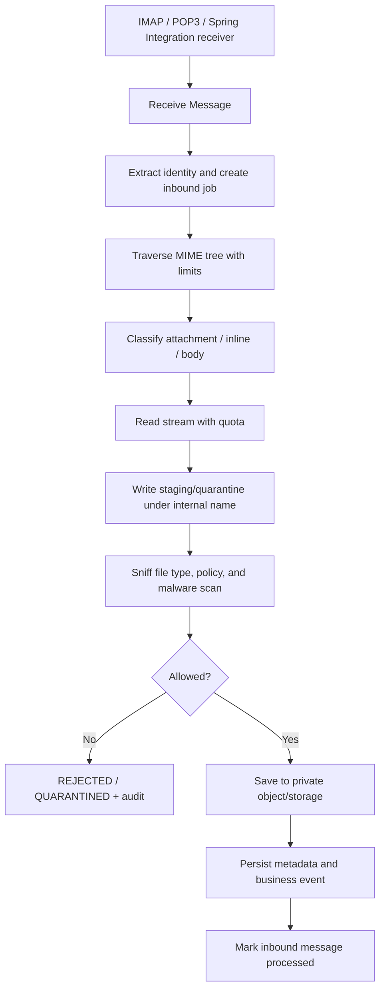

# Handling Attachments from Incoming Emails in Spring Framework Mail

When building an email-receiving application, reading email content does not stop at the Subject, sender, or body. An incoming email can contain PDF invoices, screenshots, spreadsheets, text documents, archives, attached `.eml` emails, or multiple inline resources used to render HTML. These parts are typically packaged using **MIME** (*Multipurpose Internet Mail Extensions*), sometimes nested across multiple `multipart/*` layers.

To ingest attachments properly, the application must both **read and classify the MIME structure** and **handle untrusted files safely**. Files can have spoofed names, Content-Types, extensions, or encodings; they can contain malware, archive bombs, malicious payloads, or private data. An implementation that simply calls `part.getFileName()` and `Files.copy(...)` into a public folder is not safe enough.

In the context of **Spring Framework Mail — Receiving Mail and Mailboxes**, there is an important distinction:

> **`JavaMailSender` is specialized for sending email, not an inbox-reading API.** To read incoming emails, you typically use **Jakarta Mail** (`Session`, `Store`, `Folder`, `Message`, `Part`, `Multipart`) over IMAP/POP3, or integrate **Spring Integration Mail** components for inbound email. Once you have a `Message`, reading MIME attachments uses Jakarta Mail APIs.

This lesson walks through MIME structure, detecting and traversing attachments, Jakarta Mail code examples, bounded stream reading, storing in quarantine/isolation, file-type and malware verification, IMAP UID synchronization, retry/idempotency handling, testing, and operations. Examples use **Java 17+**, **Jakarta Mail** (`jakarta.mail.*`), and Spring Boot generations using the Jakarta API; for Spring Framework 5.x, use the corresponding `javax.mail.*` stack without mixing the two packages.

## 1. Where Do Attachments Live in an Email?

An email can contain a plain-text body, HTML, inline images, and attached files simultaneously. For example:

```text
MimeMessage
└── multipart/mixed
    ├── multipart/related
    │   ├── multipart/alternative
    │   │   ├── text/plain
    │   │   └── text/html
    │   └── image/png
    │       Content-ID: <brand-logo>
    │       Content-Disposition: inline
    ├── application/pdf
    │   Content-Disposition: attachment
    │   filename="invoice-1042.pdf"
    └── application/vnd.openxmlformats-officedocument.spreadsheetml.sheet
        Content-Disposition: attachment
        filename="items.xlsx"
```

Here:

- `multipart/mixed` typically combines the body and independent attachments.
- `multipart/alternative` holds multiple representations of the same content (`text/plain`, `text/html`).
- `multipart/related` links HTML with resources such as CID logos.
- `Content-Disposition: attachment` indicates the intent to be an attached file.
- `Content-Disposition: inline` indicates a part meant to be displayed inline within content.
- `filename` and `Content-Type` are sender-supplied metadata, **untrusted by default**.

Do not assume that "the first element is the body and the second element is the attachment". A valid email can nest multiple `Multipart` containers, reorder parts, or include nested `message/rfc822`.

### 1.1. Typical Headers of a File

```text
Content-Type: application/pdf; name="invoice-1042.pdf"
Content-Disposition: attachment; filename="invoice-1042.pdf"
Content-Transfer-Encoding: base64
```

These headers hint at how a client should handle the MIME part, but do not prove the bytes inside are genuinely a PDF. An executable can be sent with `Content-Type: application/pdf`; trusting headers alone is a security bug.

### 1.2. Is Every MIME Part an Attachment?

No. A part can be:

| Part | Typical Role | Recommended Handling |
|---|---|---|
| `text/plain` | Readable content | Extract body when needed |
| `text/html` | HTML content | Never execute HTML; sanitize if displaying |
| `image/png` + `Content-ID` + inline | Image inside HTML | Optionally store as an inline resource per policy |
| `application/pdf` + attachment | Independent file | Classify as attachment and route to inspection pipeline |
| `application/octet-stream` with filename | File of unknown type | Treat as untrusted data |
| `message/rfc822` | An email attached inside another email | Handle as a file or traverse per policy |
| `multipart/*` | Container of multiple parts | Traverse recursively |

A part with `getDisposition() == null` can still be an attachment if it has a filename and an appropriate content type. Conversely, an `image/png` part marked `INLINE` does not necessarily belong in a "user-downloadable files" list. Classification must follow application goals.

## 2. The Attachment Ingestion Flow Should Separate Steps

A typical pipeline:



**Never expose a file for user download or downstream parser processing before policy/scanning allows it.** The pipeline must be able to stop safely when encountering oversized files, too many attachments, or MIME parsing errors.

### 2.1. Scope of Responsibilities

**Receiver:** fetches emails, identifies folder/UID, manages connections and retries.

**MIME extractor:** accepts a `Part`, traverses the structure, and returns bounded metadata/temp files; does not decide business access permissions.

**Security scanner/policy:** checks real file types, malware, archive nesting, and allow rules.

**Storage service:** stores approved data with internal IDs, access controls, encryption, and retention.

**Business service:** associates attachments with tickets, invoices, records, or workflows for the right tenant/user.

**Acknowledgment:** marks the message processed only after needed state/metadata is durably persisted.

Never put everything inside a single multi-hundred-line `@Scheduled` method that reads IMAP, writes files, and calls business APIs.

## 3. Configuring Inbox Reading with Jakarta Mail

Spring Boot includes `spring-boot-starter-mail` to build `JavaMailSender`, yet it does not create an equivalent "InboxReceiver" automatically from `spring.mail.host` alone. To read IMAP, use Jakarta Mail `Session`/`Store`/`Folder` or a Spring Integration Mail inbound adapter.

### 3.1. IMAP, IMAPS, and POP3

| Protocol | Characteristics | When to Use |
|---|---|---|
| IMAP | Works with folders, flags, server-side state | Inbox syncing and centralized processing |
| IMAPS | IMAP over TLS from connection start, usually port 993 | Common choice when supported by server |
| POP3/POP3S | Focused on downloading messages, fewer folder/flag features than IMAP | Simple/legacy systems per server requirements |
| Provider REST API/webhook | Reads mail/events via provider API | When supported by provider and fitting architecture |

For systems needing UID tracking, avoiding re-reading processed messages, and supporting multiple folders, IMAP is usually more convenient than POP3.

### 3.2. IMAPS Connection Example

```java
package com.example.mail.inbound;

import jakarta.mail.Folder;
import jakarta.mail.Message;
import jakarta.mail.Session;
import jakarta.mail.Store;
import java.util.Properties;

public final class ImapInboxReader {

    public void readInbox(
            String host,
            String username,
            String password) throws Exception {

        Properties p = new Properties();
        p.put("mail.store.protocol", "imaps");
        p.put("mail.imaps.connectiontimeout", "5000");
        p.put("mail.imaps.timeout", "10000");
        p.put("mail.imaps.writetimeout", "10000");
        p.put("mail.imaps.ssl.checkserveridentity", "true");
        p.put("mail.debug", "false");

        Session session = Session.getInstance(p);
        Store store = session.getStore("imaps");
        Folder inbox = null;

        try {
            store.connect(host, 993, username, password);
            inbox = store.getFolder("INBOX");
            inbox.open(Folder.READ_ONLY);

            Message[] messages = inbox.getMessages();
            for (Message message : messages) {
                // Extract metadata and attachments in a controlled manner.
                // Never log the entire message.
                inspectIncomingMessage(message);
            }
        } finally {
            if (inbox != null && inbox.isOpen()) {
                inbox.close(false);
            }
            if (store.isConnected()) {
                store.close();
            }
        }
    }

    private void inspectIncomingMessage(Message message)
            throws Exception {
        // Invoke the application's MIME extractor/inbound service.
    }
}
```

This is an example of **connection and resource management**, not a production polling service. `getMessages()` can return a huge number of emails; real code should fetch only the unprocessed UID range and cap messages per pass. `inspectIncomingMessage` is the integration point into the processing pipeline.

**Never hardcode passwords.** IMAP providers may require OAuth2 or dedicated app passwords rather than a login password. Use provider-supported authentication, a secret manager, and proper connection lifecycles. When using TLS, verify certificates/hostnames and never disable trust checks just to "make it work".

### 3.3. READ_ONLY or READ_WRITE?

`Folder.READ_ONLY` fits when you want to read and extract without altering flags. To mark `SEEN`, add processing flags, or move messages between folders, you usually must open `READ_WRITE` and define an acknowledgment policy.

Never automatically set `SEEN` **before** attachments are durably persisted just to avoid re-reading. A mid-flight scanner/database failure will cause the message to be skipped forever if the poller only reads unseen mail.

### 3.4. Do Not Rely on Message Sequence Numbers

`message.getMessageNumber()` is only the position in the current folder, unstable when the mailbox changes (messages deleted, expunged, moved). For IMAP sync, prefer an identity built from **mail account + folder + `UIDVALIDITY` + `UID`**, or provider API IDs if using an API.

## 4. Jakarta Mail Part and Multipart

Jakarta Mail uses the `Part` interface as the common abstraction for `Message` and `BodyPart`. A part can be either a container or data.

Commonly used APIs:

```java
Part part = message;

String contentType = part.getContentType();
String disposition = part.getDisposition();
String fileName = part.getFileName();
String[] contentIds = part.getHeader("Content-ID");
int declaredSize = part.getSize();

boolean isMultipart = part.isMimeType("multipart/*");
boolean isPlainText = part.isMimeType("text/plain");
boolean isHtml = part.isMimeType("text/html");
boolean isNestedMail = part.isMimeType("message/rfc822");
```

Fields may be `null`; `getSize()` may return `-1` if size is unknown. MIME headers come from external senders, so these values are not trustworthy for name, type, or size.

### 4.1. Never Cast Every getContent() to String

Wrong:

```java
String body = (String) message.getContent();
```

If the email is `multipart/mixed`, `getContent()` typically returns `Multipart`, not `String`. Casting throws an error. For `message/rfc822`, content may be a nested `Message`. For binary files, never use `String` to hold bytes.

Pattern:

```java
Object content = part.getContent();

if (content instanceof Multipart multipart) {
    // Traverse child BodyParts.
} else if (content instanceof Message nestedMessage) {
    // Nested email, handle per policy.
} else if (content instanceof String text) {
    // Text body, with length limits.
} else {
    // Do not assume the object is text.
}
```

Once a part is classified as a binary file, **use `part.getInputStream()`** to read bytes via a stream instead of loading everything into `byte[]` or `String`.

## 5. Classifying Attachments, Inline Resources, and Bodies

A starter utility:

```java
import jakarta.mail.Part;
import java.util.Locale;

enum PartRole {
    ATTACHMENT,
    INLINE_RESOURCE,
    BODY
}

static PartRole classifyLeaf(Part part) throws Exception {
    String disposition = part.getDisposition();
    String fileName = part.getFileName();
    String[] cid = part.getHeader("Content-ID");
    boolean hasCid = cid != null && cid.length > 0;

    if (disposition != null
            && disposition.equalsIgnoreCase(Part.ATTACHMENT)) {
        return PartRole.ATTACHMENT;
    }

    if (disposition != null
            && disposition.equalsIgnoreCase(Part.INLINE)) {
        return fileName != null || hasCid
                ? PartRole.INLINE_RESOURCE : PartRole.BODY;
    }

    // Many clients send files with a filename but no disposition.
    if (fileName != null && !fileName.isBlank()) {
        return PartRole.ATTACHMENT;
    }

    if (hasCid && !part.isMimeType("text/plain")
            && !part.isMimeType("text/html")) {
        return PartRole.INLINE_RESOURCE;
    }

    return PartRole.BODY;
}
```

This is a **classification heuristic**, not a universal MIME normalizer for all emails. Some emails embed inline images without setting `Content-Disposition` or contain unnamed attachment files. Depending on business needs:

- Record the actual disposition/filename/CID/`Content-Type`.
- Define distinct policies for `inline`, `attachment`, and `unknown binary part`.
- Test against real emails from supported mail clients.
- Never mark a part as "safe" merely because its role is `BODY`.
- Never pass HTML/text to a browser without context-appropriate sanitization.

### 5.1. Content-Disposition Can Be Missing

A file may have:

```text
Content-Type: application/pdf; name="report.pdf"
Content-Transfer-Encoding: base64
```

without `Content-Disposition`. Checking only `Part.ATTACHMENT.equals(part.getDisposition())` would miss it. Inspect filename, `Content-Type`, and policy.

### 5.2. Inline Resources Do Not Always Have to Be Exposed to Users

An HTML email contains:

```html

```

The corresponding image part usually carries `Content-ID`. If the application builds a list of downloadable files, it might exclude inline logos; however, if it needs to render HTML safely, it may need to store and map CIDs per policy.

Never trust any `cid:...` in HTML as an automatically authorized path. Only link to captured resources that passed safety checks, while limiting size and type.

### 5.3. message/rfc822 Is a Special Case

A `forwarded.eml` file may be packaged with `Content-Type: message/rfc822` and `Content-Disposition: attachment`. If policy lets users download the `.eml` itself, handle **the attached email part as a file**. If policy requires extracting attachments inside the forwarded email, traverse the nested `Message`.

Do not both save the raw `.eml` and deeply traverse every nested part without limits; a sender can craft many nested layers to exhaust CPU/memory. Explicitly define `PRESERVE_EML` and `RECURSE_NESTED` modes by use case.

## 6. Mandatory Limits When Processing MIME

A parser running on email data from the Internet must enforce limits, not merely catch exceptions.

| Limit Type | Purpose | Illustrative Policy Example |
|---|---|---|
| Total decoded attachment bytes per email | Prevent storage/memory exhaustion | 25 MiB |
| Bytes per single attachment | Block overly large individual files | 15 MiB |
| Total MIME parts | Prevent thousands of tiny parts | 100 |
| Attachment count | Reduce file count and scan workload | 20 |
| MIME recursion depth | Prevent nested/multipart abuse | 12 |
| Nested message count | Prevent deep `message/rfc822` chains | A few levels max |
| Total retained text body length | Prevent gigantic text bodies | As needed |
| SMTP/IMAP read timeout | Prevent worker hangs | Finite timeout |
| Total email processing time | Protect worker SLA | Dedicated deadline |
| Decompressed archive size | Defend against zip bombs | Per quota |

These numbers are **examples**, not Spring/Jakarta Mail defaults. Choose them based on business needs, mail server quotas, and real resources.

### 6.1. Do Not Trust getSize()

`Part.getSize()` may be unknown or reflect encoded/representation byte counts depending on implementation, not the final decoded data size. Safety decisions must rely on **bytes actually read from the stream**, using counters and thresholds.

### 6.2. Traversal Limits

If a MIME tree has 2,000 empty parts, a byte limit alone is insufficient. If an email has 50 nesting levels, a part-count limit alone is insufficient. Enforce **both depth and node-count limits**.

### 6.3. Why Track the Total?

20 attachments of 10 MiB each still total 200 MiB. Even if every individual file is below a 15 MiB limit, one message can still exceed the total budget. When a part pushes the total over budget, stop processing safely, record the categorized status, and clean up staging artifacts per policy.

## 7. Complete Example: Streaming Attachments into Quarantine

The Java code below takes a `jakarta.mail.Message` fetched from IMAP, traverses the MIME tree, and writes only parts classified as attachments/inline resources into a **private staging directory**. It:

- Counts total MIME parts and bounds recursion depth.
- Caps attachment count and decoded file/total byte sizes.
- Never uses `getFileName()` as a storage path.
- Generates a random internal filename via `Files.createTempFile(...)`.
- Reads through `InputStream` with a small buffer instead of loading whole files onto the heap.
- Computes SHA-256 over the actual received bytes.
- Deletes temp files if reading fails or quotas are exceeded.
- Returns metadata decoupled from file contents.

**Important:** this example is the **isolation step**, **not yet malware scanning**, and **does not yet grant users access to the file**. Never treat "file read succeeded" as "file is safe".

### 7.1. Bounded Extractor

```java
package com.example.mail.inbound;

import jakarta.mail.Message;
import jakarta.mail.MessagingException;
import jakarta.mail.Multipart;
import jakarta.mail.Part;
import java.io.IOException;
import java.io.InputStream;
import java.io.OutputStream;
import java.nio.file.Files;
import java.nio.file.Path;
import java.nio.file.StandardOpenOption;
import java.security.MessageDigest;
import java.text.Normalizer;
import java.util.ArrayList;
import java.util.HexFormat;
import java.util.List;
import java.util.Locale;

public final class QuarantineAttachmentExtractor {

    private static final long MAX_FILE_BYTES =
            15L * 1024 * 1024;
    private static final long MAX_TOTAL_BYTES =
            25L * 1024 * 1024;
    private static final int MAX_PARTS = 100;
    private static final int MAX_ATTACHMENTS = 20;
    private static final int MAX_DEPTH = 12;

    private final Path quarantineDir;
    private final List<StagedAttachment> staged =
            new ArrayList<>();

    private long totalBytes;
    private int visitedParts;

    public QuarantineAttachmentExtractor(Path quarantineDir) {
        this.quarantineDir = quarantineDir;
    }

    public List<StagedAttachment> extract(Message message)
            throws Exception {

        // One extractor instance handles only one message.
        if (visitedParts != 0) {
            throw new IllegalStateException(
                    "Extractor instances cannot be reused");
        }

        // quarantineDir is configured and permissioned by the app;
        // never accept it from the sender or email filenames.
        if (!Files.isDirectory(quarantineDir)) {
            throw new IOException("Quarantine directory unavailable");
        }

        try {
            walk(message, 0);
            return List.copyOf(staged);
        } catch (Exception failure) {
            // Clean up already-staged parts when the whole email is rejected.
            for (StagedAttachment item : staged) {
                try {
                    Files.deleteIfExists(item.quarantinePath());
                } catch (IOException cleanupError) {
                    failure.addSuppressed(cleanupError);
                }
            }
            throw failure;
        }
    }

    private void walk(Part part, int depth) throws Exception {
        if (depth > MAX_DEPTH || ++visitedParts > MAX_PARTS) {
            throw new IOException("MIME complexity limit exceeded");
        }

        // Multipart container: traverse children, do not treat container
        // as a binary attachment by default.
        if (part.isMimeType("multipart/*")) {
            Object body = part.getContent();
            if (!(body instanceof Multipart multipart)) {
                throw new IOException("Invalid multipart content");
            }
            for (int index = 0;
                    index < multipart.getCount(); index++) {
                walk(multipart.getBodyPart(index), depth + 1);
            }
            return;
        }

        // An attached .eml is kept as a file; other nested messages
        // can be traversed if application policy permits.
        if (part.isMimeType("message/rfc822")
                && !isExplicitAttachment(part)) {
            Object body = part.getContent();
            if (body instanceof Message nested) {
                walk(nested, depth + 1);
            } else {
                throw new IOException("Invalid nested message");
            }
            return;
        }

        PartRole role = classifyLeaf(part);
        if (role == PartRole.BODY) {
            return;
        }

        if (staged.size() >= MAX_ATTACHMENTS) {
            throw new IOException("Too many attachments");
        }
        staged.add(copyToQuarantine(part, role));
    }

    private StagedAttachment copyToQuarantine(
            Part part,
            PartRole role) throws Exception {

        String displayName = safeDisplayName(part.getFileName());
        String mimeType = part.getContentType();
        String cid = firstContentId(part);

        Path file = Files.createTempFile(
                quarantineDir, "mailpart-", ".bin");

        long fileBytes = 0L;
        MessageDigest digest = MessageDigest.getInstance("SHA-256");

        try (InputStream in = part.getInputStream();
             OutputStream out = Files.newOutputStream(
                     file,
                     StandardOpenOption.WRITE,
                     StandardOpenOption.TRUNCATE_EXISTING)) {

            byte[] buffer = new byte[8192];
            int count;
            while ((count = in.read(buffer)) != -1) {
                if (count == 0) {
                    continue;
                }
                if (count > MAX_FILE_BYTES - fileBytes
                        || count > MAX_TOTAL_BYTES - totalBytes) {
                    throw new IOException(
                            "Decoded attachment byte quota exceeded");
                }
                out.write(buffer, 0, count);
                digest.update(buffer, 0, count);
                fileBytes += count;
                totalBytes += count;
            }
        } catch (Exception failure) {
            try {
                Files.deleteIfExists(file);
            } catch (IOException cleanupError) {
                failure.addSuppressed(cleanupError);
            }
            throw failure;
        }

        return new StagedAttachment(
                displayName,
                mimeType,
                role,
                cid,
                file,
                fileBytes,
                HexFormat.of().formatHex(digest.digest()));
    }

    private static boolean isExplicitAttachment(Part part)
            throws MessagingException {
        return Part.ATTACHMENT.equalsIgnoreCase(
                part.getDisposition());
    }

    private static PartRole classifyLeaf(Part part)
            throws MessagingException {

        String disposition = part.getDisposition();
        String filename = part.getFileName();
        boolean hasFilename =
                filename != null && !filename.isBlank();
        boolean hasCid = firstContentId(part) != null;

        if (Part.ATTACHMENT.equalsIgnoreCase(disposition)) {
            return PartRole.ATTACHMENT;
        }
        if (Part.INLINE.equalsIgnoreCase(disposition)) {
            return hasFilename || hasCid
                    ? PartRole.INLINE_RESOURCE
                    : PartRole.BODY;
        }
        if (hasFilename) {
            return PartRole.ATTACHMENT;
        }
        if (hasCid && !part.isMimeType("text/plain")
                && !part.isMimeType("text/html")) {
            return PartRole.INLINE_RESOURCE;
        }

        // Binary parts with unclear roles must still be examined;
        // do not silently skip just because filename is absent.
        if (!part.isMimeType("text/plain")
                && !part.isMimeType("text/html")) {
            return PartRole.ATTACHMENT;
        }
        return PartRole.BODY;
    }

    private static String firstContentId(Part part)
            throws MessagingException {
        String[] values = part.getHeader("Content-ID");
        if (values == null || values.length == 0) {
            return null;
        }
        String cid = values[0].trim();
        // CID is untrusted metadata; retain only if valid
        // under application policy.
        return cid.length() <= 200 ? cid : null;
    }

    private static String safeDisplayName(String untrusted) {
        if (untrusted == null || untrusted.isBlank()) {
            return "attachment";
        }
        // Normalize for display only; never use as a storage path.
        String normalized = Normalizer.normalize(
                untrusted, Normalizer.Form.NFC);
        normalized = normalized.replace('\\', '/');
        normalized = normalized.substring(
                normalized.lastIndexOf('/') + 1);

        StringBuilder out = new StringBuilder();
        for (int i = 0; i < normalized.length()
                && out.length() < 120; i++) {
            char c = normalized.charAt(i);
            int type = Character.getType(c);
            if (!Character.isISOControl(c)
                    && type != Character.FORMAT
                    && c != ':'
                    && c != '<'
                    && c != '>'
                    && c != '"'
                    && c != '|') {
                out.append(c);
            }
        }
        String result = out.toString().trim();
        if (result.equals(".") || result.equals("..")
                || result.isBlank()) {
            return "attachment";
        }
        return result;
    }

    public enum PartRole {
        ATTACHMENT,
        INLINE_RESOURCE,
        BODY
    }

    public record StagedAttachment(
            String displayName,
            String declaredContentType,
            PartRole role,
            String contentId,
            Path quarantinePath,
            long sizeBytes,
            String sha256) {
    }
}
```

**Limitations of this sample code:** this is a streaming example for MIME attachment parts, not a complete defense against all MIME parsing attacks. `part.getContent()` on multipart/nested messages is still parsed by the library and can consume resources before the extractor counts them; the application also needs **whole raw message size limits at the receiver/server layer**, timeouts, worker caps, cancellation, and library updates. `text/*` bodies are not stored/bounded by this extractor because the example focuses on attachments; if the application also handles HTML/text bodies, bound those separately.

### 7.2. Using the Extractor

```java
Path stagingRoot = Path.of(
        "/var/private-mail-quarantine");

QuarantineAttachmentExtractor extractor =
        new QuarantineAttachmentExtractor(stagingRoot);

List<QuarantineAttachmentExtractor.StagedAttachment> items =
        extractor.extract(inboundMessage);

for (var item : items) {
    // Send metadata and temp path to scanner/policy.
    // Never return quarantinePath directly to an HTTP client.
    scanningQueue.submit(item);
}
```

`scanningQueue` is an application-defined component. `/var/private-mail-quarantine` is only a Unix example; in deployment, the directory must be provisioned/permissioned by operations and isolated from the webroot/public static resources.

**Between when the extractor returns and when the scanner processes**, maintain ownership/lifecycle for temp files: job ID, scan deadlines, retries, cleanup, and access controls. If the producer enqueues a file path and then crashes, files must not linger indefinitely.

### 7.3. Why Store Under a Random Filename?

If the sender transmits:

```text
Content-Disposition: attachment;
 filename="../../config/application.yml"
```

the stored path remains:

```text
/var/private-mail-quarantine/mailpart-842391.bin
```

The header name is metadata for display after inspection, and **never** becomes a destination path in the filesystem. Later downloads can set `Content-Disposition` with the sanitized name after authorization checks.

### 7.4. What Is SHA-256 Used For?

Hashing enables byte verification, detecting duplicate content, and verifying the file was not altered across staging–scan–storage. Hashing **does not prove a file is safe**, because malware also has valid SHA-256 hashes. If using hashes to reuse scan results, account for scanner version, policy, age, and tenant boundaries.

## 8. Common Vulnerabilities from Filenames

`Part.getFileName()` can yield a sender-chosen name, such as:

```text
invoice.pdf
../../../../etc/passwd
C:\Windows\System32\example.exe
report.pdf.exe
report.PDF
photo.jpg\u202Egpj.exe
download
CON
file name with newline
```

Examples include control/bidi characters or special names that can cause confusion when displaying, saving files, or writing logs. Across operating systems, allowed characters in filenames also differ.

### 8.1. Display Name and Storage Name Are Two Different Things

You should maintain:

| Field | Source | Purpose |
|---|---|---|
| `sourceFileName` | Sender header, untrusted | Store only as restricted metadata, if truly needed |
| `displayFileName` | Sanitized per policy | Display to users |
| `storageObjectKey` | Server-generated UUID/opaque ID | Store and retrieve the file |
| `detectedContentType` | Content classifier | Enforce policy and serve downloads |
| `sha256` | Computed from bytes | Integrity and auditing |

Never attach a trusted extension solely from the MIME header. If a file is detected as an executable while named `invoice.pdf`, reject/quarantine it per policy rather than renaming it to `invoice.exe` and allowing downloads.

### 8.2. MIME Filenames Can Be Encoded

Filenames are not always simple ASCII. Emails can use RFC 2231 encoded parameters or legacy encoding mechanisms to carry Unicode names. Jakarta Mail may decode them depending on version/configuration. Even after calling `getFileName()`, still sanitize and check for control characters; avoid double-decoding or trusting a single header variant.

### 8.3. Never Log Raw Filenames

Filenames can contain PII such as record IDs, health information, account numbers, or CRLF sequences aimed at forging log lines. For telemetry, log `attachmentIndex`, `sizeBytes`, `detectedType`, and `failureClass` instead of logging raw names indiscriminately.

## 9. Content-Type and Extensions Are Not Proof of Safety

An email can declare:

```text
Content-Type: application/pdf
Content-Disposition: attachment; filename="invoice.pdf"
```

yet the bytes may not be a PDF. Therefore, a file pipeline should combine multiple signals:

1. Declared `Content-Type` from the MIME header.
2. Normalized display filename and extension.
3. Detected file type via file signatures/magic bytes or a safe parser.
4. Use-case-specific allowlist policies.
5. Malware scanning and format-specific checks.
6. Limits on size, complexity, and total resources.

Documented example:

| Declared Type | Detected Type | Illustrative Policy |
|---|---|---|
| `application/pdf` | Valid PDF | Proceed to scan and PDF validation step |
| `application/pdf` | Windows executable | Reject/quarantine |
| `image/png` | Valid PNG | Scan; optionally decode/re-encode safely |
| `application/zip` | ZIP | Enforce archive budget and inspect each entry |
| `application/octet-stream` | Unknown | Quarantine and reject or route to manual review |

A file with valid magic bytes can still be malicious or crafted to exploit a parser. **File sniffing does not replace antivirus/AV and library updates.**

### 9.1. Parsers Should Not Run on the Mail Receiver Thread

PDF, Office, and image parsing libraries have their own attack surfaces. Never let an attacker-controlled message make the IMAP listener thread run a heavy parser directly, hang, or exhaust memory. After staging, dispatch a job to an isolated scanner/processor with:

- CPU/memory/time limits.
- Minimal filesystem/network permissions.
- Zero SMTP/IMAP production secrets.
- Allowed file-type policies.
- Tracking of scanner version and verdict.

If business logic requires reading spreadsheets and extracting data, run it **after** inspection and inside a restricted environment.

## 10. Quarantine, Scanning, and Storage

A safe pipeline never stores attachments directly into a public directory or an "approved" database before scanning.

### 10.1. Attachment State Machine

```text
RECEIVED
   |
   v
STAGED_PRIVATE
   |
   v
SCANNING
   |
   +--> CLEAN --> APPROVED_PRIVATE_STORAGE --> AVAILABLE
   |
   +--> MALICIOUS --> REJECTED / retention per policy
   |
   +--> SUSPICIOUS --> QUARANTINED / review
   |
   +--> SCAN_FAILED --> RETRY_SCAN or MANUAL_REVIEW
```

When the scanner is unavailable, **fail closed**: never allow users to download and never auto-transition to `CLEAN`. Depending on SLA, wait in the scan queue or expose a pending status so metadata workflows can continue.

### 10.2. Virus Scanning Is Insufficient for Complex Archives

ZIP/RAR/7z or Office containers can hold nested archives. To defend against decompression bombs, cap:

- Total **decompressed** bytes.
- Number of file entries and archive depth.
- Abnormal compression ratios.
- CPU time and memory during extraction.
- Individual entry sizes.
- Symlinks/hardlinks and archive path traversal.
- Nested file types and password-protected archives.

Never extract archives blindly and write `../` entries onto the filesystem. If extraction is necessary, use a maintained library, a sandbox, and Zip Slip path checks; many applications do not need to extract at all and can simply scan/quarantine the archive as a whole.

### 10.3. Macros, Active Content, and Sensitive Files

Some formats contain scripts/macros or embedded objects. If the application only needs PDF reports, do not permit macro-enabled Office documents. Allowlist policies should derive from business needs rather than blacklisting a few extensions.

Additional options:

- Convert content into a safe format per policy (CDR) if needed.
- Generate thumbnails through a decoder/re-encoder inside a sandbox.
- Disable active content when rendering previews.
- Store files in a private bucket/storage never served directly from the webroot.
- Issue download links only after authorization checks.

### 10.4. When Scanning Fails Mid-Flight

If the scanner times out:

1. Keep the attachment in `SCAN_FAILED`/`PENDING_RETRY`.
2. Do not transition the file to available.
3. Retry scanning with backoff, attempt limits, and deadlines.
4. Once expired, apply review/rejection policy.
5. Clean up temp files in a controlled way when the job ends.

Never treat a scanner exception as "no virus detected".

## 11. Storing Verified Files in Private Object Storage

Once the scanner clears a file, the application can write it to private object storage or a private filesystem under a server-generated key:

```text
tenant-id/inbound-mail/job-id/attachment-id
```

Key components must be application-issued and validated IDs, never taken directly from filenames. Before storing, verify tenant ownership; when retrieving, never rely solely on the caller knowing the object key.

### 11.1. Example Persistent Metadata

```sql
CREATE TABLE inbound_attachment (
    id                    UUID PRIMARY KEY,
    inbound_message_id    UUID NOT NULL,
    storage_object_key    VARCHAR(350),
    display_file_name     VARCHAR(180),
    declared_content_type VARCHAR(255),
    detected_content_type VARCHAR(255),
    size_bytes            BIGINT NOT NULL,
    sha256_hex            CHAR(64) NOT NULL,
    part_role             VARCHAR(30) NOT NULL,
    scan_status           VARCHAR(40) NOT NULL,
    scan_engine_version   VARCHAR(100),
    created_at            TIMESTAMPTZ NOT NULL,
    approved_at           TIMESTAMPTZ,
    CHECK (size_bytes >= 0)
);
```

This is an illustrative schema. Production also needs tenant scope, retention, storage versioning, job ownership, access controls, and states matching real requirements.

### 11.2. Never Use the Filename as the Object Key

Wrong:

```java
storage.put(
        "incoming/" + part.getFileName(),
        part.getInputStream());
```

Better:

```java
String objectKey = "inbound/"
        + inboundJobId + "/"
        + UUID.randomUUID();

// Only upload after scanning and policy approval.
storage.putApprovedFile(
        objectKey,
        scannedFile.quarantinePath(),
        scannedFile.detectedContentType());
```

`storage.putApprovedFile` and `scannedFile` are application-defined APIs. Never set the download response MIME type solely from the declared `Content-Type`; use the verified type along with defensive headers such as `X-Content-Type-Options: nosniff` per web architecture.

### 11.3. Downloads Must Enforce Authorization

An attachment can contain customer data, internal documents, or PII. The download endpoint must verify the caller has permissions for the inbound message and associated tenant. If using short-lived signed URLs, manage lifetimes, scopes, and auditing appropriately.

Keep object storage private and avoid public-read ACLs by default. Never expose absolute staging paths in JSON.

## 12. Identifying an Incoming Email: Message-ID Differs from IMAP UID

To process attachments exactly once at the business layer, you cannot rely solely on a single successful poll. IMAP connections can drop, messages can be moved across folders, or workers can crash. An already-read email can reappear in the next poll.

Common identifiers:

| Identifier | Meaning | Risk If Used as Sole ID |
|---|---|---|
| `Message.getMessageNumber()` | Message sequence number in open folder | Shifts when mailbox expunges/moves |
| `Message-ID` header | ID created by sender/relay per RFC 5322 | Can be missing, malformed, duplicated, or spoofed |
| IMAP `UID` | Message ID within a folder | Unique only within folder and `UIDVALIDITY` |
| IMAP `UIDVALIDITY` | Folder UID namespace version | When changed, old UIDs lose prior meaning |
| `inboundMessageId` | Internal ingestion job ID | Used to link attachments/workflows |
| POP3 `UIDL` | ID supplied by POP3 server if supported | Semantics differ from IMAP; server-dependent |

**For IMAP, a sound sync key is `account + folder + UIDVALIDITY + UID`.** When a message moves folders, it may receive a different UID in the destination folder; the application needs a policy on reprocessing or linking to the same logical email.

### 12.1. Reading UIDs via UIDFolder

Jakarta Mail provides the `UIDFolder` interface:

```java
import jakarta.mail.Folder;
import jakarta.mail.Message;
import jakarta.mail.UIDFolder;

Folder folder = store.getFolder("INBOX");
folder.open(Folder.READ_ONLY);

if (!(folder instanceof UIDFolder uidFolder)) {
    throw new IllegalStateException(
            "Folder does not support IMAP UID semantics");
}

long uidValidity = uidFolder.getUIDValidity();

for (Message message : folder.getMessages()) {
    long uid = uidFolder.getUID(message);
    if (uid <= 0) {
        continue;
    }

    InboundIdentity identity = new InboundIdentity(
            accountId, "INBOX", uidValidity, uid);

    inboundJobService.enqueueIfAbsent(identity);
}
```

`accountId`, `InboundIdentity`, and `inboundJobService` are project-defined components. In production, do not scan `getMessages()` across the entire inbox on every pass; maintain checkpoints to fetch only unprocessed UIDs, combined with recovery when `UIDVALIDITY` changes.

### 12.2. Inbound Identity Schema

```sql
CREATE TABLE inbound_message (
    id                  UUID PRIMARY KEY,
    account_id          UUID NOT NULL,
    folder_name         VARCHAR(255) NOT NULL,
    uid_validity        BIGINT NOT NULL,
    imap_uid            BIGINT NOT NULL,
    mime_message_id     VARCHAR(320),
    processing_state    VARCHAR(40) NOT NULL,
    attempts            INTEGER NOT NULL DEFAULT 0,
    first_seen_at       TIMESTAMPTZ NOT NULL,
    processed_at        TIMESTAMPTZ,
    last_error_class    VARCHAR(100),
    UNIQUE (account_id, folder_name, uid_validity, imap_uid)
);

CREATE INDEX idx_inbound_message_pending
    ON inbound_message (processing_state, first_seen_at);
```

All tables, states, and IDs are application examples. A multi-tenant system also needs tenant scope, account access controls, leases to prevent concurrent processing by multiple workers, retention, and mappings when IMAP folders change.

### 12.3. The Message-ID Header Remains Useful for Correlation

```java
String[] headers = message.getHeader("Message-ID");
String mimeMessageId =
        headers != null && headers.length > 0
                ? headers[0] : null;
```

However, this header can be controlled by the sender/relay. Never use it as proof of sender identity, never use it as an authorization token, and never assume two emails with the same header are the same business record.

### 12.4. Attachment Deduplication Should Not Rely Solely on Hashes

Two different emails can attach **the exact same PDF file**. Matching attachment SHA-256 hashes do not mean the application can skip an email or share an object across two tenants. Hashes can aid storage deduplication, while business logic must preserve links to **inbound message + attachment part identity + access permissions**.

## 13. Idempotent Inbound Processing

A resilient processing flow:

```text
Poll IMAP UID
    |
    v
INSERT inbound_message IF ABSENT
    |
    v
Claim inbound job / lease
    |
    v
Parse MIME -> quarantine attachments
    |
    v
Scan -> private storage
    |
    v
COMMIT metadata + business outcome
    |
    v
Mark inbound job completed
    |
    v
Optional IMAP Seen/Move acknowledgment
```

### 13.1. You Do Not Need Exactly-Once IMAP Reads to Achieve Idempotent Business Outcomes

The application may read the same message multiple times on reconnects, while unique constraints and job state ensure the same identity never spawns uncontrolled duplicate business records/attachments.

Example:

```sql
INSERT INTO inbound_message (
    id, account_id, folder_name, uid_validity, imap_uid,
    processing_state, first_seen_at
)
VALUES (
    :id, :account_id, :folder_name, :uid_validity, :uid,
    'PENDING', NOW()
)
ON CONFLICT (
    account_id, folder_name, uid_validity, imap_uid
) DO NOTHING;
```

After inserting, query the existing row by identity to obtain `inboundMessageId`. Never return the newly generated UUID when the insert conflicted; idempotency must use the persisted row.

### 13.2. Assign Individual Attachment IDs

A message can carry multiple files; each file needs an independent ID:

```text
inboundMessageId=M100
    attachment A1: PDF
    attachment A2: XLSX
    inlineResource R1: PNG logo
```

When retrying the scan for attachment A2, there is no need to re-download/re-scan A1 if A1's status is durably recorded and the file remains valid. If MIME parsing fails mid-way, decide re-extraction per policy and clean up temporary staging so nothing is orphaned.

### 13.3. Idempotency for Storage Uploads

If object store upload succeeds while the database commit fails, a retry may upload twice. You can use:

- A pre-created attachment record/ID.
- A stable object key derived from the internal ID and intentional version.
- Conditional puts or existence/metadata checks per storage contract.
- A reconciliation job cleaning up unreferenced objects.

Never use the original filename as an object key to "deduplicate"; the same name can have different contents and vice versa.

### 13.4. Handling Emails Deleted or Moved Mid-Flight

Between polling the UID and a worker fetching the body, the mailbox can change. If `UIDFolder.getMessageByUID(uid)` returns `null`, the job needs a status like `SOURCE_NOT_FOUND` or a short retry per policy; never attach content from a message sharing the same sequence number.

If strong durability is required, download the raw RFC 822 message into a bounded isolated object store and process from the internal snapshot. However, enforce raw message size caps, encryption/access controls, and retention because raw emails contain all recipients, bodies, and attachments.

## 14. When to Mark SEEN, Move, or Delete?

**Reading a message does not mean all attachments have been processed.** Acknowledgment flows depend on requirements:

- **`SEEN`:** marks as viewed; does not automatically equate to business processing.
- **Custom user flag / keyword:** supported by some IMAP servers, but inconsistent across systems.
- **Move to Processed folder:** can help operations, though UIDs can change in the destination folder.
- **Delete/expunge:** can destroy sources needed for retries and audits; requires a retention policy.
- **Application checkpoint:** stores identity, state, and attempts in the DB; usually more important than flags.

### 14.1. Never Rely on SEEN as the Sole Source of Truth

If the poller only fetches `UNSEEN`, a user opening the email in a mail client can cause the app to miss it. Conversely, an app reading an email and crashing before saving files can leave the message marked seen without being processed.

Use UID checkpoints/job stores to decide what needs processing; flags can be supplementary information.

### 14.2. Marking After Completion

Example with a `READ_WRITE` folder and a completed identity:

```java
import jakarta.mail.Flags;
import jakarta.mail.Folder;
import jakarta.mail.Message;
import jakarta.mail.UIDFolder;

Folder inbox = store.getFolder("INBOX");
inbox.open(Folder.READ_WRITE);

try {
    UIDFolder uidFolder = (UIDFolder) inbox;

    // Verify current UIDVALIDITY before using the stored UID.
    if (uidFolder.getUIDValidity() == job.uidValidity()
            && inboundJobStore.isProcessed(job.id())) {

        Message current = uidFolder.getMessageByUID(
                job.imapUid());
        if (current != null) {
            current.setFlag(Flags.Flag.SEEN, true);
        }
    }
} finally {
    if (inbox.isOpen()) {
        inbox.close(false);
    }
}
```

`job` and `inboundJobStore` are application components. Verify `UIDFolder` is genuinely supported; the example assumes an IMAP server. Setting flags can fail transiently after the database commits; therefore acknowledgment needs retries/idempotency, never rolling back processed attachment data.

### 14.3. Should Original Emails Be Deleted?

Do not auto-delete immediately after reception if auditing, lookups, or retries are needed. If policy requires cleaning the mailbox, move to a separate folder or delete after a retention window; understand server semantics, quotas, and UID changes.

For POP3, server deletion usually has different semantics from IMAP. Never apply `SEEN`/`UIDVALIDITY` code verbatim to POP3.

## 15. Spring Integration Mail in the Mail-Receiving Pipeline

**Spring Integration Mail** provides receivers/adapters to feed emails from POP3/IMAP into Spring Integration message channels. Common components include:

- `ImapMailReceiver` and `Pop3MailReceiver` to retrieve mail.
- Inbound channel adapters and polling mechanisms.
- IMAP IDLE adapter when the server supports push notifications.
- `MessageChannel`/`IntegrationFlow` to route messages through handlers.
- Header metadata and mark-read/peek options depending on component/version.

Spring Integration separates inbound transport from the processing pipeline, yet **does not automatically perform antivirus scanning, storage authorization, or business idempotency**.

### 15.1. Suggested Architecture

```text
IMAP INBOX
    |
    v
Spring Integration Mail inbound adapter
    |
    v
inboundMailChannel
    |
    v
InboundMessageHandler
    |
    +--> Identity (account/folder/UIDVALIDITY/UID)
    +--> Durable job enqueue
    |
    v
AttachmentProcessingWorker
    +--> MIME traversal
    +--> quarantine -> scan -> private storage
```

If the adapter pushes the entire MIME message onto a channel, the handler must know whether the payload is `MimeMessage`, a decoded message, or another type per adapter configuration. Never cast blindly based only on channel name.

### 15.2. Polling or IMAP IDLE?

**Polling**: periodically checks for new mail; easy to bound batches and job checkpoints, though subject to scheduled latency.

**IMAP IDLE**: server signals inbox changes; can lower latency and pointless polls. Yet network disconnects, server timeouts, and reconnects still occur. IDLE notifications must not replace UID/checkpoint enumeration so messages are not missed during connection drops.

### 15.3. Marking Messages as Read in Adapters

Some receivers offer options to mark messages read or leave state untouched. For safety, clarify:

1. How much data does the adapter fetch and read before acking?
2. When is the `SEEN` flag set?
3. If the handler throws, does the adapter retry or drop the message?
4. Does the app maintain an independent durable inbound job/checkpoint?
5. How does the mailbox server support custom flags/moves?

Never enable a "mark as read" option and treat it as equivalent to a successful scanner and database commit.

### 15.4. Connections and Credentials

With Spring Integration, IMAP URLs/configs may contain account details. Avoid hardcoding or printing raw URLs if they hold passwords. Prefer externalized config, secret managers, and valid auth mechanisms; enforce TLS verification and timeouts. Never include credentials in exception logs.

### 15.5. Do Not Arbitrarily Reuse MimeMessage After the Folder Closes

Some `MimeMessage` objects and body parts are backed by IMAP protocol streams; accessing content after `Folder`/`Store` closes can fail depending on implementation. Design lifecycles explicitly:

- Extract/capture bytes while the connection/folder remains valid; or
- Create a durable raw message snapshot/staging file and then close the folder; or
- Use an API/provider with well-understood lazy-loading contracts.

Never pass a `MimeMessage` from the receiver onto an async queue, close the IMAP folder immediately, and expect every attachment stream to remain readable.

## 16. Handling Text and HTML Bodies Alongside Attachments

Some workflows, such as creating tickets from emails, need to store both message content and files. Do not treat them completely independently: **HTML bodies can reference inline images via CID**, and MIME structures can contain plain text + HTML alternatives.

### 16.1. Plain Text and HTML Are Two Versions of the Same Content

With `multipart/alternative`:

```text
multipart/alternative
  text/plain
  text/html
```

the application can pick plain text for indexing/ticket previews, use sanitized HTML for rendering if needed, or keep both per policy. Never treat `text/plain` and `text/html` as **two attachments** merely because they are two different MIME body parts.

### 16.2. HTML Can Contain Active Content

Email HTML is **untrusted input**. Before rendering in a web application:

- Strip JavaScript, event handlers, forms, iframes, and active content.
- Restrict allowed tags and attributes.
- Validate/sanitize URLs in `href` and `src`.
- Prevent HTML from overriding page-wide CSS.
- Handle remote images per privacy policy; avoid auto-fetching attacker-controlled URLs.
- If mapping CIDs to scanned images, serve images only after authorization.
- Never render sender raw HTML in an admin page without sandboxing/sanitization.

Anti-pattern example:

```java
model.addAttribute("emailBody", rawHtmlFromSender);
// Then render raw HTML without escaping/sanitization.
```

An email containing phishing HTML or an XSS payload puts staff at risk if an admin tool renders it directly. That mail clients apply their own protections **does not guarantee** your internal web page has the same protection.

### 16.3. CID Images May Need Separate Mapping

Suppose the body contains:

```html

```

And the MIME part:

```text
Content-ID: <receipt-photo-1>
Content-Type: image/jpeg
Content-Disposition: inline
```

If the application wants to display the image:

1. Extract the CID and normalize it per policy.
2. Read, scan, and store the image part privately.
3. Build a map `CID -> approved attachment ID`.
4. Sanitize HTML and replace CID references with authorized application URLs.
5. Never fetch remote images or resolve `file://`/`data:` from HTML automatically.

Never use `Content-ID` directly as a filename/path; it is also sender-supplied metadata.

### 16.4. Multipart/related Differs from Multipart/mixed

`multipart/related` describes relationships between an HTML body and resources, whereas `multipart/mixed` typically holds independent parts. Forwarded emails or ones built by older clients may nest differently; use the MIME tree and controlled heuristics rather than hardcoding "part index=1 is the file".

## 17. Security Threats Specific to Incoming Mail

Not every blocked attachment is known malware. Think across these categories:

| Risk Category | Example | Primary Control |
|---|---|---|
| Path traversal / Zip Slip | `../../secrets` in filename/entry | Internal storage keys, sandboxed extraction |
| Malware | Executable disguised as PDF | AV scan and allowlist |
| Macros/scripts | Macro-enabled Office file | File-type policy, sandbox/CDR |
| Archive bomb | Tiny ZIP expanding massively | Decompressed quotas, depth/count limits |
| Parser exploit | PDF/Image crafted to exploit library | Up-to-date parsers, sandbox, timeouts |
| MIME nesting abuse | Deep multipart / thousands of parts | Depth and part-count caps |
| MIME type spoofing | `application/pdf` with non-PDF bytes | File signature sniffing + policy |
| HTML injection/XSS | HTML targeting admin panel | Sanitization and isolation |
| Remote content / SSRF | HTML with image/link to internal host | Never auto-fetch URLs; outbound allowlist |
| Sensitive data exposure | File containing PII | Private storage, encryption, authorization |
| Mailbox denial of service | Tens of MB/file or thousands of emails | Input quotas, concurrency/rate limits |
| Duplicate processing | IMAP reconnect/UID checkpoint bugs | Durable identity + idempotency |
| Spoofed sender identity | Forged display name/From | Never grant business permissions solely by `From` |

### 17.1. SPF/DKIM/DMARC Do Not Replace Virus Scanning

Even when an email passes SPF, DKIM, and DMARC checks, attachments can still contain malware or disallowed files. Mail authentication evaluates the sending source/domain, not the byte-level safety of attachments.

Conversely, an email lacking a DKIM signature does not automatically prove a file is malicious. Combine sender reputation/allowlists with content-handling policies rather than reducing content checks to a simple binary condition.

### 17.2. Never Grant Permissions Based Solely on the From Header

An invoice-receiving workflow must not automatically post to company A's account simply because of the header:

```text
From: invoices@trusted-vendor.example
```

`From` headers can be spoofed. Require trusted channels, gateway authentication results, sender/domain allowlists, business references, or additional verification steps proportional to business sensitivity.

If an email triggers financial actions, payments, or data exports, never use an attachment and email `From` header as sole proof.

### 17.3. Never Auto-Fetch URLs Inside Emails

An email may contain:

```html

```

If a server-side HTML renderer immediately fetches images, it can cause **SSRF** against internal services. Likewise, never open cloud attachment link URLs from untrusted sources inside a process with internal network access.

If business logic must download files from external URLs, use a dedicated download service with scheme/host/IP allowlists, DNS revalidation, redirect policies, byte/time limits, and network isolation. That is a separate workflow from MIME attachments embedded in the message.

### 17.4. Encrypted/Password-Protected Files

An encrypted ZIP or PDF cannot have its contents fully scanned. Never mark it `CLEAN` merely because the scanner could not read it. Policy can route it to manual review, reject it, or ask the sender to supply a scannable version over a secure channel.

Never log passwords or decryption secrets. Never attempt unbounded password guessing.

## 18. Retries and Error Classification

A mail-receiving worker commonly encounters many errors:

- Lost IMAP connection.
- Missing folder or insufficient permissions.
- Source UID expunged before fetch.
- Malformed MIME or invalid encoding.
- Attachment exceeds quota.
- Staging disk full or unwritable.
- Scanner timeout.
- Object storage unavailable.
- Database commit failure.
- Failed business validation.

Do not retry all errors identically.

### 18.1. Suggested Taxonomy

```java
public enum InboundFailureClass {
    IMAP_CONNECTION,
    IMAP_AUTHENTICATION,
    SOURCE_MESSAGE_NOT_FOUND,
    MALFORMED_MIME,
    MIME_TOO_COMPLEX,
    ATTACHMENT_TOO_LARGE,
    TOO_MANY_ATTACHMENTS,
    DISALLOWED_FILE_TYPE,
    MALWARE_DETECTED,
    SCANNER_UNAVAILABLE,
    STAGING_IO,
    STORAGE_UNAVAILABLE,
    BUSINESS_VALIDATION,
    UNKNOWN
}
```

These are application-defined codes, not a Jakarta Mail enum. Error codes keep logs/metrics clear without printing full exceptions containing headers, filenames, or bytes.

### 18.2. Retryable or Permanent?

| Error | Typical Handling |
|---|---|
| IMAP connection timeout | Retry with backoff/jitter |
| IMAP authentication failed | Alert on config/credentials; avoid hot-loop retries |
| Source UID no longer exists | Reconcile folder/`UIDVALIDITY`; may terminate individually |
| Unparseable malformed MIME | Quarantine/message-level reject; do not retry infinitely |
| Attachment exceeds size | Reject per policy, record reason |
| Malware detected | Reject/quarantine; do not forward downstream |
| Scanner unavailable | Keep staging pending; bounded scan retries |
| Object storage timeout | Retry storage; reconcile uploaded files |
| Database commit failed | Retry idempotently; clean up orphan files |
| Business validation failed | Manual review or permanent failure |

Do not silently discard hard-to-parse emails just because the parser errored. The system may need minimal metadata, rejection status, and alerts per policy; if raw messages are retained for forensics, enforce strict access controls and retention.

### 18.3. Mid-Stream Failures

If `InputStream.read(...)` throws an exception after writing 3 MB to staging:

1. Close the input and output streams.
2. Delete the incomplete temp file.
3. Record `STAGING_IO` or `MALFORMED_MIME` according to cause.
4. Never move that file's metadata to `CLEAN`.
5. Decide on retry if the source remains available and the error may be transient.

The extractor example in section 7 cleans up in the exception branch; production also needs a janitor to sweep leftover staging artifacts after process crashes.

### 18.4. Never Hold IMAP Connections Open Waiting for Scanners

A scanner can take seconds or minutes. A receiver should not hold `Folder`/`Store` open and maintain locks/connections throughout scanning; instead:

- Fetch bytes safely into staging within a bounded duration.
- Persist the durable inbound identity and needed snapshot.
- Close IMAP resources.
- Offload scanning/storage/processing to another worker.

This lowers connection timeout risks and lets the receiver scale independently of scanners.

## 19. Capacity Planning and Backpressure

Receiving mail is a load source not fully controlled by the application. One email can contain many files, and scanning/parsing is typically slower than reading metadata.

Parameters to bound:

| Parameter | Role |
|---|---|
| IMAP messages polled per pass | Avoid pulling too much data |
| Concurrent workers fetching raw mail | Limit connections/network |
| Attachments processed concurrently | Limit CPU, RAM, and I/O |
| Total staging bytes | Prevent disk exhaustion |
| Scanner queue depth | Detect scanner overload |
| Max bytes per email/attachment | Block abnormal payloads |
| Step timeouts | Prevent jobs from hanging indefinitely |
| Retries/backoff | Avoid retry storms on IMAP/storage errors |
| Per-tenant quotas | Prevent one tenant from starving resources |

### 19.1. An Illustrative Load Calculation

If the system receives 30 emails/minute averaging two files each, the scanner sees an average of 60 files/minute. If the scanner only completes 40 files/minute over an extended period, the scan backlog grows by roughly 20 files/minute.

Adding more IMAP pollers does not fix a scanner bottleneck; it only pushes more files into staging faster. Monitor backlogs, throttle receivers, or scale scan capacity in a controlled way.

### 19.2. Backpressure When Staging Fills Up

If staging disk space runs low:

- Stop accepting large attachments into temporary storage.
- Never skip scanning to "clear the queue".
- Hold inbound jobs in retry/backpressure state per policy.
- Alert operations and clean up orphan files per lifecycle.
- Never delete data that users/apps confirmed must be kept unless a durable copy exists elsewhere.

### 19.3. Never Raise Recursion Limits Arbitrarily

When a valid email is rejected for MIME depth, do not immediately raise `MAX_DEPTH` from 12 to 1000. Inspect what mail client produced it, how deeply nested messages truly need to be supported, and the impact on CPU/memory. You can support forwarded emails via an explicit mode rather than permitting arbitrarily deep MIME trees.

## 20. Observability and Logging When Processing Attachments

Observability aims to answer:

1. Did the receiver observe the incoming email?
2. Was a durable inbound job created?
3. How many files did the MIME parser extract?
4. Did any file exceed policy, get blocked by the scanner, or fail storage?
5. Which files are available in private storage?
6. Are there retries, duplicate processing, or orphaned staging files?

### 20.1. Illustrative Structured Event

```json
{
  "event": "inbound_attachment_staged",
  "inboundMessageId": "813c4c9a-b5b6-4d33-b478-a7b0376d43cb",
  "attachmentId": "31fa5199-a2dc-4ce2-b35c-29f08a0e91aa",
  "mailboxAlias": "invoices-inbound",
  "partRole": "ATTACHMENT",
  "declaredTypeCategory": "application/pdf",
  "sizeBytes": 148220,
  "processingMs": 215
}
```

Never write raw `Subject`, `From`, recipient emails, filenames, arbitrary `Content-ID`s, full MIME headers, or file bytes to centralized logs. Those fields can contain PII or untrusted data.

### 20.2. Events to Define

```text
inbound_message_discovered
inbound_message_claimed
inbound_mime_parse_started
inbound_attachment_staged
inbound_attachment_policy_rejected
inbound_attachment_scan_completed
inbound_attachment_available
inbound_message_processing_completed
inbound_message_processing_failed
inbound_message_acknowledged
inbound_message_retry_scheduled
```

Depending on scale, you may use fewer events; the key is **never emitting `processing_completed` immediately after merely fetching mail headers**.

### 20.3. Recommended Metrics

| Metric | Type | Meaning |
|---|---|---|
| `mail.inbound.discovered` | Counter | Newly identified emails |
| `mail.inbound.processed` | Counter | Emails completed as defined |
| `mail.inbound.failed` | Counter | Failures by failure class |
| `mail.inbound.attachments.staged` | Counter | Files written to staging |
| `mail.inbound.attachments.scanned` | Counter | Files processed by scanner |
| `mail.inbound.attachments.rejected` | Counter | Files rejected by policy/AV |
| `mail.inbound.attachments.size` | Distribution summary | Distribution of bytes per file |
| `mail.inbound.mime.parts` | Distribution summary | Number of parts per email |
| `mail.inbound.processing.duration` | Timer | End-to-end or per-phase duration |
| `mail.inbound.scan.queue.depth` | Gauge | Scanner backlog |
| `mail.inbound.staging.bytes` | Gauge | Current staging storage used |
| `mail.inbound.unacked.age` | Gauge | Age of oldest unprocessed email |

If exporting metrics to Prometheus, never place `messageId`, IMAP UID, `attachmentId`, filename, or sender email into tags due to high cardinality and data-leak risks. Only use low-cardinality categorical labels such as `mailboxAlias`, `processingPhase`, `failureClass`, or bounded `detectedTypeCategory`.

### 20.4. Event Sequence Sufficient for Investigation

```text
inboundMessageId=M1
  10:00 discovered (IMAP UID 174)
  10:00 claimed
  10:00 MIME parsed: 2 attachments + 1 inline
  10:00 attachment A1 staged
  10:00 attachment A2 staged
  10:00 A1 scan clean
  10:01 A2 scanner unavailable
  10:02 A2 scan retry clean
  10:02 A1/A2 available
  10:02 inbound message completed
  10:03 IMAP flag updated
```

Investigate via authorized inbound message IDs/attachment IDs rather than searching raw sender emails in logs when the business system can resolve IDs securely.

## 21. Testing the Extractor with In-Memory MIME Messages

You do not need a real mailbox to test most MIME traversal algorithms. You can construct a `MimeMessage` in JUnit with Jakarta Mail, add bodies/attachments, and pass it to the extractor.

### 21.1. Dependencies

In a Spring Boot app already using the mail starter, Jakarta Mail components come through the starter, and JUnit comes from the Spring Boot test starter:

```groovy
dependencies {
    implementation 'org.springframework.boot:spring-boot-starter-mail'
    testImplementation 'org.springframework.boot:spring-boot-starter-test'
}
```

If the project receives mail via Spring Integration, add the Spring Integration mail module at a version compatible with dependency management. Never pull old `javax.mail` dependencies into a Spring Framework 6.x app just for test fixtures.

### 21.2. Building an Email with Text and an Attached File

```java
package com.example.mail.inbound;

import jakarta.activation.DataHandler;
import jakarta.mail.Part;
import jakarta.mail.Session;
import jakarta.mail.internet.MimeBodyPart;
import jakarta.mail.internet.MimeMessage;
import jakarta.mail.internet.MimeMultipart;
import jakarta.mail.util.ByteArrayDataSource;
import java.nio.charset.StandardCharsets;
import java.util.Properties;

final class MimeFixtureFactory {

    private MimeFixtureFactory() {
    }

    static MimeMessage textWithAttachment(
            String sourceFilename,
            byte[] bytes) throws Exception {

        MimeMessage message = new MimeMessage(
                Session.getInstance(new Properties()));

        MimeMultipart mixed = new MimeMultipart("mixed");

        MimeBodyPart text = new MimeBodyPart();
        text.setText("Hello, I am sending the invoice.", "UTF-8");
        mixed.addBodyPart(text);

        MimeBodyPart file = new MimeBodyPart();
        file.setDataHandler(new DataHandler(
                new ByteArrayDataSource(
                        bytes, "application/pdf")));
        file.setFileName(sourceFilename);
        file.setDisposition(Part.ATTACHMENT);
        mixed.addBodyPart(file);

        message.setFrom("sender@example.invalid");
        message.setRecipients(
                jakarta.mail.Message.RecipientType.TO,
                "receiver@example.invalid");
        message.setSubject("Test invoice", "UTF-8");
        message.setContent(mixed);
        message.saveChanges();
        return message;
    }
}
```

`example.invalid` addresses are test data, not real recipients. The byte payload in the fixture can be dummy text, since the extractor test checks copying/quotas rather than PDF parsing or antivirus scanning.

### 21.3. Asserting That Filenames Cannot Escape Quarantine

```java
package com.example.mail.inbound;

import static org.junit.jupiter.api.Assertions.*;

import java.nio.charset.StandardCharsets;
import java.nio.file.Files;
import java.nio.file.Path;
import java.util.List;
import org.junit.jupiter.api.Test;
import org.junit.jupiter.api.io.TempDir;

class QuarantineAttachmentExtractorTest {

    @TempDir
    Path quarantineDir;

    @Test
    void storesAttachmentWithGeneratedName() throws Exception {
        byte[] bytes = "PDF fixture bytes".getBytes(
                StandardCharsets.UTF_8);

        var message = MimeFixtureFactory.textWithAttachment(
                "../../private/invoice.pdf",
                bytes);

        var extractor = new QuarantineAttachmentExtractor(
                quarantineDir);

        List<QuarantineAttachmentExtractor.StagedAttachment>
                attachments = extractor.extract(message);

        assertEquals(1, attachments.size());
        var item = attachments.get(0);

        assertEquals("invoice.pdf", item.displayName());
        assertEquals(bytes.length, item.sizeBytes());
        assertEquals(
                quarantineDir.toRealPath(),
                item.quarantinePath()
                        .getParent().toRealPath());
        assertArrayEquals(
                bytes,
                Files.readAllBytes(item.quarantinePath()));
    }
}
```

This test proves the email's filename **is not used as the storage path**. `@TempDir` creates a test-controlled directory. It does not prove the dummy file is a safe PDF or that a malware scanner works.

### 21.4. Testing Size Limits

To test an attachment exceeding `MAX_FILE_BYTES`:

```java
@Test
void rejectsOversizedDecodedAttachment() throws Exception {
    byte[] bytes = new byte[16 * 1024 * 1024];
    var message = MimeFixtureFactory.textWithAttachment(
            "oversized.bin", bytes);

    var extractor = new QuarantineAttachmentExtractor(
            quarantineDir);

    assertThrows(
            IOException.class,
            () -> extractor.extract(message));

    try (var files = Files.list(quarantineDir)) {
        assertEquals(0L, files.count());
    }
}
```

In the extractor example from section 7, the file limit is 15 MiB, so 16 MiB must be rejected. The test simulates a large file to verify quota-enforced copying; if running many heavy tests, replace the fixture with a custom streaming `DataSource` to avoid allocating the entire byte array upfront.

### 21.5. Testing Nested MIME

Include fixtures for:

```text
multipart/mixed
  multipart/alternative
    text/plain
    text/html
  application/pdf (attachment)
```

and:

```text
multipart/related
  multipart/alternative
    text/plain
    text/html
  image/png (inline; Content-ID)
```

Expected outcomes:

- Text bodies are not written as attachments.
- PDFs are captured with exact bytes and role `ATTACHMENT`.
- CID images are classified `INLINE_RESOURCE` when policy requires.
- Does not depend on fixed part indices.
- Nested `message/rfc822` obeys max depth and preserve/recurse policy.

### 21.6. Testing Malicious/Edge Data

Key tests:

| Input | Assertion |
|---|---|
| Missing `Content-Disposition`, filename present | Still detected per policy |
| Filename contains `../`, `\\`, or control chars | Does not escape staging dir |
| Empty/null filename | Uses fallback display name |
| MIME `Content-Type` mismatches file bytes | Rejected by scanner/type policy |
| Attachment with unknown size | Stream still enforces byte limits |
| Exceeds `MAX_PARTS` | Parser halts with categorized error |
| Exceeds `MAX_ATTACHMENTS` | Does not store beyond quota |
| Overly deep MIME tree | Stops recursing |
| Stream fails mid-transfer | Incomplete temp file is cleaned up |
| Scanner times out | File stays pending, never available |
| Duplicate IMAP UID | Does not create a second business job |
| Two tenants with same SHA-256 file | Does not grant cross-tenant read access |

Never commit real malware to the repository. When testing AV integration flows, use the benign test signature/fixture recommended by your AV tool inside an approved sandbox environment rather than spreading risky samples to other systems.

## 22. Integration Testing with a Test IMAP Server

Unit tests for MIME traversal do not prove the real system reads folders and UIDs properly. For integration tests, use a test/sandbox mail server or fixture supporting IMAP, such as a Jakarta Mail-compatible version of GreenMail.

### 22.1. Practical Steps

1. Start the test IMAP server via JUnit/Testcontainers lifecycle or in-JVM server.
2. Configure a dedicated test account; never use production IMAP credentials.
3. Inject dummy emails with multipart structures and attachments into the test inbox.
4. Have the real receiver connect to the test IMAP server with TLS/auth per fixture capabilities.
5. Read UID/`UIDVALIDITY` and create an inbound job.
6. Extract, run mock scan per test contract, and store in temp/private test storage.
7. Assert metadata is accurate and the job transitions states as expected.
8. Poll the same UID again and verify no duplicate business outcome is produced.
9. Deliberately inject scanner failures, reconnects, or worker restarts to test retries.

### 22.2. Never Use Real Mailboxes to Test Dangerous Files

Never send malicious attachments, archive bombs, or secrets to production mailboxes or SMTP ports just to observe behavior. Use local fixtures and controlled sandboxes. AV/policy testing must be isolated from production email delivery.

### 22.3. Verifying IMAP UIDVALIDITY Behavior

Some test servers support recreating folders/UID namespaces. When `UIDVALIDITY` changes:

- Old checkpoints can no longer infer new vs. old messages.
- The application must resync/reconcile per policy.
- Business deduplication may consider extra evidence, without trusting raw `Message-ID` blindly.
- Never combine old UIDs with a new `UIDVALIDITY` as the same identity.

Real-world IMAP UID/flag lifecycles depend on the server; test against a server matching production when possible.

## 23. Runbook: Diagnosing Incoming Attachment Failures

### Case A — Email Has a File, but the Application Does Not See It

Check:

1. Did the receiver see the message in the right folder/account?
2. Did the UID checkpoint skip it due to wrong state/flags?
3. Does MIME have multiple `multipart/*` layers not traversed?
4. Does the file have a null disposition with a filename?
5. Is the file `message/rfc822` or an inline image rather than an attachment?
6. Did the parser fail on malformed headers/encoding?
7. Was the attachment rejected by policy/quota while the UI hides the reason?
8. Was the file staged while the scanner has not finished yet?

**Never fix by assuming part index=1 is the file.** Inspect the MIME tree in a test environment and apply structural rules.

### Case B — Received File Has a Strange or Empty Name

Check `getFileName()`, RFC 2231/2047 decoding per Jakarta Mail version, charsets, control characters, and sanitization policy.

If filename is missing, display a fallback like `attachment-1` and show the verified file type in the UI when helpful. Never use a sender-supplied absolute path as a storage name.

### Case C — Inline Image Shows Up as an Attachment

Inspect `Content-Disposition: inline`, `Content-ID`, and the `multipart/related` tree. If the UI needs to render the image, map the CID to a scanned, authorized resource. If business logic only saves user-attached files, exclude inline resources from the download list.

### Case D — File Is Corrupted After Saving

Check:

- Were bytes converted to `String` and written back out?
- Was `getInputStream()` read properly?
- Did a byte quota or timeout truncate the stream?
- Was the file saved before flushing/closing the output stream?
- Do SHA-256 hashes in staging and private storage match?
- Did filename/path collisions overwrite an older file?

If the original file was base64-encoded in MIME, Jakarta Mail `getInputStream()` normally provides decoded body bytes per transfer encoding. Do not base64-decode a second time on an already-decoded stream, as that corrupts the content.

### Case E — Same Attachment Processed Twice

Check:

- Was `Message.getMessageNumber()` used instead of IMAP UID?
- Did `UIDVALIDITY` change?
- Does the job store have a unique constraint and claim lease?
- Did the worker crash after uploading but before DB commit?
- Are file scanning/storage idempotent by attachment ID?
- Did moving folders cause the message to be recognized as a new message?

Distinguish duplicate **reading** (expected to happen) from duplicate **business side effects** (must be controlled).

### Case F — One Email Causes a Worker to Hang

Check:

- IMAP read timeouts and network health.
- MIME depth/part count.
- Attachment size/decoded bytes.
- Archive decompression and parser workload.
- Scanner latency and queue depth.
- Quarantine disk space.
- Thread pool exhaustion or deadlocks.

Never raise timeouts/heap infinitely to "fix" every case. Identify the bottleneck and apply quotas, isolation, and sensible retries.

### Case G — Scanner Errored, Yet the File Is Still Downloadable

This is a critical state/authorization bug. Inspect code paths that set `AVAILABLE` before scanning, public cache/CDN links, already-issued signed URLs, stale DB reads, or downstream jobs ignoring status.

Architectural requirement: **only files cleared by policy and scanner may appear on download channels**. If a suspicious file was exposed, execute incident response, audit access scope, and follow revocation policies.

## 24. Misconceptions to Avoid

| Misconception | What to Remember |
|---|---|
| "`JavaMailSender` is the inbox-receiving API" | `JavaMailSender` mainly sends; receive via Jakarta Mail/Integration Mail |
| "Every email has only one attachment at part 1" | MIME can nest and reorder parts |
| "Null disposition guarantees it is the body" | Many attachments omit disposition |
| "Filename ends in .pdf so it is safe" | Filenames/extensions are untrusted |
| "`Content-Type: application/pdf` proves it is a PDF" | Senders can spoof headers |
| "`getSize()` is a safe enough limit" | Can be -1 or differ from decoded size |
| "Just blocking .exe files is enough" | Archives, macros, and parser exploits carry risk too |
| "CID images are always downloadable attachments" | Inline resources play a different role |
| "`getContent()` always returns a `String`" | Multipart returns `Multipart`; nested mail may return `Message` |
| "Saving under the original filename is convenient" | Causes path traversal, collisions, and PII leaks |
| "AV timeout means the file is clean" | Must stay pending / fail closed |
| "SHA-256 hash proves safety" | Hashing proves integrity, not AV clearance |
| "IMAP message numbers work for long-term dedup" | Sequence numbers are unstable |
| "`SEEN` means the processing pipeline finished" | Flags do not replace durable business state |
| "`Message-ID` is always unique and trustworthy" | Can be missing, duplicated, spoofed, or changed |
| "DB rollback also rolls back staging files" | Filesystem/object storage is outside DB transactions |
| "Gmail/Outlook always emit identical MIME structures" | Mail clients/providers differ |
| "Clean scan means the file can be public" | Still requires authorization, retention, and privacy |
| "Matching SHA-256 lets tenants share files" | Deduplication does not replace access control |

## 25. Checklist for Implementing Incoming Attachment Handling

### Connectivity and Sync

- [ ] Receive mail via Jakarta Mail/IMAP or Spring Integration Mail, never confusing it with `JavaMailSender`.
- [ ] TLS, authentication, timeouts, and secret management configured.
- [ ] Never log IMAP passwords/access tokens.
- [ ] IMAP UID/`UIDVALIDITY`/folder/account used for checkpoints where appropriate.
- [ ] Unique constraints/idempotent inbound jobs in place.
- [ ] Never rely solely on `SEEN` or message sequence numbers.
- [ ] `Folder`/`Store` lifecycles and MIME streams managed cleanly.

### MIME Traversal

- [ ] Recursive `multipart/*` traversal with depth/part-count limits.
- [ ] Distinguishes text body, HTML, attachments, and inline resources.
- [ ] Handles null disposition, null filename, and nested `message/rfc822`.
- [ ] Never casts every `getContent()` to `String`.
- [ ] Never trusts declared size/`Content-Type`/filename.
- [ ] Reads binary files via streams, capping decoded bytes.
- [ ] Enforces total attachment budget per message.

### Storage and Security

- [ ] Uses random/opaque storage names, never raw filenames as paths.
- [ ] Quarantine directory/private bucket outside webroot.
- [ ] Files exceeding quota rejected and staging cleaned up.
- [ ] MIME type checked against actual bytes and policy.
- [ ] Malware scanning/file validation runs before becoming available.
- [ ] When scanner is down, files are not automatically allowed.
- [ ] Policies exist for archives, encrypted files, macros, and risky parsers.
- [ ] Download API enforces tenant/message authorization.
- [ ] Orphan file cleanup and retention scheduled.

### Operations and Testing

- [ ] Separate states for staging, scanning, rejected, and available.
- [ ] Retries with backoff; permanent failures do not loop infinitely.
- [ ] Never marks processed/`SEEN` before durable outcome is confirmed.
- [ ] Concurrency and scanner/staging capacity capped.
- [ ] Metrics count attachments/bytes/errors/queue wait.
- [ ] Logs use internal IDs/failure classes without dumping raw MIME.
- [ ] Tests cover nested MIME, inline CIDs, malformed filenames, and quotas.
- [ ] Tests cover duplicate IMAP messages, crash/retry, and scan failures.
- [ ] Never uses production inboxes or real malware in automated tests.

## 26. Frequently Asked Questions

**Can Spring Framework Mail receive attachments?** Yes, by using the right components: Jakarta Mail to read `Message` and `Part`s from IMAP/POP3, or Spring Integration Mail to receive inbound messages. `JavaMailSender` is for sending, not reading inboxes directly.

**How do email attachments differ from HTTP file uploads?** Both are untrusted data requiring quotas, scanning, and storage authorization. Email adds MIME trees, `Content-Disposition`, transfer encodings, `Content-ID`, IMAP UIDs, and mail-client quirks.

**How do you tell if a MIME part is an attachment?** Start with `Content-Disposition: attachment`, then inspect filename/`Content-Type` and business intent. Do not ignore parts with null disposition that carry a filename.

**Is `getFileName()` trustworthy?** No. It can contain paths, control characters, deceptive Unicode, or fake extensions. Use it only for sanitized display/metadata; storage names must be server-generated.

**Should `getSize()` be used to enforce quotas?** Not by itself. It can be unknown or differ from decoded bytes. Count actual bytes read from `getInputStream()` and enforce whole-message limits at the receiver.

**Read files with `part.getInputStream()` or `part.getContent()`?** For binary attachments, use `InputStream` to stream with resource bounds. For `multipart/*`, `getContent()` usually returns `Multipart` for child traversal. For text parts, handle charsets and separate body limits.

**Do you need to base64-decode manually before saving?** Usually not, because Jakarta Mail `Part.getInputStream()` supplies decoded content according to `Content-Transfer-Encoding`. Do not base64-decode a second time unless you have an explicit contract for raw un-decoded bytes.

**Why does a PDF email show only `Multipart` in code?** Because MIME messages contain multiple body parts. Traverse `multipart/mixed` or nested `multipart/related`/`alternative` instead of casting the whole message content to `String`.

**Why did a logo image get picked up as an attachment?** Inline images are MIME parts with a `Content-ID` and often a filename; clients vary in how they set disposition. Separate `INLINE_RESOURCE` and `ATTACHMENT` roles per application policy.

**Is an inline CID a URL fetched over the Internet?** No. `cid:...` references a MIME resource inside the same message; HTML-rendering apps must map it to a captured, approved resource without turning CIDs into filesystem paths.

**What if an email contains nested `message/rfc822`?** Store it as an `.eml` attachment or traverse its inner email content, depending on requirements. Always cap depth and part count; nested messages are still untrusted data.

**Should unnamed files be skipped?** Not automatically. Binary parts can omit filenames; check `Content-Type`, disposition, and policy. When capturing, use a fallback display name and an internal object key.

**Can we allow only the `.pdf` extension?** Not sufficient. Verify detected file type, malware, and complexity/active content; filenames and declared MIME types can be spoofed.

**Once virus-scanned, is a file completely safe?** Absolute safety cannot be guaranteed. AV is one defense layer; keep parsers updated, sandbox, enforce quotas, authorization, archive policies, and handle unknown file types carefully.

**If the scanner fails, may the file still be downloaded?** Not under a fail-closed policy. Keep it pending/quarantined, retry scanning, or route to manual review; never mark clean just because the scanner timed out.

**Should every ZIP be extracted upon receipt?** Only when business logic truly requires it and inside a sandbox capping expanded bytes, file count, recursion, CPU/time, and path traversal. Otherwise keep the archive intact and apply appropriate policies/scans.

**Can incoming emails contain links to files instead of attachments?** Yes. A URL in the body is not a MIME attachment. If the app must fetch files from URLs, that is a separate download workflow with SSRF, redirect, TLS, domain policy, and byte-limit risks.

**Can attachments be saved directly into a static/public folder?** No. Store in quarantine/private storage and serve only through an authorized endpoint after scanning and policy checks.

**Are IMAP UIDs permanently stable?** They are unique within a folder/`UIDVALIDITY` scope. When `UIDVALIDITY` changes or a message moves folders, handle mappings/checkpoints properly.

**Can `Message.getMessageNumber()` prevent duplicates?** No. Sequence numbers shift whenever messages in the mailbox are deleted or expunged.

**Is the `Message-ID` header reliable for deduplication?** Not unconditionally. It can be missing, spoofed, duplicated, or altered. Rely on IMAP identity and a job store; use `Message-ID` only for supplementary correlation.

**Should `SEEN` be marked right after reading headers?** Not if `SEEN` is treated as a processing acknowledgment. Mark only after processing state is durably persisted; better yet, do not rely on `SEEN` alone to decide what needs processing.

**What if a user opens the email in a mail client before the poller runs?** The `SEEN` flag may already have changed. The system must rely on UID checkpoints/job state rather than filtering only `UNSEEN`.

**What if the incoming email is deleted before the worker downloads attachments?** Never substitute another message sharing the sequence number. Mark source not found / reconcile by UID, or use a durable raw message snapshot if captured upfront.

**Can you close the IMAP `Folder` and process `MimeMessage` later?** Depends on the message source and implementation. Some data lazy-loads from the server and can fail after the folder closes. For long async processing, snapshot/stage bytes while the connection is valid.

**Should you use IMAP IDLE or polling?** IMAP IDLE can reduce latency; polling is simpler in some setups. Both still need reconnects, checkpoints, idempotency, and backpressure.

**Can Spring Integration Mail replace direct Jakarta Mail?** Yes. Integration Mail helps with adapters/channels/flows, while MIME data still requires parsing and controls. Choose based on application architecture rather than line count.

**Why not run the scanner inside the IMAP poll loop?** Scanners can be slow, time out, or overload, holding connections/workers and hurting throughput. Separating staging and scanning via durable jobs is usually more reliable.

**What if storage upload succeeds, then DB rolls back?** Object uploads are side effects outside the DB transaction. Use idempotent attachment IDs/object keys, orphan reconciliation, and controlled state updates.

**Must original files be retained long-term?** Depends on business/audit/legal requirements. Stored raw MIME can contain full emails and attachments, requiring strict access control and retention. Do not retain indefinitely "for debugging convenience".

**Should files be deduplicated by SHA-256?** Helpful for storage optimization, never a substitute for linking to inbound messages and per-tenant authorization. Two users sending identical content are still two separate transactions.

**When a file exceeds quota, should it be skipped while still processing the email?** Depends on the business contract. For multi-file tickets, you might mark the email partial/rejected and report clearly; for workflows needing complete documentation, reject the whole email. Never silently treat the email as fully processed.

**Can clean PDFs be displayed directly in admin UIs?** Consider a sandboxed viewer, CSP, proper `Content-Disposition`, avoiding raw HTML/active content, and access controls. A clean AV verdict does not replace web security.

**How do you detect duplicate attachment processing?** Track inbound message ID, IMAP identity, attachment ID, attempts, storage object key, and scanner status. Do not just count files on disk.

**Should filenames and sender emails be logged for quick searching?** Not by default. They can be PII or contain payloads causing log injection. Log internal IDs and failure classes, and let support search through an access-controlled system.

## 27. Related Technical References

- **Jakarta Mail API:** `jakarta.mail.Session`, `Store`, `Folder`, `Message`, `Part`, `Multipart`, `BodyPart`, `UIDFolder`, and `Flags`.
- **Jakarta Mail Internet:** `MimeMessage`, `MimeBodyPart`, `MimeMultipart`, and Content-Type/disposition types.
- **Spring Framework Mail:** `JavaMailSender` and `MimeMessageHelper` — primarily used for **building/sending** emails; also handy for constructing MIME test fixtures.
- **Spring Integration Mail:** `ImapMailReceiver`, `Pop3MailReceiver`, polling/IDLE adapters, and message channels.
- **RFC 2045–2049 — MIME:** `Content-Type`, `Content-Transfer-Encoding`, multipart, and body parts.
- **RFC 2183 — Content-Disposition:** meaning of `attachment`/`inline` and filename metadata.
- **RFC 2231 / RFC 2047:** encoding of MIME parameters and internationalized header text.
- **RFC 2392 — Content-ID URLs:** `cid:` syntax referencing inline resources.
- **RFC 3501 / RFC 9051 — IMAP:** folders, UIDs, `UIDVALIDITY`, and flags, depending on protocol version.
- **RFC 1939 — POP3:** POP3 operations; `UIDL` is server-dependent.
- **OWASP File Upload Cheat Sheet:** file-type validation, filenames/paths, storage restrictions, antivirus/CDR, and authorization.
- **OWASP Path Traversal / Zip Slip guidance:** preventing malicious paths when saving/extracting archives.
- **JUnit 5 / Spring Boot Test / GreenMail / Testcontainers:** creating MIME fixtures and running isolated IMAP integration tests.
- **IMAP/email provider documentation:** OAuth2, folder semantics, rate limits, attachment sizes, timeouts, permissions, and retention.

---

**Takeaway:** handling attachments from incoming emails combines **parsing MIME structurally** with **protecting the system from untrusted files**. Receive mail using Jakarta Mail or Spring Integration Mail, traverse `multipart/*` with bounds, separate bodies/attachments/inline resources, stream bytes under quotas, store files under internal names in quarantine, and scan and enforce policies before moving to private storage. To avoid dropping or double-processing emails, bind each email to its IMAP identity **`account + folder + UIDVALIDITY + UID`**, use durable inbound job states, and acknowledge only after results are persisted. Never rely on filenames, declared `Content-Type`, `SEEN` flags, or SPF/DKIM as safety guarantees in place of scanning, idempotency, and authorization.
