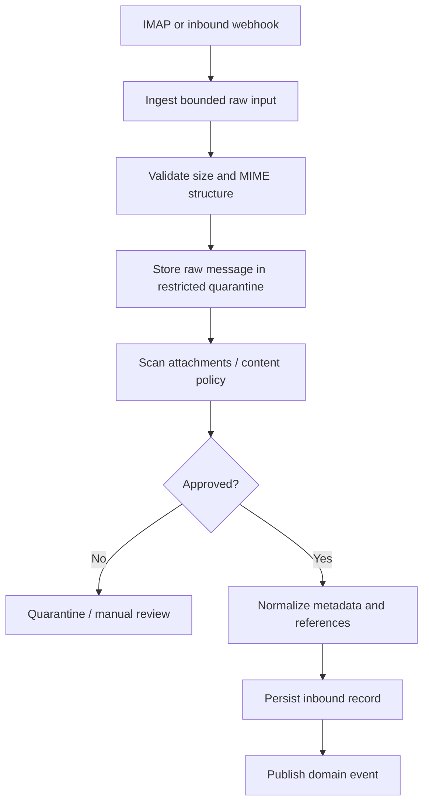

# When to Separate the Mail Receiving Module from the Mail Sending Module

In a **Spring Framework Mail** application, **sending email** usually comes first: the application generates content, builds a `MimeMessage`, and calls `JavaMailSender.send(...)` to submit via SMTP. As the product grows, the engineering team may need to **receive email**: process customer replies, ingest documents from a mailbox, read bounces/DSNs, open support tickets, retrieve verification codes from another system, or synchronize a shared mailbox.

Both directions deal with email, yet they are **not the same technical problem**:

- **Sending mail (outbound)** starts from a trusted business intent inside the application, builds a message, and hands it off to SMTP/a provider; the core concerns are submission, rate limits, templates, retries, sender identity, and deliverability.
- **Receiving mail (inbound)** starts from untrusted external data, reading via IMAP/POP3 or receiving an inbound webhook, normalizing MIME, validating source and permissions, deduplicating, persisting durably, and routing to the appropriate business flow.

The question **"When should the mail receiving module be separated from the mail sending module?"** does not have a simplistic answer like "as soon as IMAP is added". A system can establish **module boundaries within the same application** very early, yet should only split into an **independently deployed process or service** when there are concrete reasons around security, load, processing lifecycle, data ownership, reliability, or team organization.

This lesson covers the decision criteria, architectural levels from simple to fully independent, data contracts between inbound and outbound, examples with Spring, Jakarta Mail, and Spring Integration, deduplication strategies, protecting mailboxes and attachment flows, migration plans, testing, and operations.

## 1. Properly Distinguish the Outbound and Inbound Flows

A typical email passes through these components:

```text
                    OUTBOUND
Business event / HTTP request
            |
            v
      Notification service
            |
            v
     Template + MIME builder
            |
            v
    JavaMailSender / provider API
            |
            v
          SMTP relay
            |
            v
       Recipient mailbox

                    INBOUND
External sender / mail system
            |
            v
       Receiving mail server
            |
            +---- IMAP / POP3 mailbox
            |           |
            |           v
            |      Mail receiver
            |
            +---- Provider inbound webhook
                        |
                        v
                  Mail receiver
                        |
                        v
              Parse / validate / store
                        |
                        v
               Domain processing
```

The two flows can connect to each other: receiving a reply email and sending an acknowledgment, receiving a bounce to adjust sending policies, or receiving a support request and sending a response. Even so, they still need **separate boundaries** because their trust sources, failure modes, and stored data differ.

### Role of Spring Framework Mail

In Spring Framework, common APIs such as `MailSender`, `JavaMailSender`, `JavaMailSenderImpl`, and `MimeMessageHelper` focus on **composing and sending mail**. They do not provide a full equivalent IMAP/POP3 mailbox-reading service through a `spring.mail.*` configuration alone.

To receive mail, you can use:

- **Jakarta Mail** directly to connect `Store`, `Folder`, and read `Message` over IMAP/POP3.
- **Spring Integration Mail** with inbound adapters and polling or event-driven mechanisms depending on protocol/configuration.
- **Provider inbound parse webhooks/APIs** if the email service can convert inbound messages into HTTP events.
- A dedicated standalone mail-receiving service specializing in parsing, security validation, and emitting domain events.

Choosing a library does not by itself dictate deployment boundaries. Jakarta Mail can run inside the same Spring Boot application or inside an independent worker.

## 2. Why Are Inbound and Outbound Significantly Different?

| Aspect | Sending mail (outbound) | Receiving mail (inbound) |
|---|---|---|
| Starting point | Application business command/event | Email from the Internet, mailbox, or inbound provider |
| Data trustworthiness | Input is generated/validated by the system to some degree | MIME, headers, body, and attachments are untrusted by default |
| Primary protocol | SMTP submission, possibly HTTP API | IMAP, POP3, inbound SMTP gateway, or HTTP webhook |
| Identity | Sender profile, domain, Send As permission | Mailbox owner, external sender, metadata, and source verification |
| States | PENDING, SUBMITTING, SMTP_ACCEPTED, FAILED/UNKNOWN | DISCOVERED, FETCHED, PARSED, STORED, QUARANTINED, PROCESSED |
| Failures | SMTP auth, timeout, provider throttle, content rejection | Fetch timeout, UID/checkpoint, malformed MIME, spam/malware, duplicates |
| Load profile | Driven mostly by notification rate and provider quota | Driven by mailbox size, message size, attachments, and arrival rate |
| Retry risk | Risk of sending duplicate outgoing emails | Risk of processing the same incoming email twice |
| Sensitive data | Email intentionally composed by the application | Arbitrary external content, sometimes containing secrets/personal data |
| Observability | Accepted attempts, queue age, bounces | Poll lag, fetch lag, parse errors, quarantine, mailbox checkpoint |
| System permissions | Mail-sending credentials, permission to send as sender | Mailbox-reading credentials, folders, read/delete/flag permissions |
| Lifecycle | Accept request through submission and delivery feedback | Detect arriving mail, ingest durably, trigger business handling |

An error in an inbound parser can loop or stall a consumer on a malformed email; an outbound SMTP error may stem from provider quotas and slow down a worker. Without separating them, monitoring, retry, and recovery groups become difficult to operate.

## 3. First Level of Separation: Divide Responsibilities Inside the Same Codebase

**You do not need multiple servers before establishing module boundaries.**

A small application can use this structure:

```text
application
├── mail
│   ├── outbound
│   │   ├── NotificationService
│   │   ├── MailTemplateRenderer
│   │   ├── SmtpSubmissionGateway
│   │   └── OutboundStatusRepository
│   │
│   ├── inbound
│   │   ├── MailboxPoller
│   │   ├── IncomingMimeParser
│   │   ├── IncomingMailRepository
│   │   └── IncomingMailHandler
│   │
│   └── contracts
│       ├── NotificationRequest
│       ├── IncomingMailAccepted
│       └── MailCorrelation
└── business
    ├── orders
    └── support
```

Here, a module means a **source-level dependency boundary**, not necessarily physical Maven/Gradle modules. It can be packages or formal modules depending on project size.

Principles:

- `outbound` does not directly read an IMAP `Folder`.
- `inbound` does not need to know how SMTP or outbound template renderers are configured.
- Business logic does not directly depend on `jakarta.mail.Message` unless truly necessary.
- Shared contracts contain only stable data types needed for exchange.
- Raw MIME content and credentials are never placed into a shared package merely for convenience.

**Separating logical modules early is usually cheaper than splitting services late.** However, do not introduce network boundaries, separate deployment pipelines, or distributed transactions before the system actually needs them.

## 4. When Is Deploying Inbound as a Separate Service Not Yet Needed?

Cases where keeping them in the same application, separated by packages/interfaces, makes sense:

- There is only **one small mailbox** receiving very few emails.
- A periodic email-reading scheduler runs with low, clearly bounded traffic.
- Inbound email supports only a simple secondary feature.
- The same team owns both inbound and outbound and deploys on the same cadence.
- There is no strict requirement to isolate credentials/secrets at runtime.
- Memory and CPU are sufficient, and MIME parsing poses no risk of slowing down the main flow.
- Mail-receiving incidents do not require independent auto-scaling or restarts.
- Reliable duplicate prevention and checkpoint persistence are already in place.
- The system does not yet have a queue/message broker, and the benefits of separate deployment do not outweigh operational overhead.

Example: an internal application sends notifications and reads a few reply emails every hour from one fixed mailbox to create comments. As long as inputs, timeouts, retention, and errors are bounded, an inbound module running in the same process can work well.

**Never create a microservice simply because the word "receive" differs from "send".** There must be at least one concrete architectural pressure and the operational capability to run the new service.

## 5. Clear Signals That Warrant Considering Deployment Separation

| Signal | Why it creates pressure to split | Possible measures |
|---|---|---|
| Inbound receives high volumes of untrusted MIME/attachments | Parsing, scanning, and decompression can consume CPU/heap or carry dangerous payloads | Separate worker/process and appropriate sandboxing |
| Thousands of mailboxes or multiple tenants | IMAP connections, checkpoints, and token refreshes require dedicated management | Mailbox ingestion service with scheduling/sharding |
| Inbound scales independently from outbound | Fetch/parse load has no direct correlation to SMTP quota | Scale worker pools independently |
| 24/7 SLA for handling replies and tickets | Deployment/failure cadence differs from campaign-sending services | Separate deployment and SLOs |
| Reading credentials grant access to highly sensitive data | Do not want web/outbound-mail APIs able to read entire mailboxes | Isolate secrets, IAM, and network policies |
| Inbound uses public provider APIs/webhooks | Requires an externally authenticated endpoint with independent rate limiting | Dedicated ingress service or receiver deployment |
| One bad email can stall the poller | Large failure blast radius | Quarantine, DLQ, and process isolation |
| Raw emails must be retained for legal/compliance audits | Different lifecycle/retention/access rules than outgoing events | Separate storage and data ownership |
| Multiple systems consume inbound events | Needs contracts, versioning, and fan-out | Event bus with inbound module as producer |
| Customer support team owns inbound handling, platform team owns sending | Different release cadences and ownership | Modules/services aligned to bounded contexts |
| Compliance or data residency mandates separation | Distinct access controls and storage locations | Region-scoped deployment and storage |
| Mailbox provider enforces complex quota/poll limits | Requires dedicated rate limiting and runbooks | Dedicated ingestion coordinator |

A single signal does not mandate a full microservice. For instance, CPU scaling needs for parsing can be addressed by a **separate worker within the same codebase**, without immediately splitting repositories or databases.

## 6. Three Architectural Levels of Separation

### Level A — Same Application, Separate Modules

```text
                   Spring Boot Application
               +------------------------------+
Business ------>| Outbound module              |--> SMTP
                |                              |
IMAP/HTTP ----->| Inbound module               |--> Business handler
               +------------------------------+
                       Shared deployment
```

**Best suited when:** few mailboxes, moderate traffic, shared team ownership, and adequate internal resource isolation.

Pros: easy deployment, straightforward debugging, no extra network hops. Cons: a stalled parser or a worker consuming excessive heap can affect the entire process; executors and scheduling must be controlled.

### Level B — Same Codebase, Separate Deployment Processes

```text
                  Shared repository
                         |
          +--------------+--------------+
          |                             |
     Outbound worker                Inbound worker
          |                             |
          v                             v
        SMTP                      IMAP / inbound API
          |                             |
          +--------- Queue / DB --------+
```

**Best suited when:** independent scaling, restarts, secrets, or timeouts are needed without splitting source ownership completely.

You can run two Spring Boot applications sharing domain contracts, or the same artifact with explicit role/profile configuration, ensuring each role **never initializes the other role's schedulers or credentials**.

### Level C — Independent Services with API/Event Contracts

```text
   Domain services
         |
         v
  Outbound mail service  -----> SMTP / provider
         ^
         |
      Event bus
         ^
         |
  Inbound mail service   <----- IMAP / provider webhook
         |
         +-----> Inbound storage + attachment quarantine
```

**Best suited when:** separate bounded contexts, multiple inbound sources, strict security/compliance isolation, high scale, and mature distributed-systems operations.

In return, you need event schema versioning, idempotent consumers, correlation IDs, cross-service observability, queue/broker health monitoring, and failure recovery procedures.

## 7. The Most Important Decision Criteria

Use six questions in order:

1. **Do data sources cross different trust boundaries?** Inbound from the Internet must always be treated as untrusted data.
2. **Are different permissions and secrets required?** Reading sensitive mailboxes differs from SMTP submission privileges.
3. **Are load and scaling independent?** IMAP polling, MIME parsing, and SMTP sending have different bottlenecks.
4. **Can failures in one direction affect the other?** If not, isolation is required.
5. **Do data lifecycles and storage differ?** Raw inbound MIME has different retention/ownership from outbound submission attempts.
6. **Is the operational cost of distributed deployment justified?** If not yet, module or process isolation may suffice.

If most answers to 1–5 are "yes" and the team already has the operational infrastructure, separating inbound into its own service is usually worthwhile. If there is only one small mailbox with no scaling or security pressures, starting with an internal module is simpler.

## 8. Do Not Share One API for Receiving and Sending Just Because Both Are "Mail"

A confusing design:

```java
public interface MailService {
    void send(MailMessage message);
    List<MailMessage> receive();
    void delete(String id);
    void markAsRead(String id);
}
```

This interface mixes:

- Outbound message creation and SMTP submission.
- Inbound mailbox synchronization.
- Permissions to mutate mailbox state.
- Events for processing external content.

Consequences:

- Business services become directly coupled to mailbox semantics.
- Unit tests for sending mail must mock unrelated receive APIs.
- Hard to separate credentials and lifecycles.
- A single `MailMessage` type obscures the difference between raw MIME and domain notifications.

Use clearly scoped ports instead:

```java
public interface OutboundMailPort {
    SubmissionResult submit(OutboundMailCommand command);
}

public interface InboundMailSource {
    List<IncomingMailReference> discover(BatchLimit limit);
}

public interface IncomingMailProcessor {
    ProcessingResult ingest(IncomingMailReference reference);
}
```

`SubmissionResult`, `OutboundMailCommand`, `IncomingMailReference`, and `BatchLimit` are application abstractions, not built-in Spring Framework APIs.

## 9. Defining the Contract Between Inbound and Business Logic

Do not pass raw `jakarta.mail.Message` objects from a consumer to every domain handler:

- The object may lazy-load bodies/attachments from `Folder` or `Store`.
- Once the mailbox connection closes, reading content can fail.
- Domain handlers become coupled to IMAP/Jakarta Mail.
- Raw messages contain unverified external data.
- The object is unsuitable for durable serialization over a message broker.

A normalized envelope:

```java
import java.time.Instant;
import java.util.List;

public record IncomingMailAccepted(
        String inboundId,
        String sourceId,
        String mailboxRef,
        String rfcMessageId,
        String senderAddress,
        String normalizedSubject,
        String textBodyRef,
        String htmlBodyRef,
        List<String> attachmentRefs,
        Instant receivedAt,
        String correlationId
) {
}
```

`textBodyRef`, `htmlBodyRef`, and `attachmentRefs` are references to managed storage, not the full sensitive content embedded in the event. Depending on the application, the event may carry only `inboundId` and minimal metadata; handlers fetch content through an authorized API.

### Evidence-Based Event Naming

Distinguish clearly:

- `InboundMailDiscovered`: message detected at the source.
- `InboundMailFetched`: content downloaded.
- `InboundMailAccepted`: payload validated and durably persisted.
- `InboundMailQuarantined`: blocked from automatic processing for policy/security reasons.
- `InboundMailProcessed`: business workflow completed.
- `InboundMailProcessingFailed`: requires retry or manual review.

Do not emit `InboundMailProcessed` merely because IMAP allowed a fetch, just as outbound must not label `SMTP_ACCEPTED` as `DELIVERED`.

## 10. Defining the Contract Between Business Logic and Outbound

The inbound module may trigger a need to **send a reply email**, without knowing anything about SMTP hosts or template implementations.

Business event example:

```text
IncomingMailAccepted
       |
       v
SupportTicketService
       |
       v
TicketCreated
       |
       v
NotificationService
       |
       v
OutboundMailRequested
       |
       v
Outbound mail worker -> SMTP
```

Sending command:

```java
public record OutboundMailRequested(
        String notificationId,
        String correlationId,
        String recipientRef,
        String senderProfile,
        String templateKey,
        String templateVersion,
        String businessObjectRef
) {
}
```

This protects both directions:

- Inbound never "auto-replies" without going through a business decision.
- Outbound does not read mailboxes or trust raw senders.
- Templates are versioned and renderers receive validated data.
- `notificationId` enables deduplication, retries, and auditing.

If a business handler calls `JavaMailSender.send` directly upon receiving an Internet email, an attacker sending many messages can force the application to send mail, trigger loops, or act as a spam relay.

## 11. How Do IMAP, POP3, and Inbound Webhooks Affect Boundaries?

### IMAP

IMAP typically supports folder management, flags, UID-based reading, and change notifications such as IDLE. A receiving system may need to:

- Synchronize multiple folders.
- Track UIDs and UIDVALIDITY.
- Manage `SEEN` flags or move messages between folders per policy.
- Paginate/poll within bounds.
- Handle deleted or moved messages.
- Limit concurrent connections and fetch rates.
- Refresh credentials or tokens.
- Recover after dropped connections.

These are long-lived responsibilities very different from SMTP submission. When dealing with many mailboxes and complex sync state, inbound ingestion should be a dedicated module/worker.

### POP3

POP3 is usually simpler regarding folders and flag sync, yet still requires:

- Avoiding re-downloading the same messages on every poll.
- Tracking `UIDL` if supported by the server and appropriate for the contract.
- A policy for deleting messages from the server or retaining originals.
- Handling messages marked for deletion in incomplete sessions.
- Storing a safe copy before deletion.
- Accounting for unstable or reused UIDLs/identifiers.

Never use message ordinal position in the mailbox as a durable ID. Ordering shifts as mail is added or deleted.

### Inbound Webhooks

Some providers receive email on their side and forward payloads/metadata to an application HTTP endpoint. Inbound responsibilities then include:

- Securing a public endpoint.
- Verifying signatures/tokens and preventing replays.
- Limiting request size and rate.
- Parsing body/multipart/attachments per the provider's schema.
- Persisting requests to a queue/storage before returning an ACK per contract.
- Handling duplicate, delayed, or out-of-order callbacks.
- Tracking provider event schema changes.

Key point: even without IMAP, there is still a **distinct inbound problem**. If webhook volume is high or the endpoint sits on a different trust boundary, that is a strong reason to isolate the receiver.

## 12. UID, UIDVALIDITY, and Message-ID Are Not Interchangeable

In an inbound system, you need an idempotency key grounded in the **source of truth**.

| Identifier | Meaning | Caveat |
|---|---|---|
| IMAP UID | Message ID within a mailbox/folder under UID semantics | Meaningful only within a folder and UIDVALIDITY |
| IMAP UIDVALIDITY | Identifies the generation of a folder's UID space | Changes can invalidate the meaning of prior UIDs |
| POP3 UIDL | Server-assigned message identifier | Verify server support and stability |
| RFC `Message-ID` | Header declared by the message creator | Can be missing, duplicated, spoofed, or non-unique |
| Provider inbound event ID | Callback/provider identifier | May apply only to one source and limited retention |
| Internal `inboundId` | Ingestion record ID in the system | Used as internal primary key and business lookup |

An inbound deduplication key for IMAP can be based on:

```text
sourceId
+ mailboxId/folder identifier
+ UIDVALIDITY
+ UID
```

Uniqueness example:

```sql
CREATE TABLE inbound_source_message (
    inbound_id        VARCHAR(64) PRIMARY KEY,
    source_id         VARCHAR(100) NOT NULL,
    mailbox_id        VARCHAR(100) NOT NULL,
    uid_validity      BIGINT NOT NULL,
    message_uid       BIGINT NOT NULL,
    processing_status VARCHAR(40) NOT NULL,
    UNIQUE (
        source_id,
        mailbox_id,
        uid_validity,
        message_uid
    )
);
```

This is an illustrative schema. For POP3, webhooks, or other sources, use their respective appropriate identifiers rather than forcing everything into IMAP UID columns.

**Do not treat the `Message-ID` header as sole proof that two emails are the same message.** Headers come from the sender and can be duplicated or forged. However, it remains very useful for threading replies and investigation.

## 13. Mail-Receiving Checkpoints Must Be Tied to Durable Processing

A common mistake:

```text
Poll IMAP
   |
   v
Read message
   |
   v
Mark SEEN immediately
   |
   v
Try to save database
   |
   X process crashes
```

If the consumer only reads unseen messages, the next run may skip a message already marked `SEEN` even though it was never durably saved. On many mailboxes, `SEEN` can also be toggled by users or other clients, making it an unreliable machine-processing checkpoint.

A safer flow:

```text
Discover via source ID / UID
       |
       v
Fetch and parse with bounded resource
       |
       v
Persist inbound record (idempotent)
       |
       v
Commit durable transaction
       |
       v
Dispatch domain processing
       |
       v
Optional mailbox flag/move by policy
```

If the process crashes before committing, the same message can be fetched again and deduplicated via the unique key. If it crashes after committing, handlers can process with at-least-once semantics and resume from durable state. Do not expect IMAP flags and database transactions to form a single atomic operation.

### Should You Mark SEEN or Move to Another Folder?

That is a product/mailbox policy decision:

- `SEEN` is a user-visible state and can be altered by other clients.
- Moving to a "Processed" folder can work for dedicated mailboxes, though move failures must be handled.
- Deleting messages requires extreme caution; normally only after content is stored and retention rules are satisfied.
- Use a durable ingestion/processing status table as the application's source of truth.

Never use `SEEN` as a distributed lock across multiple workers.

## 14. Batch IMAP Ingestion Example with Jakarta Mail

This is an **illustrative example** showing bounded reading and persisting source identity. It does not attempt to cover all production requirements for leases, reconnects, and content security.

```java
import jakarta.mail.Folder;
import jakarta.mail.Message;
import jakarta.mail.MessagingException;
import jakarta.mail.Session;
import jakarta.mail.Store;
import jakarta.mail.UIDFolder;

public final class ImapMailboxIngestor {

    private final IncomingMimeNormalizer normalizer;
    private final IncomingMailRepository repository;

    public ImapMailboxIngestor(
            IncomingMimeNormalizer normalizer,
            IncomingMailRepository repository
    ) {
        this.normalizer = normalizer;
        this.repository = repository;
    }

    public void ingest(
            Session session,
            MailboxConfig config
    ) throws Exception {

        Store store = session.getStore("imaps");
        Folder folder = null;

        try {
            store.connect(
                    config.host(),
                    config.username(),
                    config.password()
            );

            folder = store.getFolder(config.folderName());
            folder.open(Folder.READ_ONLY);

            if (!(folder instanceof UIDFolder uidFolder)) {
                throw new MessagingException(
                        "UID semantics are required"
                );
            }

            long validity = uidFolder.getUIDValidity();
            int total = folder.getMessageCount();
            int batchSize = 50;

            for (int first = 1;
                    first <= total;
                    first += batchSize) {

                int last = Math.min(
                        total,
                        first + batchSize - 1
                );

                Message[] batch =
                        folder.getMessages(first, last);

                for (Message message : batch) {
                    long uid = uidFolder.getUID(message);

                    if (uid <= 0L) {
                        continue;
                    }

                    IncomingMailRecord normalized =
                            normalizer.normalize(
                                    message,
                                    config.sourceId(),
                                    config.mailboxId(),
                                    validity,
                                    uid
                            );

                    repository.insertIfAbsent(normalized);
                }
            }
        } finally {
            if (folder != null && folder.isOpen()) {
                folder.close(false);
            }

            store.close();
        }
    }
}
```

`MailboxConfig`, `IncomingMimeNormalizer`, `IncomingMailRecord`, and `IncomingMailRepository` are application abstractions. `insertIfAbsent` must be implemented using an appropriate unique constraint/transaction — not merely an in-memory check-then-insert.

**What must be added in a real production implementation:**

1. Sequence-number pagination only bounds a single pass; never use message numbers as durable checkpoints. If the mailbox changes during polling, scan/reconcile by UID against saved state and rescan appropriately.
2. Handle UIDVALIDITY changes so new UIDs are never mapped onto old messages.
3. The parser must **read and persist needed content while `Folder` is still open**, because `Message` may lazy-load MIME parts.
4. Enforce bounds on byte count, attachment count, MIME nesting depth, fetch duration, and concurrency.
5. Do not default to static passwords in production; OAuth2 and a secret manager may be required.
6. Avoid holding a database transaction open across the entire IMAP network wait whenever possible.
7. If a message is malformed, create a quarantine/failure record and continue processing other messages per policy; never let one bad email block the entire mailbox forever.
8. If multiple workers poll the mailbox, implement a lease/sharding mechanism and storage-level idempotency.
9. On close/fetch failures, record the event and retry with backoff rather than triggering a reconnect storm.

This example intentionally opens the folder in `READ_ONLY` mode so it **never marks or deletes messages** during ingestion. If the application needs to update mailbox state, perform that in a separate step after durable ingestion succeeds.

## 15. When Is Spring Integration Mail a Good Choice?

**Spring Integration Mail** helps build inbound flows combining polling/inbound adapters and message channels, reducing boilerplate orchestration code in some scenarios.

A conceptual flow:

```text
IMAP / POP3 adapter
          |
          v
  Spring Integration Channel
          |
          v
 MIME normalization/validation
          |
          v
  Durable inbound persistence
          |
          v
   Domain event publisher
```

Note: Spring Integration message channels are **not durable message brokers by default**. An in-memory `DirectChannel` or `QueueChannel` has different semantics from Kafka/RabbitMQ or a database outbox. When crash recovery is needed, identify explicitly where data is persisted.

Questions to answer before picking an adapter:

- Does the adapter read `SEEN`/flags, or what tracking strategy does it use?
- Does the poller attempt to re-fetch after failures?
- Does it synchronize folders/UIDs as required?
- Is there a single consumer or multiple replicas?
- Are channels durable across restarts?
- When is message content fetched?
- Can the error channel trigger hot retry loops or silently drop messages?
- Can attachment sizes and parser validation be enforced before emitting domain events?

**Spring Integration is a flow-building tool**, not a replacement for data ownership, authorization, deduplication, and security boundary design between inbound and outbound.

## 16. One Mailbox, Many Mailboxes, and Scaling Challenges

For a single mailbox, a 1–5 minute poll interval may suffice depending on the SLO. As the number of mailboxes grows, the problem changes substantially.

Example:

```text
10,000 mailboxes
× 1 poll per minute
= 10,000 polling operations per minute
```

This is purely illustrative; actual connection counts depend on caching, IDLE, provider APIs, and batching capabilities.

Challenges:

- Per-account connection and authentication request limits.
- Refreshing many OAuth tokens and handling revocations.
- Disconnected or temporarily locked mailboxes.
- Load balancing across workers.
- Tenant-level mailbox authorization.
- Per-folder checkpoints.
- Bounding ingestion latency during mail spikes.
- Preventing one huge mailbox from starving all other mailboxes.

At this scale, an **inbound mailbox coordinator** managing leases/shards, scheduling, and quotas becomes valuable. It can be deployed separately from outbound workers, which are throttled according to SMTP throughput.

## 17. IMAP IDLE Does Not Eliminate the Need for Durability

IMAP IDLE notifies clients of folder changes without constant short-interval polling. However:

- Connections can drop.
- Providers may limit concurrent sessions or IDLE duration.
- Change notifications do not replace reading and persisting messages.
- Upon reconnecting, a rescan from a durable checkpoint is still required.
- If a worker crashes before persisting, the application must rediscover the message.
- Running multiple replicas still requires mailbox ownership/leases.

Therefore, whether using IDLE or scheduled polling, **idempotent ingestion and recovery mechanisms remain mandatory**. When inbound has long-lived connection lifecycles and independent reconnect needs, separating it from the HTTP mail-sending app is worth considering.

## 18. Security Boundaries Are a Strong Driver for Separating Inbound

Outbound uses sending credentials; inbound may require credentials capable of reading thousands of emails, attachments, and sensitive data. Keeping both secrets in the same process expands the blast radius during an application compromise.

A least-privilege architecture:

```text
                    OUTBOUND SERVICE
  Notification records ---> SMTP provider
        |
        +-- send-only secret
        +-- no mailbox read permission

                     INBOUND SERVICE
  IMAP / webhook ----------> Quarantine storage
        |
        +-- mailbox read-scoped credentials
        +-- MIME parser restrictions
        +-- no general SMTP send credentials

               Shared business event contract
```

Measures when separating:

- Separate secret stores/IAM roles for inbound and outbound.
- Restrict network egress strictly to required endpoints.
- Enforce authentication, rate limits, and request-size limits on inbound webhook ingress.
- Apply stricter permissions to raw MIME storage than to notification status storage.
- Isolate attachment quarantine/scanning from the main business pipeline.
- Never grant mailbox-read access to a service that only needs to send.
- Maintain audit trails: who accessed raw emails, when, and why.

However, **separating processes does not guarantee security on its own** if both still share the same credentials or the same all-powerful database user. Enforce genuine privilege separation and least access.

## 19. Received Mail Is Untrusted Data by Default

An inbound email may contain:

- Spoofed `From` display names or addresses.
- `Reply-To` pointing to an unexpected address.
- HTML containing external links or tracking pixels.
- Malformed MIME or deeply nested multipart structures.
- Malicious attachments, complex nested archives, or oversized files.
- Extremely long headers or duplicate header fields.
- Confusing Unicode characters.
- Content containing scripts, HTML injection, or CSV formula injection.
- Confidential data that the application must not log or redistribute.

**Never use the `From` header as proof of sender identity.** SPF, DKIM, DMARC, and mail-gateway signals can assist trust policies, yet they are not equivalent to an authenticated user session inside the application.

If inbound email can trigger sensitive actions (approving payments, granting roles, changing passwords, deleting data), require stronger authentication channels or explicit in-app confirmation.

### Why Should the Parser Be an Isolated Component?

A MIME parser may:

- Read large binary payloads.
- Decode content transfer encodings.
- Encounter broken charsets.
- Open numerous streams.
- Run into anomalous MIME structures.
- Exert heavy CPU/heap pressure while processing attachments.

Running complex parsers on the same threads serving transactional APIs or OTP-sending workers allows a single malicious email to degrade service availability. Quotas, timeouts, memory caps, and process isolation shrink the blast radius.

## 20. Quarantine and Attachment Storage

A safer inbound pipeline:



Specific steps depend on organizational requirements. Key principles:

- Never automatically open or execute attachments.
- Never fetch external URLs from HTML merely to "render a preview".
- If text extraction from PDF/Office/archives is needed, cap resources and consider a sandboxed worker.
- Files should use server-generated IDs/keys, never saved directly using filenames from the email.
- Perform malware/DLP scanning per policy; never treat scanning as an absolute safety guarantee.
- Enforce retention, encryption at rest, and distinct access controls per data classification.
- If content is quarantined, business handlers receive only safe status/metadata.

When attachment volumes are high, inbound and outbound exhibit very different resource profiles. That is a compelling reason to deploy them separately with tailored heap/CPU/storage limits.

## 21. Preventing Infinite Receive–Send Loops

A classic pitfall when both directions are connected:

```text
Inbound email arrives
       |
       v
Auto-reply sent
       |
       v
Recipient auto-responder sends another mail
       |
       v
Inbound receives reply
       |
       v
Auto-reply again...
```

A support or ticketing email system must explicitly define **when automatic replies are permitted**.

Countermeasures:

- Never auto-reply unconditionally to every message.
- Detect auto-generated signals such as `Auto-Submitted` where appropriate, without trusting a single header as a security guarantee.
- Handle DSNs/bounces, vacation auto-replies, and mailing-list messages separately.
- Cap the number of auto-responses per thread/sender within a time window.
- Attach an idempotency key to the action of replying to a given inbound message.
- Check recipient/address policies before creating an outbound command.
- Maintain internal loop-prevention metadata and TTLs.
- Never echo back raw attachments or sensitive content without authorization.

**Loop prevention must sit at the business boundary**, not solely inside the SMTP adapter. Outbound cannot know on its own whether a reply email should be sent without inbound flow context.

## 22. Do Bounces/DSNs Always Need a Full Mail-Receiving Module?

Not always. Distinguish the cases:

1. **Delivery events from a provider API/webhook**: may require only a small callback handler to update sending status.
2. **DSNs/bounces delivered to a mailbox**: may require dedicated mailbox ingestion and parsing.
3. **Human replies**: require thread analysis, body/attachment handling, and business routing.
4. **Two-way support mailboxes**: may require both inbound normalization and ticketing workflows.

If the application only needs to record bounces from a provider webhook, a small module handling **verified delivery callbacks** may be enough; there is no need yet for a full IMAP receiver service.

Conversely, reading mailboxes with thousands of messages and extracting reply contents is a true inbound capability with its own lifecycle.

### Avoid Confusing Bounces with Replies

A bounce/DSN reports delivery status; a recipient reply carries conversational content. They have different formats, permissions, states, and security risks.

An inbound dispatcher should perform initial classification (after source checks and parsing) and route accordingly:

```text
Incoming message
       |
       +-- Human reply       -> conversation/ticket handler
       |
       +-- DSN/bounce        -> delivery status handler
       |
       +-- Auto-reply        -> suppression/loop policy
       |
       +-- Unknown/malformed -> quarantine or manual review
```

Do not treat every email arriving in a reply mailbox as a valid customer response to a ticket.

## 23. Correlating Replies with Outbound Notifications

When sending an email to a customer, the system can persist:

```text
notificationId
businessObjectRef
recipientRef
sentAt
mimeMessageId
providerMessageId (if available)
replyMailboxRoute
```

When receiving a reply, you can inspect these headers:

- `Message-ID`: identifier of the current MIME message.
- `In-Reply-To`: reference to the preceding message.
- `References`: chain of related messages.
- `Reply-To`: reply destination requested by the sender.

These headers assist threading, yet **they can be missing, altered, or spoofed**. If using a reply address with a routing token (e.g., an alias containing a random code), that token must have sufficient entropy, clear expiration/scope limits, and must not grant authority to perform sensitive actions without verification.

### A Safer Matching Model

1. Locate a matching route/alias or thread reference.
2. Cross-check `In-Reply-To`/`References` when present.
3. Verify whether the sender is associated with the conversation/tenant.
4. Apply business policy to decide between auto-attaching to a ticket or routing for review.
5. Never use an identical subject line alone as proof of belonging to the same conversation.
6. When uncertain, quarantine or create an unverified ticket.

Outbound and inbound correlation IDs can be linked without having to be identical. You can generate a new **inbound correlation ID** and store `causationId`/`relatedNotificationId` to preserve traceability.

## 24. Database Boundaries When Splitting Modules

There are multiple levels of data separation:

### Shared Database, Separate Tables/Modules

Appropriate early on for small teams. Even then, maintain clear ownership:

```text
outbound_notification
outbound_attempt
outbound_delivery_event

inbound_message
inbound_source_checkpoint
inbound_processing_attempt
inbound_attachment
```

Use distinct repositories/interfaces; do not allow inbound to arbitrarily modify `outbound_attempt` via raw SQL just because they share a database.

### Separate Databases

Appropriate when security, retention, or scaling requirements diverge:

```text
Inbound DB                 Outbound DB
  inbound_message           notification
  mailbox_checkpoint        submission_attempt
  raw_content_ref           delivery_event
       |                          ^
       +------ Event bus ----------+
```

At this point, there is no single database transaction spanning both sides. Durable event publishing, idempotent consumers, and reconciliation are required.

### Do Not Create Distributed Transactions Merely to "Bridge" Both Directions

SMTP, IMAP flags, webhooks, brokers, and databases do not participate in a single atomic transaction. A more resilient design typically uses:

- Local transactions in the owning database.
- Transactional outbox when emitting external events.
- Inbox/dedup tables on the consuming side.
- Explicit state machines and bounded retries.
- Step-by-step evidence rather than claiming end-to-end exactly-once.

## 25. Inbox Pattern for Inbound and Outbox Pattern for Outbound

The two pattern names sound similar yet serve opposite directions:

| Pattern | Location | Purpose |
|---|---|---|
| **Transactional outbox** | Business/outbound producer | Persist send intents or events inside a transaction before publishing/processing |
| **Inbox/deduplication table** | Inbound/event consumer | Identify already-processed messages/events to prevent duplicate side effects |

Flow:

```text
External inbound source
           |
           v
Inbound transport adapter
           |
           v
Inbox/dedup record + normalized storage
           |
           v
Business event (outbox)
           |
           v
Business handler
           |
           v
Outbound notification (outbox)
           |
           v
SMTP worker
```

Do not collapse "received/sent/processed" into a single boolean flag. Each stage has its own identifier and evidence.

### At-Least-Once Delivery and Business Impact

Even when one email has only a single `inbound_message` row thanks to a unique constraint, business consumers may still receive `IncomingMailAccepted` multiple times due to broker redelivery.

If each event creates a ticket, a unique key such as `inboundId + actionType` is needed to prevent duplicate tickets. Likewise, outbound notifications require a business idempotency key in case an inbound event is replayed.

**Deduplicating at the transport layer does not by itself guarantee business side effects will not repeat.**

## 26. When Should There Be an Event Bus in Between?

Direct calls can work when:

- Running in the same process.
- Processing is fast and synchronous.
- Failure isolation is not yet a major requirement.
- Fan-out to multiple consumers is unnecessary.

An event bus/broker helps when:

- Inbound receives large bursts while business handlers process more slowly.
- A single email must be routed to multiple bounded contexts.
- Handlers deploy and scale independently.
- Error-specific retries, delays, and DLQs are needed.
- Inbound endpoints must ACK quickly without waiting for lengthy parsing/workers.
- You want to decouple raw MIME ingestion from domain decisions.

However, a broker only helps when paired with clear **durability, backpressure, ordering, and idempotency policies**. An in-memory application queue is not a durable broker.

### Events Should Be Small and Safe

Avoid pushing 20 MB of raw MIME, access tokens, or attachment bytes into a broker unnecessarily. Instead:

```json
{
  "eventId": "evt-inbound-4d1",
  "schemaVersion": 1,
  "inboundId": "inb-801",
  "sourceId": "support-primary",
  "classification": "CUSTOMER_REPLY",
  "contentRef": "inbound-object-801",
  "receivedAt": "2026-11-12T08:30:00Z"
}
```

`contentRef` must require authorization on access; knowing an object key must never by itself grant read permission. Content storage retention must last long enough for consumer retries.

## 27. Independent Resource Limits per Direction

For outbound, throughput may be constrained by the SMTP provider:

```text
Messages/second
Concurrent SMTP connections
Recipients/day
Message/attachment size
TLS/network latency
```

For inbound, bottlenecks may be:

```text
Mailbox polling frequency
IMAP connections per account
Fetch bytes/second
MIME parser CPU
Attachment scan throughput
Database write throughput
Quarantine storage
Webhook HTTP request rate
```

If sharing a single executor, an inbound burst with large attachments can exhaust threads and slow down OTP or transactional emails. Even within one process, use separate bounded executors and queues:

```text
InboundExecutor (bounded)
  - fetch/normalize
  - attachment scan handoff

OutboundExecutor (bounded)
  - render
  - SMTP submit
```

**Executor separation is the weakest form of isolation**—it does not isolate heap or process stability. When inbound risks major memory spikes, process/container isolation or proper cgroup limits are necessary.

## 28. Backpressure for Inbound

Suppose a mail source delivers 100 emails/minute while the parser handles 40 emails/minute. Continuously fetching and holding payloads in memory will grow RAM backlog relentlessly.

An inbound backpressure strategy:

1. Cap concurrent message fetches.
2. Cap raw MIME/attachment sizes.
3. ACK webhooks only after persisting requests with required contract durability.
4. Pause claiming/polling when queues/DBs approach capacity.
5. Schedule retries with backoff rather than hot fetch loops.
6. Quarantine poison messages.
7. Prioritize mailboxes or event types by SLO.
8. Monitor the age of the oldest unprocessed message.
9. When webhook sources retry, respond with contract-appropriate HTTP status codes to avoid overloading workers.
10. Enforce admission/rate limits so attackers cannot turn inbound endpoints into DoS amplifiers.

### IMAP Pull vs. Webhook Push

- IMAP is pull-based: the application can throttle polling/fetching under load within mailbox retention/quota limits.
- Webhooks are push-based: providers may retry failed callbacks; the application must persist/ACK swiftly or return explicit contract errors.

Do not use the same "sleep 5 seconds in the HTTP handler" tactic across all sources. With webhooks, holding requests open causes provider timeouts and retries, increasing total load.

## 29. Independent SLOs and Operations

A compelling reason to separate is that the two directions have **different quality targets**.

Example:

| Metric | Outbound | Inbound |
|---|---|---|
| Primary target | Time from notification created to SMTP accepted | Time from email appearing at source to successful ingestion |
| Critical errors | Authentication, rate limits, timeouts, SMTP rejects | IMAP sync failures, webhook signatures, parser failures, checkpoint lag |
| Backlog | Pending notifications, retry queue | Fetched-but-unprocessed, mailbox lag, quarantine |
| Latency | Submit latency/queue wait | Detection lag, fetch latency, parse latency |
| Recovery | Retry submission, route failover | Re-poll, replay inbox, reprocess quarantine |
| Data to protect | Templates, recipients, sender secrets | Raw MIME, mailbox credentials, attachments |
| Synthetic check | Controlled SMTP connect/test submission | Controlled mailbox access/test inbound event |

Having only one combined metric like `mail_failed_total` helps nobody. Metric names and label groups must distinguish direction and stage.

### Suggested Metrics

```text
mail_outbound_notifications_created_total
mail_outbound_submit_attempts_total
mail_outbound_smtp_accepted_total
mail_outbound_submit_unknown_total
mail_outbound_queue_oldest_age_seconds

mail_inbound_messages_discovered_total
mail_inbound_messages_persisted_total
mail_inbound_parse_failed_total
mail_inbound_quarantined_total
mail_inbound_poll_errors_total
mail_inbound_processing_lag_seconds
```

These names are suggestions, not built-in Spring defaults. Keep tags low-cardinality such as `sourceType`, `route`, `result`, `errorCategory`. Never put high-cardinality `mailboxId` values, raw recipients, `Message-ID`, `inboundId`, or correlation IDs into metric labels.

## 30. Health Checks Should Be Separated by Purpose

Outbound health can verify SMTP connectivity via `JavaMailSenderImpl.testConnection()` where appropriate. Never call `send(...)` inside a health endpoint, as it would dispatch real emails on every probe.

Inbound health can check:

- Whether workers/schedulers are still running.
- Whether mailbox credentials are suffering prolonged failures.
- Time of the most recent successful poll.
- Maximum checkpoint age or lag.
- Whether webhook ingress is successfully persisting events.
- Whether quarantine storage/queues still have capacity.

**There is no need to read real emails on every `/actuator/health` call** if doing so triggers extra connections/CPU or alters mailbox flags. Use TTL-cached snapshots, background probes, and metrics.

### Liveness vs. Readiness

An external SMTP outage should not automatically mark overall application liveness DOWN and trigger endless restarts. Similarly, one locked IMAP mailbox should not stop an HTTP business API from serving traffic.

When deploying inbound and outbound separately, health groups can reflect each role's operational readiness instead of collapsing every dependency into one status.

## 31. Organizing Retries and Poison-Message Handling Separately

### Outbound

An SMTP attempt can end in:

- `SMTP_ACCEPTED`.
- `KNOWN_REJECTED`.
- `UNKNOWN` when the outcome is lost in an ambiguous phase.

Retries carry duplicate-sending risk. Manage attempt IDs, quotas, backoff, jitter, deadlines, and reconciliation policies.

### Inbound

A message may experience:

- Transient fetch failure.
- MIME parse error.
- Blocked attachment.
- Domain handler failure.
- Event publish failure.
- Process crash after persistence.

Inbound retries risk **duplicate processing**, not necessarily duplicate outgoing mail immediately. Side effects like creating tickets, updating states, or sending auto-replies must be idempotent.

### Poison Messages

A malformed email can fail parsing on every attempt. If the consumer always retries the exact same head-of-line message without quarantine, it can stall the entire mailbox.

Policy:

1. Record the failure type and attempt count.
2. Retry transient failures with backoff.
3. Quarantine unrecoverable parse/security failures.
4. Store references and hashes/metadata for investigation per retention rules.
5. Provide authorized, quota-bounded reprocessing actions.
6. Never log raw attachments or sensitive body content.
7. Allow subsequent messages to proceed whenever safe.

Isolating the inbound worker ensures its circuit breaker or quarantine never directly interferes with SMTP sending.

## 32. Authorization and Multi-Tenancy

In a multi-tenant system, several decisions are needed:

- Which tenant is authorized to connect which mailbox?
- How are mailbox credentials stored and rotated?
- Who is allowed to view raw mail and attachments?
- What evidence determines which tenant an incoming message routes to?
- Which tenant may trigger outbound replies and using which sender profile?
- Are cross-tenant conversations permitted?
- If a shared support address is used, who owns the thread?
- When offboarding a tenant, what happens to raw mail, checkpoints, and pending replies?

Never trust raw MIME `To` or `From` addresses alone to authorize tenant access. Addresses can be aliased, forwarded, or spoofed. Rely on trusted inbound source mappings, mailbox assignments, and business authorization.

If inbound processes sensitive tenant data, isolating credentials/storage/workers per tenant or tenant tier may be necessary. However, creating a dedicated service per tenant can drive excessive cost; consider partitioned/sharded worker pools with appropriate isolation instead.

## 33. Different Data Retention Between the Two Directions

Outbound typically needs:

- Notification ID.
- Template version or business reference.
- Recipient reference.
- Submission attempts and outcomes.
- Provider events/bounces.
- Auditing as required.

Inbound may need:

- Raw MIME or a normalized representation.
- Scanned attachments.
- Source mailbox identity.
- Sender/recipient metadata.
- Scan/quarantine status.
- Conversation access permissions.
- Checkpoints and processing history.

Retaining raw emails long-term increases privacy, encryption, deletion-request, and storage-cost obligations. Never apply outbound log retention policies by default to inbound content.

**Splitting modules does not force immediate data-store splitting**, yet retention policies and access controls should be separated because the two directions have distinct data lifecycles.

## 34. A Dependency Rule Between Modules

A maintainable model:

```text
                    Business policy
                    /            \
                   v              v
             Inbound port     Outbound port
                   ^              ^
                   |              |
             IMAP/Webhook      SMTP/API adapter
```

Principles:

- The business layer knows only normalized commands/events.
- The inbound adapter knows Jakarta Mail/HTTP webhooks and never makes autonomous business-authorization decisions.
- The outbound adapter knows SMTP/providers and never decides whether an incoming email is a valid ticket.
- The shared module holds event schemas/IDs, avoiding service implementations or raw MIME models.
- Cross-module interactions go through ports/events; never read another module's tables directly once independent data ownership is chosen.

If inbound needs to send an acknowledgment, it emits a **business event** or command for outbound after business logic decides, rather than calling SMTP directly from a parsing callback.

## 35. How to Migrate from a Monolith to a Separate Inbound Worker

A controlled migration plan:

### Step 1 — Define Source Boundaries

Locate every place reading IMAP/POP3/webhooks, parsing MIME, updating mailbox flags, calling business handlers, and sending auto-responses. Diagram the actual flow and identify the owner of each side effect.

### Step 2 — Introduce Normalized Inbound Models

Add `inboundId`, `sourceId`, `sourceMessageKey`, status, content references, error categories, and required metadata. Stop passing `jakarta.mail.Message` directly into domain logic.

### Step 3 — Persist Ingestion Idempotently

Ensure re-reading the same source message does not create duplicate logical records; enforce unique constraints and transactions. For IMAP, store UIDVALIDITY/UID; for webhooks, use the appropriate event/source ID.

### Step 4 — Separate Parsing from Domain Side Effects

The receiving pipeline should only fetch/validate/persist/publish. Business handlers create tickets/replies from events using idempotency.

### Step 5 — Isolate Executors, Quotas, and Timeouts

Even inside the monolith, use dedicated inbound queues and executors. Measure CPU, heap, network, and scan-storage consumption.

### Step 6 — Run Workers Under Dedicated Roles

Enable the inbound scheduler only when `app.role=inbound` and the outbound worker only when `app.role=outbound`. Ensure tight configuration so unrelated replicas never accidentally poll mailboxes.

### Step 7 — Migrate Secrets and Policies

The inbound worker receives only required mailbox permissions. Outbound retains only sending credentials. Separate network/secret scopes, auditing, and storage access.

### Step 8 — Transfer Checkpoint Ownership

Ensure a **real claim/lease mechanism** governs which worker ingests each mailbox/folder at any moment, while maintaining idempotency during ownership handoffs.

### Step 9 — Bounded Shadow Mode

If comparison is needed, run the new receiver in read-only mode without emitting domain side effects and store results in a test area under proper privacy controls. Never let two workers automatically send replies for the same email simultaneously.

### Step 10 — Controlled Cutover

Stop legacy ingestion, hand over checkpoints, start the new worker, and monitor duplicates/lag. On rollback, rely on durable checkpoints rather than reverting to arbitrary message sequence numbers.

### Step 11 — Explicit Deployment/API Split

Only when warranted, promote inbound into an independent service with event schema versioning, monitoring/alerts, and runbooks.

**Do not attempt to migrate both mailbox ingestion and SMTP flows in a single big-bang change** when the work can be broken into small, rollback-safe steps.

## 36. Example Scenario: Receiving Support Mail and Sending Confirmation

Suppose a customer emails `support@example.org`:

```text
1. Mailbox receiver discovers new message
2. Source identity/UID is checked for deduplication
3. MIME and attachment are normalized securely
4. Inbound message is persisted
5. IncomingMailAccepted event is published
6. Support service matches mailbox/tenant and creates ticket
7. TicketCreated event is published
8. Notification service creates outbound request
9. Outbound worker renders template and submits SMTP
10. Provider event may later report delivery/bounce
```

Responsibility boundaries:

| Step | Owner | What not to do |
|---|---|---|
| 1–4 | Inbound module | Do not send auto-replies inside the IMAP callback |
| 5 | Inbound event publisher | Do not publish huge raw payloads when a reference suffices |
| 6 | Support/business module | Do not trust raw `From` as proof of an authenticated user |
| 7–8 | Business/outbound admission | Do not create duplicate notifications on event replay |
| 9 | Outbound transport | Do not treat SMTP accepted as delivered |
| 10 | Delivery event handler | Do not mutate inbound message state arbitrarily |

If an email contains malware, inbound can quarantine it at step 3/4 while outbound continues delivering transactional notifications normally.

## 37. Testing Boundaries While Still in the Same Application

Already at the modular-monolith stage, add tests verifying:

1. The inbound parser does not depend on `JavaMailSender`.
2. The outbound sender does not depend on IMAP `Store`/`Folder`.
3. Messages from IMAP are normalized before reaching the business layer.
4. Ingesting the same source UID twice creates only one inbound record.
5. Delivering the same inbound event twice produces only one business side effect.
6. Handlers never send replies without passing policy checks.
7. Raw MIME never appears in logs or metric tags.
8. Parser failures do not halt the mail-sending worker.
9. SMTP failures do not needlessly roll back IMAP checkpoints.
10. Disabling the inbound scheduler does not stop outbound mail delivery.

Use unit tests with a fake `IncomingMailRepository` and mocked `OutboundMailPort`, paired with integration tests verifying database uniqueness constraints.

### Testing Module Dependencies

In larger projects, enforce architectural rules (such as with ArchUnit if adopted) preventing `mail.outbound` packages from importing classes in `mail.inbound.internal` and vice versa. Such rules prevent logical boundaries from eroding prior to a deployment split.

## 38. Integration Testing IMAP and Provider Webhooks

### IMAP Tests

Use a test mail server or controlled test mailbox environment to verify:

- Inserting a MIME message into the mailbox.
- The receiver fetches the exact content and metadata.
- Re-polling ingests the record only once.
- Changing UIDVALIDITY or simulating checkpoint mismatches per fixture capabilities.
- `READ_ONLY` mode neither flags nor deletes mail.
- One malformed message does not stall remaining messages.
- When the connection drops, the receiver reconnects with backoff.
- Oversized attachments are rejected/quarantined.

Never use real customer mailboxes in CI tests.

### Provider Webhook Tests

For inbound webhooks:

- Valid signatures are accepted.
- Invalid signatures or tampered payloads are rejected.
- Duplicate events are not processed twice.
- Oversized payloads do not exhaust memory.
- Events missing required fields are classified/quarantined.
- When storage is unavailable, HTTP responses follow the provider's retry contract.
- Handlers never return a success ACK before achieving the committed durability level.

Do not assume all providers share the same schema, signing algorithm, or retry policy.

## 39. Testing Reply Sending and Loop Prevention

A business test:

```text
Given:
  Inbound message M1 is a normal customer reply
  Conversation has an allowed support policy

When:
  M1 is ingested twice because of broker redelivery

Then:
  One support action is created
  At most one logical outbound acknowledgement is created
  Correlation and causation IDs are persisted
```

Another test:

```text
Given:
  Inbound message indicates automatic reply or DSN

When:
  Business handler classifies it

Then:
  Do not send automatic acknowledgement
  Preserve evidence for status/review as policy requires
```

For emails triggering sensitive actions, tests must also prove that missing sender authentication or insufficient authorization **never executes privileged business actions**.

## 40. Testing After Splitting into Independent Deployments

Beyond functional tests, test distributed-systems failure modes:

| Scenario | Expected outcome |
|---|---|
| Inbound worker dies before persisting | Source message can be fetched again |
| Worker dies after persisting, before publishing event | Outbox/event recovery republishes |
| Event delivered twice | Domain is idempotent; no duplicate ticket/reply |
| SMTP provider outage | Outbound queue holds jobs; inbound keeps ingesting |
| IMAP provider outage | Outbound keeps sending notifications normally |
| Parsing encounters malicious attachment | Quarantined; does not exhaust outbound heap |
| Two workers contend for same mailbox | Lease/sharding and unique keys prevent duplicates |
| Checkpoint UIDVALIDITY changes | Reconciles without mapping UIDs to wrong emails |
| New event schema version | Consumer handles compatibly or rejects observably |
| Broker unavailable | Inbound persists outbox/pending events per contract |
| Duplicate provider webhook delivery | Deduplicated and state updated once |
| Force shutdown | Stops polling/claiming cleanly; remaining jobs recover |
| Sending route disabled | Business handlers process inbound; outbound defers/fails visibly |
| Raw mail retention expired | Event/handler follows policy without silently dereferencing deleted files |

These tests matter far more than merely asserting that two services can boot independently.

## 41. Monitoring and Runbooks When Dividing the System

Dashboards should be split:

**Inbound**

- Messages discovered/ingested/processed counts.
- Most recent successful poll per mailbox group.
- Age of oldest unprocessed message.
- Connection errors and authentication failures.
- MIME parse failures and quarantine rate.
- Attachment scanning backlog.
- Event publish lag and retry/DLQ counts.

**Outbound**

- Notifications created.
- SMTP attempts accepted/rejected/unknown.
- Queue backlog and oldest item age.
- Submission latency and throttling.
- Provider delivery/bounce rates.
- Route availability and quotas.

**Boundary Between Modules**

- `IncomingMailAccepted` events published/consumed.
- Unprocessed or dead-lettered event counts.
- Policy-driven auto-responses generated.
- Business side-effect deduplication counts.
- End-to-end correlation from inbound records to outbound notifications.

### When Inbound Backlog Grows

Inspect source polling/IDLE/webhooks, storage, parsers, attachment scanners, and consumer lag. Never scale up SMTP sending workers to fix a MIME parser bottleneck.

### When Outbound Backlog Grows

Inspect SMTP credentials, route quotas, 4xx throttling, worker concurrency, and retry policies. Never halt the IMAP receiver merely because the SMTP provider is degraded, unless explicitly required by business policy.

### When a Mail Loop Occurs

Locate `inboundId`, `notificationId`, thread references, and the sender/recipient sequence; pause the affected auto-response rule using authorized operational controls. Never purge an entire mailbox or queue just to stop a loop.

## 42. Account Fully for the Cost of Splitting Services

Splitting into two services provides isolation, yet introduces overhead:

- Two deployments and runtime configurations.
- CI/CD pipelines and version compatibility.
- Message brokers or API integrations.
- Monitoring, tracing, and incident ownership.
- Separate secret rotation.
- Retries, DLQs, idempotency, and schema migrations.
- Distributed data consistency.
- Storage/cache infrastructure.
- Debugging incidents where one service is UP while integration between them is broken.

A small team handling a handful of inbound emails daily may not benefit from this added complexity.

### Pragmatic Check

If you split deployments yet still:

- Share a single database user with system-wide privileges.
- Share a single secret for reading and sending mailboxes.
- Maintain tangled synchronous calls between both services.
- Cannot run one service whenever the other is DOWN.
- Must deploy both together on every schema change.

then the benefits of splitting may fall well short of expectations. **A good boundary separates permissions and contracts**, not merely application names.

## 43. Decision Matrix: Which Level Should You Choose?

| Condition | Module in one app | Separate process/worker | Independent service |
|---|---|---|---|
| Single mailbox, low traffic | Often sufficient | Likely unnecessary | Usually over-engineered |
| Inbound parser consumes heavy CPU/heap | Limited | Good fit | Good fit at large scale |
| Independent scaling needed | Limited | Good fit | Good fit |
| Strict secret isolation required | Limited in same process | Better | Strong with proper IAM/network |
| Multiple IMAP/webhook/tenant sources | Can get complex | Good fit | Worth considering |
| Inbound requires dedicated SLO | Possible | Good fit | Good fit |
| Same team and release cadence | Convenient | Convenient | Higher overhead |
| Multiple domain consumers need inbound events | Possible | Possible | Helpful |
| No broker or distributed observability yet | Simplest | Can use DB | Requires extra investment |
| Separate compliance/data residency | May fall short | Possible | Often needs strict boundary |

This matrix is guidance, not a rigid rule. Even a small company may need a separate service due to highly sensitive mailbox-read access. Conversely, a large system can still choose a modular monolith if module boundaries, resources, and SLOs remain well controlled.

## 44. Common Anti-Patterns

| Anti-pattern | Why it is dangerous | Better alternative |
|---|---|---|
| Merging inbound and outbound into one giant interface | Mixes protocols, permissions, and lifecycles | Independent ports |
| Passing raw `jakarta.mail.Message` across the business layer | Tight coupling, lazy resources, untrusted input | Normalized DTOs and content references |
| Using IMAP `SEEN` as the sole checkpoint | Easy to miss or double-process mail | Source ID + durable inbox/dedup |
| Using RFC `Message-ID` as an absolute unique key | Header can be missing/duplicated/forged | Source-specific key and internal inbound ID |
| Sending auto-replies directly inside the parser | Loops, spam relay, hard to audit | Business event → outbound admission |
| Sharing credentials between inbound and outbound | Expands blast radius | Send-only and mailbox-read roles |
| Unbounded attachment loading in the parser | DoS, OOM | Bounded reads, scanning, quarantine |
| Multiple replicas polling without a lease | Duplicate work and flag races | Sharding/leases + idempotency |
| ACKing webhooks before persisting | Data loss on crash | Durable persistence before ACK |
| Retrying parse failures forever | Poison messages stall mailboxes | Quarantine/DLQ |
| Halting all inbound when SMTP is DOWN | Needless loss of ingestion availability | Independent failure handling |
| Splitting microservices while sharing DB tables freely | Data coupling remains intact | Clear data ownership and contracts |
| Sharing one executor for attachment parsing and OTP sending | Slows critical business flows | Separate pools and quotas |
| Logging full raw emails on every error | Leaks PII and secrets | IDs, error categories, restricted storage |
| Marking delivered solely because send succeeded | Misreports delivery results | Separate submission vs. delivery states |
| Failing to separate bounces from human replies | Creates bogus tickets/auto-replies | Classification and routing policies |

## 45. Pre-Split Checklist

1. Have you mapped outbound and inbound flows, entry points, and exit points clearly?
2. Have you explicitly classified inbound inputs as untrusted external data?
3. Do mailbox-reading and SMTP-sending credentials need runtime separation?
4. Have you measured CPU/heap, connections, queue lag, and SLOs per direction?
5. Could a slow parser/attachment degrade critical outbound flows?
6. Are there multiple mailboxes, tenants, folders, or inbound providers?
7. Does the receiving worker require independent scaling or restarts?
8. Is there a normalized inbound contract instead of passing raw Jakarta Mail objects?
9. Are source-specific idempotency keys and durable checkpoints in place?
10. Is there a policy for when UIDVALIDITY/UIDL/webhook IDs change or are unavailable?
11. Are human replies, DSNs/bounces, auto-replies, and malformed messages handled separately?
12. Are auto-responses rate-limited and gated by business validation to stop spam/loops?
13. Are MIME/attachment limits, quarantine, and retention defined?
14. Is there an outbox/event contract for domain handlers to request reply emails?
15. Is duplicate side-effect execution prevented when events replay?
16. Are data ownership boundaries and privacy/compliance requirements defined?
17. Are health checks, metrics, alerts, and runbooks separated for inbound and outbound?
18. Have you tested that failures in one direction do not unnecessarily break the other?
19. Is there a cutover, shadow-mode, rollback, and duplicate-handling plan?
20. Do the isolation benefits outweigh the operational cost of another process/service?

If you cannot yet answer the questions on checkpoints, access control, and idempotency, **splitting processes right away will not solve the root issues**. Stabilize contracts and state machines first.

## 46. Key Takeaways

- **Spring Framework Mail** primarily provides email composition/sending APIs; mailbox receiving is a separate problem using Jakarta Mail, Spring Integration Mail, or inbound webhooks.
- Sending starts from internal business intent; receiving starts from untrusted external input. Security and lifecycles therefore differ fundamentally.
- **Early logical module separation** is good hygiene; **deployment separation** requires measurable justification in load, SLOs, secrets, blast radius, data ownership, or team structure.
- A small mailbox does not need a microservice once package boundaries, timeouts, and idempotency are properly controlled.
- When inbound handles risky attachments, numerous mailboxes, or strict isolation requirements, a dedicated worker/process/service makes strong sense.
- IMAP UIDs are stable only within a folder and UIDVALIDITY; RFC `Message-ID` is not a reliable sole unique key.
- Never mark `SEEN` before durable persistence and treat that as a complete ACK mechanism.
- Never embed raw MIME/attachments inside domain events for convenience; pass normalized metadata and protected content references.
- Inbound requires bounded fetch/parse limits, deduplication, quarantine, and its own retry policies.
- Outbound requires notification IDs, attempt IDs, SMTP accepted/unknown states, and provider-quota backpressure.
- The receive → domain → reply flow needs explicit events/commands and idempotency to avoid auto-response loops.
- Simple DSN/bounce webhooks rarely justify a full IMAP receiver service on their own.
- Splitting services pays off only when permissions, storage, contracts, and failure ownership are separated as well.
- Measure lag/errors/backlog per direction, test crash/replay/duplicate scenarios, and design rollback paths before cutover.

**Conclusion:** Separate the mail receiving module from the mail sending module **immediately at the level of responsibilities and interfaces**, while promoting it to an independent process or service only once differences in trust boundaries, resources, SLOs, data, or lifecycles become large enough. A sound Spring Framework Mail architecture never forces everything labeled "email" into one undifferentiated service. Instead, it lets **inbound safely ingest and normalize external data, business logic decide actions, and outbound submit notifications under controlled policies**, with independent state, permissions, and recovery whenever needed.
