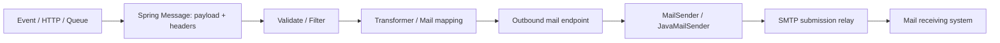
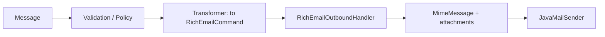
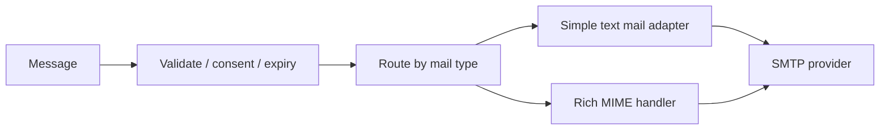

# Converting a Spring Message into an Email

A Spring Boot system receives an `OrderConfirmed` event from an internal queue. The event enters an `IntegrationFlow` as an `org.springframework.messaging.Message<OrderConfirmed>`, carrying a business payload and routing headers. To send a confirmation email, the developer needs to turn that data into recipient, sender, subject, body content, and possibly attachments. However, **a Spring Message is not an email**: a Spring Messaging `Message<?>` is an envelope for exchanging data *within the application*, whereas `SimpleMailMessage` and `jakarta.mail.internet.MimeMessage` are message representations for sending mail.

In Spring Integration, the **mail-sending outbound channel adapter** can accept several common payload types and convert them into emails via Spring's `MailSender`/`JavaMailSender`. Still, **not every Java object or MIME message is converted automatically in the same way**. For complex content such as HTML, a plain-text alternative, PDFs, and inline images, you must choose an explicit transformer or mail handler to avoid sending a malformed email while tests still pass.

This lesson, **"Converting a Spring Message into an Email"**, belongs to the **Spring Integration Mail** chapter of the **Spring Framework Mail** module and walks step-by-step through converting a Spring Integration message into a safe, well-contracted, testable outbound email. The focus is on **payloads, headers, MailHeaders, transformers, outbound adapters, MIME construction, and the SMTP submission boundary**; later sections on queues, outboxes, retries, and observability explain what happens after conversion.

## 1. Distinguishing Three Easily Confused Concepts

| Concept | Common Package/Type | Role |
|---|---|---|
| **Spring Message** | `org.springframework.messaging.Message<T>` | Carries payload and headers between Spring Integration components |
| **Spring MailMessage** | `org.springframework.mail.MailMessage`, `SimpleMailMessage` | Abstraction for a simple email, addresses, subject, text |
| **Jakarta Mail Message** | `jakarta.mail.Message`, `MimeMessage` | Email in RFC/MIME format, multipart, HTML, attachments, headers |

A Spring Message can contain a `String`:

```java
Message<String> event = MessageBuilder
        .withPayload("Order has been confirmed.")
        .setHeader("notificationId", "N-101")
        .build();
```

This message **does not yet have enough information to send an email**: it lacks `To`, `From`, and possibly `Subject`. The `notificationId` header is metadata for application use and does not automatically become the email's `Message-ID` header.

Another Spring Message can contain a `SimpleMailMessage`:

```java
SimpleMailMessage mail = new SimpleMailMessage();
mail.setTo("lan@example.net");
mail.setFrom("notifications@example.com");
mail.setSubject("Order confirmation");
mail.setText("Your order has been confirmed.");

Message<SimpleMailMessage> springMessage =
        MessageBuilder.withPayload(mail).build();
```

At this point the payload carries the simple email fields. A Spring Integration outbound mail adapter can accept a `MailMessage` payload and hand it off to `MailSender`.

A Spring Message can also contain **business data**:

```java
public record OrderConfirmed(
        String orderId,
        String recipient,
        String customerName) {
}
```

`OrderConfirmed` is **not** an email. You must map explicitly from business data to an email, typically via a transformer or application service, rather than relying on an automatic `toString()`.

### 1.1. Why Does Sharing the Name `Message` Cause Errors?

This code:

```java
import org.springframework.messaging.Message;
```

is completely different from:

```java
import jakarta.mail.Message;
```

The first has `getPayload()` and `getHeaders()`; the second has email methods such as `getRecipients()` and `getSubject()`.

When an example needs both, use fully qualified names or deliberate imports. Do not call `message.getHeaders()` on `jakarta.mail.Message`, and do not call `setSubject()` on `org.springframework.messaging.Message<?>`.

## 2. Overall Data Flow



Concrete example:

```text
Spring Message<OrderConfirmed>
    payload.orderId      = "HD-101"
    payload.recipient    = "lan@example.net"
    payload.customerName = "Lan"
    headers.correlationId = "order-HD-101"
             |
             v
Validate + render
             |
             v
Spring Message<SimpleMailMessage>
    payload.to      = "lan@example.net"
    payload.from    = "notifications@example.com"
    payload.subject = "Order HD-101 confirmed"
    payload.text    = "Hello Lan, ..."
             |
             v
Spring Integration mail outbound adapter
             |
             v
MailSender.send(SimpleMailMessage)
             |
             v
SMTP relay
```

Key takeaway: the adapter converts data into a **send request**. The `send(...)` method returning without error usually only proves that submission to the relay completed under transport conditions; **it does not prove the message reached the Inbox**.

## 3. What Components Exist in Spring Integration Mail?

Key names to recognize:

- `Message<?>`: Spring Messaging envelope.
- `MessageChannel`: channel carrying messages.
- `DirectChannel`: invokes the handler synchronously on the sending thread on the normal path.
- `ExecutorChannel`: hands processing off to an executor, creating an asynchronous boundary.
- `QueueChannel`: channel capable of buffering in memory/channel store per configuration; consumers need polling.
- `IntegrationFlow`: declares a sequence of processing steps using Java DSL.
- `@Transformer`: converts a payload or message into another form.
- `@ServiceActivator`: binds a method/handler to a channel.
- `MailHeaders`: header name constants for mail mapping.
- `MailSendingMessageHandler`: Spring Integration's outbound mail handler.
- `Mail.outboundAdapter(...)`: Java DSL factory to configure the mail outbound handler.
- `MailSender`/`JavaMailSender`: Spring Mail API that actually sends over transport.
- `SimpleMailMessage` and `MimeMessageHelper`: build simple plain-text or MIME emails.

### 3.1. Suggested Dependencies

For a modern Spring Boot project with consistent dependency management, a Gradle example:

```groovy
dependencies {
    implementation 'org.springframework.boot:spring-boot-starter-integration'
    implementation 'org.springframework.integration:spring-integration-mail'
    implementation 'org.springframework.boot:spring-boot-starter-mail'

    testImplementation 'org.springframework.boot:spring-boot-starter-test'
    testImplementation 'org.springframework.integration:spring-integration-test'
}
```

Do not pin independent versions for individual libraries if the project uses the Spring Boot BOM; Spring Integration, Spring Framework, and Jakarta Mail must remain compatible. Older projects use `javax.mail.*` instead of `jakarta.mail.*`; examples in this lesson use the `jakarta.mail.*` namespace of modern Spring.

> **Version note:** In Spring Integration 7.x, the new handler class lives in package `org.springframework.integration.mail.outbound.MailSendingMessageHandler`. The old class in `org.springframework.integration.mail.MailSendingMessageHandler` was marked deprecated starting in 7.0. The Java DSL API `Mail.outboundAdapter(...)` usually helps avoid direct coupling to the handler class package; verify against your project's actual version.

### 3.2. You Do Not Need Spring Integration for Every Email

If a simple application service only needs to call `JavaMailSender.send()` synchronously per request, Spring Integration may be unnecessary. It is useful when you want message channels, filters, transformers, routing, gateways, pollers, error flows, and unified orchestration.

Do not force a mail adapter into a complex flow just to replace a plain method call when there is no message-processing need.

## 4. Which Payloads Does the Outbound Mail Adapter Support?

According to Spring Integration's mail-sending adapter mechanism, there are several basic mapping branches:

| Payload Type in Spring Message | Adapter Behavior | When to Use |
|---|---|---|
| `String` | Content becomes the text of a simple email | Plain-text mail, no advanced MIME needed |
| `MailMessage`, e.g., `SimpleMailMessage` | Uses the constructed mail abstraction | When a transformer needs to control To/From/Subject/Text |
| `byte[]` | Attachment handling path; requires `MailHeaders.ATTACHMENT_FILENAME` | A single simple attachment per adapter contract |
| Arbitrary POJO | Do not rely on automatic conversion of arbitrary POJOs | Add an explicit transformer |
| `MimeMessage` | Do not assume it is handled identically to `MailMessage` across all versions/endpoints | Use a dedicated endpoint calling `JavaMailSender.send(MimeMessage)` for complex MIME |

**Do not assume that merely sending a `Message<OrderConfirmed>` to a mail channel lets the framework guess the recipient, subject, or body.** If the object is not a type expected by the handler, it may be mishandled or fail at runtime.

### 4.1. With String: Content in Payload, Addresses in Headers

```text
payload = "Hello Lan, your order has been confirmed."

headers:
    mail_to      = "lan@example.net"
    mail_from    = "notifications@example.com"
    mail_subject = "Order confirmation"
```

Here `mail_to`, `mail_from`, and `mail_subject` are the concrete keys provided by Spring Integration via `MailHeaders`. This is a compact choice for text-only emails.

### 4.2. With SimpleMailMessage: Payload Holds Mail Details

```java
SimpleMailMessage mail = new SimpleMailMessage();
mail.setTo("lan@example.net");
mail.setFrom("notifications@example.com");
mail.setSubject("Order confirmation");
mail.setText("Hello Lan!");

Message<SimpleMailMessage> integrationMessage =
        MessageBuilder.withPayload(mail).build();
```

The adapter does not need to build subject/to/from from separate headers when the mail object already contains them. However, if the Spring Integration Message also carries `MailHeaders.*` headers matching those fields, **the corresponding mail headers can override the values in MailMessage**. So avoid two conflicting sources of truth.

### 4.3. With byte[]: Not All Bytes Are an Email

Per the mail handler's contract, `byte[]` can be processed as an attachment; a proper filename header must be present:

```java
Message<byte[]> attachmentMessage = MessageBuilder
        .withPayload(pdfBytes)
        .setHeader(MailHeaders.TO, "lan@example.net")
        .setHeader(MailHeaders.FROM, "billing@example.com")
        .setHeader(MailHeaders.SUBJECT, "Invoice file")
        .setHeader(
                MailHeaders.ATTACHMENT_FILENAME,
                "hoa-don.pdf")
        .build();
```

This is an example of the framework-supported simple attachment path, **not a contract for multi-attachment emails with HTML**. If you need multiple attachments, `text/plain`, `text/html`, and inline images together, use `MimeMessageHelper` inside a dedicated handler.

Do not treat `byte[]` from a PDF as an email body string, and do not use `Object.toString()` to turn bytes into content.

## 5. MailHeaders: Headers for Mapping Mail Information

Spring Integration defines `org.springframework.integration.mail.MailHeaders`. Commonly used constants:

| Constant | Related Header Value | Meaning |
|---|---|---|
| `MailHeaders.TO` | `mail_to` | To recipient |
| `MailHeaders.CC` | `mail_cc` | Cc recipient |
| `MailHeaders.BCC` | `mail_bcc` | Bcc recipient |
| `MailHeaders.FROM` | `mail_from` | From address |
| `MailHeaders.REPLY_TO` | `mail_replyTo` | Reply-To address |
| `MailHeaders.SUBJECT` | `mail_subject` | Subject |
| `MailHeaders.ATTACHMENT_FILENAME` | `mail_attachmentFilename` | Attachment filename on the byte[] path |
| `MailHeaders.CONTENT_TYPE` | `mail_contentType` | Header related to MIME content type in mapping/metadata |

There are additional constants for inbound mail, such as flags, received date, and raw headers. In this **outbound** lesson, do not assume every header is forwarded directly into email headers.

### 5.1. Spring Message Headers Are Not MIME Headers

A `MessageHeaders` map may contain:

```text
id: <UUID generated by the framework>
timestamp: <time the message was created>
correlationId: "order-HD-101"
notificationType: "ORDER_CONFIRMATION"
mail_to: "lan@example.net"
mail_subject: "Order confirmation"
```

Only headers recognized by the outbound component or explicitly mapped by the developer affect the email. `correlationId` does not automatically become `X-Correlation-ID` in the email; Spring Message's `id` is not automatically an RFC 5322 `Message-ID`.

**Do not copy all Spring headers into MIME headers** because doing so can leak internal information or inject invalid values into the email.

### 5.2. Precedence Between Payload and Headers

If a `SimpleMailMessage` payload has `To = alice@example.net` while the integration header `MailHeaders.TO` is `bob@example.net`, the Spring Integration header can override the corresponding mail field per adapter mapping.

This can cause a security bug: a header-enricher step reading untrusted user data accidentally overwrites a recipient already verified by the application.

Good design practices:

- Establish **a single trusted source** for From/To/Subject.
- If enrichment is needed, perform it before final packaging.
- Do not let downstream steps arbitrarily overwrite sensitive headers.
- Validate final values right before submission.
- Write a test that intentionally creates conflicting headers/payloads to verify the contract and application policy.

### 5.3. Distinguishing Content Types

Spring Messaging's `MessageHeaders.CONTENT_TYPE` describes the payload's content type within the flow. It is **not** an API that replaces a full MIME `Content-Type: multipart/alternative` structure.

Example:

```java
Message<String> message = MessageBuilder
        .withPayload("<p>Hello!</p>")
        .setHeader(
                MessageHeaders.CONTENT_TYPE,
                "text/html")
        .build();
```

Do not assume every outbound mail adapter will automatically turn this string into a proper HTML MIME email with a plain-text alternative. If the use case requires HTML email, **build the MIME message explicitly** with `MimeMessageHelper` and verify the actual `text/html` part.

## 6. Simplest Example: Spring Message<String> -> Text Email

A Spring Boot application with `JavaMailSender` and the Spring Integration Mail dependency can declare a message channel and a Java DSL outbound adapter.

### 6.1. SMTP Submission Configuration

```yaml
spring:
  mail:
    host: ${SMTP_HOST}
    port: 587
    protocol: smtp
    username: ${SMTP_USERNAME}
    password: ${SMTP_PASSWORD}
    default-encoding: UTF-8
    properties:
      "[mail.smtp.auth]": true
      "[mail.smtp.starttls.enable]": true
      "[mail.smtp.starttls.required]": true
      "[mail.smtp.ssl.checkserveridentity]": true
      "[mail.smtp.connectiontimeout]": 5000
      "[mail.smtp.timeout]": 10000
      "[mail.smtp.writetimeout]": 10000
```

This example fits providers requiring SMTP AUTH and STARTTLS on port 587. Providers using implicit TLS on port 465 need corresponding transport settings, typically with `mail.smtp.ssl.enable=true`. Addresses and credentials must come from secret configuration, never hardcoded.

### 6.2. IntegrationFlow and Outbound Adapter

```java
package com.example.mail;

import org.springframework.context.annotation.Bean;
import org.springframework.context.annotation.Configuration;
import org.springframework.integration.channel.DirectChannel;
import org.springframework.integration.dsl.IntegrationFlow;
import org.springframework.integration.mail.dsl.Mail;
import org.springframework.mail.javamail.JavaMailSender;
import org.springframework.messaging.MessageChannel;

@Configuration
public class OutboundMailFlowConfiguration {

    @Bean
    public MessageChannel outboundMail() {
        return new DirectChannel();
    }

    @Bean
    public IntegrationFlow outboundMailFlow(
            MessageChannel outboundMail,
            JavaMailSender mailSender) {

        return IntegrationFlow.from(outboundMail)
                .handle(Mail.outboundAdapter(mailSender))
                .get();
    }
}
```

This is a Java DSL configuration following the Spring Integration Mail model. `DirectChannel` processes synchronously, so calls sending a message to the channel may block during SMTP send. Depending on version and configuration, check the exact DSL signature managed by your project.

### 6.3. Creating and Sending a Spring Message

A component can inject the channel:

```java
package com.example.mail;

import org.springframework.integration.mail.MailHeaders;
import org.springframework.messaging.Message;
import org.springframework.messaging.MessageChannel;
import org.springframework.messaging.support.MessageBuilder;
import org.springframework.stereotype.Service;

@Service
public class TextMailPublisher {

    private final MessageChannel outboundMail;

    public TextMailPublisher(MessageChannel outboundMail) {
        this.outboundMail = outboundMail;
    }

    public void sendConfirmation(
            String recipient,
            String orderCode) {

        if (recipient == null || recipient.isBlank()) {
            throw new IllegalArgumentException(
                    "Recipient is required");
        }

        Message<String> mailRequest = MessageBuilder
                .withPayload(
                        "Order " + orderCode
                        + " has been confirmed.")
                .setHeader(
                        MailHeaders.TO,
                        recipient)
                .setHeader(
                        MailHeaders.FROM,
                        "notifications@example.com")
                .setHeader(
                        MailHeaders.SUBJECT,
                        "Order confirmation " + orderCode)
                .build();

        boolean acceptedByChannel = outboundMail.send(mailRequest);

        if (!acceptedByChannel) {
            throw new IllegalStateException(
                    "Integration channel rejected message");
        }
    }
}
```

Here:

1. `MessageBuilder` creates `Message<String>`.
2. `MailHeaders.*` tells the outbound adapter the addresses and subject.
3. `outboundMail.send(...)` sends the Spring Message to the integration channel.
4. `Mail.outboundAdapter(mailSender)` uses the Spring Mail transport.

**The variable name `acceptedByChannel` does not mean the SMTP relay has accepted it.** `MessageChannel.send(...)` returns the result of sending to the channel per the channel contract; on `DirectChannel`, the handler may throw synchronously. With asynchronous channels, `true` says even less about SMTP status.

### 6.4. This Is "Simple", Not "Completely Safe"

This condensed example does not yet include:

- Full recipient validation and allowlist/suppression checks.
- From address from configuration/verified sender identity.
- HTML escaping for dynamic content.
- An outbox for sending after business commit.
- Retries and idempotency.
- Exception classification by SMTP stage.
- Metrics and provider events.

The following sections add those processing boundaries. Do not send email directly inside a business transaction simply because the channel API is concise.

## 7. Using @MessagingGateway to Hide MessageChannel Details

Instead of having an application service inject `MessageChannel` directly and assemble every header manually, Spring Integration supports gateway interfaces.

### 7.1. Gateway for Text-Only Email

```java
import org.springframework.integration.annotation.MessagingGateway;
import org.springframework.messaging.Message;

@MessagingGateway(defaultRequestChannel = "outboundMail")
public interface TextEmailGateway {
    void send(Message<String> mailRequest);
}
```

Caller:

```java
Message<String> request = MessageBuilder
        .withPayload("Hello Lan!")
        .setHeader(
                MailHeaders.TO,
                "lan@example.net")
        .setHeader(
                MailHeaders.FROM,
                "notifications@example.com")
        .setHeader(
                MailHeaders.SUBJECT,
                "Welcome")
        .build();

textEmailGateway.send(request);
```

The gateway's job is to keep external code unaware of how messages are dispatched to the channel; **it does not implement a transactional outbox by itself** and does not turn SMTP into an exactly-once operation.

### 7.2. Gateway with Method Arguments

You can declare a gateway using payload and header parameters:

```java
import org.springframework.integration.annotation.Gateway;
import org.springframework.integration.annotation.MessagingGateway;
import org.springframework.messaging.handler.annotation.Header;
import org.springframework.integration.mail.MailHeaders;

@MessagingGateway
public interface SimpleEmailGateway {

    @Gateway(requestChannel = "outboundMail")
    void sendText(
            String body,
            @Header(MailHeaders.TO) String recipient,
            @Header(MailHeaders.SUBJECT) String subject,
            @Header(MailHeaders.FROM) String fromAddress);
}
```

This allows the caller to write:

```java
simpleEmailGateway.sendText(
        "Hello Lan!",
        "lan@example.net",
        "Welcome",
        "notifications@example.com");
```

Because `fromAddress` is a method argument in the example, **do not** let an arbitrary HTTP request pass an unverified From email. In production, the gateway wrapper/application service should pull From from trusted configuration and validate To and policy before calling the gateway.

### 7.3. Why Is a Gateway Optional?

If an application only has one service sending email in one place, a gateway may be an unnecessary abstraction. It is helpful when you want an explicit endpoint contract and let Spring Integration handle message dispatch. What remains critical is the contract at the application boundary.

## 8. Transformer: Converting a Business Payload into MailMessage

If the input is `OrderConfirmed`, the clearest approach is building the email in a transformer with a dedicated name and contract.

### 8.1. Business Data

```java
public record OrderConfirmed(
        String orderCode,
        String recipient,
        String customerName) {
}
```

This data describes a business event; it contains no Spring Mail or Jakarta Mail classes.

### 8.2. A Transformer Producing SimpleMailMessage

```java
package com.example.mail;

import org.springframework.integration.annotation.Transformer;
import org.springframework.mail.SimpleMailMessage;
import org.springframework.stereotype.Component;

@Component
public class OrderConfirmationMailTransformer {

    @Transformer(
        inputChannel = "orderConfirmedChannel",
        outputChannel = "outboundMail")
    public SimpleMailMessage toMail(OrderConfirmed event) {

        if (event.recipient() == null
                || event.recipient().isBlank()) {
            throw new IllegalArgumentException(
                    "Recipient is required");
        }

        SimpleMailMessage mail = new SimpleMailMessage();
        mail.setFrom("notifications@example.com");
        mail.setTo(event.recipient());
        mail.setSubject(
                "Order confirmation " + event.orderCode());
        mail.setText(
                "Hello " + event.customerName()
                + ", order " + event.orderCode()
                + " has been confirmed.");

        return mail;
    }
}
```

Spring Integration can take the return value as the payload of a new message on the output channel. The outbound adapter receives the `SimpleMailMessage` (a `MailMessage`) and sends it.

### 8.3. Advantages Over POJO.toString()

A transformer explicitly defines:

- Which data goes into the recipient.
- How the subject and body are constructed.
- That From comes from trusted configuration.
- What the system should do when the recipient is missing.
- When templating or i18n should be applied.
- Whether the result has the exact payload type supported by the adapter.

By contrast:

```java
Message<OrderConfirmed> message =
        MessageBuilder.withPayload(event).build();
outboundMail.send(message);
```

is not unambiguous enough for the handler to infer an email. An `ObjectToStringTransformer` merely calling `toString()` is only appropriate when **the toString() output itself is the intended body**, not as a default for arbitrary domain objects. `OrderConfirmed[orderCode=..., recipient=...]` is a debug representation, not a user-friendly email.

### 8.4. Watch Out for Old Headers Riding Along with the Transformer

If the input `Message<OrderConfirmed>` already carries a `MailHeaders.TO` header set by an upstream step, that header may propagate through some flows and **override** To inside `SimpleMailMessage` after the transformer creates it.

This bug is easy to miss if you only inspect the object returned by the transformer without inspecting the final message reaching the mail adapter. Good design:

1. Do not put untrusted mail headers on business messages.
2. Have the transformer/adapter derive the recipient from a trusted source.
3. Control header propagation and overwrites.
4. When needed, create a fresh message with only an allowlisted set of headers instead of copying all headers.
5. Write an integration test with a conflicting header/payload case to protect this invariant.

## 9. Header Enricher: Mapping Payload Fields to MailHeaders

When an email is plain text, Spring Integration can use `HeaderEnricher` to map fields from the payload into mail headers, then transform the body into a String.

### 9.1. Input Data

```java
public record TextMailCommand(
        String to,
        String from,
        String subject,
        String bodyText) {
}
```

### 9.2. Illustrative Java DSL

```java
@Bean
public IntegrationFlow textMailMappingFlow(
        JavaMailSender sender) {

    return IntegrationFlow.from("textMailRequests")
            .enrichHeaders(h -> h
                    .headerExpression(
                            MailHeaders.TO,
                            "payload.to")
                    .headerExpression(
                            MailHeaders.FROM,
                            "payload.from")
                    .headerExpression(
                            MailHeaders.SUBJECT,
                            "payload.subject"))
            .transform(
                    TextMailCommand.class,
                    TextMailCommand::bodyText)
            .handle(Mail.outboundAdapter(sender))
            .get();
}
```

The example shows three stages:

1. The input is `Message<TextMailCommand>`.
2. The enricher lifts `to`, `from`, and `subject` onto `MailHeaders`.
3. The transformer turns the payload into the `String` body, keeping meaningful headers in the flow.
4. The outbound adapter handles the text mail.

Java DSL syntax and generic type inference may vary across versions; if method reference overloads cause compilation errors in a specific version, use an explicitly typed transformer function or a `@Transformer` component. The architectural behavior remains the same.

### 9.3. Do Not Trust payload.from from External Sources

In the example, `payload.from` is mapped directly to explain the mechanism. In a real system, if `TextMailCommand` arrives from an untrusted HTTP request, **replace it with a verified From** configured by the application:

```java
.enrichHeaders(h -> h.header(
        MailHeaders.FROM,
        "notifications@example.com",
        true))
```

The overwrite parameter in the DSL controls header overwriting behavior; verify against your project's API version. Never let a client pick an unauthorized From or let an untrusted header overwrite the sender address.

### 9.4. Enrichment Does Not Turn a Body into HTML MIME

If `bodyText` contains `<b>Hello</b>`, after transformation it is still a String. Use a dedicated MIME path if you need HTML email with proper Content-Type and multipart structure.

## 10. When to Choose SimpleMailMessage vs. MimeMessage?

| Requirement | `SimpleMailMessage` | `MimeMessage` + `MimeMessageHelper` |
|---|---|---|
| Plain text | Suitable | Suitable |
| Subject, To, From | Yes | Yes |
| Cc, Bcc, Reply-To | Yes | Yes |
| HTML body with `text/html` | Not a strong API for HTML MIME | Suitable |
| Plain + HTML alternative | No | Suitable |
| Multiple file attachments | No | Suitable |
| Inline image/CID | No | Suitable |
| Fine-grained MIME Content-Type/charset control | Limited | Suitable |
| A few custom MIME headers | Not the goal | Possible, with validation |
| Sending directly via mail adapter with `MailMessage` | Convenient | Needs handler building/sending MIME when complex |

**Rule of thumb:** use the simplest path that accurately meets the requirements, but never force HTML or attachments into `SimpleMailMessage` hoping mail clients will figure it out.

## 11. Converting Message<RichEmailCommand> into MimeMessage: Dedicated Endpoint

For rich emails, the clearest approach is using Spring Integration for orchestration up to a `@ServiceActivator`, while that service uses `JavaMailSender` to build and send MIME.

### 11.1. Defining the Command at the Application Boundary

```java
package com.example.mail;

import java.util.List;

public record RichEmailCommand(
        String to,
        String subject,
        String plainText,
        String htmlText,
        List<AttachmentData> attachments) {
}

public record AttachmentData(
        String fileName,
        String contentType,
        byte[] bytes) {
}
```

These are illustrative records; each public top-level Java type should reside in its own file. For production, add validation, immutable defensive copies, size/type limits, and storage references for large attachments. Do not hold large byte payloads inside Spring Messages indefinitely.

### 11.2. Handler Using MimeMessageHelper

```java
package com.example.mail;

import jakarta.mail.MessagingException;
import jakarta.mail.internet.MimeMessage;

import org.springframework.beans.factory.annotation.Value;
import org.springframework.core.io.ByteArrayResource;
import org.springframework.integration.annotation.ServiceActivator;
import org.springframework.mail.javamail.JavaMailSender;
import org.springframework.mail.javamail.MimeMessageHelper;
import org.springframework.stereotype.Component;

@Component
public class RichEmailOutboundHandler {

    private final JavaMailSender sender;
    private final String from;

    public RichEmailOutboundHandler(
            JavaMailSender sender,
            @Value("${app.mail.from}") String from) {

        this.sender = sender;
        this.from = from;
    }

    @ServiceActivator(inputChannel = "richMailRequests")
    public void send(RichEmailCommand command) {
        if (command.to() == null || command.to().isBlank()) {
            throw new IllegalArgumentException(
                    "Recipient is required");
        }

        MimeMessage mime = sender.createMimeMessage();

        try {
            MimeMessageHelper helper =
                    new MimeMessageHelper(
                            mime,
                            true,
                            "UTF-8");

            helper.setFrom(from);
            helper.setTo(command.to());
            helper.setSubject(command.subject());

            if (command.htmlText() == null) {
                helper.setText(command.plainText(), false);
            } else {
                helper.setText(
                        command.plainText(),
                        command.htmlText());
            }

            if (command.attachments() != null) {
                for (AttachmentData attachment
                        : command.attachments()) {
                    helper.addAttachment(
                            attachment.fileName(),
                            new ByteArrayResource(
                                    attachment.bytes()),
                            attachment.contentType());
                }
            }
        } catch (MessagingException ex) {
            throw new IllegalArgumentException(
                    "Cannot prepare MIME email", ex);
        }

        sender.send(mime);
    }
}
```

The `send(RichEmailCommand)` method is an application-owned outbound endpoint; Spring Integration passes the **unwrapped payload** to the method. `JavaMailSender` is invoked to send the actual `MimeMessage`. To integrate with an outbox, the worker should decide when to invoke the handler after commit, without wrapping network I/O inside a business transaction.

### 11.3. Why Not Send a MimeMessage Payload Directly to the Mail-Sending Handler?

A Jakarta Mail `MimeMessage` does not implement Spring `MailMessage`. The mail-sending adapter has distinct mapping branches for `MailMessage`, `String`, and `byte[]`; **do not assume every `Message<MimeMessage>` is handled like `JavaMailSender.send(MimeMessage)`** across all versions.

The safe path for complex MIME is:

```text
Spring Message<RichEmailCommand>
    -> RichEmailOutboundHandler
    -> JavaMailSender.createMimeMessage()
    -> MimeMessageHelper
    -> JavaMailSender.send(MimeMessage)
```

Alternatively, write a transformer returning MIME wired to a **custom handler** explicitly typed for MIME that calls the sender; there is no need to force the standard outbound adapter to do something it does not promise.

### 11.4. HTML Escaping and Plain-Text Alternative

If the command contains untrusted data, HTML must be contextually escaped (typically via a template engine with auto-escaping). Do not use:

```java
String html = "<p>Hello " + userSuppliedName + "</p>";
```

without escaping; the input could contain unwanted HTML/script markup. Email clients are not full browsers, yet content/link injection protection is still necessary.

Content with `htmlText` should also have a meaningful plain-text alternative rather than passing raw markup as plain text. `helper.setText(plain, html)` produces the appropriate MIME alternative structure.

## 12. Pattern with a Transformer Before the Rich Mail Handler

For a clear flow:



The transformer can use a template engine, attachment inventory, and configuration:

```java
@Component
public final class InvoiceMailRenderer {

    private final TemplateService templates;

    public InvoiceMailRenderer(TemplateService templates) {
        this.templates = templates;
    }

    @Transformer(
            inputChannel = "invoiceIssuedChannel",
            outputChannel = "richMailRequests")
    public RichEmailCommand toEmail(InvoiceIssued invoice) {
        String plain = templates.renderPlain(invoice);
        String html = templates.renderHtml(invoice);

        return new RichEmailCommand(
                invoice.recipient(),
                "Invoice " + invoice.invoiceNumber(),
                plain,
                html,
                invoice.attachments());
    }
}
```

The `TemplateService`/`InvoiceIssued` types are illustrative application abstractions; they are not built-in Spring Framework classes. Content generation should ensure:

- The template version is reproducible on retry.
- Subject and recipient are validated.
- Localization explicitly specifies locale/timezone.
- HTML output is properly escaped.
- Attachment bytes/references do not mutate unexpectedly across attempts.
- The From source comes from verified identity configuration, not an untrusted event.

## 13. Keeping Business Logic Clean

Do not make domain events hold mail infrastructure objects:

```java
record OrderConfirmed(
        MimeMessage mime,
        MimeMessageHelper helper,
        JavaMailSender sender) {
}
```

That couples the domain to mail infrastructure, hurts serialization/retries/testing, and violates separation of concerns.

Better:

```text
Domain:
    OrderConfirmed(orderId, customerId, occurredAt)

Application:
    Resolve approved recipient
    Choose notification purpose/template
    Snapshot intent

Integration:
    Route / filter / transform / channel

Infrastructure:
    MimeMessageHelper / JavaMailSender / provider events
```

When Spring Integration is not yet needed, the application can call a mail port directly. When flow processing is needed, Spring Integration serves as the orchestration layer without becoming the owner of domain logic.

## 14. Synchronous vs. Asynchronous: Outcome of MessageChannel.send()

### 14.1. DirectChannel

`DirectChannel` hands the message off to a subscriber on the caller's thread along the synchronous path. If the handler invokes SMTP and throws an exception, the exception can propagate back to the caller in the same call chain.

Notes:

- Calls can be slow due to SMTP timeouts.
- If the caller holds a database transaction, locks risk being held too long.
- `send()` returning without error does not mean delivered to the Inbox.

### 14.2. ExecutorChannel

`ExecutorChannel` offloads processing to a task executor. The caller can complete the handoff successfully while SMTP submission occurs later on another thread.

Risks:

- Exceptions do not necessarily propagate back to the caller.
- Thread pool saturation/rejection must be handled.
- Process crashes can lose messages if they reside only in an in-memory queue.
- Error publishing depends on error channel/task executor configuration.

Do not choose async merely by swapping `DirectChannel` for `ExecutorChannel` and assume you have reliability equivalent to a transactional outbox.

### 14.3. QueueChannel and Poller

`QueueChannel` is a `PollableChannel`. The consumer endpoint requires a poller to drain messages. The queue can use an in-memory store or a `MessageStore` depending on configuration, each with its own durability/semantics.

Do not assume an in-memory QueueChannel suffices for critical transactional emails. If the requirement is "do not lose notifications after a process crash", persist the intent in an outbox within the same transaction as business state, or use a properly designed durable queue.

### 14.4. Separating the Business Phase from the Sending Phase

```text
HTTP confirmation:
    BEGIN DB TX
    update order
    insert mail_outbox
    COMMIT

Later:
    worker claim outbox
    build Spring Message<MailCommand>
    IntegrationFlow -> mail outbound handler
    update submission outcome
```

The database transaction does not span SMTP, so accepting and crashing before updating status can still cause duplicates on retry. Spring Integration helps organize the flow, **it does not create exactly-once external delivery on its own**.


## 15. Handling Errors at the Right Layer

An error when converting a Spring Message into an email can happen before or after SMTP transport begins:

1. Payload missing fields, data fails business rules.
2. Transformer fails while rendering template.
3. Invalid mail headers or headers overwritten by an untrusted source.
4. MIME construction fails due to attachment or structure issues.
5. SMTP connect/TLS/AUTH fails.
6. SMTP server returns a temporary or permanent rejection response.
7. Client times out after `DATA` while the relay may have accepted the message.
8. Provider accepts, and later the recipient MX returns a bounce/deferral.

Do not collapse everything into a generic `MailSendException` "retry in 1 second".

### 15.1. DirectChannel and Synchronous Exceptions

With `DirectChannel`, the subscriber usually executes on the caller thread:

```text
publisher -> DirectChannel -> Transformer
                                  |
                                  v
                            Mail adapter
                                  |
                                  v
                          SMTP exception
                                  |
                                  v
                         caller receives error
```

Exceptions in the handler can propagate back along the synchronous call chain. However, if the email was already accepted by the relay and an application error occurs afterward, rolling back the database **cannot recall the email**.

### 15.2. ExecutorChannel, QueueChannel, and Error Channels

When processing asynchronously:

- The caller usually only learns that the message was handed off to the channel/executor.
- Exceptions can be converted by the framework into an `ErrorMessage` on an error channel if configured or supported by the corresponding error-publishing mechanism.
- Some errors can still occur immediately upon handoff (such as executor task rejection).
- How errors are published depends on channel type, poller, and endpoint; there is no single `errorChannel` configuration that automatically catches every error across all flows.
- Process crashes can lose messages if they reside only in an in-memory queue.

An error handler can observe:

```java
import org.springframework.integration.annotation.ServiceActivator;
import org.springframework.messaging.MessagingException;
import org.springframework.messaging.support.ErrorMessage;
import org.springframework.stereotype.Component;

@Component
public class MailErrorObserver {

    @ServiceActivator(inputChannel = "mailErrors")
    public void observe(ErrorMessage error) {
        Throwable failure = error.getPayload();

        if (failure instanceof MessagingException messaging) {
            org.springframework.messaging.Message<?> failed =
                    messaging.getFailedMessage();
            // Extract correlation ID from failed message if present,
            // avoid logging raw MIME bodies or credentials.
        }

        // Route error to classifier/metrics; do not retry blindly.
    }
}
```

`mailErrors` is an application-defined channel name and must be wired to the flow's error mechanism. Do not assume this annotation alone creates error handling for all channels.

### 15.3. Two Different MessagingExceptions

| Type | Meaning |
|---|---|
| `org.springframework.messaging.MessagingException` | Spring Messaging exception during message processing; may carry failed message |
| `jakarta.mail.MessagingException` | Exception when working with email/MIME or Jakarta Mail transport |
| `org.springframework.mail.MailException` | Runtime exception belonging to the Spring Mail abstraction |

When source code uses these types together, import selectively or use fully qualified names to avoid confusion.

### 15.4. Building a Neutral Error Taxonomy

| Category | Example | Handling Direction |
|---|---|---|
| `INVALID_NOTIFICATION` | Missing recipient/consent | Do not submit |
| `TEMPLATE_ERROR` | Render failure, invalid HTML | Fix data/template |
| `MIME_PREPARATION` | Missing attachment, invalid filename | Do not retry SMTP as-is |
| `AUTHENTICATION` | SMTP 535, wrong token | Alert/fix secret |
| `TLS_CONFIG` | PKIX or hostname mismatch | Fix certificate/truststore |
| `TEMPORARY_REJECTION` | Evidenced temporary SMTP 4xx | Retry with backoff+jitter |
| `PERMANENT_REJECTION` | Permanent SMTP 5xx | Stop or fix root cause |
| `PROVIDER_RATE_LIMIT` | Confirmed quota/rate limit | Slow down pace, wait for capacity |
| `SUBMISSION_UNKNOWN` | Timeout after message may have been sent | Reconcile/duplicate-aware retry |
| `DOWNSTREAM_BOUNCE` | Provider event after acceptance | Update suppression/state |

An error in `MimeMessageHelper` before calling SMTP means something completely different from a socket error after `DATA`. A good classifier preserves certainty level, stage, and provider evidence when available.

## 16. Validating Inputs Before Reaching the Outbound Endpoint

An email-sending flow should not blindly trust `MailHeaders` on messages arriving from HTTP, queues, or external partners.

### 16.1. Recipient

Requirements:

- Non-null, non-blank.
- Address valid per validator and policy.
- Belongs to an account/recipient the caller is authorized to contact.
- Not on the suppression list for the corresponding notification type.
- Has consent if it is a marketing email.
- Contains no control characters that corrupt headers.
- Not a debug/test address accidentally left in production.

An address parseable by `InternetAddress` **does not prove the mailbox exists** or that the recipient wants the email.

### 16.2. From and Reply-To

- Obtain From from a verified sending identity per tenant/account.
- Do not allow requests to arbitrarily set `mail_from` to an unauthorized address.
- Reply-To must also comply with policy.
- SPF/DKIM/DMARC, envelope sender, and From display name serve distinct purposes; do not try to fix authentication by setting arbitrary headers.

### 16.3. Subject/Body

- Block CR/LF/header injection.
- Enforce business length limits.
- Contextually escape HTML, especially for user-supplied data.
- Only use approved templates, link hosts, and attachments.
- Never log OTPs, password reset tokens, bodies, or secrets.

### 16.4. Bcc

Bcc serves hidden recipients; never place Bcc lists into the body, custom headers, or unprotected logs. For personalized emails, usually create a separate notification per recipient. Test actual MIME/SMTP behavior rather than assuming all mail clients/transports behave identically.

### 16.5. Do Not Turn Every Spring Header into a MIME Header

A Spring Message may carry `notificationId`, `traceId`, `tenantId`, and `correlationId`. Map only headers needed for the email; do not copy everything into `X-*` email headers. Email headers can reach recipients and multiple SMTP relays.

## 17. Unicode and MIME Content Types

### 17.1. Vietnamese Requires an Appropriate Charset

With `SimpleMailMessage`, `JavaMailSenderImpl`/Spring Mail configuration should use UTF-8 encoding. For MIME:

```java
MimeMessageHelper helper =
        new MimeMessageHelper(message, true, "UTF-8");

helper.setSubject("Hóa đơn đã thanh toán");
helper.setText(
        "Hóa đơn đã được phát hành.",
        "<p>Hóa đơn <strong>đã được phát hành</strong>.</p>");
```

Tests should read the **decoded** subject/body through Jakarta Mail APIs rather than comparing raw encoded headers.

### 17.2. An HTML String Does Not Automatically Become HTML Mail

```java
Message<String> springMessage =
        MessageBuilder.withPayload(
                "<h1>Hello!</h1>").build();
```

This is just a String payload. If passed to a text-mail adapter, you cannot assume the email will carry `Content-Type: text/html`. To guarantee valid HTML/alternative parts, construct a `MimeMessage` explicitly.

### 17.3. MIME Multipart

An email with plain text, HTML, and a PDF can be structured as:

```text
MimeMessage
└── multipart/mixed
    ├── multipart/alternative
    │   ├── text/plain; charset=UTF-8
    │   └── text/html; charset=UTF-8
    └── application/pdf attachment
```

Depending on `MimeMessageHelper` multipart modes, the structure may also nest `multipart/related` when inline resources are present. Tests should traverse by `MIME type`, disposition/filename rather than hardcoding body part indices.

## 18. Attachments: Data and Lifecycle

For small attachments where bytes are already available:

```java
helper.addAttachment(
        "invoice-HD-101.pdf",
        new ByteArrayResource(pdfBytes),
        "application/pdf");
```

However, for large files or emails sent hours later:

- Do not hold bytes in an in-memory queue for too long.
- Store references to object storage or immutable files.
- Check tenant access permissions, size, and content type.
- Streams must satisfy re-open/re-read contracts if the MIME implementation requires it.
- Do not pass an open `InputStream` inside a Spring Message across a process restart.
- Handle missing/unreadable files before attempting SMTP.
- Do not silently drop a required attachment and treat the message as successfully sent.

A record to reference a file can look like:

```java
public record AttachmentRef(
        String objectKey,
        String fileName,
        String contentType,
        long expectedSize,
        String sha256) {
}
```

Infrastructure resolves `objectKey` to a safe data source at send time; if retries need the same document, content snapshot/immutability must be guaranteed.

## 19. Filters, Routing, and Provider Policies

A Spring Integration flow can consist of:



### 19.1. Filter

When a filter drops a message because the recipient is suppressed or an OTP has expired, update the appropriate business/audit state; do not silently discard an important notification leaving operators blind.

### 19.2. Router

You can route:

- `TEXT_ONLY` → `Message<String>` + `MailHeaders`.
- `RICH_MIME` → `RichEmailCommand` + custom handler.
- `NO_SEND` → cancelled/suppressed state.
- `PROVIDER_B` → another adapter when the provider satisfies verification, region, quota, and capabilities.

### 19.3. Quota, Rate, and Concurrency

A `DirectChannel` with a single handler is **not** a distributed rate limiter. If multiple threads/pods send concurrently, account limits can still be exceeded.

Before calling SMTP:

1. Identify provider/account and cost per recipient.
2. Reserve rate/quota capacity in the appropriate scope.
3. When the local gate returns DENIED, defer dispatch without incrementing SMTP attempts.
4. When ALLOWED, execute one attempt.
5. Persist accepted/rejected/unknown and retry schedule.
6. Monitor backlog, remaining quota, and provider throttling.

## 20. Outbox: Do Not Send SMTP Inside a Business Transaction

Wrong when business requirements demand atomicity:

```java
@Transactional
public void confirmOrder(...) {
    orderRepository.markConfirmed(...);
    mailChannel.send(mailRequest); // May send SMTP before DB commit!
}
```

If SMTP accepts and the transaction rolls back, the customer can receive an email about an order that does not exist.

Transactional outbox solution:

```text
Business transaction:
    BEGIN
      UPDATE orders SET status = CONFIRMED
      INSERT mail_outbox(
        notification_id,
        business_key,
        payload_snapshot,
        status = PENDING
      )
    COMMIT

After commit:
    Worker claim due outbox
      -> build Spring Message<MailCommand>
      -> IntegrationFlow/Transformer
      -> SMTP handler
      -> persist attempt outcome
```

Provided business state and outbox genuinely share the same database transaction, both commit or roll back together. SMTP does **not** participate in that transaction.

### 20.1. Do Not Use Spring Message ID as a Business Idempotency Key

On each retry, the worker may create a new Spring `Message<?>` with a new ID. You need to preserve:

- Durable `notificationId`.
- `idempotencyKey` per event/purpose/recipient.
- `attemptId` for each transport try.
- `providerReference` if issued.
- Internal `correlationId` for tracing.

`MessageHeaders.ID` does not replace outbox idempotency.

### 20.2. UNKNOWN Outcomes and Duplicate Risk

If the client loses the response after SMTP `DATA`, the server may have already accepted. The outbox ensures **send intent is not lost**, but does not automatically guarantee exactly-once SMTP submission. Use reconciliation when possible, or retry under a policy that accepts duplicate risk per notification type.

## 21. Unit Testing a Transformer

No Spring context is needed to test converting a business payload into mail content.

```java
import org.junit.jupiter.api.Test;
import org.springframework.mail.SimpleMailMessage;

import static org.assertj.core.api.Assertions.*;

class OrderConfirmationMailTransformerTest {

    private final OrderConfirmationMailTransformer transformer =
            new OrderConfirmationMailTransformer();

    @Test
    void mapsOrderToTextEmail() {
        OrderConfirmed event =
                new OrderConfirmed(
                        "HD-101",
                        "lan@example.net",
                        "Lan");

        SimpleMailMessage mail = transformer.toMail(event);

        assertThat(mail.getTo())
                .containsExactly("lan@example.net");
        assertThat(mail.getSubject())
                .isEqualTo("Order confirmation HD-101");
        assertThat(mail.getText())
                .contains("Lan", "HD-101");
    }
}
```

This test only verifies the transformer; it does not prove channel wiring or SMTP connectivity.

## 22. Unit Testing Outbound Mapping with a Mock MailSender

With Spring Integration 7.x, the outbound handler resides in package `org.springframework.integration.mail.outbound`. Test example:

```java
import org.junit.jupiter.api.Test;
import org.mockito.ArgumentCaptor;
import org.springframework.integration.mail.MailHeaders;
import org.springframework.integration.mail.outbound.MailSendingMessageHandler;
import org.springframework.mail.MailSender;
import org.springframework.mail.SimpleMailMessage;
import org.springframework.messaging.Message;
import org.springframework.messaging.support.MessageBuilder;

import static org.assertj.core.api.Assertions.*;
import static org.mockito.Mockito.*;

class MailHandlerMappingTest {

    @Test
    void mapsStringAndMailHeaders() {
        MailSender sender = mock(MailSender.class);

        MailSendingMessageHandler handler =
                new MailSendingMessageHandler(sender);

        Message<String> request = MessageBuilder
                .withPayload("Hello Lan!")
                .setHeader(
                        MailHeaders.TO,
                        "lan@example.net")
                .setHeader(
                        MailHeaders.FROM,
                        "notifications@example.com")
                .setHeader(
                        MailHeaders.SUBJECT,
                        "Welcome")
                .build();

        handler.handleMessage(request);

        ArgumentCaptor<SimpleMailMessage> captor =
                ArgumentCaptor.forClass(
                        SimpleMailMessage.class);

        verify(sender, times(1)).send(captor.capture());

        SimpleMailMessage mail = captor.getValue();

        assertThat(mail.getTo())
                .containsExactly("lan@example.net");
        assertThat(mail.getFrom())
                .isEqualTo("notifications@example.com");
        assertThat(mail.getSubject())
                .isEqualTo("Welcome");
        assertThat(mail.getText())
                .isEqualTo("Hello Lan!");
    }
}
```

If the project uses Spring Integration 6.x, the handler class sits in package `org.springframework.integration.mail` under that API line. In 7.x, the old class in that package is deprecated, so use the new package or test through `Mail.outboundAdapter(mailSender)` to reduce coupling to the implementation package.

The test only proves mapping and mock invocation, not real sending.

### 22.1. Testing Header Conflicts

Create a `SimpleMailMessage` with To A while the Spring Message carries `MailHeaders.TO` set to B. Test adapter behavior, then apply your application policy to ensure untrusted headers cannot override a verified recipient.

### 22.2. Testing Invalid Inputs

If the recipient is missing or suppressed, assert that the application does not send to the outbound channel. Do not wait for the SMTP server to reject data already known to be invalid.

## 23. Testing Rich MIME with a Real MimeMessage

With a custom `RichEmailOutboundHandler`, use a mocked `JavaMailSender` that returns a **real MimeMessage**:

```java
import jakarta.mail.Session;
import jakarta.mail.internet.MimeMessage;
import java.util.Properties;

when(sender.createMimeMessage()).thenAnswer(
        invocation -> new MimeMessage(
                Session.getInstance(new Properties())));
```

Capture the sent message:

```java
ArgumentCaptor<MimeMessage> captor =
        ArgumentCaptor.forClass(MimeMessage.class);

handler.send(command);
verify(sender).send(captor.capture());

MimeMessage actual = captor.getValue();
actual.saveChanges();

assertThat(actual.getSubject())
        .isEqualTo("Invoice HD-101");
```

Here `command` is a `RichEmailCommand` test fixture. Verify:

- From, To/Cc/Bcc/Reply-To.
- Decoded Subject/UTF-8.
- `text/plain` and `text/html`.
- Attachment filename/Content-Type and byte contents.
- Inline Content-ID if present.
- Not sending when a required attachment fails.

A Mockito mock of `MimeMessage` does not build real MIME structures. Just calling `verify(sender).send(any())` is too weak because it does not verify content.

### 23.1. Traversing Multipart Recursively

Example test helper:

```java
static String findText(
        jakarta.mail.Part part,
        String mimeType) throws Exception {

    Object content = part.getContent();

    if (part.isMimeType(mimeType)
            && content instanceof String text
            && part.getFileName() == null) {
        return text;
    }

    if (content instanceof jakarta.mail.Multipart multi) {
        for (int i = 0; i < multi.getCount(); i++) {
            String found = findText(
                    multi.getBodyPart(i), mimeType);
            if (found != null) {
                return found;
            }
        }
    }

    return null;
}
```

Do not assume `getBodyPart(0)` is plain text across all multipart modes.

## 24. Integration Testing with an SMTP Catcher

Mockito cannot prove:

- DNS/TCP/SMTP.
- STARTTLS/TLS certificate chain.
- SMTP AUTH.
- MIME serialization over transport.
- Remote server message acceptance.
- Eventual delivery/Inbox.

Use GreenMail, Mailpit, or an authorized SMTP test server to verify:

1. The Spring context creates `IntegrationFlow` and message channels properly.
2. Input `Message<String>` passes through the adapter.
3. Email received at the SMTP catcher has expected From/To/Subject/Text.
4. Rich commands produce proper plain+HTML+PDF.
5. SMTP error/timeout simulations are handled per policy.
6. Nothing is sent to real mailboxes.

Example test profile **only for a local catcher without TLS/AUTH**:

```yaml
spring:
  mail:
    host: localhost
    port: 3025
    username: ""
    password: ""
    properties:
      "[mail.smtp.auth]": false
      "[mail.smtp.starttls.enable]": false
```

The port is illustrative, depending on your test server configuration. **Do not** copy this TLS/Auth-disabled configuration into production.

## 25. Metrics: Measuring Message Conversion and Submission Separately

An email-sending pipeline can observe:

| Metric | Meaning |
|---|---|
| `mail_intents_created_total` | Committed send intents |
| `mail_transform_failures_total` | Data/template failed to convert |
| `mail_integration_messages_total` | Spring messages traversing a channel |
| `mail_submission_attempts_total` | Number of transport attempts |
| `mail_submission_duration_seconds` | SMTP latency |
| `mail_submission_results_total` | Accepted/rejected/unknown |
| `mail_outbox_pending_count` | Backlog |
| `mail_outbox_oldest_age_seconds` | Age of oldest pending intent |
| `mail_delivery_events_total` | Provider events after submission |

**Do not merge Spring message counts, SMTP attempt counts, and delivered counts**; they represent different units and boundaries.

### 25.1. IDs That Are Not the Same

- Spring `MessageHeaders.ID`: ID of the integration message.
- `notificationId`: business intent.
- `attemptId`: a single send try.
- `Message-ID`: email header.
- `providerMessageId`: reference issued by the provider.

Do not use an unqualified `messageId` name to store all types of IDs.

### 25.2. Metric Labels

Use provider, notification type, and result/error category with a bounded value set. Never use recipient addresses, notification UUIDs, subjects, raw SMTP replies, or attachment filenames as metric labels.

### 25.3. Accepted Is Not Yet Delivered

`MailSender.send(...)` succeeding only reports transport-level submission outcome. Downstream bounce/delivery events must be processed through another source; JavaMailSender does not detect Inbox placement on its own.

## 26. Common Mistakes

1. **Confusing `org.springframework.messaging.Message<?>` with `jakarta.mail.Message`.** Both types have distinct roles.
2. **Sending a POJO straight to the mail adapter.** Debug `toString()` is not an email template.
3. **Forgetting `MailHeaders.TO`.** A text payload contains no recipient.
4. **Assuming `MessageHeaders.CONTENT_TYPE=text/html` suffices to build HTML MIME.** Proper MIME body construction is required.
5. **Pushing `MimeMessage` directly into a text-mail adapter.** Do not rely on unguaranteed conversions.
6. **Allowing untrusted MailHeaders to override To/From.** Can send to the wrong person.
7. **Copying all Spring headers into the email.** Can expose internal data.
8. **Using arbitrary From values from requests.** Risks spoofing/policy rejection.
9. **Using a String with HTML markup and expecting mail clients to render it.** Use MimeMessageHelper.
10. **Sending large attachments through an in-memory QueueChannel.** Can exhaust RAM and fail to recover.
11. **Keeping an open stream inside a message across an async flow.** Retries may hit EOF/closed stream.
12. **Treating DirectChannel as a rate limiter.** Multiple threads can still send concurrently.
13. **Treating an in-memory QueueChannel as a transactional outbox.** No atomic commit with the DB.
14. **Calling SMTP inside a `@Transactional` business method.** SMTP cannot roll back.
15. **Believing `MessageChannel.send()` means delivered.** It is only a channel result, depending on mode.
16. **Assuming `errorChannel` automatically catches every exception.** Sync/async behavior differs.
17. **Retrying every `MessagingException`.** MIME/data errors are not like temporary SMTP errors.
18. **Retrying immediately after a timeout following DATA.** Risks duplicates.
19. **Using Spring Message ID as an idempotency key.** Not stable across retries.
20. **Not using UTF-8 and testing decoded text.** Vietnamese emails can get corrupted.
21. **Only mocking `send(any())`.** Fails to verify From/To/Subject/body.
22. **Mocking MimeMessage instead of using a real object.** Hides MIME structure.
23. **Not checking API packages by version.** Handler package/deprecation changed in 7.x.
24. **Mixing accepted with delivered on dashboards.** Numbers can be misleading.
25. **Not testing negative paths.** Missing recipient/consent, template errors, missing attachments.

## 27. Practice Exercises

### Exercise 1 — Three Message Types

Compare Spring Messaging's `Message<String>`, `SimpleMailMessage`, and `MimeMessage` by package, responsibility, and API.

### Exercise 2 — Text-Only Outbound

Create a `Message<String>` with `MailHeaders.TO`, `FROM`, and `SUBJECT`, then send it via `DirectChannel` and `Mail.outboundAdapter(mailSender)`.

### Exercise 3 — @MessagingGateway

Write a gateway for text mail and call it from an application service. State what the gateway return behavior means.

### Exercise 4 — OrderConfirmed Transformer

Convert `OrderConfirmed` into `SimpleMailMessage`; verify subject, To, and body with a unit test.

### Exercise 5 — Header Enricher

From `TextMailCommand`, enrich `MailHeaders` and transform the payload into a `String`; identify the risk if From originates from an HTTP request.

### Exercise 6 — Header Precedence

When SimpleMailMessage has To=A and header MailHeaders.TO=B, inspect the mapping behavior and design a policy blocking overrides.

### Exercise 7 — HTML MIME

Write a handler using `MimeMessageHelper` to build `text/plain` + `text/html`. Explain why a markup String is insufficient.

### Exercise 8 — Attachment

Attach a PDF using `ByteArrayResource` and verify MIME part filename, Content-Type, and bytes.

### Exercise 9 — UTF-8

Set a Vietnamese subject and an accented From display name; assert decoded values rather than comparing raw MIME bytes.

### Exercise 10 — Inline CID

Add an inline logo and HTML `cid:logo`; describe the MIME related/alternative structure.

### Exercise 11 — QueueChannel

Design a poller for QueueChannel and explain how it differs from a durable DB outbox.

### Exercise 12 — ExecutorChannel Error

Simulate an SMTP exception in an async handler, configure error publication, and observe `ErrorMessage`.

### Exercise 13 — MessagingException Packages

Distinguish `org.springframework.messaging.MessagingException`, `jakarta.mail.MessagingException`, and `org.springframework.mail.MailException`.

### Exercise 14 — Business Transaction

Demonstrate the risk of sending SMTP before commit and write an outbox + post-commit worker flow.

### Exercise 15 — Idempotency

A worker creates a new Spring Message on each retry. Point out the durable business key that must be stored instead of `MessageHeaders.ID`.

### Exercise 16 — Timeout After DATA

Design `UNKNOWN` handling and a reconciliation/duplicate-aware retry strategy.

### Exercise 17 — Quota

Two workers send through one SMTP account limited to 100 recipients/minute; design a shared limiter before the adapter.

### Exercise 18 — Adapter Unit Test

Mock MailSender, capture the SimpleMailMessage generated from `Message<String>`, and assert recipient, from, subject, and text.

### Exercise 19 — Real MimeMessage Test

Mock JavaMailSender, stub `createMimeMessage()` to return a real MimeMessage, capture it, and assert MIME alternative/attachment parts.

### Exercise 20 — SMTP Catcher

Use a test server to verify IntegrationFlow wiring, SMTP submission, and content without sending emails to real people.

### Exercise 21 — Metrics

Design counters for transform failures, attempts, accepted, and provider delivery events; distinguish the three boundaries.

### Exercise 22 — Security

A client sends headers `mail_from=ceo@external.example` and `mail_bcc=attacker@example.net`. Design validation/overwrite rules to block spoofing and data leaks.

### Exercise 23 — Provider Routing

Route text-only through SMTP A and invoice PDFs through SMTP B; design a router that still preserves verified sender identity, quota, and required attachments.

### Exercise 24 — Code Review

An IntegrationFlow receives `Message<InvoiceIssued>` and wires directly into `Mail.outboundAdapter(sender)`. Rewrite it into validation + renderer + RichEmailCommand + MIME handler, then propose corresponding tests.

## 28. Takeaways and References

When **converting a Spring Message into an email** in Spring Integration Mail:

1. Spring `Message<?>` is **internal payload + headers**, not a MIME email.
2. `MailHeaders.TO`, `FROM`, `SUBJECT`, `CC`, `BCC`, and `REPLY_TO` let the adapter receive metadata for simple emails.
3. `String` payloads fit **text-only** when paired with proper headers.
4. `SimpleMailMessage` is a Spring `MailMessage` used for text emails; corresponding headers can override fields, so control precedence.
5. `byte[]` can follow the adapter's attachment branch when `MailHeaders.ATTACHMENT_FILENAME` is set; do not use it for complex multi-part emails.
6. POJO payloads need an explicit transformer; do not rely on debug `toString()`.
7. HTML, plain-text alternatives, attachments, and inline images require a `MimeMessage` constructed via an appropriate handler.
8. `MessageHeaders.CONTENT_TYPE` does not automatically turn a String into MIME multipart.
9. `Mail.outboundAdapter(mailSender)` and `@ServiceActivator` provide ways to connect outbound endpoints into a flow.
10. `DirectChannel` is typically synchronous; `ExecutorChannel`/`QueueChannel` have different handoff and error rules and do not create durability on their own.
11. Do not send SMTP inside a business transaction when a transactional outbox is needed; persist intent and dispatch after commit.
12. Distinguish preparation errors, SMTP rejections, and unknown submission outcomes.
13. Spring Message ID is not a business idempotency key.
14. Test transformers in isolation, adapter mapping via captor, MIME with real MimeMessage, and transport with an SMTP test server.
15. Use UTF-8, validation, HTML escaping, suppression/consent, and TLS hostname verification.
16. Verify Spring Integration APIs/packages by version; in the 7.x line the main handler lives in `org.springframework.integration.mail.outbound`.

References:

- [Spring Integration — Mail Support](https://docs.spring.io/spring-integration/reference/mail.html): outbound adapter and mail header mapping.
- [Spring Integration API — MailHeaders](https://docs.spring.io/spring-integration/api/org/springframework/integration/mail/MailHeaders.html).
- [Spring Integration API — MailSendingMessageHandler (7.x)](https://docs.spring.io/spring-integration/api/org/springframework/integration/mail/outbound/MailSendingMessageHandler.html).
- [Spring Integration — Java DSL](https://docs.spring.io/spring-integration/reference/dsl/java-dsl.html): IntegrationFlow, transformer, handler.
- [Spring Integration — Channel](https://docs.spring.io/spring-integration/reference/channel.html): DirectChannel, QueueChannel, executor semantics.
- [Spring Framework — Email](https://docs.spring.io/spring-framework/reference/integration/email.html): MailSender, JavaMailSender, MimeMessageHelper.
- [Spring Boot — Sending Email](https://docs.spring.io/spring-boot/reference/io/email.html): spring.mail properties.
- [Spring Messaging — Message API](https://docs.spring.io/spring-framework/docs/current/javadoc-api/org/springframework/messaging/Message.html): payload and MessageHeaders.
- [Jakarta Mail](https://jakarta.ee/specifications/mail/): MIME, Multipart, and Part.
- [RFC 5321 — SMTP](https://www.rfc-editor.org/rfc/rfc5321), [RFC 5322 — Message Format](https://www.rfc-editor.org/rfc/rfc5322), [RFC 2045 — MIME](https://www.rfc-editor.org/rfc/rfc2045).

**Converting a Spring Message into an email is a matter of choosing the right data type and the right endpoint.** For text emails, `Message<String>` with `MailHeaders` passing through the mail outbound adapter is usually enough. For business events, a transformer explicitly expresses recipients and content. For HTML and attachments, a dedicated MIME handler builds the structure far more reliably than relying on implicit conversion. Combining validation, an outbox, error classification, and layered testing keeps the mail-sending flow both clear and resilient when SMTP or asynchronous systems fail.

