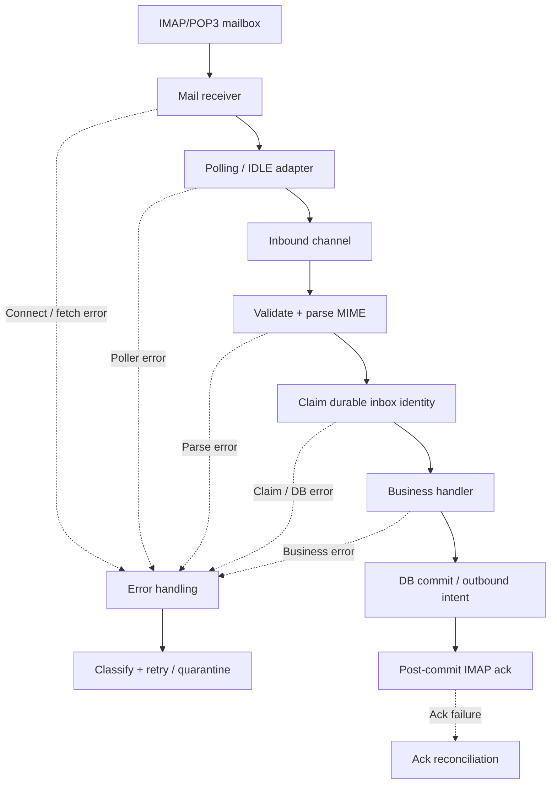
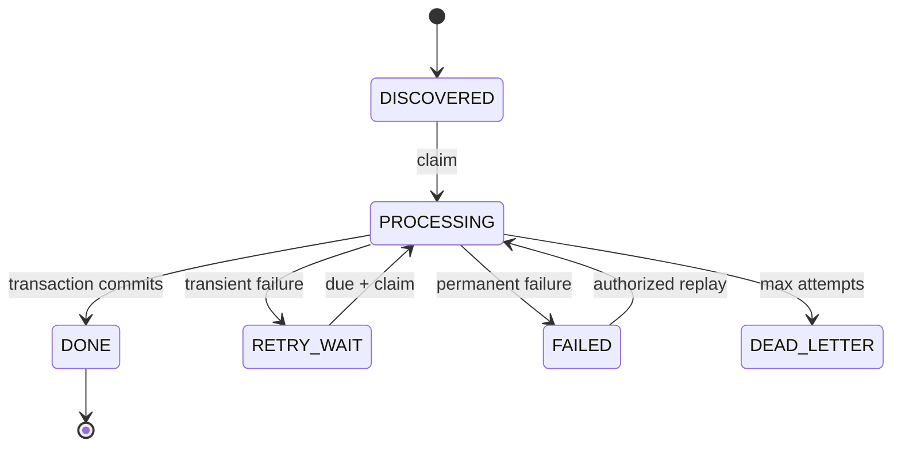
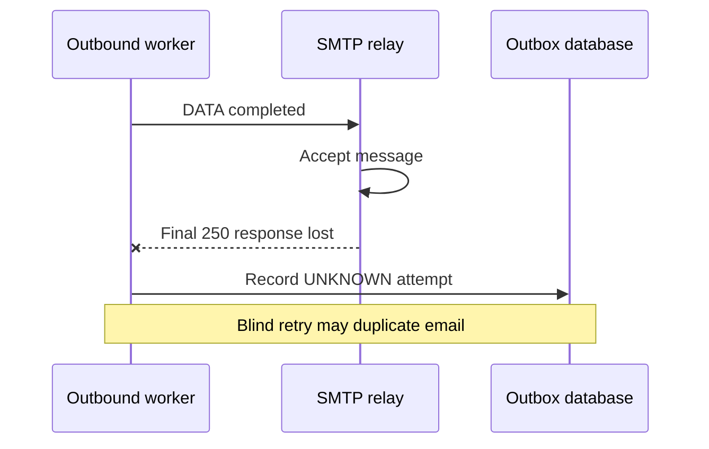

# Error Handling in Integration Flows

When building email-receiving or email-sending functionality with **Spring Integration Mail**, wiring `ImapMailReceiver`, `MailReceivingMessageSource`, message channels, and business handlers is usually concise. However, the system only becomes truly reliable once you establish **which step failed, who receives the error, whether to retry, whether the email was already marked read, and whether business operations risk executing twice**.

An email may be read from IMAP yet fail MIME parsing; parse cleanly yet fail database persistence; or commit to the database while an external HTTP API times out. Each failure requires a different response. If `errorChannel` is misconfigured, an exception may appear only in scheduler logs; if retries are unbounded, a "poison" email can occupy all workers; if an email is marked processed before commit, an error can lose the message.

**Error handling in an integration flow** is therefore more than adding a `try/catch` block around a handler. It is an end-to-end design spanning **mail source, channels, endpoints, error messages, retries, durable state, and acknowledgment**.

This article sits in the *Spring Integration Mail* chapter of Spring Framework Mail, using Java 21, Spring Framework 6.x, Spring Integration 6.x / Spring Boot 3.x, and Jakarta Mail. Examples of inboxes, repositories, and notification IDs are illustrative; APIs may vary slightly depending on the version pinned in your project. The goal is understanding the principles to implement flows that are controllable, observable, and recoverable on failure.

> **Principle:** A failure on one email must never lose processing state, produce duplicate side effects, or stall the entire mailbox. An `ErrorMessage` is only a technical signal; whether a message is retryable or `DONE` must be persisted and updated per business contract.

## 1. Map of a Mail-Receiving Flow



Each phase has distinct responsibilities:

| Phase | Failure Examples | Appropriate Handling Place |
|---|---|---|
| Source connection | IMAP AUTH, TLS, socket timeout | Poller/adapter error handling, per-mailbox circuit breaker |
| Fetch message | Folder closed, UID gone, network reset | Scan retry/checkpoint; do not create fake business failures |
| Parse/validate | Malformed MIME, bad charset, oversized attachment | Handler error classification, quarantine/dead-letter |
| Dedup/claim | Unique conflict, database unavailable | Inbox repository and lease-based retry |
| Business logic | Invalid invoice, missing permission, DB conflict | Transaction/service error policy |
| External side effects | HTTP timeout, SMTP send fail | Outbox, provider retry/idempotency/reconciliation |
| Mailbox ACK | Cannot set `SEEN` or `MOVE` | Retry acknowledgment; **never re-run business logic** |

Key point: not every error is tied to a specific email yet. An IMAP AUTH error can happen **before any `Message<?>` exists**, so error handlers must never assume `failedMessage` or a UID is always present.

## 2. Understanding Error Propagation in Spring Integration

Spring Integration passes `org.springframework.messaging.Message<?>` objects across channels and endpoints. How exceptions propagate depends on **whether the channel is synchronous or asynchronous** and **which endpoint initiated processing**.

### 2.1. Synchronous Flows via DirectChannel

With a `DirectChannel`, the subscriber runs directly on the sending thread:

```text
caller thread
  -> DirectChannel.send(message)
     -> handler.handleMessage(message)
        -> throws exception
  <- exception propagates to caller
```

An exception in the handler typically unwinds up the call stack to the sender. **Do not assume every synchronous error is automatically routed to a global `errorChannel`.** If the caller is a polling endpoint, the poller may have an `ErrorHandler` and publish an `ErrorMessage`. If the caller is direct Java code or a gateway, the caller/gateway contract determines how it is handled.

### 2.2. Asynchronous Flows via ExecutorChannel

With `ExecutorChannel` or executor-backed channels, sending and processing can run on two different threads:

```text
producer thread -> enqueue/submit task -> return

executor worker -> subscriber.handleMessage(...)
                     -> exception
                     -> error handling path
```

Errors on the worker do not automatically return to the producer thread that already returned. Spring Integration provides a mechanism to publish `ErrorMessage` onto an error channel when the endpoint/task is configured accordingly; the error channel can come from the message's `errorChannel` header or from the context's default/global error channel.

Whether an exception actually reaches an error channel must be verified at the **real boundary**. Never treat an error channel configuration as a guarantee covering arbitrary Java `CompletableFuture`s, manually spawned threads, or external APIs.

### 2.3. Polling Endpoints

Pollers actively invoke the message source and feed messages into the flow. Errors in a polling cycle can occur at:

- `receive()`: failed to fetch mail yet.
- Synchronous downstream handler: message obtained, yet processing failed.
- Scheduler/executor: unable to schedule or task rejected.

Pollers can configure an `ErrorHandler`/error channel to report issues. However, **errors occurring before fetching a message do not necessarily carry a UID/Message-ID for per-message retries**; classify them at mailbox/poller scope.

### 2.4. IMAP IDLE Adapters

IMAP IDLE continuously watches mailbox changes and delivers messages as they arrive. When the network resets, the server drops IDLE, or the adapter reconnects, it may have to recover the session. Errors/exceptions in IDLE are handled per the endpoint and error channel support in your Spring Integration Mail version.

Do not infer that IDLE provides exactly-once delivery. Reconnects can cause messages to be observed again. Whether using polling or IDLE, handlers need identical deduplication keys and idempotency logic.

### 2.5. Distinguishing Errors from Business Outcomes

An email with invalid content is sometimes an **expected business rejection**, not necessarily an exception for the poller to retry forever. For example, a duplicate invoice already processed:

```text
duplicate IMAP UID -> ALREADY_DONE -> no-op/optional ack
```

This is a normal outcome, not a system incident. A message identified as malicious:

```text
untrusted MIME -> QUARANTINED -> audit -> no business effect
```

This can be a controlled post-validation outcome. Only throw exceptions when they accurately express a failure contract.

## 3. What Is ErrorMessage?

In Spring Messaging, `org.springframework.messaging.support.ErrorMessage` is a message carrying a **`Throwable` as its payload**. When a failure enters a Spring Integration error flow, the handler receives this object and decides how to route/record/recover.

Example:

```java
import org.springframework.messaging.Message;
import org.springframework.messaging.MessagingException;
import org.springframework.messaging.support.ErrorMessage;

public void inspect(ErrorMessage error) {
    Throwable failure = error.getPayload();

    if (failure instanceof MessagingException messaging) {
        Message<?> failedMessage = messaging.getFailedMessage();
        // May be null, depending on where the error originated.
    }

    Message<?> originalMessage = error.getOriginalMessage();
    // May be absent when the error occurred before receiving any email.
}
```

`ErrorMessage.getOriginalMessage()`, when present, supplies original context; `MessagingException.getFailedMessage()` may contain the failing message. **Never rely on these fields always being populated.** If an exception was wrapped across multiple layers, you may need to walk the cause chain or use application-propagated correlation metadata.

### 3.1. Three Data Categories to Separate When Recording Errors

| Category | Example | Usage |
|---|---|---|
| Technical error | Exception class, failed component, phase | Classify transient vs. permanent |
| Message identity | mailbox ID, `UIDVALIDITY`, UID, inbox row ID | Retry/claim/ack the right message |
| Business identity | tenant ID, invoice ID, notification ID | Ensure idempotency / avoid duplicate side effects |

These details do not automatically appear in full just because an `ErrorMessage` exists. A production flow should build a safe envelope/headers right after obtaining a stable IMAP identity and persist it before executing critical side effects.

### 3.2. ErrorMessage Is Not MIME Email

Similar names, never confuse them:

- `jakarta.mail.Message` / `MimeMessage`: email fetched from a mailbox or about to be sent.
- `org.springframework.messaging.Message<?>`: internal Spring Integration message.
- `org.springframework.messaging.support.ErrorMessage`: **error-reporting** message carrying a `Throwable`.

An integration message may have a `MimeMessage`, business DTO, or stored-content reference as its payload. Error flows must not cast every payload to `MimeMessage`, especially when errors occur in the poller or after transformation to a DTO.

## 4. Error Channels: Global errorChannel vs. Dedicated Channels

Spring Integration has an error-channel convention; in some setups, a global `errorChannel` is the default error destination. However, using a dedicated channel for inbound mail isolates IMAP errors from order/payment or outbound SMTP errors.

### 4.1. Defining mailErrorChannel

```java
package com.example.mail.inbound;

import org.springframework.context.annotation.Bean;
import org.springframework.context.annotation.Configuration;
import org.springframework.integration.channel.DirectChannel;
import org.springframework.messaging.MessageChannel;

@Configuration(proxyBeanMethods = false)
public class MailErrorChannelConfiguration {

    @Bean(name = "mailErrorChannel")
    public MessageChannel mailErrorChannel() {
        return new DirectChannel();
    }
}
```

With `DirectChannel`, the error handler runs synchronously when an error message is published. This is a controlled choice for the example. In real systems, you might choose `PublishSubscribeChannel`, `ExecutorChannel`, or a durable channel depending on requirements; understand backpressure, subscriber count, and error propagation for each.

### 4.2. Registering a Handler for ErrorMessage

```java
package com.example.mail.inbound;

import org.springframework.integration.annotation.ServiceActivator;
import org.springframework.messaging.support.ErrorMessage;
import org.springframework.stereotype.Component;

@Component
public final class InboundMailErrorHandler {

    private final InboundFailureRecorder recorder;

    public InboundMailErrorHandler(InboundFailureRecorder recorder) {
        this.recorder = recorder;
    }

    @ServiceActivator(inputChannel = "mailErrorChannel")
    public void handle(ErrorMessage error) {
        recorder.record(error);
    }
}
```

`InboundFailureRecorder` is an application service you implement. It must classify the error, extract safe identifiers if present, and persist durable state per policy. **Never just call `logger.error(...)` and consider retry handling complete.**

### 4.3. Configuring the Poller Error Channel

Illustrative DSL configuration:

```java
import java.time.Duration;

import org.springframework.context.annotation.Bean;
import org.springframework.integration.dsl.IntegrationFlow;
import org.springframework.integration.dsl.Pollers;
import org.springframework.integration.mail.MailReceivingMessageSource;

@Bean
IntegrationFlow inboundMailFlow(
        MailReceivingMessageSource mailSource) {

    return IntegrationFlow
            .from(mailSource,
                    spec -> spec.poller(
                            Pollers.fixedDelay(Duration.ofSeconds(10))
                                    .maxMessagesPerPoll(20)
                                    .errorChannel("mailErrorChannel")))
            .channel("inboundMailProcessing")
            .get();
}
```

This assumes a `mailSource` bean (backed by a properly configured IMAP/POP3 receiver) and a subscriber on `inboundMailProcessing`. Method names/DSL options may vary across Spring Integration versions, so pin versions and adapt during real integration. The lesson is to **specify the error path explicitly on the poller** rather than trusting all errors to find a handler on their own.

With an IMAP IDLE adapter, the endpoint is not driven by a poller as above; use the corresponding adapter configuration and error-channel capability.

### 4.4. The errorChannel Header

Spring Messaging defines an `errorChannel` header so messages can specify an error destination along supported paths. It can hold a channel name or channel object depending on API/convention.

However, this header **is not a catch-all for every exception in the JVM**. If code spawns its own thread and drops exceptions, or if a synchronous handler throws straight back to its caller, the header does not automatically turn the failure into an `ErrorMessage`. Know which component publishes exceptions and test at that boundary.

### 4.5. Errors Inside the Error Handler Itself

If the error handler itself throws an exception while writing to the database, secondary errors can occur or the poller may log without persisting failure state. Therefore:

- Keep heavy dependencies out of the error handler and enforce timeouts.
- Classify errors that can be retried when the recorder/storage is temporarily unavailable.
- Prevent infinite recursion by never forwarding `ErrorMessage` back onto the same error channel.
- Maintain fallback telemetry/alerts when failure state cannot be persisted.
- Never treat a log-only fallback as a durable job persistence guarantee.

If an error happens before an identity is persisted, re-poll via mailbox/checkpoint; if it happens after persistence, retry from the durable inbox row rather than relying solely on in-memory error channels.

## 5. Classifying Errors Before Choosing Retries

An `ErrorMessage` does not mean every error is recoverable by re-invoking the handler. Classify by **processing step, transience, scope, and evidence of side effects**.

| Category | Example | Scope | Typical Appropriate Action |
|---|---|---|---|
| `MAILBOX_CONNECTION` | IMAP/POP3 AUTH fail, DNS, TLS | Whole mailbox/account | Connection backoff, alert on secret/TLS |
| `MAILBOX_FETCH` | Socket reset reading folder/body | Scan or message | Retry fetch by UID/checkpoint |
| `MIME_INVALID` | Malformed MIME, invalid charset | Message | Quarantine, never infinite retry |
| `MIME_OVERSIZE` | File/message exceeds policy | Message | Reject/quarantine, never re-download infinitely |
| `SECURITY_REJECTED` | Spoofed sender, dangerous attachment | Message/tenant | Stop processing, audit, no side effects |
| `BUSINESS_INVALID` | Invalid invoice ID, missing required field | Message/business key | `FAILED`/`DEAD_LETTER`, source needs fixing |
| `BUSINESS_DUPLICATE` | Invoice already committed for business key | Business | Idempotent no-op, may ACK |
| `DB_TRANSIENT` | Deadlock, DB temporarily unavailable | Infrastructure | Backoff retry after rollback |
| `DOWNSTREAM_TRANSIENT` | HTTP 503, temporary SMTP 4xx | External service | Retry via outbox, avoid holding worker |
| `DOWNSTREAM_UNKNOWN` | Timeout after side effect may have succeeded | Business/external | Reconcile or use idempotency key |
| `ACK_FAILED` | Setting `SEEN`/`MOVE` failed after DB commit | Mailbox/message | Retry ACK; never rerun business logic |
| `UNCLASSIFIED` | Unrecognized exception | Unknown | Record safe state + alert |

A broad authentication failure must not increment attempt counts for tens of thousands of unfetched emails. Conversely, a single malformed email must not pause the entire mailbox. Getting the **scope** right is a precondition for safe retries.

### 5.1. An Intermediate Result Model

```java
package com.example.mail.inbound;

public enum InboundErrorCategory {
    MAILBOX_CONNECTION,
    MAILBOX_FETCH,
    MIME_INVALID,
    MIME_OVERSIZE,
    SECURITY_REJECTED,
    BUSINESS_INVALID,
    BUSINESS_DUPLICATE,
    DB_TRANSIENT,
    DOWNSTREAM_TRANSIENT,
    DOWNSTREAM_UNKNOWN,
    ACK_FAILED,
    UNCLASSIFIED
}

public record InboundFailureDecision(
        InboundErrorCategory category,
        boolean retryable,
        boolean requiresManualReview,
        String safeReasonCode
) {}
```

Adapters/handlers can additionally store attempt ID, inbox row ID, and stage to explain decisions. Never put raw `exception.getMessage()` into `safeReasonCode`, as exceptions can leak email addresses, tokens, sensitive URLs, or host details.

### 5.2. Context-Aware Classification Rather Than Bare Exception Names

The same `IOException` can mean:

- Reading a body from IMAP reset: re-fetch by UID.
- Reading a staged attachment on object storage: retry processing job.
- Writing an attachment to a full disk: pause worker/infrastructure.
- External API connection dropped after receiving request: potentially `UNKNOWN`.

Thus the classifier needs **stage** and verified metadata. Never infer accepted/failed state of an external side effect from `SocketTimeoutException` alone.

### 5.3. Never Swallow All Errors with catch(Exception) and Return

Code like:

```java
try {
    businessProcessor.process(mail);
} catch (Exception failure) {
    logger.warn("Ignored mail failure", failure);
    return;
}
```

makes the adapter think the handler succeeded normally, allowing `ACK`/`SEEN` to proceed with zero retries. If the business transaction never committed, the email can vanish from processing.

Instead, **route failures through an explicit contract**: roll back the transaction, persist conditional `RETRY_WAIT`/`FAILED`, or rethrow so the error flow can handle it. Return normally only once the failure has been transitioned to a valid durable state.

## 6. Retrying at the Right Layer: Poller, Handler, Message, or External Side Effect?

"Enable retries for the whole flow" sounds simple yet causes unintended side effects. Distinguish:

- **Poller connection retry:** reopen `Store`/`Folder` when IMAP is unavailable; no message identity.
- **Message fetch retry:** re-fetch the same UID when reading body/attachments fails.
- **Handler retry:** rerun a specific parse/transform/business step.
- **Durable inbox retry:** rerun the job on a subsequent poll/schedule across restarts.
- **Downstream retry:** resend requests to DB/HTTP/SMTP with dedicated idempotency.
- **ACK retry:** update `Seen`/`Move` after business logic already committed.

A handler-level retry cannot solve all of the others on its own.

### 6.1. Short Synchronous Retries with RequestHandlerRetryAdvice

Spring Integration provides `RequestHandlerRetryAdvice` to retry invoking a message handler when exceptions occur. It uses Spring Retry to configure attempt counts, backoff, and recovery callbacks.

Policy bean example:

```java
package com.example.mail.inbound;

import org.springframework.context.annotation.Bean;
import org.springframework.integration.handler.advice.RequestHandlerRetryAdvice;
import org.springframework.retry.backoff.ExponentialBackOffPolicy;
import org.springframework.retry.policy.SimpleRetryPolicy;
import org.springframework.retry.support.RetryTemplate;

public class MailRetryConfiguration {

    @Bean
    RequestHandlerRetryAdvice mailShortRetryAdvice() {
        RetryTemplate retryTemplate = new RetryTemplate();

        SimpleRetryPolicy retryPolicy = new SimpleRetryPolicy(3);
        ExponentialBackOffPolicy backOff =
                new ExponentialBackOffPolicy();
        backOff.setInitialInterval(250L);
        backOff.setMultiplier(2.0);
        backOff.setMaxInterval(2000L);

        retryTemplate.setRetryPolicy(retryPolicy);
        retryTemplate.setBackOffPolicy(backOff);

        RequestHandlerRetryAdvice advice =
                new RequestHandlerRetryAdvice();
        advice.setRetryTemplate(retryTemplate);
        return advice;
    }
}
```

Here, 3 means **total attempts** in this example policy, not "3 extra retries after the initial attempt". Intervals are meant only for short, bounded retries—not multi-hour policies across a mailbox holding millions of messages.

**Important note:** `SimpleRetryPolicy(3)` in this form can retry many exception types unless classification is configured. Production must retry only allowed exceptions, never validation/security/permanent errors. Do not copy this example bean unmodified onto every handler.

### 6.2. Attaching Advice to an Endpoint

Java DSL example for a handler:

```java
import org.springframework.context.annotation.Bean;
import org.springframework.integration.dsl.IntegrationFlow;
import org.springframework.integration.handler.advice.RequestHandlerRetryAdvice;

@Bean
IntegrationFlow inboundProcessingFlow(
        InboundMessageHandler handler,
        RequestHandlerRetryAdvice mailShortRetryAdvice) {

    return IntegrationFlow
            .from("inboundMailProcessing")
            .handle(handler,
                    spec -> spec.advice(mailShortRetryAdvice))
            .get();
}
```

In this example, `InboundMessageHandler` is a bean implementing Spring Messaging `MessageHandler` or adapted to match your DSL version's `handle(...)` overload. The advice chain attaches to the **handler endpoint**, and does not automatically retry earlier failures in the IMAP receiver before any message exists. If the handler is a differently structured service method, use the corresponding DSL/annotation overload.

### 6.3. Recovery When Attempts Are Exhausted

Once advice retries exhaust their budget, decide how to forward the failure:

1. Rethrow to enter the caller/poller error path (depending on flow semantics).
2. Use an appropriate recovery callback to publish the error to a channel.
3. Transition the inbox row to `RETRY_WAIT`/`FAILED`/`DEAD_LETTER` in a safe transaction.

Spring Integration provides `ErrorMessageSendingRecoverer` for recovery callbacks in some configurations:

```java
import org.springframework.integration.handler.advice.ErrorMessageSendingRecoverer;
import org.springframework.messaging.MessageChannel;

RequestHandlerRetryAdvice advice = new RequestHandlerRetryAdvice();
advice.setRetryTemplate(retryTemplate);
advice.setRecoveryCallback(
        new ErrorMessageSendingRecoverer(mailErrorChannel));
```

This pattern connects the recovery callback to an error channel; verify exact classes/constructors against your chosen Spring Integration version. **Very important:** a recovery callback handling the exception cleanly can make upstream think the handler succeeded. Thus the error consumer must persist durable failure/retry state and avoid accidentally triggering ACK as if business work were `DONE`.

### 6.4. Short Retries Block Worker Threads

Synchronous advice backoff holds the worker thread throughout the retry sequence. If SMTP/HTTP already timed out slowly or a provider requires waiting minutes, sleeping workers can exhaust the thread pool.

Instead, use:

```text
Transient DB conflict:
  at-most few short retries in the same handler

Mailbox connection outage:
  poller reconnect later, circuit breaker per mailbox

External provider rate limit / long retry:
  update nextAttemptAt in durable inbox/outbox, release worker
```

If a side effect may have succeeded (`UNKNOWN` timeout outcome), retry only with an appropriate idempotency key/reconciliation.

### 6.5. Never Retry the Whole Flow When Steps Are Impure

Suppose:

```text
parse -> insert invoice -> send confirmation -> update status
```

Wrapping the entire flow in retry advice means an error at the final step re-runs `insert invoice` and `send confirmation`. Split into transactional/idempotent steps:

```text
parse (pure)
  -> business DB transaction + inbox DONE + outbound outbox intent
  -> outbound worker handles SMTP retry
  -> optional IMAP ACK
```

Retries should wrap **units of work safe to repeat**, not just "any block of code that might throw".

## 7. Error Channels Do Not Replace a Durable Inbox

In a mail-receiving flow, an in-JVM `ErrorMessage` can be published to a channel. Yet the JVM can crash right after publishing or before the handler writes the error to the database. To guarantee zero lost emails, you need **durable state**.

A minimal inbox schema:

```sql
CREATE TABLE inbound_mail (
    id BIGSERIAL PRIMARY KEY,
    mailbox_id VARCHAR(120) NOT NULL,
    folder_name VARCHAR(255) NOT NULL,
    uid_validity BIGINT NOT NULL,
    imap_uid BIGINT NOT NULL,
    status VARCHAR(24) NOT NULL,
    attempts INTEGER NOT NULL DEFAULT 0,
    lease_token UUID,
    lease_until TIMESTAMPTZ,
    next_attempt_at TIMESTAMPTZ,
    error_category VARCHAR(64),
    last_error_code VARCHAR(80),
    processed_at TIMESTAMPTZ,
    UNIQUE (mailbox_id, folder_name, uid_validity, imap_uid)
);
```

These columns illustrate an IMAP schema. POP3 needs a mailbox-scoped `UIDL` key (not `UIDVALIDITY`). The unique index is essential because two replicas can receive the same message simultaneously.

### 7.1. A Simple State Machine



A production state machine may add `ACK_PENDING`, `QUARANTINED`, `CANCELLED`, or other transitions. The key point is that `DONE` means **the business effect committed per contract**, not merely "handler was invoked" or "IMAP delivered the message".

### 7.2. Unique Constraints and Atomic Claims

When two pollers see the same IMAP UID concurrently:

```text
worker A: INSERT inbox identity
worker B: INSERT same identity
DB unique constraint: only one persisted identity
worker A: claim PROCESSING
worker B: claim rejected / sees leased state
```

`SELECT` followed by `INSERT` is not race-safe. In PostgreSQL, use `INSERT ... ON CONFLICT DO NOTHING` or an equivalent, then claim via conditional update/row locking.

### 7.3. Lease Tokens with Multiple Workers

A worker should claim rows using a lease owner/token. When recording `DONE` or `RETRY_WAIT`:

```sql
UPDATE inbound_mail
SET status = 'DONE',
    processed_at = NOW(),
    lease_token = NULL,
    lease_until = NULL
WHERE id = :id
  AND status = 'PROCESSING'
  AND lease_token = :leaseToken;
```

If 0 rows are updated, the worker lost ownership. Never overwrite another owner's state. Leases guard state updates; they **do not** recall external side effects such as an HTTP request already accepted.

### 7.4. Handler Errors Must Leave a Recoverable State

When an exception occurs:

```text
Message key known, inbox row PROCESSING
  -> classify error
  -> if transient: RETRY_WAIT + nextAttemptAt
  -> if permanent: FAILED / QUARANTINED
  -> if poison: DEAD_LETTER
  -> if unknown external outcome: UNKNOWN / reconciliation
```

If persisting failure state fails due to a DB outage, do not ACK the mailbox; lease expiration or re-scanning enables recovery. Never treat a warning log as having resolved the error.

## 8. Identifying Which Email Failed

An `ErrorMessage` may hold `failedMessage`, yet that info may be insufficient to find the exact email in the mailbox. In IMAP:

\[
K_{\mathrm{IMAP}} =
(\mathrm{mailboxId},\mathrm{folder},\mathrm{UIDVALIDITY},\mathrm{UID})
\]

This is the technical identity scoped to folder and UID epoch. Never use `Message.getMessageNumber()` as a durable ID because sequence numbers shift on expunge; never rely solely on `Message-ID` headers since they are sender-assigned and can be missing, duplicated, or forged.

### 8.1. Source Identity Object

```java
package com.example.mail.inbound;

public record ImapSourceIdentity(
        String mailboxId,
        String folderName,
        long uidValidity,
        long uid
) {}
```

While the receiver has the folder open, you can read the UID via `jakarta.mail.UIDFolder`:

```java
UIDFolder uidFolder = (UIDFolder) folder;
long uidValidity = uidFolder.getUIDValidity();
long uid = uidFolder.getUID(mailMessage);

ImapSourceIdentity identity = new ImapSourceIdentity(
        mailboxId, folder.getFullName(), uidValidity, uid);
```

`folder` must actually support UID semantics, and the UID must be valid. Do not assume a POP3 `Folder` can be cast to `UIDFolder`: POP3 uses UIDL via implementation-specific support and separate policies.

### 8.2. Attaching Controlled Correlation Metadata

Once the identity is resolved, a flow can switch to an internal payload:

```java
public record ReceivedMailReference(
        long inboxRowId,
        ImapSourceIdentity source,
        String stagedContentKey
) {}
```

Instead of pushing a whole `MimeMessage` onto an async queue, persist a reference to staged content and persisted metadata. On error:

```text
error + inboxRowId
  -> load durable row
  -> verify current state and lease
  -> apply retry/dead-letter decision
```

This is especially important when the handler runs on another thread while the IMAP `Folder` has already closed. Jakarta Mail `Message` objects can depend on `Store`/`Folder` connections; queueing a live object and closing the session causes hard-to-reproduce bugs.

### 8.3. Do Not Cling to Message-ID as an Exception Key

An `ErrorMessage` with a failed Spring Message containing a MIME `Message-ID` header still lacks a UID. Searching by `Message-ID` can match the wrong copy. Use `Message-ID` only for telemetry/cross-checking when sender semantics are known; for mailbox retries, rely on the IMAP/POP3 adapter identity and durable row.

## 9. Transactions and When to ACK the Mail Server

IMAP `\Seen` or `MOVE`/`DELETE` operations **do not share a transaction** with Spring's database. Thus deciding when to update the mailbox is crucial.

A flow should follow this order:

```text
1. Fetch/discover stable message identity.
2. Claim inbox row (durable, lease).
3. Parse and validate.
4. BEGIN DB transaction:
     - apply idempotent business effect
     - insert outbound outbox intent if needed
     - mark inbound row DONE
   COMMIT
5. Best-effort mailbox acknowledgement: SEEN / MOVE.
```

### 9.1. Marking SEEN Before Commit Can Lose Emails

```text
Set IMAP \Seen
  -> parse content
  -> database insert fails
  -> next poll searches only UNSEEN
  -> message disappears from processing candidates
```

Never treat `UNSEEN` as the source of truth. Users or other mail clients can flip `Seen`, and certain fetch operations can mutate flags depending on implementation/configuration.

### 9.2. Committing DONE Before ACK Can Cause Duplicate Observations

```text
DB invoice + inbound DONE commit
  -> IMAP set SEEN fails
  -> next poll sees the same UID
  -> load inbox row: DONE
  -> skip business side effect
  -> optionally retry ACK
```

This is **correct behavior**: accepting duplicate observations to protect business state. If an error handler receives an ACK failure, it must mark `ACK_PENDING` or run reconciliation—**never revert an inbox row from DONE back to PROCESSING**.

### 9.3. Business Transaction Example

```java
package com.example.mail.inbound;

import java.util.UUID;

import org.springframework.stereotype.Service;
import org.springframework.transaction.annotation.Transactional;

@Service
public final class InboundInvoiceTransaction {

    private final InboundMailRepository inbox;
    private final InvoiceRepository invoices;
    private final OutboxRepository outboundOutbox;

    public InboundInvoiceTransaction(
            InboundMailRepository inbox,
            InvoiceRepository invoices,
            OutboxRepository outboundOutbox) {
        this.inbox = inbox;
        this.invoices = invoices;
        this.outboundOutbox = outboundOutbox;
    }

    @Transactional
    public void commit(
            long inboxRowId,
            UUID leaseToken,
            ParsedInvoice invoice) {

        if (!inbox.isOwnedBy(inboxRowId, leaseToken)) {
            throw new StaleInboundLeaseException();
        }

        invoices.insertIfAbsent(
                invoice.tenantId(),
                invoice.externalInvoiceId(),
                invoice.totalAmount());

        outboundOutbox.insertIfAbsent(
                invoice.tenantId(),
                "invoice-accepted:" + invoice.externalInvoiceId(),
                invoice.recipientId());

        int updated = inbox.markDoneIfOwned(
                inboxRowId, leaseToken);

        if (updated != 1) {
            throw new StaleInboundLeaseException();
        }
    }
}
```

These repositories, `ParsedInvoice`, and `StaleInboundLeaseException` are application abstractions. The database needs unique business keys, e.g., `tenant + external invoice ID`, and unique outbox keys so confirmation notifications are never sent twice. When `markDoneIfOwned` fails, the exception must roll back **both the invoice insert and the outbox insert**, provided all three repositories share the same transaction manager/resource.

`@Transactional` works only through Spring proxies/transaction infrastructure; self-invocation can bypass the proxy. MIME parsing and attachment reading should not hold DB transactions open for long periods.

### 9.4. Never Call SMTP Inside an Inbound Transaction

Anti-pattern:

```java
@Transactional
public void processMail(ParsedInvoice invoice) {
    invoiceRepository.save(...);
    javaMailSender.send(...);
    inboxRepository.markDone(...);
}
```

If the SMTP relay accepts and the database rolls back, the sent email cannot be recalled. Retrying the inbound email can send it again. It is better to commit an **outbound intent** alongside the invoice + inbound `DONE`, then let an outbound worker send separately with its own retry/idempotency policy.

### 9.5. What If One Message Contains Multiple Business Commands?

For example, a MIME email has 10 attachments, each representing an invoice. Define atomicity explicitly:

- Must all 10 invoices commit or roll back together?
- Or does each attachment have its own business key/state and process independently?

If you only mark inbox `DONE` after 7/10 succeed while 3 fail, retrying the entire email can reprocess the first 7 invoices. Choose transaction boundaries or per-item idempotency accordingly, persisting enough state to recover cleanly. Never mark `DONE` if contracted work remains unfinished.

## 10. Quarantine and Dead-Lettering for Poison Messages

A malformed or malicious email can throw an exception on every poll. If retried indefinitely, one email can block the queue and spike error metrics endlessly. Error flows should support **quarantine** or **dead-letter state**.

### 10.1. Separating Retryable from Permanent

```text
MIME parse fails due to temporary storage problem:
  RETRY_WAIT + backoff

MIME violates configured max size:
  QUARANTINED + safe reason

Business schema is permanently invalid:
  FAILED / DEAD_LETTER with audit

Repeated DB deadlock:
  RETRY_WAIT until retry budget reached
```

For malicious files/MIME, do not keep opening or rendering content just to capture debugging screenshots/logs. Store redacted evidence and the file inside an isolated quarantine area with strict access controls.

### 10.2. Never Delete the Source Before Durable Quarantine

Wrong flow:

```text
read email -> delete from IMAP -> try to store quarantine -> DB fails
```

If the message was expunged, source data can be lost. Safer workflow:

```text
read identity + bounded content
  -> persist quarantine record/staged blob
  -> commit state QUARANTINED
  -> optional IMAP MOVE to quarantine folder
```

If `MOVE` fails, the next poll sees `QUARANTINED` and skips business processing. If moving to another folder creates a new UID, enforce source/business correlation rules so the new UID is not treated as a new command.

### 10.3. Controlled Operator Replay

After fixing a parser or rule, an operator may replay a dead-letter message. Enforce:

- Permission checks and audit logging.
- Record a replay ID, requester, timestamp, and reason.
- Never skip validation/authorization because "it is a replay".
- Preserve idempotency keys and business unique constraints.
- Use lease/fencing tokens so replays cannot collide with active workers.
- Never blindly replay thousands of poison emails post-deploy without assessing load.

Replays should create a new attempt on the **same inbound identity** or a clearly linked work item, never arbitrarily deleting `DONE`/`FAILED` history.

### 10.4. Parse Failures Need Resource Budgets

When ingesting MIME, cap:

- Total message bytes fetched/staged.
- Attachment/part count and multipart nesting depth.
- Parse duration and overall processing deadline.
- Decompressed file size and total extracted bytes.
- Allowed content types, inspecting actual bytes rather than trusting declared headers.
- Antivirus/sandbox resources and nested archive limits.
- Concurrent jobs from the same mailbox/tenant.

Never call `readAllBytes()` on unbounded untrusted attachment streams. When using external OCR or virus-scanning services, timeouts need explicit retry/quarantine policies.

## 11. Source Mailbox Errors vs. Handler Errors

Errors from `ImapMailReceiver` or a POP3 source sometimes happen before any message is created. The error flow must handle these at **mailbox/account scope**.

### 11.1. IMAP Authentication Failure

```text
Poll: connect mailbox
Server: AUTH rejected
No MimeMessage fetched
```

Actions:

1. Record mailbox ID, error category `AUTH`, timestamp; never log passwords.
2. Inspect secret/credential rotation, TLS policies, and account restrictions.
3. Pause or back off mailbox connection attempts per policy.
4. Never mark any individual email `FAILED`, since no email was fetched.
5. Once configuration is fixed, resume scanning from the right checkpoint/UID.

Never let one broken account block all other mailboxes when ingesting from multiple accounts.

### 11.2. Timeouts During Fetch

If the IMAP socket resets while reading a UID:

```text
Known mailbox + UID, content not fully staged
  -> record fetch failure
  -> retry UID when connection healthy
  -> do not mark DONE or SEEN as business acknowledgment
```

If the server expunged the message mid-fetch, classify as `SOURCE_GONE` or run reconciliation. Never trigger business side effects from partially parsed content.

### 11.3. UIDVALIDITY Changes

IMAP UIDs are scoped to a **folder and `UIDVALIDITY` epoch**. If `UIDVALIDITY` changes after a migration/restore, the old cursor cannot be applied as-is. The error handler/scan coordinator should:

- Emit a `UIDVALIDITY_CHANGED` event.
- Open a new scan epoch under a controlled workflow.
- Avoid wiping the previous epoch's inbox history.
- Rediscover messages in the new epoch under new identities.
- Rely on business idempotency to avoid duplicate side effects on restored emails.
- Monitor reprocessing volume and oldest-unprocessed age.

This is a data-source/checkpoint issue, not an ordinary `MessagingException` solvable by retrying the same old UID forever.

### 11.4. POP3 Has UIDL, Not IMAP SEEN

POP3 maildrops typically use `UIDL` for deduplication when supported by the server/provider. Never cast a POP3 `Folder` to `UIDFolder` assuming IMAP `UIDVALIDITY` exists. POP3 message sequence numbers can also shift after deletions. When POP3 fails before cleanup, keeping messages on the server alongside a durable `UIDL` table enables retries; never run `DELE`/`QUIT` cleanup before business commit.

## 12. Keeping the Poller Running When One Email Fails

One bad email must not halt all future polls. Yet recovery must distinguish:

- **Per-message processing error:** record `FAILED`/`RETRY_WAIT`, continue with other messages.
- **Mailbox connection error:** pause scanning that mailbox with backoff; do not mark all messages bad.
- **Database unavailable:** stop ACKing/dropping messages; slow down/monitor until DB recovers.
- **Global resource overload:** apply backpressure, bound concurrency/queues, never accept unbounded jobs into RAM.

If code catches every exception in a loop and continues **without** recording outcomes, the same poison message gets retried every poll; logs grow while the system makes zero progress.

### 12.1. Bounded Batch Processing

Suppose one poll fetches 100 messages. Avoid:

```text
message #1 invalid -> whole batch fails -> 99 messages never reach handler
```

and avoid:

```text
message #1 invalid -> catch+swallow, mark whole batch complete
```

A sound architecture discovers/persists identities independently (or in a recoverable batch transaction), then claims/processes each inbox row individually with its own status and attempts. That way one message failing neither loses nor blocks the others.

### 12.2. Never Use an Unbounded In-Memory Queue for Failed Mail

If downstream failures slow handlers down, pushing every message into an `ExecutorChannel` with an oversized executor/queue can exhaust heap memory and lose jobs on restart. Use bounded executors paired with a durable inbox/outbox; when full, stop claiming beyond available slots or return work items to waiting state with deadlines.

## 13. Error Handling in Outbound Mail Integration Flows

Spring Integration Mail is not limited to inbound adapters; applications can also build **outbound flows** pushing messages to an SMTP sender. This is a different error boundary:

```text
Business event / outbound outbox
  -> enrich recipients + render template
  -> MailSendingMessageHandler / SMTP adapter
  -> JavaMailSender / Jakarta Mail
  -> SMTP relay
```

Distinguish:

1. **Template/preparation failure:** missing input, missing HTML template, broken attachment resource.
2. **SMTP submission failure:** connection, TLS, AUTH, `MAIL FROM`, `RCPT TO`, `DATA`, timeout.
3. **Post-acceptance delivery failure:** relay accepted, yet downstream returns bounce/deferred/complaint via another event.

### 13.1. Spring Mail Exceptions in Outbound Flows

Common Spring Mail exceptions include:

| Exception | Signal | Handling Direction |
|---|---|---|
| `MailParseException` | Address/message parse error | Validate input; avoid retrying malformed data |
| `MailPreparationException` | Error building message | Fix template/resource; separate permanent/transient |
| `MailAuthenticationException` | AUTH rejected | Pause account/alert; never infinitely retry per recipient |
| `MailSendException` | One or more messages failed to send | Inspect cause, provider reply, and recipient scope |

In Spring Integration, exceptions may also be wrapped in `MessagingException` carrying the failed Spring message. When errors occur at the outbound adapter, `errorChannel`/advice handling must align with the channel and endpoint semantics.

### 13.2. SMTP Accepted Does Not Equal Delivered

`JavaMailSender.send(...)` returning without throwing usually means transport completed per sender contract—e.g., SMTP relay accepted at the end of `DATA`. It does **not** prove Inbox arrival. Bounces and complaints can arrive later via provider events/webhooks.

Never conflate these states:

```text
OUTBOUND_QUEUED
OUTBOUND_ATTEMPTING
SUBMISSION_ACCEPTED
SUBMISSION_REJECTED
SUBMISSION_UNKNOWN
DOWNSTREAM_DELIVERED
DOWNSTREAM_BOUNCED
```

These state names are examples; apps may name them differently. What matters is separating **submission result** from **delivery result**.

### 13.3. Timeouts After SMTP DATA Can Create Duplicates



If an error flow sees any `MailSendException` and retries immediately, the same email may be sent twice. Use a classification policy based on phase/evidence; when it is unknown whether the relay accepted, record `UNKNOWN` and weigh duplicate risk. Never infer the exact phase from a bare `SocketTimeoutException` without instrumentation.

### 13.4. Decouple Outbound Retries from Inbound Handlers

An inbound flow receiving order emails may need to send confirmations. Proper sequence:

```text
Inbound email
  -> validate/claim
  -> DB transaction:
       save order
       mark inbound DONE
       insert outbound mail intent
  -> commit

Outbound worker
  -> render and SMTP submit
  -> track attempt/retry
```

During an SMTP outage, the committed inbound order does not roll back, and the confirmation email can retry via the outbound outbox. If the inbound handler calls SMTP directly inside the transaction, outbound failures can repeat inbound business logic or send duplicates after rollback.

### 13.5. Batch Errors and Per-Recipient Scope

An outbound message with multiple recipients can be partially accepted at `RCPT TO`. A message-level exception does not mean zero recipients received it. If business rules require exact retries, use one notification per recipient or persist per-recipient attempt outcomes per the SMTP implementation's contract.

## 14. Gateways: Error Channels Do Not Replace HTTP Error Contracts

When a controller or application service calls a Spring Integration **gateway**, the flow can be synchronous or asynchronous. If the gateway is synchronous and a downstream handler throws, the exception can return to the gateway caller per gateway error mapping.

Directional example:

```text
HTTP POST /inbound-actions
  -> messaging gateway
  -> DirectChannel
  -> business service
  -> exception
  -> gateway caller
  -> HTTP error mapping
```

It is not always true that "because a global `errorChannel` is configured, HTTP will never receive an exception". Know the exact gateway, reply channel, error channel, and timeout semantics of that endpoint.

### 14.1. Returning Accurate HTTP Statuses

If an API only commits an inbox/outbox intent, it can return "accepted" with a tracking ID; it cannot yet claim the email was sent. If the system fails to persist the intent due to overload/DB outage, return a contract error (e.g., 503 with appropriate retry guidance), never success while silently dropping the task.

### 14.2. Error Channels with Asynchronous Gateways

A gateway or flow with an async boundary does not necessarily propagate exceptions up the original call stack. You need a future/completion signal, error channel, or durable status lookup. If clients need long-term status, a database-backed tracking endpoint is far more stable than waiting indefinitely on an in-JVM future.

### 14.3. Reply Timeouts Differ from Business Failures

A gateway reply timeout can occur when a flow runs too long or the response is lost after side effects already committed. Never assume you can retry the entire business operation simply because the client timed out. Use request idempotency keys and status reconciliation.

## 15. Durable Error Storage: ErrorMessage Is an Event, Not a Ledger

An error channel can have one or more subscribers, yet not every channel is durable. For example:

- `DirectChannel`: handler runs synchronously; handler errors can propagate back.
- `PublishSubscribeChannel`: broadcasts to subscribers per channel mechanics; understand per-subscriber error handling.
- `ExecutorChannel`: tasks run asynchronously with executor/queue bounds and distinct error rules.
- `QueueChannel`: in-memory queue unless backed by an appropriate store; not a durable inbox by itself.

Do not route all `ErrorMessage` instances into an unbounded in-memory queue and treat that as a retry solution. Process crashes lose queued messages, and heap can exhaust when a mail source fails continuously.

### 15.1. Recording Failure State by Phase

A record can look like:

```text
inboxId          = 9042
mailboxId        = billing-inbound-prod
stage            = MIME_PARSE
category         = MIME_INVALID
attempt          = 3
retryable        = false
nextAttemptAt    = null
status           = DEAD_LETTER
safeReasonCode   = MALFORMED_MULTIPART
occurredAt       = 2026-11-12T09:00:00Z
```

Never store a `Throwable` via Java serialization in a database as a stable API. Exceptions can carry large object graphs, connection references, headers/PII, or break across library versions. Persist structured schema fields and redacted diagnostics when needed.

### 15.2. Conditions to Consider an Error "Handled"

An error handler should return success only if it has:

- Persisted a safe business state, **or**
- Handed work off to a durable storage/queue per contract, **or**
- Confirmed a non-retryable outcome such as `ALREADY_DONE` or `QUARANTINED`.

If the recorder DB fails with no durable fallback, throwing an exception/signaling failure is more honest than swallowing it and marking `DONE`. Ensure the poller/adapter never accidentally ACKs the message in this situation.

### 15.3. Dead-Letter Full Content or References?

Storing full raw MIME/attachments inside dead-letter tables increases costs and PII exposure. Instead store:

- Mailbox ID and IMAP source identity.
- Staged content reference with ACLs and encryption at rest.
- Error code/phase/attempt count.
- Checksum/fingerprint to detect content corruption in storage.
- Retention/quarantine expiration.

If the mailbox deletes emails early, storing only the UID without staging content makes replay impossible. Choose retention and staging per business and security requirements.

## 16. Observability for Integration Flows

A useful error flow lets operators answer: **which message failed, at which stage, is it stuck, and what is the current retry/ACK state**.

| Metric / Signal | Meaning |
|---|---|
| Poll attempts, successes, failures by mailbox | Is the mail source available? |
| Last successful receive / UID cursor | Is discovery still advancing? |
| Inbound error count by category/stage | Are MIME, DB, business, or source failing? |
| `ErrorChannel` publish/handler failures | Are errors getting dropped in the error path? |
| `DISCOVERED`/`PROCESSING`/`RETRY_WAIT`/`DONE` | Is the pipeline making progress? |
| Oldest due inbox age | Messages waiting beyond SLA |
| Lease expirations/reclaims | Worker crashes or overly slow processing |
| Retry count and dead-letter rate | Poison messages, downstream instability |
| ACK pending/failed | Mailbox flags out of sync with DB |
| DB idempotency conflicts | Duplicate observations or business duplicates |
| SMTP submit p95/4xx/5xx/unknown | Is the outbound integration flow healthy? |
| Executor queue depth/rejected submissions | Is backpressure hitting limits? |

### 16.1. Correlation Fields

Structured log example:

```text
event=inbound_error_recorded
mailboxId=billing-inbound-prod
folder=INBOX
uidValidity=829311
uid=2048
inboxId=9042
attemptId=IN-3
stage=MIME_PARSE
category=MIME_INVALID
outcome=DEAD_LETTER
```

Never log raw `ErrorMessage`/`failedMessage` if payloads contain raw MIME, attachments, tokens, or personal emails. Use inbox ID/attempt ID for logs/tracing rather than high-cardinality metric labels.

### 16.2. Do Not Alert Merely Because a "Duplicate Was Seen"

A `DONE` message reappearing in a poll is expected; it gets skipped/acked via deduplication. Distinguish:

- Duplicate observation: same source UID observed again.
- Duplicate processing attempt: one inbox row has multiple attempts from retries/recovery.
- Duplicate business effect: same command creates repeated side effects outside contract.

Only the last is a critical idempotency bug; the first two may suggest optimization opportunities rather than incidents.

### 16.3. Alert When the Error Handler Itself Fails

An unavailable failure recorder can blind the entire pipeline. Monitor:

- Error channel handler exception rate.
- Expired `PROCESSING` leases.
- Inbox rows with stalled progress.
- Paused pollers/dropped subscriptions.
- Growing queue/retry backlogs.

When the DB is unavailable, prioritize stopping ACKs and throttling polling instead of fetching emails only to drop errors; when the DB recovers, scan/checkpoints must allow controlled replay.

## 17. Unit Testing the ErrorMessage Handler

A unit test can construct a `MessagingException` with a failed Spring Message and invoke the error handler. This tests the **classifier and recorder**, not whether the poller publishes `ErrorMessage` itself.

Example:

```java
import static org.junit.jupiter.api.Assertions.*;
import static org.mockito.Mockito.*;

import org.junit.jupiter.api.Test;
import org.springframework.messaging.Message;
import org.springframework.messaging.MessagingException;
import org.springframework.messaging.support.ErrorMessage;
import org.springframework.messaging.support.MessageBuilder;

class InboundMailErrorHandlerTest {

    @Test
    void forwardsFailureWithFailedMessageContext() {
        InboundFailureRecorder recorder =
                mock(InboundFailureRecorder.class);
        InboundMailErrorHandler handler =
                new InboundMailErrorHandler(recorder);

        Message<String> failed = MessageBuilder
                .withPayload("inbox-row-9042")
                .setHeader("inboxRowId", 9042L)
                .build();

        MessagingException failure =
                new MessagingException(
                        failed, "Simulated parsing failure");

        ErrorMessage error = new ErrorMessage(failure);
        handler.handle(error);

        verify(recorder).record(error);
        assertSame(
                failed,
                ((MessagingException) error.getPayload())
                        .getFailedMessage());
    }
}
```

This tests the error handler boundary. Separate tests must verify `InboundFailureRecorder.record(...)` classifies errors and saves state/leases properly; `verify(record(error))` alone does not prove transactional safety.

### 17.1. Null failedMessage Must Still Be Handled

Example:

```java
ErrorMessage error = new ErrorMessage(
        new IllegalStateException("Mailbox disconnected"));

handler.handle(error);
```

The handler must never throw `NullPointerException` when message context is absent. For connection errors, record the error at mailbox/endpoint scope from trusted context if available; otherwise record `UNCLASSIFIED` and alert rather than inventing a UID.

### 17.2. Testing Classification Independently

Example unit cases:

| Input | Expected Decision |
|---|---|
| MIME size exceeds policy | Permanent/quarantine, no infinite retries |
| Database deadlock | Retryable with backoff |
| Business key already exists | Idempotent `ALREADY_DONE` |
| IMAP AUTH rejected | Pause/retry mailbox config, never mark individual messages `FAILED` |
| SMTP accepted yet post-commit ACK fails | Retry ACK, never replay business logic |
| Socket timeout after external request, outcome unclear | `UNKNOWN`/reconcile |
| Unclassifiable exception | `UNCLASSIFIED`, needs review |

Do not assert against verbatim provider exception messages unless they are a guaranteed stable contract. Test category, scope, and state transitions.

## 18. Integration Tests: Does the Exception Actually Reach the Error Channel?

A unit test calling `handler.handle(error)` does not prove the real flow will publish an `ErrorMessage`. You need at least one integration test with the Spring context and endpoint configuration used in production.

### 18.1. Testing Synchronous DirectChannel

Scenario:

1. Boot a Spring Integration context with `DirectChannel` and a handler intentionally throwing an exception.
2. Send a message from the test through the channel.
3. Verify the exception propagates back to the caller per channel semantics.
4. Do not assert that `errorChannel` receives the message unless a specific component is configured to publish errors.

The goal is preventing the misconception "a `mailErrorChannel` bean exists, so every exception routes there".

### 18.2. Testing Polling Endpoints

Scenario:

1. Configure a test `MessageSource` returning one message on the first call, then `null`.
2. Have the handler receive the message and throw an exception.
3. Poller is configured with `errorChannel("mailErrorChannel")`.
4. Wait with a bounded timeout and verify the error subscriber receives one `ErrorMessage`.
5. Assert `failedMessage` context when present, without requiring it when the failure occurs before `receive`.
6. Verify the flow does not silently mark business work `DONE`.

In Spring Integration test infrastructure, you can use a mock message source or test binder matching your pinned version. Avoid fixed sleeps to guess poll timing; use latches/Awaitility with timeouts.

### 18.3. Testing Failures Inside receive()

A mock message source throws an exception before returning a message:

```text
poller -> source.receive() throws MailboxConnectionException
```

Expectation: the error path receives a connection failure signal, yet **no** inbound identity exists to mark per-message `FAILED`. The mailbox backs off/retries per policy. The error handler must not dereference null.

### 18.4. Testing ExecutorChannel and Rejections

Scenario:

- Use a bounded executor and hold the worker busy with a `CountDownLatch`.
- Fill to capacity, then submit one more message.
- Verify rejection yields an explicit outcome.
- If the message was already persisted in the durable inbox, the job stays retryable; if not, upstream receives a non-acceptance signal.
- Ensure the job cannot vanish even if publishing to the error channel is also rejected.

This test separates **task rejected by executor** from **handler ran and failed**.

### 18.5. Testing Retry Advice

Use a mock handler failing transiently twice and succeeding on the 3rd try. With `maxAttempts=3`, assert total attempts and that business effects equal 1.

Next, switch to a permanent validation failure: the classifier must not retry; use a real exception classification policy. Never assume default `SimpleRetryPolicy(3)` separates transient from permanent failures.

### 18.6. Testing Recovery Callbacks and ACK

Let retry advice exhaust attempts and publish the error to `mailErrorChannel`. Verify:

1. The recorder receives the failure.
2. The inbox row transitions to `RETRY_WAIT` or `FAILED` per policy.
3. Upstream/adapter does **not** mark the message business `DONE` simply because the recovery callback returned normally.
4. The next poll claims the right state and creates no duplicate business effects.

If the adapter has automatic `Seen`/`Move` behavior, test with an SMTP/IMAP sandbox or real test server; unit tests on advice do not prove flag semantics.

## 19. Integration Testing with Real Mailboxes and Crash Windows

To test the full mail-receiving flow, use an in-JVM or containerized IMAP test server such as a Jakarta Mail-compatible GreenMail version. With the paired SMTP test server, inject synthetic emails into the test mailbox and let Spring Integration poll.

A useful test suite:

| Scenario | Expectation After Poll/Restart |
|---|---|
| One valid email | One business effect, inbox `DONE` |
| Same email polled twice | One business effect, second poll skips/re-acks |
| Parser throws before business transaction | Not `DONE`; `RETRY_WAIT` or quarantine |
| Crash after claim before commit | Lease expiry allows retry |
| Crash inside business transaction | All DB work rolls back |
| Business + `DONE` commit, IMAP ACK fails | Business logic does not rerun; ACK can retry |
| IMAP AUTH fails | No fake per-message failed records |
| Malformed MIME always fails | `DEAD_LETTER` after budget, other emails still process |
| Two replicas receive same UID | Unique constraint/claim grants one worker ownership |
| `UIDVALIDITY` changes | New scan epoch, business idempotency protects side effects |
| Outbound SMTP fails after inbound `DONE` | Outbound outbox retries without replaying inbound |

### 19.1. Fault Injection at the Exact Right Point

To test crashes **before database commit**, force the transaction to roll back. To test **after commit, before IMAP ACK**, confirm business data and `DONE` truly committed before failing the ACK. Merely stubbing `mailSender.send(...)` to throw does not prove inbox transaction durability.

### 19.2. Transactions with Testcontainers

If production uses PostgreSQL, test unique constraints, row locks, and conditional updates against PostgreSQL/Testcontainers or an equivalent database. In-memory databases can differ in isolation, `ON CONFLICT`, and locking, giving false positives for idempotency under concurrent load.

### 19.3. Recovery Must Measure Business Effects, Not Handler Call Counts

In tests with retries, a handler being invoked 2 or 3 times can be normal. The more important assertion is:

```text
observed same IMAP UID twice
handler invoked twice because of replay
invoice row count = 1
outbound intent count = 1
inbound status = DONE
```

Asserting only `verify(handler, times(1))` can be overly strict for at-least-once processing. The goal is **idempotent effects**, not "code strictly never runs twice".

## 20. Runbook When Error Flows Do Not Behave as Expected

### 20.1. "Handler throws an error yet mailErrorChannel receives nothing"

Check in order:

1. Is the channel `DirectChannel` or `ExecutorChannel`?
2. On which thread is the exception being thrown?
3. Is the caller a poller, gateway, or direct message-sending code?
4. Was the error channel attached to the poller/adapter in the right place?
5. If using `RequestHandlerRetryAdvice`, did a recovery callback handle and swallow the exception?
6. Is there a subscriber bean on the channel?
7. Are bean/channel names exact and within the same application context?
8. Did the error occur inside a Java thread/future outside Spring Integration's control?

If the error is synchronous through `DirectChannel`, inspect the caller path before expecting an `ErrorMessage`.

### 20.2. "A malformed email is retried every 10 seconds"

Check:

- Did the failure classifier mistake a permanent failure for transient?
- Are attempt counts and `DEAD_LETTER` persisted?
- Did the recovery callback merely log and return without updating state?
- Is the poller searching only `UNSEEN` and re-fetching the same email?
- Is there a source identity to skip `FAILED`/`DONE` rows?

The fix is adding terminal outcomes/quarantine and durable failure states, not merely increasing the polling interval.

### 20.3. "Email is SEEN yet created no business effect"

Check:

- Did the receiver auto-mark read on fetch?
- Did another user/client mark it read?
- Was an ACK performed before DB commit?
- Did `UNSEEN`-only logic skip a previously failed email?
- Is there a durable `DISCOVERED`/`PROCESSING`/`FAILED` inbox row for recovery?

Never assume `SEEN` means `DONE`. If the source still holds messages, you need reconciliation beyond unread-only scans.

### 20.4. "Emails get processed twice after restart"

Check:

- Was deduplication metadata stored only in RAM?
- Did the key use `Message-ID`, or UID without `UIDVALIDITY`/folder?
- Does the inbox unique constraint exist in the production database?
- Do `DONE` and the business transaction share the same transaction manager?
- Was outbound SMTP called directly before commit?
- Is there a stable external idempotency key across retries?

### 20.5. "Mailbox stops receiving mail after an exception"

Check:

- Is the polling scheduler still running, or did the endpoint stop/pause?
- Did the poller error handler throw a second exception?
- Were mailbox connections/`Store` reopened after failure?
- Is a backoff/circuit breaker stuck `OPEN` too long?
- Is the executor queue full or are workers hung on socket timeouts?
- Is one poison message blocking a sequential batch?

Do not repeatedly restart the application as your sole recovery strategy; inspect state/leases/checkpoints and root causes.

## 21. Anti-Patterns to Avoid

**"Adding errorChannel catches every exception."** No; propagation depends on channel, endpoint, and thread boundaries.

**"ErrorMessage payload is MIME email."** No; the payload of `ErrorMessage` is a `Throwable`.

**"FailedMessage is always present."** Connect/fetch errors can happen before any Spring message exists.

**"Swallowing exceptions so the poller keeps going is safe."** Without persisting durable outcomes, messages can be lost or retried forever.

**"Retrying the whole integration flow makes it self-healing."** Already-committed steps or external API calls can rerun and create duplicates.

**"Three retries means three extra tries."** `maxAttempts` policies typically include the initial attempt, depending on configuration.

**"Recovery callback returning normally means business DONE."** No; transaction/state must confirm completion.

**"Marking SEEN upfront prevents duplicates."** It can lose messages when DB commits fail.

**"IMAP ACK rolls back via @Transactional."** The IMAP server does not automatically join DB transactions.

**"Deduplicating by Message-ID is enough."** Senders set that header and it can be missing or duplicated; IMAP UIDs require `mailbox/folder/UIDVALIDITY` scope.

**"Inbox row existing means already processed."** The row might be `DISCOVERED`, `PROCESSING`, `RETRY_WAIT`, or `FAILED`.

**"Having a lease means external APIs are called exactly once."** A stale worker can complete a side effect after losing its lease.

**"Outbound SMTP failures must rerun the inbound email."** Outbound intents should be stored separately so outbound retries never repeat inbound business logic.

**"Timeout means the request failed."** Outcome may be `UNKNOWN` if the response was lost after the side effect.

**"Delete malformed emails from the mailbox immediately."** That can break audits and recovery; use quarantine/retention per policy.

**"An in-memory ErrorMessage queue is a durable dead-letter queue."** A JVM crash loses the entire queue.

**"IMAP IDLE needs no idempotency."** Reconnects/replays can still deliver duplicates.

**"Logging the full ErrorMessage is easiest to debug."** It can leak raw MIME, PII, attachments, tokens, and credentials.

**"A green integration test proves Inbox delivery."** Mailbox adapter and SMTP relay tests do not guarantee deliverability/Inbox placement.

## 22. Practice Exercises

### Part A — Distinguishing Synchronous and Async Errors

Create two identical flows, one using `DirectChannel` and one using `ExecutorChannel`. Have the handler throw `IllegalStateException`. Observe whether the exception reaches the caller or which error handling path receives it. Configure an explicit error channel and verify with a timeout-bounded test.

### Part B — Creating mailErrorChannel

Define a dedicated error channel in Spring configuration. Add `@ServiceActivator(inputChannel="mailErrorChannel")` receiving `ErrorMessage`, extracting the `Throwable`, `failedMessage` when present, and a safe correlation ID. Never dump MIME bodies.

### Part C — Poller Source Failure

Create a mock message source throwing `MessagingException` before returning a message. Verify the error path records a mailbox-level failure without creating an inbox row with a fake UID or marking emails `FAILED`.

### Part D — Handler Retries

Use `RequestHandlerRetryAdvice` to retry a transient DB failure, succeeding on the 3rd attempt. Test exact attempt counts, backoff policy, and that the business effect commits only once.

### Part E — Permanent Validation Error

Send an email with an invalid business schema. Classifier transitions to `FAILED`/`QUARANTINED` without infinite retries. Polling continues accepting the next valid email.

### Part F — Durable Inbox

Create a table with a unique constraint on `mailbox/folder/UIDVALIDITY/UID`. Have two workers try claiming the same identity; only one owner reaches `PROCESSING`. The other worker causes zero side effects.

### Part G — Transaction Rollback

Inside one transaction, insert an invoice, insert an outbound intent, and mark inbox `DONE`. Intentionally throw an exception before commit. Ensure all three changes roll back, allowing retry after lease expiry.

### Part H — ACK Failed After Commit

Commit business data + `DONE`, then fail setting `\Seen`. Re-poll the same UID. Confirm no second invoice or outbound intent is created; only the ACK retries.

### Part I — Poison MIME

Craft a malformed MIME message or oversized attachment. Test transitioning to `QUARANTINED`/`DEAD_LETTER` per policy with zero business side effects and without stalling all workers.

### Part J — External Timeout

Have an external API accept the request while the response is lost. Record `UNKNOWN`, retry with a stable idempotency key if supported or reconcile. Never blindly rerun the entire inbound flow.

### Part K — Outbound SMTP Failure

An inbound email creates an order and commits a confirmation email outbox entry. The test SMTP relay returns a temporary rejection. Verify inbound stays `DONE`, the outbound job enters `RETRY_WAIT`, and only outbound transport retries.

### Part L — Error Handler Unavailable

Make the failure recorder DB temporarily unavailable. Verify the system does not ACK/mark `DONE` falsely, emits alerts/metrics, and can recover messages from source/inbox once the database returns.

### Part M — Multiple Replicas

Run two pollers against one IMAP account. Test that duplicate observations create no duplicate business effects thanks to unique constraints and atomic claims. Test lease expiry when one worker is killed.

### Part N — Metrics and Runbooks

Build dashboards for mailbox connection errors, handler retries, `ErrorMessage` publish failures, oldest due age, dead letters, ACK pending, outbound unknown, and idempotency conflicts. Write runbooks for three incidents: mailbox AUTH fail, poison MIME, and DB outage.

## 23. Pre-Production Flow Checklist

### Routing and Error Channels

- Have you confirmed whether each channel is synchronous or asynchronous?
- Do you know whether handler errors go to the caller, poller, or which error channel?
- Do poller/IMAP IDLE adapters have explicit error paths matching your version?
- Does the error handler cope with `failedMessage == null`?
- Are mailbox connection errors distinguished from message processing errors?
- Does the error handler have a fallback when the failure-recording DB itself is unavailable?

### Retries and Recovery

- Does a classifier separate transient, permanent, security, and `UNKNOWN`?
- Does `RequestHandlerRetryAdvice` wrap only repeatable steps?
- Are max attempts, backoff, jitter, and overall deadlines bounded?
- Do recovery callbacks persist durable state before treating errors as handled?
- Is there `DEAD_LETTER`/`QUARANTINE` for poison messages?
- Do long retries persist `nextAttemptAt` instead of sleeping worker threads?
- Is outbound SMTP decoupled from the inbound transaction?

### Idempotency and Acknowledgment

- Is there an IMAP key scoped by `mailbox/folder/UIDVALIDITY/UID`, or POP3 `UIDL`?
- Are unique constraints/atomic claims and lease/fencing tokens enforced?
- Do business effects and inbox `DONE` commit in a single transaction?
- Do external side effects use an outbox or idempotency/reconciliation?
- Have you avoided treating `SEEN`/`UNSEEN` as commit state?
- Does IMAP ACK run after commit and retry independently?
- Do ACK failures avoid rerunning `DONE` business logic?
- Can scan/checkpoint/reconciliation recover when `UIDVALIDITY` changes?

### Security and Operations

- Are MIME size/parts/attachment limits and processing timeouts enforced?
- Are mailbox credentials, OAuth tokens, and raw MIME protected?
- Is source identity verified before triggering sensitive side effects?
- Are errors in one mailbox/tenant isolated from other mailboxes/tenants?
- Do executors have bounded queues, backpressure, and timeouts?
- Are there metrics for error category, retry age, dead letters, ACK pending, and duplicate effects?
- Do integration tests cover handler errors, poller failures, crashes, restarts, and concurrency?
- Does replay retention/staging comply with data governance policies?

## 24. Conclusion

**Error handling in Spring Integration Mail depends directly on where an exception occurs and the message-processing boundaries.** With `DirectChannel`, exceptions normally propagate up the call stack; with asynchronous channels/polling endpoints, they may be published as `ErrorMessage` depending on error handler/error channel setup. Always define error paths explicitly and verify them with integration tests rather than creating an `errorChannel` bean and hoping it catches every error automatically.

**Retries must match the right scope and unit of work.** IMAP connection failures affect the mailbox; invalid MIME affects one message; transient DB errors require transaction rollback and retry; post-commit ACK failures need ACK reconciliation only. `RequestHandlerRetryAdvice` helps for short handler retries, while long retries or duplicate-prone side effects require durable inboxes/outboxes, backoff, idempotency keys, and explicit processing states.

Finally, treat `ErrorMessage` as a **signal to initiate recovery**, not a durable business ledger. A reliable flow preserves message identity, commits business effects and inbox `DONE` atomically where possible, ACKs mailboxes after commit, isolates poison messages, and keeps every error observable. The goal is **zero lost emails, zero unintended duplicate side effects, and ensuring local incidents never stall the entire integration pipeline**.


