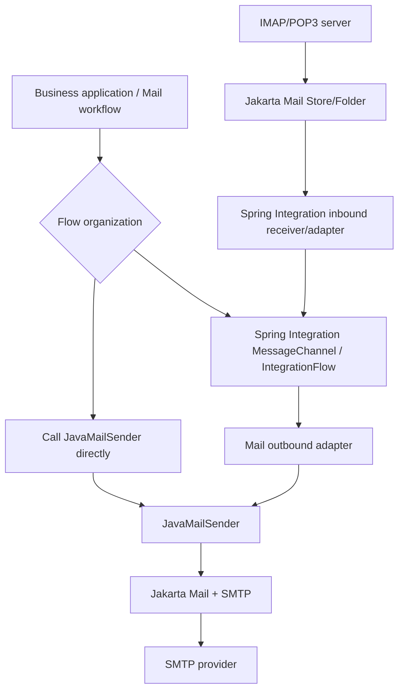
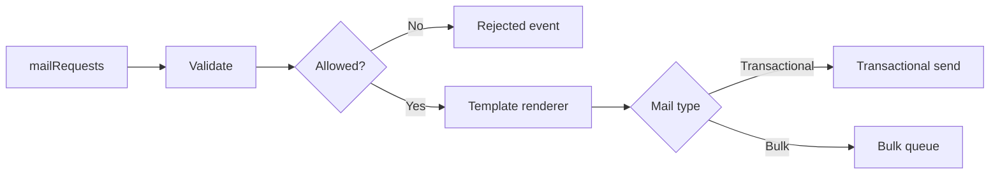
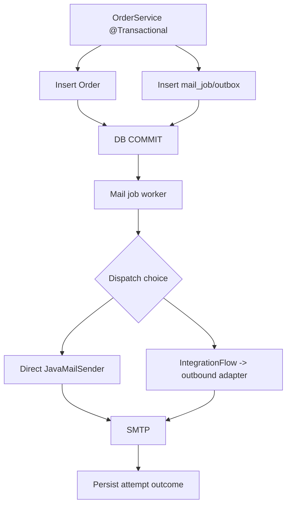
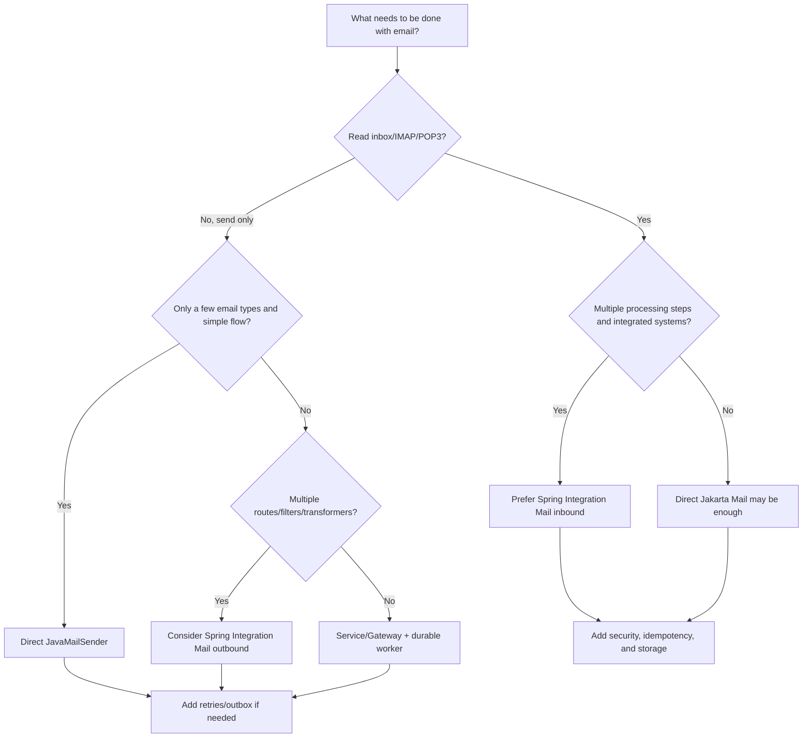

# Distinguishing Spring Integration Mail from Direct JavaMailSender

In the Spring ecosystem, sending a simple email usually only requires injecting `JavaMailSender`, creating a `SimpleMailMessage` or `MimeMessage`, and calling `send(...)`. However, if an application must **receive emails from a mailbox, pass messages through multiple processing steps, route, filter, transform, send asynchronously, or connect multiple systems**, calling a sender directly inside each service may no longer be the most convenient model.

**Spring Integration Mail** brings email sending and receiving into the *Enterprise Integration Patterns* architecture of **Spring Integration**: adapters, message channels, transformers, filters, routers, service activators, polling, and clearly described flows. It is not a separate SMTP engine replacing all of Spring Mail. On the outbound side, Spring Integration Mail typically **uses `JavaMailSender` as the underlying transport component**; the main difference lies in the **orchestration model**.

> **Rule of thumb:** `JavaMailSender` is the application-layer API for sending emails. Spring Integration Mail is the integration layer that brings email into and out of **message flows**, which may include IMAP/POP3 receivers, outbound adapters, and Spring Integration orchestration components. The two options can be used **together**.

This lesson compares their goals, abstractions, architecture, code, and key boundaries around SMTP, MIME, transactions, concurrency, retries, durability, and security—showing when to choose the direct approach and when to use Integration Mail.

## 1. Immediate Distinction from How the API Is Called

### 1.1. Direct JavaMailSender

In a typical service:

```java
@Service
public class WelcomeMailService {

    private final JavaMailSender mailSender;

    public WelcomeMailService(JavaMailSender mailSender) {
        this.mailSender = mailSender;
    }

    public void sendWelcome(String recipient) {
        SimpleMailMessage mail = new SimpleMailMessage();
        mail.setFrom("no-reply@example.org");
        mail.setTo(recipient);
        mail.setSubject("Welcome");
        mail.setText("Your account has been created.");
        mailSender.send(mail);
    }
}
```

Key imports:

```java
import org.springframework.mail.SimpleMailMessage;
import org.springframework.mail.javamail.JavaMailSender;
import org.springframework.stereotype.Service;
```

The service decides when to send, builds the content itself, and calls the transport. The control flow is very direct:

```text
Business service
  -> JavaMailSender
      -> Jakarta Mail / SMTP transport
          -> SMTP server
```

For a few types of transactional emails, a small service, clear behavior, and no need for inbound inbox processing, this model is usually enough. There is no need to add message channels just to wrap `send(...)`.

### 1.2. Spring Integration Mail

With Spring Integration, the business layer can emit a **Spring Messaging message** onto a channel:

```text
Business service
  -> Spring MessageChannel
      -> IntegrationFlow
          -> filter / transformer / router
              -> Mail outbound adapter
                  -> JavaMailSender / SMTP
```

On the inbound side:

```text
IMAP / POP3 mailbox
    -> Mail inbound adapter
        -> Spring MessageChannel
            -> filter / transformer / handler
                -> application processing
```

The difference is not "JavaMailSender sends mail, while Spring Integration sends mail faster"; rather, Spring Integration provides a **framework for connecting and orchestrating messages** across components.

### 1.3. Easily Confused Uses of the Word "Message"

In a project combining both technologies, the word `Message` has at least three meanings:

| Type | Package | Meaning |
|---|---|---|
| `org.springframework.messaging.Message<T>` | Spring Messaging | Envelope carrying `payload` and `headers` between Integration components |
| `jakarta.mail.Message` | Jakarta Mail | An email message according to the mail API model |
| `jakarta.mail.internet.MimeMessage` | Jakarta Mail | An email with MIME headers/body/attachments |

A Spring Integration message can **hold** a `MimeMessage` as its payload. However, the two objects themselves are not the same type and cannot be used interchangeably just because both are called "message".

Example:

```java
MimeMessage mime = javaMailSender.createMimeMessage();

org.springframework.messaging.Message<MimeMessage> integrationMessage =
        MessageBuilder.withPayload(mime)
                .setHeader("mailJobId", "job-100")
                .build();
```

`MessageBuilder` belongs to `org.springframework.messaging.support.MessageBuilder`. The `mailJobId` header is only internal metadata inside the Spring Integration flow; it **does not automatically become an SMTP/MIME header** unless the adapter explicitly maps it that way.

## 2. High-Level Comparison Table

| Criterion | Direct `JavaMailSender` | Spring Integration Mail |
|---|---|---|
| Primary purpose | Build and send emails from Java code | Integrate email into message-driven flows |
| Outbound sending | Yes | Yes, via an outbound adapter/handler using a sender |
| Inbound inbox reading | Does **not** provide a receiver API | Provides inbound adapters/receivers over IMAP/POP3 |
| Abstraction | Spring Mail + Jakarta Mail | Spring Integration Message/Channel/Flow + Mail |
| Invocation point | `mailSender.send(...)` | `MessageChannel.send(...)`, gateway, or `IntegrationFlow` |
| Building MIME | `MimeMessageHelper` or Jakarta Mail code | Can still use `MimeMessageHelper` or transform payloads inside the flow |
| Filter/router/transformer | Written manually in services | Core Integration patterns/components |
| Async | `@Async`, executor, or custom queue | Can use executor channels/async flows |
| Scheduling | `@Scheduled`/custom worker | Poller/adapter and Integration scheduling |
| Retry | Custom logic or Spring Retry/worker | Can integrate advice/error channels/retry, still must design semantics properly |
| SMTP sending | Based on `JavaMailSender` | Outbound adapter typically delegates to `JavaMailSender` |
| Durable queue by default | **No** | **Not simply from having a flow/channel** |
| Exactly-once email delivery | No | No |
| Atomic database + SMTP transaction | No | No |
| Complexity | Low for simple use cases | Higher, in exchange for explicit flows and system connectivity |
| Best fit | Apps sending a few transactional email types | Multi-step email intake/processing/integration pipelines |

**Important warning:** Spring Integration has channels and adapters that can work with brokers/persistent stores, but **ordinary `DirectChannel`/`ExecutorChannel` instances do not create durable queues**. Merely switching from `JavaMailSender` to an outbound adapter does not mean pending emails survive a power loss.

## 3. Where Spring Framework Mail, Jakarta Mail, and Spring Integration Mail Sit

You can visualize them in layers:



### 3.1. Jakarta Mail Is the Protocol and MIME Layer

Jakarta Mail provides the `Session`, `Transport`, `Store`, `Folder`, `Message`, `MimeMessage`, and `Multipart` abstractions. SMTP is typically used for **sending**; IMAP/POP3 is used for **reading mailboxes**.

### 3.2. Spring Mail Works with Email at the Application Layer

Spring Framework provides:

- `MailSender` and `JavaMailSender` for outbound mail.
- `SimpleMailMessage` for plain-text messages.
- `MimeMessageHelper` supporting HTML, attachments, inline resources, charsets, and recipients.
- `MailException` hierarchy to standardize errors at the Spring Mail layer.

Spring Boot can auto-configure `JavaMailSender` when the appropriate starter/dependencies and `spring.mail.*` properties are present. However, **configuring an SMTP sender does not automatically give you an IMAP inbox receiver**.

### 3.3. Spring Integration Is a Message-Driven Platform

Spring Integration provides:

- `MessageChannel` to transport messages between endpoints.
- `IntegrationFlow` to declare processing chains.
- Transformers to convert payloads or metadata.
- Filters to evaluate conditions.
- Routers to choose routing paths.
- Service activators to invoke business logic.
- Inbound/outbound adapters to connect to external systems.
- Error handling, pollers, channel interceptors, and orchestration options depending on version/configuration.

The **Spring Integration Mail** module provides mail-specific inbound/outbound components on top of this platform. It does not replace business services, template engines, mail policies, or job stores.

### 3.4. Dependencies by Responsibility

In a Spring Boot project using Gradle:

```groovy
dependencies {
    // SMTP / MIME helper.
    implementation 'org.springframework.boot:spring-boot-starter-mail'

    // Spring Integration core and Mail adapters.
    implementation 'org.springframework.integration:spring-integration-mail'

    testImplementation 'org.springframework.boot:spring-boot-starter-test'
}
```

Spring Boot dependency management should manage compatible versions. Ensure the corresponding Spring Framework 6+/Spring Boot stack uses `jakarta.mail.*` rather than mixing legacy `javax.mail.*` libraries. Spring Integration Mail may also pull in required mail dependencies; the mail starter remains useful when you want Spring Boot to auto-configure `JavaMailSender` and use Spring Mail APIs directly.

## 4. When a Simpler Option Is Better

Suppose an application has two features:

1. Sending order confirmation emails.
2. Sending password reset emails.

Both have clear content, use a single SMTP provider, and need neither inbox reading nor multi-step routing. Using a service that calls `JavaMailSender` directly (or a custom `MailGateway` adapter) offers:

- Easy-to-read control flow.
- Minimal configuration and dependencies.
- Easy mocking in unit tests.
- Avoiding a channel model when it solves no real problem.
- Clear handling of MIME construction errors and SMTP call failures.

If you need to send **after commit**, you can place an appropriate outbox/job worker or `@TransactionalEventListener` in front of the sender. You do not necessarily need Spring Integration to achieve an asynchronous or reliable architecture.

Example:

```text
OrderService
   |
   +-- DB transaction: order + mail_job
   |
   v
MailWorker
   |
   v
MailGateway
   |
   v
JavaMailSender
```

The critical rule is **do not send via SMTP inside a database transaction just to save an abstraction layer**. Sending is an external side effect; rolling back the database does not recall an already submitted email.

## 5. When Does Spring Integration Mail Make a Clear Difference?

Common scenarios where it makes sense:

1. The application **receives emails from IMAP/POP3** and must process them through multiple components.
2. Incoming emails must be converted into tickets, invoices, events, or requests after filtering and transformation steps.
3. Multiple **input/output adapters**—such as email, HTTP, files, brokers, and service activators—must be wired into a unified flow.
4. Polling, IMAP IDLE, or message routing needs fairly consistent declarative configuration.
5. Business flows need clear separation so certain message groups can be processed independently.
6. The team already uses Spring Integration for other data pipelines and wants to reuse patterns, monitoring, and operational conventions.

Example customer support system:

```text
IMAP inbox support@example.org
  -> Mail inbound adapter
  -> Extract sender/subject/body/attachments
  -> Filter spam/unsupported content
  -> Resolve customer / ticket ID
  -> Route by request type
  -> Create support ticket
  -> Publish acknowledgment email
  -> JavaMailSender outbound
```

Spring Integration helps organize **adapter -> transformer -> filter -> router -> handler** more cleanly than a single monolithic `InboxPollingService` class doing everything. Still, sender verification, attachment scanning, authorization, deduplication, and durable persistence must be explicitly designed by the application.

## 6. Understanding Inbound and Outbound Properly

### 6.1. Outbound: Sending from the Application to SMTP

Direct `JavaMailSender`:

```text
method call -> sender.send -> SMTP
```

Spring Integration Mail outbound:

```text
MessageChannel -> outbound mail handler -> JavaMailSender -> SMTP
```

Because both can rely on the same sender, host/port, TLS/auth, credentials, and basic SMTP error handling still apply. Spring Integration does not automatically add SPF/DKIM/DMARC or make emails "land in the Inbox more easily".

### 6.2. Inbound: Reading from IMAP/POP3

`JavaMailSender` has no `readInbox()` API. If you only use Spring Mail directly, receiving mail still requires calling Jakarta Mail `Store`/`Folder` or another library/provider API.

Spring Integration Mail inbound provides components such as `ImapMailReceiver`, `Pop3MailReceiver`, and inbound adapters to bring email data into a Spring Messaging flow. Some configurations support IMAP IDLE to receive mailbox change notifications with less reliance on polling.

### 6.3. A Bidirectional Workflow Is Not "SMTP Receiving Emails"

An email workflow can both receive and send, but it uses different protocols/layers:

```text
IMAP INBOX -> inbound flow -> application
application -> outbound flow -> SMTP relay
```

Do not point `spring.mail.host` to an SMTP provider and expect Spring Integration to fetch emails arriving in a mailbox. Inbound requires its own account, folder, protocol/credentials, and lifecycle.

## 7. Complete Outbound Example: Direct JavaMailSender

Suppose we need to send an order confirmation email in plain text + HTML. With the direct approach:

```java
package com.example.mail.direct;

import jakarta.mail.MessagingException;
import jakarta.mail.internet.MimeMessage;
import org.springframework.mail.javamail.JavaMailSender;
import org.springframework.mail.javamail.MimeMessageHelper;
import org.springframework.stereotype.Service;

@Service
public class DirectOrderMailService {

    private final JavaMailSender mailSender;

    public DirectOrderMailService(JavaMailSender mailSender) {
        this.mailSender = mailSender;
    }

    public void sendConfirmation(
            String recipient,
            String orderNumber,
            String plainText,
            String safeHtml) {

        try {
            MimeMessage mime = mailSender.createMimeMessage();
            MimeMessageHelper helper = new MimeMessageHelper(
                    mime, true, "UTF-8");
            helper.setFrom("no-reply@example.org");
            helper.setTo(recipient);
            helper.setSubject("Order confirmation " + orderNumber);
            helper.setText(plainText, safeHtml);

            mailSender.send(mime);
        } catch (MessagingException ex) {
            throw new IllegalStateException(
                    "Cannot prepare order confirmation", ex);
        }
    }
}
```

**Notes:**

- `MimeMessage` and `MimeMessageHelper` are Jakarta/Spring Mail APIs.
- `safeHtml` must come from a template renderer with proper escaping/sanitization; never concatenate raw user input into HTML.
- `mailSender.send(mime)` can throw `MailException` if submission fails.
- Successful sending only means the SMTP submission step completed per the transport contract; it does not prove the recipient sees it in their Inbox.
- The method executes synchronously if invoked directly by the caller without a separate async mechanism.

This is a concise example suited for an application service actively performing a send request. In production, separate template rendering, sender identity, validation, and retry policy into distinct components rather than stuffing everything into one business service.

### 7.1. Corresponding SMTP Configuration

```yaml
spring:
  mail:
    host: ${SMTP_HOST}
    port: 587
    username: ${SMTP_USER}
    password: ${SMTP_PASSWORD}
    properties:
      "[mail.smtp.auth]": true
      "[mail.smtp.starttls.enable]": true
      "[mail.smtp.starttls.required]": true
      "[mail.smtp.connectiontimeout]": 5000
      "[mail.smtp.timeout]": 10000
      "[mail.smtp.writetimeout]": 10000
      "[mail.debug]": false
      "[mail.debug.auth]": false
```

These values are illustrative for SMTP submission supporting STARTTLS on port 587. For port 465/implicit TLS, OAuth2 providers, or API-based services, configure according to the actual contract. Never store SMTP credentials in source control or log the Spring Environment.

## 8. Outbound Example with Spring Integration Mail

Instead of calling the sender directly in the business service, declare a channel and an outbound mail adapter:

```java
package com.example.mail.integration;

import org.springframework.context.annotation.Bean;
import org.springframework.context.annotation.Configuration;
import org.springframework.integration.channel.DirectChannel;
import org.springframework.integration.dsl.IntegrationFlow;
import org.springframework.integration.mail.dsl.Mail;
import org.springframework.mail.javamail.JavaMailSender;
import org.springframework.messaging.MessageChannel;

@Configuration
public class OutboundMailFlowConfiguration {

    @Bean
    public MessageChannel mailOutgoingChannel() {
        return new DirectChannel();
    }

    @Bean
    public IntegrationFlow mailOutboundFlow(
            JavaMailSender mailSender) {

        return IntegrationFlow
                .from("mailOutgoingChannel")
                .handle(Mail.outboundAdapter(mailSender))
                .get();
    }
}
```

DSL package/class names may vary by the Spring Integration release line in use; the example illustrates the modern Java DSL API. In a real project, use matching dependencies/versions and configure the flow according to that version's documentation.

### 8.1. Service Sending a MimeMessage to the Channel

```java
package com.example.mail.integration;

import jakarta.mail.MessagingException;
import jakarta.mail.internet.MimeMessage;
import org.springframework.beans.factory.annotation.Qualifier;
import org.springframework.mail.javamail.JavaMailSender;
import org.springframework.mail.javamail.MimeMessageHelper;
import org.springframework.messaging.Message;
import org.springframework.messaging.MessageChannel;
import org.springframework.messaging.support.MessageBuilder;
import org.springframework.stereotype.Service;

@Service
public class ChannelOrderMailService {

    private final JavaMailSender sender;
    private final MessageChannel outgoing;

    public ChannelOrderMailService(
            JavaMailSender sender,
            @Qualifier("mailOutgoingChannel") MessageChannel outgoing) {
        this.sender = sender;
        this.outgoing = outgoing;
    }

    public boolean submitToFlow(
            String recipient,
            String subject,
            String content,
            String mailJobId) throws MessagingException {

        MimeMessage mime = sender.createMimeMessage();
        MimeMessageHelper helper =
                new MimeMessageHelper(mime, false, "UTF-8");
        helper.setFrom("no-reply@example.org");
        helper.setTo(recipient);
        helper.setSubject(subject);
        helper.setText(content, false);

        Message<MimeMessage> request =
                MessageBuilder.withPayload(mime)
                        .setHeader("mailJobId", mailJobId)
                        .build();

        return outgoing.send(request);
    }
}
```

With `DirectChannel` as shown, the handler typically runs on the caller thread; exceptions from the outbound handler can propagate back to the caller. The boolean return value of `send(...)` indicates the result of dispatching the message over the channel, **not a delivery receipt** from the SMTP provider.

If you replace `DirectChannel` with an executor- or queue-backed channel, `send(...)` may return before SMTP runs; the meaning of "success" changes. Do not name an API `sendEmailDelivered()` just because `MessageChannel.send` returned `true`.

### 8.2. Which Part Is Spring Integration?

In the example above:

- `DirectChannel` is the Spring Integration channel.
- `IntegrationFlow` defines the processing path.
- `Mail.outboundAdapter(mailSender)` acts as the email message handler.
- `MessageBuilder` builds the Spring Messaging envelope.
- `JavaMailSender` still creates the `MimeMessage` and performs the SMTP submission.

If you only have a single channel wired straight to a mail adapter, the benefit over calling `JavaMailSender` directly may be small. Spring Integration shines when the flow has filters, transformers, routers, multiple inputs/outputs, or shared conventions.

### 8.3. Flow Headers Do Not Automatically Become Mail Headers

`MessageBuilder.withPayload(mime).setHeader("mailJobId", "...")` creates a **Spring header**. This is metadata for logging/routing within the flow. It is not:

```text
X-Mail-Job-Id: ...
```

inside the MIME message. If the system wants a custom MIME header, it must explicitly set it on `MimeMessage` or use a mapping supported by the adapter, while considering privacy and header injection. An internal mail job ID generally does not need to be leaked externally.

### 8.4. Where Should MIME Be Constructed?

There are two approaches:

**A. Build MIME before the channel:** as in the example, the service constructs `MimeMessage` and sends it into the flow. Suitable when the service owns formatting and the flow mainly orchestrates dispatch.

**B. Send a domain command/DTO into the channel and build MIME in a transformer/handler:** suitable when you want the flow to control templates/locale/sender identity and have every consumer send through the same standard pipeline.

Conceptual example:

```text
MailCommand
    -> validate
    -> select template
    -> render MIME
    -> outbound adapter
```

When choosing B, **do not push raw ORM entities through an async channel** if the entity has lazy-loaded fields or its transaction is about to end. Create a small event/DTO with a snapshot or explicit reference, and verify it is still valid before sending.

## 9. Adding Filters, Transformers, and Routers in IntegrationFlow

A multi-step flow is where Spring Integration demonstrates clear value:



A flow can:

1. Check whether the send request is permitted.
2. Drop or route away an ineligible request.
3. Render the body by template ID/version.
4. Select the sender by tenant, locale, or mail type.
5. Send through the adapter.
6. Emit an outcome event or persist job state.

Conceptual Java DSL example:

```java
@Bean
IntegrationFlow validatedMailFlow(
        MailCommandValidator validator,
        MailCommandRenderer renderer,
        MailSendingMessageHandler mailHandler) {

    return IntegrationFlow.from("mailCommands")
            .filter(MailCommand.class,
                    validator::isAllowed)
            .transform(MailCommand.class,
                    renderer::toMimeMessage)
            .handle(mailHandler)
            .get();
}
```

`MailCommand`, `MailCommandValidator`, and `MailCommandRenderer` are application components to implement; `MailSendingMessageHandler` belongs to Spring Integration Mail. This snippet illustrates a flow with concrete payload types and requires matching beans, classes, and imports for your version.

### 9.1. Silent Filter Drops Can Lose Business Work

If a filter returns `false`, depending on configuration/flow, the message may go no further. For transactional mail already recorded as a job, this cannot mean "success". Decide explicitly:

- Record `REJECTED_BY_POLICY` in the job store.
- Emit a rejected event to another channel.
- Return an error to the caller when that behavior is required.
- Log a safe reason class for operations.

Do not silently lose a required email just because a filter did not forward it while the business transaction reported success.

### 9.2. Routers Do Not Fabricate Sender Credentials

A router chooses a path based on validated business metadata, such as `mailType` or `providerAlias`. Provider senders should be configured separately; never mutate host/password on a singleton `JavaMailSenderImpl` while multiple messages are processed concurrently.

### 9.3. Transformers and HTML Security

A transformer building MIME still needs to:

- Escape user data when rendering HTML.
- Generate a `text/plain` fallback where appropriate.
- Preserve UTF-8 charset.
- Resolve an approved sender identity/`From` address.
- Handle MIME attachments/inline CIDs in the proper order.
- Never log raw bodies, OTPs, or tokens.

`IntegrationFlow` does not automatically sanitize HTML or scan attachments just because there is a `transform` step.

## 10. Inbound: The Most Important Difference

The most common reason to pick Spring Integration Mail is **receiving emails**. Here `JavaMailSender` does not address the requirement:

```text
INBOX folder
  -> fetch messages
  -> inspect MIME
  -> filter
  -> persist ticket/attachment
  -> acknowledge
```

When writing raw Jakarta Mail code directly, the application must manage:

- `Store`/`Folder` connections.
- Polling or IMAP IDLE/reconnects.
- Reading UIDs/folders and message flags.
- Extracting MIME and attachments.
- Connection errors, timeouts, and backoff.
- Synchronizing processed state.

Spring Integration Mail takes responsibility for the adapter and feeds data into a message-driven pipeline, decoupling ingestion from business handlers. It **does not handle the final parts automatically**, such as database transactions, malware scanning, or idempotent ticket creation.

### 10.1. Core Inbound Components

| Component | Role |
|---|---|
| `ImapMailReceiver` | Receives mail from an IMAP folder |
| `Pop3MailReceiver` | Receives mail over POP3 |
| Polling inbound adapter | Periodically fetches messages and emits them to a channel |
| IMAP IDLE inbound adapter | Uses IMAP IDLE capability to react to mailbox changes |
| `MessageChannel` | Delivers Spring messages to handlers |
| Transformer/service activator | Extracts content, normalizes, and saves business state |

Specific APIs may vary across Spring Integration 5.x/6.x/7.x. With modern Jakarta Mail, ensure you use the same package family and compatible dependencies.

### 10.2. Polling and IMAP IDLE Are Not the Same

**Polling:** a poller runs on a schedule to look for new messages. It is easy to bound batches, introduces a minimum latency tied to the poll interval, and issues requests even when the inbox has not changed.

**IMAP IDLE:** the server can push change notifications, reducing wait latency when new mail arrives. However, servers or networks can still drop connections or alter the mailbox while offline. Reconnects and UID/checkpoint reconciliation are still required.

IMAP IDLE is **not** a durable queue with exactly-once acknowledgment. It is a mailbox change notification mechanism from the mail server.

## 11. Example: Receiving Mail with Spring Integration Mail

A polling flow can use `ImapMailReceiver` and the `Mail.imapInboundAdapter(...)` DSL. The example below illustrates the structure, where the IMAP URL is **externalized configuration** and must be managed as a secret if it contains credentials.

```java
package com.example.mail.integration;

import org.springframework.beans.factory.annotation.Value;
import org.springframework.context.annotation.Bean;
import org.springframework.context.annotation.Configuration;
import org.springframework.integration.dsl.IntegrationFlow;
import org.springframework.integration.dsl.Pollers;
import org.springframework.integration.mail.ImapMailReceiver;
import org.springframework.integration.mail.dsl.Mail;

@Configuration
public class InboundMailFlowConfiguration {

    @Bean
    ImapMailReceiver inboxReceiver(
            @Value("${app.inbound.imap-url}") String imapUrl) {
        return new ImapMailReceiver(imapUrl);
    }

    @Bean
    IntegrationFlow inboxFlow(
            ImapMailReceiver inboxReceiver,
            InboundMailHandler handler) {

        return IntegrationFlow
                .from(Mail.imapInboundAdapter(inboxReceiver),
                        source -> source.poller(
                                Pollers.fixedDelay(15_000)
                                        .maxMessagesPerPoll(10)))
                .handle(handler, "accept")
                .get();
    }
}
```

The example uses common Java DSL patterns; some methods, constructors, or specs vary across Spring Integration versions, so verify against the exact version managed by your project. `InboundMailHandler` is an application-defined business bean.

### 11.1. Example Handler Receiving a Spring Messaging Message

When working with an inbound adapter, verify the **actual payload type** produced by your active configuration. Depending on the receiver and content conversion options, the payload may be a Jakarta Mail object or another decoded form.

A cautious handler:

```java
package com.example.mail.integration;

import jakarta.mail.internet.MimeMessage;
import org.springframework.messaging.Message;
import org.springframework.stereotype.Component;

@Component
public class InboundMailHandler {

    private final InboundMailJobService jobService;

    public InboundMailHandler(InboundMailJobService jobService) {
        this.jobService = jobService;
    }

    public void accept(Message<?> incoming) {
        Object payload = incoming.getPayload();

        if (payload instanceof MimeMessage mime) {
            // Create identity + store a bounded durable job/snapshot.
            jobService.capture(mime, incoming.getHeaders());
            return;
        }

        throw new IllegalArgumentException(
                "Unsupported inbound payload type");
    }
}
```

`InboundMailJobService` is an application API. For versions or configurations with a different payload wrapper/format, adjust conversion based on the inbound adapter contract. Do not treat a sample cast as proof that every configuration yields a `MimeMessage`.

### 11.2. When Should a Handler Act as a Service Activator?

A service activator is appropriate when its responsibility is clear: *receive the message, validate metadata, and record an inbound job*. Do not keep the IMAP connection open for minutes inside the handler while scanning PDFs, calling external systems, and sending reply emails before returning, unless matching SLAs and resources are provisioned.

A usually more resilient architecture:

```text
Mail inbound adapter
    |
    v
Capture + durable enqueue
    |
    v
Inbound job worker
    +--> MIME extraction
    +--> attachment quarantine / scan
    +--> ticket creation
    +--> acknowledgment job
```

### 11.3. IMAP Credentials and URLs

In some Spring Integration Mail configurations, the IMAP receiver uses a URL or properties containing credentials. You must:

- Retrieve configuration from a controlled secret manager/environment.
- Never log the raw IMAP URL when it contains username/password.
- Never store passwords in committed YAML files.
- Enable TLS with hostname/certificate validation; never disable trust checks to silence config errors.
- Configure read/connect timeouts.
- Scope mailbox permissions narrowly; never use an org-wide admin account when reading a single inbox suffices.

If the provider requires OAuth2 or a custom authentication mechanism, use the connection method supported by your Jakarta Mail/Spring Integration version; never place access tokens into logs, printed URLs, or uncontrolled internal message headers.

### 11.4. Reading an Inbox with Plain Jakarta Mail

It is entirely possible to receive mail without Spring Integration Mail:

```java
Properties properties = new Properties();
properties.put("mail.store.protocol", "imaps");
properties.put("mail.imaps.connectiontimeout", "5000");
properties.put("mail.imaps.timeout", "10000");
properties.put("mail.imaps.ssl.checkserveridentity", "true");

Session session = Session.getInstance(properties);
Store store = session.getStore("imaps");

Folder inbox = null;
try {
    store.connect(host, 993, username, password);
    inbox = store.getFolder("INBOX");
    inbox.open(Folder.READ_ONLY);

    for (jakarta.mail.Message message : inbox.getMessages()) {
        inboundService.capture(message);
    }
} finally {
    if (inbox != null && inbox.isOpen()) {
        inbox.close(false);
    }
    if (store.isConnected()) {
        store.close();
    }
}
```

The variables `host`, `username`, `password`, and `inboundService` are provided by the application. This snippet demonstrates direct API calls and **does not yet include incremental UID polling, backpressure, or full lifecycle management**; on large mailboxes, never scan `getMessages()` across the entire inbox every run.

**The difference:** Spring Integration Mail packages the *ingress adapter + flow*, whereas plain Jakarta Mail requires you to orchestrate polling, handlers, error propagation, and endpoint lifecycle yourself.

## 12. Inbox Lifecycle: Seen, UID, and Deduplication

One problem that does not vanish when adopting Spring Integration Mail is **reading the same email multiple times**. IMAP IDLE can reconnect, polling can re-read, and handlers can fail halfway through writing state.

### 12.1. Message Number, Message-ID, and UID

| Field | What it is used for | Should it be the sole durable idempotency key? |
|---|---|---|
| `Message.getMessageNumber()` | Current position in the folder | No |
| `Message-ID` header | Correlating a MIME message | No, may be missing/duplicate/spoofed |
| IMAP `UID` | Message ID within a folder namespace | Yes, **paired with UIDVALIDITY/folder/account** |
| `UIDVALIDITY` | Version of the UID namespace | Must participate in the key if using UID |
| Application inbound job ID | Attaching state/attempts/storage | Yes, for the internal workflow |

For IMAP, a durable identity can be:

```text
(mailAccountId, folderName, uidValidity, uid)
```

If the IMAP folder is recreated and `UIDVALIDITY` changes, the checkpoint must be re-processed according to policy; never use a bare UID alone and assume it permanently refers to the same message.

### 12.2. Do Not Treat the SEEN Flag as a Transaction Acknowledgment

Suppose an inbound adapter reads an email and marks it `SEEN`, but the business handler fails to create a ticket due to a database error. If the next poll only queries `UNSEEN`, that email may be skipped.

A safer order:

1. Confirm the message identity.
2. Persist the durable inbound job idempotently.
3. Execute processing via a state machine.
4. Commit business outcomes and file metadata.
5. Only then update flags or move folders if needed.

Spring Integration provides options around mark-as-read/peek behavior depending on receiver/adapter/version, but it **cannot automatically synchronize IMAP flags with a DB transaction**.

### 12.3. Do Not Hold Lazy MimeMessages After Arbitrarily Closing the Folder

A `MimeMessage` read via IMAP may rely on network streams or an open folder when reading the body or attachments. If the inbound handler passes this object to an executor and the receiver closes the folder before the worker reads the file, the code may fail.

When async/durable processing is needed:

- Save a raw RFC822 snapshot or required bytes/metadata into quota-bounded private staging.
- Publish only the job ID/reference onto the queue.
- Enforce retention and access control on raw messages.
- Ensure no live object tied to an IMAP connection is held across process restarts.

Spring Integration Mail does not automatically turn a `MimeMessage` into an immutable durable event.

## 13. SMTP Submission, Channel Send, and Email Delivery Are Three Different Milestones

This is one of the most common operational mistakes when using flows:

```text
Business API
    |
    v
MessageChannel.send(request) ---> accepted by channel?
    |
    v
Mail outbound handler ---------> JavaMailSender.send()
    |
    v
SMTP relay --------------------> SMTP submission accepted?
    |
    v
Recipient system -------------> delivered / deferred / bounced?
    |
    v
Mailbox ----------------------> Inbox / Spam / Quarantine?
```

### 13.1. With DirectChannel

`DirectChannel` typically executes the subscriber handler on the caller thread. If the outbound mail handler runs SMTP immediately, the channel call can block and throw errors. Still, **that result is not a delivery receipt**; SMTP can accept a message and bounce it later.

### 13.2. With ExecutorChannel

An executor-backed channel can hand off the handler to another thread. Here `send(request)` returns before SMTP finishes. If the application marks `mailJob.status=SUBMITTED` as soon as `channel.send` returns `true`, it may report an email as sent before it has even been processed.

More accurately:

```text
channel accepted -> ENQUEUED/ACCEPTED_BY_FLOW
SMTP accepted    -> SUBMITTED
provider receipt -> delivery event state
```

### 13.3. With a Broker-Backed Flow

With a broker and durable queue, successfully publishing to the broker does not mean a worker has submitted to SMTP. You need:

- Broker acknowledgment per message/consumer.
- Outbox/job status and attempt logs.
- Retry on worker crash.
- Marking `SUBMITTED` only after a successful send.
- Provider delivery/bounce tracking if required.

A broker helps survive process restarts, but it does not make SMTP participate in the same atomic DB transaction.

## 14. Threading, Concurrency, and Backpressure

Switching from a direct sender to an `IntegrationFlow` does not automatically change SMTP throughput. You must examine the channel:

| Component | Typical execution | What to consider |
|---|---|---|
| Direct sender | Caller thread | HTTP/worker thread blocked by SMTP |
| `DirectChannel` + mail handler | Caller thread | Can still block |
| `ExecutorChannel` + mail handler | Worker thread | Executor queue, rejection, MDC propagation |
| `QueueChannel` | Buffered messages processed by consumer/poller | Buffer capacity and persistence policy |
| Broker adapter + consumer | Independent worker | Ack/retry/visibility/offset semantics |
| IMAP polling inbound adapter | Scheduled poller | Fetch volume, IMAP connections, idempotency |
| IMAP IDLE inbound adapter | Event-driven mailbox notifications | Reconnect, resync/checkpoint |

### 14.1. DirectChannel Does Not Mean Async

This is an easy mistake to make:

```java
MessageChannel channel = new DirectChannel();
channel.send(mailRequest);
```

If the handler sends via SMTP, the caller still waits on the network. Spring Integration does not make the call asynchronous just because a channel exists.

### 14.2. Executor Queues Are Not Durable by Default

`ExecutorChannel` can use a `ThreadPoolTaskExecutor` with an in-memory queue. If the JVM crashes, queued unsent messages can be lost. The same applies to an in-memory `QueueChannel`, unless a persistent message store or properly designed queue architecture is configured.

If transactional emails require reliability, use a **transactional outbox or durable broker** with proper acknowledgment rather than merely dropping a `MimeMessage` onto an executor queue.

### 14.3. Concurrency Must Be Bounded

Multiple parallel `IntegrationFlow` instances may share the same SMTP provider account. Quotas can apply per:

- Total messages/minute.
- Total recipients/minute.
- Concurrent SMTP connections.
- Message size.
- Minimum interval between sends.

A 100-thread executor does not create extra quota. Use per-provider/account limiters, bounded queue capacities, and backpressure/retries when throttled.

### 14.4. MDC and Context Propagation

`MDC`/security contexts are thread-bound and are not guaranteed to propagate automatically across asynchronous channels. When a worker processes a mail job, retrieve `correlationId` and `mailJobId` from durable metadata, establish the logging scope, and clean it up in `finally`/`MDC.putCloseable`.

Do not copy all inbound HTTP headers/cookies or security contexts into integration messages; this can leak tokens and bloat memory.

## 15. Error Handling: MailException Differs from a Spring Integration Error Channel

When calling `JavaMailSender` directly:

```java
try {
    mailSender.send(mime);
} catch (MailException ex) {
    // Classify SMTP error and update job state.
}
```

`MailException` is Spring Mail's exception family. Common failures include authentication, connection errors, or partial batch failures.

In an `IntegrationFlow`, you must also consider the **message flow's error propagation mechanism**:

- A synchronous flow can throw exceptions back to the caller.
- Flows with executor/async boundaries typically route errors to an error-handling mechanism, such as an error channel or advice/recovery handler.
- Polling endpoints must handle exceptions so they do not stop or pause unexpectedly.
- An `ErrorMessage` in Spring Messaging can contain the exception and metadata of the failed message.

Spring Integration does not automatically turn every exception into a safe retry. **An SMTP error can occur after the relay has already accepted the message**, so blind automatic resending risks creating duplicate emails.

### 15.1. Distinguishing Rendering Errors from Transport Errors

| Error | Stage | Suggested handling |
|---|---|---|
| Template missing variable | Render | Halt or fix data, do not auto-retry SMTP |
| Invalid recipient address | Prepare/validation | Reject per policy |
| Attachment does not exist | Build MIME | Resolve resource issue, do not treat as provider failure |
| SMTP AUTH failed | Submit | Alert on credentials/configuration |
| SMTP 4xx/rate limit | Submit | Backoff/limiter, consider retry |
| SMTP timeout when relay receipt is unknown | Submit | `UNKNOWN_SUBMISSION` and reconcile |
| Provider bounce after submit | Post-submission | Update delivery state, suppression |
| Inbound IMAP timeout | Receive | Reconnect/backoff/checkpoint |
| Inbound attachment flagged for malware | Process | Quarantine/reject, do not retry infinitely |

### 15.2. Retry Advice Does Not Replace Business Idempotency

Spring Integration supports advice/interceptor mechanisms and can integrate with Spring Retry depending on version/configuration. These help for certain transient errors, but do not automatically check whether:

- The mail job is still valid.
- An OTP/reset token has expired.
- The SMTP provider may have accepted the mail before timing out.
- Another attempt is already sending.
- The recipient has unsubscribed or been suppressed.

Put critical email **retry decisions** inside a job state machine with explicit attempt IDs, deadlines, backoff, and outcomes.

### 15.3. An Error Channel Is Not a Dead-Letter Queue by Default

A Spring Integration error channel routes errors to subscribers within the flow scope. It does not automatically provide:

- Persistent storage across process crashes.
- Retry counters or next-attempt timestamps.
- Business dead-letter states.
- Operator resolution audit trails.

If you need a DLQ/retry queue, implement or integrate a broker/persistent store with explicit state transition rules.

### 15.4. Do Not Log Raw Messages in Error Logs

Errors in an `IntegrationFlow` may carry information from the original Spring message. If the payload is a `MimeMessage`, it may contain:

- Recipient addresses.
- OTP/reset tokens.
- HTML/text bodies.
- Attachment metadata or bytes.
- SMTP headers.

Do not log the full `ErrorMessage`, payload, or raw `exception.getMessage()` by default. Log `mailJobId`, `attemptId`, `failureClass`, `providerAlias`, elapsed time, and normalized status.

## 16. Transactions: What Neither Solution Solves Automatically

Suppose:

```java
@Transactional
public void createOrder(PlaceOrderCommand command) {
    orderRepository.save(...);
    outgoingChannel.send(...);
}
```

A `DirectChannel` flow can invoke SMTP **before the database commits**. If the transaction rolls back afterward, the already-submitted email cannot be recalled.

Changing `JavaMailSender.send` to `MessageChannel.send` **does not make SMTP a resource participating in the database transaction**.

### 16.1. Having @TransactionalEventListener Does Not Equal Durability

`@TransactionalEventListener(phase = AFTER_COMMIT)` ensures the listener only runs after a successful commit under matching conditions. However, if the JVM crashes between commit and listener execution/SMTP sending, the job can still be lost if the event only lives in memory.

Therefore, choose based on reliability requirements:

- **Best effort:** an after-commit event listener may suffice for low-criticality emails.
- **Important:** a transactional outbox or durable queue enables recovery.
- **Complex:** outbox + flow + worker/adapter if the application also has multiple processing pipelines.

### 16.2. Transactional Outbox Works with Both



An outbox does not depend on whether dispatch ultimately uses a direct sender or Spring Integration Mail. It solves the problem that **the intent to send must be persisted in the same business transaction**.

### 16.3. Minimal Outbox State Model

```text
PENDING
   -> PROCESSING
       -> SUBMITTED
       -> RETRY_WAIT -> PROCESSING
       -> UNKNOWN_SUBMISSION
       -> FAILED_PERMANENT
       -> EXPIRED
```

Each job should have a `mailJobId` and `idempotencyKey`. Each send attempt creates a distinct `attemptId`. When a provider accepts a message but the client loses the ACK, the outcome can be uncertain.

Never mark `DELIVERED` immediately after `JavaMailSender.send` or `MessageChannel.send`; delivery/bounce events can arrive later from the provider.

## 17. Example Outbox Integration with JavaMailSender

For a transactional mail use case:

```java
@Transactional
public UUID placeOrder(PlaceOrderCommand command) {
    Order order = orderRepository.save(
            Order.from(command));

    UUID jobId = UUID.randomUUID();
    mailJobRepository.insertIfAbsent(
            jobId,
            command.businessEventId(),
            "ORDER_CONFIRMATION",
            order.getId());

    return order.getId();
}
```

`insertIfAbsent` is an application API backed by a unique constraint on business event/purpose/recipient. If an event is reprocessed, no second mail job is created even though a new UUID was computed before calling insert.

Worker:

```java
public void process(ClaimedMailJob claimed) {
    MailJob job = claimed.job();

    if (job.isExpired(clock.instant())) {
        jobStore.markExpiredIfOwned(
                job.id(), claimed.claimToken());
        return;
    }

    UUID attemptId = attemptStore.startAttempt(
            job.id(), claimed.claimToken());

    MimeMessage mime = renderer.render(job);

    try {
        mailSender.send(mime);
        jobStore.markSubmittedIfOwned(
                job.id(), claimed.claimToken(), attemptId);
    } catch (MailException ex) {
        jobStore.recordSubmissionFailure(
                job.id(), claimed.claimToken(), attemptId,
                classify(ex));
    }
}
```

The store, renderer, policy, and `ClaimedMailJob` classes are application-defined; the example illustrates responsibilities rather than a standalone compilable module. Claiming and finalizing require short transactions and ownership fencing to prevent two workers from processing concurrently. **Do not hold a database transaction open while waiting on SMTP**.

### 17.1. Routing the Same Job Through an IntegrationFlow

If a flow is needed:

```text
Claimed MailJob
  -> load snapshot
  -> Spring Message<MailCommand>
  -> validation / route / template rendering
  -> mail outbound adapter
  -> submission outcome processor
```

The difference lies in how **steps are orchestrated**, not SMTP idempotency. Job/attempt state still needs to be updated by the responsible component based on the actual outcome of the outbound mail handler.

### 17.2. Atomicity Caution When Sending to a Channel

If publishing an integration message to a broker while a DB transaction commits, design consistency between the database and broker explicitly (outbox relay, transactional producer per contract, or a verified mechanism).

Do not simply write:

```java
@Transactional
void createJobAndPublish() {
    jobRepository.insert(...);
    brokerChannel.send(...);
}
```

and assume both side effects inevitably commit or roll back together. Spring's transaction manager has a specific scope; SMTP, databases, and message brokers do not automatically share a distributed transaction.

## 18. What Happens on Retry After a Crash?

Consider two scenarios:

**Case A — In-memory queue**

```text
Business -> ExecutorChannel -> queued mail task
                              JVM crash
                              task disappears
```

If the API already returned success without a durable record, the system does not know what needs retrying.

**Case B — Durable outbox**

```text
Business -> DB COMMIT mail_job=PENDING
                              JVM crash
                   new worker claims PENDING
                   SMTP submit
```

The system can resume. However:

```text
worker SMTP submit accepted
      -> JVM crash before DB markSubmitted
      -> job is reclaimed
      -> possible duplicate
```

**An outbox provides at-least-once processing**, not exactly-once delivery. You still need `UNKNOWN_SUBMISSION` classification and proper retries/reconciliation.

### 18.1. Do You Need IntegrationFlow If You Already Have an Outbox?

Not necessarily. A worker reading the outbox and calling a direct sender can be the simplest choice. Add `IntegrationFlow` when you need:

- Complex channel-based routing.
- Multiple event sources and outputs.
- Reusable filters/transformers.
- An instrumented processing chain with independent handlers.
- Integration with an existing Spring Integration architecture.

Do not add layers merely because an architecture with "more components" sounds more reliable.

## 19. MIME, Templates, and Attachments: What Is the Real Difference?

**There are not two separate MIME standards** for direct senders and Integration Mail. Both send Internet email messages per MIME/Jakarta Mail through the provider.

### 19.1. Sending Plain Text

With a direct sender:

```java
SimpleMailMessage message = new SimpleMailMessage();
message.setTo("tester@example.invalid");
message.setFrom("no-reply@example.org");
message.setSubject("Notification");
message.setText("This is the plain-text content.");
sender.send(message);
```

In Spring Integration, a suitable mail payload can be sent through an outbound handler/adapter. If using `SimpleMailMessage` as the payload, verify the payload contract supported by your adapter version; not every custom transformer or endpoint automatically converts an arbitrary string into valid MIME.

### 19.2. Sending HTML

With `MimeMessageHelper`:

```java
MimeMessage mime = sender.createMimeMessage();
MimeMessageHelper helper =
        new MimeMessageHelper(mime, false, "UTF-8");

helper.setFrom("no-reply@example.org");
helper.setTo("tester@example.invalid");
helper.setSubject("Order confirmed");
helper.setText(
        "Your order has been confirmed.",
        "<p>Your order has been <strong>confirmed</strong>.</p>");
```

When using an outbound Integration adapter, you can still construct this `MimeMessage` in a transformer and send it through the channel. Spring Integration Mail does not automatically build HTML templates or sanitize HTML according to policy.

### 19.3. Attachments

```java
MimeMessage mime = sender.createMimeMessage();
MimeMessageHelper helper = new MimeMessageHelper(
        mime, true, "UTF-8");

helper.setFrom("no-reply@example.org");
helper.setTo("tester@example.invalid");
helper.setSubject("Invoice");
helper.setText(
        "The invoice is attached.",
        "<p>The invoice is attached.</p>");

helper.addAttachment(
        "invoice.pdf",
        new ByteArrayResource(pdfBytes),
        "application/pdf");
```

`ByteArrayResource` belongs to Spring Core; `pdfBytes` is authorized/generated data with a size limit. For large payloads, avoid loading many attachments onto the heap simultaneously; use data sources that allow streaming/re-reading per the Jakarta Mail contract.

Afterward:

**Direct sender:** call `sender.send(mime)`.

**Integration Mail:** pass `mime` into the outbound flow and let the handler invoke the sender.

In both cases, you must properly enforce charset, HTML escaping, Content-Type, CID/attachments, filenames, and provider limits. Spring Integration does not strip viruses from attachments just because the message travels through a channel.

### 19.4. Receiving Attachments

This is where the significant difference appears:

- Direct `JavaMailSender`: does not receive emails; requires Jakarta Mail IMAP/POP3.
- Spring Integration Mail inbound: can deliver `MimeMessage`/mail content into the flow, where handlers traverse `Multipart` and `Part`.

However, **MIME parsing, byte limits, filename sanitization, quarantine/AV scanning, and storage** must still be implemented by the application. An IMAP adapter reading a message successfully does not mean the attachment is safe.

## 20. Multi-Provider and Multiple Email Types

An application may use:

- Provider A for transactional emails.
- Provider B for newsletters.
- Provider C as backup SMTP.
- An IMAP inbox to receive replies.

### 20.1. Can Direct JavaMailSender Handle This?

Yes. Declare multiple beans:

```java
@Bean("transactionalSender")
JavaMailSender transactionalSender(...) {
    // SMTP account A.
}

@Bean("bulkSender")
JavaMailSender bulkSender(...) {
    // SMTP account B.
}
```

Inject via `@Qualifier` in services/gateways and select routes according to business policy. Spring Integration is not required just to support multiple SMTP providers.

### 20.2. Where Spring Integration Helps with Routers

If there are multiple sources and complex routing:

```text
HTTP events -------+
Scheduled jobs ----+--> mail command flow
Broker events -----+       |
                           v
                   policy / template router
                       /           \
                      v             v
              transactional       bulk
                  |                |
                  v                v
               SMTP A           SMTP B
```

Spring Integration routers, filters, splitters, and aggregators can express paths clearly, but you must still ensure every output channel has sufficient quotas, authentication, retry policies, and accurate recipient data.

### 20.3. On Failover, Preserve the Logical Message Key

If provider A times out and you switch to B, **do not create a new mail job** just because a different adapter runs. One logical `messageKey` or `mailJobId` should remain constant, while each attempt gets its own `attemptId` and provider ID.

```text
mailJobId=J1
  attempt=A1, provider=PRIMARY -> timeout / unknown
  attempt=A2, provider=BACKUP  -> submitted
```

Note that `unknown` may mean provider A already accepted the message while the client lost the acknowledgment; immediate failover can cause duplicate sends. Even with an `IntegrationFlow`, this belongs to retry/idempotency and provider state, not routing syntax.

## 21. Testing Direct JavaMailSender

### 21.1. Unit Testing at the Mock Boundary

For a service only using `SimpleMailMessage`, Mockito works well:

```java
@Test
void sendsWelcomeToExpectedRecipient() {
    JavaMailSender sender = mock(JavaMailSender.class);
    WelcomeMailService service = new WelcomeMailService(sender);

    service.sendWelcome("alice@example.invalid");

    ArgumentCaptor<SimpleMailMessage> captor =
            ArgumentCaptor.forClass(SimpleMailMessage.class);
    verify(sender).send(captor.capture());

    assertArrayEquals(
            new String[]{"alice@example.invalid"},
            captor.getValue().getTo());
    assertEquals(
            "Welcome",
            captor.getValue().getSubject());
}
```

This test verifies that the sender is called with the expected content. It does not test SMTP connectivity, provider-added email headers, or delivery.

### 21.2. Testing MIME Builders

When using `MimeMessageHelper`, you can construct a `MimeMessage` in memory and inspect:

- `getSubject()`.
- `getRecipients(Message.RecipientType.TO)`.
- MIME structure (`multipart/alternative`, `multipart/related`, or `multipart/mixed`) as expected.
- Charset and inline CID/attachments.
- HTML/plain-text content.

If mocking `JavaMailSender`, `createMimeMessage()` must be stubbed to return a valid `MimeMessage`; Mockito defaults to returning `null` if unstubbed.

## 22. Testing Spring Integration Mail

Spring Integration introduces additional boundaries to test:

1. Is the message accepted onto the right channel?
2. Does the filter retain or reject the right commands?
3. Does the transformer produce the right MIME payload?
4. Does the router choose the right outbound adapter?
5. Does the handler invoke the sender properly?
6. When the handler throws, does the error flow record state properly?
7. When async, does the test wait until processing actually finishes?

### 22.1. Unit Testing Channel + Outbound Handler

A simple `IntegrationFlow` can be tested with a mocked `JavaMailSender` by publishing a Spring message to `mailOutgoingChannel` and using Mockito `verify`.

For flows using `DirectChannel`, you can assert synchronously right after `channel.send` once the handler finishes. For executor channels, use bounded-timeout synchronization such as `Awaitility` or `CountDownLatch`.

Do not use `Thread.sleep(1000)` to guess that a worker is done; on CI, schedulers and networks do not have fixed timing.

### 22.2. Testing Routing

Example commands:

```text
MailCommand(type=TRANSACTIONAL)
  -> transactionalChannel -> sender A

MailCommand(type=BULK)
  -> bulkChannel -> sender B
```

Assertions should verify the right sender was called and **content/recipients are never misrouted to another provider**. In multi-tenant setups, tenant identity/allowed senders must be verified at the service boundary—never blindly trust a header supplied by an external source.

### 22.3. Real SMTP Integration Tests with a Sink

Mailpit or GreenMail can receive SMTP from `JavaMailSenderImpl` in test environments, allowing verification of:

- Host/port connectivity.
- Submitted MIME.
- From/To/Subject.
- Vietnamese / UTF-8 character encoding.
- HTML/attachments.
- Multi-message batches where applicable.

When testing an outbound `IntegrationFlow`, use the same SMTP sink but publish through the channel. This tests both flow wiring and SMTP submission. Never send to production providers in tests, and never use real credentials.

### 22.4. Inbound Integration Testing

When the application reads IMAP:

1. Start a test IMAP server compatible with your Jakarta Mail version.
2. Create synthetic emails with `text/plain`, `text/html`, and attachments.
3. Place the email into the test account's INBOX.
4. Start the polling/IDLE adapter.
5. Assert that the inbound handler receives the expected identity and MIME metadata.
6. Assert that a durable job is created once across polls/reconnects.
7. Trigger scanner/database errors and verify retries and acknowledgment.

Never use production mailboxes or send real malware for testing. If the application accepts attachments, scanner policies need dedicated tests.

### 22.5. Do Not Confuse Channel Completion Tests with SMTP Tests

An `IntegrationFlow` with:

```text
channel -> mock handler
```

only proves flow routing/wiring. It does not prove `JavaMailSenderImpl` actually connects to SMTP. A sound test suite includes both unit/flow tests and targeted integration tests with an SMTP sink depending on project risk.

## 23. Observability and Operations

Both approaches require:

- Structured logging.
- Mail job/attempt status.
- SMTP error classes.
- Queue wait and worker latency.
- Provider rate limits/quotas.
- Delivery/bounce events where available.

Spring Integration can expose additional observation points at channels/handlers/flows, yet **built-in metrics do not automatically carry accurate business semantics without explicit design**.

### 23.1. Log Milestones

```text
mail_job_created
mail_flow_received
mail_template_rendered
mail_submission_started
mail_submitted
mail_attempt_failed
mail_retry_scheduled
mail_delivery_event
```

`mail_flow_received` means the integration flow received the message. `mail_submitted` should only be logged after the transport accepts submission per contract. `mail_delivery_event` comes from the provider when available.

### 23.2. Which IDs Should Be Kept?

| Identifier | Source | Purpose |
|---|---|---|
| `correlationId` | Request/workflow | Business tracing |
| `mailJobId` | Job store/outbox | Single send intent |
| `attemptId` | Worker | Single transport invocation |
| `templateId`/`templateVersion` | Template registry | Logical content version |
| MIME `Message-ID` | Jakarta Mail/transport | Correlating MIME messages |
| `providerMessageId` | Provider | Correlating delivery/bounces |
| Integration message ID | Spring Messaging | Tracking messages inside the flow |

**A Spring Messaging message ID is not a MIME Message-ID.** It identifies a Spring `Message<?>` envelope; it can change when new messages are created or transformed and must not be used as the default logical email idempotency key.

### 23.3. Metrics and Cardinality

Measure:

| Metric | Meaning |
|---|---|
| `mail.jobs.ready` | Queue depth |
| `mail.jobs.oldest.age` | Oldest waiting job |
| `mail.attempts.total` | Send attempt count |
| `mail.submission.duration` | Transport duration |
| `mail.submission.failures` | Failures by reason |
| `mail.inbound.received` | Mail received via adapter |
| `mail.inbound.processing.duration` | Inbound email processing duration |
| `mail.integration.channel.errors` | Errors at flow boundaries |
| `mail.provider.delivery.events` | Statuses from providers |

Do not use `mailJobId`, `attemptId`, Integration message ID, or recipient email as metric tags: cardinality grows per message and exhausts resources. Use low-cardinality tags such as `mailType`, `providerAlias`, `failureClass`, and `flowName`.

## 24. Choosing by Need: Decision Matrix

| Need | Sensible starting choice | Why |
|---|---|---|
| Send a transactional confirmation email | `JavaMailSender` + service | Simple and explicit |
| Send HTML email with attachments | `JavaMailSender` + `MimeMessageHelper` | No need for Integration merely because MIME is rich |
| Send after DB commit | Event listener/outbox + sender | Solves the transaction boundary |
| Send millions of emails per day | Durable queue/outbox + limiter + sender/provider adapter | Throughput/quota/retry matter more than API naming |
| Multi-step validation and template selection | Direct service/gateway or `IntegrationFlow` | Choose based on existing flow complexity |
| Send from multiple business systems through one pipeline | Spring Integration flow or dedicated service | Useful when orchestration/routing is explicit |
| Receive email from IMAP and create tickets | Spring Integration Mail inbound or direct Jakarta Mail | Inbound adapters are the key difference |
| Need IMAP IDLE/reconnects and event-driven intake | Spring Integration Mail inbound | Provides matching adapter components |
| Process inbound email and call multiple services | `IntegrationFlow` with durable jobs and handlers | Decouples ingestion and processing |
| Read only one small mailbox on a batch schedule | Direct Jakarta Mail may suffice | Avoid adding a framework prematurely |
| Already using Spring Integration widely | Spring Integration Mail | Reuses conventions/channel monitoring |
| Need exactly-once SMTP delivery | Neither guarantees it automatically | Requires provider understanding, idempotency/unknown state |

### 24.1. Decision Tree



### 24.2. Do Not Use Line Count as the Only Criterion

An `IntegrationFlow` can be shorter than a direct service when multiple adapters/routers exist, yet harder to debug if the team is unfamiliar with Spring Messaging. Conversely, a direct-sender service can look concise today and grow into a class doing everything as workflows evolve.

Evaluate:

- Actual scale and number of integration steps.
- Team operational readiness.
- Testability, debuggability, and tracing.
- Reliability and durable state requirements.
- Migration risk.
- Dependencies and version management.
- Email and provider SLAs.

## 25. Two Application Design Examples

### 25.1. E-Commerce Application

Requirements:

- Send order confirmations, invoices, and password resets.
- No inbox reading.
- Needs an email queue due to bursty traffic.
- Needs retries and zero lost work across JVM restarts.

Suggested architecture:

```text
Order / Account service
    |
    v
Transactional outbox
    |
    v
Mail worker
    |
    +-- load template
    +-- check deadline/suppression
    +-- build MimeMessage
    |
    v
JavaMailSender
    |
    v
SMTP provider
```

**Spring Integration Mail is unnecessary** when this flow is already orchestrated cleanly by a job worker. When adding a second provider, a custom `MailGateway` with a router/adapter works well. Introduce Spring Integration only when genuinely connecting multiple message-driven subsystems.

### 25.2. Email-Intake Helpdesk Application

Requirements:

- Receive mail from `support@example.org` over IMAP.
- Extract content and attachments, and scan them.
- Detect threads/tickets and prevent duplicates.
- Route by support team.
- Automatically send acknowledgment emails.

Suggested architecture:

```text
IMAP support inbox
    |
    v
Spring Integration Mail inbound adapter
    |
    v
Capture durable message identity/job
    |
    v
MIME extraction + quarantine + scan
    |
    v
Ticket creation and routing
    |
    v
Outbox acknowledgment email job
    |
    v
JavaMailSender (direct or Integration outbound)
```

Here **Spring Integration Mail inbound** adds clear value by packaging inbox connectivity into the message flow. Yet after creating the ticket, outbound acknowledgments can still use `JavaMailSender` directly; using Integration in both directions is not mandatory.

### 25.3. Multi-Protocol Synchronization Application

Requirements:

- Read mail, SFTP files, and message brokers.
- Apply shared validation/normalization.
- Route to ERP/ticketing systems.
- Send reply emails when a job finishes.

This architecture involves multiple adapters and payload conversions. Spring Integration is a strong candidate because of consistent message channels, routers, filters, endpoints, and error handling.

You must still explicitly design:

- Durable staging and job state.
- Per-source idempotency.
- Security boundaries and credentials.
- Error classification and DLQ.
- Rate limiting/circuit breakers.
- End-to-end workflow tracing.

## 26. Migrating from JavaMailSender to Spring Integration Mail

Do not rewrite all mail code merely to "upgrade to Integration". A safe roadmap:

### Step 1 — Define a Stable Boundary

Before adopting `IntegrationFlow`, decouple domain services from SMTP:

```java
public interface MailGateway {
    void send(MailCommand command);
}
```

`MailCommand` is a project-defined DTO carrying mail intent, template ID/version, and recipient reference. If content includes OTPs/tokens, control serialization and logging carefully.

### Step 2 — Keep the Working Direct Sender Implementation

```text
MailGateway -> DirectJavaMailGateway -> JavaMailSender
```

Put unit/integration tests in place for MIME, recipients, Subject, error policy, and the SMTP sink.

### Step 3 — Add a Flow for One Clear-Benefit Use Case

For example, an IMAP reply-processing pipeline or a flow with multiple routers. Do not replace every call site at once.

```text
MailGateway -> IntegrationChannelGateway
                   -> IntegrationFlow
                      -> outbound mail adapter
                         -> same JavaMailSender
```

Ensure identical sender configuration and sender identity. Measure differences in latency/throughput and submission counts.

### Step 4 — Clarify Synchronous vs. Asynchronous Contracts

If `MailGateway.send(...)` originally returned only after SMTP submission, switching it to an executor channel while still returning immediately **changes the contract**. Choose deliberately:

- Keep a synchronous `DirectChannel` and preserve semantics.
- Change the API to `enqueue(...)` or `requestSend(...)` and return a job ID.
- Return an outcome future/promise backed by real completion, never disguising queue acceptance as delivery.

This is a more important architectural concern than swapping an annotation.

### Step 5 — Preserve Idempotency and Observability

During migration, preserve the same:

- `mailJobId` and idempotency key.
- Template version.
- Sender/From and recipient policies.
- Retry/deadline behavior.
- Provider routing.
- Logging correlation.
- Suppression/consent checks.

Never create duplicate jobs simply because the dispatch mechanism changed. When running two parallel pipelines in a canary migration, guarantee that one intent has **only one owner permitted to perform SMTP submission**, or duplicates may be sent.

### Step 6 — Controlled Rollout and Fallback

Monitor:

- Enqueued and submitted job counts.
- Queue wait P95/P99.
- SMTP rejections/throttles.
- Flow/router/handler errors.
- Duplicates.
- Memory/connection usage.
- Error-channel backlog if present.

If falling back from `IntegrationFlow` to the direct sender, **do not resend all already-submitted jobs**. Fallback is a dispatch choice for valid unfinished jobs, not an unconditional resend button.

## 27. Common Pitfalls

| Symptom | Likely cause | Remedy |
|---|---|---|
| Added spring-integration-mail, but no emails are sent | Outbound flow/handler not declared, or channel has no subscriber | Check wiring and endpoint lifecycle |
| `JavaMailSender` bean not found | Missing starter/config, or ambiguity from multiple beans | Declare beans clearly and inject with the right qualifier |
| `MessageChannel.send` returns true, but recipient gets no mail | Only channel acceptance; SMTP/delivery not finished | Inspect handler, job state, and provider events |
| `DirectChannel` still slows HTTP requests | Handler runs on the caller thread | Use durable jobs/proper async; do not just rename channels |
| `ExecutorChannel` loses mail after restart | Non-durable in-memory queue | Outbox/broker/persistent store with acks |
| Flow filter drops critical emails | Filter drops while job is treated as success | Emit explicit rejection events/states and error policies |
| Flow sends duplicate mail on retries | SMTP timeout leaves server acceptance unknown | Track attempt state/`UNKNOWN_SUBMISSION` and reconcile |
| Message misses the router | Header/selector mismatch or unnormalized payload | Verify contract, schema, and routing keys |
| `JavaMailSender` works directly, but Integration flow fails | Different message type/handler expectations | Verify payload and adapter version |
| Confusing Spring `Message` with `MimeMessage` | Different imports and types | Inspect package, envelope vs. payload |
| IMAP adapter sees no messages | Wrong folder, URL, credentials, flags, or polling setup | Verify receiver config and mailbox permissions |
| IMAP email processed twice | No durable UID identity | `UIDVALIDITY` + `UID` + idempotent job |
| IMAP IDLE misses messages after reconnect | Relying on push notifications without resyncing | Reconcile/checkpoint by UID |
| MIME attachment stream fails after Folder closes | Payload still lazy-loaded over IMAP | Snapshot/stage while the folder is open |
| `SEEN` set before business commit | Premature ACK | Decouple durable job persistence from IMAP acknowledgment |
| Error channel does not handle errors | Handler/subscriber not wired as expected | Verify error flow, retry/advice configuration |
| Errors appear in logs, yet job does not retry | `ErrorMessage` only logged without updating state | Design recovery and job store updates |
| SMTP credentials leaked in logs | Logging Environment, IMAP URLs, or raw exceptions | Externalize secrets and scrub logs |
| Metrics time series explode | Using recipient/message IDs as tags | Use bounded labels |
| Overly complex Integration flow for tiny logic | Overengineering | Keep a simple direct sender/gateway |

### 27.1. Diagnosing Boundary by Boundary

When "Spring Integration Mail is not sending mail", verify step by step:

1. Was the business command created?
2. Did the channel receive the message?
3. Did filters/transformers/routers forward it?
4. Did the outbound handler execute?
5. Was `JavaMailSender` invoked?
6. Did the SMTP relay return success or throw an exception?
7. Did the provider emit bounce/deferred events afterward?

Do not merely grep for a generic "sent" log line. Each step has distinct meaning and needs matching IDs and clear statuses.

### 27.2. When "IMAP Receives, but No Ticket Is Created"

Check:

- Inbound adapter polls the right mailbox/folder.
- Payload type emitted by the adapter.
- Whether the handler decodes MIME/charset properly.
- Whether policy/scanning blocked an attachment.
- Whether the message's UID was already processed earlier.
- Whether the ticket database transaction committed.
- Whether the message was marked `SEEN`/moved before a durable job was persisted.

If MIME is malformed, infinite retries are rarely helpful; move the message to quarantine/review with a failure class and policy-driven audit trail.

## 28. Security: No Technology Replaces Email Policy

### 28.1. Sending Email

Whether direct or Integration Mail, enforce:

- SMTP credentials/secret manager and provider-compliant TLS.
- Verified `From`/sender identity.
- SPF/DKIM/DMARC and domain alignment rules.
- Recipient validation before sending.
- Escaping user inputs when rendering HTML.
- Never logging OTPs, reset tokens, passwords, or PII.
- Attachment size and count limits.
- Rate limiting, suppression/consent, and unsubscribe handling where applicable.
- SMTP error handling and post-submission state tracking.

`IntegrationFlow` does not sign DKIM, manage domain reputation, or guarantee Inbox placement.

### 28.2. Receiving Email

For IMAP/POP3 inbound, additionally enforce:

- Strict mailbox access control and credential management.
- Never trust `From` or display names to grant business authorization.
- MIME parsing with depth/part/byte limits.
- Quarantine and malware scanning for attachments.
- Never store files under raw email filenames.
- Protections against path traversal, zip bombs, and parser exploits.
- HTML sanitization before rendering in web applications.
- Never auto-fetch remote images/links from emails without SSRF controls.
- Private object storage and authorization checks on file downloads.
- Policy-driven retention and deletion.

An `ImapMailReceiver` reading a message successfully **does not prove the email or its attachments are safe**.

### 28.3. Permissions on Endpoints and Channels

Spring Integration channels are internal to the application, yet incoming data can originate from HTTP, brokers, or external emails. Never let an external header like `providerAlias=admin` or `tenantId=...` arbitrarily route to higher-privilege senders.

At the boundary, validate:

- Source identity.
- Payload schema and size.
- Tenant, sender identity, and recipient authorization.
- Allowed routes.
- Business idempotency key.
- Which data is permitted into Spring message headers.

If transferring integration messages across a distributed broker, enforce broker authentication/encryption/ACLs and avoid publishing sensitive payloads to unauthorized topics.

## 29. Pre-Selection and Deployment Checklists

### If Using Direct JavaMailSender

- [ ] A `JavaMailSender` bean is explicitly injected.
- [ ] SMTP host/port/TLS/auth and timeouts match the environment.
- [ ] Subject, recipients, MIME, charset, and templates are built properly.
- [ ] No SMTP sends occur inside long database transactions.
- [ ] An outbox/job store exists if send intents must never be lost.
- [ ] Retries are job/attempt-driven, never blind resends.
- [ ] Concurrency limits and provider quotas are enforced.
- [ ] Tests cover both mock senders and an SMTP sink.

### If Using Spring Integration Mail Outbound

- [ ] Benefits of channels/filters/transformers/routers are clearly justified.
- [ ] Flow wires the outbound mail handler to the right channel.
- [ ] Exact payload types accepted by the adapter are verified.
- [ ] `DirectChannel` is clearly distinguished from asynchronous channels.
- [ ] Channel acceptance is never treated as SMTP submission.
- [ ] Error handling and retries preserve mail job state.
- [ ] Real durability uses an outbox/broker/persistent store when needed.
- [ ] Every job/attempt has clear IDs and outcomes.
- [ ] Raw Spring Message payloads containing MIME/bodies are never logged.
- [ ] Tests cover channel wiring, routing, error flows, and an SMTP sink.

### If Using Spring Integration Mail Inbound

- [ ] IMAP/POP3 protocols and credentials are securely configured.
- [ ] Polling/IDLE has reconnect and resync policies.
- [ ] Payload type, MIME/body loading, and `Folder` lifecycle are understood.
- [ ] Logic does not rely solely on `SEEN` or message sequence numbers.
- [ ] Durable identity uses UID/UIDVALIDITY for IMAP.
- [ ] Duplicate business side effects on reconnects are prevented.
- [ ] Attachments are bounded, quarantined, and scanned before exposure.
- [ ] Heavy parsing/AV scans do not block the IMAP receiver excessively.
- [ ] Backpressure handles slow scanners, storage, or databases.
- [ ] Tests cover a test IMAP server and malformed MIME fixtures.

### For Both

- [ ] Access control, secret management, and retention are defined.
- [ ] Logs distinguish flow accepted, SMTP submitted, and provider delivery.
- [ ] Per-message IDs are never placed in metric labels.
- [ ] Incidents are traceable via correlation/job/attempt IDs.
- [ ] Manual review/incident procedures exist for failed sends or blocked attachments.

## 30. Frequently Asked Questions

**Does Spring Integration Mail replace JavaMailSender?** Not at the transport layer. On the outbound side, outbound mail handlers typically use `JavaMailSender`. Spring Integration adds orchestration abstractions and inbound/outbound adapters.

**Does spring-boot-starter-mail already include Spring Integration Mail?** Do not assume so. `spring-boot-starter-mail` primarily provides SMTP/MIME support and sender auto-configuration. For Spring Integration Mail, add the appropriate Spring Integration module along with flow/adapter configuration.

**Can both technologies be used in the same project?** Yes. An application can use Spring Integration Mail to receive via IMAP, run a processing workflow, and then use direct `JavaMailSender` or an outbound mail adapter to send replies.

**Which should I use if I only send order confirmation emails?** Usually start with `JavaMailSender`/`MimeMessageHelper` and a clean gateway/service. Add an outbox if reliability is required; you do not need Spring Integration just to send a message.

**Does Spring Integration Mail send emails faster?** There is no default guarantee. Throughput depends on the SMTP provider, network, connection reuse/behavior, batching, concurrency, and quotas. Channels/flows can organize load, yet also add overhead.

**Can JavaMailSender be used to read an inbox?** No. Reading mail requires Jakarta Mail `Store`/`Folder`, Spring Integration Mail inbound adapters, or a provider API.

**Does Spring Integration Mail read IMAP or SMTP?** Inbound mail typically uses IMAP/POP3. SMTP is a mail submission/relay protocol, not an API for reading IMAP folders.

**Does Spring Integration Mail handle attachments automatically?** Adapters can bring MIME messages/content into the flow, but extraction policies, scanning, storage, and authorization remain the application's responsibility.

**Is MimeMessageHelper only for direct JavaMailSender?** No. You can still use it to build a `MimeMessage` before sending that payload into an outbound `IntegrationFlow`.

**How is an Integration Message different from a MIME Message?** Spring `Message<T>` is an envelope with payload/headers; `MimeMessage` is an Internet email representation. MIME may sit inside the payload, yet IDs and headers of the two layers are not automatically equivalent.

**Should every DTO be converted into a MimeMessage before the channel?** Not required. A transformer can construct the MIME message. Pick one clear owner for templates, validation, and sender identity.

**Does MessageChannel.send returning true mean the mail was sent?** Not in general. It reflects channel acceptance/dispatch. In async flows, SMTP may not have run yet; in sync flows, it still does not mean the mail reached the recipient's mailbox.

**Does DirectChannel process asynchronously?** Typically no: the handler executes on the caller thread. Async execution requires an executor/async channel or a deliberate queueing mechanism.

**Does ExecutorChannel persist mail across restarts?** Not by default. If the backing queue is in memory, a process crash can lose tasks.

**Is QueueChannel always durable?** No. You must configure a durable store/broker with proper semantics and acknowledgment workflows.

**Does Spring Integration Mail retry SMTP errors automatically?** Never assume so. You can configure retry advice/error handling, but you must define what is retryable and handle idempotency and unknown outcomes.

**Can `@Async` replace Spring Integration Mail?** Yes for simple asynchronous execution needs. However, `@Async` provides neither IMAP inbound adapters nor a durable job queue by default.

**Can `@TransactionalEventListener(AFTER_COMMIT)` replace an outbox?** For best-effort delivery, an after-commit listener may suffice. When jobs must survive crashes, use a durable mechanism such as an outbox.

**Does using an IntegrationFlow make SMTP join a DB transaction?** No. SMTP is an external side effect; rolling back a database transaction cannot recall an already-submitted email.

**Why is Spring Integration Mail well suited for a helpdesk?** Because it feeds emails from IMAP into channels/flows, connecting filtering, transformation, routing, and ticket creation; you must still add durable identity and attachment security.

**Does IMAP IDLE guarantee zero missed messages?** Not on its own. You need reconnect/resync logic and UID checkpointing; notifications can be missed during disconnections.

**Should SEEN be relied upon to mark an email as processed?** Never use it as the sole business state source. Applications should persist an inbound job ID, UID/folder/UIDVALIDITY, and processing outcome.

**Does the Message-ID header replace UID?** No. `Message-ID` headers can be absent, spoofed, or duplicated. IMAP UIDs are scoped to folder/UIDVALIDITY; each serves a different purpose.

**If I need to read incoming mail and scan PDF files, is Spring Integration enough?** Not yet. You need a MIME parser with resource limits, quarantine, scanners, storage, and access control. The adapter is only part of the pipeline.

**Should I use Spring Integration Mail for a very small mailbox?** Possibly, especially if the system already uses Integration. If simply reading a few emails on a schedule with straightforward processing, direct Jakarta Mail can also be a sensible choice.

**If my app uses multiple SMTP providers, is an IntegrationFlow router mandatory?** No. A custom gateway selecting among multiple `JavaMailSender` beans works too. `IntegrationFlow` shines when paths span multiple steps or multiple adapters.

**Can I send one email to multiple recipients to reduce sender calls?** Technically possible in MIME/SMTP, but consider privacy, personalization, Bcc/envelope semantics, and quotas. Never bundle separate invoices or OTPs for different users into one shared email.

**Why is my mail flow still throttled even after adopting Integration?** Because providers still enforce quotas. You need global rate limiters/bounded concurrency, backoff, and monitoring—not just extra channels.

**Where do errors in an async flow show up?** Depending on channel/endpoint and error configuration, check error channels, advice, and structured logs—and never equate a logged error with a durably retried job.

**Should tests use mocks or real SMTP?** Combine them by layer: mocks for business/routing logic, an SMTP sink like Mailpit or GreenMail for submission/MIME, and an IMAP test server for inbound. Never use production credentials or providers in automated tests.

**Do I have to rewrite direct code when introducing Spring Integration?** No. Keep the `JavaMailSender` adapter, add `IntegrationFlow` only at boundaries needing orchestration, and migrate incrementally with clear contracts and monitoring.

**Can a large system run without Spring Integration Mail?** Yes. A system can organize its email pipeline using outboxes, brokers, workers, and direct provider adapters. Choose based on integration needs and operational capability, not project size labels.

## 31. Related Technical References

- **Spring Framework Email:** `MailSender`, `JavaMailSender`, `JavaMailSenderImpl`, `SimpleMailMessage`, `MimeMessageHelper`, and `MailException`.
- **Spring Integration Core:** `MessageChannel`, `DirectChannel`, `ExecutorChannel`, `QueueChannel`, `IntegrationFlow`, endpoints, pollers, filters, routers, transformers, and service activators.
- **Spring Integration Mail:** `ImapMailReceiver`, `Pop3MailReceiver`, IMAP polling/IDLE inbound adapters, mail outbound adapter, and `MailSendingMessageHandler`.
- **Spring Messaging:** `org.springframework.messaging.Message<T>`, `MessageHeaders`, `MessageBuilder`, and error messages.
- **Jakarta Mail:** `MimeMessage`, `Multipart`, `Part`, `Store`, `Folder`, `UIDFolder`, `Transport`, and SMTP/IMAP protocols.
- **Spring Boot Configuration:** `spring.mail.*`, externalized configuration, bean injection, `@Qualifier`, and testing profiles.
- **Spring Transaction Management:** `@Transactional`, `@TransactionalEventListener`, event phases, and transactional outbox.
- **Spring Retry / Spring Integration Advice:** retry strategies, error channels, exception classification, and recovery.
- **Micrometer / OpenTelemetry:** instrumentation, queue/SMTP metrics, trace propagation, and tag cardinality.
- **Testcontainers / Mailpit / GreenMail:** isolating SMTP/IMAP integration tests.
- **RFC 5321/5322, MIME RFC 2045–2049, IMAP RFC 3501/9051:** semantics of email transport, headers, bodies, and mailbox synchronization.
- **OWASP Logging / File Upload Cheat Sheets:** protecting sensitive data, attachment validation, storage, and log injection prevention.

---

**Takeaway:** Choosing between **direct `JavaMailSender`** and **Spring Integration Mail** is a choice of **orchestration layer**, not two competing SMTP protocols. If you only need to build and submit emails from your application, `JavaMailSender` is usually simple enough. If you need to **read IMAP/POP3 inboxes or connect multiple systems through channels, filters, transformers, routers, and adapters**, Spring Integration Mail offers clear advantages. In either approach, you must independently design **MIME security, transactions/outbox, retries/idempotency, acknowledgments, provider quotas, observability, and data protection**; never equate a channel accepting a message with SMTP submission or Inbox delivery.
