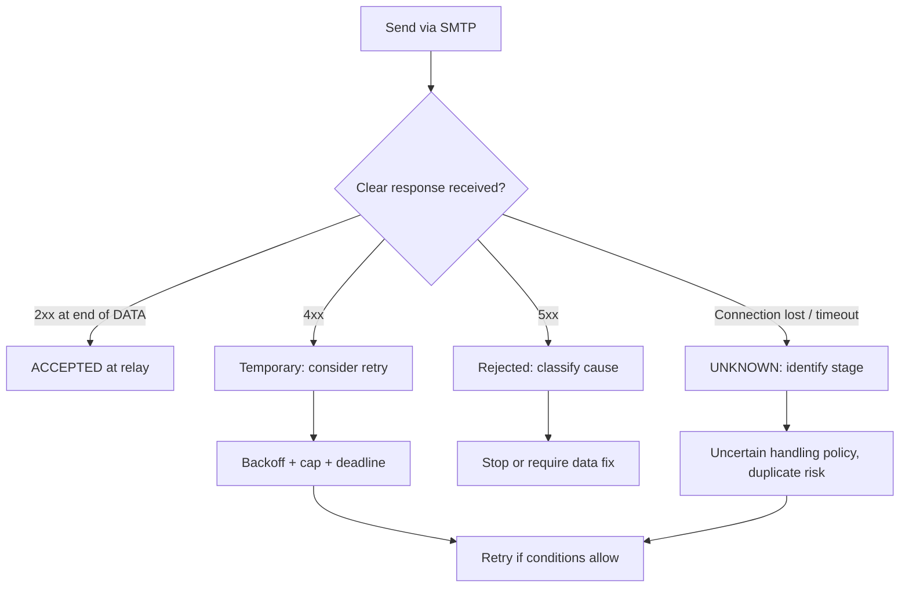
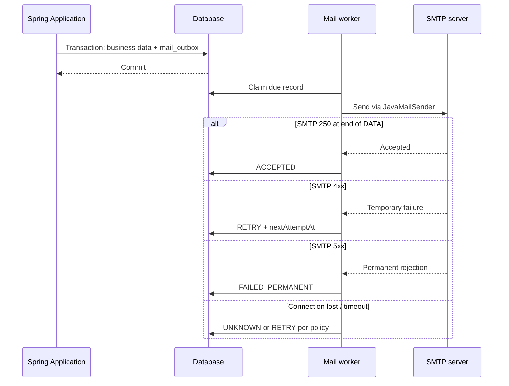
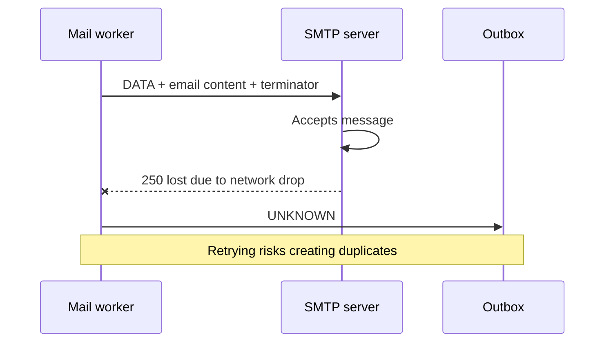

# Temporary Failures and Retry Strategies in SMTP

A Spring application can construct a completely valid email yet still fail to send on the first attempt. The SMTP server may be overloaded, the receiving mailbox may be full, the network connection may drop, DNS may experience a brief outage, or the provider may be rate-limiting. If every error is treated as a permanent failure, the system will miss emails that could have succeeded a few minutes later. If it retries too quickly or infinitely, the system can create extra load, harm sending reputation, and generate duplicate emails.

This lesson focuses on **transient failures and proper retry strategies in SMTP**, applied when sending mail with Spring Framework Mail, especially via `JavaMailSender`. It distinguishes signals from the SMTP protocol, transport errors, indeterminate states, backoff strategies, durable persistence of send requests, and how to operate a safe email-sending worker.

> **First principle:** An SMTP reply code tells you how the server answered a specific command. It does not by itself guarantee that the entire email reached the recipient's mailbox. A `JavaMailSender.send(...)` call returning normally usually only indicates that the message was accepted by the SMTP server at the hop observed by the application.

## 1. How Does SMTP Distinguish Temporary Errors from Permanent Errors?

### 1.1. Reading the First Digit of an SMTP Code

SMTP uses three-digit response codes. In the email-sending context:

| Code group | High-level meaning | How the application should interpret it |
|---|---|---|
| `2xx` | Command accepted/succeeded | Continue the session or record the result at the proper stage |
| `3xx` | More information or data needed to continue | Not a send error yet; continue the SMTP conversation |
| `4xx` | **Transient negative completion**: command could not be completed temporarily | Retryable after classification and an appropriate wait |
| `5xx` | **Permanent negative completion**: command rejected at the protocol level | Normally do not repeat the identical request; fix the cause or apply separate policy |

The word *temporary* here means the server does not assert the request will always fail. It **does not mean** retrying immediately will succeed. Conversely, `5xx` does not mean deleting the entire job without recording a reason: you may need to fix the recipient address, domain, authentication policy, or application config before creating a new send.

### 1.2. Commonly Seen Codes

| Code | Common situation | Initial decision |
|---|---|---|
| `421` | Service unavailable; server may close the connection | Retry later, reduce rate, check provider health |
| `450` | Mailbox temporarily unavailable or temporarily rejected | Schedule retry per policy |
| `451` | Server encountered a temporary processing error | Retry with backoff; monitor error rate |
| `452` | Insufficient resources/storage, temporary limit exceeded | Reduce load and retry later; check quota |
| `454` | Authentication or TLS temporarily unavailable, depending on server context | Distinguish short-lived outage from misconfiguration |
| `550` | Mailbox does not exist or request rejected by policy (depends on message) | Do not retry blindly; identify specific reason |
| `551` / `553` | Recipient/routing address or address syntax not accepted | Fix data or routing before resending |
| `552` | Exceeded storage capacity or receiving limit as classified by server | Usually permanent rejection for current command; do not auto-retry just because quota is mentioned |

Descriptions are common examples, not a one-to-one mapping between codes and business causes. Some providers use SMTP codes or extra messages per their own policies. Persist the **actual SMTP code, enhanced status code if present, failure stage, and normalized cause category**.

### 1.3. Enhanced Status Codes Provide Extra Detail

Alongside the three-digit code, the server may return an enhanced status code in `X.Y.Z` format, such as:

```text
451 4.3.0 Temporary local problem - please try later
450 4.2.2 Mailbox temporarily over quota
550 5.1.1 Recipient address rejected: user unknown
```

The leading digit `4` or `5` in the enhanced code further hints at temporary vs. permanent; the remainder typically helps identify the problem area such as addressing, mailbox, mail system, network, or policy. Do not infer solely from the English text after the code: text messages vary across providers and may be localized.

**Key distinction:** `450 4.2.2` may justify retrying per policy; `550 5.1.1` reporting a non-existent address usually requires stopping sends to that address and recording it for data cleanup.

## 2. At Which Step of the SMTP Conversation Did the Error Occur?

A send typically passes through these abbreviated steps:

```text
Client                         SMTP server
  |---- EHLO -------------------->|
  |<--- 250 ... ------------------|
  |---- STARTTLS (if used) ------>|
  |<--- 220 ... ------------------|
  |---- AUTH (if needed) -------->|
  |<--- 235 ... ------------------|
  |---- MAIL FROM:<sender> ----->|
  |<--- 250 ... ------------------|
  |---- RCPT TO:<recipient> ---->|
  |<--- 250 ... ------------------|
  |---- DATA -------------------->|
  |<--- 354 ... ------------------|
  |---- Header, body, CRLF . ---->|
  |<--- 250 Queued as ... --------|
  |---- QUIT -------------------->|
```

This is only an illustrative diagram; TLS, AUTH, and extended commands depend on the server. Once `354` is received, the client sends message content and the terminating line per SMTP rules. If after the data section the server returns `250`, the server has **accepted responsibility for processing the message at that step**. This still does not confirm the message reached the final mailbox.

Where the error occurs determines what a retry means:

- **Before `MAIL FROM`**: may be a connection, DNS, TLS, authentication, or server limit error. Normally no message content has been accepted yet.
- **At `RCPT TO`**: one recipient may be rejected while another is accepted. You must track per recipient or at least preserve the sets of succeeded/failed recipients.
- **Before finishing `DATA`**: the message has usually not been confirmed by the server; still check connection state and how the library reports errors.
- **After finishing `DATA` but before receiving `250`**: **indeterminate state**. The server may have accepted the message while the response was lost. Retrying can create duplicates.
- **After `250` at the end of `DATA`**: the provider accepted it. Do not resend just because a delivered event has not appeared yet; wait for the provider's feedback/bounce mechanism.



## 3. Distinguishing Protocol Errors, Connection Errors, and Content Errors

Not every exception raised by Spring Mail is an SMTP 4xx.

| Error group | Examples | Should you retry? |
|---|---|---|
| **Temporary, confirmed** | SMTP `451`, `452`, `421`, provider temporary pause | Yes, if the message is still valid and within budget |
| **Recoverable infrastructure** | Transient DNS error, network drop, connection reset, socket timeout | Possibly, but check the stage to recognize duplicate-send risk |
| **Authentication/config error** | Wrong SMTP password, wrong host, untrusted TLS certificate | Usually requires fixing config; infinite retries will not solve it |
| **Invalid data/message** | Email missing recipient, broken template, invalid headers | Fix input/template; do not retry blindly |
| **Recipient permanently rejected** | `550 5.1.1` user unknown | Stop for that recipient; may add to suppression list |
| **Unknown whether accepted** | Timeout after sending `DATA` | Weigh duplicate risk; prefer reconciliation if provider supports it |

When one email has multiple addresses in To/Cc/Bcc, the library or server may partially accept them. If you retry the whole list, already-accepted recipients may receive it twice. For systems requiring accurate tracking, send **one delivery record per recipient** or use the provider's per-recipient API and outcomes.

## 4. How Does Spring Mail Represent Send Errors?

### 4.1. Exception Hierarchy

In Spring Framework Mail, the main error types to know include:

- `MailException`: parent error type in the Spring Mail abstraction.
- `MailSendException`: occurs when sending fails; in some cases contains per-message details via `getFailedMessages()`.
- `MailAuthenticationException`: mail server authentication failure.
- `MailPreparationException`: unable to prepare the message before sending.
- `MailParseException`: unable to parse/construct a valid message.
- `MailException.getCause()` or underlying Jakarta Mail exceptions: may hold the SMTP root cause and detailed reply codes.

There is no reliable rule like `catch (MailException) { retry(); }`. For example, if a template is broken, retrying 100 times simply produces 100 identical failures.

In applications using Jakarta Mail, causes may traverse `jakarta.mail.MessagingException` and its `getNextException()` chain. Specialized SMTP exceptions depend on the mail provider and library version. Some providers have exception types containing `returnCode` or `address`, but **you should not force every deployment to use the exact same implementation** just to classify an error.

### 4.2. Translating Errors from the Adapter to Business Language

Instead of making the worker understand every exception class, create a boundary:

```text
JavaMailSender / SMTP provider
    |
    v
SmtpTransportAdapter
    |-- extract SMTP reply code (if truly present)
    |-- identify failure stage and recipient
    |-- identify TLS/config/auth/MIME errors
    |-- flag uncertain outcomes
    v
DeliveryOutcome
    |-- ACCEPTED
    |-- TEMPORARY_REJECTION
    |-- PERMANENT_REJECTION
    |-- INVALID_MESSAGE
    |-- CONFIGURATION_ERROR
    |-- UNKNOWN
    v
RetryPolicy + Outbox Worker
```

Illustrative, provider-independent data types:

```java
public enum DeliveryKind {
    ACCEPTED,
    TEMPORARY_REJECTION,
    PERMANENT_REJECTION,
    INVALID_MESSAGE,
    CONFIGURATION_ERROR,
    UNKNOWN
}

public record DeliveryOutcome(
        DeliveryKind kind,
        Integer smtpReplyCode,
        String enhancedStatus,
        String safeErrorCode
) {}
```

A basic classification rule from a **reliably extracted SMTP code** can be written as:

```java
public static DeliveryKind classifySmtpReply(int smtpCode) {
    if (smtpCode >= 400 && smtpCode <= 499) {
        return DeliveryKind.TEMPORARY_REJECTION;
    }
    if (smtpCode >= 500 && smtpCode <= 599) {
        return DeliveryKind.PERMANENT_REJECTION;
    }
    return DeliveryKind.UNKNOWN;
}
```

This is a **first step**, not the whole policy. You must separately handle authentication, TLS, data, provider limits, and multi-recipient cases. Never turn an exception message containing the substring "450" into `TEMPORARY_REJECTION` with a naive regex: numbers in a message could be a port, a message ID, or unrelated info.

### 4.3. A Sending Service with JavaMailSender

Example sending to **one recipient at a time** so a single outcome easily maps to one request:

```java
package com.example.mail;

import org.springframework.mail.SimpleMailMessage;
import org.springframework.mail.javamail.JavaMailSender;
import org.springframework.stereotype.Service;

@Service
public class SmtpMailGateway {

    private final JavaMailSender sender;

    public SmtpMailGateway(JavaMailSender sender) {
        this.sender = sender;
    }

    public void sendPlainText(
            String from,
            String recipient,
            String subject,
            String body
    ) {
        SimpleMailMessage mail = new SimpleMailMessage();
        mail.setFrom(from);
        mail.setTo(recipient);
        mail.setSubject(subject);
        mail.setText(body);
        sender.send(mail);
    }
}
```

The code above does one job: asking SMTP to send an email. It does not yet provide retries, database persistence, deduplication, error codes, or monitoring. Those belong to the send orchestration layer and error-classification adapter.

## 5. Designing Retries: How Long to Wait, How Many Attempts?

### 5.1. Why Not Retry Immediately?

If an SMTP server is returning `421` due to overload, 10,000 workers immediately reconnecting can prolong the outage. A good retry strategy creates breathing room, spreads load over time, throttles traffic when the provider signals limits, and **has a stopping point**.

A complete policy must answer:

1. **Which errors are retried?** Only temporary failures or specifically permitted uncertain outcomes.
2. **When does the next attempt run?** Use backoff and jitter.
3. **What is the maximum number of attempts?** A clear attempt budget.
4. **What is the maximum duration?** A message age limit or time elapsed since the first attempt.
5. **Is the notification still valid?** Do not send expired OTPs or reminders for past events.
6. **Does the provider impose rate limits?** Respect quotas, rate limits, and cooldowns if provided.
7. **Where does it go once limits are exhausted?** Transition to an actionable state, emit metrics, and have an operational workflow.

### 5.2. Fixed Delay, Exponential Backoff, and Jitter

**Fixed delay** always waits the same interval—easy to understand, but prone to synchronizing bursts of workers.

**Exponential backoff** increases the wait after each failure:

\[
d_n = \min(d_{\max}, d_{\text{base}} \times 2^{n-1})
\]

Where `n` is the **number of recorded failures**, starting at 1; `d_base` is the initial wait interval and `d_max` is the ceiling.

**Jitter** adds randomness so workers do not all retry at the exact same instant. With *full jitter*, the wait can be chosen between 0 and `d_n`; with *equal jitter*, it can be chosen between `d_n / 2` and `d_n` to prevent some requests from retrying too soon. Both are implementation choices, not automatic SMTP features.

An illustrative policy (before jitter):

| Failure # | Backoff from failure detection |
|---|---:|
| 1 | 1 minute |
| 2 | 2 minutes |
| 3 | 4 minutes |
| 4 | 8 minutes |
| 5 | 16 minutes |
| 6 onward | Max 30 minutes |

This example does **not** mean sending forever until success. Suppose `maxAttempts = 8` is set: when the eighth attempt fails, transition to a terminal state; do not schedule a ninth attempt. For a verification email valid for only 10 minutes, the time limit can end sooner than the attempt limit.

### 5.3. Code Example for Bounded Backoff Calculation

The following example calculates wait duration with *equal jitter*; it **does not call SMTP itself**:

```java
package com.example.mail;

import java.time.Duration;
import java.util.concurrent.ThreadLocalRandom;

public final class RetryDelay {

    private static final long BASE_MS = Duration.ofMinutes(1).toMillis();
    private static final long MAX_MS = Duration.ofMinutes(30).toMillis();

    private RetryDelay() {}

    // failedAttempts >= 1: number of failed send attempts so far.
    public static Duration afterFailure(int failedAttempts) {
        if (failedAttempts < 1) {
            throw new IllegalArgumentException("failedAttempts must be >= 1");
        }

        long capped = BASE_MS;
        for (int i = 1; i < failedAttempts && capped < MAX_MS; i++) {
            capped = Math.min(MAX_MS, capped * 2);
        }

        long lowerBound = capped / 2;
        long randomized = ThreadLocalRandom.current()
                .nextLong(lowerBound, capped + 1);
        return Duration.ofMillis(randomized);
    }
}
```

With `failedAttempts = 1`, the retry schedule is picked between 30–60 seconds; the next is 60–120 seconds; up to a cap of 15–30 minutes. For testability, production systems can inject a random generator and `Clock` to avoid depending on wall-clock time in unit tests.

**Note on rate limits:** some mail provider APIs return a `Retry-After` header, while SMTP may return `421` or `451` with guidance in the text message. Only rely on mechanisms the provider explicitly commits to. Do not treat a delay number appearing in free-form text as a stably parseable contract.

## 6. Where Should Retries Live in a Spring Application?

### 6.1. Short In-Memory Retries

Spring Retry provides mechanisms like `RetryTemplate` and `@Retryable` (when the dependency and corresponding configuration are enabled). They can be useful when the operation is very brief, remains in a controlled context, and adding a few seconds of latency is acceptable.

However, if an HTTP request is waiting to send an email, retrying several times with large delays makes the request slow or time out. More importantly, in-memory retries **do not survive a JVM shutdown**. Critical notification systems should persist send intents and retry schedules in durable storage.

### 6.2. Durable Outbox Is the Choice for Critical Notifications

A common design:



Minimum states might be:

| State | Meaning |
|---|---|
| `PENDING` | Send intent persisted, not yet due for processing |
| `PROCESSING` | Worker claimed and holds a lease |
| `RETRY` | Eligible to resend starting at `next_attempt_at` |
| `ACCEPTED` | SMTP relay accepted the message |
| `FAILED_PERMANENT` | Error that should not be retried as-is |
| `EXHAUSTED` | Retryable error that ran out of attempts/deadline |
| `UNKNOWN` | Cannot assert whether SMTP accepted it; requires dedicated policy |

**Do not name `ACCEPTED` as `DELIVERED`**. If the provider supports delivery events, separate `DELIVERED`/`BOUNCED` states can be added and updated by a different feedback source.

### 6.3. Sketching the Data Schema

Illustrative storage model:

```sql
CREATE TABLE mail_outbox (
    id UUID PRIMARY KEY,
    business_key VARCHAR(200) NOT NULL UNIQUE,
    recipient VARCHAR(320) NOT NULL,
    template_id VARCHAR(100) NOT NULL,
    template_payload TEXT NOT NULL,
    status VARCHAR(32) NOT NULL,
    attempts INTEGER NOT NULL DEFAULT 0,
    next_attempt_at TIMESTAMP NULL,
    lease_owner VARCHAR(100) NULL,
    lease_until TIMESTAMP NULL,
    last_smtp_code INTEGER NULL,
    last_error_category VARCHAR(100) NULL,
    accepted_at TIMESTAMP NULL,
    created_at TIMESTAMP NOT NULL,
    updated_at TIMESTAMP NOT NULL
);
```

Each field has a specific purpose:

- `business_key` prevents creating multiple **send intents** from the same business event.
- `attempts` counts actual send attempts initiated, not how many times the job scheduler ticked.
- `next_attempt_at` lets the worker process the next attempt without keeping a thread sleeping.
- `lease_owner` and `lease_until` enable time-bounded claims and recovery if a worker dies.
- `last_smtp_code` and `last_error_category` aid investigation by error code without logging email contents.
- `accepted_at` records when the SMTP server accepted it; never treat it as when the user received the mail.

For applications sending to multiple people, choose `business_key` based on both the event and the recipient, such as `invoice-123:recipient-456`, or have a separate delivery table per recipient. Do not use a single row to represent all recipients when retry results need per-address precision.

### 6.4. Worker Processing Record Lifecycle

Pseudo-code for a worker:

```text
FOR each due item claimed atomically:
    if item.expired or attempts >= maxAttempts:
        mark EXHAUSTED
        continue

    increment attempts and commit short claim transaction

    outcome = smtpAdapter.send(item)     // Network I/O outside DB lock

    if outcome == ACCEPTED:
        mark ACCEPTED
    else if outcome == TEMPORARY_REJECTION:
        if attempts >= maxAttempts or item.expired:
            mark EXHAUSTED
        else:
            mark RETRY and next_attempt_at = now + backoff(attempts)
    else if outcome == PERMANENT_REJECTION:
        mark FAILED_PERMANENT
    else if outcome == UNKNOWN:
        apply duplicate-aware uncertain-outcome policy
    else:
        mark actionable failure and alert if needed
```

In multi-worker deployments, selecting a record and acquiring a lease must be **atomic**. PostgreSQL can use `FOR UPDATE SKIP LOCKED`; other databases need an equivalent mechanism. Never hold a database transaction open across the SMTP wait: holding locks long blocks other workers and can trigger lock timeouts.

When the worker updates the outcome, use a **fencing/ownership condition** to ensure only the worker holding a valid lease can transition the state. If a lease expired and another worker claimed it, an old worker waking up late must not overwrite the newer result.

## 7. The Hardest Problem: The Server May Have Accepted the Mail Without the Client Knowing

Consider the scenario:

1. The worker sends the `DATA` portion of the email.
2. The SMTP server finishes processing and accepts the message.
3. The network drops before the client receives `250`.
4. `JavaMailSender` reports an I/O/timeout error.
5. The worker cannot definitively distinguish the two possibilities: accepted or not accepted.

If the worker retries, the recipient **may receive two emails**. If the worker skips it, the recipient **may receive no email**.



This is a fundamental limitation of distributed communication. A unique constraint on the outbox only prevents duplicate records; it **does not turn SMTP into exactly-once**. Having the same `Message-ID` header also does not guarantee every mail server will deduplicate automatically.

Ways to mitigate the impact:

1. Generate a **business-layer idempotency key** when writing the outbox, e.g., `password-reset-request:<requestId>:<recipientId>`.
2. If using a mail provider with an **API supporting idempotency keys**, leverage it per that API's contract. Standard SMTP does not define an idempotency key that spans across send attempts.
3. Store outcomes and provider message IDs whenever obtainable; use a status API/provider events to reconcile before retrying uncertain cases if the provider supports it.
4. For emails with high risk if duplicated (one-time promo codes, consequential transactions), make the **application-side action** idempotent: two emails containing the same link still allow only one business effect.
5. Set separate retry limits for `UNKNOWN`, and consider routing to a manual-intervention queue depending on criticality and urgency.

The final choice depends on business requirements: for critical confirmation emails, *possible duplication* is sometimes more acceptable than *possible loss*; for marketing emails, avoiding annoying recipients may take priority. The decision must be documented explicitly as policy rather than hidden inside `catch (Exception)`.

## 8. Configuring SMTP So Retries Stay Controllable

### 8.1. Setting Clear Timeouts

In a Spring Boot application, configure timeouts so workers do not hang indefinitely when the server or network has trouble:

```yaml
spring:
  mail:
    host: ${SMTP_HOST}
    port: ${SMTP_PORT:587}
    username: ${SMTP_USERNAME}
    password: ${SMTP_PASSWORD}
    default-encoding: UTF-8
    properties:
      mail:
        smtp:
          auth: true
          starttls:
            enable: true
            required: true
          connectiontimeout: 5000
          timeout: 10000
          writetimeout: 10000
```

- `mail.smtp.connectiontimeout` limits how long to wait when opening a connection.
- `mail.smtp.timeout` limits how long to wait when reading socket replies.
- `mail.smtp.writetimeout` limits how long to wait for writing data.

Values are in **milliseconds** and are illustrative only. Choose durations suited to the network, email size, SLAs, and upstream timeouts. Too low causes false timeouts; too high ties up workers for long periods. These timeouts are not a retry policy and do not determine whether an email was accepted after a socket error.

Security configuration must match the provider's contract. The example above is for STARTTLS on port 587; if using implicit TLS on port 465, configure SSL accordingly per provider. Never disable certificate verification to work around TLS errors.

### 8.2. Do Not Ignore System-Wide Limits

Even proper per-email retries can cause overall overload if millions of emails become due simultaneously. Additionally design:

- Send rate limits per second/minute per account/provider.
- Limits on active SMTP connections; throttle worker concurrency.
- Priority scheduling by email type: security notifications usually should not wait behind a massive marketing campaign.
- Circuit breakers or send pauses during widespread provider outages to prevent cascades of failed connections.
- Separate queues/policies for recipients/domains constantly being throttled, if recommended by the provider.
- Message age management: do not push out expired verification emails just because the system recovered.

Per-record backoff and **system-wide rate limiting** are two distinct layers. Jitter spreads out retry timestamps, but it does not replace global throttling quotas.

## 9. Measuring and Observing Retries in Production

A useful log should correlate the send attempt with the outbox record without exposing message contents or secrets:

```json
{
  "event": "smtp_delivery_attempt",
  "notificationId": "b7810b2e-1457-4359-af5d-61ad96316e33",
  "attempt": 3,
  "recipientReference": "recipient-42",
  "provider": "primary-smtp",
  "result": "TEMPORARY_REJECTION",
  "smtpCode": 451,
  "enhancedStatus": "4.3.0",
  "nextRetrySeconds": 247,
  "durationMs": 1328
}
```

Avoid logging SMTP passwords, auth codes, sensitive body data, URL tokens, or full email addresses in general logs. Error messages returned by providers may also contain recipient addresses or content that must be masked/encrypted before storing.

| Metric | Used to detect |
|---|---|
| `mail_send_attempts_total{outcome,provider}` | Abnormal spikes in temporary and permanent failures |
| `mail_retry_scheduled_total{reason}` | Too many retries or a single dominant cause |
| `mail_outbox_due_count` | Number of notifications that should already have been processed |
| `mail_outbox_oldest_due_age_seconds` | Backlog lingering too long |
| `mail_retry_exhausted_total` | Many requests exhausting retry budgets |
| `mail_smtp_latency_seconds` | Slow SMTP commands risking cascading timeouts |
| `mail_unknown_outcome_total` | Rising risk of duplicate sends or lost messages |

Only use metric labels with **low cardinality**, such as provider, error category, and template group; never use `emailAddress` or `notificationId` as Prometheus labels. Those IDs belong in logs/tracing with proper retention policies.

A useful alert does not just count errors. If SMTP returns `451` for 30 seconds and then recovers, the retry mechanism handles it well. But if the backlog keeps growing, the oldest record breaches SLA, or auth errors spike right after credential rotation, intervention is needed.

## 10. Testing Critical Scenarios

Mailpit or a test SMTP server helps check formatting and basic sending paths. To test retries, you also need an SMTP stub that can **deliberately return error codes or drop connections at exact stages**.

| Scenario | What to prove |
|---|---|
| SMTP returns `451` at `RCPT TO` | Worker logs temporary error, does not mark sent, schedules retry |
| SMTP returns `550 5.1.1` | Worker stops retrying non-existent address, saves reason |
| SMTP returns `421` in bursts | Rate limiting/backoff reduces load without retry storms |
| Wrong SMTP password | Error classified as config/alert issue, not retried forever |
| Timeout opening connection | Worker persists retryable state without holding DB locks long |
| Network drop after sending DATA | Worker marks uncertain state; does not assert with certainty it was not sent |
| Multiple recipients, one rejected | Does not indiscriminately resend to already-accepted recipients |
| Worker crashes after claim | Lease expires, another worker can pick up processing per policy |
| Two workers poll simultaneously | Only one worker claims a record under a valid lease |
| Email expires in queue | Worker aborts sending, does not push stale data |
| `maxAttempts` reached | Record transitions to `EXHAUSTED`, with logs/metrics for handling |

When running integration tests with a database, also test business transaction rollback: no outbox record should appear without a committed business transaction. For emails containing multiple data fields, verify template stability across retries so the same request does not accidentally send differing content.

## 11. End-to-End Example: Order Confirmation Email

Suppose the system creates order `ORDER-1042` and needs to send a confirmation to the buyer.

**Step 1 — Persist the send intent.** When the transaction saving the order commits, it also writes an outbox row with `business_key = order-confirmation:ORDER-1042:customer-7`, `status = PENDING`, `attempts = 0`.

**Step 2 — Worker's first send attempt.** The worker claims the record, renders the email, and calls `JavaMailSender.send(...)`. The SMTP server returns `451 4.3.0`. The adapter classifies `TEMPORARY_REJECTION`. The worker writes `attempts = 1`, `status = RETRY`, `next_attempt_at = now + RetryDelay.afterFailure(1)`.

**Step 3 — Worker retries when due.** SMTP returns `250` after the data section. The worker writes `attempts = 2`, `status = ACCEPTED`, `accepted_at`, and the provider's identifier if available.

**Step 4 — Post-send feedback.** If the provider supports delivery/bounce webhooks, another component receives events to record final delivery outcomes. Without such feedback, the system only asserts `ACCEPTED`.

**Variant A — Permanent error:** if the first attempt receives `550 5.1.1`, the worker records `FAILED_PERMANENT` and notifies the business/operations team as required, rather than retrying endlessly.

**Variant B — Server accepted but response lost:** if a timeout occurs after `DATA`, the worker lacks enough evidence to write `ACCEPTED` or `TEMPORARY_REJECTION`. It transitions to `UNKNOWN` handling per policy allowing bounded resend, provider reconciliation, or manual intervention.

**Variant C — Order recreated due to HTTP request retry:** a database unique constraint on `business_key` blocks inserting a second outbox row for the same notification. That prevents input-side duplicates, though it does not eliminate duplicate risk at the SMTP boundary as in Variant B.

## 12. Hands-On Exercise

Build a Spring Boot application with a mock SMTP server and a retry-capable email worker. Complete these milestones:

1. **Basic sending:** configure `spring-boot-starter-mail`, `JavaMailSender`, and a test SMTP server. Send a plain-text email to a test recipient.
2. **Error classification:** add an adapter returning `DeliveryOutcome`. Test `451`, `421`, `550` replies, and auth failures; store normalized error codes.
3. **Schedule persistence:** add the `mail_outbox` table, write a send intent inside a business transaction, and let a worker process it asynchronously.
4. **Retry scheduling:** apply exponential backoff with jitter, `maxAttempts`, a deadline, and the `EXHAUSTED` state.
5. **Crash recovery:** intentionally stop a worker after claiming a row, verify lease expiration, and confirm another worker resumes processing.
6. **Uncertain outcome handling:** simulate a connection drop after sending DATA; explain why you cannot assert "not sent", then choose a policy to prevent duplicate business side effects.
7. **Observability:** add logs with `notificationId`, metrics for attempts/retries/exhausted/unknown, and alerts when the queue backs up too long.

When finished, you should be able to answer three questions for every record: **why the last attempt failed, when and whether to retry, and what we actually know about whether the SMTP server accepted the email**. That is the foundation for building a reliable retry strategy instead of just wrapping `JavaMailSender.send()` in a loop.
