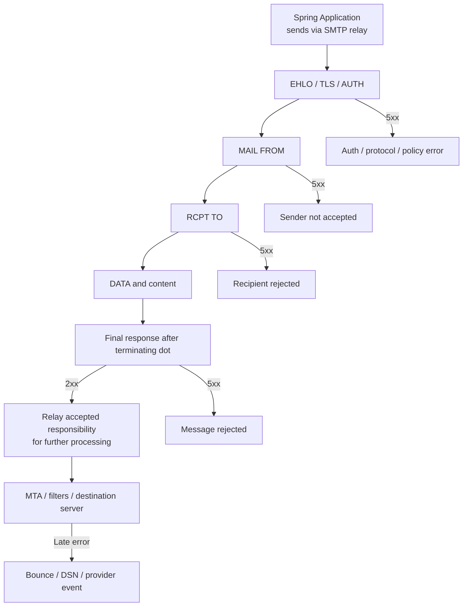
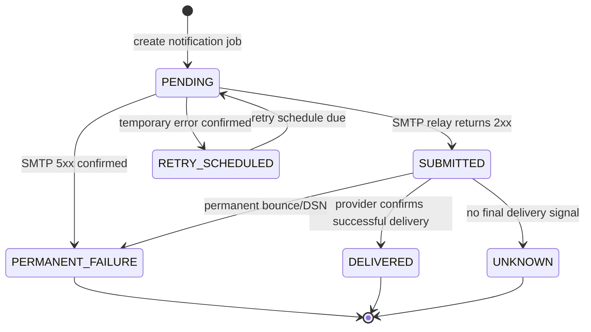

# SMTP: Permanent Failures Caused by Address, Policy, or Content

In an email-sending system built with Spring Framework Mail, not every error can be fixed by retrying. An SMTP server can **permanently reject a send operation** because the recipient address is invalid, because of security/sending-permission policies, or because the message content violates limits and rules of the receiving server. The **5xx** response group in SMTP signals this kind of failure.

Understanding permanent failures properly helps the application avoid two pitfalls: infinitely resending a message guaranteed to be rejected, and equating every "550" message with "recipient email does not exist". This lesson explains how to read SMTP codes, identify which step produced the error, distinguish the three cause categories, and translate them into appropriate handling in a Spring application.

## 1. What Does "Permanent" Mean in SMTP?

SMTP is a protocol exchanging commands and responses between a sender and a receiving server. Responses carry a **three-digit code**; the first digit indicates the outcome category:

| Group | Meaning | Examples | How to handle |
| --- | --- | --- | --- |
| `2xx` | Command accepted | `250 OK` | Continue or record success for the current step |
| `3xx` | Server waiting for more data | `354 Start mail input` | Send the requested data |
| `4xx` | Temporary error | `451 Requested action aborted` | Can be queued and retried per policy |
| **`5xx`** | **Permanent error for the current operation** | `550 Requested action not taken` | Do not blindly repeat identically |

The word **permanent** does not mean the error will last forever. A mistyped address can be corrected; a blocked sending domain can be unblocked; an oversized message can be shrunk. It means **the server has indicated you should not automatically retry the exact same command under the exact same conditions**, because simply waiting a short while is not expected to resolve the issue.

Do not confuse SMTP `5xx` status codes with HTTP `5xx`: in HTTP, 5xx server errors often lead developers to think of retrying; in SMTP, the 5xx group describes **permanent failure of the current SMTP request**.

### Three-Digit SMTP Codes and Enhanced Status Codes

Many servers return two-layer responses:

```text
550 5.1.1 Recipient address rejected: User unknown
│   │
│   └── Enhanced status code: class.subject.detail
└────── Three-digit SMTP reply code
```

In `5.1.1`: the leading digit `5` means permanent error; the `1` belongs to the **addressing** error group; the final `1` specifies a detailed condition within that group. Enhanced status codes clarify classification, though servers are not guaranteed to emit them or use the exact same message text. Text messages are diagnostic hints, not a stable programming interface.

| Enhanced status group | High-level meaning | Example situations |
| --- | --- | --- |
| `5.1.x` | Addressing, routing, or destination mailbox at address level | Mailbox does not exist, bad address |
| `5.2.x` | Mailbox status | Mailbox disabled or restricted from receiving mail |
| `5.3.x` | Mail system | Message exceeds system size limits |
| `5.4.x` | Network or routing | No valid route in cases considered permanent |
| `5.5.x` | Protocol | SMTP syntax or command not accepted |
| `5.6.x` | Content and media format | MIME format/content cannot be converted or processed |
| `5.7.x` | Security and policy | Relaying disallowed, sending policy or auth violation |

**Never classify using only the three digits.** A server may use `550` for both "user unknown" (`5.1.1`) and "blocked by policy" (`5.7.1`). Combine: the three-digit code, enhanced status code if present, diagnostic text, the rejected SMTP command, and where the response originated.

## 2. At Which Step in the SMTP Session Does the Error Appear?

A basic SMTP session comprises `EHLO`, `MAIL FROM`, `RCPT TO`, `DATA`, and the final response once the server finishes receiving the message content. The same email can be rejected at different steps:



5xx replies at different steps have different scopes:

- **At `AUTH` or submission stage:** the SMTP account is not permitted to log in or used the wrong method; the application may receive an error before sending any recipients.
- **At `MAIL FROM`:** the server rejects the envelope sender, sending domain, relay route, or sender-related policy.
- **At `RCPT TO`:** errors usually apply **per recipient**. One address can be rejected while another is accepted in the same session.
- **After `DATA`:** the server now has headers/body to scan and can reject **the entire message transfer transaction** due to content or policy. The server may also reject due to address/policy at this point.
- **After the relay already returned `250`:** handoff to the next MTA occurs afterward. Permanent errors may arrive later as a **Delivery Status Notification (DSN)**, bounce, or provider event rather than an exception in `JavaMailSender.send(...)`.

Errors unrelated to SMTP replies can also happen, such as DNS timeouts, dropped TCP connections, TLS handshake failures, or address parsing errors in the library. Those errors **are not automatically SMTP 5xx**, even though the email ultimately failed to send.

## 3. Group 1: Permanent Failures Caused by Address

Addressing errors occur when the server cannot locate or does not accept a delivery path to the address in the SMTP envelope. Common examples include a typo in the mailbox name, a non-existent domain, a disabled mailbox, or one not accepting mail.

### 3.1. Non-Existent Recipient Address

Illustrative response:

```smtp
C: MAIL FROM:<bounces@shop.example>
S: 250 2.1.0 Sender OK
C: RCPT TO:<alcie@company.example>
S: 550 5.1.1 <alcie@company.example>: Recipient address rejected: User unknown
```

The application actually intended to send to `alice@company.example`, but the transmitted value was `alcie@company.example`. The receiving server rejects it at `RCPT TO`. Resending the exact same bad address will normally keep returning `550 5.1.1`.

Appropriate handling:

1. Record the failure status for the **exact address** rejected by the server.
2. Stop automatic retries for that address until corrected or new evidence arrives.
3. Let the user correct the address or verify via another channel.
4. Never guess and replace `alcie` with `alice`, as that could belong to someone else.

### 3.2. Invalid Address Syntax

A string like `alice@@company.example` has invalid syntax. It may be rejected by Jakarta Mail/the application **before connecting**, or answered by the SMTP server, such as:

```smtp
S: 553 5.1.3 Bad recipient address syntax
```

Input validation in Spring should catch obvious syntax errors to notify the user early. However, **valid syntax does not mean the mailbox exists**. Heuristics like simple regex checks, a single MX lookup, or probing via SMTP `RCPT TO` cannot guarantee actual deliverability.

### 3.3. Domain Does Not Accept Email or Has No Valid Destination

If a domain does not exist, lacks a valid mail route, or publishes a **Null MX** declaring it does not accept email, the MTA usually cannot deliver the mail. The result may show up in relay logs as a permanent failure or DSN rather than directly at `RCPT TO` in the Spring app.

Example delayed failure notice:

```text
Final-Recipient: rfc822; alice@no-mail.example
Action: failed
Status: 5.4.4
Diagnostic-Code: smtp; No valid mail route for recipient domain
```

This is an illustrative layout of DSN fields; exact codes and wording depend on the reporting server. When investigating, also check for temporary DNS errors: DNS timeout/SERVFAIL may be retryable, unlike a confirmed non-existent domain/route.

### 3.4. Mailbox Disabled or Not Accepting Mail

The server may return `550` with an enhanced status in `5.2.x` or `5.7.x` when a mailbox is locked, disallowed from receiving mail from that source, or organization policy blocks delivery to the account. Do not infer "does not exist" from the digits `550` when the text says "mailbox disabled" or "recipient restricted".

## 4. Group 2: Permanent Failures Caused by Policy

Policy errors occur when the server **understands the address and can receive the data**, yet refuses the operation due to operational or security rules. Enhanced status codes usually fall in `5.7.x`; many products use `550 5.7.1`, `554 5.7.1`, or other specific codes.

### 4.1. No Relay Permission

```smtp
C: RCPT TO:<alice@other.example>
S: 554 5.7.1 Relay access denied
```

Typical scenario: the application connects to an SMTP server that does not allow the current account/network to relay mail to external domains. The issue lies in **relay permissions or submission server configuration**—you cannot conclude the `alice` mailbox does not exist.

Check:

- Is the application connecting to the **correct** SMTP submission host and port specified by the provider?
- Is SMTP AUTH enabled when required by the provider? Does the account have permission to send for this sender/domain?
- Does the server permit sending to external domains or from the current source network?
- Are there policies restricting `MAIL FROM`, login identity, and `From:`?

Never "fix" this error by turning on an open relay or disabling authentication on the server.

### 4.2. SPF, DKIM, and DMARC Fail Receiving Policy

Example reply:

```smtp
S: 550 5.7.1 Message rejected due to sender authentication policy
```

The receiving server may evaluate:

- **SPF:** is the sending MTA's IP authorized to send for the envelope sender or HELO domain?
- **DKIM:** does the signature over selected headers and body verify against the signing domain's DNS key?
- **DMARC:** does SPF or DKIM **pass** and **align** with the displayed `From:` domain per DMARC policy?

An SPF failure does not automatically mean DMARC fails if DKIM is valid and aligned; the reverse is also true. A receiving server may reject due to DMARC, IP reputation, identity rules, or custom filters. **Spring Mail sends over SMTP**, whereas DKIM signing, SPF DNS, DMARC, and sending IPs are typically configured at the mail infrastructure/provider layer.

The fix is checking sending domain authentication, provider config, DNS records, the `From:` domain, and envelope sender rather than resending identically. If using an external SMTP service, configure domain authentication per that service's guide.

### 4.3. Sending Reputation, Anti-Spam, and Organizational Policy

An MTA can also reject because the source IP/domain is on a blocklist, exhibits spam/phishing traits, violates mailing list policies, lacks mandatory TLS, or sends to a recipient the sender is not permitted to contact. Some cases return `4xx` to defer temporarily, while others return **5xx**.

When receiving a policy error:

1. Read the specific text accompanying the code, policy URL, or incident ID if provided.
2. Check domain authentication, sending permissions, reputation, valid recipient list, and message content.
3. Contact the provider/receiving domain administrator with minimal evidence if needed.
4. Retry only after the rejection condition has changed; apply rate limits to avoid abuse flags.

Some servers intentionally withhold detailed policy reasons to prevent abuse. Do not assert a definitive root cause solely from a generic "blocked" message.

## 5. Group 3: Permanent Failures Caused by Content

Unlike addressing errors that usually appear at `RCPT TO`, content errors are typically determined **only after the server receives headers/body** at `DATA`, or during previously advertised size checks.

### 5.1. Email Exceeds Maximum Size

```smtp
C: EHLO app.shop.example
S: 250-mail.company.example
S: 250 SIZE 10485760
C: MAIL FROM:<notification@shop.example> SIZE=15728640
S: 552 5.3.4 Message size exceeds fixed maximum message size
```

In this example, the server advertises a `10 MiB` limit via SMTP `SIZE`, while the sender attempts to transmit a `15 MiB` message. A server may reject at `MAIL FROM` upon seeing `SIZE` exceed the limit; another server may reject after receiving the data. Do not treat every `552` as a full mailbox, as the enhanced status and timing of the reply reveal the context.

With attachments, the email's wire size is **usually larger** than the raw file size due to MIME/Base64 overhead and metadata. An 8 MiB file can push a message past a 10 MiB threshold. The fix is reducing size, compressing appropriately, splitting files, or replacing with a controlled download link.

### 5.2. Unacceptable MIME Format or Encoding

HTML emails, attachments, and international characters are packaged using MIME. A server may reject an invalid message or unprocessable media:

```smtp
S: 554 5.6.0 Message content rejected: unsupported media format
```

Examples to inspect include malformed MIME headers, mismatched charset/Content-Transfer-Encoding, invalid multipart boundaries, or internationalized addresses requiring SMTPUTF8 support that the receiving server lacks. Not every server uses the same code; rely on the actual response and logs.

Spring usually helps build MIME structure via `MimeMessageHelper`, yet the application must still supply valid data/content types and avoid concatenating raw MIME improperly.

### 5.3. Attachment or Content Blocked by Policy

```smtp
S: 554 5.7.1 Message rejected: attachment type prohibited
```

Examples: prohibited executables, patterns detected as malicious, suspicious URLs, sensitive data violating DLP (Data Loss Prevention), or password-protected documents disallowed by a gateway. This is a **policy-based content rejection**, so it may carry `5.7.x` instead of `5.6.x`.

Remediation depends on the cause: switch to an allowed format, remove unnecessary content, share documents via an appropriate secure channel, or work with administrators. Never instruct users to bypass security filters; adjust the sending workflow to comply with policy.

### Quick Comparison of Content Error Types

| Cause | Illustrative reply | Where to troubleshoot |
| --- | --- | --- |
| Exceeds size limit | `552 5.3.4` | Account for MIME overhead, reduce payload size |
| Bad MIME/encoding | `554 5.6.0` | Inspect MIME structure, charset, SMTP capabilities |
| Prohibited attachment | `554 5.7.1` | Change document-sharing approach per policy |
| Content flagged as spam/phishing | `550 5.7.1` | Review message text, sender origin, domain auth, and policy |
| Mail violates security policy | `550/554 5.7.x` | Check specific rules of the receiving server |

The replies in the table are **examples**, not fixed mappings enforced by every server.

## 6. Reading SMTP Transcripts to Scope Failures Accurately

### Example A: One Address Rejected at RCPT TO

```smtp
S: 220 smtp.provider.example ESMTP
C: EHLO application.shop.example
S: 250 smtp.provider.example
C: MAIL FROM:<bounces@shop.example>
S: 250 2.1.0 OK
C: RCPT TO:<alice@company.example>
S: 250 2.1.5 OK
C: RCPT TO:<missing@company.example>
S: 550 5.1.1 Recipient unknown
C: DATA
S: 354 Continue
C: From: notification@shop.example
C: To: alice@company.example
C: Subject: Example
C:
C: Hello
C: .
S: 250 2.0.0 Queued
```

In this example, the receiving server **accepts Alice** and **rejects missing**. The message after `DATA` is accepted only for the recipient permitted in the transaction. If a system sends to multiple recipients at once, it must maintain **per-recipient** status data; you cannot mark the entire list failed or succeeded based solely on the single final `250`.

An SMTP client library may decide to abort, continue, or partially send when a recipient is rejected, depending on settings like `mail.smtp.sendpartial` and library behavior. The transcript illustrates **what the protocol allows**, not a claim that `JavaMailSender` will always emit the exact same sequence across all configurations.

### Example B: All Recipients Valid, but DATA Rejected

```smtp
C: MAIL FROM:<bounces@shop.example>
S: 250 OK
C: RCPT TO:<alice@company.example>
S: 250 OK
C: DATA
S: 354 Start mail input
C: From: notification@shop.example
C: To: alice@company.example
C: Subject: Report
C: MIME-Version: 1.0
C: Content-Type: application/octet-stream
C:
C: [message data]
C: .
S: 554 5.7.1 Message rejected by content policy
```

`250` at `RCPT TO` is **not** confirmation of successful delivery. When the server returns `554` after the terminating dot of `DATA`, the mail transfer transaction is rejected. At this point, looking into size, formatting, content filters, and receiving server policies makes more sense than assuming the recipient address is wrong.

### Example C: Relay Accepted the Mail, but Error Occurs at the Next Hop

```text
10:00  Spring -> SMTP relay : 250 2.0.0 queued as Q123
10:02  SMTP relay -> target MX : 550 5.1.1 User unknown
10:03  Relay generates DSN/bounce sent to envelope sender
```

The `JavaMailSender.send()` call at 10:00 may have completed normally. The permanent failure at 10:02 is an **asynchronous delivery outcome**. The application only learns about it if it has a mechanism to ingest bounces, webhooks, or query provider status.

In some systems with post-acceptance filtering, a relay or destination server may accept with `250` and then scan, quarantine, or detect an error. Therefore, distinguish the states **submitted, accepted by destination, delivered, bounced, quarantined**; an initial relay's SMTP `250` does not guarantee Inbox arrival.

## 7. When Using Spring Framework Mail, How Do Errors Surface?

In Java, Spring provides `JavaMailSender` to send mail over SMTP. With Spring Boot, typical configuration uses the mail starter and `spring.mail.*`; with plain Spring Framework, applications usually configure `JavaMailSenderImpl` directly.

Example submission configuration for an application:

```yaml
spring:
  mail:
    host: smtp.provider.example
    port: 587
    username: ${SMTP_USERNAME}
    password: ${SMTP_PASSWORD}
    properties:
      mail:
        smtp:
          auth: true
          starttls:
            enable: true
            required: true
          connectiontimeout: 5000
          timeout: 10000
          writetimeout: 10000
```

When the application sends email, errors may be mapped to exceptions in the `org.springframework.mail.MailException` hierarchy. Common ones include:

| Symptom in application | Possible Spring exception | Investigation path |
| --- | --- | --- |
| Cannot connect or no suitable SMTP server | `MailSendException` or send-related exception | Network, DNS, TLS, host/port |
| SMTP AUTH rejected | `MailAuthenticationException` | Account, password, provider policy |
| Syntax error / cannot build message | `MailParseException` or Jakarta Mail error in cause | Input data, MIME, library |
| Server returns `550/554/552` on send | Often wrapped in `MailSendException` with provider-dependent cause | SMTP reply, enhanced status, rejected command |

**Never infer `MailSendException` = 5xx error.** It can also wrap timeouts, dropped connections, and other errors. And **never infer no exception = mail delivered to mailbox**.

### Example Error Handling at Submission

```java
import org.springframework.mail.MailAuthenticationException;
import org.springframework.mail.MailException;
import org.springframework.mail.MailSendException;
import org.springframework.mail.SimpleMailMessage;
import org.springframework.mail.javamail.JavaMailSender;

public class NotificationEmailSender {
    private final JavaMailSender sender;

    public NotificationEmailSender(JavaMailSender sender) {
        this.sender = sender;
    }

    public void submit(String to, String subject, String body) {
        SimpleMailMessage message = new SimpleMailMessage();
        message.setFrom("notification@shop.example");
        message.setTo(to);
        message.setSubject(subject);
        message.setText(body);

        try {
            sender.send(message);
            // Only confirms successful submission to the current SMTP server.
            recordSubmitted(to);
        } catch (MailAuthenticationException e) {
            // Operational/configuration error: credentials need fixing.
            recordNeedsConfigurationFix(to, e);
        } catch (MailSendException e) {
            // Record failure and hand off to classification layer based on
            // actual SMTP response/cause/provider event.
            recordSendFailure(to, e);
        } catch (MailException e) {
            recordSendFailure(to, e);
        }
    }

    private void recordSubmitted(String to) {
        // Update submission status in the business system.
    }

    private void recordNeedsConfigurationFix(String to, Exception cause) {
        // Log config error and raise appropriate operational alert.
    }

    private void recordSendFailure(String to, Exception cause) {
        // Persist technical error safely, avoiding leaking addresses and bodies in logs.
    }
}
```

This example focuses on **responsibility boundaries**. Real applications should separate sending, persisting outcomes, and retry decisions into distinct components. If reliable delivery is required, use an outbox/queue to persist jobs before sending.

Note on exceptions: Jakarta Mail and the SMTP transport implementation may expose additional SMTP reply codes and per-failed-address info, but the exact cause structure and exception classes vary across libraries and versions. Never write business logic based on English substrings like `contains("user unknown")` or assume every exception carries an SMTP code. Extract **structured response codes** from the SMTP provider/adapter or provider event API when available, keeping raw details safely to support investigation.

### A State-Handling Flow Usable in Production



`DELIVERED` should only be recorded when evidence exists per the provider's definition (typically the destination server accepted it or the provider system confirmed delivery), not simply when Spring's `send()` succeeded. State names and logic can vary by system; the key is persisting enough information to tell **submitted to relay** apart from **delivered to destination**.

## 8. How Should the Three Permanent Error Groups Be Handled?

Each error group requires a distinct business decision:

| Group | Example signals | Appropriate action | Auto-retry same payload? |
| --- | --- | --- | --- |
| Address | `550 5.1.1`, `553 5.1.3` | Mark recipient undeliverable, request fix/verification | **No**, until the address is fixed |
| Relay permission policy | `554 5.7.1 Relay access denied` | Fix SMTP host, permissions, and authentication | **No**, until config/permissions are fixed |
| Domain auth policy | `550 5.7.1` related to SPF/DKIM/DMARC | Check DNS, alignment, sending identity | **No**, until sending infrastructure is fixed |
| Content / size | `552 5.3.4` | Reduce size, change how attachments are sent | **No**, until content is modified |
| Content / security filter | `554 5.7.1` | Comply with policy, adjust content, or seek support | **No**, until root cause is addressed |
| Contrast: temporary error | `451 4.x.x` | Schedule retry with backoff and limits | **Possibly**, per retry policy |

If you only have a "send failed" signal **without a code or error source**, you cannot mark it permanent yet. A reasonable state is `UNKNOWN` or `NEEDS_INVESTIGATION` until more evidence arrives. In particular, a timeout after finishing data transfer may mean the relay **already accepted the mail** without the application seeing the reply; uncontrolled retries can generate duplicate emails.

### Do Not Turn Bounces into Loops

When an MTA accepts a message and later detects an error, it may send a DSN back to the **envelope sender** (return-path), which can differ from the `From:` header seen by recipients. One management approach is configuring a dedicated bounce address on the sending service and correlating events by message identity.

Bounce-handling design should:

- Correlate events with the corresponding **message ID/provider ID and recipient**.
- Distinguish hard bounces (`5.x.x`) from soft bounces (`4.x.x`) when reliable data is available.
- Update status **per recipient**, especially for multi-recipient emails.
- Avoid resending to verified hard bounces unless corrected or re-confirmed by the recipient.
- Prevent duplicate event processing; verify webhook/event origins and avoid blindly trusting unauthenticated bounce emails.
- Never generate endless error-report emails when an error report itself fails to deliver; in SMTP, DSNs normally use an empty reverse-path `MAIL FROM:<>` to prevent loops.

Do not treat every email landing in a "bounces" inbox as absolute proof, because bounce messages can be spoofed, lack fields, or be forwarded.

## 9. Designing Retries Compatible with SMTP

A mail-sending system typically has retries at **two layers**:

1. **Spring application → SMTP relay:** the application can retry when unable to connect or when submission is temporarily rejected, while distinguishing ambiguous timeouts from definitive 5xx errors.
2. **SMTP relay/MTA → receiving domain:** after the relay accepts the message, the relay itself usually manages mail queues and retries for 4xx errors at subsequent hops. The application should not re-emit the same mail just because it has not appeared in the inbox immediately.

For confirmed permanent errors:

```text
Receive send outcome
    |
    +-- SMTP 2xx at relay --> SUBMITTED, wait for provider/DSN if needed
    |
    +-- Clear SMTP 4xx --> RETRY_SCHEDULED with backoff
    |
    +-- Clear SMTP 5xx --> PERMANENT_FAILURE and save reason
    |
    +-- network timeout/unknown --> UNKNOWN, needs deduplication mechanism
    |
    +-- bounce 5.x.x after submission --> update to PERMANENT_FAILURE
```

Backoff typically increases progressively with a total time/attempt limit; retry policies should pair with a queue ID, correlation ID, and idempotency strategy. **5xx codes are not solved by increasing retry counts**. Retries should only be re-enabled when conditions have changed: address corrected, policy unblocked, content replaced, or evidence shows the server emitted a temporary mis-coded reply.

For messages with multiple recipients, create jobs or results per recipient, since one address can get `250` while another gets `550`. Per-recipient data also prevents resending to those who already succeeded when another fails.

## 10. Diagnosing Permanent Errors from Logs and Provider Events

Suppose a user reports "Spring couldn't send the email". Start with **evidence closest to the failure source**, rather than guessing from exception names:

1. **Identify affected time and address:** notification ID, recipient (partially masked in shared logs), recipient domain, SMTP relay used.
2. **Identify the error source:** MIME construction in app, SMTP submission, intermediate MTA, destination domain's MX, or post-acceptance filtering.
3. **Collect the full response:** SMTP code (e.g., `550`), enhanced status (`5.1.1` or `5.7.1`), explanation text, SMTP command, queue ID/provider ID.
4. **Categorize:** address, policy, content, or insufficient data.
5. **Choose remediation:** update recipient, relay permissions, DNS/domain auth, MIME/size, or contact administrators.
6. **Perform controlled test send after fixing**, recording message version and per-recipient status.

A sensible internal log record:

```json
{
  "notificationId": "noti-2026-0051",
  "recipientDomain": "company.example",
  "smtpRelay": "smtp.provider.example",
  "phase": "RCPT_TO",
  "smtpReplyCode": 550,
  "enhancedStatusCode": "5.1.1",
  "category": "INVALID_RECIPIENT",
  "providerMessageId": null,
  "deliveryState": "PERMANENT_FAILURE",
  "retryEligible": false
}
```

This is an **illustrative log model**, not a structure generated automatically by Spring. In production environments, follow data protection policies: avoid storing bodies, passwords, SMTP AUTH credentials, or full user emails in general logs.

### Symptom Lookup Table

| Observed symptom | What to clarify | First line of investigation |
| --- | --- | --- |
| `550 5.1.1` in `RCPT TO` | Are the recipient and domain right? | Recipient data, mailbox status |
| `550 5.7.1` at `MAIL FROM` | Does the server permit this sender/relay? | Sending identity, SMTP AUTH, policy |
| `554 5.7.1` after `DATA` | Blocked by content filter or domain auth? | Content, headers, DKIM/DMARC, gateway message |
| `552 5.3.4` | Which threshold did actual mail size exceed? | MIME size after encoding, attachments |
| `553 5.1.3` | Is there an envelope address syntax error? | Address sent over SMTP, encoding/SMTPUTF8 |
| Spring `MailSendException` without a 5xx code | Is it truly a permanent SMTP error? | Cause chain, timeout, DNS, TLS, relay logs |
| Spring succeeded, bounce arrives minutes later | Which relay bounced, which recipient failed? | DSN, provider events, queue ID, target MX |

Response messages vary across providers. A non-existent address might be masked behind a "policy violation" message to prevent user enumeration; respect evidence limits and do not attempt to probe mailbox directories via SMTP.

## 11. Three Practical Scenarios to Reason Through

### Scenario A: Typo in Address During Registration

The application sends a verification code to `anhn@company.example`, whereas the user meant `anh@company.example`. The SMTP relay returns `250` on submit; a few minutes later the provider emits a `bounce` event with `550 5.1.1`.

**Operational conclusion:** the 5xx code arrived **after** submission. Flag the bad address and ask the user to confirm/correct it; do not resend the exact same string dozens of times. Never rewrite emails based on system guesswork.

### Scenario B: Application Changes `From:` to a New Domain

The dev team updates the `From:` header to `billing@new-brand.example`, but the provider's authentication config is still tied to the old domain. Several receiving domains return `550 5.7.1` citing sender authentication policy.

**Operational conclusion:** inspect SPF/DKIM/DMARC and alignment for the new domain, as well as domain verification at the SMTP provider. Simply tweaking retry counts in the Spring app will not authenticate the new domain.

### Scenario C: Sending an Oversized PDF Report

Spring builds an HTML email with a large PDF attachment. The SMTP server rejects with `552 5.3.4`, whereas a text-only email to the same recipient succeeds.

**Operational conclusion:** check the actual email size after MIME encoding along with provider/receiving-domain limits first. Shrink the file or provide an appropriate download link; do not classify the recipient address as "non-existent".

## 12. Self-Check Questions

1. **Does a `550` error always mean the mailbox does not exist?** No. Check the enhanced status, text message, SMTP step, and reply origin. `550 5.1.1` and `550 5.7.1` have very different meanings.
2. **Why can a successful `JavaMailSender.send()` call still result in a hard bounce?** Because the relay accepted the message at the first hop; the permanent failure can occur when the MTA delivers to the receiving server after the application's call has finished.
3. **When should you automatically retry?** Primarily for confirmed temporary failures or uncertain states that have deduplication safeguards; do not infinitely retry the same message that received SMTP 5xx.
4. **Why does an accepted `RCPT TO` not guarantee message delivery?** Because `DATA`, the post-`DATA` reply, downstream MTA hops, and mailbox delivery still lie ahead.
5. **Is a 9 MiB file guaranteed to fit within a 10 MiB message limit?** No. MIME/Base64 increases the actual message size, plus headers and multipart structure.
6. **What should you check first on `554 5.7.1` after `DATA`?** Gateway messages, content/attachment policies, domain authentication, and related evidence—do not simply assume a bad address.

## Conclusion

**A permanent SMTP failure is a 5xx signal that the current operation is rejected**, with causes potentially falling under **address (`5.1.x`/`5.2.x`), policy (`5.7.x`), or content (`5.3.x`/`5.6.x` and sometimes `5.7.x`)**. You must read the reply, the rejection stage, and the origin together to make the right decision. In Spring Framework Mail, submission-time errors can surface via `MailException`, while hard bounces from later hops usually must be collected separately. A reliable mail system tracks status per recipient, separates "relay accepted" from "delivered", fixes the root cause of 5xx errors, and only resends when conditions have changed.
