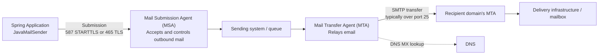
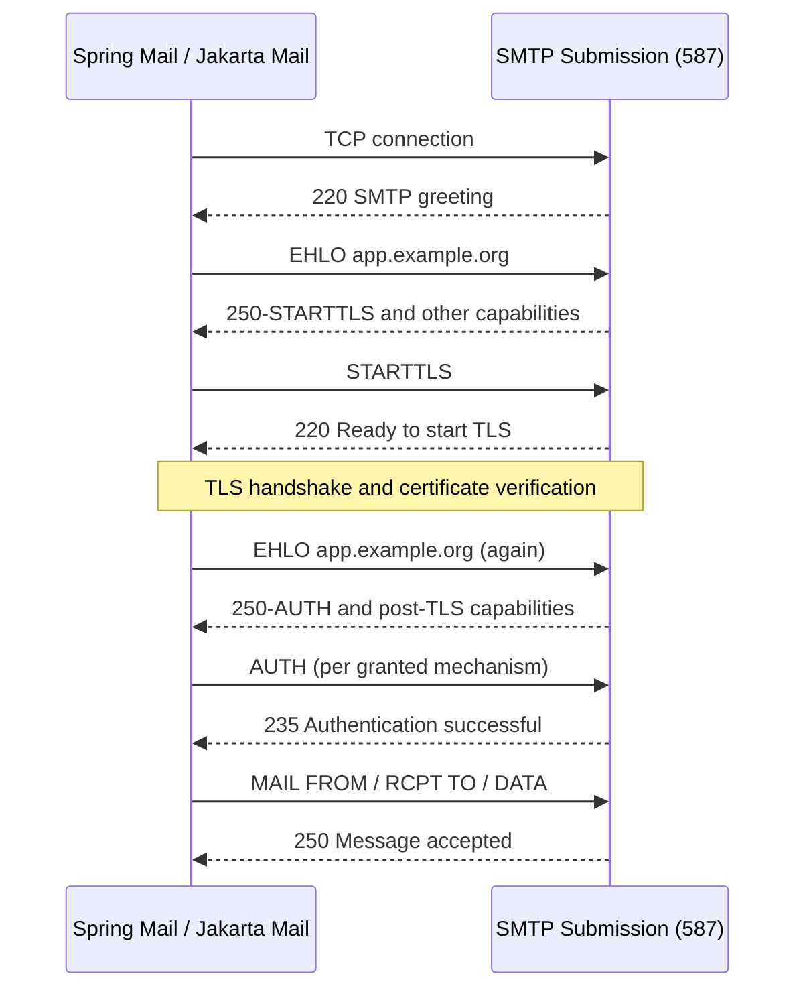
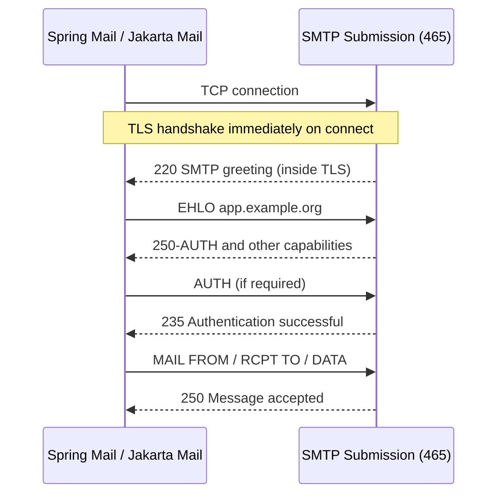

# Submission Ports and How They Differ from Traditional SMTP Ports

When configuring a Spring application to send email, three ports commonly appear in documentation: **25, 587, and 465**. All three relate to SMTP, yet they serve **different communication hops** in an email system. Choosing the wrong port can prevent the application from connecting, authenticating, negotiating TLS, or cause the server to reject relaying mail.

In most business applications, Spring Mail acts as an **SMTP client** submitting outbound email to an organization's or provider's mail service. That connection is called **mail submission**; the standard port typically used is **587 with STARTTLS**, or **465 with TLS immediately upon connect**, depending on the configuration published by the provider. **Port 25** primarily serves transferring email between SMTP servers (mail transfer).

## 1. Distinguishing Submission from Relay/Transfer

Both actions speak SMTP, but their starting point, responsibilities, and security requirements differ.



**Submission** is the process where an application or mail client sends mail to a designated server so that system can deliver it onward. The server serving this role is called a **Mail Submission Agent (MSA)**. An MSA typically authenticates the application, applies sending limits, verifies permission to use the sender address, and accepts or rejects the message.

**Transfer/relay** is the process where one mail server (MTA) transfers mail to another mail server—for example, a company server sending mail to the receiving server for `example.net`. This system usually looks up DNS MX records of the receiving domain and uses SMTP over **port 25**.

The MSA and MTA roles may run on the same host or within the same email-sending platform. The difference lies in the **function of the connection**, not necessarily the number of physical servers.

### Network Ports Are Not Separate Protocol Names

Ports 25, 587, and 465 can all use SMTP commands such as `EHLO`, `MAIL FROM`, `RCPT TO`, and `DATA`. The key difference is **which kind of communication the port is meant for** and **how TLS is initiated**.

Do not assume that "SMTP = 25, SMTPS = 465, and 587 is a different protocol." `SMTP` is the application protocol; `STARTTLS` and `implicit TLS` are two ways to establish an encrypted channel for an SMTP session. Authentication and relay rules are further governed by server policy.

## 2. Comparing Ports 25, 587, and 465

| Criterion | Port **25** | Port **587** | Port **465** |
|---|---|---|---|
| Common role | SMTP **mail transfer** between MTAs | SMTP **message submission** to an MSA | SMTP **message submission** to an MSA |
| Typical service name | `smtp` | `submission` | `submissions` |
| Initial connection style | Plaintext SMTP | Plaintext SMTP | **TLS from the very first byte of the session** |
| TLS usage | STARTTLS if supported and permitted/required by policy | **STARTTLS**; applications should require it | **Implicit TLS**, no STARTTLS step needed |
| Client authentication | Not necessarily using SMTP AUTH in MTA–MTA flows | Usually requires SMTP AUTH or equivalent authorization | Usually requires SMTP AUTH or equivalent authorization |
| Who typically initiates | Sending domain's MTA | Applications, mail clients, notification systems | Applications, mail clients, notification systems |
| How target server is chosen | By mail routing, usually via DNS MX | **Fixed MSA** specified by the provider | **Fixed MSA** specified by the provider |
| Default choice for Spring apps sending mail? | **No** | **Yes**, if supported by the provider | **Yes**, if required/supported by the provider |

### Port 25: Traditional SMTP for Mail Transfer

Port 25 is tied to SMTP exchanges between mail servers under Internet architecture. A sending MTA can query DNS MX to locate the destination domain's receiving server, then connect to port 25 on that server.

For instance, the mail server for `example.org` wanting to deliver mail to `an@example.net` looks up the MX for `example.net` and conducts an SMTP session with the target server. In this context, server identity and acceptance decisions follow the receiving side's policies; personal email credentials with SMTP AUTH are not necessarily used.

STARTTLS **can also be used on port 25**. Saying "port 25 is always unencrypted" is inaccurate. However, TLS policy between MTAs may differ from submission connections: some routes allow opportunistic encryption, while stricter routes require appropriate TLS. Using TLS on port 25 does not turn that connection into an application submission service.

Many cloud environments or ISPs block or throttle outbound port 25 connections to curb spam. This is a practical reason why sending mail directly from applications over port 25 is unreliable, aside from routing and sending-domain reputation management.

### Port 587: SMTP Submission with STARTTLS

Port 587 is standardized for **message submission from client to MSA**. A client typically:

1. Opens a TCP connection to the submission hostname/port given by the provider.
2. Sends `EHLO` and reads the capabilities advertised by the server.
3. Sends `STARTTLS` to upgrade the existing connection to TLS.
4. Completes the TLS handshake and **sends `EHLO` again**.
5. Authenticates if required by the server (usually `SMTP AUTH`).
6. Sends the envelope and message content using `MAIL FROM`, `RCPT TO`, and `DATA`.

On port 587, application configuration should **require STARTTLS** and refuse to proceed if TLS cannot be established. If you only enable STARTTLS while allowing fallback to plaintext, the client might transmit data without the intended protection.

### Port 465: SMTP Submission with Implicit TLS

With port 465, the client **performs the TLS handshake as soon as the TCP connection opens**, and only then exchanges SMTP commands inside the encrypted channel. This mode is usually called **implicit TLS** or **submissions**; in many older documents or UIs it is also labeled "SMTPS" or "SSL/TLS".

To configure it properly, the client must enable SMTP-over-TLS from connection initiation. Using a port 587 configuration (waiting for a plaintext SMTP banner before sending STARTTLS) to connect to a port 465 server expecting implicit TLS can cause both sides to wait on each other or close the connection.

**Modern TLS differs from obsolete SSL**: Jakarta Mail's property name `mail.smtp.ssl.enable` is kept for API history, yet that setting enables TLS right on connect—it does not mean the application should use legacy SSL protocols.

### Port 2525 and Other Ports

Some providers support port **2525** as an alternative when 587 is unavailable in specific network environments. This port **is not a universal standard submission port**; you cannot assume every email server supports it. TLS and AUTH characteristics of an alternate port must follow the provider's documentation.

## 3. Why Is a Dedicated Submission Port Needed?

If an application can speak SMTP, why not send straight to MTAs over port 25? Separating submission lets systems enforce clear policies at the boundary between **applications permitted to originate mail** and **infrastructure responsible for transporting mail**.

| Need | Role of the MSA in submission connections |
|---|---|
| Allow only authorized apps to send mail | Authenticate or identify clients, verify sending permission |
| Control sender addresses | Check whether the account is allowed to use a `From` / envelope sender or sending domain |
| Protect credentials and content in transit | Enforce TLS and authentication policies |
| Curb abuse | Rate limits, email size, recipient counts, quotas, anomaly detection |
| Manage sending operations | Enqueue mail, report errors, provide trace IDs or provider events |
| Keep the application simple | App configures a single MSA endpoint without managing MX lookups, MTA retries, DNS, or sending IP reputation |

Specific policies can vary among internal SMTP services, transactional email services, and standard email accounts. SMTP AUTH is a common way to authenticate submission, though not the only mechanism: an internal MSA can also enforce trusted networks, connection identities, or other authorization schemes.

**Commitment boundary:** when the MSA returns `250` after `DATA`, it has **accepted responsibility for further processing** per system policy. That **does not mean** the email has been delivered to the final mailbox. Relaying, deferral handling, bounces, and spam filtering happen at downstream hops.

## 4. Seeing Both Connection Setup Modes Directly

### Flow 587: SMTP Then Upgrade via STARTTLS



Abbreviated SMTP conversation example using dummy values:

```text
S: 220 smtp.provider.example ESMTP
C: EHLO application.example.org
S: 250-smtp.provider.example
S: 250-STARTTLS
S: 250 SIZE 10485760
C: STARTTLS
S: 220 2.0.0 Ready to start TLS
   [TCP connection upgraded to TLS and certificate verified]
C: EHLO application.example.org
S: 250-smtp.provider.example
S: 250 AUTH PLAIN LOGIN
   [Client and server complete SMTP AUTH; credentials hidden]
S: 235 2.7.0 Authentication successful
C: MAIL FROM:<notifications@example.org>
S: 250 2.1.0 Ok
C: RCPT TO:<receiver@example.net>
S: 250 2.1.5 Ok
C: DATA
S: 354 End data with <CRLF>.<CRLF>
C: From: notifications@example.org
C: To: receiver@example.net
C: Subject: Welcome
C:
C: Your account is ready.
C: .
S: 250 2.0.0 Queued as ABC123
```

The crucial point is sending `EHLO` **after the TLS upgrade**: server capabilities can change, such as advertising `AUTH` only once the connection is protected. Actual bytes used for SMTP AUTH are handled by the mail library and must never be copied into logs.

### Flow 465: TLS First, SMTP After



Both flows can produce a **TLS-protected SMTP session**. They differ in when TLS begins:

- **587 + STARTTLS:** starts with SMTP, then negotiates an upgrade to TLS on the same connection.
- **465 + implicit TLS:** establishes the TLS connection first, and all SMTP exchange starts after the TLS handshake.

SMTP AUTH is the step that **proves sending permission**, whereas TLS is the mechanism that **protects the transport channel**. Having TLS does not automatically mean the client is permitted to send from any address; having an SMTP account also does not guarantee encrypted transit if TLS is misconfigured.

## 5. Configuring Submission Ports in Spring Framework Mail

Spring provides `JavaMailSender` to send email via Jakarta Mail. The application does not need to write `EHLO`, `STARTTLS`, or `DATA` commands itself; the SMTP library executes them based on configuration.

With Spring Boot using the mail starter, `spring.mail.*` properties can configure the SMTP client. In a Spring Framework app without Boot, declare a `JavaMailSenderImpl` bean and set the equivalent Jakarta Mail properties.

### A. Spring Boot Configuration: Port 587 + STARTTLS

Add the mail starter dependency if not already present:

```groovy
dependencies {
    implementation 'org.springframework.boot:spring-boot-starter-mail'
}
```

`application.yml`:

```yaml
spring:
  mail:
    host: ${SMTP_HOST}
    port: 587
    username: ${SMTP_USERNAME}
    password: ${SMTP_PASSWORD}
    properties:
      "[mail.smtp.auth]": true
      "[mail.smtp.starttls.enable]": true
      "[mail.smtp.starttls.required]": true
      "[mail.smtp.ssl.checkserveridentity]": true
      "[mail.smtp.connectiontimeout]": 5000
      "[mail.smtp.timeout]": 10000
      "[mail.smtp.writetimeout]": 10000

app:
  mail:
    from: ${SMTP_FROM}
```

Notable properties:

| Property | Meaning |
|---|---|
| `spring.mail.host` | Provider-supplied MSA endpoint, **not each recipient's MX** |
| `spring.mail.port: 587` | Mail submission port using STARTTLS |
| `spring.mail.username`, `password` | Credentials for the library to perform SMTP AUTH if required |
| `mail.smtp.auth=true` | Enables client-side SMTP AUTH |
| `mail.smtp.starttls.enable=true` | Permits issuing the STARTTLS command |
| `mail.smtp.starttls.required=true` | Refuses to proceed if STARTTLS is unsupported or fails |
| `mail.smtp.ssl.checkserveridentity=true` | Verifies the hostname in the server's TLS certificate |
| `mail.smtp.connectiontimeout` | Time limit to open the TCP connection, in milliseconds |
| `mail.smtp.timeout` | Time limit waiting to read data from the SMTP server |
| `mail.smtp.writetimeout` | Time limit for writing data onto the connection |

`SMTP_HOST`, `SMTP_USERNAME`, `SMTP_PASSWORD`, and `SMTP_FROM` are examples of environment variables. In practice, load them from environment configuration or a secrets manager; never commit real credentials into the repository.

Combining `starttls.enable=true` and `starttls.required=true` is especially meaningful: the client demands a properly established TLS channel rather than settling for sending messages in a plaintext session if the server refuses to upgrade.

### B. Spring Boot Configuration: Port 465 + Implicit TLS

For providers specifying port 465 with TLS immediately upon connect:

```yaml
spring:
  mail:
    host: ${SMTP_HOST}
    port: 465
    username: ${SMTP_USERNAME}
    password: ${SMTP_PASSWORD}
    properties:
      "[mail.smtp.auth]": true
      "[mail.smtp.ssl.enable]": true
      "[mail.smtp.ssl.checkserveridentity]": true
      "[mail.smtp.connectiontimeout]": 5000
      "[mail.smtp.timeout]": 10000
      "[mail.smtp.writetimeout]": 10000
```

Here `mail.smtp.ssl.enable=true` tells the transport to start with TLS. STARTTLS is not needed in this example. Choosing **465 or 587 depends on the endpoint supported by the provider**—there is no reason to switch ports just to make email "more secure": both can use secure TLS when configured and certificate-verified properly.

If the server only supports 587 + STARTTLS while the client uses 465 + implicit TLS, the connection will usually fail due to a session-initiation mismatch. The reverse is also true.

### C. Plain Spring Framework: Configuring `JavaMailSenderImpl`

When not using Spring Boot auto-configuration:

```java
package com.example.mail;

import java.util.Properties;
import org.springframework.context.annotation.Bean;
import org.springframework.context.annotation.Configuration;
import org.springframework.mail.javamail.JavaMailSender;
import org.springframework.mail.javamail.JavaMailSenderImpl;

@Configuration
public class MailConfiguration {

    @Bean
    JavaMailSender javaMailSender() {
        JavaMailSenderImpl sender = new JavaMailSenderImpl();
        sender.setHost(System.getenv("SMTP_HOST"));
        sender.setPort(587);
        sender.setUsername(System.getenv("SMTP_USERNAME"));
        sender.setPassword(System.getenv("SMTP_PASSWORD"));
        sender.setDefaultEncoding("UTF-8");

        Properties props = sender.getJavaMailProperties();
        props.put("mail.smtp.auth", "true");
        props.put("mail.smtp.starttls.enable", "true");
        props.put("mail.smtp.starttls.required", "true");
        props.put("mail.smtp.ssl.checkserveridentity", "true");
        props.put("mail.smtp.connectiontimeout", "5000");
        props.put("mail.smtp.timeout", "10000");
        props.put("mail.smtp.writetimeout", "10000");
        return sender;
    }
}
```

This example assumes the environment provides all required config variables and a compatible Jakarta Mail library. In real systems, inject validated configuration and use a secrets manager instead of scattered environment reads. Configuring in Java or YAML does not change the connection's role: the app still submits email to the MSA over port 587.

### D. Sending Mail with `JavaMailSender`

Once configured, mail-sending code **does not need to know whether 587 or 465 is used**; connection handling lives in the transport layer:

```java
package com.example.mail;

import org.springframework.beans.factory.annotation.Value;
import org.springframework.mail.SimpleMailMessage;
import org.springframework.mail.javamail.JavaMailSender;
import org.springframework.stereotype.Service;

@Service
public class AccountMailService {

    private final JavaMailSender mailSender;
    private final String fromAddress;

    public AccountMailService(
            JavaMailSender mailSender,
            @Value("${app.mail.from}") String fromAddress) {
        this.mailSender = mailSender;
        this.fromAddress = fromAddress;
    }

    public void sendWelcomeMessage(String recipient) {
        SimpleMailMessage message = new SimpleMailMessage();
        message.setFrom(fromAddress);
        message.setTo(recipient);
        message.setSubject("Welcome");
        message.setText("Your account has been activated.");
        mailSender.send(message);
    }
}
```

`SimpleMailMessage` suits plain-text emails. For HTML, attachments, multipart content, or other MIME requirements, use `MimeMessage` and `MimeMessageHelper`. Regardless of message type, `JavaMailSender` still uses the configured MSA and port.

**Version note:** the Java examples use Spring Mail APIs. With Spring Framework 6+ / Boot 3+, advanced MIME classes typically use `jakarta.mail`; with Spring Framework 5 / Boot 2, older MIME imports may use `javax.mail`. Choosing the submission port is independent of this namespace difference.

## 6. Distinguishing Four Commonly Confused Concepts

### 6.1. SMTP Port vs. `From` Address

`spring.mail.host` and `spring.mail.port` determine **which MSA to connect to**. The `From:` address shows **who appears as the sender** in the message; the SMTP envelope carries `MAIL FROM` for transport and error replies. Picking the right port does not mean the account is permitted to use any `From` value.

For example, an application logs in with `smtp-user@example.org` yet sets `From: billing@other-domain.test`. The MSA may reject it because the account lacks permission to send on behalf of that domain. That error relates to **authorization/policy**, not necessarily picking the wrong port.

### 6.2. Successful Submission vs. Email Arriving in the Inbox

A Spring mail-sending call finishes once the MSA accepts the message. Afterward, the sending infrastructure continues processing; the message can be deferred, bounced, placed in spam, or filtered at the destination server. Never interpret `mailSender.send()` returning normally as "the recipient opened the email".

### 6.3. TLS vs. SMTP AUTH

- **TLS**: protects data in transit between two endpoints and supports server verification.
- **SMTP AUTH**: authenticates the client's identity so the MSA can decide submission permission.
- **`From` permission check**: policy verifying whether the authenticated identity is allowed to use a specific sender address/domain.

Each layer solves a distinct problem. A secure TLS connection can still receive `535` due to wrong credentials, or `550` due to an unapproved sender address.

### 6.4. Submission with TLS vs. Guaranteed End-to-End Encryption

TLS from the application to the MSA protects **the hop between those two parties**. An email may pass through multiple MTAs before reaching the recipient. Protection on later hops depends on those servers' TLS policies and capabilities; SMTP submission over TLS is not itself end-to-end encryption of email content. If end-to-end secrecy is required, an appropriate content encryption solution at the application/message layer is needed.

## 7. Diagnosing Common Errors When Choosing the Wrong Port

| Symptom | Common possibilities | Approach |
|---|---|---|
| `Connection refused` | Wrong hostname/port, server not listening, blocked by firewall | Verify exact provider endpoint, test TCP connectivity |
| `Connection timed out` | Network blocking the port or endpoint unresponsive | Check network policies, routing, DNS, timeouts, and supported ports |
| Long wait or SSL handshake failure on 465 | Client waiting for plaintext SMTP banner or wrong implicit TLS config | Enable `mail.smtp.ssl.enable=true` on 465 |
| `530 Must issue a STARTTLS command first` | MSA requires TLS before AUTH or sending data | Enable STARTTLS on 587 and make TLS required |
| `535 Authentication failed` | Wrong secret/account, unsupported AUTH mechanism, restricted account rights | Check credentials and the provider's SMTP AUTH guide |
| `550 Relay denied` / `554 Relay access denied` | Client not permitted to send to recipient, missing auth or relay permission | Check AUTH, sender authorization, and MSA policy |
| `SSLHandshakeException` / invalid certificate | Hostname mismatch in cert, expired cert, or broken trust chain | Fix endpoint/certificate/trust; never disable TLS verification as a shortcut |
| Sending via 25 blocked in cloud environment | Network/platform restricts outbound TCP 25 | Switch to the assigned 587/465 submission endpoint |
| MSA returns `250` yet user did not receive email | Message queued, rejected later, bounced, spam-filtered, or domain policy | Check provider status, queue ID, delivery/bounce events |

No single SMTP code always maps to one unique cause. Read the **full response and the timing of the failure**: failures during TCP connect, TLS handshake, AUTH, `MAIL FROM`/`RCPT TO`, or after `DATA` lead to different remediations.

### Testing 587 and 465 Connectivity

In environments with `openssl`, you can inspect TLS negotiation with:

```bash
# 587: start SMTP, then perform STARTTLS
openssl s_client -starttls smtp -connect smtp.example.org:587 \
  -servername smtp.example.org

# 465: TLS immediately upon connect
openssl s_client -connect smtp.example.org:465 \
  -servername smtp.example.org
```

These are TLS diagnostic commands, **not** commands for sending email or performing full SMTP authentication. Replace `smtp.example.org` with the provider's endpoint and check the certificate against the actual hostname. Never send login credentials over an unverified session, and do not treat a successful TLS connection as proof that mail was submitted or delivered.

In environments with only PowerShell, `Test-NetConnection smtp.example.org -Port 587` can tell whether TCP connects, but **does not prove STARTTLS, SMTP AUTH, or submission works**.

## 8. Choosing a Port per Scenario

| Scenario | Appropriate choice | Reason |
|---|---|---|
| Spring Boot app sending transactional email via SMTP provider | **587 + STARTTLS** if supported | Standard submission port, fits SMTP AUTH and MSA policies |
| Provider publishes a `submissions` endpoint on 465 | **465 + implicit TLS** | Matches the service's exact TLS connection mode |
| App sends through internal mail infra requiring relay from specific IPs | Per **internal endpoint and port assigned by admins** | May differ from 587/465; follow system policy |
| Mail server transferring mail to external domains' MX | **25** | Server-to-server SMTP flow |
| Provider supports 2525 to bypass 587 network blocks | **2525** if explicitly documented | Provider-specific fallback port, not a universal standard |
| Testing app locally with Mailpit/MailHog | Tool's SMTP listener port (e.g., **1025**) | Local mock environment, not a standard Internet port |
| Email service sends via HTTP API instead of SMTP | No client SMTP submission port needed | Use HTTPS API and corresponding SDK |

When unsure which port to pick, start with the **provider's SMTP submission documentation**: exact hostname, port, security mode, credential type, allowed sender accounts/domains, and rate limits. Never pick a port solely based on the label "SMTP" in a settings UI.

## 9. Safe and Reliable Design in Production

A solid submission setup does not stop at opening a socket:

1. **Match TLS mode to the port.** On 587, enable and require STARTTLS; on 465, enable implicit TLS. Verify certificate hostname and trust chain.
2. **Keep secrets out of source code.** Inject credentials per environment, rotate as needed, and never log passwords, access tokens, or AUTH transcripts.
3. **Bound wait times.** Set connection/read/write timeouts so mail-sending threads do not hang forever when the MSA drops.
4. **Pick retry policies by cause.** Network errors and SMTP `4xx` replies can usually be retried with backoff; `5xx`, auth errors, or bad addresses require fixing the root cause rather than infinite loops.
5. **Avoid coupling SMTP tightly to business transactions.** For high-volume systems, use a queue/outbox and sending workers; record submission status separately from delivery.
6. **Track delivery with appropriate events.** To know whether an email was delivered or bounced, integrate provider callbacks/webhooks or reports. Success from `JavaMailSender.send()` is the submission milestone.
7. **Respect sending domain policies.** SPF, DKIM, DMARC, and sending reputation affect downstream acceptance; passing SMTP AUTH does not replace these mechanisms.

Especially for retries: if the MSA accepted the email but the network dropped before the app read the `250` reply, the app may not know the message was accepted. Immediate retrying risks creating duplicates. The system should persist a job ID, manage attempt counts and provider status when available, and design business workflows to tolerate possible duplicates.

## 10. Frequently Asked Questions

**Is port 587 required to use TLS?** Port 587 is designated for submission, though whether the server advertises STARTTLS and enforces specific auth/TLS policies depends on the service. For production apps needing a secure channel, **configure the client to require STARTTLS** instead of relying on optional opportunistic upgrades.

**Is port 465 obsolete?** Port 465 had a history of registration and usage changes; today **implicit TLS submission on 465** is specified in RFC 8314. It is a valid choice when supported by the provider.

**Is port 25 always unencrypted or always dangerous?** No. Server-to-server SMTP on 25 can use STARTTLS, and even require TLS by policy. However, that is typically the **mail transfer** path, not the default choice for Spring apps submitting mail.

**Can you try both 587 and 465 until one works?** Look up the exact configuration from the provider. Changing only the port number without switching between STARTTLS and implicit TLS usually causes handshake errors, making troubleshooting harder.

**If switching from 587 to 465, do you have to rewrite `mailSender.send()` code?** Usually no. Change the endpoint/port and TLS properties to match the mode in `JavaMailSender`; code constructing and sending the email can stay the same.

**If port 587 is open yet sending still fails, is it a firewall issue?** Not necessarily. A successful TCP connection is just the first step: the app must still negotiate TLS, authenticate, pass sending authorization, transmit the message, and receive the MSA's reply.

**Can Spring send directly to recipients' MX servers?** You can build your own SMTP delivery system, but then your app or service must take on full MTA responsibilities (routing, queue/retry, anti-abuse, IP reputation, and error handling). For most business applications, submitting mail to an MSA is simpler and more appropriate.

## 11. Standards and Terms for Reference

Standard names to cross-reference when working with SMTP providers:

- **RFC 5321 — Simple Mail Transfer Protocol:** describes foundational SMTP and mail exchange between SMTP systems.
- **RFC 6409 — Message Submission for Mail:** describes the MSA role and submission using port 587.
- **RFC 3207 — SMTP Service Extension for Secure SMTP over Transport Layer Security:** describes the STARTTLS command in SMTP.
- **RFC 4954 — SMTP Service Extension for Authentication:** describes SMTP AUTH.
- **RFC 8314 — Cleartext Considered Obsolete: Use of Transport Layer Security (TLS) for Email Submission and Access:** describes TLS protection guidance for submission, including implicit TLS on port 465.

These RFCs describe general protocols and models. Always apply the provider's documentation for actual hostnames, ports, AUTH methods, and security requirements.

---

**Takeaway when configuring Spring Mail:** `587 + STARTTLS` or `465 + implicit TLS` is for **applications submitting mail to an MSA**; `25` is primarily for **MTAs transferring mail to MTAs**. Picking the right port must pair with the right TLS mode, authentication/sending permissions, and submission-outcome tracking. An MSA reply accepting the message does not mean the email has reached the recipient's inbox.
