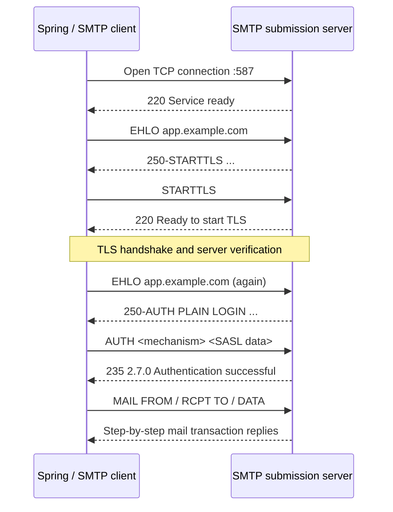
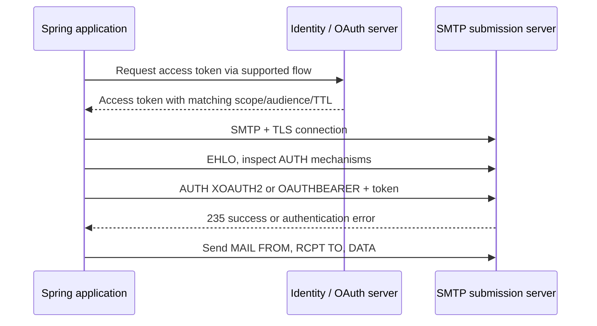

# SMTP AUTH and Authentication Mechanisms

## 1. What Problem Does SMTP AUTH Solve?

**SMTP AUTH** is an extension to **Simple Mail Transfer Protocol (SMTP)** that lets an SMTP client authenticate to an SMTP server before using permissions that require an identity—especially **sending outbound mail via an SMTP submission service**. SMTP AUTH is specified in RFC 4954 and uses authentication mechanisms under the **SASL** (Simple Authentication and Security Layer) framework.

For example, a Spring Boot application needs to send an order confirmation email from `notifications@example.com` to an external address. An SMTP server should not let every client on the Internet use it as a free forwarding server (**open relay**). Instead, the server can require clients to authenticate and only allow authenticated accounts to send mail within granted policy limits.

```text
Spring Boot application
      |
      | SMTP submission + STARTTLS/implicit TLS + AUTH
      v
Mail Submission Agent (MSA)
      |  1. Verify client identity
      |  2. Check sending permissions and policy
      |  3. Accept message if valid
      v
Mail Transfer Agent (MTA)
      |
      | Server-to-server SMTP mail transfer
      v
Recipient domain's mail server
      |
      v
Target mailbox
```

In this diagram, SMTP AUTH belongs to the **client authentication step when submitting mail**. Having a server accept an SMTP account does not prove the `From` address belongs to that account, does not guarantee the email reaches the Inbox, and does not confirm the recipient read the mail. Sending authorization, anti-spoofing, and delivery policies are separate layers.

### Distinguishing Four Easily Confused Concepts

| Concept | Question addressed | Example |
|---|---|---|
| **SMTP AUTH** | Which client is requesting to send email? | App account authenticates to submission server |
| **TLS** | Is the transport channel encrypted and the right server verified? | STARTTLS on port 587 |
| **Sending authorization** | Which addresses/domains is the authenticated identity allowed to send from? | Only service account permitted to send from `notifications@example.com` |
| **SPF, DKIM, DMARC** | How is the sending domain authenticated/evaluated on the receiving side? | Target MX checks SPF record, DKIM signature, and DMARC policy |

SMTP AUTH does not replace SPF, DKIM, or DMARC. Conversely, an email with a valid DKIM signature does not imply the application used SMTP AUTH during submission.

## 2. Where Does SMTP AUTH Fit in an SMTP Session?

The SMTP client opens a connection and sends `EHLO` to receive the server's capability list. If the server supports authentication, the `EHLO` reply may include a line like `250-AUTH PLAIN LOGIN` or other mechanisms. The client picks **a mechanism supported by the server** and executes the `AUTH` command before sending message content per server policy.

Typical flow on port 587:



**Why must `EHLO` be sent again after STARTTLS?** Once TLS is established, the client must discard the previously learned capability set and send a fresh `EHLO`. The server may only advertise AUTH mechanisms once the connection is protected, or change policies based on TLS state. Seeing `AUTH` in a pre-TLS reply does not mean you should send credentials right then.

General command syntax:

```text
AUTH <mechanism> [initial-response]
```

`mechanism` is the SASL mechanism name, such as `PLAIN` or `XOAUTH2`. Some mechanisms use an **initial response**, while others require challenge-and-response rounds. The server may return `334` to request more data, `235` when authentication succeeds, or an error reply when rejected.

> **Never include real usernames/passwords, tokens, or AUTH payloads in documentation, logs, or screenshots.** Base64 strings in an AUTH session are merely a byte encoding; Base64 is **not security encryption**.

## 3. How Does SMTP AUTH Use SASL?

SASL is a framework allowing application protocols to negotiate and execute an **authentication mechanism**. SMTP provides the `AUTH` command; SASL defines the data exchanged between client and server for the chosen mechanism.

There are two identity concepts in SASL:

- **Authentication identity (`authcid`)**: the identity proving access rights, such as the application's SMTP account.
- **Authorization identity (`authzid`)**: the identity the client wishes to act on behalf of, if permitted by the mechanism and policy. This field can be left empty; the server decides corresponding permissions.

For instance, a service logs in as `mailer-service` yet needs to send on behalf of an authorized mailbox. Successful authentication only shows the client proved its identity under the chosen mechanism; permission to send from a specific address remains the server's decision.

Mechanisms differ in how identity is proven, server requirements, OAuth support, security strength, and TLS requirements. A client cannot arbitrarily send a mechanism name missing from the server's supported list and expect the server to adapt.

## 4. The `PLAIN` Mechanism: Simple but Requires TLS

`PLAIN` is a widely used SASL mechanism. It transmits three components in a byte layout:

```text
authzid NUL authcid NUL password
```

Where `NUL` is byte `0x00`, not the four characters `N`, `U`, `L`, and spaces. If `authzid` is empty, the payload starts with a NUL byte. The entire byte sequence can be Base64-encoded for placement in the SMTP command.

With username `mailer@example.com` and a placeholder password, the structure **before Base64 encoding** is:

```text
\0mailer@example.com\0<password>
```

This is illustrative notation: `\0` represents a NUL byte, and `<password>` is a placeholder, not a real password.

A protocol-level exchange:

```text
C: AUTH PLAIN <base64-of-NUL-username-NUL-password>
S: 235 2.7.0 Authentication successful
```

The server may also use a challenge/response round instead of accepting the data directly on the `AUTH` line.

**Security:** `PLAIN` does not hide the password from eavesdroppers on its own. Base64 is trivially decoded. Therefore, only use PLAIN over a properly protected TLS connection; enable server certificate checking and require TLS instead of allowing automatic downgrade to an unencrypted channel. In enterprise environments, using static passwords also depends on provider MFA and access policies.

## 5. The `LOGIN` Mechanism: Common for Legacy Compatibility

`LOGIN` is supported by many SMTP servers and clients as a de facto authentication mechanism, especially on traditional SMTP systems. The client sends the username and password in two response steps; each value is usually Base64-encoded.

Illustrative exchange:

```text
C: AUTH LOGIN
S: 334 VXNlcm5hbWU6
C: <base64-of-username>
S: 334 UGFzc3dvcmQ6
C: <base64-of-password>
S: 235 2.7.0 Authentication successful
```

The two challenge strings in the example decode to `Username:` and `Password:`. They help illustrate the flow, though challenge text should not be treated as a strict rule for every implementation. Just like PLAIN, Base64 **does not protect passwords**: TLS is required, and AUTH response payloads must not be logged.

`LOGIN` is generally viewed as a legacy compatibility mechanism; when picking a new setup, prioritize server-supported capabilities, current security requirements, and the provider's credential issuance method.

## 6. Challenge-Response Mechanisms: `CRAM-MD5`, `SCRAM`, and Other Options

Not every SMTP AUTH mechanism sends the password directly in Base64. Some use a server-issued challenge and a cryptographically computed response.

### `CRAM-MD5`

In `CRAM-MD5`, the server sends a **challenge**. The client computes a response from the challenge and shared secret using HMAC-MD5, then sends the username together with the computed value. The raw password is not sent directly over the wire.

```text
C: AUTH CRAM-MD5
S: 334 <base64-challenge>
C: <base64-username-and-HMAC-MD5-response>
S: 235 2.7.0 Authentication successful
```

This is an older mechanism with limitations regarding cryptographic algorithms, secret storage, and integration with modern security policies. Do not choose CRAM-MD5 solely because it avoids sending the password in raw form; review security requirements and the mechanisms the server actually supports.

### `SCRAM-SHA-256` and the SCRAM Family

**SCRAM** (Salted Challenge Response Authentication Mechanism) uses a challenge-response exchange with key derivation from the password, salt, and iteration parameters. `SCRAM-SHA-256` uses SHA-256 and has a more modern design than legacy mechanisms. Some variants with a `-PLUS` suffix bind authentication to the TLS channel via **channel binding** to mitigate authentication session relay risks. However, SCRAM support across SMTP servers and client libraries is **not as uniformly widespread** as PLAIN or provider-specific mechanisms. Only configure it when both sides genuinely support it.

### `GSSAPI` and `NTLM`

`GSSAPI` typically appears in Kerberos-integrated or enterprise identity environments. `NTLM` may be seen in older Microsoft systems or specialized compatibility environments. Neither is a default choice for a Spring Boot app sending email through a public SMTP provider. Seeing a mechanism on the SMTP AUTH list does not guarantee `JavaMailSender` can use it without matching SASL/provider support and configuration.

## 7. Authenticating with OAuth 2.0: `XOAUTH2` and `OAUTHBEARER`

Many email systems support sending mail using an **access token** instead of giving the application a long-lived mailbox password. The client first obtains a token from the authorization system via a provider-approved OAuth 2.0 flow, then passes the token into a SASL mechanism supported by the SMTP server.

Two commonly seen names:

- **`XOAUTH2`**: a mechanism widely implemented by several providers; its payload typically contains the user identity and bearer token in a mechanism-defined layout.
- **`OAUTHBEARER`**: a SASL mechanism based on OAuth bearer tokens standardized in RFC 7628; its exchange format differs from XOAUTH2.

**The two mechanisms cannot be swapped simply by renaming them.** Client and server must agree on the format, audience, scope, and token policy of the provider. Nor is an arbitrary REST API access token automatically accepted by an SMTP server.

General flow:



**Benefits:** avoids having the application hold a mailbox password, supports scoped permissions, revocation, and bounded token lifetimes. **Operational overhead:** requires proper initial consent/granting, refreshing tokens before expiry, protecting refresh tokens or app secrets, handling revocation/permission errors, and avoiding sending tokens to the wrong server.

Tokens remain **sensitive secrets**: anyone holding a valid bearer token can act within the token's scope. OAuth does not replace TLS, authorization checks, or log protection.

### OAuth Options Vary by Provider

Some providers only allow SMTP AUTH via OAuth or only allow basic authentication for specific accounts/environments. Some require send-as permissions or specific scopes. Conditions can also vary by organization policy, tenant settings, MFA, and SMTP AUTH enablement. Always rely on the **actual SMTP server's** documentation to select the mechanism name and token flow; never assume an OAuth login that worked on another service applies directly here.

## 8. Comparing SMTP Authentication Mechanisms

| Mechanism | Identity proof data | Key considerations | Adoption / usage direction |
|---|---|---|---|
| `PLAIN` | Username/password in SASL payload Base64-encoded during SMTP | Must be protected by TLS; easy to integrate | Common on submission servers |
| `LOGIN` | Username then password across challenge rounds | Legacy compatibility mechanism; Base64 is not encryption | Common on many traditional SMTP servers |
| `CRAM-MD5` | HMAC-MD5 response to challenge | Older mechanism; evaluate current cryptographic policies | May appear on legacy systems |
| `SCRAM-SHA-256` | Proof derived from salted password and challenge | Requires explicit client/server support; `-PLUS` variants add channel binding | Uneven across SMTP providers |
| `XOAUTH2` | Access token in XOAUTH2 implementation format | Token has TTL/scope, needs refresh; not identical to OAUTHBEARER | Seen on providers supporting SMTP OAuth |
| `OAUTHBEARER` | OAuth bearer token per standard SASL mechanism | Follows RFC 7628 format; requires provider support | Depends on server and library |
| `GSSAPI` | Ticket/auth via GSSAPI system, usually Kerberos | Complex identity infrastructure and config | Enterprise environments |

There is no rule that "a mechanism with a longer name is always safer." Security depends on **TLS, credential/token management, server policy, sender authorization, client library**, and operational practices combined.

## 9. Ports 25, 587, 465 and Their Relationship to TLS

Three common SMTP ports serve distinct purposes:

| Port | Typical usage | Secure connection |
|---|---|---|
| **25** | SMTP relay between MTAs; sometimes internal per config | May support STARTTLS; does not default to requiring client AUTH when an MX receives mail |
| **587** | **Message submission** from application/MUA to SMTP server | Typically opens SMTP, upgrades via STARTTLS, then runs AUTH |
| **465** | Submission using **implicit TLS** | TLS handshake immediately upon connect, then SMTP commands |

With **STARTTLS** on port 587, the client first opens plaintext SMTP to negotiate the upgrade, then performs the TLS handshake; authentication data is sent only once the protected channel is established and verified. With **implicit TLS** on port 465, TLS begins even before the SMTP banner. Never mix up modes between the two ports out of habit; follow the server's configuration.

Example comparison:

```text
# Submission with STARTTLS
Host: smtp.example.com
Port: 587
TLS:  STARTTLS required
AUTH: enabled

# Submission with implicit TLS
Host: smtp.example.com
Port: 465
TLS:  implicit SSL/TLS enabled
AUTH: enabled
```

**TLS and SMTP AUTH are two separate things:** TLS encrypts the channel and authenticates the server via certificates; AUTH authenticates the SMTP client's identity. A server can require both; an inbound MX receiving mail from MTAs across the Internet usually does not require every sending MTA to know an SMTP username/password.

### Avoid TLS Settings That Allow Downgrade

Setting only `starttls.enable=true` can let the application continue the SMTP session if the server does not advertise STARTTLS, depending on library implementation and config. If the service requires TLS, also enable **`starttls.required=true`** and proper certificate/hostname verification. Never disable certificate checking just to work around connection errors, as that opens the door to server spoofing and credential leaks.

## 10. Configuring SMTP AUTH with Spring Framework Mail

Spring Framework provides `JavaMailSender`; Spring Boot typically auto-configures `JavaMailSenderImpl` when the mail starter and matching properties are present. The `spring.mail.*` properties specify the host, account, and properties passed down to Jakarta Mail.

### Example 1: Username/Password on Port 587 with STARTTLS

```yaml
spring:
  mail:
    host: smtp.example.com
    port: 587
    username: ${SMTP_USERNAME}
    password: ${SMTP_PASSWORD}
    properties:
      mail.smtp.auth: true
      mail.smtp.starttls.enable: true
      mail.smtp.starttls.required: true
      mail.smtp.ssl.checkserveridentity: true
      mail.smtp.connectiontimeout: 5000
      mail.smtp.timeout: 10000
      mail.smtp.writetimeout: 10000
```

In this example:

1. `username` and `password` are credentials loaded from environment variables or a managed secret source; never commit real credentials to Git.
2. `mail.smtp.auth=true` instructs the SMTP transport to use authentication when connecting to the submission server.
3. `mail.smtp.starttls.enable=true` allows upgrading SMTP to TLS; `required=true` requires the upgrade to succeed before proceeding.
4. `mail.smtp.ssl.checkserveridentity=true` requires hostname verification against the TLS certificate in the corresponding JavaMail/Jakarta Mail setting.
5. Timeouts are in **milliseconds**, preventing connections or sends from hanging indefinitely.

You do not necessarily have to force `mail.smtp.auth.mechanisms` if server and client share compatible defaults. When you need to restrict mechanisms, set the allowed list per policy, for example:

```yaml
spring:
  mail:
    properties:
      mail.smtp.auth.mechanisms: PLAIN LOGIN
```

This list must match mechanisms the server actually supports. If policy only permits PLAIN over TLS, you can set just `PLAIN`; avoid enabling mechanisms just to "try everything". Specific property support may depend on the Jakarta Mail version in use.

### Java Example Sending Email via `JavaMailSender`

```java
import org.springframework.mail.SimpleMailMessage;
import org.springframework.mail.javamail.JavaMailSender;
import org.springframework.stereotype.Service;

@Service
public class AccountNotificationService {
    private final JavaMailSender mailSender;

    public AccountNotificationService(JavaMailSender mailSender) {
        this.mailSender = mailSender;
    }

    public void sendWelcome(String recipient) {
        SimpleMailMessage message = new SimpleMailMessage();
        message.setFrom("notifications@example.com");
        message.setTo(recipient);
        message.setSubject("Welcome");
        message.setText("Your account is ready.");

        mailSender.send(message);
    }
}
```

`JavaMailSender.send()` uses the SMTP transport with the configuration above, so business logic does not need to write `EHLO`, `STARTTLS`, or `AUTH` commands itself. The library handles protocol negotiation. A successful `send()` in the SMTP submission model means the server accepted the send transaction; it does not yet confirm the recipient read the email.

### Example 2: Using Implicit TLS on Port 465

When the SMTP server requires a TLS connection from the beginning:

```yaml
spring:
  mail:
    host: smtp.example.com
    port: 465
    username: ${SMTP_USERNAME}
    password: ${SMTP_PASSWORD}
    properties:
      mail.smtp.auth: true
      mail.smtp.ssl.enable: true
      mail.smtp.ssl.checkserveridentity: true
      mail.smtp.connectiontimeout: 5000
      mail.smtp.timeout: 10000
      mail.smtp.writetimeout: 10000
```

Here `mail.smtp.ssl.enable=true` requires implicit TLS. This port 465 configuration does not need `STARTTLS`; pick one connection mode matching server specifications. Do not use implicit TLS on a port expecting a plaintext SMTP banner, as both sides may wait on each other and time out.

## 11. Example Integrating `XOAUTH2` with Jakarta Mail

With a provider supporting XOAUTH2, an **access token** is supplied to SMTP authentication instead of a static password. The code below shows how to configure the transport once a valid token is obtained from a separate token-issuing component:

```java
import org.springframework.mail.SimpleMailMessage;
import org.springframework.mail.javamail.JavaMailSenderImpl;

public final class OAuthSmtpExample {
    public void submit(String accessToken, String recipient) {
        JavaMailSenderImpl sender = new JavaMailSenderImpl();
        sender.setHost("smtp.example.com");
        sender.setPort(587);
        sender.setUsername("mailer@example.com");
        sender.setPassword(accessToken);

        var properties = sender.getJavaMailProperties();
        properties.put("mail.smtp.auth", "true");
        properties.put("mail.smtp.starttls.enable", "true");
        properties.put("mail.smtp.starttls.required", "true");
        properties.put("mail.smtp.ssl.checkserveridentity", "true");
        properties.put("mail.smtp.auth.mechanisms", "XOAUTH2");

        SimpleMailMessage message = new SimpleMailMessage();
        message.setFrom("mailer@example.com");
        message.setTo(recipient);
        message.setSubject("OAuth SMTP test");
        message.setText("Example message sent using an OAuth access token.");
        sender.send(message);
    }
}
```

This is a **minimal transport example**, not an implementation of issuing or refreshing OAuth tokens. `setPassword(accessToken)` is simply how the Jakarta Mail library in use accepts the credential for the selected XOAUTH2 mechanism; it does not mean the token is an account password. Confirm your Jakarta Mail version supports XOAUTH2 and the server advertises it. The token must carry the right scope/audience/sending permission for the account, be unexpired, and be issued through a secure flow.

In real applications, separate `TokenProvider` from the mail-sending layer, manage token refresh based on expiration, and scope configurations per identity. **Never mutate `password` on a singleton `JavaMailSenderImpl` shared across multiple threads** when threads need different tokens or accounts; if multi-account or rotating tokens are needed, scope the transport/sender appropriately to avoid permission leaks and race conditions.

## 12. SMTP AUTH Response Codes and Error Handling

Responses you may encounter during authentication:

| Example code | Common semantics | What to check |
|---|---|---|
| `235 2.7.0` | Authentication successful | Proceed with the sending transaction per policy |
| `334` | Server requests additional SASL data | Client must reply in the mechanism's format; never log payloads |
| `535 5.7.8` | Credentials not accepted | Wrong secret, expired token, locked account, insufficient permissions, or wrong mechanism |
| `530 5.7.0` | Server requires authentication or security prerequisite before operation | Verify AUTH, TLS, and correct submission port are enabled |
| `504 5.5.4` | AUTH mechanism or parameter unsupported in current reply context | Check `EHLO` and permitted mechanisms |
| `454 4.7.0` | Temporary authentication failure | Controlled retry after checking service status |

**Enhanced status codes** and wording are common examples; individual servers may return different codes or messages. Never hard-map every `535` error to "wrong password": it can stem from MFA policy, disabled SMTP AUTH, OAuth scope, or an account disallowed from using the protocol.

### `AuthenticationFailedException` and `MailException`

In Spring Mail, send errors are typically represented via subclasses of `org.springframework.mail.MailException`, such as `MailAuthenticationException` on auth failure or `MailSendException` on send failure. Depending on the transport, the root cause may sit inside a nested Jakarta Mail exception. Inspect the **cause, timing, and SMTP response** to distinguish:

1. **Wrong credentials/mechanism:** fix config or permissions; retrying immediately with the same secret multiple times can lock the account.
2. **Expired token:** request a fresh token via the authorized flow and resend in a controlled manner.
3. **Network error before server accepts `DATA`:** can retry, while determining transaction status at the observed boundary.
4. **Connection lost at a point where the server may have accepted the full message:** submission status may be **indeterminate**; retrying risks creating duplicate emails.
5. **AUTH succeeded yet `MAIL FROM` rejected:** most likely an issue with sender address authorization, recipient policy, or quota—not necessarily credentials.

If the application needs durable send state, persist the request ID, recipient, success/failure event, and sanitized reply code. Avoid logging `Authorization`, Base64 SASL payloads, OAuth access tokens, refresh tokens, passwords, sensitive headers, or message bodies.

## 13. Common Configuration Errors When Integrating Spring Mail

### `535 Authentication credentials invalid`

Common possibilities: wrong username/password; using a regular password when the provider requires an app password or OAuth; SMTP AUTH disabled on the account/tenant; token missing required scope; server rejecting account due to security policy. Check provider parameters and policies. Being able to log into a webmail UI **does not prove** those same credentials are permitted for SMTP AUTH.

### `530 Authentication required`

The application sent `MAIL FROM` or another send command when the server expected authentication first. Check `mail.smtp.auth=true`, `spring.mail.username`, secret, and whether `EHLO` advertises AUTH after TLS. Ensure the app is connecting to the right submission endpoint rather than a relay port with different policies.

### Server Does Not Advertise `AUTH`

You may be connecting to the wrong host/port, the server may only show `AUTH` after STARTTLS, or infrastructure disabled SMTP AUTH. Do not try guessing and sending `AUTH` if the server does not advertise the matching mechanism. Check endpoint, TLS, account configuration, and access permissions.

### `STARTTLS required` or TLS Handshake Error

Check ports 587 and 465, certificates, hostname, trust chain, TLS version, and proxy/firewall interference. Avoid "fixing" it by disabling certificate checks or sending passwords over plaintext channels. When `mail.smtp.starttls.required=true` is set, failing when TLS is unavailable is the intended protective behavior.

### AUTH Succeeded Yet Email Still Was Not Sent

The SMTP server may reject at `MAIL FROM`, `RCPT TO`, or `DATA` due to missing permission for the chosen sender address, invalid address, quota, send limits, or content policy. It can also happen that the server accepted and queued the mail, yet downstream delivery failed later. **`235` only confirms AUTH; `250` after `DATA` is what confirms the server accepted the message in that SMTP transaction.**

## 14. Operating SMTP AUTH Safely for Spring Applications

A reliable mail-sending design requires safeguards tied to SMTP AUTH usage scope:

1. **Use dedicated service accounts:** prefer service accounts/delegations dedicated to sending mail instead of sharing human mailbox passwords with applications.
2. **Grant least privilege:** restrict allowed `From` addresses, domains, sending scope, and quotas if the SMTP provider supports it. Successful authentication should not automatically grant permission to send on behalf of any address.
3. **Protect credentials:** store secrets in a secrets manager or controlled deployment mechanism; rotate secrets, revoke tokens, and safeguard refresh tokens per policy.
4. **Protect the transport channel:** require TLS, verify certificates and hostnames, and never fall back to plaintext for mechanisms carrying passwords or bearer tokens.
5. **Manage OAuth lifetimes:** refresh tokens before access tokens expire, handle permission revocation, and avoid infinite loops on permanent auth failures.
6. **Prevent abuse:** rate-limit per account, control recipient counts, monitor login failures, and alert on abnormal credential usage.
7. **Keep adequate event history:** store request IDs and sanitized errors; never enable SMTP debug logging containing AUTH payloads in environments with real data unless controlled and sensitive data is masked.
8. **Track delivery outcomes separately:** successful SMTP AUTH is only one precondition for sending—it does not replace monitoring queues, bounces, DSNs, or provider webhooks.

### Concise Troubleshooting Flow

```text
Can connect to SMTP server?
  |-- No  --> Check host, port, DNS, firewall, timeout
  |
  `-- Yes --> TLS handshake and certificate verification succeed?
                |-- No  --> Check STARTTLS/implicit TLS, truststore, hostname
                |
                `-- Yes --> Server advertises suitable AUTH after EHLO?
                             |-- No  --> Check endpoint and SMTP AUTH policy
                             |
                             `-- Yes --> AUTH receives 235?
                                          |-- No  --> Check credential/token/scope/permissions
                                          |
                                          `-- Yes --> MAIL FROM/RCPT TO/DATA succeed?
                                                       |-- No  --> Check sender policy, quota, recipient
                                                       `-- Yes --> Track queue/delivery separately
```

## 15. Architectural Conclusion

**SMTP AUTH authenticates the SMTP client to the mail server using a mutually supported SASL mechanism.** `PLAIN` and `LOGIN` are common in username/password integrations but require TLS; challenge-response mechanisms like CRAM-MD5/SCRAM have distinct traits; OAuth via XOAUTH2/OAUTHBEARER allows using access tokens per provider policy. In Spring Framework Mail, `JavaMailSender` and `spring.mail.*` properties handle SMTP communication and configure the corresponding mechanism.

What must remain clear when designing systems are **three distinct milestones**: `235` confirms client authentication succeeded; a success reply after `DATA` means the SMTP server accepted the message; whether the message actually reached the mailbox requires observing the mail transport/delivery infrastructure. Distinguishing these milestones enables proper security configuration, accurate error diagnosis, and honest mail-delivery status reporting.
