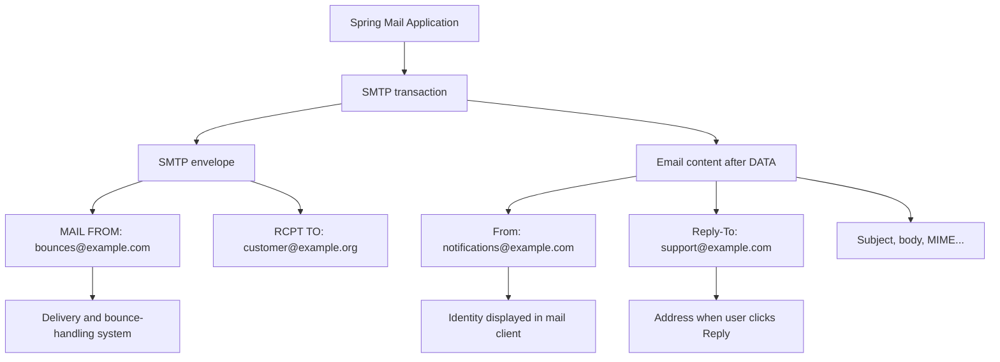

# Envelope Sender Differs from Displayed From

In an email sent via **Spring Framework Mail**, the address seen by the recipient on the **From** line is not necessarily the address the SMTP protocol uses to report delivery errors. These two addresses belong to two different layers of information:

- **Envelope sender** (also called *SMTP reverse-path*, *MAIL FROM*, or *bounce address*) lives in the **SMTP envelope**, declared via the `MAIL FROM` command.
- **From header** lives **inside the email message content** per Internet Message Format; the application and mail client display it as the message's sender name/address.

This distinction matters when configuring mail-sending services, handling returned emails (*bounces*), checking SPF/DMARC, and diagnosing why an email reached an SMTP server but never arrived in the destination mailbox.

## 1. One Email Can Have Multiple Addresses with Different Meanings

Consider an account registration notification:

| Information | Example | Function |
|---|---|---|
| **Envelope sender** | `bounces@example.com` | Address in the SMTP `MAIL FROM` command; where the mail transport system can send delivery failure notifications (*delivery status notifications*). |
| **From header** | `My App <notifications@example.com>` | Author/sender identity displayed to the reader. |
| **Reply-To** | `support@example.com` | Address that email clients normally pre-fill when the user clicks **Reply**. |
| **Envelope recipient** | `customer@example.org` | Address in the SMTP `RCPT TO` command; used by the server to route the mail. |
| **To header** | `Customer <customer@example.org>` | Recipient information displayed in the email header section. |
| **Return-Path** | `<bounces@example.com>` | Header usually added by the **final delivery** system to record the reverse-path used during transport. |

In the example above, the recipient sees **My App** in their message list. If they click **Reply**, the mail app sends the reply to `support@example.com`. If the message is rejected after the SMTP server already accepted it, the delivery failure notice can be sent to `bounces@example.com`.

**Do not equate** `MAIL FROM` with the `From:` header just because the two addresses sometimes match. They can be set by two separate mechanisms and serve two distinct purposes.

### Easily Confused Names

- **`MAIL FROM`**: SMTP command setting the *reverse-path* of a mail transaction. This is the **envelope sender**, not a header.
- **`From:`**: header describing the email's author, usually displayed prominently by mail readers.
- **`Sender:`**: a **different header** describing the actual transmitting agent acting on behalf of the author when necessary; it is **not** `MAIL FROM`. Do not use `Sender:` to try changing the bounce address.
- **`Reply-To:`**: header specifying where readers should send replies; it does not determine where the system sends bounces.
- **`Return-Path:`**: trace of the envelope sender once the message is delivered; normally added by the final receiving system. Applications should not set this header manually to replace `MAIL FROM`.

## 2. Where Does SMTP Transmit the Envelope Sender?

SMTP transmits the **envelope** before transmitting the **message content**. The example below omits greetings, STARTTLS, authentication, and some responses to focus on the difference between `MAIL FROM` and `From:`:

```text
C: MAIL FROM:<bounces@example.com>
S: 250 2.1.0 Sender OK

C: RCPT TO:<customer@example.org>
S: 250 2.1.5 Recipient OK

C: DATA
S: 354 Start mail input

C: From: My App <notifications@example.com>
C: To: Customer <customer@example.org>
C: Reply-To: support@example.com
C: Subject: Registration confirmation
C: MIME-Version: 1.0
C: Content-Type: text/plain; charset=UTF-8
C:
C: Your account has been created.
C: .
S: 250 2.0.0 Queued for delivery
```

Lines starting with `C:` and `S:` illustrate data exchanged between client and server. In a real SMTP session, the `DATA` command ends with CRLF, dot, CRLF; the mail library handles this detail automatically.

Notice the order:

1. `MAIL FROM:<bounces@example.com>` is sent **before** `DATA`, as a transport protocol command.
2. `From: My App <notifications@example.com>` is sent **after** `DATA`, as a header inside the email.
3. The server may apply separate policies to the reverse-path and the From header.
4. A `250` reply after `DATA` means the server **accepted the message for further processing**, not yet guaranteeing Inbox delivery.

A visual view:



The same email content can be sent to multiple recipients in the envelope (multiple `RCPT TO` commands). For example, a `Bcc` recipient usually appears in the SMTP envelope without appearing in the `To:` header read by other recipients. This also illustrates that **the envelope and headers are not copies of each other**.

## 3. Why Separate the Envelope Sender and the From Header?

### 3.1. Receiving Returned Emails (Bounces)

Suppose an application sends 10,000 notification emails with the From header:

```text
From: "Customer Service" <notifications@example.com>
```

Meanwhile, the delivery error-handling service uses a dedicated mailbox or endpoint:

```text
MAIL FROM:<bounces@example.com>
```

When the receiving server discovers a non-existent mailbox, full quota, or forwarding failure after accepting the email, it may send a **Delivery Status Notification (DSN)** to the reverse-path address. The sending system uses that information to update status, reduce resends to broken addresses, and support operations.

Note two different scenarios:

- **Rejected directly during the SMTP transaction:** For example, `RCPT TO` is rejected with code `550`. The application or mail provider receives the error right on the SMTP session; there may be no separate bounce email.
- **Accepted, then undeliverable later:** The mail system may send a DSN to the envelope sender. Whether a DSN is generated and arrives depends on policies, filters, and how providers process bounces.

Therefore, setting a proper bounce address helps track failures **after** the submission server returns success. However, merely setting a bounce address does not automatically create a bounce monitoring system; that address must have an actual receiving and processing mechanism.

### 3.2. Separating Communication Identity from Technical Infrastructure

Recipients can recognize the brand via `From: notifications@example.com` and reply via `Reply-To: support@example.com`. Meanwhile, the mail ops team needs to collect bounces at `bounces@example.com`. Each address has its own responsibility.

Mail providers may also require the envelope address to use a dedicated subdomain, such as `bounce.mail.example.com`, or rewrite the reverse-path themselves to track feedback lists and correlate individual sends. That is why the From header and the `Return-Path` observed in a mailbox can differ.

### 3.3. Preventing Loops When Generating Error Notices

SMTP also supports a **null reverse-path**:

```text
MAIL FROM:<>
```

This is the standard way to send **delivery status notification messages** so that an undeliverable DSN does not trigger endless new DSNs. Do not use `MAIL FROM:<>` as the default configuration for ordinary business emails; doing so may lose the ability to receive and track bounces.

## 4. How Does Spring Framework Mail Map the Two Address Types?

Spring provides `JavaMailSender`, `SimpleMailMessage`, `MimeMessage`, and `MimeMessageHelper` to build and send mail. Selecting the **envelope** address occurs at the Jakarta Mail/mail-provider SMTP transport layer, whereas the **From** header is set on the message object.

### 4.1. `setFrom(...)` Changes the From Header

Example with a Spring Boot application using `spring-boot-starter-mail`:

```java
import org.springframework.mail.SimpleMailMessage;
import org.springframework.mail.javamail.JavaMailSender;
import org.springframework.stereotype.Service;

@Service
public class AccountNotificationService {
    private final JavaMailSender mailSender;

    public AccountNotificationService(JavaMailSender mailSender) {
        this.mailSender = mailSender;
    }

    public void sendWelcome(String recipient) {
        SimpleMailMessage message = new SimpleMailMessage();
        message.setFrom("notifications@example.com");
        message.setReplyTo("support@example.com");
        message.setTo(recipient);
        message.setSubject("Welcome");
        message.setText("Your account has been created.");

        mailSender.send(message);
    }
}
```

Here:

- `message.setFrom("notifications@example.com")` sets the **From header** on the email.
- `message.setReplyTo("support@example.com")` sets the **Reply-To header**.
- `message.setTo(recipient)` sets the recipient at the message level; the mail library uses that recipient info to generate the `RCPT TO` command.
- No call in `SimpleMailMessage` above directly sets a separate envelope sender.

Without configuring a specific envelope sender, the SMTP provider typically infers an address from available information, including the From header. Thus in simple setups, `MAIL FROM` and `From:` may coincide. **Matching by default does not mean they are the same data field.**

### 4.2. `mail.smtp.from` Specifies the Envelope Sender

With standard Jakarta Mail SMTP providers, the **`mail.smtp.from`** property is used as the address for the `MAIL FROM` command. In Spring Boot, you can pass this property via `spring.mail.properties`:

```yaml
# application.yml
spring:
  mail:
    host: smtp.example.net
    port: 587
    username: ${SMTP_USERNAME}
    password: ${SMTP_PASSWORD}
    properties:
      "[mail.smtp.auth]": true
      "[mail.smtp.starttls.enable]": true
      "[mail.smtp.starttls.required]": true
      "[mail.smtp.from]": bounces@example.com
      "[mail.smtp.connectiontimeout]": 5000
      "[mail.smtp.timeout]": 5000
      "[mail.smtp.writetimeout]": 5000
```

When combining the configuration above with `AccountNotificationService`:

| Layer | Value used |
|---|---|
| From header | `notifications@example.com` from `message.setFrom(...)` |
| Reply-To header | `support@example.com` from `message.setReplyTo(...)` |
| SMTP `MAIL FROM` | `bounces@example.com` from `mail.smtp.from` |
| SMTP `RCPT TO` | The `recipient` value passed to the send method |

`spring.mail.properties` only forwards properties to the mail session/transport. The key `mail.smtp.from` is a **mail provider SMTP property**, not the `setFrom(...)` method and not a separate property named `spring.mail.from`.

**Watch the configuration scope:** `mail.smtp.from` in this example applies to emails sent through the same SMTP/session configuration. If the application serves multiple tenants or needs different bounce addresses per message, do not mutate a shared property right before each send, as concurrent sends can interfere with one another.

Design approaches for that requirement include using separate senders/sessions per configuration, or setting the envelope sender **per message** if supported by the SMTP provider (such as an appropriate provider's `SMTPMessage#setEnvelopeFrom(...)` API). Provider-specific APIs depend on library versions and tie source code to an implementation, so choose deliberately after confirming the mail stack in use.

### 4.3. What If Using `MimeMessageHelper`?

`MimeMessageHelper` supports MIME multiparts, HTML, and attachments, yet `helper.setFrom(...)` still sets the **From header**:

```java
import jakarta.mail.MessagingException;
import jakarta.mail.internet.MimeMessage;
import org.springframework.mail.javamail.JavaMailSender;
import org.springframework.mail.javamail.MimeMessageHelper;

public void sendHtmlMail(JavaMailSender sender, String recipient)
        throws MessagingException {
    MimeMessage mime = sender.createMimeMessage();
    MimeMessageHelper helper = new MimeMessageHelper(mime, "UTF-8");

    helper.setFrom("notifications@example.com", "My App");
    helper.setReplyTo("support@example.com");
    helper.setTo(recipient);
    helper.setSubject("Account confirmation");
    helper.setText("<p>Your account has been created.</p>", true);

    sender.send(mime);
}
```

If the SMTP session also has `mail.smtp.from=bounces@example.com`, the transaction's envelope sender can still be `bounces@example.com`. Switching from `SimpleMailMessage` to `MimeMessageHelper` does not change this concept.

## 5. What Is Return-Path and Why Shouldn't You Edit This Header Manually?

A delivered email may show raw headers like:

```text
Return-Path: <bounces@example.com>
Received: from ... by ...
From: My App <notifications@example.com>
Reply-To: support@example.com
To: customer@example.org
Subject: Account confirmation
```

`Return-Path:` usually reflects the reverse-path used by the delivery system. It is useful when viewing the original message source to inspect the bounce address. However:

1. The `Return-Path:` header is **not** the `MAIL FROM` command.
2. This header is usually recorded by the **final delivery server**, not something the application should manually inject into initial content.
3. During forwarding, mail services can rewrite the envelope sender using mechanisms such as SRS, VERP, or custom routing; `Return-Path` at the destination may therefore no longer match the address the app initially sent.
4. Manually adding `Return-Path:` to `MimeMessage` **does not guarantee** changing the `MAIL FROM` command in SMTP.

If the goal is choosing where bounces go, configure the **actual reverse-path** on the SMTP transport or via the mechanism specified by the mail service.

## 6. How Does the Envelope Sender Relate to SPF, DKIM, and DMARC?

The address in the envelope is not just for bounces; it also plays a role in **sender authentication**.

### SPF: Checking Sending Source Against SMTP Identity

For standard SMTP messages with a non-empty reverse-path, SPF checks whether the sending IP is authorized to send on behalf of **the envelope sender's domain**. Example:

```text
MAIL FROM:<bounces@mail.example.com>
From: notifications@example.com
```

In this example, SPF may evaluate the `mail.example.com` domain, while the mail client displays `notifications@example.com`. With a null reverse-path, SPF has separate evaluation rules based on the HELO/EHLO identity.

**An SPF pass does not automatically verify that the From header belongs to the same domain.** This is part of why DMARC is needed.

### DKIM: Signature Over Content and Selected Headers

DKIM verifies an email signature using the signing domain `d=`. Depending on the system, the DKIM domain may be the organization's domain or a domain operated by the mail service. Having Spring create a `MimeMessage` does not mean the message is DKIM-signed; signing is usually handled by the SMTP provider or mail gateway.

### DMARC: Authentication Aligned with the From Header

DMARC takes **the domain in the From header** as its reference identity, then checks whether SPF or DKIM results achieve **alignment** (domain alignment) with the From header.

Examples:

| From header | Envelope sender | DMARC implication |
|---|---|---|
| `notify@example.com` | `bounce@example.com` | Same domain; if SPF passes, SPF alignment can be satisfied. |
| `notify@example.com` | `bounce@mail.example.com` | Subdomain can satisfy *relaxed* alignment; depends on policy and organizational domain. |
| `notify@example.com` | `bounce@provider.invalid` | SPF may pass for the provider's domain but fail alignment with `example.com`; DMARC can still pass if there is **valid, aligned DKIM**. |

Therefore, when separating the envelope sender from the From header, coordinate SPF, DKIM, and DMARC configuration with the provider. An SMTP server allowing a message to be sent does not guarantee destination mail systems will trust or deliver it.

## 7. Setting the Envelope Sender in Real-World Scenarios

### Case A: Simple Notifications

A small application uses:

```text
MAIL FROM:<notifications@example.com>
From: notifications@example.com
Reply-To: support@example.com
```

The advantage is minimal, easy-to-understand configuration. If bounce monitoring is needed, the `notifications@example.com` mailbox must be operated and process replies appropriately; do not assume it is send-only.

### Case B: Sending High Volume and Needing Bounce Management

A notification system may use:

```text
MAIL FROM:<bounce-queue@mail.example.com>
From: "My App" <notifications@example.com>
Reply-To: support@example.com
```

A dedicated mail service ingests and processes DSNs/bounces, then ties failures back to individual sent notifications. Correlation can rely on data in provider events, message IDs, VERP addresses, or other platform-specific linking mechanisms.

Do not assume `mail.smtp.from` alone is enough to map every bounce back to a specific business request. A shared address only defines where bounces arrive, while **correlating to each email** is a separate design task.

### Case C: SMTP Service Manages Return-Path on Behalf of the App

Some email platforms offer dedicated bounce domains, subdomains for verification, or *custom MAIL FROM / custom Return-Path* features. When using such services, the actual address appearing in the SMTP session or in `Return-Path` at the recipient may be governed by the provider's configuration.

When seeing discrepancies, check the provider's documentation and logs rather than looking only at the From header in Java source code.

## 8. Common Misconceptions

| Misconception | Accurate understanding |
|---|---|
| "Calling `message.setFrom(...)` configures the bounce address." | `setFrom(...)` sets the From header. Check how the SMTP provider selects `MAIL FROM`. |
| "`Reply-To` is where bounces go." | `Reply-To` serves reader replies; DSNs are routed based on the reverse-path. |
| "Adding a `Return-Path:` header changes the envelope sender." | `Return-Path` is a delivery trace header; you must change the SMTP envelope address via transport/provider configuration. |
| "If `send(...)` throws no error, the email reached the Inbox." | The SMTP server may only have accepted it for relaying; it can still bounce, be delayed, or hit spam. |
| "If SPF passes, DMARC definitely passes." | DMARC also requires alignment with the From header; DKIM can be another path to a DMARC pass. |
| "If the receiving server sees a clean `From`, it accepts sending." | Mail systems can inspect the envelope, source IP, SPF/DKIM/DMARC, limits, and anti-spoofing policies. |

## 9. How to Observe and Troubleshoot

When determining what the application is actually sending, inspect data at the **right layer**:

1. **At the application:** Check code calling `setFrom(...)`, `setReplyTo(...)`, and SMTP configuration `mail.smtp.from`. Never log passwords, tokens, or sensitive email bodies.
2. **At the SMTP server:** Inspect logs or an SMTP test tool to see actual `MAIL FROM` and `RCPT TO` commands; compare against headers inside `DATA`.
3. **At the receiving mailbox:** If the email arrives, view the raw message source for `From:`, `Reply-To:`, `Return-Path:`, SPF/DKIM/DMARC results, and `Received:` headers.
4. **At the sending service:** When mail fails to arrive, check the message ID, acceptance, relay, deferral, bounce, or suppression events. If a bounce occurred, verify the infrastructure handling the configured reverse-path address.

You can use a test SMTP server/mail-catcher tool in development to inspect the **SMTP envelope** and **message headers** separately. Do not rely solely on the Inbox UI, since many email apps show only the From header and hide the envelope.

A security note: successfully authenticating to an SMTP server **does not implicitly grant permission to use any From header**. Many services require verified From domains or addresses; some will reject or rewrite the sending address. Follow the sending system's policies and configure domain authentication appropriately.

## 10. Summary of Flow and Key Takeaways

When Spring Mail sends a notification, application code creates a message object with headers like `From:` and `Reply-To:`. The SMTP transport opens a connection to the mail server, sends `MAIL FROM` to declare the **envelope sender**, then sends `RCPT TO` and `DATA` containing headers/body. The receiving server continues relaying or delivering.

- **Envelope sender = `MAIL FROM`:** address for transport and delivery failure replies; can be set via `mail.smtp.from`.
- **From header = `From:`:** displayed identity; set via `SimpleMailMessage.setFrom(...)` or `MimeMessageHelper.setFrom(...)`.
- **Reply-To = `Reply-To:`:** where readers send replies; does not govern bounces.
- **Return-Path = `Return-Path:`:** header added by the delivery system to record the reverse-path; does not replace the SMTP command.
- **SPF/DMARC:** can involve two different domain identities and require proper alignment configuration.
- **SMTP accepted the mail** is a different state from **the email was successfully delivered**.

In an email-sending design meant for long-term operation, explicitly decide **who is the displayed identity**, **who receives replies**, **who receives bounces**, and **which system tracks delivery status**. Once those roles are defined, the difference between the envelope sender and the From header becomes a useful design tool rather than a hard-to-find bug.
