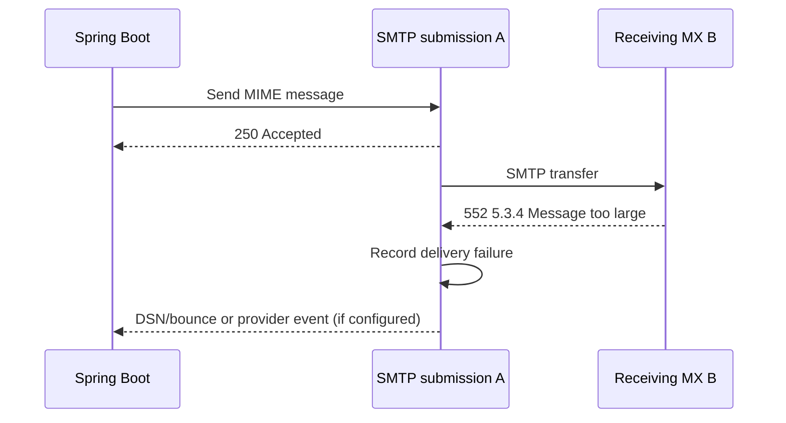

# Message Size, Line Limits, and Server Limits

A Spring Boot application uses `JavaMailSender` to send an email with a 20 MiB PDF attachment. The attachment is allowed to be uploaded to the application, the SMTP connection works, and the sending account authenticates successfully. Yet the server returns `552 5.3.4 Message size exceeds fixed maximum message size`. How can a 20 MiB file exceed a mail service's 25 MiB limit?

The issue is that **the original file size does not equal the size of the email transported over SMTP**. Email content must include headers, body, MIME structure, and usually binary files encoded into transport-safe text. Beyond total size limits, SMTP also defines **line length limits** and **command length limits**. Each intermediate server can also enforce its own policies.

This lesson explains those limits in the context of **Spring Framework Mail**, how they interact with MIME, how to recognize server error replies, and how to prevent oversized-email failures.

## 1. Three Layers of Limits to Distinguish

When evaluating whether an email can be sent, distinguish three layers:

| Layer | Typical limits | Impact on the application |
|---|---|---|
| **SMTP protocol / email format** | Data line length, SMTP commands, line and character representation | Email must be validly formatted, even when total size is small. |
| **Sending server capabilities & policies** | Max message size, recipient count, auth requirements, sending quotas/limits | Submission server can reject the mail at send time. |
| **Receiving server and intermediate hops** | Own MIME/message limits, mailbox quota, content and attachment filters | An email accepted by the sending server can still be rejected at a later hop. |

For example, an application sends through server A which accepts up to 30 MiB, but the recipient's domain via filter gateway B only accepts 20 MiB. **The effective limit of the delivery path is imposed by the systems along that path**, not simply Spring Boot configuration.

At the same time, "message size" can be measured in several ways:

- **File size on disk:** exact byte count of `report.pdf`.
- **MIME size:** the entire message after adding headers, body, multipart boundaries, encoded attachments, and line breaks.
- **SMTP wire transfer size:** number of octets transmitted in message data; subject to SMTP DATA or negotiated extension rules.
- **Product quota/limits:** providers may advertise "max attachment" or "max message" with their own accounting. Always read the exact unit and scope stated in their documentation.

An **octet** is an 8-bit group, normally equivalent to one byte. SMTP limits are usually stated in octets, not the number of Unicode characters Java counts in `String.length()`.

## 2. SMTP Line Limits

### 2.1. What Is the Maximum Length of an Email Data Line?

In base SMTP, the limit for a **text line transmitted over SMTP** is **1,000 octets including the CRLF line ending** (`\r\n`). Since CRLF takes 2 octets, a normal content line can hold at most **998 octets before CRLF**. SMTP's rule for handling leading dots on a line is a special case explained later.

A message of only a few kilobytes can still be invalid if it contains an excessively long continuous line:

```text
Valid in principle:
  998 content octets + CRLF (2 octets) = 1000 octets

Invalid in classic SMTP DATA:
  2000 continuous content octets + CRLF
```

Common examples:

- An HTML email minified onto one giant single line.
- A long JSON string or token inserted verbatim into the body.
- An encoded binary part without line wrapping.
- A custom library generating headers and concatenating content without following folding rules.

**Never arbitrarily insert line breaks into every piece of text.** For URLs, digital signatures, machine-parseable content, or fixed-format data blocks, arbitrary line breaks can alter the content. MIME provides appropriate encodings to preserve data intact.

### 2.2. CRLF, Header Limits, and Folding

SMTP uses the **CRLF** pair (carriage return + line feed, `\r\n`) to end lines in the protocol. A lone `\n` inside a Java string does not mean a valid SMTP line sent straight onto the wire; the email library is responsible for representing the message per standard.

For **message headers**, RFC 5322 additionally specifies:

- Each header line **must not exceed 998 characters**, excluding CRLF.
- Header lines **should be at most 78 characters** for display ease and compatibility.
- Headers can be **folded** by breaking at CRLF and starting the next line with whitespace or a tab; the receiving side **unfolds** those lines when parsing headers.

Example of a folded header:

```text
Subject: Notification about your request processing status
 and the next steps for users
```

The example above only illustrates folding syntax. For subjects containing Vietnamese or non-ASCII text, MIME libraries also use header encoding mechanisms (such as encoded-word) or negotiated internationalization support. **Do not build `Subject:` lines by raw string concatenation**; let Jakarta Mail/MIME handle encoding and folding.

RFC 5322 character counts and SMTP octet counts are not always identical when Unicode is present. Cases needing SMTPUTF8 or 8BITMIME have separate negotiation rules; even when 8-bit characters are supported, **not every line length limit disappears automatically**.

### 2.3. SMTP Commands Also Have Limits

Outside `DATA`, a basic SMTP command line has a limit of **512 octets, including CRLF**. Examples:

```text
EHLO app.example.com
MAIL FROM:<notifications@example.com>
RCPT TO:<buyer@example.net>
DATA
QUIT
```

SMTP extensions can add parameters and related limits per their own specs. Applications should not try stuffing hundreds of addresses, business data, or JSON payloads into a single SMTP command.

Distinguish:

- `MAIL FROM` / `RCPT TO` are **protocol commands**.
- `From:` / `To:` / `Subject:` are **headers inside message content**.
- Both have separate limits; editing headers does not automatically alter the SMTP envelope.

### 2.4. Leading Dots and DATA Termination

When sending with `DATA`, SMTP uses a line containing only a dot (`.`) to signal **end of message**:

```text
C: DATA
S: 354 End data with <CRLF>.<CRLF>
C: Hello
C: ..This line originally started with one dot
C: Goodbye
C: .
S: 250 2.0.0 Queued
```

This is **dot-stuffing**: if an original data line begins with a dot, the sender prepends a dot during transport; the receiver strips the extra dot when restoring the message. SMTP line limits are defined with this special rule in mind.

`JavaMailSender` and Jakarta Mail's SMTP transport automatically perform framing/dot-stuffing when sending via `DATA`. **Never manually prepend extra dots to the body of a `MimeMessage`**, as doing so can corrupt the content.

## 3. Total Size Limits for a Single Message

### 3.1. Does SMTP Have a Global 10 MB or 25 MB Limit?

**No.** Values such as 10 MB, 20 MB, 25 MB, or 50 MB are **service limits**, not a universal maximum size enforced by SMTP across all systems.

A server may cap size due to:

- Queue storage and buffer memory.
- Network budget, connection hold time, and processing cost.
- Preventing spam, malicious attachments, or abuse.
- Policies per sending account, recipient group, or domain.
- Mailbox quotas, content-filtering gateways, or enterprise policy.

An email can be accepted by the sending SMTP server and still be rejected later by a filtering gateway at the recipient's domain. Never treat a successful `send()` result as a guarantee that the message reached the Inbox.

### 3.2. The SMTP SIZE Extension (RFC 1870)

The **SIZE** extension lets a server advertise its size limit and lets the sender declare the estimated message size before transmitting the full payload.

After `EHLO`, the server may reply:

```text
C: EHLO app.example.com
S: 250-smtp.example.com
S: 250-SIZE 26214400
S: 250-8BITMIME
S: 250 HELP
```

In this example, `26214400` is **26,214,400 octets = 25 MiB**. Do not read it as "decimal 25 MB":

- **1 MB** (decimal) = 1,000,000 bytes.
- **1 MiB** (binary) = 1,048,576 bytes.
- **25 MiB** = 26,214,400 bytes, whereas **25 MB** = 25,000,000 bytes.

When the server supports SIZE, the client can declare the expected size via the `SIZE` parameter on `MAIL FROM`:

```text
C: MAIL FROM:<notifications@example.com> SIZE=28700000
S: 552 5.3.4 Message size exceeds fixed maximum message size
```

Here the estimated message is around 28.7 million octets, exceeding the server's advertised limit, so the server can reject **before receiving DATA**. Even if size is unknown upfront or the SIZE parameter is not used, the server still retains the right to reject during receipt or after processing actual data.

Several important points:

1. `SIZE` describes the octet count of the **transmitted message**, including headers and encoded body—not merely the raw attachment file size.
2. A server may advertise the `SIZE` extension without a fixed limit number; `250-SIZE` still indicates extension support.
3. The SIZE extension is a **helpful negotiation mechanism**; it does not mean every server advertises or enforces the same capacity.
4. The estimated figure must match the actual data to be transferred; adding signatures, footers, files, or MIME changes can increase total size.
5. Another server at downstream hops may enforce a lower limit.

### 3.3. What Parts Count Toward Size?

When sending a MIME email, the size to consider includes:

```text
Message
├── Headers: From, To, Subject, Date, MIME-Version, Content-Type, ...
├── Blank line separating headers and body
└── Body
    └── multipart/mixed (if attachments exist)
        ├── text/plain or text/html part
        ├── MIME boundaries, per-part headers
        ├── Attachment A (transfer-encoded)
        └── Attachment B (transfer-encoded)
```

The original file gains **Content-Type**, **Content-Disposition**, filename, MIME boundaries, line endings, and typically **base64** encoding. SMTP `DATA` also has protocol framing and dot-stuffing; SIZE calculation must follow the extension's definition rather than arbitrarily counting all wire framing bytes toward message total.

For one email with multiple recipients in a single delivery, **MIME size is not multiplied by the recipient count within one SMTP transaction**. However, if the provider splits the email into separate deliveries, service quotas and aggregate bandwidth may vary by implementation.

## 4. Why Do Attachments Make Emails Larger Than Expected?

### 4.1. Base64 Increases Size

Because traditional SMTP was designed around constrained text data, MIME commonly uses **base64** to convert binary data into ASCII characters.

Every **3 bytes of raw data** becomes **4 base64 characters**; with padding and line breaks, total volume grows. Standard MIME base64 wraps lines after at most **76 characters**. CRLF also adds 2 bytes per line.

For a file of \(N\) bytes, you can estimate:

1. Number of base64 characters: \(B = 4 \times \lceil N/3 \rceil\).
2. Added CRLF bytes: approximately \(2 \times \lceil B/76 \rceil\).
3. Total encoded attachment payload: roughly \(B + 2 \times \lceil B/76 \rceil\) bytes, before counting MIME part headers and boundaries.

For large files, the approximate expansion factor is:

\[
\frac{4}{3} \times \frac{78}{76} \approx 1.3684
\]

That means **binary files can take roughly 136.8% of their original size** when sent as MIME line-wrapped base64; this is an estimate, not a fixed constant for every email.

| Original file | Estimated MIME base64 part | Notes |
|---:|---:|---|
| 1 MiB | About 1.37 MiB | Excludes headers/boundaries. |
| 10 MiB | About 13.68 MiB | Message also has body and metadata. |
| 20 MiB | About 27.37 MiB | Can exceed a 25 MiB limit. |
| 25 MiB | About 34.21 MiB | Far exceeds a 25 MiB message limit. |

Hence the claim "if SMTP allows up to 25 MiB, you can attach a 25 MiB file" is false if 25 MiB is the **limit on the entire encoded email**.

### 4.2. HTML, Unicode, and Encoding Also Matter

Not every email part shares the same 136.8% factor.

- **Short ASCII `text/plain`:** can travel as 7-bit, close to raw byte count.
- **`text/html`:** HTML markup, inline CSS, long URLs, and embedded images can enlarge content; `cid:` images are attached as MIME parts.
- **`quoted-printable`:** fits text that is mostly ASCII, though character escaping and line wrapping also add bytes.
- **`base64` for UTF-8 text:** content must be measured in **UTF-8 bytes before encoding**, not character count.
- **Internationalized headers:** subject, display names, and filenames may require encoding/folding, adding more bytes than expected.

For example, the Java string `"Đơn hàng"` has a `String.length()` counted in UTF-16 code units, while the message may be encoded into **more UTF-8 bytes** and then undergo transfer encoding. Never use `text.length()` to measure SMTP limits.

### 4.3. One Email with Multiple Files

If sending 3 files of 6 MiB each, raw attachment size alone is 18 MiB. After base64, the attachments alone are roughly **24.63 MiB**, before counting body, headers, and MIME overhead. If the server only allows 25 MiB, very little headroom remains; this situation risks rejection when adding a logo, signature, or HTML.

Design a **safety margin** when setting internal thresholds instead of configuring right at the advertised maximum.

## 5. How Do Servers Reject Oversized Messages?

SMTP has three-digit reply codes; when enhanced status codes are supported, replies may include an `X.Y.Z` code. Several scenarios:

### 5.1. Rejection Before Transferring Content

```text
C: EHLO app.example.com
S: 250-smtp.example.com
S: 250-SIZE 10485760
S: 250 HELP
C: MAIL FROM:<alerts@example.com> SIZE=14500000
S: 552 5.3.4 Message size exceeds fixed maximum message size
```

Advantage: avoids transmitting a large payload that is guaranteed to be rejected under advertised limits.

### 5.2. Rejection During or at the End of DATA

```text
C: MAIL FROM:<alerts@example.com>
S: 250 2.1.0 OK
C: RCPT TO:<recipient@example.net>
S: 250 2.1.5 OK
C: DATA
S: 354 Start mail input
C: [Encoded headers, body, and attachment]
C: .
S: 552 5.3.4 Message too large for this server
```

The server may wait until receiving enough data to measure actual size or run certain checks. The sending application may already have spent time and bandwidth even though the message gets rejected.

### 5.3. Related Reply Codes That Are Not Synonymous

| Response | Interpretation |
|---|---|
| `552 5.3.4` | Usually indicates the message exceeded a fixed size limit. |
| `552 5.2.2` | May relate to mailbox quota or storage capacity; read enhanced code and context. |
| `452 4.3.1` | Temporary insufficient storage/resources in some situations. |
| `451 4.x.x` | Temporary processing error; do not automatically assume size-related. |
| `550 5.7.1` / `554 5.7.1` | May be policy or permission, e.g., blocked file type; not necessarily total byte count. |
| `500` / `501` or syntax error | Can occur on invalid command/protocol; inspect position and actual response. |

**Never classify every `552` as "email too large".** Semantics depend on the enhanced status code, when the failure occurred, and the server's specific message. `4xx` codes usually indicate temporary failures, whereas `5xx` codes indicate permanent failures for that send attempt; retries must follow the cause and policy.

### 5.4. Rejection at the Receiving Server

A typical flow:



The application may finish `send(...)` successfully at hop A, only to fail due to **B's limit** reported later via bounce/DSN or provider events. This means **pre-send size control** and **post-send delivery error tracking** are complementary responsibilities.

## 6. Do CHUNKING, BINARYMIME, and 8BITMIME Eliminate Limits?

SMTP has extensions expanding how messages are transported:

| Extension | Primary meaning | What not to infer |
|---|---|---|
| **8BITMIME** | Allows transmitting 8-bit content in suitable parts when the server supports it and the message is validly formatted. | Does not mean arbitrary binary data or ultra-long lines are permitted. |
| **SMTPUTF8** | Extends support for internationalized addresses/headers under negotiated conditions. | Does not remove total size limits or server policies. |
| **CHUNKING** | Uses `BDAT` to transfer messages in declared-length chunks instead of the usual `DATA` terminator. | Does not automatically mean every binary format is valid. |
| **BINARYMIME** | Pairs with appropriate transfer mechanisms to send binary MIME content parts when supported by the server. | Does not guarantee all downstream hops support it; SIZE/quota limits still apply. |

Seeing the word "CHUNKING" in `EHLO` does not let you conclude files can be sent without limits, without encoding, or bypassing all line constraints. **Exact rules depend on the extensions actually negotiated by both sides**, how MIME is built, and every intermediate system.

For a Spring Boot app sending general Internet email, the high-compatibility choice is usually **standard MIME, base64 attachments, and SMTP submission over TLS**, rather than manually driving `BDAT` commands or forcing specialized binary formats.

## 7. Integrating Spring Framework Mail and Controlling Size

### 7.1. What Is Spring Mail Responsible For?

In a Spring Boot application, the common dependency is:

```groovy
dependencies {
    implementation 'org.springframework.boot:spring-boot-starter-mail'
}
```

Spring provides the `JavaMailSender` abstraction to construct and send emails via Jakarta Mail. When attachments, HTML, or multipart content are needed, `MimeMessage` with `MimeMessageHelper` is typically used.

Example SMTP submission configuration:

```yaml
spring:
  mail:
    host: ${MAIL_HOST}
    port: 587
    username: ${MAIL_USERNAME}
    password: ${MAIL_PASSWORD}
    properties:
      mail:
        smtp:
          auth: true
          starttls:
            enable: true
            required: true
          connectiontimeout: 5000
          timeout: 10000
          writetimeout: 10000
```

Environment variables must be supplied by the deployment environment. The timeouts are **connect/read/write wait times**, not message size limits. If the SMTP server requires implicit TLS on port 465, change the TLS config accordingly—do not just change the port number.

**Avoid configuration misconceptions:**

- `spring.servlet.multipart.max-file-size` and `spring.servlet.multipart.max-request-size` govern **HTTP uploads** into a Spring MVC app when using servlet multipart config.
- `spring.codec.max-in-memory-size` relates to certain reactive-stack data buffering scenarios, not SMTP outbound MIME limits.
- Spring Boot **has no standard `spring.mail.max-size` property to enforce a universal SMTP size limit across providers**. The application must enforce its own sending policy while letting the SMTP server make the final decision.

An accepted 20 MiB HTTP upload **does not prove** an email containing that file will be accepted by SMTP infrastructure.

### 7.2. Example of Sending an Attachment with Size Control

Suppose a report-sending service allows PDF files up to 12 MiB and enforces an internal 20 MiB MIME email threshold. These numbers are **application policy examples** and must be tuned to the actual provider and recipients.

```java
import jakarta.mail.MessagingException;
import jakarta.mail.internet.MimeMessage;
import org.springframework.core.io.FileSystemResource;
import org.springframework.mail.javamail.JavaMailSender;
import org.springframework.mail.javamail.MimeMessageHelper;
import org.springframework.stereotype.Service;

import java.io.IOException;
import java.io.OutputStream;
import java.nio.charset.StandardCharsets;
import java.nio.file.Files;
import java.nio.file.Path;

@Service
public class ReportMailService {

    private static final long MIB = 1024L * 1024L;
    private static final long MAX_ATTACHMENT_BYTES = 12L * MIB;
    private static final long MAX_MESSAGE_BYTES = 20L * MIB;

    private final JavaMailSender mailSender;

    public ReportMailService(JavaMailSender mailSender) {
        this.mailSender = mailSender;
    }

    public void sendReport(String recipient, Path report)
            throws IOException, MessagingException {

        if (!Files.isRegularFile(report)) {
            throw new IllegalArgumentException("Report must be a regular file");
        }

        long attachmentSize = Files.size(report);
        if (attachmentSize > MAX_ATTACHMENT_BYTES) {
            throw new IllegalArgumentException("Attachment exceeds local limit");
        }

        MimeMessage message = mailSender.createMimeMessage();
        MimeMessageHelper helper =
                new MimeMessageHelper(message, true, StandardCharsets.UTF_8.name());

        helper.setFrom("reports@example.com");
        helper.setTo(recipient);
        helper.setSubject("Monthly report");
        helper.setText("Please see the attached PDF report.", false);
        helper.addAttachment("monthly-report.pdf", new FileSystemResource(report));

        // Save MIME changes before estimating the number of serialized bytes.
        message.saveChanges();
        ByteCounter counter = new ByteCounter();
        message.writeTo(counter);
        if (counter.bytes() > MAX_MESSAGE_BYTES) {
            throw new IllegalArgumentException("Encoded email exceeds local limit");
        }

        mailSender.send(message);
    }

    private static final class ByteCounter extends OutputStream {
        private long count;

        @Override
        public void write(int value) {
            count++;
        }

        @Override
        public void write(byte[] value, int offset, int length) {
            count += length;
        }

        long bytes() {
            return count;
        }
    }
}
```

The example uses `MimeMessage.writeTo(OutputStream)` to count bytes of the **serialized MIME message** without buffering the whole email in a `ByteArrayOutputStream`. With `FileSystemResource`, the attachment can open a stream for reading during serialization and open again when sending.

This is a **local pre-send check**, with several caveats:

- `writeTo(...)` may read the entire file, so **measuring size and sending** incurs extra I/O. For large files, consider computing size from metadata + safe-margin estimation or spooling data to avoid repeated processing.
- MIME contents can change when the transport/provider adds or adjusts headers; bytes measured pre-send are an **estimate for the current serialization**, not a promise every hop sees the exact same size.
- A file could change between measurement and sending if managed by another process. For strict guarantees, use an immutable file or managed snapshot.
- If using `InputStreamSource` for attachments, the data source must be able to supply a **fresh stream** when Jakarta Mail reads again; avoid single-use streams.
- Ensure the file path is authorized for access; never take arbitrary paths from user requests without checking permissions and scope.
- After all local checks, the **SMTP server and each receiving hop still decide whether the message is accepted**.

In production systems, also avoid sending large files synchronously while holding a user's HTTP request. Enqueue the request and send via a worker while updating status clearly.

### 7.3. Can `MimeMessage.getSize()` Be Used to Check?

Do not treat `MimeMessage.getSize()` as a reliable way to determine total SMTP bytes. This API **can return `-1` when size is unknown**, or return results that do not fully reflect MIME serialization and actual processing. Body character count or raw file size is insufficient too.

If pre-send precision is needed at the application level, work with the **bytes of the serialized MIME message** or a spooling flow that can measure and bound size. If only a quick check is needed, use **per-part estimation** and set a threshold well below the provider's cap as a safety buffer.

### 7.4. Tracking Send Errors with Spring

`JavaMailSender.send(...)` can throw exceptions in the `MailException` family, such as `MailSendException` when protocol sending fails. In some cases, the deeper cause sits inside Jakarta Mail or SMTP transport exceptions.

Handling rules:

1. Record the **send attempt**, SMTP error code (if obtainable), timestamp, provider, and diagnostic info stripped of sensitive data.
2. Distinguish permanent size errors like `552 5.3.4` from timeouts, dropped connections, or account errors.
3. For oversized messages, **reduce size/switch to a download link**; do not retry identically forever.
4. For temporary errors, use controlled retries, exponential backoff, and attempt caps.
5. When the submission server accepts the mail yet a receiving server rejects later, ingest provider bounces/DSNs or events to update status.

Never log raw email bodies, tokens, SMTP passwords, or attachments just to diagnose size errors.

## 8. Designing an Application Size Policy

### 8.1. Set Internal Thresholds Across the Whole Message

A practical strategy is:

1. **Identify the lowest known limit** across your sending provider and expected recipient types.
2. Distinguish limits for **individual files**, **total attachments**, and the **entire message**.
3. Account for encoding, MIME overhead, subject/headers, HTML content, inline images, and a safety buffer.
4. Reject policy-violating requests early with a user-understandable message.
5. Monitor SMTP outcomes and post-send bounces; adjust thresholds when encountering real receiving-system policies.

Example policy:

| Limit type | Illustrative value | Purpose |
|---|---:|---|
| Individual attachment | 12 MiB | Avoid sending oversized files right from the start. |
| Total raw attachments | 15 MiB | Limit file count/total even when each file is valid. |
| Total encoded MIME | 20 MiB | Keep a safety buffer below a 25 MiB provider cap. |
| Send job processing time | Per system SLA | Avoid blocking synchronous requests too long. |

These are not RFC or Spring defaults. Appropriate numbers must come from business requirements and service policies.

### 8.2. When an Email Is Too Large, What Should You Do?

Common options include:

- **Shrink content:** optimize HTML, remove unnecessary inline images, export PDFs at reasonable resolution.
- **Compress files when permitted:** helpful for text documents; less effective for JPEG, video, or already-compressed formats.
- **Send a secure download link:** upload files to object storage and email an expiring link requiring authorization and download controls.
- **Split content by business purpose:** send documents across separate purpose-built notifications; avoid arbitrarily splitting one large file across multiple emails just to bypass limits.
- **Use a different delivery channel:** for large data, APIs/file transfer suit better than email.

For sensitive documents, download links should enforce expiration, access control, revocation, and audit logs. Merely emailing a link **does not automatically make a document secure** if the link is public indefinitely.

### 8.3. Never Try to Bypass Receiving System Limits

If an SMTP server returns a size or file-policy error, never automatically rename extensions, re-encode arbitrarily, or send multiple copies to evade filters. Such behavior hurts deliverability, increases spam classifications, and violates receiving system policies.

For transactional emails, UX should display "File exceeds email sending limit; please use a download link" or ask to reduce size instead of endlessly failing retries.

## 9. Diagnosing When Email Sending Fails

To diagnose accurately, trace where the error occurred:

| Symptom | Possible cause | What to check |
|---|---|---|
| SMTP rejects at `MAIL FROM ... SIZE=...` | Estimated size exceeds advertised limit | Read `EHLO SIZE`, compare **MIME bytes**, not just file bytes. |
| `552 5.3.4` after `DATA` | Server measured actual size and rejected | Check base64 attachments, headers, MIME boundaries, and server cap. |
| `500/501` or format error sending body | Invalid line/command, possibly too long | Check that mail is built by MIME library, folding, CRLF, per-part encoding. |
| Fails only for certain recipient domains | Destination MX/gateway policy is lower or stricter | Check DSN/bounce and that domain's receiving policies. |
| 18 MiB file fails despite 20 MiB cap | MIME/base64 pushed total message over cap | Estimate or measure serialized MIME output. |
| Cannot send one attachment type despite small size | File-type filter or security policy | Read SMTP code/reply and provider docs; do not assume SIZE. |
| App upload fails before sending | HTTP multipart or reverse proxy limit | Check web/proxy config; not SMTP-related yet. |
| Submitted to provider OK, then bounce arrives | Rejected at a downstream hop | Monitor provider bounce/DSN/events; match recipient and error code. |

When SMTP tracing is needed, Jakarta Mail offers transport debug mode, though you **must control where it logs and what data is exposed**. Traces can contain email addresses, metadata, content, or other sensitive data; never enable debug broadly in production and never share raw logs publicly.

## 10. Scenario Exercises

### Scenario A: 20 MiB PDF on a Server with a 25 MiB Limit

An application sends a 20 MiB PDF with a short HTML body. The SMTP server advertises:

```text
250-SIZE 26214400
```

Determine:

1. Is `26214400` measured in bytes or characters?
2. Roughly how many MiB is the attachment after MIME base64?
3. Which conclusion is sounder: assuming 5 MiB of headroom remains, or predicting a limit breach?
4. If sending this document is needed regularly, what alternative works best?

**Hint:** the PDF's MIME base64 alone is already around 27.37 MiB, before adding body and headers.

### Scenario B: HTML Is Only 30 KiB Yet Gets Rejected

A custom program constructs MIME manually and puts the entire HTML onto one long line without proper encoding or folding.

Explain why an email **that is small in total bytes** can still violate the protocol. Should this be fixed in the content/MIME builder or by raising the SMTP server's total message size limit?

### Scenario C: Submission Accepted, Recipient Reports No Email

`JavaMailSender.send(...)` finishes normally. Two minutes later, the provider emits a `552 5.3.4` bounce event from the recipient's MX.

Distinguish:

- The state of the initial send call.
- The delivery state at the downstream hop.
- Data to persist to correlate the bounce with the specific email.
- How the system should notify and avoid pointless retries.

### Scenario D: 8BITMIME and CHUNKING

A server advertises support for `8BITMIME` and `CHUNKING`. A developer concludes: "From now on we can send any binary data with 10,000-byte lines and unlimited files."

Explain why that conclusion is wrong, based on the differences among encoding, framing, BINARYMIME support, and server limits/policies.

## 11. Key Takeaways

- **Basic SMTP line limit** is **1,000 octets including CRLF**; basic SMTP command line limit is **512 octets including CRLF**. Email headers add further length and folding rules.
- **Total size limits** are set per server/provider; the **SIZE** extension (RFC 1870) advertises and declares size upfront, but does not override downstream hop limits.
- **A 20 MiB attachment can become around 27.37 MiB** after MIME base64 encoding, before counting the rest of the email. Thus raw file size is not enough to predict outcomes.
- **Spring `JavaMailSender` sends MIME messages**, while the application owns pre-send size policies, SMTP error handling, and ingesting bounces/DSNs if failures happen later.
- **Standard MIME, measuring/estimating bytes with a safety margin, and using download links for large files** are usually far better than trying to push past server limits.

### Protocol Specifications for Deeper Reading

- **RFC 5321 – Simple Mail Transfer Protocol:** SMTP model, commands, `DATA`, line rules, and transport limits.
- **RFC 5322 – Internet Message Format:** headers, line lengths, and folding.
- **RFC 1870 – SMTP Service Extension for Message Size Declaration:** the `SIZE` extension.
- **RFC 2045 – MIME Part One:** transfer encoding, base64, quoted-printable, and MIME representation.
- **RFC 6152 – SMTP Service Extension for 8-bit MIME Transport:** `8BITMIME`.
- **RFC 3030 – SMTP Service Extensions for Transmission of Large and Binary MIME Messages:** `CHUNKING` and `BINARYMIME`.

For any specific Spring Boot system, always combine protocol specs with the **message/attachment limit guidelines of your active SMTP provider**; operational limits published by providers may differ from illustrative numbers in this lesson.
