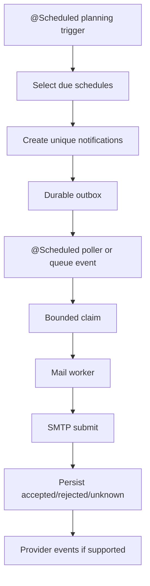

# @Scheduled and the Limits of Periodic Tasks

In **Spring Framework Mail**, not every email needs to be sent immediately on an HTTP request. An application may need to send reports at 08:00, appointment reminders 30 minutes ahead, billing notices at the start of the month, weekly digest emails, or poll an outbound mail queue every few seconds. Spring Framework provides `@Scheduled` to invoke a method on a schedule, but this annotation has a specific scope.

**`@Scheduled` is a work-triggering mechanism within the Spring application lifecycle—it is not a durable queue, does not automatically store missed runs, and does not guarantee an email is sent exactly once.** A scheduler can fire accurately as configured while the SMTP provider is still slow or rejecting, the application is restarting at send time, or three replicas all generate three copies of the email.

This lesson explains `fixedDelay`, `fixedRate`, and `cron`, time zones, and thread pools; limits around execution duration, multi-instance deployments, restarts, exceptions, and shutdown; how to combine schedulers with an outbox, idempotency, workers, and retry/backpressure; along with Java/YAML/SQL examples, testing, and practical architectural decisions.

## 1. Placing the Scheduler at the Right Stage of the Mail Pipeline

Three designs commonly appear.

**Simple approach: sending directly inside the schedule**

```text
@Scheduled
    |
    v
Render template
    |
    v
JavaMailSender.send(...)
    |
    v
SMTP relay
```

This approach may be acceptable for a few non-critical internal emails. However, if the process crashes before or during a send round, the send intent can be lost, and retries and duplicate prevention are hard to control.

**More reliable approach: create notifications, then hand off to workers**

```text
@Scheduled trigger
    |
    v
Find due business occurrences
    |
    v
Insert unique notification
    |
    v
Durable outbox / queue
    |
    v
Bounded mail worker
    |
    v
JavaMailSender.send(...)
    |
    v
Persist SMTP attempt outcome
    |
    v
Provider delivery events (if supported)
```

**Using the scheduler as a poller**

```text
Business service -> durable outbox
                         |
                         v
                 @Scheduled polling
                         |
                         v
                 Claim due jobs
                         |
                         v
                       Worker
                         |
                         v
                        SMTP
```

In the last two models, `@Scheduled` only **wakes up** the work to be done; the database or broker holds the actual job state.

### Questions to keep distinct

- **Is it due?** Decided by the schedule/planner.
- **Has the send request been durably recorded?** Decided by the outbox/queue.
- **Has a worker attempted to send?** Decided by the attempt log.
- **Did the SMTP server accept the message?** Decided by the transport result.
- **Was the mail delivered to the recipient's side?** Requires downstream evidence such as provider events/DSNs if available.
- **Did the recipient see or read the email?** Cannot be inferred from `@Scheduled` or `JavaMailSender.send`.

## 2. Enabling @Scheduled with @EnableScheduling

Example Spring Boot application:

```java
import org.springframework.boot.SpringApplication;
import org.springframework.boot.autoconfigure.SpringBootApplication;
import org.springframework.scheduling.annotation.EnableScheduling;

@SpringBootApplication
@EnableScheduling
public class MailApplication {

    public static void main(String[] args) {
        SpringApplication.run(MailApplication.class, args);
    }
}
```

Trigger bean:

```java
import org.springframework.scheduling.annotation.Scheduled;
import org.springframework.stereotype.Component;

@Component
public class OutboxPollTrigger {

    private final MailDispatchCoordinator coordinator;

    public OutboxPollTrigger(
            MailDispatchCoordinator coordinator
    ) {
        this.coordinator = coordinator;
    }

    @Scheduled(fixedDelay = 5_000)
    public void poll() {
        coordinator.offerAvailableWork();
    }
}
```

`MailDispatchCoordinator` is an application-defined service. Here the method does not directly send a large email campaign; it simply checks for and dispatches work within capacity limits.

For a `@Scheduled` method to run:

- The bean must be Spring-managed/registered in the appropriate application context.
- Scheduling must be enabled.
- Scheduled methods normally take no parameters; any return value does not automatically become a job receipt.
- Verify the bean is instantiated once; multiple contexts or registrations can cause tasks to fire unexpectedly.
- When unit tests instantiate the object via `new`, the annotation does not automatically create scheduling infrastructure.
- Scheduling and business logic should be separated for easier testing.

## 3. How Do fixedDelay, fixedRate, and cron Differ?

| Form | Meaning | When to consider |
|---|---|---|
| `fixedDelay` | Waits an interval after the **previous run finishes** | Polling an outbox or maintenance tasks |
| `fixedRate` | Targets start ticks from when the **previous run started** | Fast checks at a steady cadence |
| `cron` | Triggers at specific calendar times | Daily/weekly/monthly reports |
| `initialDelay` | Delays before the first run | Controlled startup |

### fixedDelay

```java
@Scheduled(fixedDelay = 30_000)
public void pollPendingMail() {
    dispatchCoordinator.offerAvailableWork();
}
```

If the method runs for 8 seconds, the scheduler waits roughly 30 seconds after it finishes:

```text
Start A ---- run 8s ---- End A
                           |
                           +-- wait 30s -- Start B
```

`fixedDelay` fits synchronous pollers with short, variable runtimes. However, if the method merely submits tasks to `@Async` and returns immediately, the wait period does not account for when SMTP actually finishes.

### fixedRate

```java
@Scheduled(fixedRate = 30_000)
public void refreshMailRoutingSnapshot() {
    routingSnapshot.refresh();
}
```

The scheduler aims for start ticks 30 seconds apart. If the method takes longer than the period, the next run may be delayed depending on scheduler/executor behavior. Never infer "exactly one email created every 30 seconds" or "every run is durably persisted".

### cron

```java
@Scheduled(
    cron = "0 0 8 * * MON-FRI",
    zone = "Asia/Ho_Chi_Minh"
)
public void planWeekdayDigest() {
    digestPlanner.materializeDueNotifications();
}
```

Cron expresses **08:00 Monday through Friday** in the specified time zone. It does not guarantee the email lands in the inbox at exactly 08:00.

## 4. Spring Cron Typically Has Six Fields

```text
┌──────────── second
│ ┌────────── minute
│ │ ┌──────── hour
│ │ │ ┌────── day of month
│ │ │ │ ┌──── month
│ │ │ │ │ ┌── day of week
│ │ │ │ │ │
* * * * * *
```

| Expression | Timing |
|---|---|
| `0 */5 * * * *` | Every 5 minutes |
| `0 0 8 * * *` | 08:00 every day |
| `0 30 9 * * MON-FRI` | 09:30 Monday through Friday |
| `0 0 0 1 * *` | Start of every month |
| `0 0 18 * * FRI` | 18:00 every Friday |

Unix cron typically uses five fields. Never copy an expression from Linux crontab without checking Spring's syntax—especially when a mistaken cron could generate tens of thousands of emails.

Extended tokens like `L`, `W`, or `#` have specific rules that must be verified against your Spring version and tested at boundary dates.

### Externalizing schedules to configuration

```java
@Scheduled(
    cron = "${mail.digest.cron:0 0 8 * * *}",
    zone = "${mail.digest.zone:Asia/Ho_Chi_Minh}"
)
public void planDigest() {
    digestPlanner.plan();
}
```

Spring's property placeholder syntax allows pulling the cron expression and time zone from deployment configuration.

```yaml
mail:
  digest:
    cron: "0 0 8 * * *"
    zone: Asia/Ho_Chi_Minh
```

Spring supports the special cron value `-` to disable a placeholder-configured trigger:

```yaml
mail:
  digest:
    cron: "-"
```

Note: changing a property at runtime **does not automatically re-register `@Scheduled` annotations immediately**. If users need to change schedules frequently, persist schedule state and implement explicit rescheduling.

## 5. Time Zones Are Part of Business Logic

"Send at 08:00" requires knowing 08:00 where:

- The server's time zone?
- UTC?
- The tenant's time zone?
- The time zone chosen by each recipient?

If `zone` is omitted, cron may be interpreted in the scheduler/runtime's default time zone. Moving servers to another region could shift send times.

Example:

```java
@Scheduled(
    cron = "0 0 8 * * *",
    zone = "Asia/Ho_Chi_Minh"
)
public void planAtEightInVietnam() {
    planner.planDue();
}
```

### Multiple users, multiple time zones

If users in Vietnam, Japan, and Germany all want their digest at 08:00 **local time**, a single 08:00 cron cannot serve everyone.

Store instead:

```text
mail_schedule
  schedule_id
  recipient_ref
  zone_id
  local_hour
  local_minute
  next_due_at (UTC instant)
  enabled
```

A poller wakes periodically and queries `nextDueAt <= now`. The planner computes the next occurrence using `ZoneId` and business rules, rather than creating one `@Scheduled` annotation per user.

## 6. DST and Nonexistent Times

In many regions observing daylight saving time (DST), a given local time may not exist or may occur twice.

For example, if a user chooses 02:30 daily:

- On the day clocks spring from 01:59 to 03:00, 02:30 may not exist.
- On the day clocks fall back, a local hour may repeat.

The system must lock down a policy:

1. Skip the missing occurrence.
2. Shift to the next valid time.
3. Use UTC-based rules.
4. On repeated hours, create only one notification per business date.
5. Log/audit adjusted occurrences.

`@Scheduled` evaluates cron times itself, but it cannot decide the business meaning of "exactly one copy per day" across all time zones.

Tests should cover leap days, month-ends, year-ends, DST transitions, user zone changes, and application downtime spanning a due time.

## 7. The Scheduler Thread Is Not an SMTP Worker

In a typical Spring Boot setup with `ThreadPoolTaskScheduler`, the pool can be small—often a single thread if unconfigured; versions/framework configs or virtual thread modes may differ.

If a scheduled method sends many emails synchronously:

```text
08:00 cron starts
       |
       v
Render 2,000 emails
       |
       v
SMTP calls, each waits for network
       |
       v
Cron method runs many minutes
       |
       v
Other scheduled tasks may start late
```

Keep the trigger lightweight:

- Find due work.
- Create/persist a small batch.
- Dispatch jobs that have available processing slots.
- Return control to the scheduler quickly.
- Let a separate worker pool handle SMTP network I/O.

### Configuring the scheduler thread pool

With matching Spring Boot auto-configuration:

```yaml
spring:
  task:
    scheduling:
      pool:
        size: 2
      thread-name-prefix: mail-schedule-
```

This is not a fix to boost SMTP throughput. When a provider only allows 10 submissions/sec, adding scheduler threads may simply increase pressure.

## 8. @Async Does Not Guarantee Durability

You can combine `@Scheduled` and `@Async`, but understand the implications:

- `@Scheduled` triggers the method.
- `@Async` can hand off work to another executor when routed through the appropriate proxy/interception.
- The trigger method returns before SMTP finishes sending.
- The next trigger may arrive while previous work is still running.
- The RAM executor queue can fill up and reject tasks.
- When the process dies, tasks queued in RAM can be lost.
- Async exceptions do not become durable job retries by default.

Risky example:

```java
@Async("mailExecutor")
@Scheduled(fixedRate = 5000)
public void sendPending() {
    sendThousandsOfMessages();
}
```

If processing takes 60 seconds, multiple runs can pile up in the executor; without atomic claiming, they may attempt the same notification.

**`@Async` does not replace an outbox, leases, rate limits, and idempotency.**

## 9. fixedRate Does Not Automatically Cause or Prevent Overlap in Every Case

Suppose a task takes 70 seconds while its period is 60 seconds:

```text
fixedDelay 60s:
  run 70s -> wait 60s -> next run

fixedRate 60s:
  target starts at 0s, 60s, 120s...
  actual start may be delayed by execution resources
```

Do not claim `fixedRate` always overlaps: with a synchronous registration and a standard scheduler, slow runs may execute sequentially. Still, other sources of overlap exist:

- Methods having multiple `@Scheduled` registrations.
- `@Async` spawning background tasks.
- Multiple beans or application contexts.
- Multiple replicas.
- Operators manually triggering the same job.
- Workers reclaiming jobs after lease expiry.

The defense for critical mail is **business occurrence key + unique constraint + atomic claim**, not assuming no overlap happened on one machine.

## 10. Multiple Replicas Can Fire the Same Schedule

Example Kubernetes Deployment with three replicas:

```text
08:00 Pod A executes @Scheduled
08:00 Pod B executes @Scheduled
08:00 Pod C executes @Scheduled

All create the same daily digest.
```

If each replica builds MIME and calls `send`, the recipient may receive three copies.

### Options

| Approach | Benefits | Limitations |
|---|---|---|
| Dedicated single scheduler role | Simple | Needs failover when that role dies |
| Database unique occurrence key | Prevents duplicate logical notifications | Does not prevent duplicate SMTP attempts by itself |
| Distributed lock/lease | Coordinates triggers | Lock expiry and stale owners |
| Dedicated scheduler service | Clear ownership | Extra deployment component |
| Quartz clustered/JDBC job store | Supports durable schedules/misfires as configured | Still needs idempotent side effects |
| Kubernetes CronJob | Independent scheduled process | Still needs missed-run policy and idempotency |

In-JVM `synchronized` or `ReentrantLock` cannot coordinate across replicas. A tool like ShedLock coordinates via a shared lock store, but still faces lock expiration during long jobs or crashes after SMTP acceptance.

## 11. @Scheduled Does Not Automatically Catch Up on Missed Runs

Example:

```text
07:59 application stops during deployment
08:00 cron should create digest
08:05 application starts

Plain @Scheduled:
  may simply wait for the next scheduled occurrence
```

Scheduled registrations live inside the Spring application context and do not durably record each tick by default. Handling missed occurrences requires **persisted schedule state** or a durable scheduler with an explicit misfire policy.

Never let a business-critical email get skipped simply because a deployment happened at the exact scheduled minute.

## 12. Catching Up Using Due State in the Database

One model:

```text
digest_schedule
  schedule_id
  recipient_ref
  zone_id
  next_due_at
  last_occurrence_key
  enabled
```

The scheduler runs every minute:

1. Find schedules where `nextDueAt <= now`.
2. Determine which occurrences still need processing.
3. Insert a notification with a unique dedupe key.
4. Update `nextDueAt` per policy.
5. Commit.
6. Workers send from the outbox.

After a restart, overdue schedules are rediscovered. However, **catch-up does not mean blindly sending every old email**. Expired OTPs or reminders should move to `EXPIRED`. Reports might be coalesced; mandatory invoices might require catch-up sending.

## 13. Business Occurrence, Logical Notification, and SMTP Attempt

Do not conflate these three units:

| Unit | Example |
|---|---|
| **Occurrence** | Nov 12 digest for recipient A |
| **Notification** | Record representing the intent to send that digest |
| **Attempt** | One SMTP submission try for that notification |

One occurrence may be inspected by the planner multiple times. One notification may be attempted multiple times by workers. The first guarantee to enforce is **at most one logical notification per occurrence** when product rules require it.

A dedupe key:

```text
scheduleId + recipientRef + businessDate + templateType
```

Example:

```text
digest-42:recipient-19:2026-11-12:daily-summary
```

Never generate a fresh random UUID on every cron tick and use it as a business dedupe key.

## 14. Use Unique Constraints Instead of Check-Then-Insert

Illustrative outbox schema:

```sql
CREATE TABLE mail_outbox (
    id                 VARCHAR(64) PRIMARY KEY,
    dedupe_key         VARCHAR(255) NOT NULL UNIQUE,
    recipient_ref      VARCHAR(128) NOT NULL,
    notification_type  VARCHAR(64) NOT NULL,
    due_at             TIMESTAMP NOT NULL,
    expires_at         TIMESTAMP NULL,
    next_attempt_at    TIMESTAMP NOT NULL,
    status             VARCHAR(32) NOT NULL,
    attempts           INTEGER NOT NULL DEFAULT 0,
    claim_token        VARCHAR(64),
    lease_until        TIMESTAMP NULL,
    created_at         TIMESTAMP NOT NULL
);

CREATE INDEX ix_mail_outbox_dispatch
    ON mail_outbox (status, next_attempt_at, due_at);
```

Timestamp types, retention, payload references, and indexes should be adapted to your actual database.

Two replicas can simultaneously observe that a key does not exist yet. Thus:

```text
SELECT existsByDedupeKey(K)
then INSERT(K)
```

is insufficient against races. A **database unique constraint** plus explicit conflict handling is the real safeguard.

Note: the constraint prevents creating **duplicate logical notifications**, not duplicate SMTP submissions after crashes/retries.

## 15. Separating Planner, Outbox, and Worker

A recommended architecture:



- The planner owns **due/expiry/idempotent materialization**.
- The dispatcher owns **capacity and ownership**.
- The worker owns **MIME/SMTP**.
- The attempt repository owns **known and uncertain outcomes**.
- The provider event handler owns **downstream delivery/bounce evidence**.

This can still run inside a single Spring Boot process initially; as load grows, you can split out worker deployments without rewriting business planning.

## 16. Example @Scheduled Planner with Clock

```java
import java.time.Clock;
import org.springframework.scheduling.annotation.Scheduled;
import org.springframework.stereotype.Component;

@Component
public class DueMailPlanningTrigger {

    private final Clock clock;
    private final DueMailPlanningService planner;

    public DueMailPlanningTrigger(
            Clock clock,
            DueMailPlanningService planner
    ) {
        this.clock = clock;
        this.planner = planner;
    }

    @Scheduled(
        fixedDelayString = "${mail.planning.poll-delay-ms:60000}"
    )
    public void tick() {
        planner.materializeDueNotifications(
                clock.instant(),
                200
        );
    }
}
```

`DueMailPlanningService` is application-defined and executes within proper transactions:

- Select a batch of due occurrences.
- Check subscription and consent.
- Build the dedupe key.
- Insert the unique notification.
- Update `nextDueAt`.
- Never call SMTP.

Clock configuration:

```java
import java.time.Clock;
import org.springframework.context.annotation.Bean;
import org.springframework.context.annotation.Configuration;

@Configuration
public class TimeConfiguration {

    @Bean
    public Clock clock() {
        return Clock.systemUTC();
    }
}
```

Injecting `Clock` makes tests deterministic and avoids different methods reading slightly different "current" times near midnight.

## 17. Example Scheduled Poller for the Outbox

```java
import org.springframework.scheduling.annotation.Scheduled;
import org.springframework.stereotype.Component;

@Component
public class MailOutboxPollingTrigger {

    private final MailDispatchCoordinator coordinator;

    public MailOutboxPollingTrigger(
            MailDispatchCoordinator coordinator
    ) {
        this.coordinator = coordinator;
    }

    @Scheduled(
        fixedDelayString = "${mail.outbox.poll-delay-ms:5000}",
        initialDelayString = "${mail.outbox.initial-delay-ms:10000}"
    )
    public void poll() {
        coordinator.offerAvailableWork();
    }
}
```

The coordinator needs to know how many worker permits are free, claim only matching jobs, leave jobs PENDING if the executor cannot accept them, and avoid unbounded in-RAM queues.

In particular, never claim 10,000 database jobs and dump them into an executor of capacity 100. Leases can expire before jobs reach SMTP, causing other workers to reclaim and duplicate them.

## 18. Never Hold a Transaction Open While Sending SMTP

An anti-pattern:

```java
@Scheduled(fixedDelay = 5000)
@Transactional
public void sendPending() {
    for (MailJob job : repository.findPending()) {
        mailSender.send(buildMime(job));
        repository.markSent(job.id());
    }
}
```

Drawbacks:

- Database locks/connections are held during SMTP network I/O.
- SMTP submission does not participate in the database transaction.
- Rolling back after an exception does not recall mail already accepted by the relay.
- If a batch has 100 jobs and job 80 fails, earlier state updates may roll back.
- Queries may pull in too much work.
- Multiple replicas may contend for the same records.

Better:

```text
Transaction A:
  atomic claim bounded jobs
  set claimToken and leaseUntil
COMMIT

Outside transaction:
  render MIME and submit via SMTP

Transaction B:
  update attempt result if claimToken matches
COMMIT
```

When using `@Transactional` on service methods, watch Spring proxy semantics: internal self-calls to an annotated method within the same instance may not pass through the transaction interceptor as expected.

## 19. Atomic Claiming, Leases, and Multi-Worker Recovery

A flow:

```text
PENDING / RETRY_SCHEDULED
         |
         v
Atomic claim
         |
         v
PROCESSING + claimToken + leaseUntil
         |
         v
SMTP attempt
         |
    +----+----+
    |    |    |
accepted reject unknown
```

Some databases like PostgreSQL support `FOR UPDATE SKIP LOCKED` in transactions to reduce contention when selecting jobs; syntax and isolation vary by database.

Never use an unconditional SELECT pending followed by UPDATE and treat it as atomic.

**Lease expiration** lets a new worker take over if the old worker dies. However, if the old worker only hit a long GC pause and later resumes sending, two attempts can happen. Claim tokens/versions stop stale workers from overwriting DB state, but cannot recall an outbound SMTP request.

Pair lease renewal, timeouts, attempt history, and retry policies matched to your duplicate tolerance.

## 20. JavaMailSender.send Succeeding Does Not Mean Delivered

Example:

```java
MimeMessage message = mailSender.createMimeMessage();

MimeMessageHelper helper =
        new MimeMessageHelper(message, false, "UTF-8");

helper.setFrom("notifications@example.org");
helper.setTo("customer@example.net");
helper.setSubject("Periodic Report");
helper.setText("Your report is ready.");

mailSender.send(message);
```

When SMTP transport returns normally, the application typically only has proof that **SMTP submission to the next-hop server was accepted**, not that:

- The message reached the inbox.
- The recipient opened or read it.
- HTML/attachments rendered properly.
- The mail will not bounce later.

Record a state like `SMTP_ACCEPTED`; if the provider offers webhooks/DSNs, record delivery/bounces in a separate layer. Never mark `DELIVERED` right after `send`.

## 21. Classifying SMTP Errors and Unknown Outcomes

`MailException` can stem from AUTH, TLS, connect timeouts, recipient rejections, provider throttling, or dropped connections.

A tricky situation:

```text
Worker                       SMTP relay
  |---- message DATA ---------->|
  |                              |
  |                         accepts message
  |                              |
  X<---- final reply lost -------|
  |
  v
Timeout / MailException
```

The worker does not know whether the server received the message. Retrying immediately can produce a duplicate.

| Outcome | Meaning | Handling direction |
|---|---|---|
| `SMTP_ACCEPTED` | Transport confirmed submission | Do not retry just because delivery event is missing |
| `KNOWN_REJECTED` | Proof that server rejected | Retry/fix based on error category |
| `UNKNOWN` | Unclear whether accepted | Reconcile/controlled retry |
| `EXPIRED` | Job exceeded business validity | Do not send |
| `CANCELLED` | Job was cancelled | Do not send |

Classifiers must inspect cause chains, SMTP stages, and provider responses when available. Never treat every exception as proof the email was definitely not sent.

## 22. @Scheduled Does Not Provide Built-in Retry/Backoff

A dangerous pattern:

```java
@Scheduled(fixedRate = 1000)
public void retryAllFailures() {
    for (MailJob job : repository.findAllFailed()) {
        mailSender.send(buildMime(job));
    }
}
```

If the SMTP provider is throttling or credentials are wrong, jobs can retry relentlessly, creating a **retry storm**.

A retry policy needs:

1. Classification of known failures vs. unknown outcomes.
2. A max-attempts limit.
3. Increasing backoff with jitter.
4. Persisted `nextAttemptAt`.
5. Provider quotas and retry hints respected.
6. Deadline/expiry checks.
7. Same notification ID, new attempt ID.
8. Attempt history and error categories.
9. Moving exhausted jobs to a final/DLQ/manual-review state.
10. Never retrying already-accepted messages solely for lack of a delivered webhook.

Example:

```text
Attempt 1 -> temporary reject -> next after ~30 seconds
Attempt 2 -> temporary reject -> next after ~60 seconds
Attempt 3 -> temporary reject -> next after ~120 seconds
Attempt 4 -> stop or escalate by policy
```

Values are illustrative only; Spring Mail does not prescribe a universal backoff schedule across providers.

## 23. Due-Job Polling Must Be Bounded

An illustrative query solely to identify due jobs:

```sql
SELECT id
FROM mail_outbox
WHERE status IN ('PENDING', 'RETRY_SCHEDULED')
  AND due_at <= CURRENT_TIMESTAMP
  AND next_attempt_at <= CURRENT_TIMESTAMP
ORDER BY next_attempt_at, created_at
LIMIT 50;
```

This is **not yet** an atomic claim mechanism for multiple workers. It must be combined with transactions, locks, or conditional updates.

Never select unbounded pending rows and stuff them into an in-RAM executor. Polling faster only increases DB query load; it does not increase your SMTP rate limit.

## 24. Backpressure for Periodic Emails

A cron job generates 50,000 emails per hour, while the provider only accepts 10 emails/sec. Minimum time to submit 50,000 emails (with zero retries and zero overhead):

\[
\frac{50\,000}{10} = 5\,000\text{ seconds}
\]

About **83 minutes and 20 seconds**. If another 50,000 jobs are created every hour, the backlog grows without bound while capacity stays constant.

Limits that must be designed explicitly:

| Limit | Meaning |
|---|---|
| Scheduler interval | Frequency of checking for due work |
| Queue capacity | Tasks buffered in RAM |
| Worker concurrency | Concurrent SMTP attempts |
| Provider rate limit | Submissions/recipients per second |
| Provider quota | Hourly/daily email totals |
| Outbox admission | Volume/count of pending records allowed |
| Business deadline | How long the email remains valid |

Adding scheduler threads or shortening poll intervals does not bypass provider quotas. When multiple replicas share a provider, use a globally coordinated rate limiter or explicit per-instance budgets.

## 25. Priority and Fairness

If 40,000 newsletters are queued, OTPs must not get stuck behind all of them.

You can separate into:

- **Critical transactional:** OTPs, password resets, dedicated quotas and short TTLs.
- **Normal transactional:** receipts, order confirmations, durable retries.
- **Digest/reminder:** business schedules, can expire or coalesce when late.
- **Bulk marketing:** rate-limited and pausable.

Never let clients arbitrarily tag any job as `priority=CRITICAL`. The backend assigns priority based on notification type, permissions, and policy. Enforce fairness so one tenant cannot consume all capacity.

## 26. Cancellation and Expiration

Examples:

- An appointment is cancelled.
- An OTP is no longer valid.
- A report was superseded by a newer version.
- A user unsubscribed.
- A recipient changed their send time.
- A sender profile or tenant was disabled.

Every job should carry `dueAt`, `expiresAt`, and business send conditions. Workers check them before calling SMTP. If expired, transition to `EXPIRED` or `CANCELLED` instead of attempting delivery.

Cancelling a schedule **cannot recall an email already accepted by SMTP**. Define behavior explicitly for unsubmitted vs. in-flight notifications.

## 27. Dynamic Per-User Schedules Should Not Be Thousands of Annotations

`@Scheduled` suits a small set of statically configured triggers. If each recipient has an individual send time, persist schedules in the database:

```text
scheduleId
recipientRef
zoneId
localDeliveryTime
nextDueAt
enabled
```

A poller finds due rows and creates unique notifications. Spring offers `TaskScheduler`/`Trigger` for programmatic dynamic tasks, yet in-memory scheduled futures still do not automatically become durable jobs.

When a user edits their schedule, lock down policy:

- Cancel or keep the old occurrence?
- Which date does the new time take effect?
- Audit schedule versions?
- Does the deduplication key change?
- Are already-accepted notifications handled differently?

Never just swap a cron string and assume all older state remains valid.

## 28. Graceful Shutdown

When the process receives SIGTERM:

1. Stop claiming new work.
2. Stop admitting tasks to the shutting-down executor.
3. Let in-flight SMTP attempts finish within a bounded timeout.
4. Persist outcomes if ownership is still valid.
5. Let unfinished jobs recover from the outbox.
6. On restart, let the planner handle missed occurrences per policy.

You can configure:

```java
executor.setWaitForTasksToCompleteOnShutdown(true);
executor.setAwaitTerminationSeconds(25);
```

However, these settings **do not preserve an in-RAM queue across SIGKILL, OOM, or power loss**. A durable outbox and leases/retries remain the required recovery layer.

## 29. Observability Separating Scheduler and Transport

Suggested metrics:

| Metric | Question answered |
|---|---|
| `mail_schedule_trigger_total` | How many times did the scheduler fire? |
| `mail_schedule_trigger_failure_total` | Are there trigger/planner errors? |
| `mail_schedule_duration_seconds` | Are triggers running slowly? |
| `mail_notification_created_total` | How many notifications were created? |
| `mail_outbox_pending` | How many jobs are waiting? |
| `mail_outbox_oldest_age_seconds` | How long has the oldest job waited? |
| `mail_send_attempt_total` | How many SMTP attempts occurred? |
| `mail_send_accepted_total` | How many attempts were accepted? |
| `mail_send_failure_total` | How many known failures occurred? |
| `mail_send_unknown_total` | How many uncertain outcomes occurred? |
| `mail_provider_delivered_total` | How many delivered events arrived (if supported)? |

These names are suggestions, not a built-in metric set provided automatically by Spring Mail.

A system can have steady scheduler ticks while workers are dead. Therefore, **successful ticks do not prove emails are being processed**. Dashboards must show backlogs, queue age, accepted throughput, and provider errors.

Never put notification IDs, recipients, email bodies, or raw error messages into metric labels; detailed diagnostics belong in access-controlled logs and databases.

## 30. Health and Security of Scheduled Sending

Do not wire an external SMTP dependency into Kubernetes liveness probes such that a provider outage restarts your app continuously. With an outbox, the app can keep accepting business requests and wait for the provider to recover.

Mail pipeline health should examine:

- Is the scheduler still triggering?
- Is the planner still creating due jobs?
- Are workers picking up jobs?
- What do backlog size and oldest age look like?
- Is SMTP connectivity failing?
- Is outbox storage healthy?

Never call `JavaMailSender.send` inside a health endpoint to "probe", because each probe could send a real email. When needed, use a connectivity probe like `JavaMailSenderImpl.testConnection()` under appropriate config.

Protections:

- Protect cron configs and "run now" endpoints with authentication/authorization.
- Audit and rate-limit bulk resends.
- Select only recipients with valid consent/permissions.
- Load SMTP secrets from a secret manager.
- Never log OTPs/reset tokens, full MIME, or attachments.
- Provide a kill switch/campaign pause for misconfigurations.

## 31. Testing Logic with Clock.fixed

Instead of waiting for real cron ticks in CI, extract planner logic:

```java
import java.time.Clock;

public final class PlanningTick {

    private final Clock clock;
    private final DueMailPlanningService planner;

    public PlanningTick(
            Clock clock,
            DueMailPlanningService planner
    ) {
        this.clock = clock;
        this.planner = planner;
    }

    public void execute() {
        planner.materializeDueNotifications(
                clock.instant(), 200
        );
    }
}
```

JUnit 5 + Mockito:

```java
import static org.mockito.Mockito.*;
import java.time.Clock;
import java.time.Instant;
import java.time.ZoneOffset;
import org.junit.jupiter.api.Test;

@Test
void planningTickUsesFixedTime() {
    Instant now = Instant.parse("2026-11-12T01:00:00Z");
    Clock clock = Clock.fixed(now, ZoneOffset.UTC);

    DueMailPlanningService planner =
            mock(DueMailPlanningService.class);

    PlanningTick tick = new PlanningTick(clock, planner);
    tick.execute();

    verify(planner).materializeDueNotifications(
            now, 200
    );
    verifyNoMoreInteractions(planner);
}
```

`DueMailPlanningService` is an application interface. This test verifies the method receives the exact timestamp and batch size, without real SMTP or sleeping for seconds.

## 32. Test Suite for Timing and Occurrences

Cases to include:

- Immediately before `dueAt`.
- Exactly at `dueAt`.
- After `dueAt`.
- Same occurrence evaluated by the planner multiple times.
- Two replicas generating the same occurrence concurrently.
- Application downtime spanning send time followed by catch-up.
- DST: nonexistent hours and repeated hours.
- Leap days, month-ends, and year-ends.
- User changing `ZoneId` or send time.
- Cancelled subscriptions.
- Notification expiring before a worker starts.
- Manual run concurrent with scheduled run.

An invariant:

```text
Given same schedule + business date + recipient
When planner is invoked N times
Then only one logical outbox notification exists
```

Test unique constraints against a real or compatible database to prove concurrency safety; an in-JVM mock repository is insufficient.

## 33. Test Suite for SMTP, Queues, and Recovery

| Scenario | Expectation |
|---|---|
| SMTP accepted | Attempt = SMTP_ACCEPTED, do not report delivered |
| AUTH rejected | Clear error category, no hot retry loop |
| Temporary SMTP 4xx | Backoff per policy |
| Ambiguous timeout | UNKNOWN, do not assert definitely rejected |
| Template render error | Do not call SMTP |
| Executor full | Job stays durable or explicit admission rejection |
| Multiple retries | One notification, multiple attempt IDs |
| Worker dies before submit | Job recovers from outbox |
| Worker dies after DATA | Account for duplicate risk |
| Provider webhook delivered | Updates separate delivery evidence |
| Job expired/cancelled | Do not send |
| Large backlog | Bounded batches, concurrency, and queue age metrics |
| Two replicas | Never create two notifications for the same occurrence |

Use Mockito, fake senders, or an SMTP test server. Never use production SMTP credentials in automated tests.

### Testing @Scheduled registration

Some configuration mistakes only surface when running a Spring context:

- Forgetting `@EnableScheduling`.
- Bean not component-scanned.
- Cron disabled via `-`.
- Invalid cron/zone.
- Multiple instances of the bean.
- Blocked scheduler thread.

Component tests can verify bean registration and invocation using a controlled scheduler or latch. Avoid `Thread.sleep` assertions demanding an exact tick count in CI.

## 34. When Should You Use Another Tool?

| Need | Appropriate approach |
|---|---|
| Poll an outbox every few seconds | `@Scheduled(fixedDelay)` |
| One low-stakes internal email per week | Direct `@Scheduled(cron)` may suffice |
| Transactional emails that must survive restarts | `@Scheduled` + durable outbox/worker |
| Each user has an individual schedule | Database `nextDueAt` + poller/durable scheduler |
| Complex misfire policies and clustered triggers | Quartz JDBC JobStore or equivalent |
| Large batches and multi-step pipelines | Dedicated batch/job processor, scheduler triggers only |
| Scheduled jobs running in Kubernetes | CronJob with concurrency/missed-run policy |
| Shared provider quota across replicas | Distributed rate limiter + workers |

Even Quartz, CronJob, or managed schedulers **do not make SMTP exactly-once**. Those tools improve triggering and recovery, while outbound submission remains a non-transactional external side effect.

## 35. Runbook: Scheduled Time Passed Without Sending

**Step 1 — Check the schedule:** cron, zone, enabled flag, bean registration, last tick, deployments/restarts around the due mark.

**Step 2 — Check the planner:** was the occurrence recognized, was a unique-key conflict legitimate, are subscription/consent still valid?

**Step 3 — Check the outbox:** `dueAt`, `nextAttemptAt`, status, `expiresAt`, backlog, leases.

**Step 4 — Check workers:** available permits, claim rate, executor rejections, worker shutdowns.

**Step 5 — Check SMTP:** AUTH, TLS, timeouts, quotas, 4xx/5xx, unknown outcomes.

**Step 6 — Check delivery:** SMTP accepted does not prove inbox placement; inspect provider events/bounces/quarantine if available.

**Step 7 — Catch up if appropriate:** check TTL, accepted/unknown status, duplicate risk, and bulk-resend authorization.

Never blindly re-run the entire cron via a public endpoint or resend all PENDING jobs indiscriminately.

## 36. Common Mistakes

| Mistake | Consequence | Fix |
|---|---|---|
| Cron directly sends thousands of emails | Blocks scheduler, hard to recover | Planner/outbox/worker |
| Multiple replicas without dedupe | Duplicate sends | Business occurrence unique key |
| Assuming fixedRate is strictly on-time | Lag/overlap under load | Due state and SLOs |
| Omitting zone | Time shifts across environments | Explicit ZoneId |
| Scattering `Instant.now()` | Flaky tests | Inject Clock |
| No catch-up | Missed runs on restart | Persist nextDueAt |
| Unbounded RAM queue | OOM/lost tasks on crash | Bounded queue + durable storage |
| Transaction wrapping SMTP | Long locks, rollback cannot recall mail | Claim/send/finalize |
| Relying solely on `@Async` | Tasks are not durable | Outbox |
| Retrying all exceptions immediately | Retry storms/duplicates | Classifier + backoff |
| Marking delivered right after send | False reporting | SMTP_ACCEPTED, separate delivery events |
| No expiry | Sends stale/obsolete emails | TTL/cancel policy |
| Monitoring only scheduler ticks | Misses stalled workers | Backlog + attempt metrics |
| Cluster locking via synchronized | Fails across replicas | Shared lease/DB constraint |
| Testing with real SMTP | Flaky tests and unintended emails | Fake SMTP/test server |

## 37. Implementation Checklist

1. Define business schedule, `dueAt`, and `expiresAt`.
2. Choose the right `fixedDelay`/`fixedRate`/`cron`.
3. Use six-field cron expressions and explicit zones.
4. Define policies for DST, holidays, and missed runs.
5. Verify `@EnableScheduling` and bean registration.
6. Avoid long SMTP network I/O on the scheduler thread.
7. Persist schedule state and a durable outbox for critical mail.
8. Enforce dedupe keys with unique constraints.
9. Use atomic claiming/leases and ownership checks.
10. Never hold transactions open during SMTP I/O.
11. Bound batch sizes, executor queues, concurrency, and provider rates.
12. Retry with backoff, jitter, max attempts, and deadlines.
13. Distinguish accepted/rejected/unknown outcomes.
14. Never send expired or cancelled jobs.
15. Include pause/kill switches, auditing, and authorization for manual runs.
16. Protect secrets and PII.
17. Separate metrics for scheduler, planner, outbox, SMTP, and delivery.
18. Alert on oldest age, missed due work, failures, and unknown outcomes.
19. Test with a fixed `Clock`, time zones, DST, and concurrent planning.
20. Test crash recovery and graceful shutdown.
21. Maintain a runbook for controlled resending.
22. Even with another durable scheduler, still handle SMTP ambiguity.

## 38. Key Takeaways

- **`@Scheduled` only triggers work**; it does not persist jobs durably or guarantee inbox delivery.
- `fixedDelay` measures from completion; `fixedRate` targets start cadence; `cron` defines calendar points.
- Spring cron typically uses six fields; time zones must be specified explicitly.
- A slow scheduled method can delay other tasks sharing the same scheduler.
- `@Async` does not turn an in-RAM queue into a durable queue and can introduce overlap.
- Each replica runs its own scheduler; idempotency and coordination are required.
- Runs missed during downtime do not automatically catch up with annotations alone.
- Unique occurrence keys prevent duplicate logical notifications, not duplicate SMTP attempts.
- Critical emails need an outbox, claims/leases, retry state, bounded workers, and backpressure.
- SMTP submission does not join database transactions; rollbacks cannot recall accepted messages.
- Timeouts can leave an uncertain outcome.
- SMTP accepted does not equal delivered/inbox/read.
- Per-user scheduling needs persisted `ZoneId` and `nextDueAt`.
- Monitor backlogs and deadlines, not just scheduler ticks.
- Focus tests on timing, idempotency, crashes, multiple replicas, and provider outages.

**Conclusion:** `@Scheduled` is great for **waking up periodic work** in Spring Framework Mail. For important emails, let the scheduler identify *due work*, and rely on **persisted schedule state, an outbox, backpressure-aware workers, idempotency, policy-driven retries, and SMTP outcome observability** so send requests are never lost when the app slows down, restarts, or runs across multiple instances.
