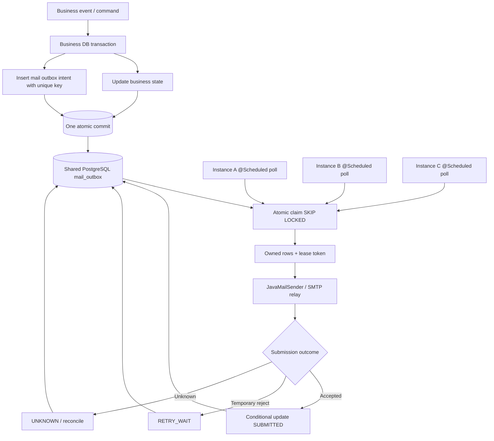

# Preventing Duplicate Execution Across Multiple Instances

A Spring Boot application uses `@Scheduled` to scan a table of due emails and call `JavaMailSender`. Initially there is only one instance, so the task runs once per minute. When the system scales to three pods for high availability, all three start their schedulers. Right at 09:00, all three read the same list of `PENDING` emails, build `MimeMessage` objects, and send them. Customers can receive three identical invoice emails, even though each instance executed "correctly" according to its own code.

The problem of **preventing duplicate runs across multiple instances** in the **Scheduled Sending** module of **Spring Framework Mail** is not solved merely by putting a lock around a `@Scheduled` method. A real mail system must distinguish **duplicate job triggers**, **creating the same notification intent multiple times**, **multiple workers claiming the same outbox row**, and **an SMTP relay accepting the same message more than once**. Each layer of duplication has different guarantees and different solutions.

This lesson walks from basic failure modes and cluster/scheduler lock selection to an architecture built on **transactional outbox + atomic claiming + leases/fencing + idempotency**, followed by multi-worker PostgreSQL testing, observability, and handling failure windows that cannot be eliminated completely at the SMTP boundary.

## 1. Why Does @Scheduled Run on Every Instance?

In Spring, `@Scheduled` registers tasks with a scheduler **inside each JVM's application context**. If the same application runs on three instances, three application contexts typically register three identical schedules.

```java
import org.springframework.scheduling.annotation.EnableScheduling;
import org.springframework.scheduling.annotation.Scheduled;
import org.springframework.stereotype.Component;

@Component
public class MailSchedule {

    @Scheduled(cron = "0 * * * * *", zone = "UTC")
    public void sendDueMail() {
        // Scan due emails and send.
    }
}
```

Suppose all three instances are running:

```text
09:00:00 UTC
   |
   +-- instance A: sendDueMail()
   |
   +-- instance B: sendDueMail()
   |
   +-- instance C: sendDueMail()
```

Nothing in this annotation causes the three JVMs to know about each other or elect a leader automatically. `@Scheduled` governs *when this instance's method should run*; it does not provide **distributed mutual exclusion**.

### 1.1. Same schedule, multiple processes

| Context | What can happen? |
|---|---|
| One JVM, one `@Scheduled` registered once | Method runs on that JVM's scheduler; still understand overlap with trigger/executor settings |
| Two JVMs sharing one database | Both methods run; both read the same rows without claiming |
| Three Kubernetes replicas | Each pod runs its own scheduler if scheduling is enabled on all |
| Rolling deployment | Old and new pods can overlap during rollout |
| Autoscaling | New pods join the schedule, increasing contention for work |
| Restart after crash | Jobs may re-run, miss a slot, or start concurrently depending on scheduling mechanism |
| Multiple app instances sharing no state | No "once cluster-wide" guarantee without a coordination mechanism |

### 1.2. Local locks are not distributed locks

Approaches like these coordinate only within **one process**:

```java
private final Object lock = new Object();

@Scheduled(fixedDelay = 60_000)
public void poll() {
    synchronized (lock) {
        // Only locks threads sharing the same object/JVM.
    }
}
```

Similarly:

- `synchronized`.
- `ReentrantLock`.
- `AtomicBoolean inProgress`.
- Static flags on a class.
- A `ThreadPoolTaskScheduler` with only one worker.
- `@Async` or local thread-pool caps.

These can help avoid overlap **inside a single JVM**, but they do not lock other processes, do not survive restarts, and do not guarantee an email is sent only once.

### 1.3. @Scheduled(fixedDelay) vs. cron

- `fixedDelay`: within one task registration, waits an interval after the previous run finishes before starting the next.
- `fixedRate`: schedules at regular intervals; depending on scheduler/executor configuration, executions may queue or have concurrency interactions to design for.
- `cron`: fires at specific calendar timestamps with a timezone; each instance evaluates the schedule independently.

None of the three **automatically turns into a cluster-wide scheduler**.

## 2. "Duplicate Execution" Has at Least Four Distinct Layers

Name each problem accurately before picking a solution.

| Layer | Duplicate example | Primary defense |
|---|---|---|
| **Schedule trigger** | Three pods run the same method every minute | Leader election or distributed job lock if one runner is truly needed |
| **Notification intent creation** | One business event creates three outbox rows | Unique business/idempotency key + transaction |
| **Work claiming** | Two workers grab the same outbox row | Atomic DB/queue claim, row locks, leases, and fencing tokens |
| **SMTP submission** | Provider accepted, worker crashes before writing `SUBMITTED`, then retries | Reconciliation/provider idempotency when available; manage `UNKNOWN` outcomes and duplicate risk |

**A distributed lock around `@Scheduled` usually addresses only the first layer.** If the scheduler leader crashes and another worker reprocesses an email already accepted by SMTP, duplicates can still happen. Conversely, if each worker claims outbox rows atomically in the DB, multiple schedulers waking workers **is not necessarily a problem**: they can safely divide the work.

### 2.1. One job run differs from one email

Suppose at 10:00 a job scans 10,000 invoices. Even if only one job starts cluster-wide, that job can still:

1. Successfully send 3,000 emails.
2. Crash.
3. Be retried.
4. Re-scan all 10,000 invoices.
5. Double-send 3,000 emails if per-notification state is missing.

Therefore the business requirement "never send duplicate emails" must be enforced at **notification identity and attempt state**, not just at the job level.

### 2.2. One event can validly create multiple notifications

For instance, an `InvoiceIssued` event validly produces two emails:

- Email to the customer.
- Copy email to accounting.

Never use `eventId` alone as the unique key for every email, as that would wrongly block the second email. Keys should reflect business scope such as **event + purpose + recipient identity + channel**, or an equivalent domain rule.

## 3. What Is a Realistic Guarantee Target?

Three goals often get confused:

**At-most-once scheduling:** tries to prevent two runners from executing the same job concurrently. In exchange, if a runner dies at the wrong time, work may remain unfinished.

**At-least-once processing:** unfinished work is retried after failures. Good for durability, though the same item may be attempted multiple times.

**Exactly-once business effect:** requires each logical business effect to be recorded once within a well-defined scope. In databases, unique keys and transactions achieve idempotent **intent creation**. For external SMTP delivery, an exactly-once guarantee cannot be inferred from a local SQL transaction alone.

### 3.1. "One row, one worker at a time" is a conditional goal

Database claims and leases guarantee that at claim time, only one worker holds the **active lease** on a row. However, if Worker A stops responding and its lease expires, Worker B can reclaim the row while A is still stuck sending over SMTP due to a hung network call. Both workers may call SMTP.

This is why you need:

- Leases longer than realistic send timeouts, with margin.
- Fencing tokens on database updates.
- Heartbeats/lease renewal if processing runs long.
- Attempt caps and `UNKNOWN` classification.
- Provider idempotency/reconciliation when available.
- Business policies deciding whether to allow or block duplicates when uncertain.

**A lease is not a two-phase commit protocol with SMTP.**

### 3.2. Never promise "emails will definitely arrive only once"

An SMTP relay does not participate in PostgreSQL transactions. If the client sends `DATA` and loses the response, the system may not know whether the server accepted it. A retry may produce a second message. Stable `Message-ID` headers help tracing, but are not a deduplication contract enforced by all SMTP servers.

A realistic engineering goal is: **never lose intent**, **never create duplicate intents**, **never claim the same item uncontrollably**, **minimize and detect retry duplicates**, and **handle uncertainty by policy**.

## 4. Strategies for Preventing Duplicate Execution in a Cluster

Three common solution families solve slightly different problems.

| Solution | Best fit | Strengths | Limitations to remember |
|---|---|---|---|
| **Distributed scheduler/job lock** | Small job needing a single runner | Minimal changes to `@Scheduled` logic | Does not prevent per-email duplicates on crashes/retries |
| **Quartz clustered JDBC JobStore** | Complex schedules, many triggers, misfires/recovery | Durable scheduler metadata and cluster coordination | Requires proper cluster/DB setup; job effects still need idempotency |
| **Shared outbox + atomic row claim** | Many independent emails, multi-worker scaling | Workers grab distinct rows, boosting throughput | Leases, timeouts, retries, unknown outcomes still require design |
| **Distributed queue + consumer group** | Event/dispatch flows with an existing durable broker | Consumer partitioning, retries/prefetch | Broker redelivery is typically at-least-once; still needs idempotency |
| **Single dedicated scheduler instance** | Small, simple systems with external HA | Easy to operate initially | Single point of failure without failover; does not solve mid-run restarts |

### 4.1. Match the choice to the real workload

- If a scheduler just triggers **a short hourly maintenance task**, a distributed job lock may suffice.
- If you need **accurate complex schedules, misfires, calendars, and durable job metadata**, Quartz clustering fits well.
- If the goal is **sending thousands of notification intents**, usually let multiple workers poll the same table and claim rows atomically. No need for every worker to wait behind one global lock held across an entire SMTP batch.
- If using Kafka/RabbitMQ, factor in ACKs, redelivery, visibility timeouts, broker state, and idempotent consumers.

**You do not need every technology at once.** A small system can start with a PostgreSQL outbox and one worker; the same model scales to many workers without changing the business contract.

## 5. Recommended Architecture for Multi-Instance Spring Mail



The key is that **all three instances are allowed to run the poller**. The database arbitrates row claiming via transactions rather than each instance checking a local `boolean isRunning` flag.

### 5.1. Separating two transaction types

1. **Business transaction:** updates domain state and inserts the notification intent into the outbox.
2. **Worker claim/result transactions:** claims rows and records attempt outcomes.

SMTP sending happens **outside any database transaction holding row locks**. Never hold a `SELECT ... FOR UPDATE` lock across a 30-second network call.

### 5.2. The outbox table is the durable source of truth

In this model, `@Scheduled` is merely the alarm clock waking workers. If a tick is missed while rows remain `PENDING` in the database, the next tick or another instance picks them up.

By contrast, if a cron tick builds and sends emails directly without persisting intent, a lost tick or crashed process can mean lost notifications.

## 6. Schema Design for Scheduled Notifications

PostgreSQL example:

```sql
CREATE TABLE mail_outbox (
    id UUID PRIMARY KEY,
    idempotency_key VARCHAR(240) NOT NULL,
    notification_type VARCHAR(80) NOT NULL,
    recipient_address VARCHAR(320) NOT NULL,
    sender_address VARCHAR(320) NOT NULL,
    subject VARCHAR(500) NOT NULL,
    plain_text TEXT NOT NULL,
    status VARCHAR(32) NOT NULL,
    due_at TIMESTAMPTZ NOT NULL,
    expires_at TIMESTAMPTZ NULL,
    next_attempt_at TIMESTAMPTZ NULL,
    attempt_count INTEGER NOT NULL DEFAULT 0,
    claim_token UUID NULL,
    lease_until TIMESTAMPTZ NULL,
    submitted_at TIMESTAMPTZ NULL,
    created_at TIMESTAMPTZ NOT NULL DEFAULT CURRENT_TIMESTAMP,
    updated_at TIMESTAMPTZ NOT NULL DEFAULT CURRENT_TIMESTAMP,
    last_error_category VARCHAR(80) NULL,
    CONSTRAINT uq_mail_outbox_intent UNIQUE (idempotency_key),
    CONSTRAINT ck_mail_outbox_status CHECK (
        status IN (
            'PENDING', 'PROCESSING', 'RETRY_WAIT',
            'SUBMITTED', 'UNKNOWN',
            'FAILED_PERMANENT', 'EXPIRED'
        )
    ),
    CONSTRAINT ck_attempts_nonnegative CHECK (attempt_count >= 0)
);

CREATE INDEX ix_mail_outbox_due
ON mail_outbox (status, next_attempt_at, due_at, created_at);

CREATE INDEX ix_mail_outbox_lease
ON mail_outbox (status, lease_until);
```

This schema is an educational example for text-only emails; production systems may store `payload_snapshot`/template versions, HTML, attachment references, tenant/provider accounts, recipient identities, audit trails, and attempt histories. Never leave resendable content solely inside transient Java objects.

### 6.1. Key statuses

| Status | Meaning |
|---|---|
| `PENDING` | Intent committed and sending has not started |
| `PROCESSING` | A worker currently holds a claim/lease |
| `RETRY_WAIT` | Prior attempt hit a retryable failure; waiting until `next_attempt_at` |
| `SUBMITTED` | SMTP relay/provider accepted per observed response |
| `UNKNOWN` | Submission outcome unclear; requires reconciliation or dedicated policy |
| `FAILED_PERMANENT` | Must not retry with the same data/config per policy |
| `EXPIRED` | Notification no longer valid to send, e.g. expired OTP |

`SUBMITTED` **does not mean `DELIVERED`**. If delivery/bounce tracking is needed, store provider event streams and per-recipient records separately.

### 6.2. Distinct roles for timestamp columns

- `created_at`: when the intent was written.
- `due_at`: do not send before this timestamp.
- `next_attempt_at`: retry time after failure or local rate deferral.
- `lease_until`: when the claim expires.
- `expires_at`: after this time the notification is no longer valid.
- `submitted_at`: when an accepted submission was confirmed by the app.

Never overload one `scheduled_at` column for send schedule, retry timing, expiry, and lease. These timestamps carry distinct business semantics.

### 6.3. Unique keys prevent duplicate intents

If an order should send only one confirmation email to a recipient identity:

```text
order-confirmation:<order-id>:<recipient-key>
```

If a daily job creates summaries:

```text
daily-summary:<tenant-id>:<schedule-occurrence-id>:<recipient-key>
```

Avoid `UUID.randomUUID()` for `idempotency_key` when the goal is blocking duplicate business events. Random UUIDs remain appropriate for surrogate `id` or `attempt_id` values.

## 7. Creating Intents Once with a Unique Constraint

Checking `SELECT` then `INSERT` **is insufficient** under concurrency:

```text
Instance A: SELECT key K -> not found
Instance B: SELECT key K -> not found
Instance A: INSERT K
Instance B: INSERT K -> race
```

Define a unique constraint in the database and use insert-if-absent, e.g., PostgreSQL:

```sql
INSERT INTO mail_outbox (
    id, idempotency_key, notification_type,
    recipient_address, sender_address,
    subject, plain_text,
    status, due_at, expires_at
)
VALUES (
    :id, :idempotencyKey, :notificationType,
    :recipient, :sender,
    :subject, :plainText,
    'PENDING', :dueAt, :expiresAt
)
ON CONFLICT (idempotency_key) DO NOTHING;
```

When multiple instances generate the same logical intent, only one row commits for that key. However, **do not forget payload consistency**:

- If the same key arrives again with the same payload, treat it as an idempotent retry.
- If the same key arrives with a different recipient/subject/body, never silently ignore the mismatch.
- Store a `payload_hash` or version to detect semantic conflicts.
- A unique key will not stop an improperly scoped key from dropping a legitimate notification.

### 7.1. Business event and outbox in the same transaction

```java
@Service
public class ConfirmOrderService {

    private final OrderRepository orders;
    private final MailOutboxWriter outbox;

    public ConfirmOrderService(
            OrderRepository orders,
            MailOutboxWriter outbox) {
        this.orders = orders;
        this.outbox = outbox;
    }

    @Transactional
    public void confirm(UUID orderId, UUID recipientId) {
        boolean changed = orders.confirmIfNew(orderId);

        if (changed) {
            outbox.insertIfAbsent(
                    "order-confirmation:" + orderId + ":" + recipientId,
                    /* stable mail content snapshot */);
        }
    }
}
```

`OrderRepository` and `MailOutboxWriter` are application-defined ports in this example, not Spring APIs. Verify that both share the **same database resource/transaction manager**, with no `REQUIRES_NEW` committing the outbox independently, and no SMTP calls inside this transaction.

## 8. Distinguishing Locking a Job From Locking Each Email

A global lock stops three instances from running the same **job**, but does not solve per-email claiming across crashes and retries. Consider this example:

```text
09:00 Instance A acquires the scheduler lock.
09:00 A sends emails #1, #2, #3.
09:01 A crashes while sending #4.
09:02 Lock expires; Instance B acquires the lock.
09:02 B re-scans the list #1 ... #N.
```

If the query checks only `due_at <= now()` without status/atomic claiming, B can resend #1–#3.

### 8.1. When is a global job lock appropriate?

It helps when a job:

- Updates a scheduled summary table.
- Generates one batch of intents from a data source without wanting multiple runners duplicating expensive work.
- Calls a non-concurrent API where item-level idempotency already exists.
- Performs a singleton maintenance task.

For high-volume dispatching, holding a long lock forces a single pod to do all the work, limiting throughput and resilience. A row-claiming DB queue is usually a better fit.

### 8.2. Leader election does not replace idempotency

Leadership can shift due to network partitions, lease expirations, or rolling deployments. If an old leader has not fully stopped while a new leader begins work, overlap can still occur. Critical side effects require fencing and idempotency at the data layer—never trust an `isLeader` flag alone.

## 9. Distributed Scheduler Locks with ShedLock

ShedLock is a popular library for locking Spring scheduled tasks across multiple instances using a shared lock provider (such as JDBC). It is **optional**, not a built-in part of `@Scheduled` or Spring Mail.

Diagram:

```text
Instance A ----┐
Instance B ----+--> Shared lock row: "mail-discovery"
Instance C ----┘              |
                      one runner acquires
                               |
                               v
                         execute scheduled job
```

### 9.1. Configuration idea

A typical JDBC setup includes a corresponding lock table:

```sql
CREATE TABLE shedlock (
    name VARCHAR(64) NOT NULL PRIMARY KEY,
    lock_until TIMESTAMP(3) NOT NULL,
    locked_at TIMESTAMP(3) NOT NULL,
    locked_by VARCHAR(255) NOT NULL
);
```

Exact configuration APIs depend on the ShedLock version. A common pattern looks like:

```java
@Configuration
@EnableScheduling
@EnableSchedulerLock(defaultLockAtMostFor = "PT5M")
public class ClusterSchedulingConfiguration {
}

@Component
public class MailDiscoveryJob {

    @Scheduled(cron = "0 * * * * *", zone = "UTC")
    @SchedulerLock(
            name = "mailDiscoveryJob",
            lockAtMostFor = "PT5M",
            lockAtLeastFor = "PT0S")
    public void discover() {
        // Create intents/schedule work, not necessarily sending SMTP.
    }
}
```

You must include ShedLock dependencies and imports compatible with your Spring Boot version; the snippet above illustrates annotation semantics and does not imply Spring Boot provides `@SchedulerLock` natively.

### 9.2. lockAtMostFor is not an SMTP deadline

- `lockAtMostFor` is a safety fallback if an instance dies without releasing the lock.
- If a job runs **longer than `lockAtMostFor`**, another instance can acquire the lock while the first is still running.
- `lockAtLeastFor` helps prevent immediate re-runs on short schedules, but does not guarantee exact firing intervals.
- When clock skew exists, prefer database-time-based locking if supported and appropriate.
- If a lock cannot be acquired, that scheduler tick is typically **skipped**, not queued to run later.

Measure real runtimes, configure timeouts, and set TTLs with margin. Never set tiny lock TTLs just to "increase throughput".

### 9.3. Never use ShedLock to promise exactly-once sends

This library primarily guards **scheduled method invocations**, not transactions with an SMTP relay. For durable at-least-once processing and duplicate-intent protection, you still need an outbox, idempotency, and claiming.

## 10. Quartz Clustered Scheduler

Quartz fits well when you have many jobs, complex schedules, trigger states, and durable misfire/recovery needs.

In cluster mode, nodes share a **JDBC JobStore** and coordinate trigger acquisition. Configure clustering properly:

- Use JDBC JobStore—**never** in-memory RAMJobStore for clustering.
- Use a consistent Quartz schema.
- Enable clustering per your version's configuration.
- Give every node a valid unique instance identity.
- Synchronize clocks and define misfire/recovery semantics.
- Never let independent apps accidentally share the same scheduler tables with conflicting contracts.

Conceptual Spring Boot properties example:

```yaml
spring:
  quartz:
    job-store-type: jdbc
    properties:
      org.quartz.jobStore.isClustered: true
      org.quartz.scheduler.instanceId: AUTO
```

Additional settings for job-store implementation, schema, misfires, and thread pools must match your Spring Boot/Quartz version and production database. Never enable clustering with a single flag while neglecting datasource and schema setup.

### 10.1. What does Quartz solve?

Quartz ensures job scheduling and trigger acquisition are coordinated across nodes under Quartz's cluster contract.

However:

- A job may still be recovered or re-executed after a crash.
- Misfires have multiple handling strategies.
- Side effects already sent over SMTP cannot roll back with trigger state.
- If one job sends 10,000 emails directly, retrying the job can cause duplicates.

Still use **stable occurrence IDs** and unique outbox keys. Quartz manages *when to create/assign work*; the outbox manages *which sends were requested and their states*.

### 10.2. When Quartz is not needed

If the application simply runs one poller every few seconds scanning `due_at <= CURRENT_TIMESTAMP`, a plain `@Scheduled` on every pod paired with atomic DB claiming can suffice. Adding Quartz solely out of fear of `@Scheduled` duplicates is sometimes heavier than necessary.

## 11. Claiming Individual Outbox Rows with PostgreSQL SKIP LOCKED

This is the centerpiece when multiple workers scan due work concurrently.

### 11.1. Anti-pattern: separate SELECT then UPDATE

Wrong:

```java
List<MailOutbox> due = repository.findPendingDue(now);

for (MailOutbox item : due) {
    item.setStatus(PROCESSING);
    repository.save(item);
    sender.send(...);
}
```

If two instances query before status is committed:

```text
A: SELECT N-101 status=PENDING
B: SELECT N-101 status=PENDING
A: UPDATE status=PROCESSING
B: UPDATE status=PROCESSING
A: SMTP send N-101
B: SMTP send N-101
```

An update that merely flips status without checking ownership does not prove exclusivity.

### 11.2. Atomic claiming in one short transaction

PostgreSQL provides `FOR UPDATE SKIP LOCKED` so multiple workers grab distinct rows instead of blocking on already-locked rows. You can combine a CTE selecting due rows with an `UPDATE ... PROCESSING` in one SQL statement:

```sql
WITH due AS (
    SELECT id
    FROM mail_outbox
    WHERE
      (
        (
          status IN ('PENDING', 'RETRY_WAIT')
          AND COALESCE(next_attempt_at, due_at)
              <= CURRENT_TIMESTAMP
        )
        OR (
          status = 'PROCESSING'
          AND lease_until < CURRENT_TIMESTAMP
        )
      )
      AND due_at <= CURRENT_TIMESTAMP
      AND (expires_at IS NULL OR expires_at > CURRENT_TIMESTAMP)
    ORDER BY
        COALESCE(next_attempt_at, due_at),
        created_at,
        id
    LIMIT :batchSize
    FOR UPDATE SKIP LOCKED
)
UPDATE mail_outbox AS m
SET
    status = 'PROCESSING',
    claim_token = :newClaimToken,
    lease_until = CURRENT_TIMESTAMP
                  + (:leaseSeconds * INTERVAL '1 second'),
    attempt_count = attempt_count + 1,
    updated_at = CURRENT_TIMESTAMP
FROM due
WHERE m.id = due.id
RETURNING
    m.id,
    m.idempotency_key,
    m.recipient_address,
    m.sender_address,
    m.subject,
    m.plain_text,
    m.attempt_count,
    m.claim_token,
    m.lease_until;
```

This syntax is **PostgreSQL-specific**. Never copy `SKIP LOCKED` to another database without verifying syntax and transaction semantics.

### 11.3. Why does CTE + UPDATE prevent duplicate claims?

Within the same transaction:

1. Select eligible rows.
2. Acquire row locks on the selected rows.
3. Other workers using `SKIP LOCKED` skip rows already locked.
4. Update status and claim token before committing.
5. Return the owned rows to the worker.

After commit, the rows are `PROCESSING`, so normal queries will not reclaim them until the lease expires.

### 11.4. Things to remember about SKIP LOCKED

- `SKIP LOCKED` works well for queue-like tables, but does not provide a single consistent snapshot of the whole table.
- Under concurrency, a worker skips locked rows and takes later ones—desired behavior for higher throughput.
- `ORDER BY` does not guarantee strict fairness across multiple workers, locks, retries, and priorities.
- If a batch is huge, a worker may hold many unsent items while leases on the tail items near expiration.
- Add indexes for status/due/lease queries and measure contention.
- Never hold a transaction row lock while calling SMTP.

### 11.5. Lease tokens per claim round

The example above uses `:newClaimToken` for the whole **batch**. This still works for checking `(id, claim_token)`, provided the token is fresh, unpredictable, and never reused across claim rounds. For fine-grained auditing or heartbeats, you can assign individual tokens per item.

**A lease token does not stop two already-started SMTP sends.** It prevents an old worker from mutating **database state** after another worker reclaimed the row.

## 12. Conditional Updates When a Worker Finishes

Once the SMTP relay confirms acceptance of a message, the worker may mark `SUBMITTED` only if its token is still current.

```sql
UPDATE mail_outbox
SET
    status = 'SUBMITTED',
    submitted_at = CURRENT_TIMESTAMP,
    claim_token = NULL,
    lease_until = NULL,
    updated_at = CURRENT_TIMESTAMP
WHERE id = :id
  AND status = 'PROCESSING'
  AND claim_token = :claimToken;
```

The application must check `affectedRows`:

- `1`: the outcome update succeeded.
- `0`: the row no longer belongs to that claim; it may have been reclaimed or transitioned—log a conflict/diagnostic rather than overriding.

Similarly for temporary failures:

```sql
UPDATE mail_outbox
SET
    status = 'RETRY_WAIT',
    next_attempt_at = :nextAttemptAt,
    last_error_category = :errorCategory,
    claim_token = NULL,
    lease_until = NULL,
    updated_at = CURRENT_TIMESTAMP
WHERE id = :id
  AND status = 'PROCESSING'
  AND claim_token = :claimToken;
```

### 12.1. Do not require `lease_until > now` on every completion update

If a lease expired but nobody has reclaimed the row yet, the worker may still be the token owner. One option is allowing the update if the token still matches (as shown). Another design rejects any completion after expiry and triggers reconciliation.

Either way, design it explicitly. The golden rule is **never overwrite a new owner's token** once ownership moved to another worker.

### 12.2. Counting attempts accurately

In the claim SQL above, `attempt_count` increments at claim time, meaning "times granted processing ownership"—not necessarily that an SMTP connection opened. If metrics require **actual SMTP attempts**, increment and persist an attempt record right before calling the transport instead of equating claims with attempts.

This instrumentation distinction matters when a rate limiter can reject after claiming. Never let a notification deferred by a local quota gate be counted as an SMTP failure.

### 12.3. Expired items

A notification with `expires_at <= CURRENT_TIMESTAMP` must not be claimed as a valid new send. Transition it to `EXPIRED` in a dedicated cleanup/policy transaction—for example, an expired OTP.

Never send an invalidated OTP simply because a job arrived late after failover.

## 13. Spring Worker: Pollers Still Run on Every Instance

An illustrative implementation at the orchestration layer:

```java
package com.example.mail;

import java.util.List;
import org.springframework.scheduling.annotation.Scheduled;
import org.springframework.stereotype.Component;

@Component
public class ScheduledMailDispatcher {

    private final MailClaimRepository claims;
    private final MailSubmissionPort submission;
    private final MailAttemptResultRepository results;

    public ScheduledMailDispatcher(
            MailClaimRepository claims,
            MailSubmissionPort submission,
            MailAttemptResultRepository results) {
        this.claims = claims;
        this.submission = submission;
        this.results = results;
    }

    @Scheduled(fixedDelayString = "${mail.poll.delay-ms:2000}")
    public void dispatchDue() {
        List<ClaimedMail> batch = claims.claimDue(20);

        for (ClaimedMail claimed : batch) {
            dispatchOne(claimed);
        }
    }

    private void dispatchOne(ClaimedMail mail) {
        try {
            submission.submitOnce(mail);
            int changed = results.markSubmitted(
                    mail.id(), mail.claimToken());

            if (changed == 0) {
                // Lost ownership before saving result:
                // do not claim exactly-once.
                results.reportStaleCompletion(
                        mail.id(), mail.claimToken());
            }
        } catch (DefinitelyTemporaryMailException ex) {
            results.scheduleRetryIfOwned(
                    mail.id(), mail.claimToken(), ex);
        } catch (SubmissionOutcomeUnknownException ex) {
            results.markUnknownIfOwned(
                    mail.id(), mail.claimToken(), ex);
        } catch (DefinitelyPermanentMailException ex) {
            results.markPermanentFailureIfOwned(
                    mail.id(), mail.claimToken(), ex);
        }
    }
}
```

Interfaces like `MailClaimRepository`, `MailSubmissionPort`, `MailAttemptResultRepository`, `ClaimedMail`, and the exception types are **application-defined abstractions**, not built-in Spring classes. This example highlights responsibilities; production code must handle unclassified exceptions, thread interruptions, shutdown, and retries without dropping work.

### 13.1. Never put @Transactional around the entire dispatchDue()

Do not write:

```java
@Transactional
@Scheduled(fixedDelay = 2000)
public void dispatchDue() {
    List<ClaimedMail> batch = claimRows();
    for (ClaimedMail item : batch) {
        javaMailSender.send(...); // Network call inside a long transaction.
    }
}
```

This holds SQL locks/connections across SMTP, easily blocking other workers. SMTP cannot roll back with PostgreSQL. Transaction boundaries belong around **claimDue** and **result updates**, never wrapping the send.

### 13.2. Claim repository uses a short transaction

Example with Spring JDBC:

```java
@Repository
public class MailClaimRepository {

    private final NamedParameterJdbcTemplate jdbc;

    public MailClaimRepository(
            NamedParameterJdbcTemplate jdbc) {
        this.jdbc = jdbc;
    }

    @Transactional
    public List<ClaimedMail> claimDue(int batchSize) {
        UUID token = UUID.randomUUID();

        MapSqlParameterSource params =
                new MapSqlParameterSource()
                        .addValue("batchSize", batchSize)
                        .addValue("leaseSeconds", 90)
                        .addValue("newClaimToken", token);

        return jdbc.query(CLAIM_SQL, params, (rs, i) ->
                new ClaimedMail(
                        rs.getObject("id", UUID.class),
                        rs.getObject("claim_token", UUID.class),
                        rs.getString("recipient_address"),
                        rs.getString("sender_address"),
                        rs.getString("subject"),
                        rs.getString("plain_text")));
    }

    private static final String CLAIM_SQL = """
        -- Place the CTE UPDATE ... RETURNING SQL
        -- introduced in section 11 here.
        """;
}
```

Imports: `java.util.List`, `java.util.UUID`, `org.springframework.jdbc.core.namedparam.NamedParameterJdbcTemplate`, `MapSqlParameterSource`, `org.springframework.stereotype.Repository`, and `org.springframework.transaction.annotation.Transactional`.

`ClaimedMail` is a record/DTO matching the constructor fields above. `CLAIM_SQL` is a placeholder referencing the full SQL from section 11—never execute a comment-only literal in a real app.

A service calls `claimDue()` through a Spring bean proxy sharing the same `DataSource` and transaction manager. If you instantiate `new MailClaimRepository(...)` manually or call `@Transactional` via self-invocation bypassing the proxy, transactions may not apply as expected.

### 13.3. How many rows should each poll claim?

If one item can take 20 seconds to send via SMTP and the batch size is 100, sequential processing can take over 30 minutes. A 90-second lease on the tail items will expire before their turn, causing reclaims and duplicates.

Choose instead:

- Small batch sizes aligned with real concurrency.
- Leases long enough for expected processing.
- Claiming only enough rows for currently available worker slots.
- Bounded concurrent SMTP attempts if needed.
- Lease renewal for items still actively processing.
- Per-attempt deadlines/timeouts.
- Monitoring lease expirations and stale completions.

Never claim 1,000 rows merely because SQL can return 1,000 rows at once.

## 14. When Leases Expire: Recovery and Fencing

A lease lets jobs continue when an owner dies:

```text
09:00 A claims row N-101
      status=PROCESSING
      token=Ta
      lease_until=09:02

09:01 A hangs, unresponsive

09:02 B claims expired N-101
      token=Tb
      lease_until=09:04

09:02:10 A unexpectedly resumes
      sends SMTP and updates with token=Ta
      update affectedRows=0

09:02:20 B may also send SMTP
```

The token causes A's DB update to be rejected, but **cannot recall an SMTP request A already sent**. Unless the broker/provider supports idempotency, both A and B can sometimes create two accepted submissions.

### 14.1. Heartbeat / lease renewal

For long-running work, a worker can renew its lease:

```sql
UPDATE mail_outbox
SET lease_until = CURRENT_TIMESTAMP
                  + (:extraSeconds * INTERVAL '1 second'),
    updated_at = CURRENT_TIMESTAMP
WHERE id = :id
  AND status = 'PROCESSING'
  AND claim_token = :claimToken;
```

If `affectedRows=0`, the worker lost ownership. If SMTP has not started yet, stop. If SMTP already started, it may not be cleanly abortable; record the outcome and reconcile.

### 14.2. Timeouts must align with leases

Example application properties:

```properties
spring.mail.properties.mail.smtp.connectiontimeout=5000
spring.mail.properties.mail.smtp.timeout=10000
spring.mail.properties.mail.smtp.writetimeout=10000
```

These are illustrative SMTP socket timeouts (in milliseconds for Jakarta Mail properties), **not a hard cap on an entire send operation**, since DNS, internal retries, large payloads, and multiple messages/recipients vary total duration.

Choose lease durations from **observed worst-case durations, batch scheduling, and safety margins**. If processing takes minutes, use heartbeats/lease renewal rather than setting a tiny TTL.

### 14.3. Fencing with tokens and versions

A fresh random `claim_token` per claim is usually enough to block stale DB writes when checked alongside `id`. Some systems use a monotonically increasing `fencing_version` and require all writers to match the latest version.

Distinguish:

- **DB fencing:** blocks an old worker from modifying the database after losing ownership.
- **External side-effect fencing:** SMTP servers typically do not understand your token, so they cannot reject stale requests on the SMTP side.

Never claim "duplicates are impossible because we have fencing tokens" if the external service does not validate fencing tokens.

## 15. Ensuring Schedule Occurrences Do Not Create Duplicate Intents

By now worker claiming is safer, yet a periodic schedule can still create **multiple notification intents** for the same event if all three pods run the batch-creation job together.

For example, a daily tenant report at 08:00 UTC. Each occurrence needs a stable identity:

```text
daily-report:<tenant-id>:<2026-11-12>:<recipient-id>
```

Notes:

- If an occurrence sends only once, the key includes the scheduled occurrence identity.
- If a corrected report must be resent deliberately, use a new purpose/version per business decision.
- Never use `Instant.now()` when each pod runs as the key, since pods running milliseconds apart generate different keys.
- If a schedule runs in a local timezone with DST, the occurrence ID must be defined unambiguously.

### 15.1. Do not lock only the scheduler tick

```java
@Scheduled(cron = "0 0 8 * * *", zone = "UTC")
public void scheduleReports() {
    // If 3 pods run concurrently, three rows are created without a unique key.
}
```

Even with ShedLock, keep the unique constraint to preserve invariants if locks expire, processes restart, or another code path also generates reports.

### 15.2. Choose the schedule source of truth

If an 08:00 job is missed because the entire cluster went down, `@Scheduled` restarting at 08:15 will not automatically catch up missed occurrences under every setup.

For reliable catch-up:

1. Store schedule definitions and last-processed occurrences in the database.
2. On poll, find due occurrences not yet materialized.
3. Create intents using unique keys in a transaction.
4. Mark the occurrence materialized once intents are safely created.
5. Bound catch-up bursts and evaluate expiry.
6. Allow safe operator re-runs per policy.

Here `@Scheduled` merely wakes the logic finding **missed occurrences**, rather than serving as the sole record of what should have happened.

## 16. Be Careful With "Job Already Ran" Marker Tables

A naive approach:

```sql
INSERT INTO scheduled_job_run(
    job_name, scheduled_slot
)
VALUES (:name, :slot)
ON CONFLICT DO NOTHING;
```

If the row is inserted and committed **before the job creates intents**, and the process crashes in between:

```text
09:00 Insert run marker: COMMIT
09:00 Process crashes
09:01 Recovery sees marker already exists
09:01 Skips job
=> No notifications created, even though run marker says "already ran".
```

**A unique run marker only blocks duplicate admission; it does not guarantee work finished.**

### 16.1. Two safer options

**Option A — Same transaction:**

- Insert run marker.
- Create all intents for the occurrence.
- Mark materialization complete.
- Commit in one transaction.

Works well when intent volume is moderate and the transaction stays small. Never call SMTP inside this transaction.

**Option B — Durable run state machine:**

- `PENDING`/`RUNNING` with a lease.
- Batch cursor/checkpoint.
- `COMPLETED` only once materialization finishes.
- Reclaim after timeout.
- Each recipient intent carries a unique key so repeated batches never duplicate rows.

Fits large campaigns that cannot insert millions of emails in one transaction.

### 16.2. Example occurrence schema

```sql
CREATE TABLE scheduled_mail_occurrence (
    job_name VARCHAR(150) NOT NULL,
    occurrence_key VARCHAR(150) NOT NULL,
    status VARCHAR(30) NOT NULL,
    claim_token UUID NULL,
    lease_until TIMESTAMPTZ NULL,
    created_at TIMESTAMPTZ NOT NULL,
    completed_at TIMESTAMPTZ NULL,
    PRIMARY KEY (job_name, occurrence_key)
);
```

For a crashed `RUNNING` row, another worker can reclaim via lease and continue creating intents idempotently. This table tracks **materialization status**; it does not replace `mail_outbox` for SMTP attempts.

### 16.3. Intentional re-runs

An operator may need to re-run a daily report due to a broken template. If the business wants to send a corrected version, never delete the old unique key to fake a brand-new send. Create a separate correction purpose or version with auditing to distinguish **unintended duplicates** from **approved resends**.


## 17. Timezones, DST, and Schedule Identity

A multi-instance system may run on machines with inconsistent timezones or clocks. If "machine local time" determines occurrences, two pods can generate different keys for the same event or miss a slot during daylight saving transitions.

### 17.1. Always specify the zone in business schedules

For "08:00 daily in the customer's time", you need:

- IANA timezone, e.g., `Asia/Ho_Chi_Minh`.
- User-selected local date/time.
- Policy for DST nonexistent or repeated hours.
- Execution timestamp as `Instant`/UTC.
- Occurrence identity stable across retries and restarts.

If an internal cron runs in UTC:

```java
@Scheduled(cron = "0 0 8 * * *", zone = "UTC")
public void wakeDailyMailScheduler() {
    // Only wakes up the process of finding due occurrences.
}
```

then 08:00 UTC **does not mean 08:00 for every customer**. For per-user timezone scheduling, materialize `due_at` using each user's zone, then poll using UTC/database time.

### 17.2. Separate occurrence identity from actual execution time

Example scheduled occurrence:

```text
job_name: DAILY_RECAP
tenant_id: tenant-A
local_date: 2026-11-12
timezone: Asia/Ho_Chi_Minh
occurrence_key: tenant-A:DAILY_RECAP:2026-11-12
due_at_utc: 2026-11-12T01:00:00Z
```

If Pod A arrives at 08:00:01 and Pod B arrives at 08:00:03, both still compute the **same occurrence key**, never using actual execution timestamps as the key.

For timezones with DST, the occurrence key may need to include an offset/occurrence index or an immutable schedule occurrence ID if business rules allow **two runs** during a repeated hour; never assume all DST schedules run strictly once.

### 17.3. Clock skew breaks both job locks and leases

If Instance A thinks it is 09:00:10 and B thinks it is 08:59:40:

- One pod may think a lease already expired.
- One pod may materialize an occurrence early.
- Retry deadlines become inconsistent.
- Logs become hard to correlate.

For `due_at` and `lease_until` decisions in PostgreSQL, using `CURRENT_TIMESTAMP`/the DB clock inside the transaction reduces clock-skew impact across application pods. In long transactions, PostgreSQL's `CURRENT_TIMESTAMP` stays fixed at transaction start—**another reason to keep claim transactions short**. Some systems use `clock_timestamp()` when statement-level real time is needed, provided it is designed consistently.

### 17.4. Monotonic vs. wall clock

- `Instant`/UTC is right for persisting schedules, deadlines, and cross-process audits.
- `System.nanoTime()` or a monotonic timer is right for measuring elapsed durations **within one JVM**.
- Never compare Process A's nanosecond counter directly against Process B's.
- Never use timezone-less `LocalDateTime.now()` for a cluster-wide occurrence.

## 18. Misfires, Downtime, and Catching Up on Missed Schedules

"No duplicate runs" does not mean "allowed to drop schedules". If all three pods are down at send time, recovering and scheduling missed work when the system returns is critical.

### 18.1. A missed cron tick

```text
07:59 application runs normally
08:00 all instances down
08:15 system starts back up
```

A plain `@Scheduled(cron="0 0 8 * * *")` method has no durable record that the 08:00 run needs catching up. Depending on config, the next execution may not happen until tomorrow.

### 18.2. Polling a schedule/occurrence table

A durable approach:

```sql
SELECT job_name, occurrence_key, due_at
FROM scheduled_mail_occurrence
WHERE status IN ('PENDING', 'RETRY_WAIT')
  AND due_at <= CURRENT_TIMESTAMP
ORDER BY due_at
LIMIT 100;
```

If multiple nodes read concurrently, use claiming/locking on occurrences just like the mail outbox, or idempotent transactional inserts/upserts for the intent batch.

There are two layers:

- **Occurrence processing:** creates the exact required intents.
- **Outbox dispatch:** sends those intents when due.

Never mix building huge recipient lists and sending SMTP inside one long transaction.

### 18.3. Catch-up policies must fit business rules

Not every delayed email should be caught up:

| Email category | When a schedule is missed |
|---|---|
| OTP/password reset | If the token expired, never send the old token |
| Invoice | Usually needs catch-up with auditing and SLA alerts |
| Daily summary | Can catch up or coalesce per business rules |
| Appointment reminder | If the appointment already passed, skip or adjust content |
| Marketing promotion | Campaign window may have ended; do not flush blindly |
| Security alert | May require an alternate channel if overly delayed |

Define `expires_at`, cancellation, and catch-up semantics before implementing.

### 18.4. Bounding backlog bursts after downtime

If the system is down for 8 hours, millions of intents may become due at once. On recovery:

- Claim only as many rows as capacity supports.
- Apply account-wide provider rate/quota limiters.
- Prioritize transactional and time-sensitive mail.
- Cap concurrency.
- Never scan the entire table in one huge transaction.
- Monitor queue age/oldest due item and projected drain time.

Never treat holding a scheduler lock as permission for one pod to blast past provider quotas.

## 19. Transaction Boundaries for Jobs, Claims, and Submissions

A clean design has three transaction types:

| Transaction | Operation | Includes SMTP network call? |
|---|---|---|
| **Business / intent creation** | Update domain + insert outbox | **No** |
| **Claim / lease** | Select due rows, update PROCESSING + token | **No** |
| **Result / retry update** | Update status by id+token, record attempt | **No** |

SMTP sending sits **between** the claim and result transactions—not because transactions are unimportant, but because SMTP cannot join database transactions and network I/O must never hold row locks.

### 19.1. Commit claims before calling SMTP

If a worker queries rows `FOR UPDATE` and calls SMTP before committing the claim:

- Connections and row locks stay held too long.
- Other workers block or skip rows unexpectedly.
- SMTP can accept the message and then the DB transaction rolls back.
- Retrying after a crash sends duplicates to the user.

Commit the claim quickly, send, then commit the outcome in a separate transaction.

### 19.2. Database failure after SMTP acceptance

```text
1. Worker claims N-101 and commits PROCESSING.
2. SMTP relay returns accepted.
3. DB is temporarily unavailable when updating SUBMITTED.
4. Worker crashes.
5. Lease expires.
6. Another worker reclaims and retries.
```

This is the **crash window between an external side effect and committing the result**. It cannot be eliminated purely with `@Transactional`, `SKIP LOCKED`, or ShedLock.

Mitigate risk via:

- Provider APIs supporting idempotency with clear contracts.
- Persisting provider references and reconciling.
- Appropriate deadline/lease policies.
- Quarantining `UNKNOWN` when evidence is missing.
- Distinct policies for transactional vs. marketing mail.
- Detecting and auditing potential duplicates.

### 19.3. Never swallow exceptions and commit the wrong state

If code catches every exception and marks `SUBMITTED` just to "clear the queue", unsent emails vanish. Conversely, if code marks `RETRY_WAIT` on unknown-outcome timeouts and retries infinitely, it can send duplicates repeatedly.

Success must be defined by **provider acceptance evidence**, not a desire to keep tables tidy.

## 20. SMTP States and Retry Policies

### 20.1. Accepted differs from Delivered

`JavaMailSender.send(...)` returning without throwing usually reflects submission to the SMTP relay at that boundary. The relay may accept it while the email still bounces or defers at downstream MX servers.

Never mark a notification `DELIVERED` solely because `send()` succeeded; use `SUBMITTED` or `ACCEPTED_BY_RELAY`.

### 20.2. Temporary rejection

For example, the SMTP server returns a temporary `451` or `421`. Inspect the SMTP command stage, enhanced status code, and provider diagnostics. Never assume **every** `4xx` means rate limiting, though verified temporary rejections typically use bounded backoff/retries.

State flow:

```text
PENDING -> PROCESSING -> RETRY_WAIT
                              |
                              +-- next_attempt_at due
                                      |
                                      v
                                  PROCESSING
```

A retry is a **new attempt for the same intent**, not a new outbox row.

### 20.3. Permanent rejection

If a recipient is invalid or policy permanently rejects the message, stop retrying the same payload forever. Mark `FAILED_PERMANENT` and update suppression lists when appropriate evidence exists.

Do not confuse permanent submission failures with post-acceptance bounces from the relay.

### 20.4. Timeout before vs. after DATA

| Stage | Conclusion you can draw |
|---|---|
| TCP connect failed before any mail commands were sent | Usually no submission occurred |
| AUTH failed before DATA | Do not retry like a random network blip |
| Explicit RCPT TO rejection | Recipient acceptance per specific reply |
| Timeout after transmitting DATA, no final reply received | **UNKNOWN**: relay may have accepted |
| Received 250 after DATA | Relay accepted submission per SMTP reply |
| Provider delivered webhook arrives later | Downstream delivery evidence per provider contract |

Libraries may wrap exceptions, so classifiers must rely on actual evidence rather than guessing the stage from a single exception class.

### 20.5. One message with multiple recipients

A single SMTP submission can have partial recipient acceptance. Never treat the whole batch as binary success/failure and retry all recipients. For transactional mail, modeling one notification intent per recipient makes idempotency, quotas, suppression, and auditing much simpler.

## 21. Idempotency at the Provider Boundary

Some ESP HTTP APIs support request idempotency keys; you can send the same key across retries of the **same notification**, within the provider's documented scope and TTL.

Distinguish carefully:

- **Application idempotency:** DB unique constraint prevents duplicate intents.
- **Worker claim uniqueness:** atomically restricts who processes an outbox row.
- **Provider idempotency:** exists only if the API/provider actually supports it and within its TTL.
- **Recipient deduplication:** mailbox/SMTP servers have no universal guarantee to deliver only one copy per `Message-ID`.

### 21.1. The same key does not deduplicate across multiple providers

Providers A and B do not share an idempotency store. If A accepted and the client timed out, sending the same key to B can still produce two emails.

### 21.2. Message-ID helps tracing

You can generate a stable RFC `Message-ID` for correlation, provided it is syntactically valid and compliant without leaking raw business IDs or PII. **`Message-ID` is not a distributed lock**.

### 21.3. Policies based on criticality

Examples:

- OTP: expires promptly; may choose not to retry on unknown outcomes to avoid confusing users with two codes, depending on UX.
- Invoice: must complete; reconcile with the provider before retrying.
- Marketing: on unknown outcomes, avoid annoying users with duplicates; prioritize positive evidence.
- Security alert: sometimes uses multiple channels and may tolerate controlled duplicates.

No single local-SQL exactly-once policy fits every scenario.

## 22. Organizing Concurrency and Capacity Across Many Workers

If 10 pods each claim 100 rows, the system can hold 1,000 `PROCESSING` items simultaneously. If the provider allows only 5 SMTP connections, most claimed items wait, expire their leases, and get reclaimed.

### 22.1. Bound batch sizes to available worker slots

One policy:

```text
Per instance:
    worker slots = 4
    claim batch <= 4 rows
    max SMTP attempts concurrently = 4

Cluster:
    provider account active submissions <= configured limit
    recipient units/sec <= provider safe rate
```

If provider limits apply account-wide, a `Semaphore(4)` inside each JVM is not enough. You need distributed admission/gating or a centralized dispatcher.

### 22.2. Do not "pre-claim and hoard"

If a worker with capacity 4 claims 1,000 rows, it holds ownership over 996 unstarted rows. When leases expire, other pods reclaim them and risk duplicates if the original worker still holds an internal queue.

Claim only what fits available slots, or use small batches with verified per-row deadlines and leases.

### 22.3. Fairness and starvation

If queues order strictly by `created_at` and a marketing batch drops a million rows, new OTPs may wait far too long. Consider:

- Separate queues or priority classes.
- Reserved capacity for transactional emails.
- Weighted fair scheduling across tenants.
- Per-provider/account quotas.
- Tracking oldest pending age per notification type.
- Using appropriate claim queries/indexes to avoid full-table scans.

`SKIP LOCKED` does not guarantee fairness automatically; it only resolves row-lock contention under its specific locking rules.

## 23. When Should You Use a Broker Instead of DB Polling?

Kafka, RabbitMQ, or managed queues can also distribute scheduled work.

### 23.1. What queues/brokers help with

- Consumer groups partitioning messages.
- Platform-managed retries, dead-lettering, and delayed delivery.
- Scaling workers without writing custom polling queries.
- Partition assignment and ordering policies on some platforms.

### 23.2. Yet brokers do not make SMTP exactly-once

Typical pattern:

```text
Broker delivers notification N-101
    -> worker calls SMTP
    -> SMTP accepts
    -> worker crashes before ACK
    -> broker redelivers N-101
    -> SMTP could accept again
```

You still need:

- Idempotent consumers.
- Durable state keyed by notification ID.
- ACKs only after valid state/side-effect policy handling.
- Duplicate-aware recovery.
- Never creating a fresh notification on redelivery.

Even when a broker supports "exactly-once" within its own internal processing, that guarantee **does not extend across an SMTP relay**.

### 23.3. Pick the simplest model that fits load

If the app already uses PostgreSQL and mail volume is moderate, an outbox + `SKIP LOCKED` is often sufficient, easy to audit, and aligned with business transactions. At very high throughput, you may need a broker and dedicated adapters. Base the decision on throughput, SLAs, recovery, operations, and real complexity—not technology buzzwords.

## 24. Testing Concurrency With Real PostgreSQL

The goal is proving **two instances/threads never claim the same row simultaneously** and state stays protected under races. A mock repository cannot verify PostgreSQL's locking and transaction semantics.

### 24.1. Test environment

Use:

- Spring Boot integration tests.
- PostgreSQL Testcontainers.
- Production-compatible schema migrations.
- Real `JdbcTemplate`/repositories.
- Two threads with independent transactions and connections.
- A fake `MailSubmissionPort` so no real emails are sent.

Testing against H2 when production uses PostgreSQL `SKIP LOCKED` can miss critical isolation and SQL syntax differences.

### 24.2. Avoid @Transactional on the test method

A `@Transactional` test usually rolls back at the end in Spring Test. If the service/repository shares the test transaction, it may:

- Read uncommitted data assuming it is committed.
- Prevent two threads from seeing the same committed data as in production.
- Contend on locks differently than expected.
- Fail to test post-commit effects.

For claim-concurrency tests, let the repository create and commit real transactions, then query state from an independent transaction.

### 24.3. Testing two workers claiming distinct rows

Assume setup committed two `PENDING` rows. The code below illustrates the test logic:

```java
@Test
void twoWorkersClaimDifferentRows() throws Exception {
    UUID firstId = insertPendingMail("N-101");
    UUID secondId = insertPendingMail("N-102");

    ExecutorService pool =
            Executors.newFixedThreadPool(2);
    CountDownLatch start = new CountDownLatch(1);

    try {
        Callable<List<ClaimedMail>> claimOnce = () -> {
            if (!start.await(5, TimeUnit.SECONDS)) {
                throw new IllegalStateException(
                        "Start timeout");
            }
            return repository.claimDue(1);
        };

        Future<List<ClaimedMail>> a =
                pool.submit(claimOnce);
        Future<List<ClaimedMail>> b =
                pool.submit(claimOnce);

        start.countDown();

        List<ClaimedMail> claimed = new ArrayList<>();
        claimed.addAll(a.get(10, TimeUnit.SECONDS));
        claimed.addAll(b.get(10, TimeUnit.SECONDS));

        Set<UUID> ids = claimed.stream()
                .map(ClaimedMail::id)
                .collect(Collectors.toSet());

        assertThat(ids).containsExactlyInAnyOrder(
                firstId, secondId);
        assertThat(claimed).hasSize(2);
        assertThat(ids).hasSize(2);
    } finally {
        start.countDown();
        pool.shutdownNow();
    }
}
```

Helpers `insertPendingMail(...)` and `repository` are application test fixtures; use imports `java.util.*`, `java.util.concurrent.*`, `java.util.stream.Collectors`, and AssertJ. The test assumes two ready rows with no expiry, quota gate, or competing tests.

### 24.4. A timing subtlety to understand

`CountDownLatch` starts two threads close together, **not proving they hit `SELECT FOR UPDATE` at the exact same nanosecond**. To force a row-lock race, use barriers/hooks right at the DB boundary or run two transactions deliberately holding locks.

Never conclude "all races are eliminated" simply because a test ran once and passed.

### 24.5. Running many iterations does not replace a sound model

Stress tests of 100–1,000 iterations can catch rare races, yet correctness must rest on DB constraints, transaction isolation, conditional updates, and state machines. A randomized test does not prove mathematical exactly-once.

## 25. Testing Lease Expiry and Stale Workers

A key scenario:

1. Insert one `PENDING` outbox row.
2. Worker A claims → token `Ta`.
3. Use DB-controlled time or a test hook to expire the lease.
4. Worker B reclaims → token `Tb`.
5. A attempts `markSubmitted(id, Ta)` → `0` affected rows.
6. B calls `markSubmitted(id, Tb)` → `1` affected row.
7. DB ends up `SUBMITTED`, token cleared.

### 25.1. Test SQL by token, not by PID

Do not assert only on different `worker_id` values. Owners must be identified by **each claim round's token**. An instance may restart with the same hostname or pod name, yet its stale claim must never overwrite a reclaimed row.

### 25.2. Testing when A sends SMTP after lease expiry

Use a fake port recording sends:

- Allow A to begin sending and then stall.
- Let A's lease expire.
- Let B reclaim and attempt sending.
- Let A wake up and have its result update rejected.

This test shows **DB state is protected** while the fake port may still observe **two submissions**. Document that limit rather than rigging the test to force only one fake call in every case.

### 25.3. Testing heartbeats

- When the token still matches, renewing the lease succeeds.
- When the token changed, renewal updates `0` rows.
- Never renew indefinitely if a worker is stuck past its deadline.
- On thread interruption or shutdown, enforce a clear stop/cleanup policy.
- Heartbeats must never hold a database transaction open across SMTP I/O.

## 26. Testing Creation Idempotency and Scheduled Occurrences

### 26.1. Two schedulers creating the same intent

Have A and B materialize the same occurrence and recipient with key K:

```text
daily-report:tenant-A:2026-11-12:user-U1
```

After both transactions finish:

- Only one outbox row exists for key K.
- Payload and recipient match the business version.
- Neither transaction created an extra row with a random key.
- If a duplicate request carries a different payload, the system flags the mismatch rather than silently altering content.

### 26.2. Crash after run marker

Failure test:

- Create a run marker / set `RUNNING`.
- Crash or roll back before creating intents.
- Recovery must recognize the incomplete occurrence.
- If run marker and intents share one transaction, verify both roll back together.
- If using a state machine/lease, verify Instance B resumes intent creation after expiry.
- Final result loses zero intents and duplicates zero intents.

### 26.3. Two business effects in the same transaction

If a confirmation event creates an outbox intent, throw an exception after the insert before commit and assert:

- Business state rolled back.
- Outbox insert rolled back.

Keep separate from SMTP tests. Never use a mock JDBC/`DataSource` to "prove" atomic commits.

### 26.4. DST/zone tests

For a schedule in a DST-observing timezone, test:

- Nonexistent local time during spring-forward.
- Repeated local time during fall-back.
- Local date boundaries differing from UTC date.
- Different pod timezones.
- Re-running the same occurrence after a restart.
- Catching up on missed occurrences.

Expected behavior must come from business policy, not incidental behavior of `LocalDateTime.now()`.

## 27. Testing Crashes, Provider Outcomes, and Recovery

| Crash point | State before crash | What to verify |
|---|---|---|
| Before outbox insert | No intent yet | Event retries without loss |
| After insert, before business commit | Transaction uncommitted | Both business state and intent roll back |
| After intent commit, before claim | `PENDING` | Another pod can claim |
| After claim commit, before SMTP call | `PROCESSING` | Lease recovery; intent not lost |
| During SMTP send | `PROCESSING` | Timeout, UNKNOWN, or policy-aligned state |
| After SMTP accepted, before result commit | `PROCESSING` | Duplicate risk on recovery; never claim exactly-once |
| After `SUBMITTED` commit | `SUBMITTED` | Poller never reclaims |
| After provider delivered event, before webhook ACK | Delivery event partially processed | Idempotent event deduplication |
| While lock holder crashes | Scheduled lock still within TTL | Cluster continues after timeout per semantics |
| While Quartz occurrence is incomplete | Trigger metadata durable | Misfire/recovery policy behaves properly |

### 27.1. Use a fake SMTP instead of sending real emails

Concurrency and crash tests often need precise control over when sending starts and finishes. A fake `MailSubmissionPort` with latches or barriers easily simulates:

- Immediate acceptance.
- Temporary rejection.
- Permanent rejection.
- Timeout before calling.
- Accepted followed by client losing response.
- Hanging longer than the lease.
- Crashing right after provider accepted.

You do not need to send hundreds of emails to real recipients to verify distributed locking.

### 27.2. Test the SMTP adapter separately

Use an SMTP catcher/test server to verify:

- MIME builds correctly with To/From/Subject/UTF-8.
- TLS/AUTH work under the proper test profile.
- `JavaMailSender.send` throws when the server rejects.
- Timeouts are classified by evidence.
- Partial failures do not retry duplicate recipients.

An SMTP catcher does not prove PostgreSQL idempotency/atomicity; those are two separate test layers.

## 28. Observability: Detecting Duplicates and Protecting SLAs

Do not just log "job started" on every pod; dashboards must separate **job scheduling**, **outbox processing**, and **SMTP outcomes**.

### 28.1. Suggested metrics

| Metric | Meaning |
|---|---|
| `mail_schedule_trigger_total` | How many times each instance's schedule fired |
| `mail_schedule_lock_acquired_total` | Job lock acquisitions (if used) |
| `mail_schedule_lock_skipped_total` | Ticks skipped because another node held the lock |
| `mail_occurrence_materialized_total` | Occurrences that created durable intents |
| `mail_intents_created_total` | New unique intents |
| `mail_intent_conflicts_total` | Duplicate key or payload conflicts |
| `mail_claims_total` | Rows claimed successfully |
| `mail_claim_conflicts_total` | Failed claims/conditional updates if any |
| `mail_lease_expired_total` | Expired leases requiring recovery |
| `mail_stale_completion_total` | Stale workers attempting updates after losing token |
| `mail_submission_attempts_total` | Actual transport calls |
| `mail_submission_unknown_total` | Unknown outcomes |
| `mail_outbox_pending_count` | Backlog size |
| `mail_outbox_oldest_due_age_seconds` | Age of the oldest overdue unprocessed row |
| `mail_time_to_submission_seconds` | Intent commit → relay accepted |
| `mail_provider_throttles_total` | Provider rate-limit/throttling rejections |
| `mail_duplicate_suspicions_total` | Cases showing signs of repeated submission |

### 28.2. Do not mistake three job triggers for three emails

If three pods poll every minute and two pods claim 0 rows:

```text
schedule_trigger_total += 3
mail_claims_total += N
mail_submission_attempts_total += N
```

High trigger counts **are not necessarily a bug** when the architecture intentionally runs parallel workers. Alert on duplicate-claim risk, stale completions, unexpected repeated attempts, and SLAs—never solely on `@Scheduled` execution counts.

### 28.3. Avoid high-cardinality metrics

Never put recipient emails, notification UUIDs, claim tokens, or raw SMTP responses in Prometheus labels.

Use bounded labels: `provider`, `notification_type`, `result`, `error_category`, `instance_group`. Correlation IDs and claim tokens belong in access-controlled structured logs or audit databases.

### 28.4. Detecting duplicates by identity

An audit query might look for duplicate intent keys in attempt histories or event stores. Since `mail_outbox.idempotency_key` is already unique, `GROUP BY idempotency_key HAVING COUNT(*) > 1` on that table is always blocked by the constraint.

Look for duplicate signals in the **attempts table**:

```sql
SELECT notification_id,
       COUNT(*) AS attempted_count
FROM mail_submission_attempt
WHERE started_at >= CURRENT_TIMESTAMP - INTERVAL '1 day'
GROUP BY notification_id
HAVING COUNT(*) > 1;
```

This is only a **retry signal**, not proof of an erroneous duplicate: a notification may validly need multiple attempts after temporary failures. Inspect outcomes and send stages to determine whether multiple accepted submissions occurred.

### 28.5. Meaningful alerts

- Elevated `lease_expired`/`stale_completion` compared to baseline.
- Overdue `PENDING` rows while multiple workers are online.
- OTP time-to-submission exceeding SLO.
- Provider throttles rising alongside worker scaling.
- Spike in `UNKNOWN` after a network incident.
- Occurrences unmaterialized past their deadline.
- Scheduler lock held unusually long with zero successful materializations.
- Signs of one notification having two accepted attempts needing investigation.

## 29. Runbook When Duplicate Emails Are Detected

### Step 1 — Identify which layer duplicated

- Are there two `notification_intent` rows with different IDs but the same business key?
- Is there one outbox row with multiple SMTP attempts?
- Did the provider record two accepted attempts?
- Did the recipient report two emails while the provider shows only one submission?
- Are there two events/notifications with different business purposes but similar-looking content?

Never delete records before distinguishing duplicate business events from duplicate transport submissions.

### Step 2 — Trace identities

Gather:

```text
business event ID
notification ID
idempotency key + purpose + recipient identity
scheduled occurrence key
attempt IDs
claim tokens and lease timestamps
provider/account
SMTP/provider references
worker instance + app version
timestamps in UTC
```

Never put raw email addresses in metric labels; inspect data via authorized audit tools.

### Step 3 — Check the claiming mechanism

- Did two workers claim the same row?
- Was `SELECT` followed by `UPDATE` used outside a transaction?
- Is the unique constraint present?
- Did result updates check `WHERE claim_token=:token`?
- Was batch size too large relative to the lease?
- Were instances pointing at different databases?
- Was there abnormal clock skew or lease expiration?

### Step 4 — Check the SMTP crash window

If one row has two attempts without concurrent claims, it may be a retry after:

- Timeout after DATA.
- Worker crash after accepted.
- DB result update failure.
- Delayed provider events/references.

Do not "fix" this by removing all retries: that loses critical emails. Implement outcome-aware retries and reconciliation.

### Step 5 — Contain impact and shed load

- Pause non-urgent campaigns if duplicates are rising.
- Reduce worker concurrency if lease expirations stem from backlogs.
- Tune leases/timeouts/batch sizes in a controlled manner.
- Never re-run entire jobs without idempotency.
- Inspect provider quotas, suppressions, and recipient complaints.
- If dispatching must halt, preserve durable intents for later recovery.

### Step 6 — Postmortem

Review:

- Invariants per schedule occurrence/recipient.
- DB schema and unique constraints.
- Atomic claiming and tokens.
- Retry/`UNKNOWN` policies.
- Clocks and timezones.
- Metrics and alerts.
- Manual re-run procedures.
- Coverage of concurrency/crash tests.

## 30. Runbook When Schedules Fail to Run or Emails Are Not Sent

Not every issue is a duplicate. If users stop receiving emails after adding a distributed lock:

1. Is the scheduler actually enabled on the instances?
2. Is one node holding the lock for too long?
3. Is `lockAtMostFor`/lease blocking takeover?
4. Was the occurrence due but never materialized?
5. Was `PENDING` outbox committed and does the due query match it?
6. Is the poller paused due to quota or a provider outage?
7. Are `PROCESSING` rows stuck with expired leases?
8. Is batch claiming skipping rows due to bad status/`next_attempt_at`?
9. Did timezone/cron/DST compute the wrong `due_at`?
10. Did valid consent/suppression/expiry stop sending?
11. Did SMTP accept while provider delivery events are delayed?
12. Did a worker stop due to an unhandled exception?

A global lock held too long can cause **missed jobs**, whereas an outbox poller lacking claiming can cause **duplicate emails**. Measure and handle both failure modes separately.

## 31. Common Mistakes

### 31.1. Thinking `@Scheduled` runs once cluster-wide

Each instance has its own scheduler. Choose explicit coordination or atomic work claiming.

### 31.2. Using `synchronized`/static flags across multiple pods

They coordinate only inside a single JVM.

### 31.3. Adding `@Async` thinking it stops duplicates

Async only changes where execution runs; it creates neither distributed locks nor idempotency.

### 31.4. Using one global lock for all 100,000 emails

Holds locks too long, complicates failover, and bottlenecks throughput; consider per-row DB claiming.

### 31.5. Treating ShedLock as exactly-once email delivery

Locks only guard scheduled method invocation; SMTP does not join DB transactions.

### 31.6. Setting `lockAtMostFor` shorter than actual job runtime

The holder is still running when the lock expires, allowing another node to start concurrently.

### 31.7. Ignoring missed cron occurrences

Downtime can drop runs. Implement durable occurrences and catch-up if business requires it.

### 31.8. Inserting a run marker and committing before doing the work

Crashing after the marker loses work if recovery treats the marker as completed.

### 31.9. Separate `SELECT` pending then `UPDATE`

Two workers can read the same row. Use an atomic claim transaction.

### 31.10. Omitting `UNIQUE(idempotency_key)`

Application-only checks do not protect against concurrency or duplicate event redelivery.

### 31.11. Using `UUID.randomUUID()` as the logical idempotency key every time

Every retry looks like a brand-new intent. Use a stable key derived from business identity/occurrence.

### 31.12. Claiming 1,000 rows and processing sequentially one by one

Leases on unsent items expire before their turn. Claim according to available slots.

### 31.13. Not checking the claim token when saving results

An old worker can overwrite a newer worker's state.

### 31.14. Assuming a fencing token stops duplicate SMTP sends

Tokens only block stale DB writes unless the relay also validates tokens.

### 31.15. Calling SMTP inside a transaction holding row locks

Stalls the DB without providing atomicity with SMTP.

### 31.16. Treating `send()` returning as Delivered

It only evidences relay submission; downstream delivery can still bounce.

### 31.17. Retrying all SMTP 4xx and timeouts identically

Rate limits, permanent errors, and unknown-outcome timeouts require distinct policies.

### 31.18. Retrying immediately on SMTP timeout after DATA

The provider may have already accepted, creating duplicates.

### 31.19. Using `Message-ID` as an exactly-once key

SMTP does not require deduplication by `Message-ID`.

### 31.20. Using timezone-less local time as an occurrence key

Different pods and DST transitions destabilize keys, causing duplicates or skipped runs.

### 31.21. Ignoring payload consistency on key conflicts

Same idempotency key with different content can hide data bugs.

### 31.22. Setting status `SUBMITTED` before DB update commits

Leaves no durable evidence; crashes can trigger retries.

### 31.23. Treating one latch test as proof against all races

Latches do not force lock-acquisition interleavings; rely on DB semantics, stress tests, and targeted interleavings.

### 31.24. Using H2 to verify PostgreSQL `SKIP LOCKED`

Syntax and locking differences can produce false-green tests.

### 31.25. `@Transactional` on tests reading uncommitted data

Services may not commit as in production. Test real transaction boundaries.

### 31.26. Not monitoring stale completions or lease expirations

Duplicate symptoms can go unnoticed; add metrics and audits.

### 31.27. Manually re-running entire jobs without keys

Operator-triggered reruns can spawn thousands of duplicate intents. Use stable occurrence keys and audits.

### 31.28. Adding pods when the bottleneck is provider quota

More workers only produce more failed attempts and lease contention.

### 31.29. Using provider SDK idempotency without understanding TTL/scope

Reusing the key after TTL or across accounts/providers can still double-send.

### 31.30. Deleting `PROCESSING` outbox rows to "unstick the queue"

Loses state and audit records of in-flight or already-accepted attempts. Recover cleanly via leases and the state machine.

## 32. Practical Exercises

### Exercise 1 — Three pods running `@Scheduled`

Draw a timeline of three pods running `@Scheduled(cron="0 * * * * *")`. Explain why the same due row can be sent three times.

### Exercise 2 — Local vs. distributed locks

Compare `synchronized`, `ReentrantLock`, a single-thread scheduler, and a distributed DB lock. State the protection scope of each.

### Exercise 3 — Four duplicate layers

List job trigger duplicates, intent creation duplicates, row claim duplicates, and SMTP submission duplicates. Propose a distinct safeguard per layer.

### Exercise 4 — Outbox schema

Design `mail_outbox` with a unique idempotency key, `due_at`, status, claim token, `lease_until`, `next_attempt_at`, and `attempt_count`.

### Exercise 5 — Unique intent

Two instances handle the same `OrderConfirmed` with the same business key. Use PostgreSQL `ON CONFLICT DO NOTHING` to ensure only one intent row is inserted.

### Exercise 6 — Payload mismatch

Two events share a key but differ in subject/recipient. Design conflict detection instead of silently dropping the second.

### Exercise 7 — Claim concurrency

Write a `FOR UPDATE SKIP LOCKED` query claiming 10 outbox rows and marking them `PROCESSING` in a short transaction.

### Exercise 8 — Conditional update

Write a SQL update to `SUBMITTED` with `WHERE id AND claim_token`. Test `affectedRows` when the token is stale.

### Exercise 9 — Lease expiry

Worker A claims and hangs; B reclaims after timeout. Prove A cannot mutate DB state with its old token.

### Exercise 10 — SMTP side effects

If both A and B send mail despite A losing its claim, explain why a fencing token cannot undo SMTP sends.

### Exercise 11 — Batches and leases

An SMTP attempt can take 20 seconds, a batch of 100 rows runs sequentially, and the lease is 90 seconds. Explain the risk and redesign batch size, concurrency, and heartbeats.

### Exercise 12 — ShedLock

Design a `@Scheduled` job with `@SchedulerLock`. Explain the difference between `lockAtMostFor`, `lockAtLeastFor`, and per-row idempotency.

### Exercise 13 — Quartz clustering

Contrast Quartz JDBC JobStore clustering with `@Scheduled` across three JVMs. Explain why recovery still requires idempotent effects.

### Exercise 14 — Missed occurrences

All instances are down at 08:00 and restart at 08:15. Design durable schedule occurrences and catch-up.

### Exercise 15 — Marker crash window

Insert `scheduled_job_run` and crash before creating emails. Prove why a unique marker does not mean completed, and fix it with a transaction or state machine.

### Exercise 16 — Timezones/DST

A tenant schedules 08:00 local time daily. Design UTC `due_at` and an occurrence key stable across pods in different timezones.

### Exercise 17 — Transaction boundaries

Identify the three transactions: business/intent, claim, result. Explain why the SMTP call stays outside the row-lock transaction.

### Exercise 18 — Temporary rejection

A provider returns `451` verified as temporary. Design `RETRY_WAIT`, backoff+jitter, and preserving the same notification ID.

### Exercise 19 — Unknown results

A worker loses connection after SMTP DATA. Why can't you assume it was not sent? Design reconciliation and a duplicate-aware policy.

### Exercise 20 — Provider idempotency

An ESP API keeps idempotency keys for only 24 hours. Describe behavior when retrying on day 3 and when failing over to another ESP.

### Exercise 21 — Testcontainers

Using PostgreSQL Testcontainers, insert two due rows and run two claiming threads with batch size 1. Assert they receive two distinct IDs.

### Exercise 22 — Testing stale owners

Give Worker A token `Ta` and Worker B token `Tb` after expiry; assert A updates 0 rows and B updates 1 row.

### Exercise 23 — Testing rollback

Inside a transaction updating business state and inserting a mail intent, throw an exception before commit. Assert both roll back.

### Exercise 24 — Testing double acceptance

Have a fake SMTP record acceptance, then simulate a DB result-update failure. Recover the lease and retry to demonstrate duplicate risk; propose an `UNKNOWN` policy.

### Exercise 25 — Testing quotas

Assume 10 pods and 5 available SMTP connections account-wide. Design distributed concurrency/rate admission before sending.

### Exercise 26 — Dashboard

Create metrics for due backlog, lease expiry, stale completions, claims/s, attempts/s, unique submitted/s, unknown count, and oldest due age.

### Exercise 27 — Incident runbook

A recipient reports two identical invoices after a rolling deployment. Define the order for checking logs, tokens, attempts, provider accepted IDs, and unique keys.

### Exercise 28 — Recovery drill

Kill a pod holding an active lease abruptly, verify another pod continues without losing the intent, and document potential duplicate SMTP acceptance.

### Exercise 29 — Re-running daily reports

An operator needs to send a corrected daily report. Design a versioned correction notification with auditing instead of deleting the old idempotency key to force a blind resend.

### Exercise 30 — Choosing a strategy

Compare ShedLock around cron, Quartz clustered JobStore, and multiple `@Scheduled` workers using `SKIP LOCKED` for a 100,000-email workload. Pick the best fit by SLA, throughput, recovery, and operations.

## 33. Production Deployment Checklist

Before scaling out mail-dispatch replicas:

- [ ] Distinguished job locking from preventing duplicate intents and duplicate row claims.
- [ ] Business transaction writes outbox intents alongside domain state where atomicity is required.
- [ ] Stable `idempotency_key` and database unique constraint in place.
- [ ] Rules exist to detect same-key/different-payload conflicts.
- [ ] Schedule occurrences have durable identity and a policy for missed ticks.
- [ ] Due/expiry/retry timestamps have explicit timezones and are stored in UTC.
- [ ] Workers claim via atomic DB transactions or equivalent broker semantics.
- [ ] Every claim has an explicit token/lease or ownership mechanism.
- [ ] Result updates validate the current owner/fencing token.
- [ ] No row locks/DB transactions held across SMTP sends.
- [ ] Batch sizes fit worker slots and lease durations.
- [ ] SMTP connect/read/write timeouts and graceful shutdown are configured.
- [ ] Temporary, permanent, and unknown outcomes are classified.
- [ ] Retries operate on the **same intent**, never creating a new outbox row.
- [ ] SMTP accepted is never conflated with delivered.
- [ ] Provider quotas/rates/concurrency are bounded account- and cluster-wide.
- [ ] Metrics cover backlogs, lease expirations, stale completions, and `UNKNOWN`.
- [ ] Integration tests run against real PostgreSQL with at least two workers/threads.
- [ ] Failure tests cover crashes before/after SMTP and DB commits.
- [ ] Runbooks exist for re-runs and investigating duplicate sends.
- [ ] Secrets, verified sender identities, TLS, and suppressions are enforced.
- [ ] Never claim exactly-once SMTP delivery without explicit contract support.

## 34. Summary and References

For **preventing duplicate execution across multiple instances** in Spring Framework Mail:

1. **`@Scheduled` runs inside each instance**, not once across the cluster.
2. `synchronized`/`ReentrantLock` protect only a single JVM; use distributed coordination when a singleton job runner is needed.
3. **ShedLock** helps for job-level locks; **Quartz clustered JDBC JobStore** helps for persistent scheduling/misfires; neither eliminates duplicate SMTP submissions by itself.
4. For many independent emails, **outbox + atomic row claiming + leases/fencing** is usually more flexible and scalable than holding one global lock across an entire batch.
5. **Unique business keys in the database** block duplicate notification intents when multiple schedulers materialize an occurrence.
6. Separate `SELECT` pending then `UPDATE` is insufficient; use transactional claiming such as PostgreSQL `FOR UPDATE SKIP LOCKED`.
7. **Claim tokens** block stale workers from overwriting DB state, but cannot stop external SMTP side effects if an old owner keeps running.
8. **Lease durations** must fit SMTP timeouts, batch sizes, and heartbeats; overly short leases increase reclaim risk.
9. Never call SMTP inside a transaction holding row locks, nor send before business commit when a transactional outbox is required.
10. Cron ticks are not durable schedule occurrences; missed runs need catch-up/state machines if business requires them.
11. Occurrence keys must stay stable across pods, timezones, DST, and restarts.
12. SMTP accepted does not mean delivered, and timeouts after `DATA` can yield `UNKNOWN`.
13. **Exactly-once delivery cannot be inferred solely from local DB locks or `Message-ID`**; when needed, use contract-backed provider idempotency and reconciliation.
14. Test multiple workers against a real database with fault injection, stale tokens, and crash windows—not just verified mocks.
15. Monitor queue age, lease expirations, stale completions, accepted throughput, unknown counts, provider quotas, and SLAs to catch bugs before recipients report duplicates.

Technical references:

- [Spring Framework — Scheduling](https://docs.spring.io/spring-framework/reference/integration/scheduling.html): `@Scheduled`, `@EnableScheduling`, cron, and scheduling semantics.
- [Spring Framework — Transaction Management](https://docs.spring.io/spring-framework/reference/data-access/transaction.html): transaction boundaries and rollback.
- [Spring Framework — Email](https://docs.spring.io/spring-framework/reference/integration/email.html): `JavaMailSender` and MIME construction.
- [Spring Boot — Sending Email](https://docs.spring.io/spring-boot/reference/io/email.html): `spring.mail.*`, timeouts.
- [PostgreSQL — Explicit Locking](https://www.postgresql.org/docs/current/explicit-locking.html): row-level locks and concurrency.
- [PostgreSQL — SELECT](https://www.postgresql.org/docs/current/sql-select.html): `FOR UPDATE SKIP LOCKED`.
- [PostgreSQL — INSERT](https://www.postgresql.org/docs/current/sql-insert.html): unique constraints and `ON CONFLICT`.
- [Quartz Scheduler Documentation](https://www.quartz-scheduler.org/documentation/): JDBC JobStore, clustering, triggers, misfires/recovery.
- [ShedLock project documentation](https://github.com/lukas-krecan/ShedLock): distributed scheduled-task locks and lock TTL semantics.
- [Testcontainers — PostgreSQL](https://java.testcontainers.org/modules/databases/postgres/): integration testing with a real database.
- [RFC 5321 — SMTP](https://www.rfc-editor.org/rfc/rfc5321): SMTP transactions and reply codes.
- [RFC 3463 — Enhanced Mail System Status Codes](https://www.rfc-editor.org/rfc/rfc3463): temporary and permanent failures.
- **Transactional Outbox pattern:** persists intents durably inside the business transaction and dispatches asynchronously.
- **Idempotent Consumer pattern:** handles redeliveries and duplicate commands safely.
- **Micrometer/Prometheus documentation:** metrics for claims, attempts, backlogs, and send schedules.

**Effective duplicate prevention does not force the entire cluster to allow only one pod to "run the scheduler".** Turn email sending into notification intents with durable identities so multiple instances can wake up and claim work atomically. Lock a schedule when a single runner is truly required, while keeping unique keys, transaction boundaries, leases, fencing, and retry semantics per email. That lets the system scale without uncontrolled duplicate work, while remaining honest about SMTP failure windows where database locks alone cannot guarantee exactly-once delivery.

