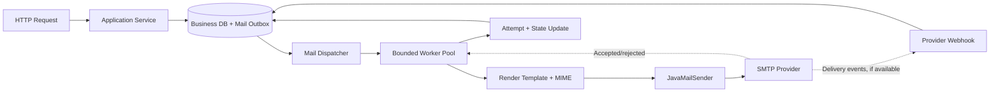
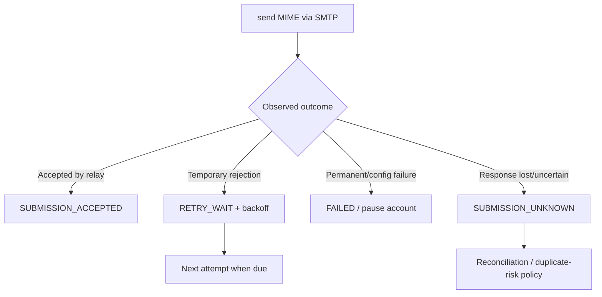
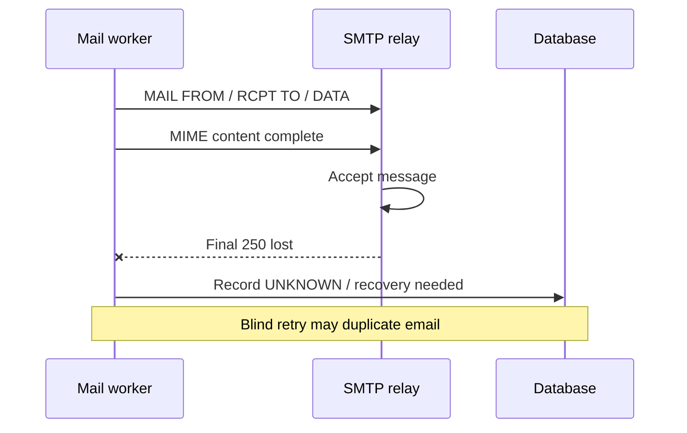

# Decoupling Mail Worker from the Request Thread

In a Spring Framework Mail application, flows like "account registration", "order placement", or "invoice issuance" commonly trigger emails. The simplest implementation builds a `MimeMessage` and calls `JavaMailSender.send(...)` directly inside the HTTP controller or request-handling service. However, sending email is **I/O dependent on SMTP relays, DNS, networks, TLS, authentication, and provider limits**. A single send can take seconds or fail even though the core business action already succeeded.

A key production pattern is **decoupling the mail worker from the request thread**: the request only records the send intent in durable storage and returns a response matching the API contract; an independent worker picks up due work, builds MIME, sends via SMTP, handles retries, and updates state. Between the two sides, there must be clear transactional, coordination, and idempotency boundaries.

This is more than just adding `@Async`. The goals are to ensure:

- HTTP latency does not depend on SMTP response times.
- Email intents are not lost during process restarts or deployments.
- Business transactions are not held open while connecting to SMTP.
- When SMTP fails or throttles, workers can retry without corrupting committed business transactions.
- Multiple workers/replicas do not process the same job concurrently by accident.
- Every send has observable state; never promise "email received" when only enqueued.
- Mail provider failures do not take down unrelated requests or services.

The lesson **Decoupling Mail Worker from the Request Thread** belongs to the *Production Design Patterns* chapter of Spring Framework Mail. Examples use Java 21, Spring Framework 6.x / Spring Boot 3.x, Jakarta Mail, PostgreSQL, and an SMTP test server. They illustrate the architecture, and APIs may need adjustment for your project's dependencies/versions; SQL targets PostgreSQL and is not guaranteed to run unchanged on every database.

## 1. Why not send SMTP directly in the request?

Suppose we have an order creation API:

```java
@PostMapping("/orders")
public ResponseEntity<OrderResponse> create(
        @RequestBody CreateOrderRequest request) {

    Order order = orderService.create(request);
    emailService.sendConfirmation(order);
    return ResponseEntity.ok(OrderResponse.from(order));
}
```

If `emailService.sendConfirmation(...)` calls `JavaMailSender.send(...)` synchronously, the HTTP response time is roughly:

\[
T_{\mathrm{request}} \approx
T_{\mathrm{validation}} +
T_{\mathrm{database}} +
T_{\mathrm{render}} +
T_{\mathrm{SMTP}} +
T_{\mathrm{overhead}}
\]

Here, `T_SMTP` can vary widely. A slow relay or socket timeout stalls the request, ties up a web thread, and may trigger a 504 at the gateway. Users may click submit again because they do not know the order was created, causing **duplicate requests** unrelated to SMTP itself yet triggered by SMTP latency.

### 1.1. Sending inside @Transactional is even more dangerous

```java
@Transactional
public Order createOrder(CreateOrderCommand command) {
    Order order = orders.save(new Order(command));
    mailSender.send(buildConfirmation(order));
    return order;
}
```

The risks:

1. The database transaction holds connections/locks while waiting on SMTP.
2. SMTP may accept the email, yet the DB transaction rolls back afterward; the recipient sees confirmation for a nonexistent order.
3. The database commit may succeed while the HTTP response is lost, and client retries create another order/email if request idempotency is missing.
4. An SMTP error causes the business transaction to roll back by policy even though the **intent to create the order** was completely valid.

SMTP does not participate in the database's ACID transaction. `@Transactional` cannot recall an email after the relay has accepted it. A simple `try/catch` also does not make email part of the DB transaction.

### 1.2. Spawning a new thread does not solve the problem

A common shortcut:

```java
new Thread(() -> mailSender.send(message)).start();
return ResponseEntity.accepted().build();
```

It may let HTTP return quickly, but it introduces severe issues:

- Unbounded thread creation easily exhausts resources.
- Tasks live in RAM; a JVM crash loses work.
- No state tracking, retry budget, or auditing.
- No SMTP quota coordination.
- May hold references to closed requests/sessions/transactions.
- Exceptions are not returned to the caller and may go unhandled.

In production, never spawn raw threads for mail sends that require reliability.

## 2. Three architectures and reliability levels

| Model | Request waits for SMTP? | Work survives restarts? | Retry/observability |
|---|---|---|---|
| Synchronous send in request | Yes | No queue needed, but request must wait | Errors return to request, prone to timeouts |
| `@Async` with in-memory executor | No, if proxy/submit works | **Not guaranteed on its own** | Must manually manage exceptions, queue, retries |
| Transactional outbox + mail worker | No | Yes if DB commit succeeds | Has state/lease/attempts and retry schedule |
| Message broker + worker | No | Depends on durable broker/ack/publisher semantics | Good if configured right; still needs idempotency |

The central pattern of this lesson is **transactional outbox + bounded mail worker**. This fits when emails relate to critical business workflows and must recover after crashes. For low-importance best-effort notifications, a bounded in-memory executor may suffice, provided task loss is acceptable and the contract is clear.

### 2.1. @Async is useful, but does not replace durability

```java
@Service
public class AsyncMailService {

    private final JavaMailSender sender;

    public AsyncMailService(JavaMailSender sender) {
        this.sender = sender;
    }

    @Async("mailExecutor")
    public CompletableFuture<Void> sendAsync(MimeMessage message) {
        sender.send(message);
        return CompletableFuture.completedFuture(null);
    }
}
```

For `@Async` to work, asynchronous method execution must be enabled via `@EnableAsync` or equivalent configuration; calls must go through the Spring proxy, not self-invocation like `this.sendAsync(...)`. Submission can throw if the executor rejects tasks, and in-task exceptions surface through the future. Still, **the email is not durably persisted** merely because the method returns `CompletableFuture`.

Do not return `200 OK - email delivered` immediately after calling `sendAsync(...)`. It is best to have a clearly defined `QUEUED` / `SUBMISSION_PENDING` state in the system.

### 2.2. A broker also needs a commit boundary

If a service performs:

```text
DB commit order
  -> publish event to RabbitMQ/Kafka
```

there is still a crash window **after DB commit, before publish**, losing the email event. Conversely, publishing before DB commit can cause workers to email about rolled-back orders. Transactional outbox solves **persisting intent in the same business transaction**; a relay can publish outbox entries to a broker after commit. Broker consumers still need deduplication because redelivery can occur after lost acknowledgments.

## 3. Recommended production architecture



Detailed flow:

1. Client sends an HTTP request with business data and, where appropriate, a request idempotency key.
2. Application service validates and **within the same database transaction** creates the business record and outbox intent.
3. DB commit completes. API returns order/notification ID and "accepted for sending" status.
4. Dispatcher reads due outbox rows and claims batches with lease/fencing tokens.
5. Worker loads necessary data, renders the template, builds MIME, and calls the SMTP relay via `JavaMailSender`.
6. Worker records attempt result and updates notification state conditionally on lease/attempt.
7. On temporary failure, set `nextAttemptAt`; on permanent failure, move to FAILED/DEAD_LETTER per policy.
8. If the provider offers downstream webhooks, handle them independently of submission results.

Key point: **there is no single transaction spanning HTTP, DB, and SMTP**. Instead, there are short DB transactions, with external side effects tracked via attempts and recovery.

## 4. API contract: "accepted" differs from "sent successfully"

An order creation API can return both business and notification info:

```text
POST /orders
Idempotency-Key: req-3d4f-test

HTTP/1.1 201 Created
Content-Type: application/json

{
  "orderId": "ORDER-1042",
  "notificationId": "MAIL-8821",
  "emailStatus": "QUEUED"
}
```

HTTP 201 here means **the order was created**, not that the email reached the recipient. For a dedicated asynchronous mail-sending API, HTTP `202 Accepted` with a tracking ID can fit well:

```text
POST /notifications/email
HTTP/1.1 202 Accepted

{
  "notificationId": "MAIL-8821",
  "status": "QUEUED",
  "statusUrl": "/notifications/MAIL-8821"
}
```

The status endpoint can return:

```text
QUEUED -> SENDING -> SUBMISSION_ACCEPTED
                  -> RETRY_WAIT -> SENDING
                  -> FAILED / DEAD_LETTER
                  -> SUBMISSION_UNKNOWN
```

If the provider supplies delivery events, separate downstream states can exist. **`SUBMISSION_ACCEPTED` does not mean `DELIVERED_TO_INBOX`**. An SMTP `250` after DATA means the relay accepted it at that point, not that the destination mailbox received it or placed it in Inbox vs Spam.

### 4.1. Request idempotency

If the client times out after DB commit, it may retry `POST /orders`. The API must prevent business duplicates using a validated unique idempotency key with proper scope, e.g., `(tenant_id, request_id)`. The outbox intent should have a **business event key**:

```text
order-created:tenant-5:ORDER-1042
```

When a request repeats, return the same order/notification if the idempotency contract allows, without inserting two outbox rows.

Idempotency keys need **scope, expiry policies, and payload consistency checks**: the same key with a different request payload must not silently be treated as the same request.

### 4.2. Do not let clients choose arbitrary SMTP providers

Provider accounts, sender identities, email templates, and recipient policies should be selected server-side based on the authenticated tenant and permissions. Accepting an unverified provider ID from JSON could let a user send through another tenant's credentials.

## 5. Outbox data model

An illustrative PostgreSQL schema:

```sql
CREATE TABLE mail_outbox (
    id UUID PRIMARY KEY,
    tenant_id VARCHAR(100) NOT NULL,
    business_event_key VARCHAR(240) NOT NULL,
    template_key VARCHAR(120) NOT NULL,
    template_version VARCHAR(50) NOT NULL,
    recipient_ref VARCHAR(160) NOT NULL,
    payload_ref VARCHAR(300) NOT NULL,
    state VARCHAR(32) NOT NULL,
    attempt_count INTEGER NOT NULL DEFAULT 0,
    next_attempt_at TIMESTAMPTZ NOT NULL DEFAULT NOW(),
    expires_at TIMESTAMPTZ,
    lease_owner VARCHAR(120),
    lease_token UUID,
    lease_until TIMESTAMPTZ,
    accepted_at TIMESTAMPTZ,
    last_error_category VARCHAR(80),
    created_at TIMESTAMPTZ NOT NULL DEFAULT NOW(),
    updated_at TIMESTAMPTZ NOT NULL DEFAULT NOW(),
    UNIQUE (tenant_id, business_event_key),
    CONSTRAINT ck_mail_outbox_state CHECK (
      state IN ('QUEUED','SENDING','RETRY_WAIT',
                'SUBMISSION_ACCEPTED','SUBMISSION_UNKNOWN',
                'FAILED','DEAD_LETTER','EXPIRED')
    )
);

CREATE INDEX ix_mail_outbox_due
ON mail_outbox (next_attempt_at, created_at)
WHERE state IN ('QUEUED', 'RETRY_WAIT');
```

This is an explanatory schema; production needs required columns, indexes for lease reclaiming, and retention. You should also keep a `mail_attempt` table rather than overwriting all history into one row:

```sql
CREATE TABLE mail_attempt (
    id UUID PRIMARY KEY,
    outbox_id UUID NOT NULL REFERENCES mail_outbox(id),
    attempt_number INTEGER NOT NULL,
    provider_id VARCHAR(100),
    started_at TIMESTAMPTZ NOT NULL,
    completed_at TIMESTAMPTZ,
    outcome VARCHAR(50),
    safe_error_code VARCHAR(80),
    provider_message_id VARCHAR(240),
    UNIQUE (outbox_id, attempt_number)
);
```

### 5.1. Why store recipient_ref and payload_ref?

Storing full `MimeMessage` objects or attachment bytes inside a closure or RAM queue can spike memory usage heavily. The outbox can hold an **immutable intent/DTO** or references to rendering data in a database/object store with proper access controls. The worker builds the message when its turn comes.

However, referencing mutable data also causes bugs: an invoice email must reflect data as of issuance time. Store a **controlled business snapshot** or versioned/immutable payload rather than simply re-reading the current order state and sending different content.

### 5.2. PII, secrets, and retention

Recipient addresses, billing addresses, verification tokens, attachments, and email content can be sensitive data:

- Restrict outbox visibility by tenant/service account.
- Encrypt stored data appropriately.
- Never put raw bodies/OTPs/tokens into logs or metric labels.
- Define TTL/retention/scrubbing for payloads and attempt history.
- Never store SMTP passwords in outbox rows; fetch them via secret management in workers.

## 6. Transaction writing business state and send intent

Place this logic in the application service rather than letting the controller call two repositories without a transaction:

```java
package com.example.productionmail;

import java.time.Clock;
import java.time.Instant;
import java.util.UUID;

import org.springframework.stereotype.Service;
import org.springframework.transaction.annotation.Transactional;

@Service
public final class OrderApplicationService {

    private final OrderRepository orders;
    private final MailOutboxRepository outbox;
    private final Clock clock;

    public OrderApplicationService(
            OrderRepository orders,
            MailOutboxRepository outbox,
            Clock clock) {
        this.orders = orders;
        this.outbox = outbox;
        this.clock = clock;
    }

    @Transactional
    public CreatedOrder create(CreateOrderCommand command) {
        Order order = orders.insertIdempotently(command);

        UUID mailId = outbox.insertIfAbsent(
                order.tenantId(),
                "order-created:" + order.id(),
                "ORDER_CONFIRMED",
                "v2",
                order.customerRef(),
                order.immutableConfirmationPayloadRef(),
                Instant.now(clock));

        return new CreatedOrder(order.id(), mailId, "QUEUED");
    }
}
```

`OrderRepository`, `MailOutboxRepository`, `CreateOrderCommand`, `Order`, and `CreatedOrder` are application-defined business abstractions. `insertIfAbsent(...)` must be backed by a unique constraint and return the existing row's ID when the event already exists, rather than generating a fresh UUID and returning an unpersisted ID.

Creating the order and writing the outbox must occur in the **same database/transaction manager** to guarantee:

| Scenario | Result |
|---|---|
| Transaction rollback | No new order, no new mail intent |
| Transaction commit | Order and mail intent are both durable |
| Client misses response after commit | Idempotent request retry can return existing order and outbox ID |
| SMTP outage right after commit | Order remains persisted, outbox keeps waiting |

`@Transactional` relies on Spring proxies in standard configurations; self-invocation can bypass the proxy. Do not pull SMTP calls or long object-storage downloads into the transaction. Operations outside the transaction must have their own protocols and retries.

### 6.1. Is @TransactionalEventListener AFTER_COMMIT enough?

A popular option:

```java
@TransactionalEventListener(phase = TransactionPhase.AFTER_COMMIT)
public void onOrderCreated(OrderCreated event) {
    mailSender.send(...);
}
```

This avoids sending before the order commits, but is **not durable on its own**: the process can die after commit and before or during the listener run. If sending fails, the event also does not survive across restarts for retries. `AFTER_COMMIT` is useful as a **dispatcher wake-up signal**, while the source of truth should still be the committed outbox.

This avoids sending before the order commits, but is **not durable on its own**: the process can die after commit and before or during the listener run. If sending fails, the event also does not survive across restarts for retries. `AFTER_COMMIT` is useful as a **dispatcher wake-up signal**, while the source of truth should still be the committed outbox.

## 7. Workers must not blindly read and send every QUEUED row

With a single worker, a loop of `SELECT...WHERE state=QUEUED` then `send(...)` looks sufficient. But production usually has multiple replicas, schedulers can overlap, workers can crash mid-flight, and DB queries can race.

A sound pattern separates:

1. **Discover:** find pending work.
2. **Claim:** one worker temporarily takes ownership via an atomic update.
3. **Attempt:** one SMTP call with its own ID and outcome.
4. **Commit outcome:** update result while checking lease/attempt.
5. **Recovery:** when a worker dies or outcome is uncertain, prevent jobs from getting stuck forever.

### 7.1. Why SELECT then UPDATE is insufficient

```text
Worker A: SELECT row MAIL-8821 where state=QUEUED
Worker B: SELECT row MAIL-8821 where state=QUEUED
Worker A: UPDATE state=SENDING
Worker B: UPDATE state=SENDING
Worker A: SMTP send
Worker B: SMTP send
```

Without locking/conditional claiming, two workers can send simultaneously. Java `synchronized` only protects a single JVM and does not solve races across pods.

### 7.2. Claiming with FOR UPDATE SKIP LOCKED

PostgreSQL can pick a due row and claim it in one short transaction:

```sql
WITH candidate AS (
    SELECT id
    FROM mail_outbox
    WHERE state IN ('QUEUED', 'RETRY_WAIT')
      AND next_attempt_at <= NOW()
      AND (expires_at IS NULL OR expires_at > NOW())
    ORDER BY next_attempt_at ASC, created_at ASC
    LIMIT 1
    FOR UPDATE SKIP LOCKED
)
UPDATE mail_outbox AS job
SET state = 'SENDING',
    lease_owner = :workerId,
    lease_token = :leaseToken,
    lease_until = NOW() + INTERVAL '2 minutes',
    attempt_count = attempt_count + 1,
    updated_at = NOW()
FROM candidate
WHERE job.id = candidate.id
RETURNING job.*;
```

This example is **for PostgreSQL**. The token is a fresh UUID per claim generated by the worker; `:workerId` is the instance ID. Within the same claim transaction, insert `mail_attempt` with the new attempt number, or ensure claim+attempt creation happens atomically. Syntax/locking may vary on other databases.

`SKIP LOCKED` keeps two workers from blocking on the same locked row; it does not by itself guarantee strict fairness or exactly-once external side effects. This SQL only claims unstarted rows or due retries. Reclaiming `SENDING` jobs with expired leases needs a **separate workflow** because the SMTP outcome may be uncertain.

### 7.3. Never hold DB locks while sending SMTP

Do not do:

```text
BEGIN transaction
SELECT FOR UPDATE order/outbox
JavaMailSender.send(...)   <-- can take many seconds
UPDATE status
COMMIT
```

This holds connections/row locks, increases deadlocks, and still cannot roll back SMTP.

Better:

```text
Transaction A (short): claim + create attempt -> COMMIT

SMTP call outside transaction

Transaction B (short): write attempt outcome + state -> COMMIT
```

If the process crashes between A and B, attempt/lease data remains for recovery; in return, there is an **uncertain outcome window** that must be handled carefully.

### 7.4. Updating state with a fencing token

After SMTP succeeds:

```sql
UPDATE mail_outbox
SET state = 'SUBMISSION_ACCEPTED',
    accepted_at = NOW(),
    lease_owner = NULL,
    lease_token = NULL,
    lease_until = NULL,
    updated_at = NOW()
WHERE id = :outboxId
  AND state = 'SENDING'
  AND lease_token = :leaseToken;
```

If updated rows = 0, the worker may no longer own the lease. Do not overwrite another worker's state. An outcome transaction should also record the corresponding result in `mail_attempt` by attempt ID, with ownership/transition checks and conflict policies.

**Fencing only protects database writes**. The old worker may still be executing SMTP after losing its lease; hence fencing alone does not prevent an email from being sent twice. You need timeouts, properly sized leases, conditional heartbeats, recovery policies, and duplicate-risk evaluation.

### 7.5. How to choose lease duration

Leases must be long enough for expected attempt processing time without making recovery too slow. Account for:

- Template rendering and attachment download.
- SMTP connect, TLS/AUTH, DATA, and read/write timeouts.
- JVM pauses and network delays.
- DB result update duration.
- Heavy-attachment scenarios.

For example, a 2-minute lease with a 10-second SMTP read timeout may be reasonable for small payloads, though not a universal default. For large jobs, you may need token-checked lease heartbeats, or caps on attempt deadlines/attachment sizes. **Never let a worker extend a lease without verifying its token**.

## 8. Dispatcher caps in-flight jobs

If the outbox has 100,000 rows, you cannot claim all 100,000 and submit them into an executor with 8 workers. When many jobs are claimed without available worker threads, leases can expire in the queue and cause duplicate processing.

The dispatcher must bound claimed jobs to actual available slots. One illustrative approach combines a `Semaphore` with a bounded executor.

### 8.1. Dedicated bounded executor for mail

```java
package com.example.productionmail;

import java.util.concurrent.ThreadPoolExecutor;

import org.springframework.context.annotation.Bean;
import org.springframework.context.annotation.Configuration;
import org.springframework.core.task.AsyncTaskExecutor;
import org.springframework.scheduling.annotation.EnableScheduling;
import org.springframework.scheduling.concurrent.ThreadPoolTaskExecutor;

@Configuration(proxyBeanMethods = false)
@EnableScheduling
public class MailWorkerConfiguration {

    @Bean(name = "mailWorkerExecutor")
    AsyncTaskExecutor mailWorkerExecutor() {
        ThreadPoolTaskExecutor executor =
                new ThreadPoolTaskExecutor();

        executor.setThreadNamePrefix("mail-worker-");
        executor.setCorePoolSize(4);
        executor.setMaxPoolSize(4);
        executor.setQueueCapacity(16);
        executor.setRejectedExecutionHandler(
                new ThreadPoolExecutor.AbortPolicy());
        executor.initialize();

        return executor;
    }
}
```

Values like 4 threads / 16 queued are **examples** only; measure SMTP latency and provider quotas before choosing. `AbortPolicy` makes overload explicit: tasks are rejected rather than silently dropped. Never use `DiscardPolicy` for business emails.

With `ThreadPoolTaskExecutor`, when `queueCapacity > 0`, once core workers are busy, the executor typically enqueues tasks before scaling above core toward max size. Thus `core=4, max=100, queue=100000` can let the queue grow enormously before a 5th thread ever appears. Never design capacity based solely on `maxPoolSize`.

### 8.2. Dispatcher with permits

```java
package com.example.productionmail;

import java.util.Optional;
import java.util.concurrent.Semaphore;

import org.springframework.core.task.AsyncTaskExecutor;
import org.springframework.core.task.TaskRejectedException;
import org.springframework.scheduling.annotation.Scheduled;
import org.springframework.stereotype.Component;

@Component
public final class MailDispatcher {

    private final Semaphore slots = new Semaphore(4);
    private final MailOutboxClaims claims;
    private final MailAttemptWorker worker;
    private final AsyncTaskExecutor mailWorkerExecutor;

    public MailDispatcher(
            MailOutboxClaims claims,
            MailAttemptWorker worker,
            AsyncTaskExecutor mailWorkerExecutor) {
        this.claims = claims;
        this.worker = worker;
        this.mailWorkerExecutor = mailWorkerExecutor;
    }

    @Scheduled(fixedDelayString = "${app.mail.poll-delay-ms:500}")
    public void pollDueJobs() {
        while (slots.tryAcquire()) {
            ClaimedMailJob claim;
            try {
                Optional<ClaimedMailJob> next = claims.claimOne();
                if (next.isEmpty()) {
                    slots.release();
                    break;
                }
                claim = next.get();
            } catch (RuntimeException claimFailure) {
                slots.release();
                throw claimFailure;
            }

            try {
                mailWorkerExecutor.execute(() -> {
                    try {
                        worker.process(claim);
                    } finally {
                        slots.release();
                    }
                });
            } catch (TaskRejectedException rejected) {
                slots.release();
                claims.releaseForRetry(
                        claim.id(), claim.leaseToken());
                break;
            }
        }
    }
}
```

`MailOutboxClaims`, `MailAttemptWorker`, and `ClaimedMailJob` are abstractions the project must implement. `claimOne()` executes a short transaction as shown earlier; `releaseForRetry(...)` must update conditionally on the lease token so it does not reset a newer worker's job.

This code illustrates the **reserve slot → claim → submit → finally release** principle. Production also needs:

- Explicit handling if `releaseForRetry` fails: lease recovery and alerts.
- Ensuring the executor does not use silent-discard or unexpected `CallerRuns` policies.
- Preventing overlap of multiple scheduler runs within one instance when needed.
- Stopping claims once shutdown begins.
- Handling tasks canceled before the `Runnable` executes: permits and leases must be reclaimed/recovered.
- Backing off poll frequency when quota is exhausted or the database is slow.

A semaphore is a **single-JVM limit**, not a cluster-wide SMTP limit. Other pods can concurrently claim different jobs from the same outbox; global SMTP limits must be handled separately.

### 8.3. Distinguishing worker capacity from queue capacity

In the example, the semaphore has 4 permits, so at most 4 jobs are claimed/in-flight from that dispatcher at once. Even though the executor has a queue of 16, the queue normally holds few or no jobs if all tasks originate from this dispatcher. This is **intentional**: long-term waiting belongs in the database, not on the JVM heap.

If multiple components share an executor, one dispatcher's semaphore alone cannot prevent the executor from filling up with other work. Use a dedicated mail-only executor and bound each submission source separately.

## 9. Worker executes a controlled attempt

A worker should follow a short, state-explicit cycle:

```text
ClaimedMailJob(outboxId, attemptId, leaseToken)
  -> verify ownership/current policy
  -> resolve immutable payload reference
  -> validate template / sender / recipient / TTL
  -> compose MimeMessage
  -> apply provider rate/concurrency permit
  -> JavaMailSender.send(...)
  -> classify result: ACCEPTED, TEMPORARY, PERMANENT, UNKNOWN
  -> commit attempt result and outbox transition
```

Separate three responsibilities:

- **Composer:** builds MIME content from trusted data without opening SMTP sockets.
- **Transport:** selects provider and sends, returning technical outcomes.
- **Outcome recorder:** updates attempt/outbox via transactions and fencing tokens.

### 9.1. Illustrative interfaces

```java
package com.example.productionmail;

import java.util.UUID;

public record ClaimedMailJob(
        UUID id,
        UUID attemptId,
        UUID leaseToken,
        int attemptNumber
) {}

public interface MailOutboxClaims {
    java.util.Optional<ClaimedMailJob> claimOne();
    void releaseForRetry(UUID id, UUID leaseToken);
}

public interface MailAttemptWorker {
    void process(ClaimedMailJob claimed);
}

public enum MailAttemptCategory {
    SUBMISSION_ACCEPTED,
    TEMPORARY_FAILURE,
    PERMANENT_FAILURE,
    UNKNOWN_OUTCOME
}
```

`attemptNumber`, attempt ID, and lease token should be persisted at claim time; do not regenerate them randomly inside the worker without saving. Some implementations claim in batches; ownership and transaction rules remain similar.

### 9.2. The unit of work is a notification, not an HTTP request

A request can generate multiple email intents—for example, a customer receives an invoice and a manager receives an alert. Each notification should have its own identity and state. One failing job should not roll back the entire order or force other emails to resend.

For emails with multiple recipients in a single MIME message, SMTP may partially accept at `RCPT TO`. If exact per-recipient retries are needed, model one intent per recipient or store per-recipient outcomes; do not assume the entire batch failed on a `MailSendException`.

### 9.3. Workers can live in the same deployment on separate threads

"Decoupling from the request thread" has several levels:

1. **Same process, separate executor:** simple to deploy, though request handling and workers share CPU/heap/lifecycle.
2. **Same codebase, separate worker deployment:** runs via a distinct profile/command and scales/shuts down independently.
3. **Dedicated mail worker service via broker/outbox:** stronger network/resource isolation at higher operational cost.

You do not need microservices on day one. What matters is the **durable intent boundary and never calling SMTP from the request thread**; as traffic grows, you can split deployments without changing API contracts.

## 10. Composer builds MIME independently of HTTP requests

A worker may run minutes or hours after the HTTP request. Therefore it must never depend on:

- `HttpServletRequest`, web sessions, or responses.
- Expired request-scoped Spring beans.
- Lazy-loaded JPA entities after the request transaction closed.
- `SecurityContextHolder` or request-thread MDC.
- Temporary `InputStream`s opened in a controller.
- Temporary uploaded files that might be deleted right after the request.

The intent must carry enough durable, authorized data for the worker to **reconstruct the exact content to send**. For many mail types, version templates/payloads so rollouts do not unexpectedly alter backlogged emails.

### 10.1. MimeMessageHelper example in a worker

```java
package com.example.productionmail;

import jakarta.mail.MessagingException;
import jakarta.mail.internet.MimeMessage;

import org.springframework.core.io.ByteArrayResource;
import org.springframework.mail.javamail.JavaMailSender;
import org.springframework.mail.javamail.MimeMessageHelper;

public final class OrderConfirmationComposer {

    private final JavaMailSender sender;
    private final OrderMailTemplateRenderer templates;

    public OrderConfirmationComposer(
            JavaMailSender sender,
            OrderMailTemplateRenderer templates) {
        this.sender = sender;
        this.templates = templates;
    }

    public MimeMessage compose(OrderMailPayload payload)
            throws MessagingException {

        MimeMessage message = sender.createMimeMessage();
        MimeMessageHelper helper =
                new MimeMessageHelper(message, true, "UTF-8");

        helper.setFrom("orders@example.test");
        helper.setTo(payload.recipientEmail());
        helper.setSubject(templates.subject(payload));
        helper.setText(
                templates.plainText(payload),
                templates.html(payload));

        if (payload.hasReceipt()) {
            byte[] pdf = payload.receiptPdfBytes();
            helper.addAttachment(
                    "receipt.pdf",
                    new ByteArrayResource(pdf),
                    "application/pdf");
        }

        return message;
    }
}
```

`OrderMailPayload` and `OrderMailTemplateRenderer` are illustrative abstractions. The snippet uses `ByteArrayResource` for small/simple fixtures; for large files, workers should use a resource/stream supplier capable of **reopening the stream on subsequent reads**, enforcing size and memory limits. Never hold large PDF `byte[]` arrays for thousands of tasks in a queue.

### 10.2. Validating data at send time

A notification may sit in the outbox for a long time; before sending, check policies:

- Is the recipient address valid/permitted for this mail type?
- For marketing, do current consent/unsubscribe/suppression rules still permit sending?
- For OTPs, is the code still valid? Never send expired codes.
- Are the sender From/domain permitted by the provider?
- Do the template ID/version and locale exist?
- Is data interpolated into HTML properly escaped/sanitized for context?
- Do attached documents belong to the tenant and remain authorized for download?

For issued invoices, content may need to stay frozen as of business commit. For marketing mailing lists, consent may need checking **at dispatch time**. These are two different policies; do not naively "snapshot everything" or "always read current state."

### 10.3. Normalizing inputs into a stable DTO

If a worker reads a JPA `Order` entity directly by ID and renders a template, it can break on new table schemas after deployment or closed lazy relationships. A durable approach uses a versioned payload schema:

```text
payloadVersion = 2
orderId        = ORDER-1042
recipientRef   = CUSTOMER-51
locale         = vi-VN
currency       = VND
issuedAt       = ...
receiptRef     = object-store://tenant-5/receipt/...
templateKey    = ORDER_CONFIRMED
templateVersion= v2
```

The URI name is illustrative, not a public download URL. References must be guarded by tenant-scoped authorization; workers use a service identity with auditing to read blobs rather than relying on old web session tokens.

### 10.4. HTML injection and secrets

Never concatenate unescaped user names directly into HTML:

```java
String html = "<p>Hello " + customerName + "</p>";
```

Before rendering, use a context-aware escaping template engine, allowlist permitted URLs/domains, and keep OTPs/passwords/reset links out of logs. Because email content leaves the system, apply data minimization, especially for emails with financial attachments.

### 10.5. Separating render failures from SMTP failures

If a template is missing or a PDF source is unreadable, SMTP has not even been called. The worker should record:

```text
TEMPLATE_NOT_FOUND (permanent until deployment/config fixed)
ATTACHMENT_READ_TEMPORARY (may retry)
ATTACHMENT_TOO_LARGE (message policy)
SMTP_AUTH_FAILED (provider account)
SMTP_TEMPORARY_REJECTION (provider temporary)
```

Do not lump every exception into `MAIL_SEND_FAILED` and keep retrying. Classifying by stage prevents retrying requests that were invalid from the start.

## 11. Configuring JavaMailSender for workers

Spring Boot can auto-configure a `JavaMailSenderImpl` when dependencies/configuration are present and no custom bean overrides it. In workers, you might configure:

```yaml
spring:
  mail:
    host: smtp.example.test
    port: 587
    username: ${MAIL_SMTP_USER}
    password: ${MAIL_SMTP_PASSWORD}
    properties:
      "[mail.smtp.auth]": "true"
      "[mail.smtp.starttls.enable]": "true"
      "[mail.smtp.starttls.required]": "true"
      "[mail.smtp.ssl.checkserveridentity]": "true"
      "[mail.smtp.connectiontimeout]": "5000"
      "[mail.smtp.timeout]": "10000"
      "[mail.smtp.writetimeout]": "10000"
app:
  mail:
    poll-delay-ms: 500
```

This is an example of SMTP submission over STARTTLS; hostname, port, credentials, and TLS mode must match your specific provider. Never set `starttls.required=false` or disable certificate verification in production just to make tests pass.

### 11.1. What role do timeouts play?

- `mail.smtp.connectiontimeout`: bounds socket establishment time.
- `mail.smtp.timeout`: read timeout.
- `mail.smtp.writetimeout`: write timeout depending on implementation.

They prevent a worker from hanging indefinitely when the network stalls. However, **they are not an overall deadline** covering DNS, template rendering, attachment downloads, multiple SMTP commands, and database updates. A worker's SLA must also factor in job timeout/TTL, lease duration, and shutdown grace period.

### 11.2. Synchronous sender calls are normal inside a worker

There is no need to force `JavaMailSender.send(...)` to be asynchronous at all costs. The worker already runs on a dedicated mail executor/thread; calling SMTP **synchronously inside the worker** keeps result recording and exception handling clear. This is a valid pattern:

```text
request thread -> DB outbox commit -> return

mail worker thread -> JavaMailSender.send(...) [blocking]
                     -> record result -> release thread
```

What needs bounding is the number of workers/connections, rather than trying to force SMTP into non-blocking I/O that the client library does not directly support.

### 11.3. One JavaMailSender is not necessarily a connection pool

`JavaMailSenderImpl` sends via SMTP, but does not imply an automatically managed connection pool aligned with provider limits. Operations may create/connect/close transport per send. Optimizing connection reuse or batching requires inspecting Jakarta Mail's implementation and transaction semantics, rather than assuming worker count equals fixed sockets.

At high volume, measure throughput across connection setup, TLS, transfer, and provider quotas. Do not raise thread counts until you know the bottleneck.

## 12. SMTP outcomes: accepted, rejected, and unknown

A worker must understand:



### 12.1. Primary SMTP reply codes

| Group | Example | Direction |
|---|---|---|
| 2xx | `250` after DATA | Relay accepted submission |
| 3xx | `354` before DATA | Ready to start sending data, not yet accepted |
| 4xx | `421`, `451` | Usually temporary; retry/backoff per provider policy |
| 5xx | `550`, `552`, `554` | Usually rejected; distinguish sender/recipient/message |

Enhanced status codes like `5.1.1`, `5.7.1`, or `4.7.0` and the SMTP phase (AUTH, MAIL FROM, RCPT TO, DATA) provide finer clarity. Never suppress a recipient on every `550` error: `550 5.7.1` can indicate sender/relay permission issues rather than a bad recipient address.

### 12.2. Spring Mail exceptions

`JavaMailSender` can throw subclasses of `org.springframework.mail.MailException`, commonly:

- `MailAuthenticationException`: AUTH error.
- `MailSendException`: transport error while sending one or more messages.
- `MailParseException`: address/message parsing error.
- `MailPreparationException`: error preparing MIME.

Nested Jakarta Mail `MessagingException` instances may carry `cause` and `nextException`; some implementations have subclasses holding SMTP reply codes or failed addresses. Do not use `exception.getMessage().contains("451")` as a global classifier. The transport adapter layer should normalize structured error codes when available, with a safe fallback when evidence is insufficient.

### 12.3. Uncertainty window after DATA



If the worker loses the response after DATA, the relay may already have accepted it; you cannot conclude `NOT_SENT`. Retrying through the same relay or another provider can deliver two copies to the recipient.

`Message-ID` in MIME or an outbox idempotency key **does not guarantee** two SMTP relays will deduplicate. Some email HTTP APIs support idempotency keys under specific contracts; when using them, understand key scope and expiration. Standard SMTP has no exactly-once delivery.

### 12.4. Recording attempt results with a short database transaction

An outcome recorder might accept:

```java
public record MailAttemptResult(
        MailAttemptCategory category,
        String providerId,
        String safeErrorCode,
        String providerMessageId
) {}
```

After the SMTP call, record:

```text
attempt.outcome = SUBMISSION_ACCEPTED
outbox.state = SUBMISSION_ACCEPTED
outbox.acceptedAt = now
```

or:

```text
attempt.outcome = TEMPORARY_FAILURE
outbox.state = RETRY_WAIT
outbox.nextAttemptAt = now + backoff
```

conditioned on the lease token/attempt ID still matching. If the DB update fails after SMTP accepted, the system fails to persist success; that is another cause of **UNKNOWN recovery** even though the SMTP call completed before the DB write.

### 12.5. Do not retry the whole message on partial recipient failure

A MIME message sent to multiple recipients can encounter:

```text
RCPT TO A -> 250
RCPT TO B -> 550
RCPT TO C -> 451
```

Depending on SMTP client/provider policy, some recipients may be accepted. For personalized mail, one notification per recipient makes status and retries much cleaner. If batching, store per-recipient outcomes and understand the implementation's `mail.smtp.sendpartial` setting where applicable.

## 13. Proper retries: never sleep a thread while waiting

A dangerous retry loop:

```java
while (!sent) {
    try {
        sender.send(message);
        sent = true;
    } catch (MailException failure) {
        Thread.sleep(60_000);
    }
}
```

It ties up the worker thread during the entire wait, has no max attempts, does not classify permanent failures, and causes retry storms during widespread provider outages.

Better:

1. Each worker executes **one attempt**.
2. Classifier determines temporary/permanent/unknown and scope.
3. For temporary failures, write `RETRY_WAIT` and `nextAttemptAt`.
4. Release the worker instead of sleeping the thread.
5. Dispatcher reclaims only when due and quota permits.
6. When retry budget or TTL expires, transition to FAILED/DEAD_LETTER or EXPIRED as appropriate.

### 13.1. Backoff by attempt count

Hypothetical example:

```text
Attempt 1: 451 -> retry after ~30s
Attempt 2: 451 -> retry after ~60s
Attempt 3: 451 -> retry after ~120s
Attempt 4: 451 -> retry after ~240s
Attempt 5: exhausted budget -> DEAD_LETTER
```

Jitter (bounded random variance) prevents all jobs from waking up at the exact same instant. If the provider specifies a trustworthy quota window or `retry-after`, factor it into scheduling. Never use the same retry profile for a 5-minute OTP and a long-lived invoice.

### 13.2. Designing RetryPolicy by category

```java
public enum RetryDisposition {
    RETRY_LATER,
    STOP_PERMANENT,
    PAUSE_PROVIDER,
    RECONCILE_UNKNOWN
}

public interface MailRetryPolicy {
    RetryDisposition classify(
            MailAttemptResult result,
            int attemptNumber);
}
```

Examples:

| Error category | Action |
|---|---|
| Verified temporary SMTP 4xx | `RETRY_LATER` with backoff |
| Invalid AUTH credentials | `PAUSE_PROVIDER` / operator action |
| Unverified sender domain | Stop/pause sender route, do not suppress recipient |
| Clearly invalid recipient | `STOP_PERMANENT` / controlled suppression |
| Attachment exceeds limit | `STOP_PERMANENT` or alter content per business policy |
| Timeout after DATA | `RECONCILE_UNKNOWN` |
| DNS failure before connect | May `RETRY_LATER` / conditional failover |
| Missing template from deploy | Pause/alert to fix template, do not spam retries |

Not all 4xx or 5xx codes mean the same thing across providers. When evidence is lacking, classify as `UNCLASSIFIED` and apply a cautious policy rather than assuming a permanent recipient failure.

### 13.3. Manual replay

When a job lands in `DEAD_LETTER`, an operator may replay it after fixing a template or permission. Replays must:

- Require authorization and auditing.
- Preserve notification identity/business key.
- Generate a new attempt ID linked to history.
- Respect current TTL, consent/suppression, and quotas.
- Not ignore `UNKNOWN` outcomes or duplicate side-effect risks.
- Not delete old outbox rows to "start clean" if doing so breaks auditing.

## 14. Worker crash recovery

A job can be in `SENDING` when a JVM dies. Never assume that state means "SMTP did not receive it." A recovery model is needed:

```text
SENDING + lease not expired
    -> another worker skips

SENDING + lease expired
    -> recovery/reconciliation policy
    -> maybe RETRY_WAIT, SUBMISSION_UNKNOWN or manual review
```

### 14.1. Crash window table

| Crash point | Persisted data | Appropriate recovery |
|---|---|---|
| Before outbox commit | No durable intent | Client retries via request idempotency |
| After outbox commit, before claim | `QUEUED` | Another worker claims normally |
| After claim, before SMTP connect | `SENDING` with lease | May retry if evidence shows no submission |
| During SMTP transaction | `SENDING`, incomplete attempt | Outcome may be uncertain; check phase/evidence |
| After DATA accepted, before saving result | `SENDING`, relay may have received | `UNKNOWN`/reconciliation, duplicate risk |
| After result commit `ACCEPTED`, before HTTP response | `ACCEPTED` in DB | Status endpoint returns state; do not resend |
| After `ACCEPTED` before webhook arrives | Submission known, downstream unknown | Track downstream events separately; do not resend just because Inbox wasn't confirmed |

### 14.2. Reaper for expired leases

A scheduled recovery job can find `SENDING AND lease_until < NOW()`. Instead of flipping everything straight back to `QUEUED`:

1. Inspect the attempt record and the latest recorded phase.
2. If SMTP never started and reliable evidence confirms it, requeue.
3. If it might have been accepted without a DB write, move to `SUBMISSION_UNKNOWN` or a needs-reconciliation state.
4. If the provider offers a lookup API by provider message ID, reconcile when safe.
5. When certainty is impossible, decide on retry according to the business workflow's duplicate tolerance.

Set a recovery grace interval and check limits; do not let an expired lease immediately trigger a parallel send while the old worker is still streaming DATA.

### 14.3. Heartbeats do not make SMTP exactly-once

A worker can extend its lease during long processing. However, if the worker stalls or faces a network partition and the heartbeat fails, another worker can claim the job while the old SMTP attempt continues at the OS/network layer. Use timeouts/deadlines, fencing states, and policies for unknown outcomes; heartbeats only reduce accidental reclaims, not eliminate all duplicates.

## 15. Backpressure: fast requests do not mean sufficient system capacity

Suppose the API creates 80 notifications per second while mail workers can only send 30 emails per second. The API still responds fast because it only writes to the DB, yet the outbox backlog grows by roughly 50 jobs per second.

Under simple assumptions:

\[
\frac{\Delta Q}{\Delta t}
\approx \lambda_{\mathrm{new}} - \mu_{\mathrm{worker}}
\]

With `λ_new = 80/s` and `μ_worker = 30/s`, after 10 minutes the backlog grows by roughly:

\[
50\times600 = 30.000\ \text{jobs}
\]

Web threads are no longer blocked on HTTP SMTP calls, yet the system is still **overloaded**. Decoupling workers lets overload be absorbed and controlled; it does not make SMTP capacity infinite.

### 15.1. Types of backpressure

- **API admission control:** reject or throttle requests whose SLA cannot be met.
- **Durable queue/outbox:** store send intents for deferred processing.
- **Dispatcher claim cap:** never claim more jobs than available slots.
- **Executor bound:** bounded worker count and RAM queue.
- **Provider rate limiter:** limit messages/recipients/requests over time.
- **Provider connection semaphore:** cap active SMTP connections.
- **Business TTL:** drop notifications that expire while waiting too long.

These mechanisms do not substitute for one another. `maxPoolSize=8` does not guarantee staying below 20 messages/sec if each attempt is very fast; conversely, a 20/s rate limiter does not cap concurrent connections at 8 when the relay is slow.

### 15.2. Sizing concurrency by latency

Under steady-state assumptions, Little's law for the sending phase gives:

\[
L = \lambda W
\]

If you want 15 attempts/second and each attempt holds a worker for 0.4 seconds on average, average busy concurrency is roughly:

\[
15 \times 0,4 = 6\ \text{attempts}
\]

This is a starting point for measurement, **not a default worker count**. Account for SMTP p95/p99, rendering CPU, PDF attachments, provider concurrent connection limits, replica count, and headroom. Measure **attempt** throughput rather than only `SENT` notifications, since retries also consume resources.

### 15.3. Never blindly raise maxPoolSize when the provider is throttling

If an SMTP relay returns rate limits or 421 due to too many connections, adding more workers increases failure rates and prolongs cooldowns. The right response is usually slowing down, pausing for the quota window, or scaling within approved limits.

## 16. Provider-level SMTP rate and connection limits

A provider can enforce multiple limits:

| Quota type | Unit | Control approach |
|---|---|---|
| Concurrent SMTP sessions | Concurrent connections | Semaphore/connection cap |
| Messages per second | Messages/s | Token bucket / rate limiter |
| Recipients per second | Recipients/s | Limiter by recipient count |
| Daily quota | Messages/recipients per window | Durable quota accounting, scheduling |
| Max MIME size | Bytes after encoding | Validate before dispatch |
| Sender/account limit | Account/domain/region | Per-account limiter, routing policy |

Quotas and units must come from your actual provider/account rather than copying tutorial numbers into production configs. If 5 pods each allow 8 active SMTP calls, the theoretical total hits 40, potentially exceeding the shared account limit.

### 16.1. Limiter before the send call

Logical design:

```text
dispatcher has eligible job
  -> account/tenant policy check
  -> wait until quota permits are available without occupying worker
  -> claim job near execution time
  -> acquire connection permit
  -> send SMTP with bounded timeout
  -> release permit in finally
```

In practice, handle atomicity of quota booking/claiming, especially when multiple pods share an account. Do not tie up thousands of workers waiting for rate tokens. Limiters can live in the dispatcher or transport layer, as long as it is clear who may start an attempt and when permits expire.

### 16.2. Rate limiters must be cluster-wide for shared quotas

A per-JVM token bucket will not enforce a provider-account-level quota on its own. Options:

- Distributed token bucket/atomic counter with a recovery policy.
- Dedicated dispatcher managing each account.
- Static quota partitioning per replica when replica count is bounded.
- Broker topic/partition per provider account with matched consumer concurrency.

Never rotate IPs/accounts to evade anti-spam limits or provider policies. If quotas are too low, spread out schedules or request an official quota increase.

### 16.3. Latency targets by mail type

| Mail type | Characteristics | Worker scheduling |
|---|---|---|
| OTP/verification | Short TTL, needs prompt dispatch | Bounded priority, skip expired, issue new code when needed |
| Security alerts | Needs high reliability, storm protection | Deduplication and dedicated quota |
| Invoices/receipts | Durable, auditable, attachments | Outbox retries, longer retention policy |
| Marketing | Can be staggered on schedule, needs consent | Throttled/segmented, never starve transactional capacity |

Never queue all marketing emails ahead of OTPs just because a FIFO outbox has hundreds of thousands of rows. Separate worker lanes, provider accounts, or use fair scheduling while still respecting the provider's global quota.

### 16.4. Deadlines and expiration

If an OTP has a 5-minute TTL yet sits queued for 7 minutes, sending the stale OTP hurts UX and can pose security risks. Workers check `expiresAt` immediately before submission; if expired, mark `EXPIRED` and do not send.

For invoices, do not auto-expire after 5 minutes. Every message type needs its own policy for TTL, retry budget, and escalation.

## 17. Multi-tenancy and preventing one source from starving workers

If one tenant enqueues 50,000 campaign emails while another tenant needs 2 invoice emails sent, a shared FIFO queue can delay the invoices unacceptably. A system can:

1. Separate transactional and bulk outbox lanes.
2. Reserve capacity/priority for critical emails.
3. Enforce per-tenant rate/concurrency limits.
4. Apply round-robin or weighted fair selection.
5. Cap retries for failing tenants so other tenants do not starve.
6. Isolate provider accounts where permitted and governed by clear policy.

When creating separate worker pools, sum total concurrency across **all pools and replicas**. Do not split into four executors of 10 threads each and accidentally raise the SMTP connection ceiling to 40.

### 17.1. Data isolation when workers lack request context

Workers typically run under a service identity without an HTTP principal. Therefore:

- Tenant ID must come from a row validated/authorized at enqueue time.
- Repository queries and object-storage lookups must be tenant-scoped.
- Never let workers pick From/recipient/attachments from unchecked free-form input.
- Never rely on `SecurityContextHolder` from an old request.
- Use correlation IDs for tracing, never as authentication.

If using MDC to log tenant/job IDs, always restore/remove in `finally` so the previous task's data never leaks into the next task on the same thread.

## 18. Separate worker deployment and graceful shutdown

As traffic grows, you can run the same application in two roles:

```text
Web deployment:
  - Handles HTTP requests
  - Writes business tables + outbox
  - Does not run SMTP poller

Mail worker deployment:
  - Polls mail_outbox
  - Uses SMTP credentials/network access
  - Can scale independently
  - Exposes health/metrics, not public HTTP API by default
```

Use Spring profiles/conditional configuration or two entrypoints in the same codebase. Example:

```java
@Configuration(proxyBeanMethods = false)
@Profile("mail-worker")
@EnableScheduling
public class MailWorkerProfileConfiguration {
    // Mail dispatcher/worker beans enabled in the worker deployment.
}
```

This is an illustrative bean activation mechanism. In production, verify worker-only beans, schedulers, and SMTP secrets are not accidentally enabled in web pods. Web pods may not even need egress access to SMTP, isolating risk further.

### 18.1. Multi-phase shutdown

On SIGTERM or normal shutdown:

1. Mark the instance **no longer accepting new claims**.
2. Stop the scheduler/poller cleanly.
3. Give in-flight attempts time to finish, bounded by the shutdown grace period.
4. Persist attempt results if time allows.
5. Once the grace period ends, unfinished jobs remain in the outbox/lease for recovery.

Spring `ThreadPoolTaskExecutor` provides graceful-shutdown options such as waiting for tasks to complete or awaiting termination, but they **do not guarantee completion** under OS kills, power loss, JVM OOM, or process crashes.

### 18.2. Do not drain an oversized RAM queue

If an executor holds 10,000 queued tasks taking 1 second each, shutdown takes far too long. Keep the RAM queue small and claim only up to capacity; keep large backlogs in the database. When the process stops, `QUEUED` jobs remain intact.

### 18.3. Rolling deployments and schema/template versioning

During a rolling deploy, a new-version worker may process outbox rows created by an old-version web pod. Therefore:

- Payload formats must be versioned.
- Template versions must be stored or mapped by policy.
- Database migrations must stay read/write compatible across versions.
- Never delete old templates while queued jobs still reference them.
- Keep a worker rollback path in case new serialization/rendering breaks.

This is why an outbox is not just a table of subject/body columns: it is a contract between producers and workers running at different times.

## 19. Do virtual threads help?

Java 21 supports virtual threads, reducing the cost of holding many blocking I/O units in certain cases. However:

- SMTP providers still enforce connection/rate quotas.
- TLS, MIME encoding, and attachment bytes still consume CPU/memory/bandwidth.
- In-RAM tasks are still not durable.
- External side effects still are not transactional with the DB.
- Retry storms still occur without limiters.

If choosing virtual-thread-per-task, implement explicit semaphores and admission controls. Never use "virtual threads are cheap" as an excuse to skip bounded concurrency, rate limiters, or the outbox.

### 19.1. When should you optimize I/O?

Before swapping executors or writing custom transports, measure:

- SMTP p50/p95/p99 latency.
- Breakdown of connect/TLS/DATA time.
- MIME/attachment sizes.
- CPU, GC, heap, and socket counts.
- 4xx/throttle rates.
- DB claim/query throughput.

If the bottleneck is provider quota, replacing platform threads with virtual threads will not increase your quota.

## 20. Observability: from request ID to SMTP attempt

A reliable system links:

```text
HTTP requestId
  -> businessEventKey
  -> outbox notificationId
  -> attemptId (providerId)
  -> SMTP accepted/rejected/unknown
  -> downstream event (if available)
```

Do not use email addresses as primary correlation keys in broad logs. Internal IDs correlate records without logging raw bodies, OTPs, or attachments.

### 20.1. Recommended metrics

| Group | Metric | Question |
|---|---|---|
| API | Request latency / 201/202/4xx/5xx | Does web stay fast during an SMTP outage? |
| Outbox | `QUEUED`/`RETRY_WAIT`/`SENDING` counts | Where is the backlog sitting? |
| Outbox | Oldest due age | Are emails missing SLAs? |
| Dispatcher | Claims/s, claim conflicts | Is work progressing or contending? |
| Worker | Active threads, queue size, rejections | Is capacity hitting the ceiling? |
| Transport | SMTP attempt duration p50/p95/p99 | How slow is the relay? |
| Transport | Accepted/temp/permanent/unknown counts | Which failure class is rising? |
| Provider | Rate permits denied, concurrent sessions | Which quota is saturated? |
| Recovery | Expired leases / unknown attempts | Are crashes/timeouts increasing? |
| Delivery | Bounce/deferred/complaint events | Are issues occurring post-acceptance? |
| JVM | Heap, GC, CPU, thread count | Are payloads/queues exhausting resources? |

### 20.2. Structured logging

```text
event=mail_attempt_started
notificationId=MAIL-8821
attemptId=ATT-2
providerId=primary
tenantGroup=transactional

event=mail_attempt_result
notificationId=MAIL-8821
attemptId=ATT-2
outcome=TEMPORARY_FAILURE
smtpCategory=RATE_LIMITED
nextAttemptAt=2026-11-12T15:10:00Z
```

Avoid printing raw MIME, attachments, SMTP AUTH exchanges, passwords, reset links, or full recipient addresses. Never use notification/attempt IDs as Prometheus labels due to high cardinality; keep them in logs/traces.

### 20.3. Alert on impact, not just error counts

Alert when:

- Oldest due job exceeds SLA for several minutes.
- Zero claims occur despite due jobs existing.
- Retry/throttle rates climb without recovering.
- Many `SENDING` leases expire or `UNKNOWN` outcomes spike.
- Widespread SMTP AUTH/TLS errors occur on a provider account.
- `DEAD_LETTER` grows or a poison template appears.
- Executor rejections occur continuously.
- Web API latency degrades because mail code still runs on request threads.

Do not page urgently for a single invalid recipient if that is an expected business outcome.

## 21. Testing the request/worker architecture, not just templates

A unit test verifying the subject string is not enough to prove this pattern works. You must test the **boundaries**: requests do not call SMTP, the outbox shares the business transaction, workers claim safely, attempts actually use SMTP, and crashes/retries neither lose nor duplicate side effects contrary to contract.

### 21.1. Testing that requests do not call JavaMailSender

In the decoupled architecture, `OrderApplicationService.create(...)` should not inject `JavaMailSender`. A unit test can verify:

- When creating an order, repositories write one business record and one outbox intent.
- No `send(...)` calls occur on the request path.
- Returns order ID + notification ID and `QUEUED` state.
- Repeating the request with the same idempotency key does not create a second intent.

Example Mockito test verifying service interactions:

```java
import static org.junit.jupiter.api.Assertions.*;
import static org.mockito.Mockito.*;

import java.time.Clock;
import java.time.Instant;
import java.time.ZoneOffset;
import java.util.UUID;

import org.junit.jupiter.api.Test;

class OrderApplicationServiceTest {

    @Test
    void createsOrderAndEmailIntentWithoutCallingSmtp() {
        OrderRepository orders = mock(OrderRepository.class);
        MailOutboxRepository outbox = mock(MailOutboxRepository.class);

        Clock clock = Clock.fixed(
                Instant.parse("2026-11-12T09:00:00Z"),
                ZoneOffset.UTC);

        UUID mailId = UUID.randomUUID();
        CreateOrderCommand command = fakeOrderCommand();
        Order order = fakeSavedOrder();

        when(orders.insertIdempotently(command)).thenReturn(order);
        when(outbox.insertIfAbsent(
                anyString(), anyString(), anyString(), anyString(),
                anyString(), anyString(), any(Instant.class)))
                .thenReturn(mailId);

        OrderApplicationService service =
                new OrderApplicationService(orders, outbox, clock);

        CreatedOrder result = service.create(command);

        assertEquals(mailId, result.mailId());
        assertEquals("QUEUED", result.emailStatus());
        verify(orders).insertIdempotently(command);
        verify(outbox).insertIfAbsent(
                anyString(), anyString(), anyString(), anyString(),
                anyString(), anyString(), any(Instant.class));
    }
}
```

`fakeOrderCommand()`, `fakeSavedOrder()`, and record accessors are fixture/application contracts you must implement. The unit test above only verifies interactions, **not** database transactions or unique constraints; those require integration tests with a real DB.

Another useful architectural check: the request service/module **has no direct dependency on the SMTP sender**, while only the worker component is permitted to invoke transport.

### 21.2. Transaction testing with a real database

Using PostgreSQL/Testcontainers or a production-equivalent database:

1. Create order and outbox intent in a single transaction.
2. Intentionally throw an exception before commit.
3. Verify **no order and no outbox row exist** after rollback.
4. Repeat with a successful commit; verify both exist.
5. Resend the same request idempotency key; verify order/outbox row counts do not increase.
6. Send the same key with a different payload; assert an error response per the API contract.

Note: if the test method itself is `@Transactional` and the framework rolls back at test end, it is hard to verify **committed** state from an external transaction. Design setup/assertions to match real transaction boundaries.

### 21.3. Claim concurrency testing

With two workers:

```text
Both workers begin together
One eligible outbox row
Both call claimOne()
Expected: exactly one returns a lease
Other returns empty (or different row)
```

Tests can use a `CountDownLatch` to start nearly simultaneously, PostgreSQL row locking/unique constraints, and clear deadlines. Do not test races by calling `Thread.sleep(100)` and hoping two workers collide. Under high load, test that batch claims never exceed in-flight capacity.

### 21.4. Real SMTP testing with a sandbox

An integration test using `JavaMailSenderImpl` pointed at GreenMail or a Mailpit test server. Abbreviated example:

```java
import static org.junit.jupiter.api.Assertions.*;

import com.icegreen.greenmail.util.GreenMail;
import com.icegreen.greenmail.util.ServerSetup;
import org.junit.jupiter.api.Test;
import org.springframework.mail.javamail.JavaMailSenderImpl;

class MailTransportSmtpIT {

    @Test
    void sendsMessageToControlledSmtpRelay() throws Exception {
        GreenMail smtp = new GreenMail(
                new ServerSetup(
                        0, "127.0.0.1", ServerSetup.PROTOCOL_SMTP));

        smtp.start();
        try {
            JavaMailSenderImpl sender = new JavaMailSenderImpl();
            sender.setHost("127.0.0.1");
            sender.setPort(smtp.getSmtp().getPort());
            sender.setDefaultEncoding("UTF-8");
            sender.getJavaMailProperties().put(
                    "mail.smtp.connectiontimeout", "3000");
            sender.getJavaMailProperties().put(
                    "mail.smtp.timeout", "5000");

            var message = sender.createMimeMessage();
            var helper = new org.springframework.mail.javamail
                    .MimeMessageHelper(message, false, "UTF-8");
            helper.setFrom("no-reply@example.test");
            helper.setTo("recipient@example.test");
            helper.setSubject("Xác nhận đơn hàng");
            helper.setText("Email test, không phải đơn hàng thật.");

            sender.send(message);

            assertTrue(smtp.waitForIncomingEmail(5000, 1));
            assertEquals(1, smtp.getReceivedMessages().length);
            assertEquals(
                    "Xác nhận đơn hàng",
                    smtp.getReceivedMessages()[0].getSubject());
        } finally {
            smtp.stop();
        }
    }
}
```

This is an SMTP test **against a real socket test server**, not sending to real users. Choose a GreenMail version supporting Jakarta Mail for Spring Boot 3; check API/constructors against your locked dependencies. The test confirms the test relay receives the email, not Inbox placement at a production provider.

### 21.5. Separating unit tests from integration tests

Unit tests for `MimeMessageHelper` can capture messages via Mockito `ArgumentCaptor` to inspect To/Subject/HTML, yet mocking `JavaMailSender` **opens no SMTP socket**. Integration tests with a real sender verify sockets, protocol exchanges, and MIME serialization. Both have a role; you do not need an SMTP sandbox for every simple text assertion.

## 22. Failure-injection test matrix

Test not only "happy path sends", but also failure windows:

| Scenario | Expected state/effect |
|---|---|
| SMTP down during order creation API | API still commits order+outbox without waiting on SMTP |
| DB rollback in create | No new order, no new mail intent |
| HTTP response lost after commit | Retry with same idempotency key creates no duplicate intent |
| Crash after outbox commit before claim | Job stays `QUEUED` and another worker picks it up |
| Two pods claim one job | Only one owner holds a valid lease |
| Crash after claim before SMTP | Controlled lease recovery |
| SMTP AUTH fails | Pause account, do not retry every job forever |
| Temporary SMTP 451 | `RETRY_WAIT` + backoff, worker released |
| SMTP 550 5.1.1 invalid recipient | Do not retry as-is, suppress per policy |
| SMTP 550 5.7.1 sender not authorized | Do not suppress recipient; fix sender/account |
| Attachment source unreadable | Stage-specific failure, never mark accepted |
| Template render error | Retry/stop by error source; SMTP not called |
| SMTP 250 accepted, DB update succeeds | Attempt + outbox `SUBMISSION_ACCEPTED` |
| SMTP accepted, DB update fails | Recovery/`UNKNOWN` risk, do not claim `NOT_SENT` |
| Final response lost after DATA | `UNKNOWN`, failover per duplicate-risk policy |
| Accepted email bounces via webhook | Record downstream event, do not rewrite history as "not submitted" |
| Queued job exceeds OTP TTL | `EXPIRED`, do not send stale code |
| Executor full | Durable intent preserved, never fall back to HTTP SMTP call |
| Process hard kill | Outbox survives; lease/reaper/reconciliation |
| Provider quota exhausted | Slow dispatch, avoid retry storms |

### 22.1. Resilience tests must verify side-effect counts

A retry test can invoke a handler twice and remain correct if only one business email intent is created. For SMTP, since exactly-once is not guaranteed, distinguish attempt count from notification count:

```text
notificationCount = 1
smtpAttemptCount  = 2
businessOrderCount= 1
```

However, if the first attempt had an `UNKNOWN` outcome, final emails in the recipient's inbox may be 1 or 2. Tests must reflect observable limits rather than asserting unproven guarantees.

### 22.2. Testing shutdown and deployment

In a worker deployment:

1. Enqueue many jobs.
2. Let several jobs enter `SENDING`.
3. Send a shutdown signal with a grace period.
4. Verify the dispatcher stops taking new claims.
5. `QUEUED` jobs remain in the DB.
6. In-flight jobs record outcomes if finished; otherwise, lease recovery preserves intents.
7. Start a new worker and assert backlog drains per policy.

If a test merely calls `executor.shutdown()` and awaits all tasks, it does not simulate a crash. Test controlled process kills/timeouts when high reliability is required.

### 22.3. Testing rate/concurrency without real emails

To test limiters, use a virtual clock/token bucket and a fake transport holding socket permits with a latch. Assert:

- Simultaneous attempts never exceed the allowed limit.
- Rate over time is not exceeded.
- Across multiple replicas sharing an account, cluster-wide quota is respected.
- When no permits are available, outbox rows stay pending without being lost.
- When quota returns, the dispatcher resumes without bursting past policy.

A very fast localhost SMTP sandbox helps verify transport, yet does not replace limiter tests or real provider quotas.

## 23. Migrating from controller sends to workers

To evolve a running system, you do not need microservices immediately. A risk-reducing path:

### Phase 1 — Separate composer and transport

Move email logic out of controllers:

```text
Controller -> ApplicationService
ApplicationService -> MailIntentWriter
Worker -> Composer -> Transport
```

Separate content construction from opening SMTP sockets for independent testing. If currently using `SimpleMailMessage`, keep a text-only composer first and gradually upgrade to MIME/attachments.

### Phase 2 — Create outbox schema and unique business keys

Create the outbox table, attempt history, due/lease indexes, retention, and canonical states. During transition, **do not run two sending paths in parallel for the same event** without deduplication/feature-flag guards.

### Phase 3 — Write intent inside the business transaction

Replace synchronous SMTP calls in requests with an outbox insert in the same transaction. Verify the API still returns the right business response with email status `QUEUED`, not `SENT`.

### Phase 4 — Enable a small number of workers

Run one worker or deployment with low concurrency against an SMTP sandbox/staging account. Measure:

- HTTP latency before/after.
- Time from enqueue to accepted.
- Attempt, retry, dead-letter, and unknown counts.
- SMTP quota and connection usage.
- Outbox oldest due age.

Then raise concurrency based on measurements rather than jumping straight to high thread counts.

### Phase 5 — Exercise failure cases

Intentionally stop the SMTP test server, fail DB updates, and kill workers mid-attempt. Confirm intents are never lost and `UNKNOWN` outcomes follow policy. Test rollback/duplicates against business contracts.

### Phase 6 — Isolate deployments and secrets

When workload warrants it, create a dedicated mail-worker deployment. Web pods only write to DB/outbox; worker pods hold SMTP secrets and matching egress. Scale workers by backlog, oldest age, and provider quota—not just CPU.

### Phase 7 — Guardrailed rollout

Canary a subset of tenants/notification types. Keep routing clear so the same event is never sent by both legacy and new code. Support pausing workers without losing the outbox. Monitor bounces/throttles, retries, accepted rates, and delayed notifications before expanding.

### Phase 8 — Clean up legacy synchronous code

Once the worker path handles load stably, remove direct SMTP calls from requests, delete redundant executors/batch schedulers, update runbooks/API contracts, and verify no accidental fallback runs SMTP on HTTP threads when executors fill up.

## 24. Production incident runbook

### 24.1. "API is fast, yet customers aren't receiving emails"

Check:

1. Are outbox rows being created and committed?
2. Are `QUEUED`/`RETRY_WAIT` counts growing? What is the oldest due age?
3. Are worker deployments/schedulers running?
4. Are jobs getting claimed, or are DB/leases blocked?
5. Are SMTP attempts hitting AUTH, TLS, rate limits, or connection timeouts?
6. Are there `SUBMISSION_ACCEPTED` jobs with no downstream events?
7. Does the provider have bounce/complaint/suppression policies blocking delivery?

Never tell a customer "delivered to Inbox" merely because outbox shows SENT/ACCEPTED.

### 24.2. "Outbox has thousands of stuck SENDING rows"

Inspect lease expirations, worker liveness, DB update errors, and recent SMTP attempts. Never blindly reset all `SENDING` rows back to `QUEUED`: some emails may already have been accepted without persisting status. Make recovery decisions based on evidence.

### 24.3. "Provider repeatedly returns 421/451"

Check account messages/sec and concurrent connection quotas, replica/thread counts, provider health, and retry storms. Reduce send rate, add backoff/jitter, temporarily pause bulk mail, and do not instinctively increase max workers.

### 24.4. "One order received two confirmation emails"

Inspect:

- Business event key and outbox unique constraint.
- Request retries with same/different idempotency keys.
- Whether two dispatchers claimed the same row.
- Lease timeouts/reclaims and fencing tokens.
- SMTP timeouts after DATA or DB ack failures.
- Provider failovers and provider message IDs.
- Whether legacy SMTP code and new workers ran concurrently.

Do not jump to blaming SMTP provider duplication before checking attempt history and request/idempotency logs.

### 24.5. "Workers are exhausting memory"

Inspect queued task counts, attachment byte arrays, MIME object sizes, DB batch sizes, GC, and thread/stack counts. Never load 100,000 outbox rows as Java objects before filtering; claim small batches matched to capacity and stream attachments when needed. Shrink payloads kept in RAM queues.

## 25. Common design pitfalls

**"Just add `@Async`."** `@Async` switches threads, yet tasks in RAM can vanish on restart; there is no durable retry or audit unless built explicitly.

**"An `AFTER_COMMIT` listener guarantees no lost emails."** There is a crash window after DB commit before the listener runs; persisting the outbox in the business transaction is what protects intent.

**"With a broker, we don't need an outbox."** Without coordination between DB commit and broker publish, events can still be lost; consumers also must handle redelivery.

**"Keeping SMTP in `@Transactional` lets emails roll back."** SMTP is not a database transaction participant.

**"Larger executor queues are safer."** Huge RAM queues increase heap usage, latency, and task loss on crashes; durable backlogs belong in the database.

**"`maxPoolSize=100` means 100 workers."** With bounded queues, executors usually enqueue after core threads before scaling above core.

**"Unique outbox keys and leases guarantee exactly-once SMTP."** Unique keys protect business intent and leases protect temporary ownership; neither closes the accepted-before-ack window.

**"A timeout means the provider didn't receive it."** After DATA, the outcome may be `UNKNOWN`. Never flip directly back to `QUEUED` for resend without evaluating duplicate risk.

**"`CallerRunsPolicy` is always safe."** It can push SMTP work right back onto HTTP request threads when the executor fills.

**"Adding more pods speeds up SMTP."** When sharing a provider account, more pods can breach connection/rate quotas.

**"Workers can use old `HttpServletRequest` or `InputStream` objects."** Those objects are request-scoped; use durable payloads/references and a service identity.

**"Mocking `JavaMailSender` proves the real sending path."** Mocks open no SMTP connections; integration tests need a real sender and an SMTP test server.

**"SMTP accepted means email is in the Inbox."** Submission, downstream delivery, and Inbox placement are separate milestones.

## 26. Hands-on exercises

### A. Decouple requests from SMTP

Create an order endpoint calling SMTP synchronously and measure p95 when the relay is slow. Replace it with transactional outbox writes; measure HTTP latency and confirm `QUEUED` state after response.

### B. Rollback and idempotency

In one transaction creating order + outbox, force a rollback and verify neither record remains. Resend the same request idempotency key and verify only one order and one intent exist.

### C. Concurrent claiming

Have two workers claim from one row in PostgreSQL. Only one worker receives the lease; the other never calls SMTP for that row. Use conditional updates and real transaction tests.

### D. Expired lease

Worker A claims and stalls; Worker B recovers and gets a new token. Verify A cannot write state with its stale token. Discuss the risk that A's SMTP call already completed.

### E. Bounded concurrency

Create a mail-only executor with four permits and a small queue. Hold workers busy with a latch, verify the dispatcher never claims beyond capacity, and verify rejections never lose durable jobs.

### F. SMTP server testing

Run GreenMail or Mailpit, send MIME via `JavaMailSenderImpl`, and verify the server receives Unicode subjects and attachment bytes. Never send to real customer addresses.

### G. Retries and unknown outcomes

Simulate 451 to test `RETRY_WAIT`/`nextAttemptAt`/backoff. Then simulate a lost final response after DATA: outcome `UNKNOWN`, no blind auto-failover.

### H. Crashes and shutdowns

Kill a worker before SMTP, and then after an attempt that may have been accepted. Inspect outbox/attempt history across restarts; do not reset all `SENDING` rows to `QUEUED`.

### I. Multi-tenant quotas

Two replicas share one provider account. Apply account-level rate limiters and connection caps, separating transactional/bulk priorities with fairness.

### J. Observability

Build dashboards for oldest `QUEUED` age, SMTP latency, retry/unknown counts, expired leases, worker rejections, and API p95. Alert on SLAs, not only CPU.

## 27. Production checklist

- Does the request path avoid SMTP blocking and return the right "accepted for sending" status?
- Are business records and mail intents written in the same transaction?
- Do request idempotency keys / business event keys have unique constraints and proper scoping?
- Can payloads/attachments/templates be reconstructed across restarts, deploys, and retries?
- Do workers claim jobs with atomic locking and commit claims before SMTP?
- Are lease tokens, attempt IDs, fencing, and expired-lease recovery implemented?
- Are `QUEUED`, `SENDING`, `RETRY_WAIT`, `ACCEPTED`, `FAILED`, and `UNKNOWN` clearly distinguished?
- Are worker concurrency, queue size, SMTP connections, and rates bounded per provider/account/cluster?
- When workers/executors overload, do jobs remain safely in the outbox?
- Are SMTP connect/read/write timeouts, retry backoff, and job TTLs appropriate?
- Are temporary, permanent, AUTH/config, and unknown outcomes classified?
- Are infinite retries and sleeping worker threads between attempts avoided?
- When SMTP accepts but DB result updates fail, does the recovery policy account for duplicate risk?
- Is submission acceptance distinguished from downstream delivery and Inbox placement?
- Do workers use a service identity without relying on old HTTP requests/security sessions?
- Do workers stop claiming on shutdown without losing jobs on hard kills?
- Are oldest queued age, active workers, rejections, SMTP errors, and retry/unknown counts observable?
- Are there integration tests for transaction rollbacks, concurrent claiming, SMTP sandboxes, and crash windows?
- Is there a canary plan preventing legacy synchronous code from running alongside new workers for the same events?

## 28. Conclusion

**Decoupling the mail worker from the request thread is an architectural boundary, not merely adding an `@Async` annotation.** Requests should commit business state and send intents in a transactional outbox, then return a response reflecting `QUEUED` status. Independent workers claim work, build MIME, and send via `JavaMailSender` under controlled timeouts, concurrency, and quotas.

A reliable mail worker needs **atomic claiming, leases/fencing, attempt history, backoff, durable states, and crash recovery**. SMTP does not guarantee exactly-once delivery: a relay may accept a message while the worker loses the response or fails to save the result. In those cases, handle `UNKNOWN_OUTCOME` according to duplicate risk rather than resending blindly.

Organized this way, slow or temporarily failing SMTP never holds HTTP request threads or database transactions open; the system can control backlogs, prioritize critical mail, scale workers within provider quotas, and recover cleanly across deploys and restarts without losing send intents.


