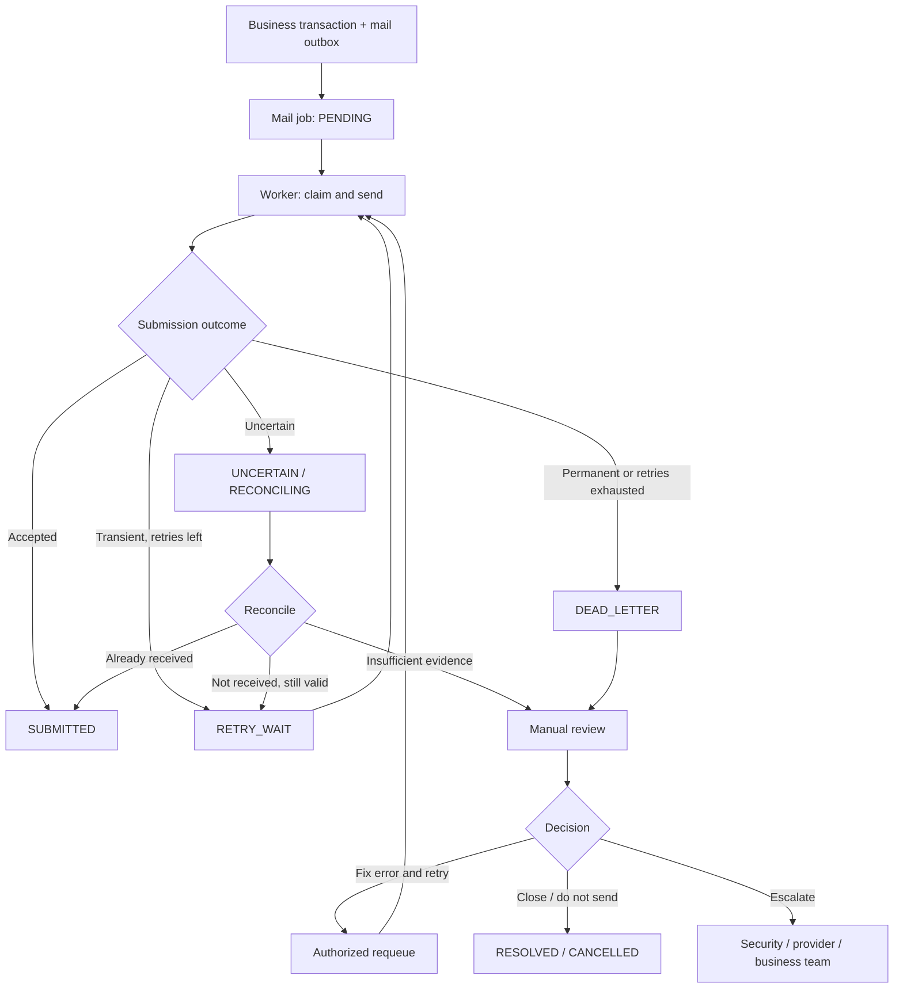
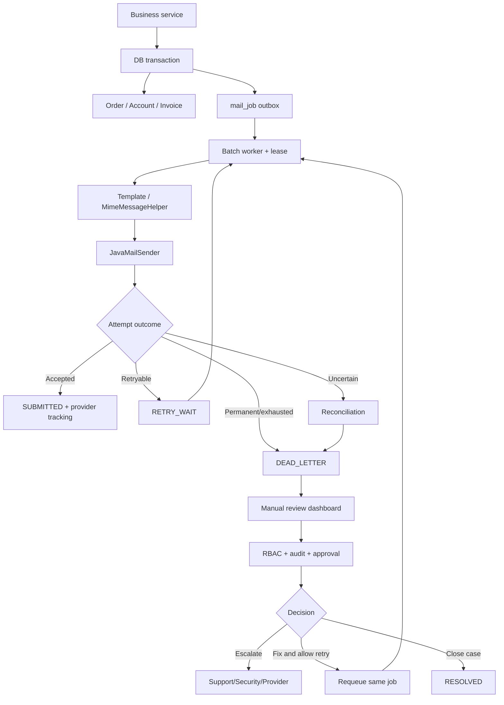

# Dead Letter and Manual Handling Workflows in Spring Framework Mail

In a production application, emails do not always succeed on the first try. The SMTP server can time out, the provider may rate-limit requests, a template may miss data, an attachment file may no longer exist, a recipient address may be invalid, or a task may fail repeatedly despite retries. If the application merely calls `log.error(...)` and drops it, the send request vanishes. If it retries indefinitely, the system easily triggers a **retry storm**, floods the queue, and causes duplicate sends.

**Dead letter** is a mechanism that routes work that cannot proceed down the normal path into a separate state or storage area for **visibility, investigation, and deciding the next step**. In an email-sending system, a dead letter can be a database record with `mail_job.status = 'DEAD_LETTER'`, a broker **dead-letter queue (DLQ)**, or a combination of both.

Crucially, **moving to dead letter does not mean the email never reached the recipient**. An SMTP timeout after the server already accepted the data can leave an *uncertain* outcome; bounce webhooks arriving after successful submission belong to a separate phase. Therefore, manual handling workflows must distinguish certain errors, permanent errors, exhausted retries, and unknown submission states.

In Spring Framework Mail:

- `JavaMailSender`/`JavaMailSenderImpl` performs SMTP submission.
- `MimeMessageHelper` assists in preparing HTML, plain text, and attachments.
- `MailException` and related exceptions provide data for error classification.
- **Spring Mail does not provide a durable mail job queue, DLQ, retry ledger, or manual review UI out of the box.** Those components must be implemented by the application or via brokers, job stores, and operational tooling.

This lesson builds a complete production pattern: error classification, state machine, transactional outbox, dead-letter records, bounded retries, Spring Boot/SQL, RabbitMQ/Kafka, operational dashboards, authorization, auditing, safe retry/requeue, reconciliation, and testing.

## 1. Why do we need dead letters?

Suppose a service sends invoice confirmation emails. On the first try, the SMTP provider returns a temporary error; the worker retries several times with backoff yet still cannot send.

Without a dead-letter mechanism:

```text
InvoiceService
    |
    v
MailWorker -> SMTP timeout
    |
    v
Retry -> SMTP timeout
    |
    v
Retry -> SMTP timeout
    |
    v
Log ERROR and task vanishes
```

Consequences:

- There is no way to identify which requests were dropped.
- Support has no reliable status to answer customers.
- There is no history of attempts, timestamps, errors, or providers.
- A system outage can silently affect thousands of emails.
- Operators may "resend" by creating a brand-new request, causing duplicates.

With a dead-letter workflow:



Documentation and statuses must let operators see **why a job is in dead letter**, **who is authorized to act on it**, **what actions were taken**, and **whether duplicate sends are possible**.

## 2. Distinguishing dead letter from retry queue, bounce, and quarantine

Related terms are not synonymous:

| Concept | Purpose | Example |
|---|---|---|
| **Ready queue** | Jobs ready to send | Due `PENDING` |
| **Retry queue / RETRY_WAIT** | Temporarily waiting on recoverable errors | SMTP 4xx, transient provider error |
| **Dead letter / DLQ** | Jobs no longer auto-retried | Exhausted attempts, invalid data needing investigation |
| **UNCERTAIN / reconciliation queue** | Unclear whether SMTP received the message | Lost ACK after DATA |
| **Bounce / delivery failure** | Provider feedback during delivery stage | Message rejected post-submission |
| **Quarantine** | Isolate suspicious content or files | Suspected malware attachment, risky HTML |
| **Manual review queue** | Work awaiting human decision | Recipient verification, data remediation |

An email can be `SUBMITTED` at the SMTP layer and later reported `BOUNCED` by the provider. That is a **delivery event**; it should not automatically flip the job back to `PENDING` to resend, nor should it always share the same DLQ as submission errors.

### 2.1. Is dead letter a business state or a physical queue?

**Business state:** a database record holding `mailJobId`, `state`, `failureClass`, reason, attempt count, and review metadata. This is usually the source of truth for operations teams.

**Physical queue:** a RabbitMQ DLQ, Kafka dead-letter topic, or dedicated queue receiving failed envelopes. It is useful for routing/consumers, yet does not by itself provide RBAC UIs, approval actions, or auditing.

A production design can use:

```text
mail_job (source of truth)
    state=DEAD_LETTER
        |
        +-- audit + history
        +-- dashboard/manual review
        +-- optional broker DLQ event
```

RabbitMQ is not mandatory to have dead letters. A mail worker backed by a PostgreSQL outbox can rely cleanly on a `DEAD_LETTER` state and dashboard.

### 2.2. Dead letter is not indefinite secret storage

A DLQ often carries payload/message envelopes. If payloads embed raw MIME, OTPs, tokens, or attachment bytes, long-lived DLQs become hard-to-govern stores of sensitive data.

Prefer publishing **opaque mail job ID + error code + minimal metadata** to a DLQ, while protected data stays in the job store/private storage with explicit retention. If the broker must retain original messages, enforce permissions, encryption, retention, size caps, and content checks.

## 3. Classifying errors before deciding dead letter

Do not rely solely on "`catch (Exception)` then `attempts++`." Each error type needs a different policy:

| Error group | Example | Auto-retry? | Handling direction |
|---|---|---|---|
| Configuration error | Wrong SMTP credentials, broken TLS config | Usually **do not** hot-retry | Pause route, alert, fix config |
| Transient provider error | Throttle, network drop, service unavailable | Yes, bounded | Backoff/jitter; circuit breaker |
| Permanent recipient error | Bad address, permanently rejected recipient | Usually no | Dead letter/suppression or business reject |
| Template error | Missing variable, HTML render failure | Do not blindly retry SMTP | Fix template/data then review |
| Attachment failure | File deleted, too large, policy blocked | Depends on cause | Fix data/reject or review |
| Uncertain SMTP response | Timeout after sending data | **Do not auto-retry by default** | `UNCERTAIN`, reconcile |
| Retry budget exhausted | Repeated transient errors | Stop auto-retrying | Dead letter + alert |
| Deadline expired | Expired OTP/reset link | No | `EXPIRED`; never resend stale tokens |
| Recipient opted out | Unsubscribe/suppression | No | `CANCELLED`/policy rejection |
| Crash/lease expired | Worker lost job ownership | Based on attempt state | Reclaim with fencing, resolve ambiguity |

This is a **sample policy**, not a universal default for every provider. SMTP enhanced status codes, `MailSendException`, or provider APIs can enrich signals, but classification must rely on genuinely available evidence.

### 3.1. Transient vs permanent is not always just the SMTP code prefix

In SMTP, `4xx` replies typically denote temporary errors and `5xx` permanent ones. Still, examine the **protocol step**, root cause, and provider policy:

- `421`/`451`: may retry after backoff.
- `452`: may be temporary resource/storage limits.
- `550`: may be nonexistent recipient, policy rejection, or other causes.
- `552`: content/quota not accepted.

Do not use this list to automatically route around a permanent rejection via another provider. Domain authentication errors, anti-abuse blocks, and suppressions must be respected.

### 3.2. JavaMailSender does not always know whether the provider received it

Example:

```text
Client sends DATA to SMTP provider
Provider accepts email
Connection drops before client reads "250 OK"
JavaMailSender throws exception
```

You cannot conclude with certainty from a generic exception that the email was not sent. If the job goes straight to a DLQ and an operator clicks "Retry" without context, the recipient may receive two emails.

Therefore, use a dedicated `UNKNOWN_SUBMISSION`/`UNCERTAIN` state and a reconciliation step before permitting a resend.

## 4. Retry policy before dead-lettering

A job typically follows this cycle:

```text
PENDING
  -> attempt #1
  -> failed temporary
  -> RETRY_WAIT
  -> attempt #2
  -> failed temporary
  -> RETRY_WAIT
  -> attempt #3
  -> ...
  -> attempts exhausted
  -> DEAD_LETTER
```

### 4.1. Three stop conditions

A retry policy should check all three simultaneously:

1. **Attempt count**: `attemptNo < maxAttempts`.
2. **Time**: job has not passed `expiresAt`/business deadline.
3. **Error class**: outcome belongs to the retryable set.

Do not attempt to send an expired OTP email just because it still has one configured attempt left. Conversely, a legally required invoice may need an escalation workflow instead of vanishing once an attempt count is reached.

### 4.2. Backoff and jitter

An example:

```text
Attempt 1 fails -> wait ~5 seconds
Attempt 2 fails -> wait ~10 seconds
Attempt 3 fails -> wait ~20 seconds
Attempt 4 fails -> wait ~40 seconds
Max delay        2 minutes
Jitter           bounded randomness
```

Jitter prevents jobs from retrying in lockstep after an outage. Never set retry delay to 0 for tens of thousands of emails when a provider is throttling.

### 4.3. Retry budgets by mail type

| Mail type | Characteristics | Reference policy |
|---|---|---|
| OTP | Low latency; short-lived token | Few attempts, expiry takes precedence |
| Password reset | Expiring link | Stop if token/challenge expires |
| Order confirmation | Important, though may tolerate brief delay | Retry with backoff; alert on dead letter |
| Invoice | May carry business obligation | Retry and escalation/manual workflow |
| Newsletter | High volume, unsubscribe rules | Quota-aware retry, suppression, separate DLQ |
| Periodic report | Can be regenerated per period | Deduplicate and verify snapshot |

Exact numbers must reflect SLAs, provider contracts, and business semantics, not a fixed `JavaMailSender` setting.

## 5. Production state model

A useful state machine:

```text
PENDING
  |
  v
PROCESSING
  |   \
  |    +--> SUBMITTED
  |    +--> RETRY_WAIT --> PROCESSING
  |    +--> UNCERTAIN --> RECONCILING
  |    +--> DEAD_LETTER
  |    +--> FAILED_PERMANENT
  |    +--> EXPIRED
  |
  +--> CANCELLED

DEAD_LETTER
  |
  v
UNDER_REVIEW
  |     \
  |      +--> REQUEUE_APPROVED --> RETRY_WAIT
  |      +--> RESOLVED_NO_SEND
  |      +--> ESCALATED
  |      +--> CANCELLED
  |
  +--> DEAD_LETTER (review returned to queue)
```

State names are **application enums**, not built-in Spring Mail states. You do not have to cram every state into one column; some designs keep `mail_job.processing_state` and `manual_case.state` separate so job lifecycles and support workflows stay clean.

### 5.1. Invariants to preserve

- One `mailJobId` identifies **one send intent** across attempts, retries, and manual requeues.
- Each transport call has its own `attemptId`; never overwrite past attempt history.
- `SUBMITTED` is a submission outcome; the provider may still report a bounce later.
- An `UNCERTAIN` job must never automatically be treated as "not sent" for clicking retry.
- At most one worker may process a job at a time via ownership claim/lease.
- Every operator action must record actor, reason, timestamp, decision, and outcome.
- Requeuing must never silently bypass expiry, suppression, consent, sender policies, or tenant boundaries.
- There is no default transition from `SUBMITTED` back to `PENDING`.

### 5.2. When to use FAILED_PERMANENT vs DEAD_LETTER?

Two reasonable designs exist:

**Single terminal bucket:** all jobs that cannot proceed automatically go to `DEAD_LETTER` with a `failureClass` such as `RECIPIENT_REJECTED`, `TEMPLATE_INVALID`, or `RETRY_EXHAUSTED`.

**Split states:** permanent errors close as `FAILED_PERMANENT`; only cases needing human review enter `DEAD_LETTER`.

Both work. Align on the operational question: **what enters a queue for human action**, what is a terminal outcome needing reporting only, and what is still auto-retrying. Do not flood the manual review queue with every hard bounce if policy already defines an automated action.

## 6. Recommended architecture: outbox + worker + dead-letter store + review UI



The **source of truth** is `mail_job` and the attempt/review history tables. If a broker DLQ is used, it acts as routing, never the sole store of approved business decisions.

### 6.1. Moving to dead letter must be durable

When a worker decides to stop retrying, `DEAD_LETTER` state, reason, and `lastAttemptId` must be written in a short transaction. If you want to emit a `MailDeadLettered` event for dashboards/alerts, prefer writing an outbox event **in the same transaction** for a relay to publish to the broker.

Avoid:

```java
deadLetterQueue.send(job);
jobRepository.updateStatus(job.id(), "DEAD_LETTER");
```

when those two operations span two systems without coordination. A crash after the first step emits an event without updating the DB; a crash after the second (if reversed) can lose the event. An outbox lets event publishing retry without losing primary state.

### 6.2. Never hold a database transaction open while sending SMTP

An ideal processing cycle:

1. Claim job + create attempt in a short transaction.
2. Commit and release locks.
3. Render/send SMTP outside any database transaction.
4. In a short transaction, persist outcome and transition job state.
5. If moving to DLQ, create audit/outbox events in the same transaction.

SMTP does not join DB transactions; sending and then failing DB commit can leave an uncertain outcome during recovery. Retry designs must tolerate potential duplicates and support reconciliation.

## 7. PostgreSQL schema for mail jobs, attempts, and dead-letter cases

A data model should preserve the **original send intent**, **history of each send attempt**, and **manual decisions**. The tables below illustrate the design:

```sql
CREATE TABLE mail_job (
    id                 UUID PRIMARY KEY,
    tenant_id          UUID NOT NULL,
    business_key       VARCHAR(180) NOT NULL,
    mail_type          VARCHAR(64) NOT NULL,
    template_id        VARCHAR(100) NOT NULL,
    template_version   VARCHAR(40) NOT NULL,
    payload_ref        VARCHAR(300) NOT NULL,
    state              VARCHAR(40) NOT NULL,
    version            BIGINT NOT NULL DEFAULT 0,
    attempt_count      INTEGER NOT NULL DEFAULT 0,
    max_attempts       INTEGER NOT NULL DEFAULT 5,
    next_attempt_at    TIMESTAMPTZ,
    expires_at         TIMESTAMPTZ,
    claim_token        UUID,
    lease_until        TIMESTAMPTZ,
    last_failure_class VARCHAR(100),
    created_at         TIMESTAMPTZ NOT NULL DEFAULT NOW(),
    updated_at         TIMESTAMPTZ NOT NULL DEFAULT NOW(),
    CONSTRAINT uq_mail_business_key
        UNIQUE (tenant_id, business_key),
    CHECK (attempt_count >= 0),
    CHECK (max_attempts >= 1)
);

CREATE TABLE mail_attempt (
    id                   UUID PRIMARY KEY,
    mail_job_id          UUID NOT NULL REFERENCES mail_job(id),
    attempt_no           INTEGER NOT NULL,
    provider_alias       VARCHAR(80) NOT NULL,
    started_at           TIMESTAMPTZ NOT NULL,
    completed_at         TIMESTAMPTZ,
    outcome              VARCHAR(40),
    failure_class        VARCHAR(100),
    mime_message_id      VARCHAR(320),
    provider_message_id  VARCHAR(320),
    CONSTRAINT uq_mail_attempt_no
        UNIQUE (mail_job_id, attempt_no)
);

CREATE TABLE mail_dead_letter_case (
    id                  UUID PRIMARY KEY,
    mail_job_id         UUID NOT NULL REFERENCES mail_job(id),
    state               VARCHAR(40) NOT NULL,
    reason_class        VARCHAR(100) NOT NULL,
    last_attempt_id     UUID REFERENCES mail_attempt(id),
    opened_at           TIMESTAMPTZ NOT NULL DEFAULT NOW(),
    claimed_by          VARCHAR(160),
    claim_expires_at    TIMESTAMPTZ,
    resolved_at         TIMESTAMPTZ,
    resolution_code     VARCHAR(80),
    version             BIGINT NOT NULL DEFAULT 0
);

CREATE TABLE mail_manual_action (
    id                  UUID PRIMARY KEY,
    case_id             UUID NOT NULL REFERENCES mail_dead_letter_case(id),
    mail_job_id         UUID NOT NULL REFERENCES mail_job(id),
    action              VARCHAR(80) NOT NULL,
    actor_id            VARCHAR(160) NOT NULL,
    reason_code         VARCHAR(80) NOT NULL,
    note_ref            VARCHAR(300),
    request_key         UUID NOT NULL,
    happened_at         TIMESTAMPTZ NOT NULL DEFAULT NOW(),
    outcome             VARCHAR(80) NOT NULL,
    CONSTRAINT uq_mail_manual_request UNIQUE (request_key)
);

CREATE INDEX idx_mail_job_ready
    ON mail_job (next_attempt_at, created_at)
    WHERE state IN ('PENDING', 'RETRY_WAIT');

CREATE INDEX idx_mail_dead_letter_open
    ON mail_dead_letter_case (opened_at)
    WHERE state IN ('OPEN', 'IN_REVIEW', 'ESCALATED');

CREATE INDEX idx_mail_attempt_job
    ON mail_attempt (mail_job_id, attempt_no);
```

### 7.1. Relationships between tables

```text
mail_job J100
  |  state=DEAD_LETTER
  |
  +-- mail_attempt A101, provider=P1, TIMEOUT
  +-- mail_attempt A102, provider=P1, THROTTLED
  +-- mail_attempt A103, provider=P2, FAILED
  |
  +-- mail_dead_letter_case C100
         state=IN_REVIEW
         |
         +-- mail_manual_action M1: CLAIM
         +-- mail_manual_action M2: INVESTIGATE
         +-- mail_manual_action M3: REQUEUE_APPROVED
```

Fixing data during manual handling **must not delete attempts**; when the job is requeued, the next attempt receives a new sequence number while past history stays intact for traceability.

### 7.2. Dead-letter case ID differs from mail job ID

One job can enter dead letter multiple times:

```text
Job J100
   -> dead letter case C1
   -> operator requeues
   -> new attempt still fails
   -> dead letter case C2
```

Therefore, use a dedicated case ID. A constraint preventing **two active cases simultaneously for one job** is appropriate, while still allowing closed historical cases to remain. PostgreSQL example:

```sql
CREATE UNIQUE INDEX uq_mail_one_active_dl_case
    ON mail_dead_letter_case (mail_job_id)
    WHERE state IN ('OPEN', 'IN_REVIEW', 'ESCALATED');
```

If the product allows multiple concurrent case types (e.g., submission failure and compliance review), adjust indexes and design to match the contract. Never copy a sample constraint without checking business scope.

### 7.3. Version column to prevent concurrent handling

The `version` column supports optimistic concurrency:

```sql
UPDATE mail_dead_letter_case
SET state = 'IN_REVIEW',
    claimed_by = :operator_id,
    claim_expires_at = NOW() + INTERVAL '10 minutes',
    version = version + 1
WHERE id = :case_id
  AND state = 'OPEN'
  AND version = :expected_version;
```

Only when updated rows = 1 does the operator acquire review ownership. If two people open the UI simultaneously, the second receives a conflict error and must reload the case. Never let both click requeue concurrently.

### 7.4. Never store raw bodies/OTPs in dead-letter tables

`payload_ref` should point to protected data or snapshots governed by retention policies. Dead-letter/audit tables primarily store IDs, reason codes, and decisions—not MIME files or message bodies.

When an OTP expires, **never extend the token lifetime just because a case is open**. If the customer needs a new code, a new business request must create a new challenge/job rather than replaying the old email.

## 8. Claiming mail jobs with ownership and leases

Concurrent workers must avoid sending the same job twice. In PostgreSQL, claim batches with `FOR UPDATE SKIP LOCKED`:

```sql
WITH ready AS (
    SELECT id
    FROM mail_job
    WHERE state IN ('PENDING', 'RETRY_WAIT')
      AND next_attempt_at <= NOW()
      AND (expires_at IS NULL OR expires_at > NOW())
    ORDER BY next_attempt_at, created_at, id
    FOR UPDATE SKIP LOCKED
    LIMIT :batch_size
)
UPDATE mail_job AS j
SET state = 'PROCESSING',
    claim_token = :claim_token,
    lease_until = NOW() + INTERVAL '90 seconds',
    attempt_count = attempt_count + 1,
    version = version + 1,
    updated_at = NOW()
FROM ready
WHERE j.id = ready.id
RETURNING j.*;
```

This runs inside a **short database transaction**, assigns `claim_token` for the claim round, and commits before any SMTP call. For multi-row batches, each job still needs its own attempt ID. A shared `claim_token` for a claim round can be used when filtering by `id + token`; never filter solely by token and accidentally update all jobs.

### 8.1. When a lease expires

A worker may have submitted to SMTP and crashed before updating the DB. If the lease expires and a new worker grabs the job and sends again, duplicates can occur.

Recovery requires:

1. Find `PROCESSING` jobs with `lease_until <= NOW()`.
2. Check whether the corresponding attempt is still `SUBMITTING` or already has an outcome.
3. Assess whether you can prove SMTP was never called.
4. If outcome is unclear, transition to `UNCERTAIN`/reconciliation rather than blindly requeuing.
5. When releasing a claim, use a fencing token/version to prevent the old worker from overwriting state.

Fencing protects database consistency; **it cannot undo an SMTP side effect that already happened**.

### 8.2. Stop sending once a job expires

Check `expires_at` both at claim time and **immediately before submission**. If a job was claimed and then delayed for minutes, it may expire while waiting for a worker.

For OTP/password resets, ending in `EXPIRED` does not mean "immediately resend the old code via manual requeue." The user should initiate a fresh request with a new token if needed.

## 9. Classifying send outcomes and creating dead letters

Spring Mail provides:

```java
import org.springframework.mail.MailAuthenticationException;
import org.springframework.mail.MailException;
import org.springframework.mail.MailSendException;
import org.springframework.mail.javamail.JavaMailSender;
```

However, the application must define its own outcome and failure policies:

```java
public enum SubmissionOutcome {
    SUBMITTED,
    DEFINITELY_NOT_SUBMITTED,
    UNKNOWN_SUBMISSION
}

public enum FailureClass {
    SMTP_AUTHENTICATION,
    SMTP_THROTTLED,
    SMTP_CONNECTION,
    SMTP_TIMEOUT,
    RECIPIENT_REJECTED,
    MIME_PREPARATION,
    TEMPLATE_RENDERING,
    ATTACHMENT_UNAVAILABLE,
    POLICY_REJECTED,
    UNKNOWN
}

public enum RetryDecision {
    RETRY_LATER,
    DEAD_LETTER,
    EXPIRED,
    CANCELLED,
    RECONCILE
}
```

These are application enums, not built-in Spring Framework enums. `MailSendException` with multiple messages may expose `getFailedMessages()`, yet exceptions do not always prove exactly which individual messages the provider accepted or rejected.

### 9.1. Sample classifier

```java
public final class MailErrorClassifier {

    public FailureClass classify(MailException exception) {
        if (exception instanceof MailAuthenticationException) {
            return FailureClass.SMTP_AUTHENTICATION;
        }
        if (exception instanceof MailSendException) {
            // Must inspect underlying error/provider response further
            // to accurately distinguish 4xx vs 5xx.
            return FailureClass.UNKNOWN;
        }
        return FailureClass.UNKNOWN;
    }
}
```

This example is intentionally conservative. Avoid `catch (MailException ex) { return RETRY; }` for all errors, since errors occurring after the provider accepted the message cause duplicates if retried.

### 9.2. Policy based on outcome, error class, and deadline

A policy method:

```java
public RetryDecision decide(
        SubmissionOutcome outcome,
        FailureClass failure,
        int attemptsUsed,
        int maxAttempts,
        Instant now,
        Instant expiresAt) {

    if (outcome == SubmissionOutcome.SUBMITTED) {
        throw new IllegalArgumentException(
                "Submitted mail is not a retry candidate");
    }

    if (expiresAt != null && !now.isBefore(expiresAt)) {
        return RetryDecision.EXPIRED;
    }

    if (outcome == SubmissionOutcome.UNKNOWN_SUBMISSION) {
        return RetryDecision.RECONCILE;
    }

    if (failure == FailureClass.POLICY_REJECTED) {
        return RetryDecision.CANCELLED;
    }

    if (failure == FailureClass.MIME_PREPARATION
            || failure == FailureClass.TEMPLATE_RENDERING
            || failure == FailureClass.RECIPIENT_REJECTED
            || failure == FailureClass.ATTACHMENT_UNAVAILABLE) {
        return RetryDecision.DEAD_LETTER;
    }

    if (attemptsUsed >= maxAttempts) {
        return RetryDecision.DEAD_LETTER;
    }

    return switch (failure) {
        case SMTP_CONNECTION, SMTP_TIMEOUT, SMTP_THROTTLED ->
                RetryDecision.RETRY_LATER;
        default -> RetryDecision.DEAD_LETTER;
    };
}
```

`SubmissionOutcome.DEFINITELY_NOT_SUBMITTED` should only be assigned when the adapter knows for sure **no SMTP side effect occurred**. `UNKNOWN_SUBMISSION` is routed to reconciliation before evaluating retry budgets. In real production systems, refine classification with provider error codes or hard-bounce policies; not every attachment error is permanent—for example, a transient storage disconnect may allow bounded retries.

### 9.3. Terminal transitions must be consistent

After an attempt:

- Persist `mail_attempt.outcome` and `failure_class`.
- Verify claim token/ownership.
- Update `mail_job.state`.
- If `DEAD_LETTER`, create `mail_dead_letter_case`.
- Record an outbox notification event for operations if needed.

These **database writes** should execute inside a single short transaction so you never end up with a dead-lettered job without a case, or a case opened while the job is still ready.

## 10. SQL to transition a job into dead letter

Example transaction handling a job still owned by the worker:

```sql
BEGIN;

-- Only the valid owner may change state.
UPDATE mail_job
SET state = 'DEAD_LETTER',
    last_failure_class = :failure_class,
    next_attempt_at = NULL,
    claim_token = NULL,
    lease_until = NULL,
    updated_at = NOW(),
    version = version + 1
WHERE id = :mail_job_id
  AND state = 'PROCESSING'
  AND claim_token = :claim_token;

-- The application must verify UPDATE affected exactly 1 row
-- before running the case INSERT below.
INSERT INTO mail_dead_letter_case (
    id, mail_job_id, state, reason_class,
    last_attempt_id
)
VALUES (
    :case_id, :mail_job_id, 'OPEN',
    :failure_class, :attempt_id
);

COMMIT;
```

This is an **illustrative sequence of operations**, not a script to execute verbatim without checking affected rows. In a real repository/service, if `UPDATE` affects 0 rows, **roll back** and do not insert a case; the worker may have lost its lease or the state already changed.

Additionally, guard case insertion against duplicate creation on transaction retries using a unique active-case constraint and idempotency key. If the attempt outcome was already recorded, do not increment attempts or open new cases endlessly when the same completion event is reprocessed.

### 10.1. Reprocessing an event must not create two dead-letter cases

Suppose a worker times out during commit and does not know whether the transaction succeeded. On retry, the repository must inspect `mail_job.state` and active cases:

```text
job already DEAD_LETTER
  + active case exists
  -> return existing case ID
  -> do not create a new case
```

Rely on unique constraints and idempotent operations, not just in-memory checks.

### 10.2. Why not delete the job after publishing a DLQ message?

If you delete the source job, later it becomes hard to tell:

- Which business flow the original data belonged to.
- How many send attempts occurred.
- Whether any SMTP submission was uncertain.
- Which operator decided to resend or cancel.
- Whether the provider returned a bounce.

A DLQ message may have a short retention window or be deleted by operators. **Business history must live in durable storage with access control**, never relying solely on a broker.

## 11. Manual handling workflow: from OPEN to RESOLVED

Dead letter is not merely "a folder to delete failed emails." Operational workflows must offer explicit actions, authorization, and evidence.

### 11.1. Roles

| Role | Appropriate permissions | Should not be allowed to do |
|---|---|---|
| Support viewer | Search cases/read masked metadata | View OTPs/bodies/SMTP secrets |
| Mail operator | Claim cases, classify failures, propose retries | Arbitrarily edit tenant/recipient |
| Mail approver | Approve resend actions when required | Bypass policy/security |
| Platform on-call | Investigate providers/configs/queues | Use SMTP admin secrets in UI |
| Security reviewer | Handle data/abuse/compliance incidents | Re-emit blocked emails unilaterally |
| Auditor | View immutable decision history | Modify cases |

Actual roles vary by organization. Specifically, **permission to view a dead-letter case does not automatically grant permission to download email bodies or attachments**.

### 11.2. Operator case-handling flow

```text
1. Alert or dashboard surfaces a new case.
2. Operator opens the case via an authenticated app.
3. System verifies tenant/scope and logs VIEW audit if required.
4. Operator claims the case with a short lease.
5. Inspect mail type, deadline, attempts, and failure class.
6. Determine whether SMTP submission succeeded / failed / is uncertain.
7. Check provider status and bounce events if available.
8. Select an authorized action.
9. Enter a reason code + safe notes.
10. (If policy requires) approver signs off.
11. Backend records action and state in a transaction.
12. Worker picks up the job if requeued; UI tracks the new outcome.
```

Steps 4–10 are not always manual; many permanent failures can close automatically under clear policies, still with auditing. For sensitive emails, **resend** operations should require separate approval.

### 11.3. What should the review screen display?

A case can include:

| Field | Example | Meaning |
|---|---|---|
| Case ID | `C-1002` | Case identifier |
| Mail job ID | `J-1025` | Send intent |
| Mail type | `ORDER_CONFIRMATION` | Business policy |
| Template/version | `ORDER_CONFIRMATION/v9` | Isolate template bugs |
| Created/last tried | UTC timestamp | Delay and case age |
| Attempts | 5/5 | Retry budget consumed |
| Failure class | `SMTP_THROTTLED` | System reason |
| Last provider | `primary-relay` | Where the error occurred |
| Submission evidence | `NOT_SUBMITTED` / `UNKNOWN` | Duplicate send risk |
| Business deadline | `2026-11-13T09:00Z` | Whether sending is still allowed |
| Tenant scope | Opaque tenant ID | Data authorization |
| State | `OPEN` / `IN_REVIEW` | Workflow status |
| Available actions | `ESCALATE`, `REQUEUE`, `RESOLVE` | Effective policy permissions |

Do not display raw MIME, recipient emails, message bodies, tokens, sensitive filenames, or SMTP account credentials on the default dashboard. When support needs to look up a recipient, route through a separate authorized business screen with masking.

### 11.4. Claiming a case is not claiming the mail job

**Case claim** means an operator is investigating and holds decision authority.

**Mail job claim** means a worker owns the sending execution for a short window.

These are two distinct leases. An operator holding a case `IN_REVIEW` must never trigger an SMTP attempt until a requeue action is approved and durably persisted. Never use `mail_job.claim_token` as a token for UI operators.

## 12. Manual action matrix

A well-governed action set:

| Action | When valid | Checks required |
|---|---|---|
| `RETRY_SAME_JOB` | Temporary error has been resolved | Prior outcome not unknown; deadline; retry policy |
| `REQUEUE_WITH_BACKUP_PROVIDER` | Primary definitely did not submit and backup is approved | SMTP evidence, provider identity, quota |
| `REQUEST_CORRECTION` | Data/template/attachment can be fixed | Never silently alter intent meaning |
| `CANCEL` | Job no longer needs sending | Actor/reason, business alignment |
| `RESOLVE_NO_SEND` | Valid decision not to send | Evidence and reason recorded |
| `MARK_ALREADY_HANDLED` | Proof of handling via another channel | Store reference; never fake SMTP submitted |
| `ESCALATE` | Needs platform/security/business review | Target team, severity, SLA |
| `RECONCILE` | SMTP outcome is uncertain | Query provider/logs/attempts before resend |
| `CREATE_NEW_INTENT` | Business requires a new email with new content/token | Create new business event and idempotency key |

### 12.1. Never "flip status to SENT" just to make the dashboard green

A `MARK_ALREADY_HANDLED` operation must never fabricate transport events. For example, if support phoned the customer to confirm, close the case with `resolutionCode=HANDLED_OUT_OF_BAND`, rather than writing `mail_attempt.outcome=SUBMITTED` when SMTP was never called.

This keeps metrics and audits meaningful.

### 12.2. Requeuing must keep the same logical mail key

Example:

```text
mailJobId = J100
idempotencyKey = order-721:confirmation:v1

attempt A1 -> failure
attempt A2 -> failure
case C1 -> operator approved requeue
attempt A3 -> new submission
```

**Do not create a second mail job J101** just because an operator clicked retry. A single record with multiple attempts keeps duplicate risk under control.

If the business data changed into a different email (such as a fresh password reset request), create a **valid new send intent** instead of overwriting `payload_ref`/tokens on the old job and calling it a retry.

### 12.3. Requeuing after exhausting attempts

If the worker already used 5/5 attempts, setting `state='RETRY_WAIT'` without adjusting policy will send the job straight back to the DLQ because the limit is already exceeded.

You need **a controlled decision**:

- Grant at most N additional attempts for the specific action.
- Persist the granted manual retry budget.
- Never reset or delete `attempt_count` or attempt history.
- Re-check expiry/consent/suppression.
- Never requeue endlessly while the provider is still failing.

Example policy: each case can be approved for at most two additional attempts; every grant must be audited, optionally requiring two-person approval for sensitive mail types.

## 13. A Spring Boot service handling requeue actions

An application might expose an API:

```text
POST /admin/mail/dead-letters/{caseId}/actions
Authorization: authenticated operator with tenant scope
Idempotency-Key: unique request UUID
If-Match: expected case version

body:
{
  "action": "RETRY_SAME_JOB",
  "reasonCode": "PROVIDER_RECOVERED"
}
```

This endpoint is an illustrative contract; never expose admin APIs to the Internet without authentication, authorization, and CSRF/abuse protections. Never trust `actorId` or `tenantId` sent by the client in JSON; derive them from the authenticated identity.

### 13.1. DTO and action enum

```java
public enum ManualMailAction {
    RETRY_SAME_JOB,
    REQUEUE_WITH_BACKUP_PROVIDER,
    RESOLVE_NO_SEND,
    CANCEL,
    ESCALATE,
    REQUEST_CORRECTION
}

public record ManualActionCommand(
        UUID caseId,
        UUID requestKey,
        long expectedVersion,
        ManualMailAction action,
        String reasonCode) {
}
```

`requestKey` prevents double-clicks or network retries from applying the same decision twice. `expectedVersion` provides optimistic locking. `reasonCode` must come from an allowlist rather than arbitrary text copied verbatim into logs.

### 13.2. Transactional service

A conceptual implementation:

```java
@Service
public class ManualDeadLetterService {

    private final DeadLetterRepository cases;
    private final MailJobRepository jobs;
    private final ManualActionRepository actions;
    private final PermissionService permissions;
    private final ManualRetryPolicy policy;
    private final Clock clock;

    public ManualDeadLetterService(
            DeadLetterRepository cases,
            MailJobRepository jobs,
            ManualActionRepository actions,
            PermissionService permissions,
            ManualRetryPolicy policy,
            Clock clock) {
        this.cases = cases;
        this.jobs = jobs;
        this.actions = actions;
        this.permissions = permissions;
        this.policy = policy;
        this.clock = clock;
    }

    @Transactional
    public UUID retry(
            ManualActionCommand cmd,
            AuthenticatedOperator operator) {

        // If requestKey was already processed, return previous result;
        // any concurrent conflict must still be guarded by a unique DB key.
        var previous = actions.findByRequestKey(cmd.requestKey());
        if (previous.isPresent()) {
            permissions.assertCanView(
                    operator, previous.get().tenantId());
            return previous.get().mailJobId();
        }

        DeadLetterCase current = cases.lockById(cmd.caseId())
                .orElseThrow(() ->
                        new IllegalArgumentException("Case not found"));

        permissions.assertCanRetry(
                operator, current.tenantId(), current.mailType());

        if (current.version() != cmd.expectedVersion()) {
            throw new StaleCaseVersionException();
        }
        if (current.state() != ReviewState.IN_REVIEW
                || !current.claimedBy().equals(operator.id())) {
            throw new InvalidReviewStateException();
        }

        MailJob job = jobs.lockById(current.mailJobId())
                .orElseThrow(() ->
                        new IllegalStateException("Job not found"));

        policy.assertCanRetry(
                job, current, cmd.action(), clock.instant());

        // Do not perform SMTP inside this transaction.
        jobs.scheduleManualRetry(
                job.id(),
                current.allowedAdditionalAttempts(),
                clock.instant());

        cases.resolveAsRequeued(current.id(), operator.id());

        actions.insert(new ManualActionRecord(
                UUID.randomUUID(),
                cmd.requestKey(),
                current.id(),
                job.id(),
                operator.id(),
                cmd.action(),
                cmd.reasonCode(),
                clock.instant()));

        return job.id();
    }
}
```

`DeadLetterRepository`, `ManualRetryPolicy`, `PermissionService`, `AuthenticatedOperator`, `ReviewState`, and the exceptions are **application-defined** APIs; this is an architectural example, not a drop-in module.

**Critical requirement:** `cases.lockById` and `jobs.lockById` must actually lock or enforce concurrency in the database; merely reading an entity and checking version in memory lets two HTTP requests pass the check together. The unique `request_key` constraint is the final safeguard for idempotent actions.

### 13.3. Request idempotency must handle concurrency

Two POST requests with the same `Idempotency-Key` can execute concurrently:

```text
Request A: SELECT requestKey -> missing
Request B: SELECT requestKey -> missing
Request A: INSERT action -> success
Request B: INSERT action -> unique conflict
```

Request B must be handled per transaction semantics: roll back, then query the existing result, verify matching actor/tenant/action, or return an appropriate conflict. **Never simply catch a unique exception and keep trying to commit a transaction already marked rollback-only.**

### 13.4. Policies must be enforced on the backend

Do not merely hide the "Retry" button in the UI. The backend must verify:

- Actor holds the required role and tenant scope.
- Case is still `IN_REVIEW` with a valid claim.
- Job is in the dead-letter state with no active worker.
- Last outcome is not an unreconciled `UNKNOWN_SUBMISSION`.
- `expiresAt` is still valid.
- Recipient/consent/suppression are not blocked.
- Template/payload snapshot can still be reused.
- Provider is permitted to send and has quota.
- Manual retry budget has not been exceeded.

Only when all conditions pass should the job move back to `RETRY_WAIT`/`PENDING`. Never let clients supply an arbitrary `mailJobId` and request a direct SMTP send.

## 14. Requeue SQL protecting state and preventing double-clicks

A requeue transaction can use conditional locking:

```sql
BEGIN;

-- Lock case so only one operator/action wins.
SELECT id, mail_job_id, state, version
FROM mail_dead_letter_case
WHERE id = :case_id
FOR UPDATE;

-- Verify owner, version, state, and permissions in service.
SELECT id, state, expires_at, attempt_count, version
FROM mail_job
WHERE id = :mail_job_id
FOR UPDATE;

-- After policy checks pass in the service:
UPDATE mail_job
SET state = 'RETRY_WAIT',
    next_attempt_at = NOW(),
    version = version + 1,
    last_failure_class = NULL,
    claim_token = NULL,
    lease_until = NULL,
    updated_at = NOW()
WHERE id = :mail_job_id
  AND state = 'DEAD_LETTER'
  AND version = :expected_job_version
  AND (expires_at IS NULL OR expires_at > NOW());

-- Must assert UPDATE affected exactly 1 row.
UPDATE mail_dead_letter_case
SET state = 'REQUEUED',
    resolved_at = NOW(),
    resolution_code = 'MANUAL_RETRY_APPROVED',
    version = version + 1
WHERE id = :case_id
  AND state = 'IN_REVIEW'
  AND version = :expected_case_version;

-- Insert audit action in same transaction, using UNIQUE requestKey.
-- If any step fails, ROLLBACK everything.

COMMIT;
```

This is a transactional sequence template—**never run it verbatim while ignoring affected row counts**. The service/repository must roll back if either UPDATE affects anything other than one row, and must grant/check manual retry allowances appropriately when the attempt budget was exhausted.

### 14.1. Never reset attempt_count to 0

Resetting the counter erases retry history and can let a job take unwanted extra attempts. Instead:

- Keep `attempt_count` monotonically increasing.
- Persist granted extra max attempts or retry budget.
- Record the manual action/approval.
- Generate a new `attemptId` when the worker actually calls SMTP.

### 14.2. Never delete or alter error evidence

After requeuing, `last_failure_class` on the job may be cleared to reflect its pending retry status, yet **`mail_attempt`** and `mail_dead_letter_case` retain the historical error data. To see who changed policy, consult audit actions.

### 14.3. Never call SMTP inside an admin request

When an operator clicks retry, the API should return `202 Accepted`/job state and let workers process via the standard pipeline. If an admin HTTP request both calls SMTP and updates the DB, timeouts or double-clicks can cause duplicate sends.

A sound admin action **authorizes and schedules work**, rather than submitting emails straight from a browser request.

## 15. RabbitMQ dead-letter exchanges and DLQs

If mail jobs arrive via RabbitMQ, you can configure a dead-letter exchange (DLX) so messages rejected/nacked without requeue, past TTL, or exceeding queue limits route to dead-letter paths per RabbitMQ semantics.

A topology:

```text
mail.jobs.exchange
       |
       v
mail.jobs.queue
       |
       +--> worker processes / acks once durable outcome exists
       |
       +--> reject/nack requeue=false
                |
                v
        mail.dead.exchange
                |
                v
        mail.dead.queue
                |
                v
        DLQ consumer -> durable review case
```

### 15.1. Sample Spring AMQP configuration

This is RabbitMQ configuration **when the application uses RabbitMQ**; it is not default Spring Mail configuration:

```java
package com.example.mail.queue;

import org.springframework.amqp.core.Binding;
import org.springframework.amqp.core.BindingBuilder;
import org.springframework.amqp.core.DirectExchange;
import org.springframework.amqp.core.Queue;
import org.springframework.context.annotation.Bean;
import org.springframework.context.annotation.Configuration;

@Configuration
public class MailRabbitTopology {

    public static final String MAIN_EXCHANGE =
            "mail.jobs.exchange";
    public static final String MAIN_QUEUE =
            "mail.jobs.queue";
    public static final String DEAD_EXCHANGE =
            "mail.dead.exchange";
    public static final String DEAD_QUEUE =
            "mail.dead.queue";

    @Bean
    DirectExchange mainMailExchange() {
        return new DirectExchange(MAIN_EXCHANGE, true, false);
    }

    @Bean
    DirectExchange deadMailExchange() {
        return new DirectExchange(DEAD_EXCHANGE, true, false);
    }

    @Bean
    Queue mainMailQueue() {
        return QueueBuilder.durable(MAIN_QUEUE)
                .deadLetterExchange(DEAD_EXCHANGE)
                .deadLetterRoutingKey("mail.dead")
                .build();
    }

    @Bean
    Queue deadMailQueue() {
        return QueueBuilder.durable(DEAD_QUEUE).build();
    }

    @Bean
    Binding mainBinding(Queue mainMailQueue,
                        DirectExchange mainMailExchange) {
        return BindingBuilder.bind(mainMailQueue)
                .to(mainMailExchange)
                .with("mail.jobs");
    }

    @Bean
    Binding deadBinding(Queue deadMailQueue,
                        DirectExchange deadMailExchange) {
        return BindingBuilder.bind(deadMailQueue)
                .to(deadMailExchange)
                .with("mail.dead");
    }
}
```

Import `org.springframework.amqp.core.QueueBuilder` to use the builder. In production, RabbitMQ often recommends applying DLX via policies rather than hard-coding x-arguments on queues so changes are easier; choose a clear topology-management approach based on your organization and deployment.

### 15.2. Which states should be nacked to a DLQ?

Not every SMTP failure should trigger `nack(requeue=false)`:

- Temporary errors with backoff: schedule a durable retry instead of sending straight to DLQ.
- Permanent data/poison messages: route to DLQ or finalize job with a terminal status per policy.
- Submission unknown: reconcile; never treat nack as proof of non-delivery.
- Consumer failures before SMTP: can retry up to a delivery count, with loop protection.

**Important:** a broker dead-lettered message does not automatically set `mail_job.state=DEAD_LETTER`. When the database is the source of truth, the worker/reconciler must durably write the state/case first, then ack/drop the broker message per contract.

### 15.3. Acknowledgments at the right time

Suppose a consumer determines a job failed permanently:

1. Write `DEAD_LETTER` state and case/audit or outbox event to the database.
2. Commit successfully.
3. Ack the broker message or reject/nack according to the designed DLQ strategy.

If the **DB commit fails**, do not ack and lose the message before recovery. If the **DB commit succeeds but the broker ack fails**, the message may redeliver; the consumer must see the job is already dead-lettered and handle it idempotently.

Note that one implementation may **not need to publish to a broker DLQ** at all because the case is already in the database; in that case, acking is appropriate. If a materialized DLQ is needed, use an outbox relay to emit a DLQ event and ack the original consistently. Never both nack to DLQ and outbox-publish a DLQ event without deduplication, or you create duplicate coordination.

### 15.4. Dead-letter routing does not automatically guarantee zero loss

Durability of dead-letter transfers depends on RabbitMQ queue type, configuration, cluster state, and ack semantics; classic-queue dead-lettering should not be assumed to be an immutable atomic transaction. For high-reliability requirements, consider **quorum queues** and dead-lettering mechanisms with suitable guarantees for your RabbitMQ version, while monitoring pending counts and transfer failures.

Durable broker queues do not replace **publisher confirms**, retention, replication, monitoring, and idempotent consumers.

### 15.5. TTL retry queues and dead-letter loops

A TTL-based retry diagram:

```text
mail.main.queue
     |
     +-- temporary error -> mail.retry.queue (TTL)
                                  |
                                  +-- TTL expires -> mail.main.queue
```

Count attempts in metadata/job state, enforcing limits and deadlines. If a two-way DLX is configured without a retry budget, a poison message can loop endlessly between queues. RabbitMQ dead-letter headers are useful for observability, yet **do not replace an application job attempt ledger** when exact state tracking is needed.

### 15.6. When not to use RabbitMQ DLQ as a manual review inbox

If staff need to filter by tenant, view timestamps, inspect statuses, approve requeues, and audit actions, a dashboard reading the RabbitMQ management UI directly is usually insufficient. Broker UIs exist for queue operations; present **normalized, authorized cases** inside the application.

Never grant `purge DLQ` permissions to support operators just to close a single case. Bulk-purging queue messages can destroy unreviewed data.

## 16. Kafka dead-letter topics: key differences

Kafka has no DLX like RabbitMQ. Typically teams implement:

```text
mail.jobs topic
     |
     +-- consumer success -> commit offset
     |
     +-- retryable -> retry topic / durable schedule
     |
     +-- terminal failure -> mail.jobs.dlt topic
                                |
                                v
                        DLQ case processor
```

When using Spring Kafka, error handlers/recoverers like `DeadLetterPublishingRecoverer` can publish failed records to a dead-letter topic per configuration. Even so, **SMTP submission remains an external side effect**: Kafka transactions do not make SMTP and databases commit atomically together.

### 16.1. Never commit offsets before error handling is secured

If a record fails to send an email:

- Persist dead-letter state or publish successfully to the DLT per contract.
- Only then commit/advance the corresponding offset.
- If forwarding to the DLT fails, never silently skip the record.

If the DLT producer and consumer offset share a Kafka transaction, internal Kafka guarantees may hold, while DB/SMTP operations still need separate design. Never claim exactly-once email merely because Kafka EOS is enabled.

### 16.2. Never replay an entire DLT without business policies

A Kafka dead-letter topic can accumulate varied causes:

- Invalid payloads.
- Template errors from an old deployment.
- Hard bounces/recipient rejections.
- Exhausted temporary SMTP failures.
- Unknown submissions.

A script reading every record and republishing it back to `mail.jobs` is very dangerous. Route items into a case workflow and requeue only jobs verified to be **still valid and safe from uncontrolled duplicates**.

### 16.3. Partition ordering can affect retries

If a failing record sits at the head of a partition, choosing to block, retry separately, or move to DLT affects ordering of subsequent records. Define whether ordering by business key is mandatory. Single transactional notifications rarely need strict ordering; sequences of order-status emails, however, can confuse users if "delivered" arrives before "confirmed."

## 17. Spring Integration Mail and error channels

If the system sends emails via Spring Integration Mail:

```text
IntegrationFlow
    -> Mail outbound handler
        -> JavaMailSender
            -> SMTP
```

errors may propagate directly in synchronous flows or route through error handling/error channels in asynchronous flows depending on configuration.

**Error channels are not durable dead-letter storage by default.** An `ErrorMessage` can wrap the exception and failed Spring message, yet if you only log and drop it, the send intent is still lost.

A sensible error handler:

1. Safely extracts `mailJobId`/`attemptId` from the envelope.
2. Checks job ownership and state.
3. Classifies the failure as retryable/unknown/permanent.
4. Persists attempt outcome and job state transition.
5. Emits an outbox event to open a dead-letter case if needed.

Never log full `MimeMessage` objects or raw `ErrorMessage` payloads: they can expose email addresses, HTML, OTPs, attachments, and credentials inside exception chains.

### 17.1. Beware of async channels

An `ExecutorChannel` can return once the message is **handed to the executor**, before sending actually happens. Never mark `SUBMITTED` or delete a job merely because `channel.send(...)` returned `true`.

State updates must occur on the actual sender/worker outcome. If an async flow crashes before the handler runs, a durable job store or broker is needed to recover.

### 17.2. Never retry infinitely inside an IntegrationFlow

Spring Retry advice helps for brief transient errors, yet retrying repeatedly on the same call stack can:

- Tie up worker threads for too long.
- Increase timeouts and SMTP connection counts.
- Exceed provider quotas.
- Cause duplicates if outcomes are uncertain.

For production email, define per-job attempt budgets and use durable delayed retries for longer waits. Flow advice is not a complete replacement for a dead-letter/manual workflow.

## 18. Jobs that should not be auto-replayed

Before clicking requeue, an operator must verify why the job stopped:

### 18.1. OTPs and password resets

If a token has expired, **never resend an email containing the stale token**. The right action may be asking the user to start a new reset flow. Manual handling should close the case as `TOKEN_EXPIRED` rather than replaying the mail job.

### 18.2. Suppressed or unsubscribed recipients

If the provider reported a hard bounce or the user opted out of marketing, never resend via another provider "just to see." Update suppression/consent from authoritative sources, and never let manual retry permissions bypass policy.

### 18.3. Sensitive content or wrong recipient

If an invoice may have gone to the wrong address, that is a security/privacy incident. Do not change the recipient by directly editing `mail_job.payload_ref` and resending under the same key without verifying business intent; a new intent may be needed after incident handling.

### 18.4. Provider A submitted, no delivery receipt yet

Never auto-retry through Provider B just because a `delivered` webhook hasn't arrived within seconds. Delivery stages can take time. Rerouting without failure evidence can cause duplicates.

### 18.5. Missing attachments

If an attachment was deleted from object storage, never copy an arbitrary file with the same name into the job. Verify the document matches the business record/version, permissions, and hash if available. If the document was replaced, decide whether this is a retry of the old intent or a new intent.

### 18.6. Bulk marketing failures

Campaigns have dedicated consent/unsubscribe rules and quotas. Requeuing an entire bulk campaign at once can trigger complaints or policy violations; enforce rate limits, small segments, per-recipient deduplication, and scale-appropriate approvals.

## 19. Dedicated workflow for UNKNOWN_SUBMISSION

This deserves special care when operating an email system. A job can lack **confirmation on the client side** while the provider already accepted the message. Leaving this state mixed into permanent-failure dead letters where operators freely click retry carries high duplicate risk.

### 19.1. Typical scenario

```text
10:00:00  Worker creates attempt A1
10:00:01  Client sends SMTP DATA
10:00:03  Network disconnects
10:00:03  Worker misses 250 acknowledgment
10:00:04  Attempt is recorded as UNKNOWN_SUBMISSION
10:00:05  Reconciliation case is opened
```

You cannot conclude the email never reached the server merely from an "SMTP timeout" log line.

### 19.2. Reconciliation workflow

1. Inspect `mailJobId`, `attemptId`, provider alias, and submission timestamp.
2. Check MIME `Message-ID` and provider ID if the adapter recorded them.
3. Cross-check authorized provider dashboards/APIs/logs for the exact account and region.
4. Check any received provider delivery/bounce events.
5. If evidence confirms **provider accepted**, mark the attempt `SUBMITTED` and do not resend.
6. If the provider reliably confirms **not received**, permit a retry if the job is still valid.
7. If indeterminable, keep unknown status or make a manual decision based on risk level and SLA.

Not every SMTP relay offers an API to query by MIME `Message-ID`; when reconciliation tooling is missing, document that limitation in the case instead of fabricating certainty.

### 19.3. Reconciliation outcomes

| Outcome | Action |
|---|---|
| `CONFIRMED_ACCEPTED` | Mark attempt submitted, monitor delivery |
| `CONFIRMED_NOT_ACCEPTED` | May requeue subject to policy checks |
| `STILL_UNKNOWN` | Keep waiting/manual decision, no automatic retry by default |
| `JOB_EXPIRED` | Close per expiry policy, never send stale tokens |
| `BUSINESS_CANCELLED` | Cancel/reject per business rules |
| `DUPLICATE_DETECTED` | Incident/audit, create no further attempts |

**Never rewrite an attempt's history as "definitely failed" just because a recipient says they don't see the email.** The email may be in Spam, quarantined at a gateway, or still in provider transit.

### 19.4. Manual override when accepting duplicate risk

In some workflows, the business may accept the possibility of a recipient seeing two emails to meet a deadline. The decision must record:

- Who accepted the risk.
- What evidence was checked.
- Why resending outweighs duplicate risk.
- Whether senior approval is required.
- Whether business-idempotent subjects/content are needed.
- Follow-up actions if Provider A delivers a delayed copy.

Without an explicit policy, the safe default is never converting unknown states into automatic retries.

## 20. Provider bounces, complaints, and dead letters

Applications must separate **submission failure** from **delivery feedback**:

```text
JavaMailSender.send() returns normally
    -> submission accepted
    |
    v
Provider processing
    +--> delivered
    +--> deferred
    +--> bounced
    +--> complained
```

`Bounced` does not mean you can immediately retry SMTP. A hard bounce typically requires updating suppression; a temporary deferral may already be retried by the provider. Sending another email yourself can cause duplicates or backfire.

### 20.1. When to open a manual review from a bounce?

Open a specialized case when:

- A mandatory invoice hard-bounces and the customer must be contacted via another channel.
- A security notification fails to reach the recipient.
- Provider feedback cannot map `providerMessageId` back to a mail attempt.
- Delivered and bounced events conflict.
- An important address was suppressed while business data has not been updated.

Do not dump every bounce from a large marketing campaign into the same DLQ as SMTP transport errors; it creates noise and slows support triage.

### 20.2. Mapping back to the right attempt

When using multiple providers:

```text
mailJobId=J100
  attempt A1 / provider P1 / mimeMessageId M1
  attempt A2 / provider P2 / mimeMessageId M2
```

Webhooks must be authenticated, then matched via provider namespace/account and `providerMessageId` or valid metadata. Never look up by un-namespaced provider IDs, and never delete A1's history after switching to B.

### 20.3. Webhook retries and deduplication

Providers may send the same webhook multiple times. Deduplicate using `providerEventId` scoped to the provider namespace, or via the provider's documented deduplication mechanism. Avoid opening multiple manual cases from a redelivered bounce event.

If a delayed webhook arrives from an old provider after failover, still record it against the corresponding attempt. Never ignore events merely because the job switched providers.

## 21. Dead-letter runbooks by root cause

### 21.1. Mass SMTP authentication failures

**Signal:** sudden spike in `SMTP_AUTHENTICATION`; many jobs entering DLQ.

**Actions:**

1. Scope by provider account and environment.
2. Verify secrets/certificates/configs via authorized tools without printing secrets to logs.
3. Pause automatic retries if configuration errors are repeating en masse.
4. Fix credentials/TLS or route to an authorized backup provider per policy.
5. Pick a small batch of jobs **definitely not submitted** for a canary retry.
6. Verify submission outcomes and provider events.
7. Only then open batched requeues with rate limiters.

**Do not:** requeue tens of thousands of jobs at once before confirming the config fix.

### 21.2. SMTP throttling and exhausted retry budgets

**Signal:** `SMTP_THROTTLED` rises, queue backlog and dead-letter counts grow together.

**Actions:** inspect message/recipient/concurrent-connection quotas, reduce send rate and batch size if needed, tune backoff/jitter, isolate bulk from transactional, and canary-retry once the provider stabilizes.

**Do not:** scale workers indefinitely or shift an entire bulk campaign to backup without approved quotas and sender identities.

### 21.3. Template rendering failures after deployment

**Signal:** `TEMPLATE_RENDERING` errors cluster around a `templateId`/new version.

**Actions:** pause the affected mail type, fix the template or roll back the version, validate data variables and snapshots, build MIME in test/sandbox, and requeue eligible cases.

**Do not:** auto-retry SMTP with the same broken template thousands of times. If content/send intent changed in business meaning, decide whether a new intent or controlled retry is needed.

### 21.4. Invalid recipient

**Signal:** `RECIPIENT_REJECTED` or hard bounce.

**Actions:** inspect contact info via an authorized system; request updates through business flows, check consent and mail job state, and close the case or create a new intent once verified.

**Do not:** edit the recipient straight inside a DLQ payload to test sending; never bypass suppression to see if another provider accepts it.

### 21.5. Attachment or PDF generation failure

**Signal:** `ATTACHMENT_UNAVAILABLE`/`MIME_PREPARATION`.

**Actions:** verify object references, access permissions, sizes, document versions, storage timeouts, and hashes/metadata if needed. Requeue only when the resource matches the business record and is authorized.

**Do not:** copy an arbitrary file with the same name or write raw attachments into audit records.

### 21.6. SMTP timeout with unknown outcome

**Signal:** `UNCERTAIN` job/attempt with no clear ACK.

**Actions:** inspect `attemptId`, provider, MIME ID, and provider logs/webhooks; establish `accepted`/`not accepted` evidence; if still unknown, keep in manual review and apply risk policies.

**Do not:** manually flip status to `FAILED` and auto-requeue like an ordinary timeout.

### 21.7. Expired jobs

**Signal:** OTP, reset link, or time-sensitive notification waited too long.

**Actions:** mark `EXPIRED`, close the dead-letter case with reason; guide the user through a fresh flow when needed. Never send stale tokens/challenges.

## 22. Monitoring the DLQ and operational SLAs

A dead-letter queue with "only a few jobs" is not harmless if those jobs are password resets, invoices, or security alerts. Measure **case age and business impact**, not just raw counts.

### 22.1. Suggested metrics

| Metric | Type | Meaning |
|---|---|---|
| `mail.jobs.dead_lettered` | Counter | Total jobs moved to DLQ by failure class |
| `mail.dead_letter.open` | Gauge | Unresolved cases |
| `mail.dead_letter.oldest.age` | Gauge | Age of oldest open case |
| `mail.dead_letter.requeue.approved` | Counter | Approved requeue decisions |
| `mail.dead_letter.requeue.rejected` | Counter | Ineligible action attempts |
| `mail.dead_letter.resolved` | Counter | Cases closed by resolution code |
| `mail.dead_letter.reopened` | Counter | Jobs returning to DLQ after manual retry |
| `mail.attempts.unknown` | Counter | Uncertain submissions |
| `mail.reconciliation.pending` | Gauge | Cases awaiting reconciliation |
| `mail.smtp.failures` | Counter | Submission errors by provider/class |
| `mail.jobs.expired` | Counter | Expired jobs |
| `mail.manual.actions` | Counter | Manual decisions by action/outcome |

When exporting to Prometheus, normalize metric names to exporter conventions. Never attach `mailJobId`, `caseId`, `attemptId`, recipient emails, or free-text reasons as metric tags due to high cardinality and PII exposure.

### 22.2. Bounded tags to use

Useful low-cardinality tags:

- `mailType`: OTP/TRANSACTIONAL/BULK/REPORT.
- `failureClass`: SMTP_THROTTLED/TEMPLATE_RENDERING/...
- `providerAlias`: stably identified provider account.
- `environment`: production/staging.
- `resolutionCode`: RETRIED/CANCELLED/HANDLED_OUT_OF_BAND/...

In multi-tenant systems, add a tenant label only with clear operational need, controlled cardinality, and zero data leakage; usually logs/job stores are better for per-tenant lookups.

### 22.3. Alerts should track age and rates

Example:

```text
CRITICAL:
  OTP dead-letter case exists beyond SLA threshold

WARNING:
  transactional mail DLQ count rising steadily
  or oldest case age increasing across intervals

CRITICAL:
  UNKNOWN_SUBMISSION spikes suddenly

WARNING:
  SMTP throttling -> retry queue growing continuously

WARNING:
  manual requeue approved yet job not progressing
```

Do not alert at the same severity for every single case; bulk marketing can legitimately produce many hard bounces. Use alert grouping/dedup and route to the right on-call team.

### 22.4. Dashboards should separate work streams

A helpful dashboard includes:

1. **New dead letters** by hour/day and mail type.
2. **Open cases** by failure class, priority, and owner.
3. **Oldest case age** and SLO breaches.
4. **Retry exhaustion** by provider.
5. **Unknown submissions/reconciliation queue**.
6. **Manual actions**: approved, rejected, closed, escalated.
7. **Requeue outcomes**: submitted, failed again, dead-lettered again.
8. **Provider health**: throttles, timeouts, authentication.

Simply counting "100 cases handled" fails to show how many emails were actually submitted, closed without sending, or still carry duplicate risk.

## 23. Security, privacy, and auditing for manual review

A dead-letter dashboard is an operations system linked to many customers' email data, so it often carries higher risk than a standard log viewer.

### 23.1. Principle of least privilege

- Only operators with the appropriate role may view cases.
- Every case query must be scoped by tenant/account/team.
- Requeue permission differs from view permission; overriding unknown differs from retrying certain failures.
- Sensitive actions may require two-person approval.
- Never grant general operators permission to upload raw MIME, swap recipients, or arbitrarily edit payloads.
- Never let the admin UI call SMTP directly without going through the job store.
- Never treat a random case ID as an authorization token.

### 23.2. Immutable application-level audit logs

A minimal action log entry:

```json
{
  "event": "mail_manual_action_applied",
  "caseId": "bb56116d-a4f0-4ced-bacd-0e3ef592ca51",
  "mailJobId": "1e7c40e4-3b2c-4b0f-bdbb-d26cd12c16bc",
  "actorId": "operator-52",
  "action": "RETRY_SAME_JOB",
  "reasonCode": "PROVIDER_RECOVERED",
  "result": "REQUEUED",
  "requestKey": "a5f61e02-317a-4841-a92d-59d76d8eaf26",
  "policyVersion": "v5",
  "occurredAt": "2026-11-12T08:30:00Z"
}
```

Do not store free-form notes containing recipients/OTPs/bodies in centralized logs. If detailed analysis notes are needed, use `note_ref` pointing to RBAC-protected storage with separate retention, sanitize input against HTML/log injection, and validate content before rendering.

### 23.3. Why attach requestKey

An operator clicks retry and the browser times out:

```text
POST action -> DB commit succeeds
HTTP response lost
Operator clicks retry again
```

Without an idempotency key, two clicks can record two decisions and trigger two dispatches. `requestKey` is issued by the UI/API per action and enforced unique in the database; retrying the same action reuses the key and returns the prior result.

If an operator **intentionally** takes a new action after the job fails again, that is a new action with a new `requestKey` and a new case state/version.

### 23.4. MFA, approvals, and break-glass

Depending on system sensitivity:

- Require MFA for bulk requeues or overriding unknown states.
- Require two-person approval when duplicate or wrong-recipient risk is high.
- Maintain a break-glass process recording actor, reason, and expiry.
- Alert on unusual manual requeue volumes.
- Periodically review operator permissions and access audits.

Never share a single "admin password" across a team; require accountable actor identities.

### 23.5. Retention

Retention periods should be defined per data class:

| Data | Considerations |
|---|---|
| Mail job metadata | Business needs and reconciliation |
| Attempts/provider IDs | Duplicate and delivery investigations |
| Dead-letter cases | Workflow/audit resolution |
| Manual actions | Compliance and traceability |
| Raw MIME/body/attachments | PII/token risks; minimize strictly |
| Broker DLQ payloads | Retention/size/ACL and replay policies |
| Provider logs/webhooks | TTL/provider contracts |

Never retain OTPs, reset tokens, payment attachments, or raw MIME indefinitely just for requeue convenience. If the source payload is no longer valid, manual actions must close the case or create a new intent instead of violating retention policy.

### 23.6. Audit considerations for "resolved without sending"

Closing a case as `RESOLVED_NO_SEND` can be completely valid when:

- The email expired or was superseded.
- The user changed preferences.
- The business handled it through another channel.
- Content was blocked due to a security incident.

Audits must show the reason; never turn `RESOLVED_NO_SEND` into `SUBMITTED` just to make statistics look better.

## 24. Controlling bulk actions and preventing retry storms

The "Requeue All" button is one of the most dangerous controls in a DLQ UI.

Suppose 20,000 jobs landed in dead letter because Provider A timed out. Once the provider recovers, pushing all 20,000 jobs back to ready simultaneously can cause:

- SMTP getting throttled again.
- Worker executors/queues overloading.
- Thousands of jobs missing deadlines while waiting.
- Unknown-outcome jobs sending duplicates.
- Critical emails being blocked behind bulk jobs.

### 24.1. Budgeted batch requeuing

A bulk-requeue workflow can:

1. Filter by mail type, provider, failure class, outcome state, and deadline.
2. Exclude unreconciled `UNKNOWN_SUBMISSION` jobs.
3. Confirm they share the same incident root cause.
4. Approve the case list by snapshot and version.
5. Run a small canary, e.g., 10–50 jobs depending on load.
6. Measure SMTP success/failure, provider throttles, and duplicate signals.
7. Gradually ramp up requeued job rates over a time window.
8. Auto-halt if error rates cross a threshold.
9. Audit per job or batch action + detailed mapping.

Do not treat 10–50 as a universal default; it is illustrative. Configure sizes based on provider capacity and SLAs.

### 24.2. Separating batch actions from per-job actions

A bulk action can carry a `bulkActionId` representing the overall request, while **each job** records its own result:

```text
bulkActionId = B200
    |
    +-- J1 approved/requeued
    +-- J2 skipped/expired
    +-- J3 skipped/unknown
    +-- J4 rejected/suppressed
```

Never record "bulk action success" and assume all jobs were sent; store per-job outcomes and reason codes.

### 24.3. Rate limiting and workload isolation

Urgent emails and bulk marketing should have separate quotas/worker pools where needed. If sharing one SMTP provider account, an overall limiter must still protect the shared quota.

```text
Manual requeue planner
  -> filtered approved jobs
  -> rate-limited scheduler
     -> transactional mail worker
     -> bulk mail worker
          -> shared/provider-specific limiter
          -> SMTP
```

Never let operators adjust thread counts directly or bypass rate limits via a dashboard button without platform privileges and safety guards.

### 24.4. Canarying differs from sending test copies to another recipient

A canary can use genuinely eligible jobs or a dedicated set of test messages **created specifically** for a sandbox mailbox. Never take a real customer invoice and swap the recipient to a test address on the same job: it corrupts intent integrity and risks data leaks.

## 25. Testing policies and state machines

Tests must cover more than "on `MailException`, create DLQ." Test retry boundaries, expiry, concurrency, and idempotency.

### 25.1. Unit testing retry policy with JUnit 5

Assuming `MailRetryPolicy` holds the `decide(...)` method from Section 9:

```java
import static org.junit.jupiter.api.Assertions.assertEquals;
import java.time.Instant;
import org.junit.jupiter.api.Test;

class MailRetryPolicyTest {

    private final MailRetryPolicy policy = new MailRetryPolicy();

    @Test
    void transientFailureStillWithinBudgetSchedulesRetry() {
        RetryDecision decision = policy.decide(
                SubmissionOutcome.DEFINITELY_NOT_SUBMITTED,
                FailureClass.SMTP_THROTTLED,
                2,
                5,
                Instant.parse("2026-11-12T10:00:00Z"),
                Instant.parse("2026-11-12T11:00:00Z"));

        assertEquals(RetryDecision.RETRY_LATER, decision);
    }

    @Test
    void exhaustedRetriesMoveToDeadLetter() {
        RetryDecision decision = policy.decide(
                SubmissionOutcome.DEFINITELY_NOT_SUBMITTED,
                FailureClass.SMTP_THROTTLED,
                5,
                5,
                Instant.parse("2026-11-12T10:00:00Z"),
                Instant.parse("2026-11-12T11:00:00Z"));

        assertEquals(RetryDecision.DEAD_LETTER, decision);
    }

    @Test
    void uncertainAttemptMustReconcileBeforeRetry() {
        RetryDecision decision = policy.decide(
                SubmissionOutcome.UNKNOWN_SUBMISSION,
                FailureClass.SMTP_TIMEOUT,
                1,
                5,
                Instant.parse("2026-11-12T10:00:00Z"),
                Instant.parse("2026-11-12T11:00:00Z"));

        assertEquals(RetryDecision.RECONCILE, decision);
    }

    @Test
    void expiredOtpCannotBeRetried() {
        RetryDecision decision = policy.decide(
                SubmissionOutcome.DEFINITELY_NOT_SUBMITTED,
                FailureClass.SMTP_CONNECTION,
                1,
                5,
                Instant.parse("2026-11-12T11:05:00Z"),
                Instant.parse("2026-11-12T11:00:00Z"));

        assertEquals(RetryDecision.EXPIRED, decision);
    }
}
```

This is a sample test for the defined policy; `MailRetryPolicy` is an application implementation and enums belong in appropriate packages/imports. Add tests for `RECIPIENT_REJECTED`, `POLICY_REJECTED`, authentication failures, and content errors.

### 25.2. Testing the "attempts exhausted" boundary

Verify:

```text
attemptsUsed=4, maxAttempts=5 -> retryable if transient
attemptsUsed=5, maxAttempts=5 -> DEAD_LETTER
attemptsUsed=6, maxAttempts=5 -> no further auto-retries
```

If a manual retry granted extra budget, test policy against the **persisted allowance** without losing attempt history. Never "fix" it by resetting `attempt_count=0`.

### 25.3. Testing concurrent manual review

With PostgreSQL Testcontainers:

1. Create an `OPEN` case at version 0.
2. Have two operators claim the same case concurrently.
3. Assert only one transaction succeeds in changing state/owner.
4. The loser receives a conflict and cannot requeue.
5. With two requests sharing the same `requestKey`, assert only one audit action exists.
6. With a stale `expectedVersion`, assert the job remains unchanged.

Never use a mocked in-memory get/set repository to prove race conditions are solved.

### 25.4. Testing ownership when an old worker returns

```text
Worker W1 claims J100, token=T1
Lease expires, W2 claims new token=T2
W1 tries to mark SUBMITTED WHERE token=T1
  -> rowcount=0
W2 owns current claim
```

This test protects database state. It **does not prove** W1's SMTP send was canceled; therefore also test unknown/reconciliation states to guard against duplicates when W1 actually submitted.

### 25.5. Testing invalid business requeues are blocked

Create jobs:

- Expired OTP.
- Unsubscribed marketing recipient.
- Cross-tenant attachment.
- `SUBMITTED` job.
- Unreconciled `UNCERTAIN` job.
- Case owned by another operator.
- Operator lacking required role.

Each test must verify **no new attempt is created and the job does not become ready**, while returning the proper reason/HTTP status and logging security/audit events when required.

### 25.6. Testing crashes between DB and broker

Simulate crash points:

```text
A: DB commits state=DEAD_LETTER
B: publish notification event
C: RabbitMQ ack
```

If crashing after A before B, the outbox relay must emit the event after restart. If crashing after B before C, the consumer may redeliver the message; the system must detect the existing job/case and create no duplicate. No production SMTP is needed to test this logic.

## 26. Testing SMTP failures without sending real emails

To test transport, use tools like Mailpit, GreenMail, or a controllable SMTP stub in an isolated environment.

### 26.1. Testing definite failures before DATA

Configure the SMTP stub to reject authentication or recipients at a defined step. Verify:

- `SUBMITTED` is never recorded.
- Failure class matches.
- Policy chooses dead letter or retry accurately.
- Job/case persist IDs and reasons.
- Secrets/recipients/bodies are not printed to logs.

### 26.2. Testing uncertain ACK scenarios

An SMTP stub can accept data and then drop the connection before the client reads the final ACK. Verify:

- Attempt is marked `UNKNOWN_SUBMISSION`.
- It does not immediately auto-retry through another provider.
- Manual review/reconciliation is created per policy.
- Requeue endpoint rejects retries lacking safety evidence/approval.

With standard SMTP sinks, not every version supports precise connection-drop injection. Where unavailable, mock the transport adapter against the `UNKNOWN_SUBMISSION` contract to test policy, and reserve protocol fault injection for specialized test harnesses.

### 26.3. Testing partial failures in a batch

When `JavaMailSender.send(MimeMessage...)` takes multiple messages, a single exception does not prove every item failed or succeeded together. Using a mocked `MailSendException` and per-message metadata where available, test that the application:

- Records attempt results per individual job.
- Does not retry the whole chunk if some items were accepted.
- Keeps uncertain outcomes for reconciliation.
- Does not open dead-letter cases for items that actually submitted.

If per-item correctness outweighs connection reuse, send individual `MimeMessage`s and persist separate outcomes, while still accounting for ambiguity if the network drops the ACK.

### 26.4. Testing recovery once the provider stabilizes

After an error is resolved:

1. Have the SMTP stub return success.
2. Approve an eligible case.
3. Assert the same `mailJobId` is preserved.
4. Worker creates a new `attemptId`.
5. Assert previous `mail_attempt` rows are not overwritten.
6. Assert the case closes as `REQUEUED` and the new outcome is saved.
7. Assert blocked cases are not submitted to SMTP.

An SMTP sink test only proves the test server received the message; **it does not prove production delivery or inbox placement**.

## 27. Three illustrative real-world scenarios

### 27.1. Case A: prolonged provider timeout

**Context:** 300 order confirmation emails failed due to provider SMTP timeouts. Workers retried up to three times with backoff, then opened dead-letter cases.

```text
Provider A latency spikes
   |
   +-- 300 mail jobs
       +-- RETRY_WAIT -> budget exhausted
       +-- DEAD_LETTER
       +-- OPEN cases
```

On-call checks the provider dashboard and sees an active outage. Because most attempts have timeout failure classes, they must verify **whether each message was received** before replaying.

Reasonable workflow:

1. Group cases by time window and provider.
2. Separate `UNKNOWN_SUBMISSION` cases needing reconciliation.
3. Separate jobs that definitely failed before SMTP acceptance.
4. Wait for provider recovery and verify via a test account.
5. Approve a canary for the eligible group.
6. Monitor outcomes and quotas.
7. Requeue the remainder with rate limiting rather than all at once.
8. Close cases confirmed submitted by the provider without retrying.

**Takeaway:** dead letters preserve unfinished work; ambiguity classification keeps an outage from turning into a mass duplicate-send incident.

### 27.2. Case B: broken new template version

**Context:** release `INVOICE_READY/v14` is missing the `invoiceDownloadUrl` placeholder for a subset of records. Mail jobs fail during MIME rendering.

```text
Job J101, template v14 -> TEMPLATE_RENDERING
Job J102, template v14 -> TEMPLATE_RENDERING
Job J103, template v13 -> SUBMITTED
```

Because the failure occurs **before SMTP submission**, those attempts have no transport ambiguity. Operator:

1. Isolates by `templateId`/version and deploy time.
2. Inspects data sources and rolls back/fixes the template in staging.
3. Determines whether retries should use the old snapshot/version or require a new intent.
4. Runs a canary with a safe fixture.
5. Approves requeuing for jobs whose content remains valid.
6. Logs the manual action and resolved template version.

Never reset all cases and manually edit recipients/Subjects; fix the template-layer root cause while preserving intent audits.

### 27.3. Case C: expired OTP in DLQ

**Context:** OTP sending slowed down due to provider throttling. By the time support opens the case, the token has been expired for 15 minutes.

Correct action:

- Confirm the old business challenge expired.
- Do not requeue the mail job holding the stale token.
- Close the case as `EXPIRED_NO_SEND` or matching resolution.
- Guide the user to request a fresh OTP through the protected flow.
- Review queue priorities/SLOs to prevent recurrence.

**Takeaway:** "every dead-letter job gets a Retry button" is a flawed design. Valid actions depend on the email's **business meaning** and deadlines.

## 28. Production readiness checklist

### Jobs and retries

- [ ] Every send intent has a durably stored `mailJobId` and idempotency key.
- [ ] Every SMTP attempt has its own `attemptId` and history.
- [ ] `SUBMITTED`, `DEFINITELY_NOT_SUBMITTED`, and `UNKNOWN_SUBMISSION` are distinguished.
- [ ] Retry policy checks failure class, max attempts, and deadlines.
- [ ] Retries use backoff/jitter rather than tight infinite loops.
- [ ] Never mark `SUBMITTED` merely upon enqueuing into an executor/channel.
- [ ] Outbox/queues have crash-recovery mechanisms.
- [ ] Claim/lease/fencing prevent multiple workers from finalizing concurrently.
- [ ] Never send inside long database transactions.

### Dead letters

- [ ] Clear rules define when a job moves to `DEAD_LETTER`.
- [ ] Durable tables/states store reasons, attempts, and timestamps.
- [ ] Retried completion events do not create duplicate active cases.
- [ ] Source of truth is independent of broker DLQ retention.
- [ ] If using RabbitMQ/Kafka, ack/commit/DLT semantics are explicitly defined.
- [ ] Reconciliation pipeline exists for unknown submissions.
- [ ] Already submitted or hard-bounced emails are not auto-replayed.
- [ ] Separate cleanup/retention policies exist for payloads and cases.

### Manual review

- [ ] Dashboard enforces authentication, RBAC, and tenant scoping.
- [ ] View permissions differ from requeue/override permissions.
- [ ] Operator claim/version/optimistic locking is enforced.
- [ ] Actions carry `requestKey` to prevent double-clicks.
- [ ] Actions record actor/reason/policy version/audit outcome.
- [ ] Requeue backend re-checks expiry/consent/suppression.
- [ ] Rules exist for expired OTPs and sensitive mail content.
- [ ] Manual requeues never reset attempt history.
- [ ] Approvals/canaries/rate limits protect bulk requeues.
- [ ] `RESOLVED_NO_SEND` is never faked as `SUBMITTED`.

### Security and observability

- [ ] Raw MIME/bodies/OTPs/SMTP passwords are not stored in default DLQs.
- [ ] Raw exception messages with arbitrary provider replies/recipients are not logged.
- [ ] All critical decisions are audited.
- [ ] Alerts track oldest DLQ age, dead-letter rates, and unknown states.
- [ ] Metrics use bounded labels; never tag with job/attempt IDs.
- [ ] Clear runbooks exist for SMTP auth, throttles, templates, recipients, and outages.
- [ ] Tests cover failure injection, concurrency, idempotency, and crash recovery.
- [ ] Production providers and real recipients are never used in automated tests.

## 29. Common mistakes

| Mistake | Consequence | Replacement |
|---|---|---|
| Retrying every `MailException` immediately | Retry storms, duplicate sends | Classifier + backoff + unknown state |
| Unbounded retries | Infinite queues, wasted quota | Attempt budget + dead letter |
| DLQ exists only in logs | No jobs/cases to recover | Durable state + audit |
| Storing only broker DLQ payloads | Hard to trace business history, unclear retention | Job/attempt store as source of truth |
| Routing all hard bounces to manual queue | Support flooded with cases | Auto suppression, policy-based triage |
| Clicking retry for every DLQ job | Duplicates, sending expired OTPs | Eligibility checks by mail type |
| Resetting attempt count on requeue | Exceeds retry budget, loses history | Additional allowance + audit |
| Creating a new job per retry | Breaks idempotency | Same `mailJobId`, new `attemptId` |
| Deleting old attempts after requeue | Cannot reconcile | Immutable attempt history |
| Marking submitted when channel accepts job | False status reporting | Mark only after SMTP outcome |
| Ignoring `UNKNOWN_SUBMISSION` | Increases duplicates | Reconciliation/manual decision |
| Using `Message-ID` as an exactly-once key | SMTP can still accept duplicates | Business idempotency + provider contract |
| Treating IMAP bounces as direct SMTP retry triggers | Confuses delivery with submission | Separate delivery webhooks and retry policy |
| Operator editing recipient directly | Data leaks / corrupted intent | Business correction / new intent |
| Bulk requeuing without limiters | Provider throttles again | Canary, ramp-up, quotas |
| Admin API calling SMTP synchronously | Timeouts/double-clicks cause duplicates | Schedule job, let workers process |
| Not checking version when handling cases | Two operators requeue together | DB locking / optimistic concurrency |
| No actor audit | No accountability | Immutable action ledger |
| Writing raw MIME into DLQ | Expands data exposure surface | Opaque job references |
| Putting `mailJobId` in metric tags | Cardinality explosion | Logs/stores for IDs, bounded metric tags |
| No retention policy | DLQ holds secrets long-term | TTL/cleanup/access controls |

## 30. Frequently asked questions

**What is dead letter in Spring Framework Mail?** It is the pattern of routing mail jobs that cannot continue automatic processing into durable storage for visibility, handling, or policy-driven closure. `JavaMailSender` does not provide a DLQ on its own.

**Is RabbitMQ required to have a DLQ?** No. A PostgreSQL outbox with a `DEAD_LETTER` state, case/audit tables, and suitable workers meets most production needs cleanly.

**How does a DLQ differ from a retry queue?** A retry queue holds jobs still eligible for automatic retries when due. A DLQ holds jobs stopped from automatic processing that generally require investigation, fixes, or decisions.

**Does moving to dead letter mean no email reached the recipient?** No. An SMTP timeout can happen after the server already accepted the message. Use `UNKNOWN_SUBMISSION`/reconciliation before resending.

**Should every SMTP error go straight to the DLQ?** No. Transient errors can retry with backoff; permanent or budget-exhausted failures stop. Unknown errors need their own policy.

**After how many retries should a job dead-letter?** There is no single default number right for every email type. Define it by SLA, deadlines, criticality, failure class, and provider contracts.

**Are 4xx SMTP codes always retryable?** Usually temporary, though you still must check root cause, protocol phase, provider policy, deadlines, and quotas. Never retry infinitely.

**Should 5xx SMTP codes try another provider?** Not by default. If a recipient is permanently rejected or blocked by anti-abuse rules, never route around policy via another provider.

**If `JavaMailSender.send()` returns normally, can it enter DLQ after a bounce?** It can open a separate delivery-failure case, but do not classify it as an initial submission failure or auto-retry blindly. Delivery differs from SMTP acceptance.

**What if SMTP times out even though the provider received the email?** Record an unknown outcome and inspect provider logs/message IDs/events if available; base resend decisions on evidence and risk policy.

**Should the dead letter store the full `MimeMessage`?** Not by default. Raw MIME can contain PII, OTPs, attachments, and sensitive data. Store metadata/IDs, controlled payload references, and dedicated retention.

**Can we rely solely on exception messages to classify errors?** Neither safe nor accurate enough. They can expose recipient addresses or provider replies and do not prove whether the server accepted the message. Use failure classes and concrete evidence.

**Should permanent-failure jobs go to DLQ for operators to click Retry?** Only when policy allows a valid fix. Many hard bounces/recipient suppressions should close automatically with reporting rather than queuing for manual retries.

**What permissions does a manual review workflow need?** At minimum: view case, claim case, propose action, approve requeue, and close/escalate—scoped by tenant and mail type.

**Why do we need operator claims and versions?** To prevent two operators from acting on stale state simultaneously, causing duplicate requeues or overlapping updates.

**What does `Idempotency-Key` in the admin API solve?** It prevents double-clicks or network retries from applying the same action twice. Database unique constraints are still needed for concurrent requests.

**Should requeuing create a new `mailJobId`?** No, if it is still the same send intent. Keep the job ID and business idempotency key; create a new attempt ID.

**When should a new send intent be created?** When the business genuinely initiates a new request, such as generating a new reset token or issuing a new invoice version. Never repurpose an outdated mail job to send a different intent.

**What should happen to expired OTPs in dead letter?** Close/expire the old job and ask for a new OTP flow. Never requeue expired tokens.

**Should manual requeues call SMTP inside the HTTP request?** No. The admin API approves/schedules in the database; workers send through the standard pipeline with limiters, retries, and audits.

**Can we requeue the entire DLQ at once?** Not by default. Filter for eligibility, resolve unknown outcomes, run a canary, rate-limit, and obtain scale-appropriate approval.

**Does a RabbitMQ DLX share a database transaction with the job store?** No. Use outbox/idempotent consumer/ack strategies to synchronize state. DLX does not update business jobs automatically.

**Does RabbitMQ `nack requeue=false` lose emails?** It can route to dead-letter queues per topology/policy, yet durability depends on broker configuration; never treat it as a business guarantee without designing and testing transfers, retention, and monitoring.

**Do Kafka dead-letter topics give exactly-once SMTP?** No. Kafka transactions can cover certain internal Kafka effects, while SMTP sits outside and needs its own idempotency and reconciliation.

**Is a Spring Integration error channel a DLQ?** Not by default. It delivers error messages to handlers; if durable cases/queues are required, persist them explicitly and define proper retry/ack semantics.

**Should a `submitted` job be flipped back to `PENDING` just to be sure?** Not without an approved business decision. Submission is not delivery; a delayed webhook does not prove failure.

**Should we record every attempt?** Store at least attempt IDs, timestamps, providers, outcomes, and failure classes whenever reliability/retries matter. Overwriting attempts destroys vital evidence for duplicate reconciliation.

**How should support report on unsent emails?** Through durable job/case statuses and authorized delivery events—not merely console logs or broker DLQ message counts.

**Should DLQ retention be very long?** Only with clear need and policy. Weigh payload contents, PII, tokens, audit/legal mandates, and data-purging capabilities.

**Can a case be closed without sending the email?** Yes, for valid reasons: expired, cancelled, handled out of band, or policy rejected. Distinguish `RESOLVED_NO_SEND` from `SUBMITTED`.

**Which metrics matter most?** Dead-letter rate, open cases, oldest age, unknown submissions, retry exhaustion, requeue outcomes, and provider failure classes. Do not measure queue depth alone.

**How do we test against duplicate sends?** Combine state/policy unit tests, database concurrency/idempotency tests, ACK-dropping SMTP stubs, broker redeliveries, and attempt inspections. No single test guarantees exactly-once SMTP in every situation.

## 31. Related technical references

- **Spring Framework Mail:** `JavaMailSender`, `JavaMailSenderImpl`, `MailException`, `MailSendException`, `MailAuthenticationException`, and `MimeMessageHelper`.
- **Jakarta Mail / Eclipse Angus Mail:** `MimeMessage`, SMTP transport, partial sends, and error semantics.
- **RFC 5321 (SMTP):** reply codes, 4xx/5xx, mail submission/relaying.
- **RFC 5322 (Internet Message Format):** `Message-ID` and message headers.
- **Spring Transaction Management:** `@Transactional`, transaction boundaries, and transactional outboxes.
- **Spring AMQP / RabbitMQ:** `QueueBuilder`, DLX, `x-dead-letter-exchange`, acknowledgments, quorum queues, and dead-letter policies.
- **Spring Kafka:** `DeadLetterPublishingRecoverer`, error handlers, retry topics, offset commits, and transaction semantics.
- **Spring Integration:** `MessageChannel`, error channels, inbound/outbound adapters, advice chains, and `JavaMailSender` integration.
- **PostgreSQL:** `FOR UPDATE SKIP LOCKED`, unique indexes, row locking, optimistic concurrency, `ON CONFLICT`.
- **Spring Security:** authentication, method/endpoint authorization, tenant isolation, CSRF, and auditing.
- **Micrometer / Spring Boot Actuator:** Counters, Gauges, Timers, Prometheus export, and tag cardinality.
- **JUnit 5 / Mockito / Testcontainers:** unit, integration, and concurrency/failure-injection tests.
- **Mailpit / GreenMail / SMTP stubs:** testing SMTP/MIME and failure scenarios in isolated environments.
- **OWASP Logging Cheat Sheet:** secrets, PII, log injection, audit access, and retention.
- **Actual SMTP provider documentation:** rate limits, response codes, provider IDs, idempotency APIs, webhook authenticity, bounce/complaint, and delivery semantics.

---

**Remember:** Dead letter is **a safe state or handling route for email jobs that cannot continue automatically**, not a bucket to catch every exception and click "Retry All." In Spring Framework Mail, persist mail jobs and attempts durably, classify errors and submission outcomes, retry with budgets/backoff/deadlines, route permanent or exhausted failures into clear cases, and isolate `UNKNOWN_SUBMISSION` for reconciliation. Manual workflows require RBAC, claims/versions, idempotent actions, audits, and backend eligibility checks; requeue the same logical job while creating a new attempt. With RabbitMQ, Kafka, or Spring Integration, DLQs and error channels are routing tools—they neither replace business state nor turn SMTP into an exactly-once transaction. Only by **governing data, actions, and duplicate risk** does a dead-letter workflow make production email operations truly reliable.
