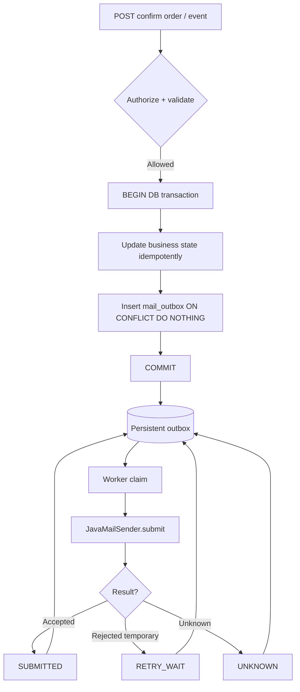
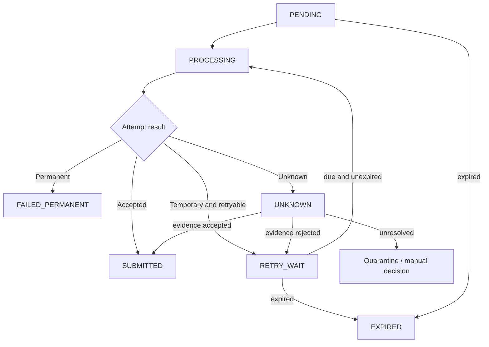

# Idempotency Keys and Duplicate Send Prevention

A Spring Boot application receives an `OrderPaid` event, saves the invoice, and sends a confirmation email via `JavaMailSender`. After a consumer restarts, the broker redelivers the event. An HTTP client also retries its request after missing the response, while a cron worker runs concurrently on two pods. Ultimately, the buyer receives three nearly identical emails. Every component may have done its own job correctly: the broker guaranteed *at-least-once delivery*, the HTTP client retried on timeout, the scheduler ran on each instance, and the SMTP relay accepted each message. **The system lacked a unified concept of "is this the same email send request?"**

In production, an **idempotency key** is a stable identifier for one logical operation. When the same operation is requested again, the system recognizes it as the same work and **does not create unintended additional business effects**. For Spring Framework Mail, this problem does not stop at a string key or a line of `if (alreadySent) return`: it must address transactions, concurrency, retries, the outbox, crashes between SMTP and the database, provider APIs, multiple recipients, and intentional resends.

This lesson belongs to the **Production Design Patterns** chapter of **Spring Framework Mail**. It builds an operable design: from notification identity, PostgreSQL unique constraints, transactional outbox, and per-attempt tracking, to recognizing uncertain SMTP outcomes, choosing retry/failover policies, testing multi-instance contention, and investigating duplicate-send incidents.

## 1. What does idempotency actually guarantee?

An operation `f` is considered idempotent with respect to observable effects if executing it again with the **same identity and same meaning** produces no additional business changes beyond the first execution:

\[
f(f(x)) \equiv f(x)
\]

This is a conceptual illustration, **not** a formula proving SMTP is inherently idempotent.

Examples:

- Re-receiving the "order-42 paid" event does not create a second confirmation *notification intent* for the same recipient and purpose.
- An HTTP client resending the same idempotency key does not duplicate the notification record.
- A worker retries the **same intent**, without creating a different intent.
- Receiving a `delivered` webhook twice does not increment the delivered counter twice for the same provider event.

However:

- One call to `JavaMailSender.send(message)` can emit one email.
- A second call with the same `Message-ID` can still emit a second email.
- An SMTP relay does not participate in PostgreSQL transactions.
- There is no `idempotent=true` flag in `JavaMailSender`.

**What can be strongly guaranteed with internal data** is that *one logical business intent has only one record* and *executions of the same record are coordinated safely*. **You cannot infer exactly-once external SMTP submission/delivery** from a local database alone.

### 1.1. Why is email a hard problem?

Suppose a worker executes:

```text
1. DB: mark PROCESSING
2. SMTP: send message
3. SMTP: 250 OK, relay accepted
4. DB: mark SUBMITTED
```

If the process crashes between steps 3 and 4, the database still shows `PROCESSING`. Once the lease expires, another worker may retry sending. The first relay already accepted the message, yet the DB did not record it: a duplicate can occur.

The reverse order is also dangerous: marking `SUBMITTED` **before** calling SMTP to avoid retries risks crashing before the send step, losing the email permanently.

That is the **dual-write problem** at the boundary between a database and an external side effect. Idempotency keys and an outbox reduce, control, and detect duplicates; they cannot completely erase network uncertainty if the provider lacks reliable outcome/idempotency mechanisms.

## 2. Distinguishing types of duplicates

| Layer | Source | Symptom | Primary safeguard |
|---|---|---|---|
| **HTTP request** | Client retry after timeout, double-click | Two requests for one operation | Request idempotency key, payload fingerprint, unique constraint |
| **Event delivery** | Kafka/RabbitMQ redelivery, replay | One event ID processed multiple times | Inbox/dedup and unique business intent key |
| **Business logic** | Multiple handlers generating mail | Two intents with same purpose/recipient | Define logical notification identity |
| **Scheduler** | `@Scheduled` running on every pod | Multiple jobs reading the same data | Durable occurrence key, atomic work claim |
| **Worker claim** | `SELECT` pending then separate update | Two workers sending the same row | Atomic claim, row locks, lease/fencing |
| **Transport retry** | SMTP timeout/4xx, worker crash | Multiple attempts for one intent | Failure classification, retry policy, provider idempotency if available |
| **Provider delivery** | Relay retrying to recipient MX | Multiple events, possible duplicate at mailbox | Correlation and provider diagnostics; app does not resend while relay retries |
| **Webhook** | ESP resending un-ACKed callback | Repeated delivered/bounce events | Unique provider event identity + transaction |

A single mechanism typically addresses only **one or a few layers**. For example, `UNIQUE(idempotency_key)` alone does not stop two workers from sending the same outbox row if claiming is broken. A distributed scheduler lock does not prevent two business events with different keys from carrying the same meaning.

### 2.1. "Visually identical" duplicates may not be the same intent

Two emails with identical content could be:

- One legitimate confirmation and one user-requested resend.
- An invoice sent to the buyer and a copy sent to accounting.
- Marketing emails from two separate campaigns.
- Two notification intents from an accidentally duplicated event.
- One intent turned into two submissions by SMTP retries.

Proper investigation requires checking the **business event, recipient identity, purpose, notification key, and attempt history**, not just comparing subjects/bodies.

## 3. Defining the identity of a logical notification

The most important question:

> Under what conditions should two send requests arriving at different times be considered **the same email to send**?

A logical notification can be identified from:

- **Tenant/organization**: prevents collisions across tenants.
- **Business source**: e.g., `orderId`/`invoiceId` and event identity.
- **Purpose**: `ORDER_CONFIRMATION`, `INVOICE_PUBLISHED`, `PASSWORD_RESET`.
- **Recipient identity**: logical recipient or resolved delivery target.
- **Channel**: email differs from SMS/push in multi-channel systems.
- **Semantic version/occurrence**: when the same business entity has a new valid send.
- **Business policy**: whether corrections/reissues/resends are permitted.

Illustrative table:

| Use case | Example logical key | When should the key change? |
|---|---|---|
| Order confirmation | `tenant:T1:order:O42:confirmation:user:U9` | Only when purpose/recipient is genuinely new |
| Invoice | `tenant:T1:invoice:I15:issued:v1:user:U9` | Intentionally issuing invoice v2 |
| Password reset | `tenant:T1:password-reset:request:R7:user:U9` | User creates a **new reset request** |
| Daily report | `tenant:T1:daily-summary:2026-11-12:user:U9` | Different day/occurrence or correction version |
| Appointment reminder | `tenant:T1:appointment:A8:reminder:T-24h:user:U9` | Different reminder occurrence |
| Marketing | `tenant:T1:campaign:C6:recipient:U9:wave:W1` | Newly approved wave or explicit resend policy |

These are **illustrative key strings** showing components; production structures may store binary identifiers or HMAC/hashes to avoid exposing PII.

### 3.1. Retries must not generate a new identity

Wrong:

```java
String idempotencyKey = UUID.randomUUID().toString();
outbox.insert(idempotencyKey, email);
```

When the consumer redelivers the same event, it generates a different UUID, so the unique constraint misses the duplicate.

Correct is deriving from **existing, stable identities**:

```java
String key = "order-confirmation:v1:"
        + tenantId + ":"
        + orderId + ":"
        + recipientId;
```

These variables must be verified business identifiers; this abbreviated example does not solve escaping, key length, or privacy on its own.

### 3.2. Not "one event = one email"

An `InvoiceIssued` event might need to send:

- The invoice to the customer.
- A copy to accounting.
- An internal notification with another purpose.

If uniqueness only keys on `eventId`, the second legitimate email gets dropped. Keys must include **purpose + logical recipient** or a business-generated per-notification intent ID.

### 3.3. Avoid using raw email addresses as identity when a durable user ID exists

Addresses can change after an event. Use `recipientId` paired with an **address snapshot** captured when creating the intent:

```text
recipientIdentity = customer:U9
recipientAddressSnapshot = lan@example.net
```

If the business requires sending once **per address** even when a user changes emails, the identity must reflect that policy explicitly. Do not switch from user ID to email address out of coding convenience.

### 3.4. Email canonicalization is easy to get wrong

Do not blindly:

- Strip dots in the local part.
- Drop `+tag` suffixes.
- Lowercase every local part.
- Rewrite aliases using one mailbox provider's rules.
- Treat two visually similar Unicode emails as the same identity.

Domains are generally compared case-insensitively and may need IDNA normalization; local parts under mail standards have nuances and provider-specific behavior. When a trusted user ID exists, **prefer the user identity**, treating the address merely as a contact snapshot.

If you must key by address, define normalization explicitly and test it thoroughly. Never apply a "Gmail normalizer" to every domain.

### 3.5. Versioning in keys is a business decision

Do not automatically embed `templateVersion` in every key just because you deployed a new template: replaying the same event post-deploy could trigger a new email merely due to the version change.

You can choose:

- Key stays unchanged across template implementation changes; outbox holds a **content snapshot** or version pinned at creation.
- Key includes `documentRevision` when the business issues a revised document and **needs a new email sent**.
- Key includes `resendOperationId` when a user clicks "Resend invoice" and policy permits a new email.

Distinguish **code/template changes** from **intentionally creating a new notification**.

## 4. Who creates and trusts idempotency keys?

There are two common key sources.

### 4.1. Client-supplied request keys

An HTTP API can accept `Idempotency-Key` from clients confirming orders or requesting notifications.

Advantage: the client knows which operation it is retrying and reuses the same key when responses are lost.

Risks:

- Clients may reuse keys with different payloads.
- Two tenants may send the same key string.
- Keys may be overly long or contain sensitive data.
- An attacker could supply a predictable key to suppress someone else's operation.
- Retention/expiration causes re-execution after TTL.
- Checking keys before authorization can leak another user's operation outcome.

**Always scope keys by authenticated principal/tenant + API operation.** Authorization must run on every request, including replays.

### 4.2. Server-derived business keys

For event handlers and outboxes, the server already knows the business event ID, recipient, and purpose, so it derives a stable key itself.

Advantages:

- Independent of HTTP clients sending keys properly.
- Easily tied to domain invariants.
- Shareable across consumers/instances.
- Event retries preserve the same key.

Risk: if a business key has the wrong scope or omits purpose/recipient/version, it can **mistakenly block a valid notification**.

### 4.3. Rules for operating keys

A good key is:

1. **Deterministic within the scope of one logical intent.**
2. **Distinct** for genuinely different logical intents.
3. Namespaced/versioned by **naming convention**, never random per deployment.
4. Validated for length and character set.
5. Scoped to tenant/account/operation.
6. Paired with detection for same-key/different-payload reuse.
7. Free of unnecessary email addresses, tokens, or personal data.
8. Retained durably long enough for the retry/redelivery lifecycle.

### 4.4. Should keys be hashed?

If source identities contain PII or are very long, you can store a digest:

```text
logical tuple:
    [tenant-id, purpose, business-id, recipient-id, occurrence]

canonical encoding:
    length-prefixed fields / canonical structured serialization

storage key:
    HMAC-SHA256(secret, canonical tuple)
```

Why is canonical encoding needed? Naive string concatenation has semantic collisions:

```text
["ab", "c"]  -> "abc"
["a", "bc"]  -> "abc"
```

Use length-prefixing or versioned schema serialization to eliminate ambiguity.

Plain hashing is not encryption. If inputs contain guessable email addresses and you want to avoid exposing identities, HMAC with a managed secret reduces guessing from digests; however, key rotation, version lookup, and secret management must be designed. Never treat HMAC as a substitute for authorization/PII controls.

## 5. How idempotency keys differ from other identifiers

| Identifier | Source | Role | Can it replace an idempotency key? |
|---|---|---|---|
| `businessEventId` | Domain/event publisher | Identifies one event | Only when scoped properly per notification |
| `notificationId` | Outbox/application | Primary key of one intent | No if every replay creates a new UUID |
| `idempotencyKey` | Business rule or API client | Identifies same logical operation | It is the designed dedup mechanism |
| `attemptId` | Worker | Identifies one transport attempt | No; each retry needs a new attempt |
| Spring `MessageHeaders.ID` | Spring Messaging | Identifies message envelope | Unstable across rebuilds/redeliveries |
| MIME `Message-ID` | Email format/sender | Correlation inside email | SMTP is not required to dedup |
| `providerMessageId` | ESP/relay | Remote submission/event lookup | Can be null; scoped to provider |
| `traceId` | Observability | Links spans/logs | Not a business identity |

Do not use an ambiguous `messageId` variable for all identifiers; later it becomes hard to distinguish "one intent with 3 attempts" from "3 logical intents."

## 6. PostgreSQL schema design with a unique business key

Illustrative schema for a single-recipient notification with text/HTML and sender identity:

```sql
CREATE TABLE mail_outbox (
    id UUID PRIMARY KEY,
    tenant_id UUID NOT NULL,
    idempotency_key VARCHAR(240) NOT NULL,
    payload_fingerprint CHAR(64) NOT NULL,

    notification_type VARCHAR(80) NOT NULL,
    recipient_id VARCHAR(120) NOT NULL,
    recipient_address VARCHAR(320) NOT NULL,
    sender_address VARCHAR(320) NOT NULL,
    subject VARCHAR(500) NOT NULL,
    plain_text TEXT NOT NULL,
    html_text TEXT NULL,

    status VARCHAR(40) NOT NULL DEFAULT 'PENDING',
    due_at TIMESTAMPTZ NOT NULL,
    expires_at TIMESTAMPTZ NULL,
    next_attempt_at TIMESTAMPTZ NULL,

    claim_token UUID NULL,
    lease_until TIMESTAMPTZ NULL,
    accepted_at TIMESTAMPTZ NULL,
    provider_reference VARCHAR(240) NULL,

    created_at TIMESTAMPTZ NOT NULL DEFAULT CURRENT_TIMESTAMP,
    updated_at TIMESTAMPTZ NOT NULL DEFAULT CURRENT_TIMESTAMP,

    CONSTRAINT uq_mail_intent UNIQUE (tenant_id, idempotency_key),
    CONSTRAINT ck_mail_status CHECK (
      status IN (
        'PENDING',
        'PROCESSING',
        'RETRY_WAIT',
        'SUBMITTED',
        'UNKNOWN',
        'FAILED_PERMANENT',
        'EXPIRED',
        'CANCELLED'
      )
    )
);

CREATE INDEX ix_mail_outbox_due
ON mail_outbox(status, next_attempt_at, due_at);

CREATE INDEX ix_mail_outbox_lease
ON mail_outbox(status, lease_until);
```

This is a teaching schema. Production may also require template versions/snapshots, attachment references, priorities, provider accounts, retry policy versions, suppressions, encryption at rest, audit logs, and retention. Do not store OTPs or plaintext password tokens unnecessarily in the outbox if you can reference a protected, expiring token; balance retry capability with data protection.

### 6.1. Unique constraints as the final barrier

`UNIQUE (tenant_id, idempotency_key)` operates at the **database** level, protecting across concurrent app instances, consumer replays, or simultaneous requests.

Checking in Java alone:

```java
if (!repository.existsByKey(key)) {
    repository.save(intent);
}
```

is insufficient:

```text
Pod A: exists(key) = false
Pod B: exists(key) = false
Pod A: insert key
Pod B: insert key
```

Without a unique constraint, both inserts succeed.

### 6.2. Do not confuse business idempotency TTL with arbitrary retention

If rows are deleted after 24 hours while the broker can replay after 7 days, the same key has nothing left to deduplicate against and the email can be recreated.

Define:

- How long an event can be redelivered.
- How long clients can retry the same request key.
- How long a notification can remain pending/retrying/unknown.
- GDPR/privacy policies, data minimization, and retention.
- Keeping a smaller **dedup tombstone** instead of full email content.

Never delete durable keys merely because a message reached `SUBMITTED` while idempotency guarantees are still active.

## 7. Payload fingerprints to prevent improper key reuse

A key can be reused with different content:

```text
Request #1: key=K, to=alice, subject="Invoice I-42"
Request #2: key=K, to=bob,   subject="Invoice I-42"
```

If the server sees key K exists and blindly returns "success", the second request masks a logic bug or abuse.

Store a **fingerprint of the canonical logical request** and compare on key collisions. Include fields meaningful to "the same operation":

- Tenant/operation/purpose.
- Business entity and revision.
- Logical recipient identity.
- Destination snapshot if policy requires.
- Content snapshot or pinned template version/parameters.
- Attachment content IDs/hashes when required.
- Scheduling/expiry policy if meaningful.

### 7.1. Never compare arbitrary JSON serializations

Two JSON objects with the same meaning but different field order produce different digests:

```json
{"to":"alice@example.net","subject":"Hello"}
```

```json
{"subject":"Hello","to":"alice@example.net"}
```

For stable hashes, use canonical schema encoding and versioned normalization. For binary attachments, include content digests rather than embedding huge bytes in JSON strings.

### 7.2. Distinguish same-key/same-payload from same-key/different-payload

| Situation | Response |
|---|---|
| Key does not exist | Create new intent |
| Key exists, fingerprint matches | Return/reference existing intent; create no new intent |
| Key exists, fingerprint differs | Return explicit conflict/business error; never silently overwrite |
| Key belongs to another tenant | Not the same operation; enforce scope and authorization |
| Key past retention | Policy explicitly defines re-execution behavior and risk |

In HTTP APIs, responses can return `202 Accepted` for pending intents or return the current state per contract; exact replay of the original HTTP response is unnecessary unless API policy promises it. If the API promises *exact response replay*, store and manage responses accordingly.

## 8. Atomic insert-if-absent with PostgreSQL

Use `INSERT ... ON CONFLICT DO NOTHING` to eliminate application-layer races.

```sql
INSERT INTO mail_outbox (
    id, tenant_id, idempotency_key, payload_fingerprint,
    notification_type, recipient_id, recipient_address,
    sender_address, subject, plain_text, html_text,
    status, due_at, expires_at
)
VALUES (
    :id, :tenantId, :idempotencyKey, :payloadFingerprint,
    :notificationType, :recipientId, :recipientAddress,
    :senderAddress, :subject, :plainText, :htmlText,
    'PENDING', :dueAt, :expiresAt
)
ON CONFLICT (tenant_id, idempotency_key)
DO NOTHING
RETURNING id;
```

Outcomes:

- An `id` is returned: this transaction created the intent.
- No row returned: the key already existed at the conflict boundary; read the existing record and compare fingerprints.

### 8.1. Re-checking after conflict

```sql
SELECT id, payload_fingerprint, status
FROM mail_outbox
WHERE tenant_id = :tenantId
  AND idempotency_key = :idempotencyKey;
```

In PostgreSQL under `READ COMMITTED`, a committing concurrent insert makes `INSERT ON CONFLICT` wait; the **subsequent separate** `SELECT` normally sees the committed row. Under stricter isolation like `REPEATABLE READ`/`SERIALIZABLE`, serialization/conflict errors may occur requiring whole-transaction retries. Never rely on unconstrained `SELECT` then `INSERT`.

### 8.2. Returning API results

A service can return:

```java
public record EnqueueResult(
        UUID notificationId,
        boolean newlyCreated,
        String status) {
}
```

- `newlyCreated=true`: a new logical intent was persisted.
- `newlyCreated=false`: valid replay; return the same `notificationId` and current state.
- Different fingerprint: throw a domain conflict and map to an appropriate HTTP status (typically `409 Conflict`).

Never send SMTP directly inside an HTTP API's idempotency handler just because creating the intent succeeded on the first try.

## 9. Transactional Outbox: persisting business state and intent in one commit

A production design separates:

1. **Business transaction:** updates order status and creates a durable mail intent.
2. **Worker transactions:** claims outbox rows and records attempt/status history.
3. **External transport:** `JavaMailSender.send(...)` outside row-locking database transactions.

Diagram:



### 9.1. Never call SMTP inside business @Transactional

Wrong:

```java
@Transactional
public void confirmOrder(UUID orderId) {
    orders.confirm(orderId);
    mailSender.send(buildEmail(orderId));
}
```

If the SMTP relay accepts the email while the DB commit fails, the recipient receives confirmation for a rolled-back transaction. If the DB transaction holds locks across SMTP timeouts, throughput and concurrency suffer too.

Better:

```java
@Transactional
public EnqueueResult confirmOrder(
        UUID orderId, UUID recipientId) {

    orders.confirmIfEligible(orderId);

    NotificationDraft draft =
            notifications.forConfirmedOrder(orderId, recipientId);

    return outbox.insertOrReturnExisting(draft);
}
```

`orders`, `notifications`, `outbox`, and `NotificationDraft` are project-defined application ports. The vital contract: business writes and outbox inserts share the same transaction manager and datasource. `@Transactional` through Spring proxies must actually take effect; never use `REQUIRES_NEW` on the outbox writer if you need atomic commit/rollback.

### 9.2. Event replays and business state

If `orders.confirmIfEligible(orderId)` returns `false` merely because the order is already confirmed, do not assume no mail intent is needed; cases can exist where state is confirmed yet the intent was never written due to migration or an earlier bug.

Make the policy explicit: the `OrderConfirmed` event ensures the corresponding intent's presence via insert-if-absent, regardless of whether the order update changed state when business rules allow it. Sharing the same transaction keeps normal replays duplicate-free while letting recovery materialize missing intents.

### 9.3. Idempotent inbox for event consumers

A consumer can record event IDs in an inbox table:

```sql
CREATE TABLE processed_event (
    consumer_name VARCHAR(100) NOT NULL,
    event_id VARCHAR(240) NOT NULL,
    processed_at TIMESTAMPTZ NOT NULL DEFAULT CURRENT_TIMESTAMP,
    PRIMARY KEY (consumer_name, event_id)
);
```

If used, insert the inbox marker, update business state, and insert the outbox intent **in the same transaction**; only ACK the broker after commit succeeds. Still, an inbox marker **does not replace** a unique outbox key: different event IDs can express the same business operation.

Never insert and commit the marker separately **before** processing, because crashing after the marker marks the event processed even though business/outbox writes never finished.

## 10. HTTP API: idempotency keys do not bypass authorization

Example endpoint:

```http
POST /api/orders/O42/confirm
Idempotency-Key: 89e0d42a-3eb1-4d11-a2e1-aab5bcee2c64
Content-Type: application/json

{"recipientId":"U9"}
```

The server must:

1. Authenticate the user and tenant.
2. Verify the user is authorized to confirm order O42.
3. Validate key format, size, and operation scope.
4. Canonicalize the logical request and fingerprint.
5. Write business state + outbox in one DB transaction.
6. On replay with same key/same fingerprint, return the same notification reference/status.
7. On key reuse with a different request, reject explicitly.
8. Never send the email synchronously inside the HTTP request when durable asynchronous dispatch is needed.

### 10.1. API scenarios to test

| Scenario | Expected result |
|---|---|
| Client sends once | Creates one intent |
| Client times out then resends same key/payload | Returns existing intent, no duplicate insert |
| Double-click sends two concurrent requests | One insert succeeds, other sees existing row |
| Old key reused with a new recipient | Conflict; never silently updates recipient |
| Two tenants use the same key string | Two independent scopes; never leak each other's state |
| User loses access permissions | Never return sensitive data just for knowing the key |
| Key resent after published TTL | Matches retention contract with duplicate-risk review |
| Server crashes after DB commit before HTTP response | Retry retrieves committed record |

### 10.2. Never put a client API idempotency key directly as SMTP Message-ID

Client keys can be too long, contain invalid characters, or hold sensitive data. MIME `Message-ID` has its own syntax and semantics and does not guarantee relay deduplication anyway. Store client keys in the application database; for email correlation, generate a valid server-side opaque ID.

## 11. Lifetimes of keys, data, and dedup tombstones

A common misconception: "keeping idempotency keys for 24 hours is enough because API clients retry within a day."

If a notification waits 48 hours due to quota limits, or a broker replays after 7 days, deleting the key early allows a duplicate intent when the same event arrives again.

There are at least three distinct lifetimes:

- **Request replay window:** published window during which API clients can retry the same key.
- **Business operation identity lifetime:** window during which the same event/notification must not recur.
- **Provider idempotency TTL:** window during which a remote provider deduplicates requests, if supported.

They do not have to be equal.

### 11.1. Dedup tombstones after purging sensitive content

When email bodies or recipient snapshots must be deleted per retention policy, you can still retain a minimal record (where lawful and compliant with policy):

```text
tenant scope
idempotency digest
notification purpose/version
createdAt
terminal status
payload fingerprint (weigh privacy)
retention expiresAt
```

Tombstones prevent replays from creating new emails without keeping email content around too long. Evaluate HMAC/key rotation, guessability, erasure-on-request obligations, and lawful retention windows.

### 11.2. Key TTL is not OTP validity duration

An OTP token expiring after 5 minutes moves the notification intent to `EXPIRED`. Yet the dedup key for **that OTP request** must still survive so client retries of the same request do not generate new tokens/emails. If the user actively requests a new OTP, that is a **new `requestId`** per business policy.

Never use the email's `expires_at` as the automatic deletion time for the idempotency key.

## 12. Attempt history: one intent, multiple transport attempts

Separate `mail_outbox` (one per logical intent) from `mail_submission_attempt` (one per attempt to submit to a provider).

```sql
CREATE TABLE mail_submission_attempt (
    attempt_id UUID PRIMARY KEY,
    notification_id UUID NOT NULL REFERENCES mail_outbox(id),
    attempt_no INTEGER NOT NULL,
    provider_key VARCHAR(100) NOT NULL,
    provider_account VARCHAR(100) NOT NULL,
    provider_reference VARCHAR(240) NULL,
    state VARCHAR(32) NOT NULL,
    failure_category VARCHAR(80) NULL,
    smtp_reply_code INTEGER NULL,
    transport_stage VARCHAR(60) NULL,
    started_at TIMESTAMPTZ NOT NULL,
    finished_at TIMESTAMPTZ NULL,
    CONSTRAINT uq_mail_attempt_no UNIQUE(notification_id, attempt_no),
    CONSTRAINT ck_mail_attempt_state CHECK (
      state IN ('STARTED', 'ACCEPTED', 'REJECTED',
                'UNKNOWN', 'ABORTED_BEFORE_TRANSPORT')
    )
);

CREATE INDEX ix_mail_attempt_notification
ON mail_submission_attempt(notification_id, started_at);
```

Example:

```text
mail_outbox
  id=N-101
  idempotency_key=order-confirmation:T1:O42:U9
  status=SUBMITTED

mail_submission_attempt
  A-1: notification=N-101, attempt_no=1, state=REJECTED (451)
  A-2: notification=N-101, attempt_no=2, state=ACCEPTED
```

This is **one** notification intent attempted **twice**. Never call two attempts two logical notifications.

### 12.1. Separate claims from actual SMTP attempts

A worker may claim a row and then be denied capacity by a local rate limiter. In that case:

- The claim may be noted.
- **No SMTP attempt occurred**.
- Do not increment `mail_submission_attempts_total` as if a network connection opened.
- Do not burn max retry attempts simply because a local quota gate deferred it.

An attempt record can be created right before transport starts, or store intermediate states like `PREPARED`/`SEND_STARTED`. Understand that DB writes and network sends cannot be mutually atomic; crashing right at the boundary still creates uncertainty.

### 12.2. Never delete attempts when a retry succeeds

Attempt history reveals why an email was delayed, which providers were tried, whether an `UNKNOWN` outcome preceded acceptance, and potential duplicate submissions. Only purge/redact under approved data retention policies—never delete them just because a dashboard wants to "show only successful attempts."

## 13. Multiple workers: atomic claiming before sending

A database unique key only stops **creating two outbox rows**, yet two workers can still send **one** row simultaneously if they query `PENDING` normally and update status separately.

Wrong:

```text
A: SELECT status=PENDING for N-101
B: SELECT status=PENDING for N-101
A: send(N-101)
B: send(N-101)
```

Use **atomic transactional claiming** or appropriate broker consumer ownership.

### 13.1. PostgreSQL SKIP LOCKED

```sql
WITH due AS (
    SELECT id
    FROM mail_outbox
    WHERE
      status IN ('PENDING', 'RETRY_WAIT')
      AND due_at <= CURRENT_TIMESTAMP
      AND (
        next_attempt_at IS NULL
        OR next_attempt_at <= CURRENT_TIMESTAMP
      )
      AND (
        expires_at IS NULL
        OR expires_at > CURRENT_TIMESTAMP
      )
    ORDER BY
      COALESCE(next_attempt_at, due_at),
      created_at,
      id
    LIMIT :batchSize
    FOR UPDATE SKIP LOCKED
)
UPDATE mail_outbox m
SET
    status = 'PROCESSING',
    claim_token = :claimToken,
    lease_until = CURRENT_TIMESTAMP
                  + (:leaseSeconds * INTERVAL '1 second'),
    updated_at = CURRENT_TIMESTAMP
FROM due
WHERE m.id = due.id
RETURNING
    m.id, m.claim_token,
    m.recipient_address, m.sender_address,
    m.subject, m.plain_text, m.html_text;
```

With two workers sharing a database:

- One worker locks a row in a short transaction.
- The other worker's `SKIP LOCKED` skips that locked row at the same instant.
- After commit, the row is `PROCESSING`, so subsequent polls ignore it.
- A fresh claim token is assigned each time ownership is granted.

**Never call SMTP inside a transaction holding `FOR UPDATE` row locks.** Commit the claim first; execute transport outside the transaction; update the outcome in a new transaction.

### 13.2. Why not reclaim PROCESSING directly inside the send query?

If a `PROCESSING` row's lease expired, the old worker might have:

- Died before the network call.
- Stalled inside an SMTP call.
- Been accepted by the relay while the DB update failed.

Reclaiming and sending immediately can cause duplicates. A conservative design uses a **dedicated recovery path**:

1. Find `PROCESSING` rows with expired leases.
2. Check attempt stage/evidence in DB and provider logs when available.
3. If proven unsent, move back to `RETRY_WAIT`/`PENDING`.
4. If uncertain, move to `UNKNOWN` or a reconciliation queue.
5. Only resend under an explicit duplicate-risk policy.

This reduces the chance of a lease race silently turning into an SMTP duplicate. At-least-once systems may choose earlier retries, provided they document the trade-off.

### 13.3. Batch size and leases

If a worker claims 1,000 rows and sends sequentially with 15-second slow SMTP calls, later rows' leases expire before they even start sending. Only claim as many rows as slots and time can finish before lease expiry; renew leases if needed.

## 14. Conditional completion and fencing tokens

After the relay confirms acceptance:

```sql
UPDATE mail_outbox
SET
    status = 'SUBMITTED',
    accepted_at = CURRENT_TIMESTAMP,
    provider_reference = :providerReference,
    claim_token = NULL,
    lease_until = NULL,
    updated_at = CURRENT_TIMESTAMP
WHERE
    id = :notificationId
    AND status = 'PROCESSING'
    AND claim_token = :claimToken;
```

Check `affectedRows`:

- `1`: the worker still held permission to update the row.
- `0`: the worker lost ownership or state changed; do not overwrite current state, log diagnostics/reconciliation.

On temporary rejection:

```sql
UPDATE mail_outbox
SET
    status = 'RETRY_WAIT',
    next_attempt_at = :nextAttemptAt,
    claim_token = NULL,
    lease_until = NULL,
    updated_at = CURRENT_TIMESTAMP
WHERE
    id = :notificationId
    AND status = 'PROCESSING'
    AND claim_token = :claimToken;
```

On unknown outcomes, perform a guarded update to `UNKNOWN` or follow defined policy rather than immediately setting `RETRY_WAIT`.

### 14.1. Fencing only protects DB state if external providers do not participate

Scenario:

```text
Worker A claims N-101 (token=Ta)
Worker A starts sending SMTP, hangs
Lease A expires
Worker B reclaims N-101 (token=Tb)
Worker B also sends SMTP
A wakes up, SMTP accepted
A UPDATE ... WHERE token=Ta -> 0 rows
B may also be accepted
```

The token stops A from overwriting B's state, yet **cannot recall the email A already sent**. Preventing external side-effect duplicates requires remote idempotency or choosing not to resend when outcomes are unknown; standard SMTP offers no universal fencing mechanism.

### 14.2. Identify owner by claim, not by pod

`worker_id=pod-4` can be reused after a restart. A fresh token per claim plays a cleaner role in conditional updates. Monotonically increasing versions also work; stale transport calls still need handling.

### 14.3. Heartbeats are not magic

Extending `lease_until` while a worker is genuinely active reduces premature reclaims. Yet if a network send is already stuck past the point of no return, heartbeats cannot guarantee duplicate absence. Configure SMTP timeouts, concurrency bounds, and recovery policies.

## 15. Worker flow: one notification creates no new intent on retry

Pseudocode:

```text
claim eligible outbox row (atomic transaction)
   |
   v
validate expiry / suppression / provider capacity
   |
   +-- local quota denied -> defer same row, no SMTP attempt
   |
   v
create attempt record, commit
   |
   v
build MimeMessage from immutable content snapshot
   |
   v
call JavaMailSender.send()
   |
   +-- confirmed accepted -> record ACCEPTED / SUBMITTED
   |
   +-- confirmed temporary reject -> RETRY_WAIT same row
   |
   +-- confirmed permanent reject -> FAILED_PERMANENT
   |
   +-- outcome uncertain -> UNKNOWN / reconciliation
```

Workers must keep:

- Fixed `notificationId`.
- Fixed `idempotencyKey`.
- New `attemptId` per transport attempt.
- Controlled incrementing `attemptNo`.
- `providerKey`/`providerReference` tied to each attempt.
- Distinct `claimToken` per processing lease.
- Fixed or policy-versioned retry deadline/expiry.

### 15.1. Never create a new email inside catch

Wrong:

```java
try {
    sender.send(message);
} catch (MailException ex) {
    notificationService.createNewNotification(
            UUID.randomUUID(), sameRecipient, sameBody);
}
```

It turns a transport retry into a brand-new logical intent. Subsequent sends become hard to trace and business unique keys are bypassed.

Right: update `nextAttemptAt` on the **same outbox row**, preserve attempt history, apply backoff, and classify errors.

### 15.2. Stable content snapshots

If an invoice is retried 2 days later, the template or customer address may have changed. If each retry re-renders from mutable data, the same idempotency key could send **two different contents**.

Persist:

- Verified recipient address snapshot as of creation time.
- Subject/plain/HTML content snapshot or pinned template version + immutable parameters.
- Immutable attachment reference and content hash.
- Expiry policy and notification purpose.

If the business wants to send a revised version, create a new logical intent with an explicit correction/version rather than silently mutating an old retrying intent's content.

## 16. Spring JavaMailSender does not handle idempotency automatically

Spring Mail provides:

```java
JavaMailSender sender;
MimeMessage message = sender.createMimeMessage();
// Build MIME...
sender.send(message);
```

`JavaMailSender` builds and sends email via Jakarta Mail transport; it knows nothing about `idempotencyKey` in your database, nor does it check whether a business event already created an intent.

### 16.1. A clear transport boundary adapter

```java
public interface MailTransportPort {
    void submitOnce(MailEnvelope email);
}
```

`MailEnvelope` is an application type holding verified From/To/Subject/plain/HTML and attachment snapshots. An SMTP adapter might look like:

```java
public final class SmtpMailTransport
        implements MailTransportPort {

    private final JavaMailSender sender;

    public SmtpMailTransport(JavaMailSender sender) {
        this.sender = sender;
    }

    @Override
    public void submitOnce(MailEnvelope email) {
        MimeMessage mime = sender.createMimeMessage();

        try {
            MimeMessageHelper helper =
                    new MimeMessageHelper(mime, true, "UTF-8");
            helper.setFrom(email.from());
            helper.setTo(email.to());
            helper.setSubject(email.subject());
            helper.setText(
                    email.plainText(),
                    email.htmlText());
        } catch (MessagingException ex) {
            throw new IllegalArgumentException(
                    "Invalid MIME payload", ex);
        }

        sender.send(mime);
    }
}
```

Imports belong to `org.springframework.mail.javamail.*` and `jakarta.mail.*`. `MailEnvelope` is a project-defined record/interface. This example illustrates one attempt with plain+HTML; production must handle absent HTML, attachments, exception classification, recipient policies, and SMTP timeouts.

### 16.2. Do not return boolean delivered

`sender.send(...)` returning without throwing normally only means the transport reported no error at the submission boundary. It **does not prove the email reached the Inbox**, does not prove a downstream MX accepted it, and provides no global exactly-once guarantee.

A production port should return a `SubmissionOutcome` with `ACCEPTED_BY_RELAY`, `TEMPORARY_REJECTION`, `PERMANENT_REJECTION`, or `UNKNOWN` where evidence permits, instead of a boolean `emailDelivered`.

### 16.3. SMTP codes and stages matter

Useful diagnostic signals include:

- SMTP reply codes / enhanced status codes.
- Stage: connect / AUTH / MAIL FROM / RCPT TO / DATA.
- `MessagingException` `cause`/`nextException` chains.
- `MailSendException` failed messages / nested errors.
- Provider logs/references when available.
- Whether network timeout happened before or after bytes were sent.

Do not regex-match an exception message and treat every `MailException` as retryable. When evidence is insufficient, classify conservatively as `UNKNOWN` or `UNCLASSIFIED` per policy.
## 17. Uncertainty window after SMTP DATA

This is the single most critical limitation when discussing "send exactly once."

### 17.1. When the relay confirms acceptance

In a simple SMTP transaction:

```text
Client                         SMTP relay
  |                                |
  | -------- EHLO/AUTH ----------> |
  | -------- MAIL FROM ----------> |
  | <---------- 250 -------------- |
  | -------- RCPT TO ------------> |
  | <---------- 250 -------------- |
  | -------- DATA ---------------> |
  | <---------- 354 -------------- |
  | ---- MIME bytes + <CRLF>.<CRLF> ->|
  | <---------- 250 -------------- |  Relay accepted
  |                                |
```

Note: a `250` after `RCPT TO` only indicates the recipient was accepted at that step; it does not confirm **the full message DATA was received**. At the DATA step, the reply after end-of-data is the primary submission evidence. Provider acceptance also does not equal final delivery to the recipient mailbox.

### 17.2. Lost response after DATA

```text
Client                         SMTP relay
  | ---- MIME bytes + end ------- > |
  |                                | Accepted internally
  |    [connection reset]          |
  |    [no final reply observed]    |
```

From the client's perspective, either truth is possible:

1. The relay received and committed the message, yet the reply was lost.
2. The relay did not fully receive or rejected the message, and the client could not read the result.

Recording `FAILED` and retrying immediately risks duplicates. Recording `SUBMITTED` risks hiding an unreceived email. The epistemically accurate state is **`UNKNOWN`**, paired with evidence and a recovery policy.

### 17.3. UNKNOWN differs from clear temporary rejection

| Client-observed result | Certainty | Action |
|---|---|---|
| TCP connect failed before sending SMTP data | No message submitted | May retry after checking config |
| AUTH rejected | No accepted message | Fix credentials/account |
| Explicit `RCPT TO` rejection for recipient | Recipient not accepted per reply | Classify temporary/permanent |
| Server returns clear temporary failure after DATA | Message not accepted for that transaction per SMTP semantics, though still check provider diagnostics | Bounded retry |
| Client receives final `250` after DATA | Relay accepted | Record `SUBMITTED` |
| Client timeout/lost response after sending DATA | Indeterminate | `UNKNOWN`/reconcile |
| ESP emits delivery event | Downstream evidence per provider contract | Update delivery state independently |

Framework exceptions do not always identify the exact stage. Do not assume "connect exception = definitely not sent" if proxies, automatic retries, or adapters already took prior action. Inspect the implementation and evidence.

### 17.4. No atomic transaction spans SMTP and PostgreSQL

Wrapping the entire workflow in `@Transactional` does not make SMTP participate in the DB commit; SMTP provides no universal XA/2PC transactions via `JavaMailSender`.

Common choices:

- **At-least-once notification processing:** retry until proven successful or policy exhausts; accept SMTP duplicate risk.
- **Conservative unknown handling:** hold `UNKNOWN` and reconcile before retrying; lowers duplicates at the risk of delays or missed deadlines when verification is impossible.
- **Provider-backed idempotency:** use provider APIs with explicit key semantics to reduce ambiguous duplicates when supported.
- **Business-specific trade-offs:** some notifications tolerate duplicates, while others prioritize duplicate avoidance over immediate delivery.

### 17.5. Decision table after UNKNOWN

| Requirement | Suggested approach | Residual risk |
|---|---|---|
| Marketing avoiding annoyance | Quarantine, query provider, controlled retry | Delayed or skipped email |
| Invoices requiring durable delivery | Reconcile provider, retry per policy with same snapshot | Possible duplicate if provider cannot confirm |
| Short-deadline OTP | Expire if past deadline; UX lets user request new one | User may miss stale OTP |
| Critical security alert | May tolerate duplicates or use alternate channel | Controlled duplicates |
| Provider API with true idempotency | Resend same key within window | TTL/scope/provider semantics still bounded |

Never apply one policy table to every notification. Place retry/duplicate tolerance in a **notification purpose policy**.

## 18. Retries: one intent, many attempts, zero lost history

A retry policy should consider **error type, stage, intent age, remaining attempts, and content deadline**.

### 18.1. Recommended state machine



Quarantine can be represented by `UNKNOWN` plus a reconciliation status rather than requiring another enum. The key is **never pushing `UNKNOWN` automatically into `RETRY_WAIT`** as if it definitely failed.

### 18.2. Exponential backoff with jitter

Example policy:

```text
Attempt 1 fails temporary -> wait random 0..30 seconds
Attempt 2 fails temporary -> wait random 0..60 seconds
Attempt 3 fails temporary -> wait random 0..120 seconds
Attempt 4 fails temporary -> wait random 0..240 seconds
Thereafter -> capped window, bounded by maxAttempts/maxAge
```

This illustrates **full-jitter exponential backoff**. No single number fits every provider. When an HTTP provider API returns a valid `Retry-After`, never retry earlier than requested. Standard SMTP 4xx lacks a universal `Retry-After` header.

### 18.3. Testable delay calculation

```java
import java.time.Duration;
import java.util.concurrent.ThreadLocalRandom;

public final class RetryDelays {

    private RetryDelays() {}

    public static Duration fullJitter(
            int consecutiveFailures,
            Duration base,
            Duration cap) {

        if (consecutiveFailures <= 0
                || base.isNegative() || base.isZero()
                || cap.isNegative() || cap.isZero()) {
            throw new IllegalArgumentException(
                    "Invalid retry delay arguments");
        }

        long baseMillis = base.toMillis();
        long capMillis = cap.toMillis();
        long ceilingMillis = Math.min(
                capMillis,
                saturatingMultiplyByPowerOfTwo(
                        baseMillis, consecutiveFailures - 1));

        if (ceilingMillis <= 0L) {
            return Duration.ofMillis(0);
        }

        long delay = ThreadLocalRandom.current()
                .nextLong(ceilingMillis + 1L);

        return Duration.ofMillis(delay);
    }

    private static long saturatingMultiplyByPowerOfTwo(
            long value, int exponent) {

        if (exponent >= 62) {
            return Long.MAX_VALUE;
        }

        if (value > (Long.MAX_VALUE >> exponent)) {
            return Long.MAX_VALUE;
        }

        return value << exponent;
    }
}
```

The idea: exponential growth **with an upper cap**, plus jitter so workers do not retry simultaneously. Production code assumes `base.toMillis() > 0` and `cap.toMillis() < Long.MAX_VALUE`; if extremely small or large durations are permitted, add validation against `ceilingMillis + 1` overflow and rounding to zero. Inject a jitter source/`Clock` for deterministic unit tests.

### 18.4. Never retry in three layers at once

If:

- `@Retryable` retries 3 times,
- worker retries 5 times,
- provider SDK internally retries 4 times,

a single intent can trigger up to 60 transport calls while obscuring stage outcomes. Assign **one retry policy owner** at dispatch level aware of attempt state and idempotency; never stack retry libraries silently.

### 18.5. @Retryable can hide metadata

`@Retryable` is handy for transient tasks, yet wrapping `JavaMailSender.send` directly without persistent attempt state can:

- Retry after an `UNKNOWN` timeout.
- Send a second time when the first was accepted.
- Fail to save attempt IDs / provider references.
- Skip expiry/consent checks on retry.
- Retry on a thread holding a business transaction.

If using Spring Retry, use it only inside a policy aware of **submission outcomes and persistence**, never treating the annotation as an exactly-once solution.

## 19. Provider idempotency: use only when the contract truly supports it

Some ESP HTTP APIs accept a request idempotency key. When the same key is resent within a documented window, the provider can return the prior result or prevent creating a new submission.

**This is provider-specific, not part of standard Spring Mail SMTP.**

### 19.1. What to check in the contract

- Which endpoints support idempotency?
- What is the header/field name?
- Is the key scoped by account, region, subaccount, or endpoint?
- What is the TTL? What happens once TTL expires?
- Is same-key/different-payload rejected or silently reused?
- How does the server handle concurrent same-key requests?
- On response timeout, can a status API look up by key?
- Does HTTP `202` mean "request accepted", "queued", or "mail submitted"?
- Does deduplication apply per recipient or per batch request?
- Do rejected/duplicate requests count against quota?

Do not slap an `Idempotency-Key` header onto SMTP MIME and hope the ESP deduplicates. If a provider documents a custom X-header, check its contract carefully; arbitrary X-headers are **not an idempotency guarantee**.

### 19.2. Application keys and provider keys can share one origin

Example:

```text
Application notification id = N-101
Application idempotency key = K-Order-42-Recipient-9
Provider A API idempotency key = derived(K, provider A scope)
```

You can pass the same key when permitted and non-sensitive, or derive a deterministic opaque provider key from the application identity. **Record key mappings and provider account scope**.

### 19.3. Provider TTL shorter than notification lifetime

Suppose remote idempotency TTL is 24 hours, while retries occur after 48 hours. Resending the same key on day three may create a new email depending on the provider. Never claim "having an idempotency key makes duplicates impossible forever."

If `UNKNOWN` persists past TTL:

- Reconcile before resubmitting.
- Assess business significance.
- Optionally stop automatic retries and escalate.
- If still resending, audit that duplicate risk was accepted.

### 19.4. Switching providers does not preserve global idempotency

```text
A accepted request with key K
    |
    +-- Client timeout, application UNKNOWN
    |
    +-- Failover to B with same K
                     |
                     v
             B does not know A's K
             => B can accept duplicate
```

Two providers do not share a dedup store. Never fail over an `UNKNOWN` attempt as if primary definitely failed.

### 19.5. Provider keys for batches

If an HTTP API sends a batch of 500 recipients in one request, the provider may deduplicate the **request**, not each recipient. Partial failures or batch timeouts require per-recipient mappings and clear contracts; retrying the whole batch can partially duplicate sends.

## 20. Scheduled mail: idempotency must bind to the occurrence

A daily 08:00 report job can run multiple times because:

- Three instances all run `@Scheduled`.
- Rolling deployments overlap pods.
- An operator clicks "run now."
- Restart/catch-up logic reruns an occurrence.
- Clock/timezone differences misidentify the date.

Generating random keys each run easily produces duplicates.

### 20.1. Defining a stable occurrence

```text
schedule = DAILY_REVENUE_SUMMARY
tenant = T1
business day = 2026-11-12
recipient = U9

intent key:
DAILY_REVENUE_SUMMARY:T1:2026-11-12:U9
```

If the scheduled job runs at 08:00:00 on Pod A and 08:00:03 on Pod B, both use the **same business date/occurrence ID**, never `Instant.now()` when each pod executes.

### 20.2. LocalDateTime and DST

If a schedule is "08:00 in the recipient's timezone":

- Store IANA timezone and local schedule rules.
- Convert due time to `Instant`/UTC.
- Define handling for nonexistent/ambiguous DST hours.
- Use a stable occurrence ID regardless of which timezone application pods run in.

Never use a pod's OS local date as identity when pods span timezones.

### 20.3. A scheduler lock does not replace unique intents

ShedLock or Quartz clustered JobStores help keep multiple runners from materializing the same occurrence, yet if a lock expires mid-run or recovery reruns, you still need a unique constraint per occurrence/recipient.

### 20.4. Marking a run complete too early

A classic bug:

```text
Insert scheduled_job_run(occurrence=2026-11-12), COMMIT
Crash before inserting mail_outbox rows
Recovery sees marker -> skips
=> Lost emails
```

To avoid this, commit the marker alongside all intent rows at moderate volume, or use a durable occurrence state machine with leases/checkpoints and per-intent unique keys. **A "started" marker is not a "completed" marker.**

## 21. Multiple recipients and partial recipient failures

One `MimeMessage` can address To, Cc, and Bcc. When providers count quota per recipient, a message with three recipients may consume three units.

### 21.1. Message-level vs recipient-level success

```text
MimeMessage to:
  alice@example.net
  bob@example.net
  carol@example.net

SMTP RCPT TO alice -> 250
SMTP RCPT TO bob   -> 550
SMTP RCPT TO carol -> 250
```

Depending on transport settings and server behavior, the email may be delivered to some recipients or rejected for the whole transaction. You cannot use a single batch-wide `success=true/false` boolean to safely determine which recipients need retries.

### 21.2. One intent per recipient is usually easier

For personalized transactional emails:

```text
InvoiceIssued I42
  -> intent K:I42:customer:U9
  -> intent K:I42:accounting:U2
```

Each intent has its own:

- Recipient snapshot.
- Retry/expiry policy.
- Provider attempt tracking.
- Suppression/consent policy.
- Idempotency key.

If a requirement genuinely needs a single group email with valid To/Cc, design per-recipient status/partial failure handling and avoid exposing unrelated recipients.

### 21.3. Batch personalization over HTTP APIs

A provider might accept 1 API call containing 1,000 individualized messages. When retrying after partial success, keep per-recipient references and outcomes. Without evidence, the provider's batch idempotency unit may differ from logical notifications, leading to duplicates.

Never optimize request count at the expense of accurate recipient-level deduplication.

### 21.4. Bcc and privacy

Never send a single shared To/Cc message to thousands of customers just to "ensure one send." To/Cc headers expose recipient lists. Bcc also requires verifying MIME/SMTP behavior and does not inherently support personalization.

## 22. Retry vs resend vs correction: three different actions

A "send again" request can mean three different things:

| Action | Reuse old idempotency key? | Create new logical intent? |
|---|---|---|
| Retry due to temporary failure on same intent | **Yes** | No |
| Replay same event/request from network/broker | **Yes** | No |
| User actively requests a second resend | Per policy: usually **new operation identity** | Yes if business allows |
| Send revised/reissued invoice | **No** if new semantic revision | Yes, with revision/version |
| Requeue `UNKNOWN` after evidence shows unaccepted | Same intent | No |
| Provider webhook redelivery | Use provider event identity to dedup | Creates no outbound intent |

### 22.1. Avoiding clicking "Resend" with an unchanged key producing no email

If a user hasn't received an invoice and clicks "Resend invoice", the application must decide:

- Is the same intent still unaccepted? Ask the worker to retry **that same intent**.
- Was the old intent already submitted, yet business allows sending a new copy? Create a new `resendOperationId`, purpose `INVOICE_RESEND`, and audit.
- Was the invoice revised? Create a new revision with an immutable document snapshot.
- Do consent/suppression or expiry block resending? Enforce policy before creating an intent.

Never add `force=true` to bypass all unique constraints without auditing.

### 22.2. Corrections are distinct business events

Example:

```text
invoice:I42:issued:v1:recipient:U9
invoice:I42:corrected:v2:recipient:U9
```

Two emails may look similar in subject, yet payloads/documents carry different business revisions. Never treat a correction as a duplicate to suppress.

### 22.3. Never mutate an old intent's payload

If retrying the same key re-renders against a new template, a recipient can receive different content across attempts. Keep snapshots. Intentional sends of new content should receive a new intent/version.

## 23. Multi-tenancy and data safety

Tenants A and B can have the same order ID `O42` or client-supplied key `req-123`. A system-wide unique key without tenant scoping can mistakenly suppress emails.

### 23.1. Scoping keys in the database

```sql
UNIQUE (tenant_id, idempotency_key)
```

In APIs, keys often also need scoping by `operation`/endpoint when constructing canonical keys. If sharing one table across operations, namespace keys or include an operation column in the composite unique key.

### 23.2. Authorization before returning replay results

If User X guesses User Y's key, the API must never return Y's `notificationId`, recipient, or status just because the key matches. Authenticate and authorize requests per tenant/entity; keys never replace access control.

### 23.3. Limiting PII in keys and logs

Never place full email addresses, OTPs, sensitive invoice numbers, or raw customer data into metric labels or HTTP URLs. Store opaque key digests in the DB and log authorized correlation tokens.

### 23.4. Conflict-forcing attacks

A malicious client might send thousands of requests with the same key and different payloads to block another user. API rate limiting, auth scoping, validation, and conflict logging detect this. Never let conflicts overwrite a validly created intent's content.

## 24. Observability: detecting duplicates without miscounting retries

A dashboard should clearly separate:

| Metric | Unit/meaning |
|---|---|
| `mail_intents_created_total` | Committed unique intents |
| `mail_intent_idempotent_replays_total` | Repeated requests/events with same key/payload |
| `mail_idempotency_conflicts_total` | Same key, differing fingerprint |
| `mail_submission_attempts_total` | Actual transport attempts |
| `mail_submission_accepted_total` | Provider-accepted attempts |
| `mail_intents_submitted_total` | Unique intents reaching `SUBMITTED` for the first time |
| `mail_submission_unknown_total` | Attempts with uncertain outcomes |
| `mail_outbox_pending_count` | Undispatched intents |
| `mail_outbox_oldest_pending_age_seconds` | Backlog age |
| `mail_stale_claim_completions_total` | Stale workers attempting updates after losing claim token |
| `mail_lease_expiry_total` | Lease expirations/recoveries |
| `mail_provider_idempotency_hits_total` | Provider-reported duplicates, if data available |
| `mail_duplicate_suspicions_total` | Cases showing duplicate signals needing investigation |
| `mail_webhook_deduplicated_total` | Repeated delivery webhooks deduplicated |

### 24.1. Attempts > 1 does not prove a duplicate send

An intent with 3 attempts:

```text
attempt #1: SMTP 451 temporary rejection
attempt #2: TCP connect failed
attempt #3: SMTP 250 accepted
```

is not duplicate accepted submissions. Conversely, two confirmed accepted attempts for the same intent is a much stronger signal.

### 24.2. Separate accepted from delivered

A provider can accept a message and later bounce it. Do not increment unique delivered counters just because `JavaMailSender.send()` returned. When ESP webhooks exist, normalize and deduplicate before recording delivery outcomes.

### 24.3. Low-cardinality tags

Use:

- `provider`.
- `notification_type`.
- `result_category`.
- `tenant_tier` when needed.
- `retry_class`.

Avoid:

- `idempotencyKey`.
- `notificationId`.
- `attemptId`.
- `recipientEmail`.
- `providerMessageId`.
- Raw error responses.

IDs belong in authorized audit databases/logs, not Prometheus labels.

### 24.4. An audit query for multiple accepted attempts

```sql
SELECT
    notification_id,
    COUNT(*) AS accepted_attempts
FROM mail_submission_attempt
WHERE state = 'ACCEPTED'
GROUP BY notification_id
HAVING COUNT(*) > 1;
```

This is an investigable signal; cross-check provider references, recipient granularity, and per-attempt states. `COUNT(*) > 1` across all attempts is normal when retrying temporary failures.

### 24.5. UNKNOWN can mask accepted duplicates

If one attempt was accepted by the provider while the client recorded `UNKNOWN`, a query counting only internal `ACCEPTED` rows misses it. Provider logs/events and reconciliation uncover these cases, though not every SMTP relay has a lookup API.
## 25. Deduplicating delivery webhooks: inbound paths must also be idempotent

Once a provider receives an email, the application may continue receiving events:

```text
accepted -> deferred -> delivered
accepted -> bounced
accepted -> complained
```

Providers often retry callbacks when webhook endpoints time out or return errors. If each callback re-increments counters or re-applies state downgrades, analytics and suppressions break.

### 25.1. Inbox/dedup keys for provider events

Example table:

```sql
CREATE TABLE mail_provider_event (
    id UUID PRIMARY KEY,
    provider_key VARCHAR(100) NOT NULL,
    provider_account VARCHAR(100) NOT NULL,
    provider_event_key VARCHAR(240) NOT NULL,
    provider_message_id VARCHAR(240) NULL,
    notification_id UUID NULL REFERENCES mail_outbox(id),
    recipient_key VARCHAR(240) NULL,
    normalized_type VARCHAR(40) NOT NULL,
    occurred_at TIMESTAMPTZ NULL,
    received_at TIMESTAMPTZ NOT NULL DEFAULT CURRENT_TIMESTAMP,
    CONSTRAINT uq_mail_provider_event
      UNIQUE (provider_key, provider_account, provider_event_key)
);
```

If the provider supplies a stable unique event ID, use it scoped to the right account/provider. Otherwise, define a composite dedup identity from available fields **per provider documentation**; never assume `providerMessageId + eventType` is always unique since one email can have multiple `deferred` events of the same type.

### 25.2. Verify first, dedup second, update state in a transaction

A webhook flow:

1. Verify signature and timestamp/replay window per provider contract.
2. Validate payload/schema/version.
3. Map provider/account/message/recipient.
4. Insert event record via unique constraint.
5. If event already exists: ACK without incrementing business counters again.
6. If event is new: update normalized state/suppressions inside the same transaction.
7. Commit before returning ACK; if commit fails, let the provider retry.

Never return a success ACK before durably recording the event if processing is required. If processing is heavy, write a durable inbox/event first and process in a separate worker, keeping transactions and dedup explicit.

### 25.3. Out-of-order events and state precedence

A provider may deliver `delivered` first and an earlier `deferred` event afterward. Never let state regress from delivered back to deferred merely due to **callback arrival order**.

Ensure you:

- Store `occurredAt` and `receivedAt` separately.
- Define valid state transitions.
- Distinguish per-recipient vs per-message events.
- Accept that some provider states lack strict total ordering.
- Quarantine conflicting/unknown event types for investigation.

### 25.4. Webhook duplicates are not outbound SMTP duplicates

Two `delivered` callbacks for the same remote message may just be an event retry, not proof the provider sent two emails. Conversely, two remote accepted IDs for one notification warrant investigation. These two problems have different dedup keys.

## 26. Spring Boot example: intent creation service with JDBC

This section illustrates placing **unique-key handling in the repository** while keeping **transaction boundaries in the application service**. Examples use PostgreSQL, Spring JDBC, and custom types; it is not a full starter project.

### 26.1. Normalized NotificationDraft

```java
import java.time.Instant;
import java.util.UUID;

public record NotificationDraft(
        UUID tenantId,
        String idempotencyKey,
        String fingerprint,
        String type,
        String recipientId,
        String recipientAddress,
        String senderAddress,
        String subject,
        String plainText,
        String htmlText,
        Instant dueAt,
        Instant expiresAt) {
}
```

Before calling the repository, the application must:

- Authorize tenant/order/recipient.
- Generate a stable key per purpose and recipient.
- Compute the fingerprint from the canonical logical request.
- Snapshot subject/body/recipient.
- Validate `expiresAt`/`dueAt` and suppressions.
- Select the right business event/version.

The repository must not generate `UUID.randomUUID()` as the **`idempotencyKey`**. Random UUIDs are only for surrogate row `id`s.

### 26.2. Illustrative JDBC repository

```java
import java.util.List;
import java.util.UUID;

import org.springframework.jdbc.core.namedparam.MapSqlParameterSource;
import org.springframework.jdbc.core.namedparam.NamedParameterJdbcTemplate;
import org.springframework.stereotype.Repository;

@Repository
public class JdbcMailIntentRepository {

    private final NamedParameterJdbcTemplate jdbc;

    public JdbcMailIntentRepository(
            NamedParameterJdbcTemplate jdbc) {
        this.jdbc = jdbc;
    }

    public EnqueueResult insertOrGet(NotificationDraft draft) {
        UUID newId = UUID.randomUUID();

        MapSqlParameterSource args = new MapSqlParameterSource()
                .addValue("id", newId)
                .addValue("tenant", draft.tenantId())
                .addValue("key", draft.idempotencyKey())
                .addValue("fingerprint", draft.fingerprint())
                .addValue("type", draft.type())
                .addValue("recipientId", draft.recipientId())
                .addValue("recipientAddress", draft.recipientAddress())
                .addValue("senderAddress", draft.senderAddress())
                .addValue("subject", draft.subject())
                .addValue("plainText", draft.plainText())
                .addValue("htmlText", draft.htmlText())
                .addValue("dueAt", draft.dueAt())
                .addValue("expiresAt", draft.expiresAt());

        List<UUID> inserted = jdbc.query("""
                INSERT INTO mail_outbox (
                    id, tenant_id, idempotency_key,
                    payload_fingerprint, notification_type,
                    recipient_id, recipient_address,
                    sender_address, subject,
                    plain_text, html_text,
                    status, due_at, expires_at
                )
                VALUES (
                    :id, :tenant, :key,
                    :fingerprint, :type,
                    :recipientId, :recipientAddress,
                    :senderAddress, :subject,
                    :plainText, :htmlText,
                    'PENDING', :dueAt, :expiresAt
                )
                ON CONFLICT (tenant_id, idempotency_key)
                DO NOTHING
                RETURNING id
                """, args, (rs, rowNum) ->
                    rs.getObject("id", UUID.class));

        if (!inserted.isEmpty()) {
            return new EnqueueResult(
                    inserted.get(0), true, "PENDING");
        }

        StoredIntent prior = jdbc.queryForObject("""
                SELECT id, payload_fingerprint, status
                FROM mail_outbox
                WHERE tenant_id = :tenant
                  AND idempotency_key = :key
                """, args, (rs, rowNum) ->
                    new StoredIntent(
                            rs.getObject("id", UUID.class),
                            rs.getString("payload_fingerprint"),
                            rs.getString("status")));

        if (prior == null) {
            // Rare when isolation or concurrent deletes
            // break assumptions; retry transaction per policy.
            throw new IllegalStateException(
                    "Idempotency record is not visible");
        }

        if (!prior.fingerprint().equals(draft.fingerprint())) {
            throw new IdempotencyConflictException(
                    "Same key, different logical request");
        }

        return new EnqueueResult(
                prior.id(), false, prior.status());
    }

    public record StoredIntent(
            UUID id,
            String fingerprint,
            String status) {
    }

    public record EnqueueResult(
            UUID notificationId,
            boolean newlyCreated,
            String status) {
    }
}
```

`IdempotencyConflictException` is an application-defined business exception, e.g., extending `RuntimeException`. `EnqueueResult` here is a nested repository record; callers can import it fully qualified or move it to an application package.

### 26.3. Boundaries to understand this example properly

- The method must be called inside an **appropriate transaction** of the application service; the repository does not manage business transactions on its own.
- PostgreSQL under `READ COMMITTED` allows the `SELECT` after `ON CONFLICT DO NOTHING` to observe the committed row in typical conflict races.
- Under `SERIALIZABLE`/`REPEATABLE READ` or serialization failures, retry the **entire transaction** with a bounded policy.
- `ON CONFLICT` only protects keys covered by the matching unique constraint.
- Draft/fingerprint generation must be consistent across requests, independent of timezones or random JSON field order.
- `prior.status()` is a read-time snapshot that can change immediately afterward; HTTP APIs should present mutable status rather than promising an immutable final state.
- When throwing conflict inside a transaction, the exception must roll back the transaction if business updates cannot stand independently.
- When data retention deletes rows, the model needs tombstones/retention policies rather than permitting unintended duplicates.

### 26.4. Application service must preserve atomicity

```java
@Service
public class OrderConfirmationApplicationService {

    private final OrderRepository orders;
    private final NotificationDraftFactory drafts;
    private final JdbcMailIntentRepository intents;

    public OrderConfirmationApplicationService(
            OrderRepository orders,
            NotificationDraftFactory drafts,
            JdbcMailIntentRepository intents) {
        this.orders = orders;
        this.drafts = drafts;
        this.intents = intents;
    }

    @Transactional
    public JdbcMailIntentRepository.EnqueueResult confirm(
            UUID tenantId, UUID orderId, UUID recipientId) {

        orders.confirmIfEligible(tenantId, orderId);

        NotificationDraft draft = drafts.forOrderConfirmation(
                tenantId, orderId, recipientId);

        return intents.insertOrGet(draft);
    }
}
```

`OrderRepository`/`NotificationDraftFactory` are application abstractions. The transaction wraps both the business state update and insert-or-get intent using the same database transaction manager. Service invocations must pass through the Spring bean proxy or an active transaction mechanism.

Key rule: **never call `JavaMailSender` inside `confirm`**.

### 26.5. HTTP responses on replay

If a client calls the same key again after the notification is `SUBMITTED`, the endpoint can return the existing `notificationId` and `SUBMITTED` state. No new email is created. If the user wants an **intentional** resend, that is a separate API operation with explicit key/permissions/purpose.

## 27. Failure sequences to simulate in production design

| Milestone | Crash/failure | System observes | Action needed |
|---|---|---|---|
| Before intent insert | Request interrupted | No row | Client retries same key |
| Inserted before commit | DB transaction rolls back | No committed row | Retry creates one intent |
| After commit before HTTP response | Client times out | Intent exists | Replay receives same ID |
| After commit before worker poll | `PENDING` | Unsent work | Later worker handles |
| Two workers claim simultaneously | Contention | One claim succeeds / other picks another row | Atomic claim |
| After claim commit before SMTP call | `PROCESSING` | Lease needs recovery | Check attempt evidence, never drop intent |
| Between SMTP DATA/response | `PROCESSING`/`UNKNOWN` | Outcome may be ambiguous | Reconciliation/policy |
| SMTP accepted before result commit | DB stays `PROCESSING` | Duplicate risk on retry | Unknown handling, evidence |
| After `SUBMITTED` commit | `SUBMITTED` | No auto-requeue | Monitor delivery events |
| After provider event insert before ACK | Event committed | Provider may resend callback | Webhook dedup |
| After idempotency retention cleanup | Key gone | Replay may recreate | Tombstone/TTL contract |

### 27.1. Contrasting two opposite failure modes

**Wrong due to marking sent too early:**

```text
DB SUBMITTED commit
    |
    +-- crash before SMTP
            => lost email, no retry
```

**Wrong due to marking sent too late with unconditional retry:**

```text
SMTP accepted
    |
    +-- crash before DB SUBMITTED
            => retry -> possible duplicate send
```

Separating outbox and state machine does not eliminate both issues simultaneously. You need evidence, `UNKNOWN`, and explicit business trade-offs.

## 28. Unit testing: identity, fingerprints, and conflicts

### 28.1. Deterministic keys

```java
@Test
void sameEventAndRecipientProduceSameKey() {
    String a = keys.orderConfirmation(
            tenantId, orderId, recipientId);
    String b = keys.orderConfirmation(
            tenantId, orderId, recipientId);

    assertThat(a).isEqualTo(b);
}
```

Also verify:

- Different tenant → different key.
- Different recipient → different key.
- Different purpose → different key.
- Retrying the same business event → key unchanged.
- New correction revision → different key.
- Local timezone, pod hostname, and call timestamp do not affect the key.

`keys` is an application-defined service; use stable test data rather than letting expectations depend on wall-clock time.

### 28.2. Payload fingerprints

Verify:

- Same logical request with different JSON field order → identical fingerprint if canonicalization defines it.
- Same key with different recipient → conflict.
- Same key with different attachment content hash → conflict if content is part of the identity contract.
- Unknown optional fields do not randomly change fingerprints if schema permits.
- Different secret/HMAC versions have migration/lookup policies.

### 28.3. Conflicts never alter existing payloads

Test sequence:

1. Insert key K, payload A.
2. Call again with K, payload A → same notification ID.
3. Call again with K, payload B → `IdempotencyConflictException`.
4. Query DB and verify recipient/subject/body remain A.

Never resolve conflicts with `UPDATE mail_outbox SET body=:newBody`, as a worker may already be processing the original version.

## 29. Concurrency integration testing with PostgreSQL Testcontainers

A unit test mocking a repository cannot prove unique constraints or `SKIP LOCKED` handle races properly. Use real PostgreSQL in integration tests.

### 29.1. Environment

Example dependencies using Spring Boot BOM:

```groovy
dependencies {
    implementation 'org.springframework.boot:spring-boot-starter-jdbc'
    implementation 'org.springframework.boot:spring-boot-starter-mail'

    testImplementation 'org.springframework.boot:spring-boot-starter-test'
    testImplementation 'org.springframework.boot:spring-boot-testcontainers'
    testImplementation 'org.testcontainers:junit-jupiter'
    testImplementation 'org.testcontainers:postgresql'
}
```

Do not pin arbitrary versions conflicting with Spring Boot dependency management. Verify Testcontainers packages/versions in use. Choices may vary for other JDBC setups or Spring Boot versions.

### 29.2. Two threads inserting the same key

Illustrative test logic:

```java
@Test
void twoConcurrentRequestsCreateOnlyOneIntent()
        throws Exception {

    ExecutorService executor =
            Executors.newFixedThreadPool(2);
    CountDownLatch start = new CountDownLatch(1);

    try {
        Callable<UUID> request = () -> {
            if (!start.await(10, TimeUnit.SECONDS)) {
                throw new IllegalStateException("Barrier timeout");
            }

            return service.confirm(
                    tenantId, orderId, recipientId)
                    .notificationId();
        };

        Future<UUID> first = executor.submit(request);
        Future<UUID> second = executor.submit(request);

        start.countDown();

        UUID firstId = first.get(15, TimeUnit.SECONDS);
        UUID secondId = second.get(15, TimeUnit.SECONDS);

        assertThat(firstId).isEqualTo(secondId);

        Integer storedCount = jdbc.queryForObject("""
                SELECT COUNT(*)
                FROM mail_outbox
                WHERE tenant_id = :tenant
                  AND idempotency_key = :key
                """,
                Map.of("tenant", tenantId, "key", stableKey),
                Integer.class);

        assertThat(storedCount).isEqualTo(1);
    } finally {
        start.countDown();
        executor.shutdownNow();
    }
}
```

This snippet is illustrative, with `service`, `jdbc`, `tenantId`, `orderId`, `recipientId`, and `stableKey` as project fixtures. Setup requires a valid business order and each thread running through an independent service proxy/transaction.

### 29.3. Avoid @Transactional on the test itself

If the test method wraps an outer transaction and fixture data hasn't committed, other threads cannot see the data or contend on locks differently from production. Create committed fixtures first, run service calls on independent transactions, and assert using a fresh connection/transaction.

### 29.4. Latches do not prove every race

`CountDownLatch` aligns thread start, not nanosecond-simultaneous `INSERT` execution. Correctness rests on **unique database constraints**, transaction semantics, and testing critical interleavings. You can add barriers/fault injection at repository boundaries to force specific races.

### 29.5. Testing same key with differing fingerprints

Two concurrent requests with key K and different payloads:

- Only one row is created.
- The other request fails with conflict or retries its transaction and hits conflict.
- Never two email intents.
- Final row never mixes fields from A and B.
- Authorization and tenant scope are never bypassed.

## 30. Integration testing worker claims, leases, and stale completions

With two due rows `N-101` and `N-102` in PostgreSQL:

1. Threads A and B both call `claimDue(1)`.
2. Both claims return different IDs.
3. With only one due row, only one worker succeeds.
4. After claim commit, the row is `PROCESSING` with a token.
5. Stale tokens cannot update once a row is reclaimed.

### 30.1. Testing conditional result updates

```text
A claims N-101, token=Ta.
Lease expires.
Recovery determines safe reclaim policy.
B claims N-101, token=Tb.

UPDATE WHERE id=N-101 AND token=Ta -> 0
UPDATE WHERE id=N-101 AND token=Tb -> 1
```

If A already called SMTP, even though A updates 0 rows, an external duplicate may still exist. DB fencing tests and SMTP side-effect tests must **be understood as two separate assertions**.

### 30.2. Testing quota denials

Worker claims N-101, then local quota/rate limiter denies **before transport**. Expectations:

- `JavaMailSender.send` is not called.
- Intent remains durable.
- `nextAttemptAt` is set appropriately.
- No extra notification row is created.
- SMTP attempt counter does not increment as if sent.
- Claim token is conditionally released/updated.

### 30.3. Testing temporary provider rejections

Fake provider returns a clear temporary rejection:

- One `REJECTED` attempt record is saved.
- Outbox transitions to `RETRY_WAIT` with backoff.
- When due, worker retries the same intent ID/key.
- Subsequent acceptance transitions to `SUBMITTED`.
- Only one intent row exists, with multiple attempt rows.

### 30.4. Testing UNKNOWN after DATA

Fake transport:

```text
send() receives MIME
provider records Accepted
client receives timeout instead of success
```

Expectations:

- Never groundlessly mark `FAILED_PERMANENT`.
- `UNKNOWN`/reconciliation state is used.
- No new outbox row is created.
- No automatic failover to Provider B unless policy permits.
- If an operator decides to retry, logs/audits explicitly note duplicate risk.

A simple mocked `MailException` **is insufficient** to establish a post-DATA timeout; the fake transport must support simulating stages/outcomes.

## 31. Testing crash windows and delivery event deduplication

### 31.1. Crash before business commit

- Update order + insert intent.
- Throw exception before commit.
- Assert both order and intent roll back.

### 31.2. Crash after commit before response

- Service commit succeeds.
- Test client receives simulated timeout.
- Resend with same idempotency key.
- Assert same notification ID returned, row count = 1.

### 31.3. Crash after claim before SMTP

- Claim commits.
- Worker dies.
- Recovery inspects lease and attempt evidence.
- Intent is never lost.

### 31.4. Crash after SMTP accepted before result commit

- Fake provider records accepted.
- Fault-injected DB update throws error.
- After recovery, verify no groundless exactly-once claim is made.
- System keeps `UNKNOWN`/trace, or applies duplicate-aware policy if retrying.
- Metrics record attempts/reconciliations per contract.

### 31.5. Webhook redelivery

- Provider sends a `delivered` event twice.
- Event unique constraint keeps one record.
- Business delivery states/counters do not double-increment.
- Callback is ACKed after commit.
- Invalid signatures/replays are rejected as invalid events.

### 31.6. Missing provider IDs

SMTP adapters sometimes lack provider message references. Test that the system still manages notification IDs, attempt IDs, and `UNKNOWN` without fabricating fake remote IDs and pretending it can reconcile.

## 32. Runbook: user reports receiving two emails

### Step 1 — Verify the duplicate type

Collect:

```text
Tenant / business operation
Order or invoice revision
Recipient logical identity
Notification purpose
Idempotency key / notification ID
Attempt IDs + states
Provider/account + remote references
MIME Message-ID if available
Timestamps in UTC
Client/API request IDs
Broker event IDs
Worker instance and claim tokens
```

Do not put personal info into metrics; view logs/audits with proper authorization.

### Step 2 — Check if two logical intents exist

If two outbox rows share the same purpose/recipient:

- Is the key deterministic?
- Was a random UUID used per retry?
- Were tenant/purpose/recipient included accurately?
- Does the unique constraint exist and remain enabled in production DB?
- Do two services write to separate databases?
- Did different event IDs represent the same business operation?
- Was an approved manual resend triggered?

If keys differed for the same business intent, fix **key derivation** and clean up/compensate per policy; do not merely increase scheduler locks.

### Step 3 — If only one intent, inspect attempts

- Did two workers claim the same row?
- Was there a non-atomic `SELECT` then `UPDATE`?
- Did the lease expire before the SMTP call finished?
- Did a stale worker send despite losing its claim?
- Did SDK retries or `@Retryable` run outside worker retries?
- Did an `UNKNOWN` attempt precede an accepted one?
- Did the provider return two accepted message references?

### Step 4 — Reconcile with the provider

- Do provider logs/APIs support submission lookups?
- Does the ESP show multiple remote IDs for one intent?
- Did event redelivery make dashboards double-count?
- Did the receiving mailbox show two copies from forwarding/filters rather than separate submissions?
- During primary/secondary failover, did both providers send?

Never delete outbox rows or attempt history during an investigation, or you destroy evidence.

### Step 5 — Mitigate risk before fixing

You can:

- Temporarily lower concurrency/batch sizes.
- Pause non-essential campaigns.
- Disable blind retries of `UNKNOWN`.
- Tune leases/timeouts based on measurements.
- Keep durable intents and isolate `UNKNOWN` handling paths.
- Contact the provider when ambiguous submissions spike.
- Enforce no-resend policies on annoyance-sensitive mail types.

Never "fix" it by setting all emails to `SUBMITTED` upfront, which causes lost emails.

### Step 6 — Postmortem

Document:

- Actual duplicate type (intent/claim/transport/provider event).
- Root cause: key, transaction, lease, retry, or provider contract.
- Number of affected logical recipients.
- Monitoring signals that could detect it earlier.
- New integration/concurrency/crash tests to add.
- Runbook and retention/audit updates.

## 33. Runbook: emails lost due to overly aggressive deduplication

The opposite of duplicates is a notification **not being sent** because it was wrongly suppressed.

### 33.1. Symptoms

- API returns "already processed" yet no outbox row exists.
- Unique key collided with a request having a different payload.
- Run marker completed despite crash during materialization.
- Intent marked `SUBMITTED` without acceptance evidence.
- `UNKNOWN` status hung forever without a reconciliation SLA.
- Overly broad tombstone/key retention blocked a legitimate resend.

### 33.2. Investigation steps

1. Verify business operation and version.
2. Recompute key under active schema/canonicalization.
3. Check conflict logs and payload fingerprints.
4. Check business + outbox transaction atomicity.
5. Inspect state and attempt history.
6. Check expiry, consent, suppression, and quotas.
7. Verify whether SMTP acceptance evidence exists.
8. If an intentional resend is needed, create an audited new operation rather than arbitrarily deleting old keys.

Proper idempotency does not just **block duplicates**; it also **never blocks valid new operations**.

## 34. Common design mistakes

### 34.1. Using a random UUID as the idempotency key per event delivery

Fails to recognize replays. Keys must be deterministic per logical intent.

### 34.2. Using email subject/body as the unique key

Two valid notifications can share content; retrying the same intent can render differently. Use business identity and purpose.

### 34.3. Checking exists then inserting

Races across multiple instances. Enforce uniqueness in the DB.

### 34.4. Failing to scope keys by tenant/operation

Causes false suppressions and leaks info via API replays.

### 34.5. Not comparing fingerprints on key collision

A request changes recipient/body while reusing an old key, and the server falsely returns success or sends different content.

### 34.6. Concatenating keys without escaping or length prefixing

Different tuples can collapse into the same string. Use canonical encoding.

### 34.7. Canonicalizing emails using one mailbox provider's rules

Stripping dots, plus tags, or lowercasing local parts can wrongly merge valid addresses on other domains.

### 34.8. Adding arbitrary template build versions to every key

Every deploy/replay can emit new emails. Only change keys when business intent changes.

### 34.9. Relying on MIME Message-ID for SMTP deduplication

SMTP servers are not required to deduplicate by `Message-ID`.

### 34.10. Using Spring Message ID or broker delivery tags as business keys

Those IDs have different lifecycles; redeliveries can receive new envelope IDs.

### 34.11. Not writing intents in the business transaction

Business commits can succeed without emails, or emails go out for rolled-back transactions.

### 34.12. Calling SMTP directly inside @Transactional

SQL rollbacks cannot recall accepted emails. Network calls also hold locks open.

### 34.13. Assuming a unique outbox key prevents two workers from sending

You need atomic claiming/leases/fencing per row.

### 34.14. Ignoring affectedRows on conditional updates

Stale workers can overwrite state after losing ownership.

### 34.15. Assuming fencing tokens enforce control on SMTP relays

Tokens only guard resources that verify them; standard SMTP relays do not check application tokens.

### 34.16. Using leases shorter than send duration with oversized claim batches

Old workers are still sending when new workers reclaim. Raises duplicate risk.

### 34.17. Failing to distinguish claims from transport attempts

Local quota denials inflate attempt counts and burn retries without ever sending.

### 34.18. Retrying concurrently in @Retryable, workers, and provider SDKs

Stacked layers multiply total attempts and mask `UNKNOWN` outcomes.

### 34.19. Treating every timeout as definitely unsent

After DATA/HTTP requests, providers may have accepted. Use `UNKNOWN`.

### 34.20. Treating all 4xx/5xx errors as identically retryable

Classify SMTP stage, enhanced status, and provider diagnostics.

### 34.21. Marking SUBMITTED before SMTP to avoid retries

Risks losing emails if the process dies before transport.

### 34.22. Retrying UNKNOWN immediately via another provider

The primary may have accepted; remote idempotency is not shared across providers.

### 34.23. Believing SMTP automatically understands HTTP Idempotency-Key

SMTP has no standard for this header. Use only per provider API contracts.

### 34.24. Ignoring provider idempotency TTL

After TTL expires, the provider can accept again even with the same key.

### 34.25. Retrying an entire batch when only one recipient fails

Can send duplicates to already-accepted recipients.

### 34.26. Deleting idempotency records immediately upon submission

Later broker/API replays can create new intents. Retention must span the full lifecycle.

### 34.27. Deleting all attempt history to "clean the database"

Destroys evidence of `UNKNOWN`, duplicate investigations, and provider references.

### 34.28. Recording delivered as soon as send() returns

Submission acceptance does not guarantee downstream delivery.

### 34.29. Incrementing delivered counters on every webhook

Callbacks can be redelivered. Use a unique webhook inbox key.

### 34.30. Conflating retries with intentional resends

Reusing the same key blocks valid resends; random keys for retries cause duplicates. Define operations cleanly.

### 34.31. Letting recipients/subjects change while retrying the same intent

Can send two different contents under one key. Store immutable snapshots.

### 34.32. Using H2 mocks to prove PostgreSQL ON CONFLICT / SKIP LOCKED

Locking/transaction differences yield false green tests. Use real PostgreSQL.

### 34.33. Testing concurrency inside a single @Transactional test method

Threads cannot see uncommitted fixtures and race differently from production.

### 34.34. Alerting on duplicates solely from count(attempts) > 1

Temporary failures legitimately cause multiple attempts. Check accepted/unknown outcomes and evidence.

### 34.35. Using idempotency keys as authorization

Knowing a key grants no right to inspect another tenant's email status.

### 34.36. Scaling pods up when a provider is throttling

More workers only increase transport retries without raising accepted throughput once quotas are hit.

## 35. Hands-on exercises

### Exercise 1 — Order confirmation identity

Define the key for an order confirmation email to one recipient in one tenant. Analyze which fields should and should not be in the key.

### Exercise 2 — One event, two recipients

`InvoiceIssued` must notify both customer and accounting. Why would a key containing only `eventId` wrongly drop a valid email?

### Exercise 3 — HTTP double-click

Two concurrent requests carry the same `Idempotency-Key` and payload. Design the transaction and expected responses for both.

### Exercise 4 — Same-key/different-payload

A client reuses key K while changing the recipient. Write the conflict policy and test that the existing row is never overwritten.

### Exercise 5 — Canonical keys

Design an unambiguous encoding for the tuple `[tenant, purpose, order, recipient]`. Show the bug when concatenating strings without delimiters/escaping.

### Exercise 6 — Email address canonicalization

Explain why stripping dots or `+tag` suffixes for all addresses is unsafe. Propose a logical recipient ID.

### Exercise 7 — HMAC keys

Design HMAC-SHA256 over a canonical tuple to avoid logging raw PII. Note the challenges of secret rotation and key versioning.

### Exercise 8 — Payload fingerprints

Select fields to hash for an invoice with a PDF attachment. Define same-key/same-payload vs conflict.

### Exercise 9 — ON CONFLICT

Write a PostgreSQL insert-if-absent returning ID with a composite unique key. Return the existing ID on conflict.

### Exercise 10 — Transactional Outbox

In one transaction, update `orders` and insert a mail intent. Test that throwing before commit rolls back both.

### Exercise 11 — Event replays

A consumer receives the same event ID twice, and two different event IDs describing the same confirmed order. Design inbox + outbox keys.

### Exercise 12 — API authorization

A client from Tenant B guesses Tenant A's idempotency key. How do you ensure A's notification ID/status is never returned?

### Exercise 13 — Claim race

Two workers run `SELECT PENDING` together. Write an atomic `SKIP LOCKED` claim and explain how it differs from separate SELECT/UPDATE.

### Exercise 14 — Leases/fencing

A claims token Ta; B reclaims token Tb; A later updates `SUBMITTED`. Why must SQL include `WHERE claim_token=?`?

### Exercise 15 — Claim != attempt

A worker claims a row, then a local limiter denies it. Design counters/states that do not falsely increment SMTP attempt counts.

### Exercise 16 — SMTP crash window

Provider returns final `250`, then the worker crashes before DB commit. Why can retrying duplicate, and why can't `@Transactional` alone fix it?

### Exercise 17 — Timeout after DATA

Describe the two relay possibilities when a client loses the response after end-of-data. Design the `UNKNOWN` state.

### Exercise 18 — Backoff

Write an exponential backoff function with full jitter, cap, and `maxAttempts`; inject the randomness source for testing.

### Exercise 19 — Layered @Retryable

An app has `@Retryable(3)`, workers retry 5 times, and an SDK retries 4 times. Estimate maximum transport attempts and design a single retry owner.

### Exercise 20 — Provider API idempotency TTL

An ESP deduplicates requests for 24 hours. An intent is `UNKNOWN` after 48 hours. Propose reconciliation/retry options.

### Exercise 21 — Failover

Provider A times out after a request while B received nothing. Why isn't the same idempotency key enough to prevent duplicates across providers?

### Exercise 22 — Partial recipient acceptance

A batch has three recipients and two are accepted. Design per-recipient intents/statuses and retry only those with failure evidence.

### Exercise 23 — Manual resend

A user clicks "Resend invoice" after the old intent is `SUBMITTED`. Design a new resend operation, audit, and key scope.

### Exercise 24 — Corrected invoice

An invoice is issued as v2. Explain when to change keys/template versions and how to keep v1 replays from creating new emails.

### Exercise 25 — Webhook dedup

A provider sends the same `delivered` event twice. Design unique event keys, transactions, and post-commit ACKs.

### Exercise 26 — Testcontainers concurrency

Have two threads insert the same key and two threads claim two due rows. Assert one intent ID and distinct claim ownership.

### Exercise 27 — Stale claims

Simulate lease expiry and assert the stale worker updates 0 rows while the new worker updates 1 row; evaluate external SMTP risk.

### Exercise 28 — Failure injection

Fake SMTP accepts, then simulate a database outage before result commit. Verify the system never makes unfounded exactly-once claims.

### Exercise 29 — Retention

A broker can replay after 7 days, clients retry for 48 hours, and OTP emails are valid for 5 minutes. Design dedup retention and tombstones.

### Exercise 30 — Dashboard

Design metrics distinguishing idempotent replays, conflicts, transport retries, accepted duplicate suspicions, and webhook redeliveries.

### Exercise 31 — Duplicate incident

A recipient reports two invoices after a rolling deployment. Build a checklist tracing business keys, attempt history, lease tokens, and provider references.

### Exercise 32 — Missing mail incident

An API request reported "already processed" yet no email was sent. Investigate key scope, fingerprints, transactions, and status states.

## 36. Production deployment checklist

Before releasing an email-sending flow with retries, verify:

- [ ] Every email type has a business-defined **logical notification identity**.
- [ ] Keys remain stable across HTTP retries, broker redeliveries, worker restarts, and multiple instances.
- [ ] Keys have proper tenant/operation/purpose/recipient scoping.
- [ ] Random UUIDs are never used as business idempotency keys for replays.
- [ ] Canonical encoding/versioning is explicit and avoids exposing PII.
- [ ] Same-key/different-payload collisions are detected via fingerprints.
- [ ] Unique constraints are enforced in the database, not just in Java.
- [ ] Business state + outbox inserts share the same transaction when atomicity is needed.
- [ ] Inbound inbox/event dedup never commits markers separately ahead of work.
- [ ] SMTP is never called before business commit.
- [ ] Durable intent tables and attempt history exist per notification ID.
- [ ] Workers claim work atomically without SELECT-then-send races.
- [ ] Leases, claim tokens, and conditional completions handle stale workers.
- [ ] Row locks are never held across SMTP calls.
- [ ] Claim batches fit worker slots, SMTP timeouts, and lease durations.
- [ ] Local quota gate denials do not count as SMTP attempts.
- [ ] Retries preserve intent IDs/keys and create new attempt IDs.
- [ ] Multiple retry layers are not stacked uncontrollably.
- [ ] Preparation, temporary, permanent, and `UNKNOWN` errors are classified separately.
- [ ] Timeouts after DATA are not treated as definite failures.
- [ ] Reconciliation/quarantine policies exist for `UNKNOWN`.
- [ ] Provider idempotency is only used where contracts verify scope/TTL.
- [ ] MIME `Message-ID` is not treated as a deduplication guarantee.
- [ ] Failover does not automatically resend an `UNKNOWN` attempt accepted by primary.
- [ ] Recipient/content/attachment snapshots remain stable across retries.
- [ ] User-requested resends/corrections are audited new operations.
- [ ] Delivery webhooks enforce signature verification and deduplication.
- [ ] Key retention/tombstones satisfy replay windows and privacy obligations.
- [ ] Metrics track idempotent hits, conflicts, attempts, `UNKNOWN`, and duplicate suspicions.
- [ ] Integration tests cover PostgreSQL concurrency, crash windows, lease fencing, and fake SMTP.
- [ ] `COMPLETED` or exactly-once delivery is never claimed solely from DB transaction tests.
- [ ] Runbooks exist for investigating both duplicate emails and mistakenly suppressed emails.

## 37. Summary

**Idempotency keys and duplicate-send prevention** form a multi-layered design, not a single annotation:

1. **Define logical intents:** each notification gets a stable key by business operation, recipient, and purpose.
2. **Prevent duplicate creation:** enforce DB unique constraints and compare fingerprints so distinct requests are never conflated.
3. **Persist intents durably:** transactional outbox committed alongside domain state before sending.
4. **Coordinate multiple workers:** atomic claiming, leases, and fencing prevent uncontrolled concurrent processing of the same row.
5. **Track every attempt:** one intent can span multiple transport attempts; never create a new intent on retry.
6. **Acknowledge SMTP is non-transactional:** acceptance before DB commit or timeouts after DATA can produce `UNKNOWN`.
7. **Use provider idempotency within scope:** reduces duplicates on HTTP APIs, though not universally applicable to SMTP or across ESPs.
8. **Distinguish retries/resends/corrections:** only intentional new business actions receive new logical identities.
9. **Deduplicate inbound events:** webhook redeliveries require separate deduplication and do not imply two emails were sent.
10. **Verify under real faults:** simulate concurrency, restarts, network timeouts, DB outages, and lease expirations.

**The right production goal** is *never losing send intents, never creating duplicate intents, minimizing unnecessary resends, surfacing ambiguous cases, and keeping business decision authority clear*. Since the SMTP boundary lacks remote deduplication, never claim exactly-once delivery merely because the application has an idempotency key.

## 38. References

- [Spring Framework Reference — Email](https://docs.spring.io/spring-framework/reference/integration/email.html): `JavaMailSender`, `MimeMessageHelper`, and SMTP integration.
- [Spring Boot Reference — Sending Email](https://docs.spring.io/spring-boot/reference/io/email.html): `spring.mail.*`, transport properties, and timeouts.
- [Spring Framework Reference — Transaction Management](https://docs.spring.io/spring-framework/reference/data-access/transaction.html): `@Transactional` and transaction boundaries.
- [Spring Framework Reference — Scheduling](https://docs.spring.io/spring-framework/reference/integration/scheduling.html): `@Scheduled` and multiple application instances.
- [Spring JDBC — NamedParameterJdbcTemplate](https://docs.spring.io/spring-framework/reference/data-access/jdbc/core.html): SQL execution and parameter mapping.
- [PostgreSQL — Constraints](https://www.postgresql.org/docs/current/ddl-constraints.html): unique keys and constraint enforcement.
- [PostgreSQL — INSERT / ON CONFLICT](https://www.postgresql.org/docs/current/sql-insert.html): atomic insert-if-absent.
- [PostgreSQL — SELECT / SKIP LOCKED](https://www.postgresql.org/docs/current/sql-select.html): row-level queue claiming.
- [PostgreSQL — Transaction Isolation](https://www.postgresql.org/docs/current/transaction-iso.html): concurrent writes and snapshot behavior.
- [Testcontainers PostgreSQL module](https://java.testcontainers.org/modules/databases/postgres/): integration testing with a real database.
- [Spring Retry documentation](https://github.com/spring-projects/spring-retry): retry mechanics; must be paired with outcome-aware policies.
- [Jakarta Mail specifications](https://jakarta.ee/specifications/mail/): MIME, SMTP transport exceptions, and message types.
- [RFC 5321 — SMTP](https://www.rfc-editor.org/rfc/rfc5321): DATA, final replies, temporary/permanent failures.
- [RFC 5322 — Internet Message Format](https://www.rfc-editor.org/rfc/rfc5322): `Message-ID` and email headers.
- [RFC 3463 — Enhanced Mail System Status Codes](https://www.rfc-editor.org/rfc/rfc3463): enhanced statuses.
- [RFC 9110 — HTTP Semantics](https://www.rfc-editor.org/rfc/rfc9110): HTTP retry semantics and `Retry-After`.
- **Transactional Outbox pattern:** atomic creation of business state and external notification intents.
- **Idempotent Consumer pattern:** handling event redeliveries with durable keys.
- **Official idempotency, message status API, and webhook documentation for your ESP:** remote key scope, TTL, same-key conflicts, provider references, and delivery event semantics.

**An idempotency key only delivers value when the entire pipeline preserves its meaning.** Defining accurate logical identities, guarding with unique constraints, recording clear states/attempts, and handling uncertain SMTP outcomes lets Spring Mail systems curb duplicates without silently dropping critical emails.


