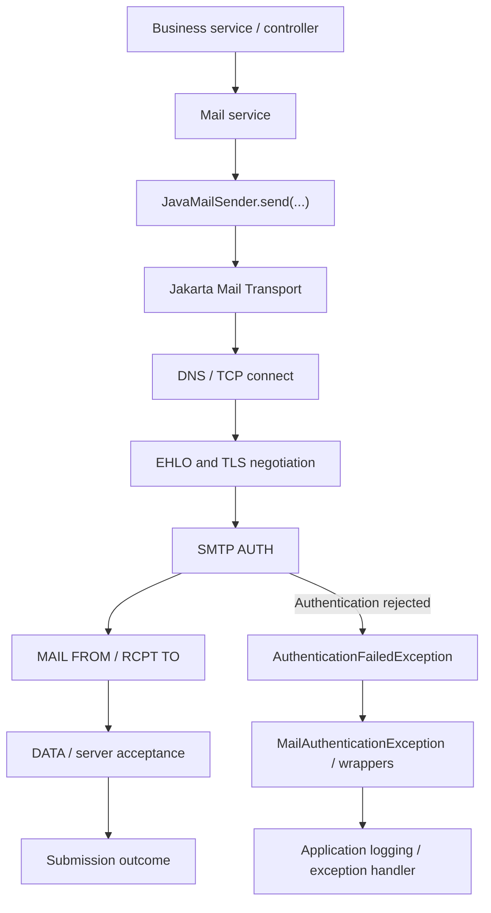
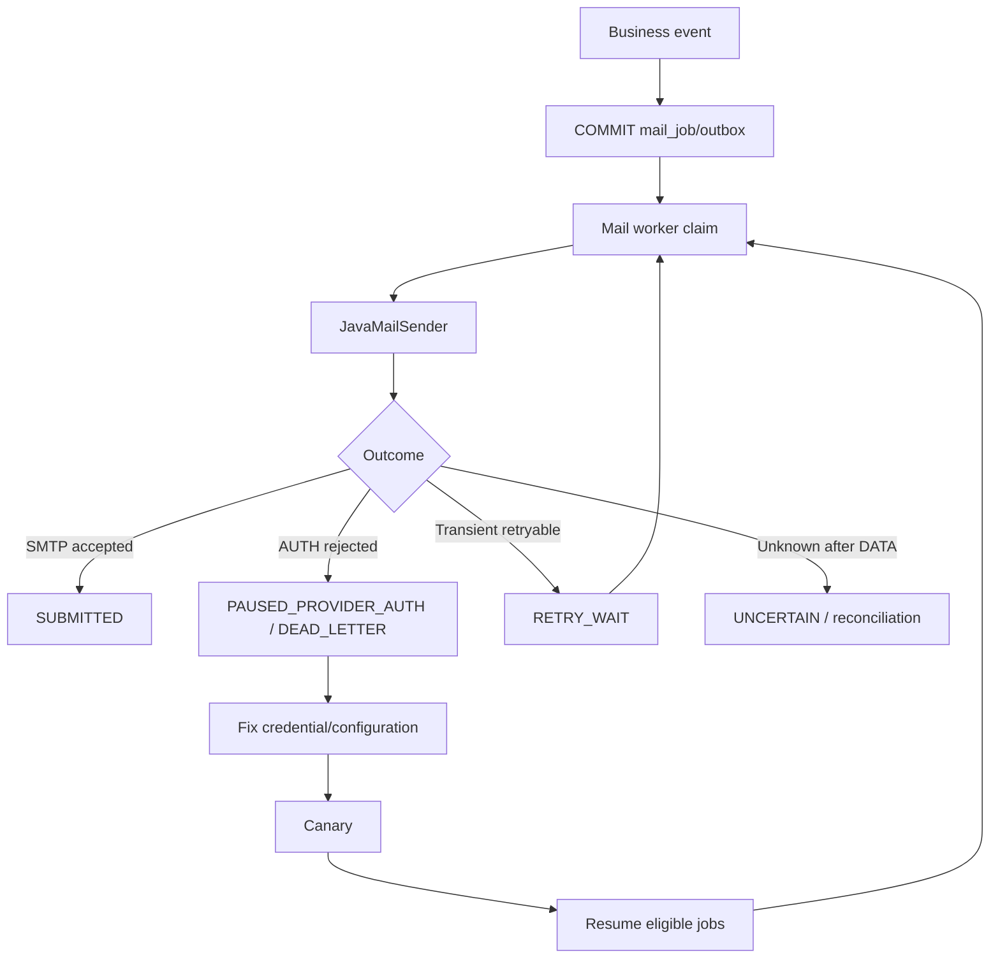
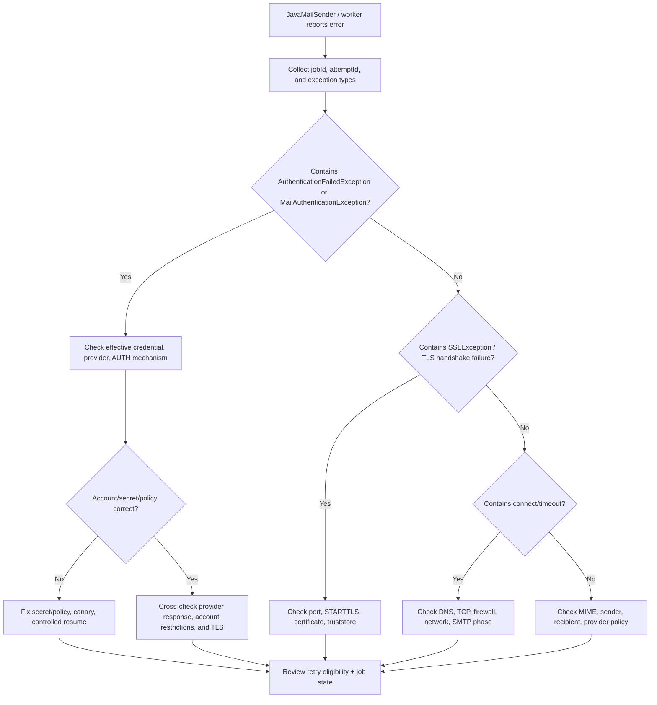

# Using the Wrong Password While Only Looking at the Outermost Exception in Spring Framework Mail

A very common SMTP error in Spring Boot applications is **an incorrect or no longer valid mail account password**, yet the developer only reads the outermost exception line: “Failed to send mail”, “Error occurred in message handler”, or a generic asynchronous task error. They start modifying HTML templates, changing ports, adding retries, or even switching providers without realizing that **the SMTP server rejected the authentication step**.

In Spring Framework Mail, `JavaMailSender` calls Jakarta Mail to connect and send over SMTP. When an operation fails, the exception can pass through several layers: Spring Mail, Jakarta Mail, Spring Integration, Spring Scheduling/`@Async`, an executor, a service, or an HTTP controller. **The top log line describes where the error was caught; the specific cause may reside in the `cause` chain, `nextException`, or inside the details of a `MailSendException`.**

Illustrative example, not a specific provider's response:

```text
org.springframework.messaging.MessageHandlingException:
  error occurred in message handler
  Caused by: org.springframework.mail.MailAuthenticationException:
    Authentication failed
    Caused by: jakarta.mail.AuthenticationFailedException:
      535 5.7.8 Authentication credentials invalid
```

If you only look at `MessageHandlingException`, you might think the flow is broken. If you only look at `MailAuthenticationException`, you know authentication failed, yet you still have to ask **why**: wrong password, secret not loaded, rotated password, locked account, disallowed AUTH mechanism, provider requiring OAuth2/app password, or wrong TLS configuration. The `535 5.7.8` code helps isolate an authentication error; it is **not sole proof that a password string was mistyped**.

> **Principle:** trace down to the most meaningful exception, classify by SMTP phase and the configuration actually running, then fix the root cause. Do not enable debug logging that prints passwords, do not infinitely retry authentication errors, and do not return raw sensitive exception strings to end users.

This lesson focuses on the mistake “using the wrong password while only looking at the outermost exception” in the **Common Errors** chapter of **Spring Framework Mail**. Topics include exception wrapping mechanics, inspecting causes and Jakarta Mail's next exception, Spring Boot configuration, an SMTP AUTH diagnostic table, protecting secrets, Java examples, testing, production incidents, and easily confused scenarios.

## 1. Error Location Along the SMTP Send Path

An email send call can go through multiple stages:



An error at the **AUTH** stage typically occurs **before mail content is submitted**. This differs from a timeout after `DATA`, where the outcome may be uncertain.

| Stage | Common Indicator | Could It Be a Wrong Password? |
|---|---|---|
| DNS | Cannot resolve SMTP host | No |
| TCP connect | Connection refused/timeout | Not directly |
| TLS/STARTTLS | SSLHandshakeException, certificate error | Not directly |
| SMTP EHLO | Server capabilities do not match expectations | Unlikely |
| SMTP AUTH | 535/5.7.8, AuthenticationFailedException | **Possibly** |
| MAIL FROM | Sender identity/domain rejected | Not necessarily |
| RCPT TO | Recipient rejected | No |
| DATA/acceptance | Content/policy/size, socket timeout | Not necessarily |
| Post-submission | Bounce/deferred/delivered events | Not an initial send password error |

Do not apply the same fix to every “cannot send mail” error. If the TLS handshake has not completed, changing the password solves nothing. If the server rejects `RCPT TO`, changing the SMTP password is usually pointless.

## 2. Three Common Exception Layers

### 2.1. Spring Mail Exceptions

Spring Framework has the `org.springframework.mail.MailException` hierarchy. Key classes include:

- `MailAuthenticationException`: authentication error while sending mail.
- `MailSendException`: error during submission, which may hold per-message details for some batch sends.
- `MailParseException`: error parsing/preparing mail at the Spring layer.
- `MailPreparationException`: error preparing a message via callback/preparator.

Depending on the `JavaMailSender` overload and where the error occurs, the outermost exception can differ. Do not assert that every wrong password always returns `MailAuthenticationException` at the root of the stack trace regardless of wrappers.

### 2.2. Jakarta Mail Exceptions

The Jakarta Mail layer typically uses:

- `jakarta.mail.AuthenticationFailedException`: server rejected authentication or the API detected an authentication-related failure.
- `jakarta.mail.MessagingException`: protocol/message error category.
- `jakarta.mail.SendFailedException`: mail sending failed; some recipient information may exist at this layer.

A specific SMTP implementation may provide exceptions with response codes/enhanced status codes, though those implementation classes are not standard abstractions guaranteed across all providers/versions.

### 2.3. Wrappers from Other Layers

In production applications, errors may be wrapped further:

```text
Servlet exception / HTTP controller exception
  -> BusinessServiceException
      -> MailAuthenticationException
          -> AuthenticationFailedException
```

Or:

```text
CompletionException / ExecutionException
  -> MailTaskException
      -> MailAuthenticationException
          -> AuthenticationFailedException
```

Or when using Spring Integration:

```text
MessagingException / MessageHandlingException
  -> MailAuthenticationException
      -> AuthenticationFailedException
```

The outermost layer tells you **where the error surfaced**, not necessarily **why SMTP rejected it**.

## 3. Bad Example: Logging Only the Outermost Exception

An implementation that easily misleads:

```java
try {
    javaMailSender.send(message);
} catch (Exception ex) {
    log.error("Cannot send email: {}", ex.getMessage());
}
```

Problems:

1. Printing only `getMessage()` of the outer exception can drop the cause.
2. `catch (Exception)` conflates template, TLS, authentication, recipient, and network errors.
3. If the method returns normally after logging, the caller may **mistakenly assume sending succeeded**.
4. Raw exception messages may contain SMTP server responses, email addresses, or sensitive metadata.
5. There is no attempt ID/job ID for reconciliation and controlled retries.

A variant:

```java
catch (MailException ex) {
    log.warn("Mail failure: {}", ex.getClass().getSimpleName());
    throw new RuntimeException("Send failed");
}
```

Here, the new exception **does not preserve the cause**; the root cause can be lost completely. If you must wrap an exception, keep it as the cause:

```java
catch (MailException ex) {
    throw new MailSubmissionFailure(
            "Mail submission failed; see internal failure class", ex);
}
```

`MailSubmissionFailure` is an internal application-defined exception. Preserving the cause for investigation **does not mean you are permitted to log or return every detail verbatim externally**.

## 4. Reading a Stack Trace Properly by Eye

Mock log example:

```text
2026-11-12 14:05:11 ERROR MailWorker
MailJob=7a9149d1 failed

java.util.concurrent.CompletionException:
    com.example.mail.MailSubmissionFailure: submission failed
    at ...
Caused by: com.example.mail.MailSubmissionFailure:
    submission failed
    at ...
Caused by: org.springframework.mail.MailAuthenticationException:
    Authentication failed
    at ...
Caused by: jakarta.mail.AuthenticationFailedException:
    535 5.7.8 Authentication credentials invalid
    at ...
```

Read it in order:

1. **Outer wrapper:** `CompletionException` — the error was observed via a future/async call.
2. **Application boundary:** `MailSubmissionFailure` — application exception-wrapping rule.
3. **Spring mail category:** `MailAuthenticationException` — authentication failed.
4. **SMTP/Jakarta cause:** `AuthenticationFailedException` with code 535/5.7.8 — server rejected AUTH.

Only at this point do you check **effective SMTP configuration**, account status, and AUTH policy. Do not start by changing the Subject, HTML template, or attachments.

### 4.1. The “Root Cause” Is Not Always the Only Piece to Inspect

The deepest exception might simply be `SocketException`, whereas `MailAuthenticationException` in the middle shows that AUTH was taking place. Conversely, a provider-specific exception with a useful response code may sit in `MessagingException.getNextException()` rather than on the `getCause()` chain.

Therefore, in practice you should record **the chain of significant exception types** (filtered/safe) rather than keeping only the single deepest class name.

## 5. `MessagingException` Has Its Own `nextException`

Jakarta Mail `MessagingException` has a `getNextException()` method. This is easy to miss if you only traverse `Throwable.getCause()`.

```java
MessagingException messagingException = ...;
Exception extra = messagingException.getNextException();
```

In implementations, `nextException` may overlap with or relate to the cause, yet you must not assume every nested detail is found by a single loop:

```java
Throwable current = ex;
while (current.getCause() != null) {
    current = current.getCause();
}
```

The loop above follows only **one path**. If a `MailSendException` holds multiple exceptions per message, it can also miss the remaining branches.

A fuller model:

```text
Spring MailException
   |
   +-- getCause()
   |      |
   |      +-- Jakarta MessagingException
   |              |
   |              +-- getCause()
   |              +-- getNextException()
   |
   +-- MailSendException.getFailedMessages()
           |
           +-- exception for message A
           +-- exception for message B
```

**Do not put the raw `MimeMessage` object, recipient list, or raw SMTP reply into logs** when traversing these branches. The goal is error classification, not data dumping.

## 6. Distinguishing a Wrong Password from Other AUTH Issues

When seeing `MailAuthenticationException` or `AuthenticationFailedException`, the next step is not just “change the password”. Several possibilities exist:

| Possibility | Diagnostic Question | Remediation |
|---|---|---|
| Password is genuinely wrong | Does the secret match the SMTP account in use? | Update the secret in the right source |
| Secret was rotated | Has the deployment loaded the new version? | Sync rotation/restart as needed |
| Username is wrong | Which mailbox/account is being used to send? | Verify full username and sender identity |
| App password/OAuth2 required | Does the provider allow standard password AUTH? | Use a supported auth mechanism |
| SMTP AUTH disabled | Is submission enabled for the account/tenant/organization? | Adjust policy legitimately |
| Account locked/temporarily restricted | Are there provider alerts or security policy blocks? | Verify account health |
| Wrong protocol/port/TLS | Did negotiation succeed properly before AUTH? | Fix port, STARTTLS/SSL |
| Incompatible AUTH mechanism | What mechanism does the server advertise vs client pick? | Configure a supported mechanism |
| Empty/wrong env var secret | Which profile/secret path supplies the effective config? | Inspect config source without printing values |
| Wrong environment provider/account | Is staging pointing to production SMTP or vice versa? | Fix host/credential mapping |
| Relay requires OAuth scope | Does the token carry valid SMTP send permissions? | Adjust token/scope per provider |
| Rate/abuse policy | Did the provider temporarily block AUTH due to login failures? | Stop hammering retries, handle incident |

A server may return an opaque message to avoid leaking the exact reason. **Do not jump from a 535 code** to assuming a mistyped password string is definitely the sole cause; verify the account and configuration properly.

## 7. SMTP Configuration in Spring Boot: Know What You Are Using

Before hunting for complex bugs, determine **which server the application is actually connecting to, with which account, and over which mechanism**. Config files in the repository can differ from the effective configuration due to profiles, environment variables, secret managers, Kubernetes Secrets, ConfigMaps, or runtime overrides.

Spring Boot example sending email via SMTP submission using STARTTLS:

```yaml
spring:
  mail:
    host: ${SMTP_HOST}
    port: 587
    username: ${SMTP_USERNAME}
    password: ${SMTP_PASSWORD}
    default-encoding: UTF-8
    properties:
      "[mail.smtp.auth]": true
      "[mail.smtp.starttls.enable]": true
      "[mail.smtp.starttls.required]": true
      "[mail.smtp.connectiontimeout]": 5000
      "[mail.smtp.timeout]": 10000
      "[mail.smtp.writetimeout]": 10000
      "[mail.debug]": false
      "[mail.debug.auth]": false
```

**Environment variables are examples; never copy real passwords into documentation or source control.** Port 587/STARTTLS is only right if the SMTP server supports this setup. For implicit TLS/port 465, different properties apply; do not mix the two modes arbitrarily.

### 7.1. Commonly Misunderstood Properties

| Property | Meaning | Common Mistake |
|---|---|---|
| `spring.mail.host` | SMTP server hostname | Mixing up environments/providers |
| `spring.mail.port` | SMTP submission port | Port does not support expected AUTH/TLS |
| `spring.mail.username` | SMTP account principal | Using the From address instead of login ID |
| `spring.mail.password` | Corresponding credential | Stale password, empty secret, wrong secret version |
| `mail.smtp.auth` | Enables SMTP AUTH | Forgotten or unsupported by server |
| `mail.smtp.starttls.enable` | Allows STARTTLS upgrade | Client fails to negotiate TLS when required |
| `mail.smtp.starttls.required` | Requires STARTTLS | Must match server capability |
| `mail.smtp.ssl.enable` | Uses SSL/TLS immediately on connect | Applying blindly to a STARTTLS port |
| `mail.smtp.connectiontimeout` | Connection creation timeout | Does not replace auth validation |
| `mail.smtp.timeout` | Network read timeout | A timeout does not prove a wrong password |
| `mail.smtp.writetimeout` | Network write timeout | Can leave an uncertain outcome during submit |

Some providers use port 465 with implicit TLS. Corresponding example configuration:

```yaml
spring:
  mail:
    port: 465
    properties:
      "[mail.smtp.auth]": true
      "[mail.smtp.ssl.enable]": true
      "[mail.smtp.starttls.enable]": false
      "[mail.smtp.connectiontimeout]": 5000
      "[mail.smtp.timeout]": 10000
      "[mail.smtp.writetimeout]": 10000
```

These are **illustrative configurations**, not two interchangeable options for every provider. Cross-check the documentation of the approved SMTP endpoint.

### 7.2. An SMTP Password Is Not Necessarily a Web Login Password

Depending on provider/policy:

- An SMTP password may be a dedicated secret distinct from the web account password.
- An account with MFA enabled may require an app password or OAuth2.
- An organization may disable basic SMTP AUTH.
- The credential may be an API key supported by the provider for SMTP AUTH in a specific format.
- An OAuth2 access token has a TTL/scope and refresh cycle, rather than being a static password.

Never infer “web login works, so the SMTP password must be right”. Web authentication and SMTP submission can enforce different policies.

### 7.3. `From` Differs from SMTP Username

`MimeMessageHelper.setFrom(...)` sets the sender address inside the email; `spring.mail.username` is the identity used during SMTP AUTH. They can differ per provider policy.

Example:

```text
SMTP AUTH username: service-account@example.org
From:              notifications@example.org
```

This configuration is valid only when the provider authorizes that account to send on behalf of the From address. Do not change username to match From as a guess to fix errors, as that can break authentication or sender verification.

## 8. Inspecting Effective Config Without Leaking Passwords

During an incident, what you need to know is whether the configuration was loaded from the right source, **not to print secret values into logs**.

Example class logging safe metadata at startup:

```java
package com.example.mail.diagnostics;

import org.springframework.boot.autoconfigure.mail.MailProperties;
import org.springframework.stereotype.Component;

@Component
public final class MailConfigurationSnapshot {

    private final MailProperties properties;

    public MailConfigurationSnapshot(MailProperties properties) {
        this.properties = properties;
    }

    public SafeMailConfig view() {
        String username = properties.getUsername();
        String password = properties.getPassword();

        return new SafeMailConfig(
                properties.getHost(),
                properties.getPort(),
                username != null && !username.isBlank(),
                password != null && !password.isBlank());
    }

    public record SafeMailConfig(
            String host,
            Integer port,
            boolean usernameConfigured,
            boolean passwordConfigured) {
    }
}
```

**Record only present/absent flags**, not `properties.getPassword()`, password hashes, password lengths, full environment variables, or the raw Spring Environment. Even username can be PII; the example records only a flag.

`MailProperties` is an auto-configured bean in Spring Boot setups using `MailAutoConfiguration`. If the application defines its own `JavaMailSender` without Spring Boot's config, the snapshot class must read from **the actual config source of the active sender bean**, rather than assuming `MailProperties` definitely reflects the sender.

### 8.1. Common Configuration Mistakes

**Wrong active profile:**

```text
application.yml          -> SMTP_HOST primary
application-staging.yml  -> SMTP_HOST sandbox
runtime SPRING_PROFILES_ACTIVE=production
```

Reading a YAML file in the repository does not prove the effective host is that value. Check active profiles and final configuration using properly authorized administrative tooling.

**Secret not injected:**

```text
SMTP_PASSWORD env var missing
    -> placeholder resolution failure
or
    -> password=null/empty depending on configuration
    -> authentication cannot succeed
```

Do not assume every missing placeholder produces `AuthenticationFailedException`: Spring can fail startup immediately when property binding fails. The key is knowing whether failure occurred **before calling SMTP or during AUTH**.

**Secrets with special characters:** `#`, `:`, `!`, spaces, newlines, and Unicode characters can be mangled if written directly in YAML/`.properties`/shell without proper quoting. Secret managers/environment injection reduce parsing errors, though you still must ensure values pass intact without printing raw bytes.

**Unsynchronized rotation:** The secret was rotated at the provider while the deployment still uses the old value; or only some pods refreshed.

**One provider's credential used with another host:** very easy to hit when two `JavaMailSender` beans exist and config aliases are unclear.

### 8.2. Be Careful When Printing Configuration Metadata

Even `host` and `port` can be internal infrastructure details. Log them only in authorized logs per policy; for general auditing, you can log an application-defined `smtpProviderAlias`.

Never expose an actuator endpoint like `/env` or `/configprops` to the Internet just to “easily check the mail password”. Spring Boot has masking mechanisms, but that is no reason to expose sensitive endpoints publicly.

## 9. How to Read the Cause Across Multiple Exception Layers

For errors from `JavaMailSender`, separate two tasks:

1. **Machine-readable classification**: auth, TLS, network, recipient, template, unknown.
2. **Technical investigation**: inspect the causal chain/protocol response in a restricted-access logging system scrubbed of sensitive data.

A design principle:

```text
Business workflow:
    catches MailException
    -> structured failure class
    -> persists attempt outcome
    -> decides retry/dead-letter

Restricted diagnostics:
    inspects nested exception types
    -> correlates provider response category
    -> never publishes SMTP credentials
```

Never return `ex.toString()`, `ex.getMessage()`, or raw stack traces in JSON responses to users.

### 9.1. Is Logging the Full Exception the Fastest Way?

In an isolated local/test environment with dummy data, logging the full stack trace can help reveal the hierarchy. In production, however, stack traces and Jakarta Mail debug output can contain:

- SMTP account names or recipients.
- Provider responses containing email addresses.
- Internal headers and metadata.
- File paths/secret references.
- Authentication/debug output details if misconfigured.

**Do not rely on the assumption “stack traces never contain passwords”.** Use standardized error codes for routine logs; if detailed data is needed, use a restricted diagnostics system with redaction, retention limits, and auditing.

### 9.2. Do Not Catch and Silently Return Success

Wrong:

```java
public void send(MimeMessage mime) {
    try {
        sender.send(mime);
    } catch (MailException ex) {
        log.error("Send failed");
        // Caller will think the method succeeded.
    }
}
```

Better:

```java
public void submit(MimeMessage mime, UUID mailJobId) {
    try {
        sender.send(mime);
        attempts.recordSubmitted(mailJobId);
    } catch (MailException ex) {
        var details = failureAnalyzer.analyze(ex);
        attempts.recordFailed(mailJobId, details.code());
        throw new MailSubmissionFailure(
                "SMTP submission failed", ex);
    }
}
```

`attempts`, `failureAnalyzer`, and `MailSubmissionFailure` are application components. This snippet shows how **not to drop errors**, though in production recording attempts and updating jobs requires ownership/fencing, transactions, and handling `UNKNOWN_SUBMISSION`. Never assume every exception means “definitely not sent”.

### 9.3. Do Not Mix Diagnostic Classification with Retries

Knowing it is an auth error is necessary, yet retry decisions are a separate step. An `SMTP_AUTH_FAILED` caused by a wrong secret usually needs a config fix, not a retry loop every 100 ms. Similarly, a pre-connect network error can retry with backoff; a timeout after `DATA` requires checking submission ambiguity.

## 10. Java Example: Traversing the Error Chain Properly

For an application mail worker, you can write a utility that analyzes **exception types** without printing raw messages. The sample below traverses:

- `Throwable.getCause()`.
- Jakarta Mail's `MessagingException.getNextException()`.
- Exceptions inside `MailSendException.getFailedMessages()`.
- `Throwable.getSuppressed()` when present.
- Using an identity-based visited set to avoid duplicate visits or reference cycles.
- Bounding the node count to avoid unbounded resource usage.

### 10.1. Exception Type Analyzer

```java
package com.example.mail.diagnostics;

import jakarta.mail.AuthenticationFailedException;
import jakarta.mail.MessagingException;
import java.util.ArrayDeque;
import java.util.ArrayList;
import java.util.Collections;
import java.util.Deque;
import java.util.IdentityHashMap;
import java.util.List;
import java.util.Set;
import javax.net.ssl.SSLException;
import org.springframework.mail.MailAuthenticationException;
import org.springframework.mail.MailException;
import org.springframework.mail.MailSendException;

public final class MailFailureAnalyzer {

    private static final int MAX_NODES = 64;

    public Analysis analyze(Throwable throwable) {
        if (throwable == null) {
            return new Analysis(
                    "MAIL_ERROR_UNKNOWN", List.of());
        }

        Set<Throwable> visited = Collections.newSetFromMap(
                new IdentityHashMap<>());
        Deque<Throwable> pending = new ArrayDeque<>();
        List<String> types = new ArrayList<>();

        pending.push(throwable);
        boolean authentication = false;
        boolean tls = false;

        while (!pending.isEmpty()
                && visited.size() < MAX_NODES) {

            Throwable current = pending.pop();
            if (!visited.add(current)) {
                continue;
            }

            types.add(current.getClass().getSimpleName());

            if (current instanceof MailAuthenticationException
                    || current instanceof AuthenticationFailedException) {
                authentication = true;
            }

            if (current instanceof SSLException) {
                tls = true;
            }

            Throwable cause = current.getCause();
            if (cause != null && !visited.contains(cause)) {
                pending.push(cause);
            }

            if (current instanceof MessagingException messaging) {
                Exception next = messaging.getNextException();
                if (next != null && !visited.contains(next)) {
                    pending.push(next);
                }
            }

            if (current instanceof MailSendException sendFailure) {
                // Inspect exception values only.
                // Do NOT log/serialize map keys (typically Message).
                for (Exception failure :
                        sendFailure.getFailedMessages().values()) {
                    if (failure != null
                            && !visited.contains(failure)) {
                        pending.push(failure);
                    }
                }
            }

            for (Throwable suppressed :
                    current.getSuppressed()) {
                if (!visited.contains(suppressed)) {
                    pending.push(suppressed);
                }
            }
        }

        String code;
        if (authentication) {
            code = "SMTP_AUTH_FAILURE";
        } else if (tls) {
            code = "SMTP_TLS_FAILURE";
        } else {
            code = "MAIL_ERROR_UNCLASSIFIED";
        }

        return new Analysis(code, List.copyOf(types));
    }

    public record Analysis(
            String code,
            List<String> exceptionTypes) {
    }
}
```

This is a **first-pass classifier**, not an engine resolving every provider error. Specifically:

- It prioritizes AUTH if an authentication exception appears in any branch.
- For a multi-message `MailSendException`, one branch having an authentication error does not prove **every message in the batch** had an authentication error. To obtain per-message outcomes, classify **each failed-message exception separately**, rather than using only a batch-level summary.
- An `AuthenticationFailedException` can relate to a locked account or policy, not necessarily a wrong password.
- Because it does not read the raw exception message, it **does not distinguish** response code 535 from 454; if deeper distinction is needed, integrate a provider/SMTP response classifier with validation/redaction.
- It does not fix or rethrow the exception itself; the system still needs to persist attempt state and apply retry policy.

### 10.2. Using It in a Mail Worker

```java
@Service
public class SmtpSubmissionService {

    private static final Logger log =
            LoggerFactory.getLogger(SmtpSubmissionService.class);

    private final JavaMailSender sender;
    private final MailFailureAnalyzer analyzer;
    private final MailAttemptRepository attempts;

    public SmtpSubmissionService(
            JavaMailSender sender,
            MailFailureAnalyzer analyzer,
            MailAttemptRepository attempts) {
        this.sender = sender;
        this.analyzer = analyzer;
        this.attempts = attempts;
    }

    public void submit(
            UUID mailJobId,
            UUID attemptId,
            MimeMessage mime) {

        try {
            sender.send(mime);
            attempts.recordAccepted(attemptId);

        } catch (MailException failure) {
            var analysis = analyzer.analyze(failure);

            log.warn(
                    "mailAttemptFailed jobId={} attemptId={} "
                    + "failureCode={} exceptionTypes={}",
                    mailJobId,
                    attemptId,
                    analysis.code(),
                    analysis.exceptionTypes());

            attempts.recordFailure(
                    attemptId,
                    analysis.code());

            throw new MailSubmissionFailure(
                    "Mail submission failed", failure);
        }
    }
}
```

`MailAttemptRepository` and `MailSubmissionFailure` are application-defined; Spring/SLF4J/Jakarta Mail imports should be added per the actual packages. **This sample only illustrates exception analysis**; it does not solve atomicity between SMTP and DB, nor does it provide the `UNKNOWN_SUBMISSION` state. In production, attempt outcomes must be determined conservatively and persisted via an ownership-checked transaction.

**Do not pass `failure` as the final argument to `log.warn` if your production policy prohibits logging raw stack traces.** Even with scrubbed restricted diagnostic logging, access and retention must be controlled.

### 10.3. The `MessagingException.nextException` Branch in Practice

Some Jakarta Mail exceptions chain other exceptions using `setNextException(...)`. Therefore, both methods are worth checking:

```java
Throwable cause = exception.getCause();

if (exception instanceof MessagingException mailError) {
    Exception next = mailError.getNextException();
    // Classify next and cause separately, without logging raw objects.
}
```

If `cause` and `next` reference the same object, the visited set prevents loops. Do not assume `nextException` always differs from `cause` or is always the final node.

### 10.4. Why Not Parse the String `"Invalid password"` as the Source of Truth?

SMTP error strings are determined by provider/version, can change wording or language, and sometimes conceal the cause for security. A classifier like:

```java
if (ex.getMessage().contains("password")) {
    return "BAD_PASSWORD";
}
```

can fail when message is null, text changes, or another phrase is used. Prefer:

1. Stable exception types at the library layer.
2. Validated SMTP response/enhanced status codes.
3. Official provider API/error codes when using a provider API.
4. Sending-stage context.
5. Only if needed, text patterns as *investigative hints*, never as the sole basis for retries.

## 11. When Sending Batches: The Outermost Exception Is Even More Misleading

`JavaMailSender` supports sending multiple messages:

```java
sender.send(new MimeMessage[] {
        first,
        second,
        third
});
```

A `MailSendException` can hold the failed messages and their corresponding exceptions via `getFailedMessages()`. If you only look at:

```text
MailSendException: Failed messages: 2
```

you do not yet know each message's error. A single recipient failure is not necessarily an account-wide failure; an AUTH error before starting can affect every message in the submission call.

### 11.1. Reading Values from the `failed-messages` Map

```java
catch (MailSendException ex) {
    int failedItems = ex.getFailedMessages().size();

    for (Exception itemFailure :
            ex.getFailedMessages().values()) {
        MailFailureAnalyzer.Analysis result =
                analyzer.analyze(itemFailure);

        metrics.recordFailure(result.code());
    }

    log.warn(
            "mailBatchFailed failedItems={} batchId={}",
            failedItems,
            batchId);
}
```

**Note:** map keys may be message objects containing recipients/bodies. Never call `log.error("{}", ex.getFailedMessages())` and never dump the full exception into centralized logs. `metrics` should only receive low-cardinality failure codes, not message IDs or recipient tags.

### 11.2. Do Not Assume the Remaining Messages Were Definitely Sent

The granularity of successful/failed outcomes depends on where the error occurred and the implementation. When a connection drops mid-batch, there may not be enough evidence to confirm each item. Do not automatically mark every message **absent from the failed map** as delivered; they may simply lack confirmation or have been accepted by SMTP without reaching the inbox yet.

A job store should track each message as a logical job/attempt:

```text
batch B100
  mailJob J1 / attempt A1 -> SUBMITTED
  mailJob J2 / attempt A2 -> DEFINITELY_NOT_SUBMITTED
  mailJob J3 / attempt A3 -> UNKNOWN_SUBMISSION
```

Only jobs with definitive evidence may be retried directly. Uncertain cases require reconciliation.

## 12. A Spring Integration Mail Scenario

If outbound email is sent via Spring Integration:

```text
HTTP/business event
   -> MessageChannel
   -> IntegrationFlow
   -> Mail outbound handler
   -> JavaMailSender
   -> SMTP provider
```

When authentication fails, the exception may propagate through:

```text
MessageHandlingException
  -> MailAuthenticationException
      -> AuthenticationFailedException
```

Someone seeing `MessageHandlingException` and editing the router or filter is looking in the wrong place. Inspect `getCause()` or the internal error channel payload **in a secure logging environment**, confirm the mail handler failed at AUTH, and then check credentials.

### 12.1. The Error Channel Does Not Know Why the Password Is Wrong

Spring Integration's error channel may receive an `ErrorMessage` containing the exception, failed message, and headers. It does not automatically fix secrets or accurately classify every SMTP response.

A production error handler should:

- Extract `mailJobId`/`attemptId` from controlled internal metadata.
- Traverse nested exceptions to identify `SMTP_AUTH_FAILURE`.
- Update job/attempt state and alert on the right provider.
- Avoid printing raw `ErrorMessage`/payload if it contains `MimeMessage`.
- Avoid retrying immediately inside the flow when AUTH is broken account-wide.

### 12.2. Channel Acceptance Is Not SMTP Success

An `ExecutorChannel` may accept a message successfully while the downstream outbound handler later encounters `MailAuthenticationException`. If the application marks the mail job `SUBMITTED` as soon as `channel.send(...)` returns true, the semantics are wrong.

```text
channel accepted -> ENQUEUED
SMTP AUTH failed -> FAILED_AUTH / DEAD_LETTER / PAUSED
SMTP submission accepted -> SUBMITTED
provider delivery event -> DELIVERED/BOUNCED/etc.
```

Do not conflate these milestones just because the outermost exception is a message-handling error.

## 13. Wrong Password Errors in `@Async` and `CompletableFuture`

With `@Async` or `CompletableFuture`, the caller might only see:

```text
java.util.concurrent.CompletionException:
    java.lang.IllegalStateException: mail task failed
```

Yet the real cause is:

```text
CompletionException
   -> IllegalStateException
      -> MailAuthenticationException
         -> AuthenticationFailedException
```

### 13.1. `void` Async Methods

An `@Async void` method does not return error outcomes to the caller like a synchronous call. If SMTP AUTH is rejected, the exception may go to `AsyncUncaughtExceptionHandler` depending on configuration. Simply seeing an HTTP 200 response does not mean the background task sent successfully.

Use a **durable mail job**, attempt records, and metrics for important emails. When managing outcomes via an async API, you can return `CompletableFuture<MailSubmissionResult>` with an explicit failure handling policy.

### 13.2. `CompletableFuture.join()` and `get()`

- `future.join()` typically wraps errors in `CompletionException`.
- `future.get()` typically wraps errors in `ExecutionException`.
- Both have a cause, and that cause may hold the Spring Mail exception deeper inside.

Do not treat `CompletionException` as a thread-pool issue and overlook SMTP AUTH. Use a causal-chain traversal utility.

### 13.3. Do Not Turn Errors into `null`

An anti-pattern:

```java
return CompletableFuture.supplyAsync(() -> {
    try {
        sender.send(mime);
        return "ok";
    } catch (MailException failure) {
        return null;
    }
});
```

If the caller skips null checks, errors are silently lost. Instead, return a typed result with `outcome`/`failureCode` or complete exceptionally, and maintain durable job state when reliability matters.

## 14. Step-by-Step Diagnosis: Do Not Change the Password Before Finding the Right Error Layer

A solid runbook cuts investigation time and avoids breaking a running system. Reference order:

### Step 1 — Confirm Which Send Requests Failed

Record:

- `mailJobId`, `attemptId`, and timestamp.
- SMTP provider alias or account scope (no raw username needed).
- Running environment/instance/pod.
- Attempt failure class.
- Whether it is a single email or widespread across mail types.
- Whether prior `SUBMITTED` records exist.

You do not need to log body, OTP, recipient, or attachment bytes to confirm an AUTH failure.

### Step 2 — Traverse the Exception Chain

Look for:

```text
MailAuthenticationException
AuthenticationFailedException
MessagingException.nextException()
MailSendException.failedMessages
```

If there is only a generic `MailSendException` or `MessagingException`, do not jump to conclusions; analyze per-attempt/per-message errors and protocol stage.

### Step 3 — Determine Whether the Server Reached the AUTH Stage

`UnknownHostException`, `ConnectException`, or `SSLHandshakeException` typically happen before SMTP authentication. If AUTH never began, changing the password goes in the wrong direction.

If there is a `535` code and an auth exception, focus on account/credentials/policy. If `454` or a temporary code appears, check provider service status or the authentication backend; do not assume the password is wrong.

### Step 4 — Verify Active Provider/Account and Effective Configuration

Check host, port, TLS mode, SMTP AUTH enabled, profile, selected sender bean, secret reference, and running version.

**Compare only fingerprints or secret versions in an authorized secret manager**, never copy passwords into tickets or terminal output. An operator needs to know “pod X is using credential version Y”, not see the actual value.

### Step 5 — Check Account Policy

Verify via an appropriately authorized admin console/provider API:

- Is the SMTP account still active?
- Is SMTP submission disabled on the tenant/organization?
- Is an app password/OAuth2 required?
- Was the password/secret changed recently?
- Is there a lockout from too many failed logins?
- Is there an IP/location/network policy?
- Is the sender identity verified?

These are **distinct** questions. An account using MFA does not automatically prove SMTP cannot be used; depending on the provider, OAuth2 or dedicated credential methods may be supported.

### Step 6 — Test Connectivity in an Isolated Environment

Check sequentially:

1. DNS resolution.
2. TCP reachability.
3. STARTTLS/implicit TLS negotiation.
4. SMTP AUTH with valid credentials via a secure environment/procedure.
5. Submission to an allowed sandbox recipient if permitted.

Never enter passwords into terminal commands via command-line arguments that may appear in process lists/shell history. Never use real customer emails as test recipients.

### Step 7 — Fix the Root Cause and Verify Small

After updating credentials/config:

- Deploy/refresh secrets per the supported strategy.
- Test with an authorized test account/inbox.
- Observe `SMTP_AUTH_FAILURE` and connection behavior.
- Do not immediately retry tens of thousands of mail jobs.
- If using a queue, ramp traffic up gradually within quota.

### Step 8 — Handle Failed Jobs

If AUTH was definitively rejected before SMTP DATA, eligible jobs may be retried per policy. However, if timeouts after DATA also occurred during the incident, handle that group separately to avoid duplicates.

For OTP/password-reset emails, check expiry before retrying; do not send expired tokens just because credentials now work.

## 15. Comparing Symptoms Commonly Lumped Together as “Wrong Password”

### 15.1. Wrong Credentials

```text
MailAuthenticationException
  -> AuthenticationFailedException
     -> 535 5.7.8 ... (example)
```

The application reached the server and the server rejected AUTH. Verify the exact account, secret version, authentication mechanism, and policy.

### 15.2. SMTP AUTH Not Enabled on the Client

If `mail.smtp.auth=false` or missing while the relay requires authentication, the server may reject an operation such as `MAIL FROM` with “authentication required”, e.g., `530`. The outermost error may be `MailSendException` rather than `MailAuthenticationException`.

**Fix:** enable SMTP AUTH per the server contract, rather than just changing the password. If the provider requires TLS before AUTH, configure TLS accordingly.

### 15.3. SMTP AUTH Disabled on Server/Account

Even when `mail.smtp.auth=true` and the password is correct, the server may forbid the account/tenant from using SMTP AUTH. The message may resemble “authentication unsuccessful” or “basic authentication disabled”.

**Fix:** use a provider-supported method (such as OAuth2 if applicable) or change sending method; infinite retries will not solve it.

### 15.4. TLS Handshake Error Before AUTH

```text
MailSendException / MessagingException
  -> SSLHandshakeException
     -> certificate path validation failed
```

This is a **TLS certificate validation** error, not an SMTP password error. Fix the truststore/certificate/hostname/port; do not disable TLS validation or enable trust-all in production.

### 15.5. Connection Refused or Timeout

```text
MailSendException
  -> MessagingException
     -> ConnectException: Connection refused
```

May be due to wrong host, firewall, network policy, service outage, or port not listening. No password was even sent to the server. Prioritize DNS/TCP/network tracing.

### 15.6. Disallowed Sender Address

AUTH may succeed while the provider rejects the sender:

```text
AUTH successful
MAIL FROM:<notifications@example.org>
  -> 5xx sender identity rejected
```

This relates to **authorization to send from an address/domain**, not necessarily a wrong password. Check From/envelope sender and domain verification. Do not arbitrarily change `spring.mail.username` to match From.

### 15.7. Invalid Recipient or Policy Reject

AUTH can succeed while `RCPT TO` is rejected. Looking only at `MailSendException` might make you think the SMTP account is broken. Inspect the stage and recipient outcome; do not use another provider to try to bypass a permanent rejection.

### 15.8. Authentication Works in Test but Fails in Production

Common causes:

- Test uses a sandbox account; production uses a different credential.
- Pods were not restarted/refreshed after rotation.
- Some instances still hold the old secret.
- Config profiles/overrides differ.
- Provider network/IP policies differ across environments.
- Auth mechanism/token scopes differ.

Do not compare only `application.yml` files; compare **effective configuration per provider alias and secret version**.

## 16. Selected SMTP Reply Codes and Interpretation Limits

SMTP uses three-digit response codes and may include **enhanced status codes** like `5.7.8`. The following are reference examples:

| Code / Group | Common Meaning | Action |
|---|---|---|
| `235` | Authentication succeeded | Proceed to sending stage |
| `535` / `5.7.8` | Credentials/authentication rejected | Check account, secret, method, policy |
| `530` / `5.7.x` | AUTH required or auth-related policy | Check AUTH/TLS mode |
| `454` / `4.7.0` | Authentication or security backend temporary error | Backoff/investigate provider |
| `421` | Service temporarily unavailable | Check health/backoff |
| `550` | Possibly recipient/policy reject | Check stage context |
| `554` | Transaction rejected per various policies | Check provider reply in a controlled way |

Do not assume every provider uses identical wording or code pairs, and do not deduce the entire cause from one three-digit string. Response codes must be analyzed **in protocol context**, alongside the exception type and provider contract.

### 16.1. “Authentication Failed” Can Stem from AUTH Mechanism Config

If the server only advertises an AUTH mechanism that the client does not support or has misconfigured, the failure can look like an authentication failure. When investigating, you may need to:

- Know which `AUTH` mechanisms are advertised after EHLO/STARTTLS.
- Verify whether the client uses PLAIN/LOGIN/OAUTH2 per contract.
- For OAuth2 tokens, verify token type, scope, expiry, and refresh.
- Check whether AUTH mechanisms are advertised **only after STARTTLS**.

Never force `mail.smtp.auth.mechanisms=PLAIN` as a “quick fix” if the server/policy requires another mechanism. Never disable STARTTLS to expose AUTH mechanisms.

### 16.2. Continuous Retries Can Lock the Account

A worker retrying a bad password:

```text
Attempt 1 -> 535
Attempt 2 -> 535
Attempt 3 -> 535
...
100 workers -> 535 repeated
```

can trigger a lockout or anti-abuse policy and worsen operational strain. Authentication failures are rarely transient “try again immediately” errors; pause the route, alert the platform team, fix credentials, and verify via a canary.

## 17. Testing SMTP Without Exposing Credentials

### 17.1. Network Tests Only Verify the Transport Path

In Windows PowerShell:

```powershell
Test-NetConnection -ComputerName smtp.example.org -Port 587
```

A successful TCP result proves only that the client can open a socket; **it does not prove SMTP AUTH is right**. Furthermore, firewall/host policies can differ between a developer machine and a production pod; test in the properly authorized environment.

With OpenSSL and STARTTLS on a machine with the appropriate tool:

```bash
openssl s_client \
  -starttls smtp \
  -connect smtp.example.org:587 \
  -servername smtp.example.org
```

This command helps observe TLS negotiation/certificates, not verify passwords. Never add credentials to the command line; never disable verification as a production fix.

### 17.2. Testing Authentication with `JavaMailSenderImpl.testConnection`

`JavaMailSenderImpl` provides `testConnection()` to test connectivity/transport, which may include authentication depending on configuration. It **does not send an actual email body**, yet it can open an SMTP session and attempt AUTH.

Example in a restricted administrative tool:

```java
public ConnectionCheckResult checkConnection(
        JavaMailSenderImpl sender) {

    try {
        sender.testConnection();
        return new ConnectionCheckResult(
                true, "SMTP_CONNECT_OK");
    } catch (MessagingException failure) {
        MailFailureAnalyzer.Analysis analysis =
                analyzer.analyze(failure);

        return new ConnectionCheckResult(
                false, analysis.code());
    }
}

public record ConnectionCheckResult(
        boolean ok,
        String code) {
}
```

`analyzer` is the `MailFailureAnalyzer` from earlier. Actual usage requires wiring/organizing classes and imports. Rate-limit calls; never let every public HTTP request or liveness probe attempt an SMTP login, which can trigger lockouts or throttling.

**Note:** `testConnection()` only verifies connect/auth at that moment; it does not prove `From` is authorized, `RCPT TO` is valid, message size fits limits, inbox placement, or delivery.

### 17.3. Weighing `spring.mail.test-connection`

Spring Boot offers a startup validation option:

```yaml
spring:
  mail:
    test-connection: true
```

When enabled, the application can test the mail server on startup depending on Boot configuration. This can **fail fast** if authentication is wrong, yet it also couples application startup to SMTP availability; when many instances start simultaneously, it can generate a burst of AUTH requests.

Use it only when it fits your reliability/operational model. Do not enable it broadly across production merely as a substitute for exception analysis; evaluate health strategy and provider outage impact first.

### 17.4. Sandbox Email Test After Fixing

Once AUTH is verified:

1. Use an `example.invalid` recipient in unit tests/SMTP sinks, or an approved test mailbox in an integration environment.
2. Send a simple message without PII/OTPs.
3. Record the job ID/attempt ID and submission outcome.
4. If provider delivery webhooks exist, correlate the corresponding ID.
5. Never conclude a user received the email in their Inbox solely because `JavaMailSender.send()` returned normally.

In production, a live canary send must use an organization-owned/approved test mailbox, not send to `example.invalid` expecting delivery.

## 18. Protecting Passwords and Sensitive Data in Logs

A second mistake that often accompanies ignoring the exception chain is **over-enabling debug logging to hunt for a wrong password**. Accidentally logging SMTP AUTH payloads, access tokens, or passwords turns an auth issue into a credential leak incident.

### 18.1. Information That Must Not Be Logged

- `spring.mail.password` or the full `MailProperties`.
- Environment variables, secrets, Kubernetes Secret YAML/JSON.
- Authorization headers, OAuth access tokens, or app passwords.
- Raw SMTP AUTH transcripts.
- Full `MimeMessage`/HTML bodies/OTPs/reset links/attachments.
- `MailSendException.getFailedMessages()` map keys.
- Unredacted exception/provider reply strings if they contain recipients/PII.

Dangerous examples:

```java
log.info("Mail config: {}", mailProperties);
log.error("Failed messages: {}", exception.getFailedMessages());
log.debug("SMTP password={}", mailProperties.getPassword());
```

Even in staging, such logs can be shipped to centralized systems with broader access than expected.

### 18.2. Safe Structured Log Example

```json
{
  "event": "smtp_authentication_failed",
  "mailJobId": "46c9c82f-0824-45b7-9c75-c8dfe4501e21",
  "attemptId": "b1fb394d-9e37-4ac4-b30c-2383a5fdba4a",
  "providerAlias": "transactional-primary",
  "failureClass": "SMTP_AUTH_FAILURE",
  "exceptionTypes": [
    "MailAuthenticationException",
    "AuthenticationFailedException"
  ],
  "secretVersion": "configured-version-reference",
  "environment": "production"
}
```

`secretVersion` should appear only if it is safe metadata that does not reveal the real credential; omit sensitive secret IDs when unnecessary. `mailJobId` and `attemptId` are fine in restricted structured logs, **never as metric labels** due to high cardinality.

### 18.3. Should `mail.debug` Be Enabled?

Jakarta Mail supports protocol debug logging. Enabling debug can expose connection details, addresses, or authentication information depending on version/implementation/settings.

For production:

- Default to **`mail.debug=false`**.
- Never use regular debug logging to print AUTH credentials.
- If protocol traces are truly needed, enable them only temporarily in a controlled test/sandbox environment using dummy accounts.
- Redact sensitive data; restrict viewer access and retention.
- Disable it again after investigation.

Some implementations have authentication-debug properties (such as `mail.debug.auth`); configuration and semantics must be verified for the library in use. **Never set `mail.debug.auth=true` with production secrets.**

### 18.4. Never Expose Raw Exceptions in REST Responses

Wrong:

```java
@ExceptionHandler(MailException.class)
ResponseEntity<String> handle(MailException ex) {
    return ResponseEntity.status(500)
            .body(ex.toString());
}
```

Return a neutral response instead:

```json
{
  "code": "MAIL_SUBMISSION_UNAVAILABLE",
  "message": "Unable to process email send request.",
  "requestId": "f22c5d53-6e2b-455f-b139-7f558b8bb204"
}
```

If the request has already been persisted to an outbox, the API can return a job ID/status appropriately rather than conflating an SMTP outage with a business transaction failure. SMTP AUTH details must be handled exclusively via secure operational channels.

## 19. Retry Policy for Authentication Errors

A wrong password error **rarely resolves itself** after a few seconds. If every worker continuously retries, it can generate thousands of failed logins and get the provider account locked.

Reference policy:

```text
SMTP_AUTH_FAILURE
   |
   v
Pause provider route / open circuit breaker
   |
   v
Emit alert to platform/on-call
   |
   v
Investigate credential + AUTH policy
   |
   v
Update secret / deploy
   |
   v
Restricted connection check / test message
   |
   v
Gradual resume from durable queue
```

### 19.1. Do Not Retry Indefinitely with the Same Bad Credential

Avoid:

```java
while (true) {
    try {
        sender.send(mime);
        break;
    } catch (MailAuthenticationException ex) {
        Thread.sleep(1000);
    }
}
```

This snippet has no timeout, no retry budget, no expiry or provider lockout awareness, and no persisted job state. With multiple application instances, the impact is even worse.

### 19.2. Which State Should Jobs Enter?

Depending on business needs:

- `PAUSED_PROVIDER_AUTH` or `BLOCKED_CONFIGURATION`: for an account suffering systemic AUTH failures while jobs remain unexpired, avoiding pointless attempt increments.
- `RETRY_WAIT`: when the error is confirmed transient and has proper backoff.
- `DEAD_LETTER`: when policy halts automatic handling and requires manual review or escalation.
- `EXPIRED`: token/link has expired.
- `CANCELLED`: business/policy no longer permits sending.

Spring Mail does not provide these states out of the box; they are defined by the application/job store.

### 19.3. Use an Outbox for Critical Emails

An architecture:



An AUTH error before SMTP DATA can usually be classified as definitely not submitted, **provided the adapter knows the exact failure stage**. With a generic exception, never assign “definitely not sent” without evidence.

### 19.4. When Some Emails Were Submitted Before the Incident

If 10,000 jobs are waiting and credentials are rotated mid-flight:

- Jobs already `SUBMITTED` must not be resent.
- `PENDING` jobs not yet attempted can send after the fix.
- Attempts that definitively hit AUTH rejection can be retried if still valid.
- `UNKNOWN_SUBMISSION` attempts require reconciliation.
- Expired OTP/reset links must be skipped.

Never use an unfiltered “Retry all failed mail” button; it can create duplicates or send invalid tokens.

### 19.5. Do Not Switch to Provider B to Bypass AUTH Policy

If provider A rejects due to wrong credentials, B can be a valid backup route **once properly configured and authorized to send**. However, if the account/domain was disabled for abuse or consent policy reasons, do not use another provider to evade that control.

Keep the same logical mail job key across failover, create a new attempt, and log the right provider; never create a separate job just because the SMTP account changed.

## 20. Monitoring Before Users Report Missing Emails

Metric groups:

| Metric | Type | Purpose |
|---|---|---|
| `mail.smtp.auth.failures` | Counter | AUTH errors by provider |
| `mail.smtp.connection.failures` | Counter | Network/port/connection |
| `mail.smtp.tls.failures` | Counter | TLS handshake/certificate |
| `mail.attempts.started` | Counter | Total attempts |
| `mail.attempts.submitted` | Counter | Accepted submissions |
| `mail.jobs.pending` | Gauge | Unsent jobs |
| `mail.jobs.oldest.pending.age` | Gauge | Oldest waiting job |
| `mail.jobs.dead.letter` | Gauge | Jobs needing review |
| `mail.provider.route.paused` | Gauge | Paused send routes |
| `mail.auth.recovery.duration` | Timer | AUTH incident recovery time |

Metric names are naming-convention examples and may differ when exported to Micrometer/Prometheus. What matters is distinguishing **systemic AUTH errors** from a single MIME preparation failure.

### 20.1. Alert on Rates Instead of Spamming per Attempt

If a shared credential becomes invalid, every worker can emit warnings. Do not fire a separate alert for every `MailAuthenticationException`. Group alerts by provider account/route, error rate, duration, and queue impact.

Example:

```text
WARNING:
  SMTP_AUTH_FAILURE > 0 on transactional-primary
  across multiple consecutive checks

CRITICAL:
  SMTP_AUTH_FAILURE rising and submitted throughput dropping
  while oldest pending age breaches SLO

RECOVERY:
  authentication canary succeeded,
  backlog shrinking and failure rate back to normal
```

Do not let a single successful `testConnection()` auto-clear alerts if mail submissions still fail on another step like sender identity or quota.

### 20.2. Avoid High-Cardinality Metric Tags

Never attach password hashes, raw SMTP usernames, recipients, job IDs, or attempt IDs as tags. Use bounded-value dimensions like `providerAlias`, `failureClass`, `mailType`, and `environment`.

### 20.3. Log Provider Secret Versions Safely

If the secret manager has a safe version ID, use it to spot which instances have not refreshed:

```text
pod-1 -> credential version v17 -> auth OK
pod-2 -> credential version v16 -> auth failed
pod-3 -> credential version v16 -> auth failed
```

This is illustrative data. Never store real passwords, tokens, or deterministic credential hashes in metrics. Even a secret reference can be sensitive under organizational policy, so restrict viewing permissions.

## 21. Rotation Workflow to Minimize Wrong-Password Incidents

An abrupt SMTP password change can leave some pods using the old password. Treat the secret lifecycle as an operational procedure:

1. Create the new credential in the provider/secret manager using a supported method.
2. Define an overlap window between old and new credentials if the provider supports it.
3. Update the secret reference/volume/environment.
4. Perform a rolling restart/refresh per framework and platform semantics.
5. Canary connection/auth, then run a controlled test submission.
6. Monitor `SMTP_AUTH_FAILURE` per provider/instance.
7. Revoke the old credential once all instances run the new version.
8. Audit timestamp, actor, and outcome without recording secret values.

If the provider **does not support** two simultaneous credentials, plan a dedicated maintenance/switchover window. Never assume Kubernetes-mounted secrets are automatically reloaded by `JavaMailSenderImpl`: a sender bean configured at startup can hold the old credential in memory until the bean is recreated or configuration is properly refreshed.

### 21.1. Multiple `JavaMailSender` Beans

In an application with multiple SMTP accounts:

```text
transactionalSender -> credential A
marketingSender     -> credential B
backupSender        -> credential C
```

Specify `@Qualifier` explicitly at injection sites. If a `@Primary JavaMailSender` is accidentally injected for every job, fixing B's password will not affect the route actually sending through A.

Never mutate host/username/password on a shared singleton `JavaMailSenderImpl` across threads; that risks races and account mixing. Build separate adapters/senders with fixed configuration per provider.

## 22. Testing the Exception Chain with JUnit 5

You do not need a real SMTP login to test **reading nested exceptions**. Unit tests can construct production-like exception chains and assert that the classifier does not stop at the wrapper.

### 22.1. A Deeply Wrapped `AuthenticationFailedException`

```java
package com.example.mail.diagnostics;

import static org.junit.jupiter.api.Assertions.*;

import jakarta.mail.AuthenticationFailedException;
import java.util.concurrent.CompletionException;
import org.junit.jupiter.api.Test;
import org.springframework.mail.MailAuthenticationException;

class MailFailureAnalyzerTest {

    private final MailFailureAnalyzer analyzer =
            new MailFailureAnalyzer();

    @Test
    void findsAuthenticationFailureBehindAsyncWrapper() {
        var inner = new AuthenticationFailedException(
                "535 5.7.8 authentication rejected");

        var springFailure = new MailAuthenticationException(
                inner);

        var wrapped = new CompletionException(
                new IllegalStateException(
                        "Background mail task failed", springFailure));

        var result = analyzer.analyze(wrapped);

        assertEquals("SMTP_AUTH_FAILURE", result.code());
        assertTrue(
                result.exceptionTypes().contains(
                        "AuthenticationFailedException"));
        assertTrue(
                result.exceptionTypes().contains(
                        "MailAuthenticationException"));
    }
}
```

This test demonstrates **the mistake of “only looking at `CompletionException`”**. Reading only the outermost object's class yields `CompletionException`; traversing further uncovers the authentication failure.

### 22.2. Testing `MessagingException.nextException`

```java
@Test
void discoversJakartaMailNextException() {
    MessagingException wrapper =
            new MessagingException("Mail transport failed");

    wrapper.setNextException(
            new AuthenticationFailedException(
                    "535 auth rejected"));

    var result = analyzer.analyze(wrapper);

    assertEquals("SMTP_AUTH_FAILURE", result.code());
}
```

`MessagingException` is imported from `jakarta.mail.MessagingException`. This test targets the **next-exception chain**, not just `Throwable.getCause()`.

### 22.3. Testing That TLS Is Not Classified as a Wrong Password

```java
@Test
void identifiesTlsFailureWithoutAuthMarker() {
    Throwable failure = new IllegalStateException(
            "SMTP operation failed",
            new javax.net.ssl.SSLHandshakeException(
                    "certificate validation failed"));

    var result = analyzer.analyze(failure);

    assertEquals("SMTP_TLS_FAILURE", result.code());
}
```

If a TLS error is the real cause, you should not change the password. This is why **distinguishing exception categories** matters instead of returning a single `MAIL_FAILED` label everywhere.

### 22.4. Testing That Secrets Are Not Accidentally Logged

A logging test can use the project's configured test appender and pass an exception containing a sentinel:

```text
TEST_SECRET_SHOULD_NOT_APPEAR_IN_LOGS
```

After the service handles it, assert that logs contain `failureCode=SMTP_AUTH_FAILURE`, while **containing no sentinel, raw password, recipient, or MIME body**. Never use real credentials in tests.

### 22.5. Testing Missing Passwords and Wrong Profiles

For a Spring Boot integration test, use test configuration:

```yaml
spring:
  mail:
    host: localhost
    port: 2525
    username: test-user
    password: test-invalid-secret
    properties:
      "[mail.smtp.auth]": true
      "[mail.smtp.connectiontimeout]": 1000
      "[mail.smtp.timeout]": 1000
```

Testing requires an SMTP stub running on `localhost:2525` that supports AUTH and rejects credentials in a controlled scenario. If the stub lacks AUTH support or does not open the port, the test will receive a different error; do not blame the classifier based on an unsuitable server fixture.

### 22.6. Testing with GreenMail or an SMTP Protocol Stub

An SMTP test server can be configured with a dummy account/password. Test steps:

1. Start the SMTP test server on a dynamically allocated port.
2. Create a dummy account with a valid password.
3. Configure `JavaMailSenderImpl` with the same username and a wrong password.
4. Call `testConnection()` or send to a test mailbox (depending on test goal).
5. Capture the exception and inspect nested types.
6. Assert the failure category is authentication, not connect/TLS.
7. Switch to the valid test password.
8. Assert connection/auth succeeds.
9. Do not send mail to external Internet recipients.

Not every version of GreenMail, Mailpit, or an SMTP sink configures AUTH identically. When precise fault injection is needed, use an SMTP stub that controls AUTH responses directly. **Classifier unit tests are not a test of the real provider.**

## 23. Testing Authentication Errors Across Multiple Providers

Suppose an application has two senders:

```text
transactional-primary -> SMTP account A
transactional-backup  -> SMTP account B
```

Test cases must distinguish:

| Scenario | Expected Outcome |
|---|---|
| Account A wrong password | Auth failure attributed accurately to provider A |
| Account B remains usable | No AUTH error recorded for B |
| Router selects wrong bean | Logs provide provider alias to isolate |
| A failed before SMTP DATA | May switch to B if policy allows |
| A has unknown outcome after DATA | No blind failover |
| Secret A rotated but old pod unrefreshed | Alert per instance/credential version |
| Job already `SUBMITTED` via B | Do not resend via A after A recovers |
| Email expired during fix | Worker does not send stale token |

This is why a “wrong password” error must be placed in the context of **job state and provider route**, not treated as an isolated stack trace.

### 23.1. Testing the Exact Sender Bean Name

If the application has:

```java
public MailService(
        @Qualifier("transactionalMailSender")
                JavaMailSender sender) {
    this.sender = sender;
}
```

verify the bean name, provider alias, and bean config source. A common mistake is editing `spring.mail.password` while the service uses a **custom-declared `JavaMailSenderImpl`** reading its password from `app.mail.providerA.password`; editing the former has no effect on the active sender.

### 23.2. Do Not Share One Error Metric Without Dimensions Across Accounts

If there is only `mail.auth.failed=1` with no indication of which provider alias failed, on-call responders struggle to act. Use low-cardinality tags like `providerAlias` and `environment`; keep individual job IDs in restricted logs, not metric tags.

## 24. A Production Incident: Wrong Password After Rotation

### 24.1. Context

A Spring Boot application runs 6 pods all sending through one SMTP provider. The secret in the secret manager was rotated. Three pods restarted with the new credential; the remaining three still held the old value inside their `JavaMailSenderImpl` bean.

Symptoms:

```text
pod-a: submission accepted
pod-b: MailAuthenticationException
pod-c: submission accepted
pod-d: MailAuthenticationException
pod-e: MailAuthenticationException
pod-f: submission accepted
```

Looking only at an outermost exception:

```text
Mail worker failed
```

makes it look like an intermittent network issue. Yet when grouped by `providerAlias` and pod/secret version:

```text
secret version v2 -> success
secret version v1 -> auth failure
```

the root cause becomes clear.

### 24.2. Resolution

1. Stop aggressive retries from pods using the old secret.
2. Identify actual deployment versions and credential references.
3. Confirm provider credential v2 is valid.
4. Rolling-restart/refresh pods properly.
5. Run a bounded auth test via sandbox/canary.
6. Classify jobs that failed at AUTH before DATA.
7. Retry jobs that are still valid and free of submission ambiguity.
8. Monitor backlog, latency, and provider quota during recovery.

Never put passwords v1/v2 into tickets as proof of the incident; version IDs and refresh timestamps are usually enough.

### 24.3. Lesson Learned

**A correct secret in the secret manager does not prove every instance is using it.** You must understand the lifecycle of environment variables, config binding, and SMTP beans. Reading deep into exceptions and cross-checking instance-level metadata separates credential issues from network issues.

## 25. Another Production Incident: Looking Only at Outer `MailSendException`

### 25.1. Context

The system sends a batch of multiple MIME messages. Logs show only:

```text
MailSendException: Failed messages: 3
```

The developer thinks attachments are corrupted and tweaks the template. Inside the `failed-messages` map, some causes are authentication failures, while others may be recipient rejections from another send or missing info.

### 25.2. Investigation Approach

- Identify batch size and each job's `attemptId`.
- Inspect `MailSendException.getFailedMessages().values()` item by item.
- Classify the exception on each branch, not just the outer exception.
- If an AUTH error occurred before message submission, check credentials.
- If partial submission occurred, store the exact outcome per job and preserve any unknown set.
- Do not retry the entire batch just because one message failed.

**Takeaway:** one outer exception can represent multiple outcomes; proper handling is per-message, not guessed from the exception title.

## 26. Once a Wrong Password Is Confirmed, How Do You Fix It Safely?

A credential remediation workflow:

1. **Verify authorization:** only authorized operators/platform engineers view or update secret references.
2. **Verify account:** confirm the exact SMTP provider alias and account role.
3. **Create/rotate a valid credential** in the provider-supported way.
4. **Update the secret store**, never hardcode into `application.yml`/source.
5. **Ensure the app loads the new credential**: refresh or rolling-restart per system architecture.
6. **Canary auth and SMTP submission** using an authorized test mailbox.
7. **Reopen the route gradually** and watch error rates.
8. **Evaluate retries** for mail jobs that are still valid and unsubmitted.
9. **Record an audit trail** of the rotation, root cause, and preventive recommendations.

### 26.1. Never Send Passwords Automatically to Support Tools

When contacting provider support or filing internal tickets, share only failure class, time window, provider/account alias, request ID, or masked account identifier per provider guidelines. Never copy SMTP secrets, OAuth refresh tokens, or raw AUTH transcripts.

### 26.2. Do Not Disable Security as a Workaround

These actions are the wrong direction:

```text
TLS validation failed -> disable certificate checks
SMTP AUTH failed -> set mail.smtp.auth=false
Provider demands OAuth -> reuse raw account password
Wrong secret version -> hard-code password in Java code
```

They increase credential leak risk, permit downgrades, or merely disguise the error. Fix **the root cause and supported configuration**, rather than “bypassing” authentication.

## 27. Quick Decision Flowchart When Mail Fails to Send



The diagram outlines an investigative path, not a replacement for protocol evidence. Multiple errors can coexist; the order above avoids changing passwords when the real cause is TLS or network.

### 27.1. Summary by Outer Exception and Next Action

| Observed Outer Exception | Additional Info to Inspect | First Action |
|---|---|---|
| `MailAuthenticationException` | Cause / SMTP response / provider | Check auth credentials and policy |
| `MailSendException` | `getFailedMessages()`, nested exceptions | Classify per message |
| `MessagingException` | `getCause()` and `getNextException()` | Identify SMTP phase |
| `CompletionException` | `getCause()` | Find inner business/Spring Mail exception |
| `ExecutionException` | `getCause()` | Find root failure inside async task |
| `MessageHandlingException` | Cause and outbound handler | Separate routing from SMTP auth |
| `MailParseException` | Cause / MIME preparation code | Inspect template/MIME, do not touch password yet |
| `SSLHandshakeException` | Certificate/trust details | Inspect TLS, do not change password |
| `ConnectException` | Host/port/network route | Inspect TCP connectivity |

**Do not rely solely on class names:** `MailSendException` can wrap multiple causes; `MailAuthenticationException` indicates an AUTH failure without revealing exact provider policy details.

## 28. Common Mistakes and Better Alternatives

| Mistake | Consequence | Alternative |
|---|---|---|
| Logging only outer `ex.getMessage()` | Loses underlying cause layers | Safely traverse cause/next/per-item |
| Throwing a new exception without cause | Loses stack relationship | Use a constructor accepting cause |
| Treating every `MailSendException` as wrong password | Misses recipient/TLS/network errors | Classify by SMTP phase |
| Checking only `Throwable.getCause()` | Misses Jakarta next exception | Traverse `getNextException()` too |
| Dumping `getFailedMessages()` map | Exposes MimeMessage, recipient, body | Iterate values and log error codes |
| Seeing `CompletionException` and tuning executor | Investigates wrong layer | Unwrap async cause |
| Seeing `MessageHandlingException` and editing router | Misses nested auth failure | Follow cause down to sender |
| Editing only `application.yml` in repo | Fails to update effective runtime secret | Check env/profile/provider bean |
| Printing password in logs to compare | Leaks credential | Use secret version/metadata |
| Temporarily hardcoding password | Leaks into git/CI/logs | Secret manager + rotation |
| Calling `testConnection()` in every health probe | AUTH flood/lockout | Restricted, rate-limited checks |
| Enabling `mail.debug.auth=true` in production | May expose auth details | Off by default, isolated tests |
| Retrying AUTH every second forever | Lockout, retry storm | Pause route, alert, fix + canary |
| Switching providers to evade account policy | Violates sending rules | Authorized routing only |
| Treating AUTH success as Inbox delivery | Inaccurate delivery reporting | Track submission vs delivery |
| Retrying every message in a batch | Duplicate submissions | Per-job outcome/attempt state |
| Resending expired OTP after fixing password | Sends invalid tokens | Expiry check, new intent |
| Fixing `From` by arbitrarily changing SMTP username | Breaks AUTH or sender identity | Distinguish the two concepts |
| Disabling TLS verification to test sending | Breaks transport security | Fix certificate/trust/hostname |
| Logging raw Integration `ErrorMessage` | Leaks email payload | Log scrubbed metadata |
| Putting per-job IDs into metric tags | High cardinality | Structured logs + low-cardinality metrics |

## 29. Checklist for Resolving “Wrong Password” Errors

### Exception Diagnosis

- [ ] Do you know the affected mail job, attempt, and provider alias?
- [ ] Did you inspect nested `cause`s instead of only the outer exception?
- [ ] Did you check `MessagingException.getNextException()` where applicable?
- [ ] For `MailSendException`, did you inspect failed messages per item?
- [ ] Did you verify SMTP reached AUTH before blaming the password?
- [ ] Did you distinguish auth failures from TLS/connection/recipient errors?
- [ ] Did you redact sensitive SMTP replies when logging?

### SMTP Configuration

- [ ] Are host/port/protocol/TLS mode right for the server?
- [ ] Is `mail.smtp.auth` set to the required state?
- [ ] Is username an authorized login principal for the provider?
- [ ] Is the password/token the right SMTP credential type?
- [ ] Were active Spring profiles/environment overrides verified?
- [ ] Is the secret injected and refreshed into the active sender bean?
- [ ] Are there account/policy/MFA/OAuth2/SMTP AUTH restrictions?
- [ ] Are there multiple providers or `JavaMailSender` beans needing qualifiers?
- [ ] Did you avoid printing raw passwords or tokens while checking?

### Reliability

- [ ] Do you avoid swallowing exceptions and faking success?
- [ ] Is there durable job/attempt outcome tracking for critical mail?
- [ ] Does the retry policy prevent AUTH lockouts/retry storms?
- [ ] Is there a dedicated `UNKNOWN_SUBMISSION` state when needed?
- [ ] Do you avoid marking jobs submitted when only enqueued?
- [ ] Are expiry checks enforced for OTP/password-reset emails?
- [ ] Does recovery use canary checks and quota limits after fixing?
- [ ] Do you avoid resending already-submitted jobs?

### Security and Testing

- [ ] Are SMTP debug/auth debug disabled in production?
- [ ] Is there a unit test for nested AUTH exceptions?
- [ ] Is there a test ensuring TLS exceptions are not classified as bad passwords?
- [ ] Are async/Integration wrappers tested?
- [ ] Is there an SMTP sandbox test with dummy passwords?
- [ ] Are logs tested to ensure no secret sentinels appear?
- [ ] Are real production recipients/credentials kept out of automated tests?
- [ ] Are secret rotations and provider outages audited?

## 30. Frequently Asked Questions

**Why is looking only at the outermost exception wrong?** Because Spring Mail, Jakarta Mail, async executors, or Spring Integration can wrap errors. The outer exception tells you where the error surfaced, while the AUTH cause may sit inside `cause`, `nextException`, or the `failed-messages` map.

**Which exception does Spring Mail throw for a wrong password?** A typical case is `MailAuthenticationException`, which may wrap `jakarta.mail.AuthenticationFailedException`. Depending on invocation method and other wrappers, callers may see a different outer class.

**Does `MailAuthenticationException` always mean a wrong password?** No. It indicates authentication failed; causes include an invalid secret, disabled account, unsupported AUTH mechanism, OAuth2/app password requirements, or provider policies.

**Which package contains `AuthenticationFailedException`?** In modern Jakarta Mail stacks, it is `jakarta.mail.AuthenticationFailedException`. Legacy projects based on JavaMail/`javax.mail` use a different package; do not mix the two APIs.

**Is `MailSendException` always an AUTH error?** Not by default. It represents a mail-sending failure group that may involve multiple messages or multiple error types. You must inspect nested exceptions and message-level outcomes.

**Is `getCause()` enough?** Not always. Jakarta Mail `MessagingException` has `getNextException()`. `MailSendException` can also hold per-message failures.

**Can `getMostSpecificCause()` be used?** Some utilities/frameworks offer a helper to fetch the deepest cause, yet when multiple error branches exist (next exceptions/failed messages), fetching a single cause does not represent an entire batch.

**Should full stack traces be logged?** In isolated tests with dummy data, it can be helpful. In production, logs must follow security policy; avoid raw SMTP responses, auth debug output, recipients/bodies/secrets. Use standardized failure codes and scrubbed metadata for routine logs.

**Does code 535 prove the password was mistyped?** It usually indicates authentication was rejected, yet you must verify the account, secret version, mechanism, and provider restrictions. Not every 535 stems from a typo.

**If port 587 is right, must the password be right?** No. Successful TCP connection/STARTTLS does not verify SMTP AUTH. Each stage must be checked independently.

**If `Test-NetConnection` succeeds, is the issue resolved?** No. That tool checks socket reachability only; it does not test credentials or send email.

**If using port 465, should STARTTLS be enabled like port 587?** Do not apply arbitrarily. Port 465 typically uses implicit TLS; port 587 typically uses STARTTLS. Follow the provider's actual configuration.

**Does `mail.smtp.auth=true` automatically select OAuth2?** Do not assume so. Auth mechanisms/tokens must be configured per the Jakarta Mail implementation and provider; plain password credentials may no longer be accepted by the provider.

**Is a web login password the same as an SMTP password?** Not necessarily. Providers may use app passwords, SMTP-contract API keys, or OAuth2 tokens with separate security policies.

**Why does localhost/test send successfully while production fails?** Host, account, profile, secret version, sender bean, firewall, IP restrictions, or auth policy may differ. Inspect the effective configuration of the failing environment.

**Why does it still fail after fixing `spring.mail.password`?** Check whether the app actually reads that property, or uses a manually declared `JavaMailSenderImpl` reading from a different property. If the secret changed, beans or pods may not have refreshed yet.

**Is `setFrom` the SMTP username?** No. `From` is the sender address in MIME; username is the principal used for AUTH. Providers may require verifying send permissions for the From address.

**If the SMTP account is locked, can we retry?** Do not retry aggressively. Investigate provider account status, fix the cause, and run a controlled canary. Infinite retries can worsen lockouts.

**Should `spring.mail.test-connection=true` be enabled in all production deployments?** Not by default. It helps fail fast, yet couples startup to SMTP and spikes AUTH requests when scaling. Choose based on operational policy.

**Does `JavaMailSenderImpl.testConnection()` send mail?** It tests connectivity/transport and may perform AUTH per config rather than sending a content email. It does not prove sender/recipient authorization or mail delivery.

**Why does `@Async` obscure errors?** Callers may receive a `CompletableFuture` or see only `CompletionException` while `MailAuthenticationException` sits deeper in the cause; with `@Async void`, callers may not see exceptions directly at all.

**If Spring Integration throws `MessageHandlingException`, should we fix the router?** Not necessarily. The outbound mail handler may be wrapping `MailAuthenticationException`. Inspect the cause before changing flows.

**If `channel.send` returns true, did SMTP AUTH succeed?** Not generally; an async channel may not have processed SMTP yet. Channel acceptance and SMTP submission are distinct milestones.

**Should an authentication error be retried immediately?** Not by default. If the secret is wrong, continuous retries do not help and may lock the account. Better to pause the route, alert, fix config, and resume with quota limits.

**If a bad password failed 10,000 mail jobs, should we requeue all after fixing?** Filter for the eligible subset, check expiry and unknown outcomes, send a canary, then ramp up gradually. Never replay already-submitted jobs or expired tokens.

**If the exception is `SSLHandshakeException`, what should we fix?** Check the certificate chain, hostname, truststore, TLS mode, and port. Never resolve it by disabling certificate validation or blindly changing the password.

**If an error message contains a recipient address, should it be logged?** Not automatically. Email addresses are personal data; use internal IDs, failure classes, and role-restricted support tools for lookup.

**Should provider responses be stored for investigation?** Standardized, necessary metadata/response codes may be stored. Raw replies can contain PII or sensitive info; if detailed records are kept, enforce RBAC, redaction, and retention.

**Does an auth failure guarantee the message was definitely not sent?** If you know for sure AUTH failed prior to SMTP DATA on that attempt, usually no submission side effect occurred. However, generic exceptions or batches with prior attempts require separate evaluation.

**Do bad credentials require dead-lettering?** Depends on policy. You can pause the provider route and keep jobs pending, or move budget-exhausted jobs to a DLQ/manual review. What matters is neither dropping send intent nor retrying endlessly.

**How does an SMTP test server differ from production?** A test server can mock AUTH and return controlled errors; it does not simulate every provider restriction, delivery behavior, or spam filter. Never use mock test results to claim production mail will reach the Inbox.

## 31. Self-Practice Exercises

### Exercise 1 — Reading an Exception Chain

Given the log:

```text
CompletionException
  -> BusinessMailException
    -> MailAuthenticationException
      -> AuthenticationFailedException(535)
```

Answer:

1. Which exception is the async wrapper?
2. Which exception reflects the SMTP authentication failure?
3. List three possible causes of AUTH rejection besides a “mistyped password”?
4. Should you check effective config or HTML templates first?
5. Is it acceptable to return the raw SMTP exception to users over an HTTP API?

**Hint:** an exception type can answer “which stage failed” without always pinpointing “which exact configuration item is wrong”.

### Exercise 2 — Comparing Three Scenarios

| Scenario | Where Is the Failure? | Investigation Path |
|---|---|---|
| `SSLHandshakeException` | TLS | Certificate/trust/port |
| `AuthenticationFailedException` | AUTH | Credentials/account policy |
| `SendFailedException` due to rejected recipient | RCPT TO | Recipient/provider policy |

Try writing a classifier that returns distinct codes instead of always returning `MAIL_FAILED`.

### Exercise 3 — Rotating a Password Without Printing It

Design a deployment featuring:

- A secret manager storing controlled versions.
- Two SMTP provider aliases.
- A rate-limited connection check.
- Structured logs containing only provider alias, failure class, and secret version reference.
- Canary and controlled resume.

Ensure operators never need to copy credentials into an issue tracker to confirm rotation succeeded.

## 32. Related Technical References

- **Spring Framework Mail:** `JavaMailSender`, `JavaMailSenderImpl`, `MailException`, `MailAuthenticationException`, `MailSendException`, `MimeMessageHelper`.
- **Jakarta Mail:** `jakarta.mail.AuthenticationFailedException`, `MessagingException`, `getNextException()`, and SMTP transport.
- **Spring Boot Mail auto-configuration:** `spring.mail.*`, `MailProperties`, `spring.mail.test-connection`, and externalized configuration.
- **Jakarta Mail SMTP provider properties:** `mail.smtp.auth`, STARTTLS, implicit TLS, network timeouts, authentication mechanisms, and debug options.
- **RFC 5321 — SMTP:** SMTP commands/responses, connection phases, mail submission/relay.
- **RFC 4954 — SMTP Service Extension for Authentication:** SMTP AUTH mechanisms and related enhanced status codes.
- **RFC 3207 — Secure SMTP over TLS:** STARTTLS.
- **RFC 8314 — Cleartext Considered Obsolete:** recommendations for TLS when accessing mail/submission services.
- **Spring Integration:** `MessageChannel`, `MessageHandlingException`, error channels, and mail outbound adapters.
- **Spring Scheduling/Async:** `@Async`, `CompletableFuture`, `CompletionException`, and `AsyncUncaughtExceptionHandler`.
- **Spring Retry / transactional outbox patterns:** retry policies, backoff, idempotency, dead letters, and uncertain submission states.
- **Micrometer / Spring Boot Actuator:** failure rates, queue depth, circuit breakers, tracing, and cardinality.
- **OWASP Logging / Secrets Management Cheat Sheets:** avoiding logging secrets, tokens, PII, and managing rotation.
- **JUnit 5 / Mockito / GreenMail / SMTP stubs:** unit testing nested exceptions, testing SMTP AUTH, and fault injection in isolated environments.
- **Official SMTP provider documentation:** account restrictions, app passwords, OAuth2, SMTP AUTH availability, error codes, quotas, and credential rotation.

---

**Remember:** when using Spring Framework Mail with a **wrong SMTP password**, the real error can be masked by `MailSendException`, `MessageHandlingException`, `CompletionException`, or an outer business exception. Never stop at the outermost message: inspect **`getCause()`, `MessagingException.getNextException()`, and per-message errors when present**, then determine whether the failure is AUTH, TLS, network, or sending stage. When it truly is an authentication failure, check the account, effective configuration, AUTH mechanism, and secret version **without printing the password**. Fix the root cause, test with bounded checks, recover eligible jobs per retry policy, and never confuse channel acceptance or SMTP submission with delivery. Reading the exception chain accurately prevents fixing the wrong layer, avoids retry storms, and protects both reliability and SMTP secrets in production.
