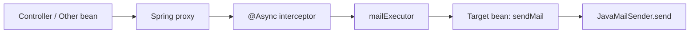
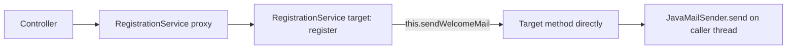
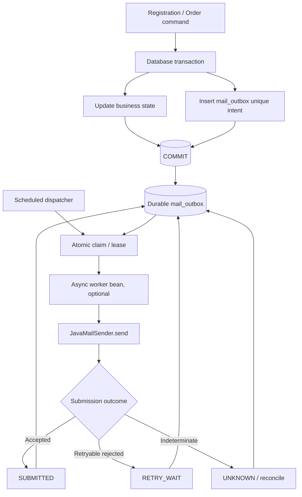

# Using `@Async` While Calling Internally Within the Same Bean

A Spring Boot service sends a confirmation email after user registration. The developer annotates the mail-sending method with `@Async` so the request does not wait for SMTP. Yet the request still takes several seconds, the HTTP handler thread still shows up in mail-sending logs, and an SMTP timeout still makes the API return an error. The code looks asynchronous at a glance:

```java
@Service
public class RegistrationService {

    private final JavaMailSender mailSender;

    public RegistrationService(JavaMailSender mailSender) {
        this.mailSender = mailSender;
    }

    @Transactional
    public void register(RegisterCommand command) {
        // Save account to database...
        sendWelcomeMail(command.email()); // INTERNAL CALL.
    }

    @Async("mailExecutor")
    public void sendWelcomeMail(String recipient) {
        SimpleMailMessage message = new SimpleMailMessage();
        message.setFrom("notifications@example.com");
        message.setTo(recipient);
        message.setSubject("Welcome");
        message.setText("Your account has been created.");
        mailSender.send(message);
    }
}
```

**The bug lies in calling `sendWelcomeMail(...)` from another method of the same `RegistrationService`.** Under Spring's default proxy mode, `@Async` is applied only when the call passes **through the Spring proxy**. An internal call is equivalent to `this.sendWelcomeMail(...)` and goes directly to the target object, bypassing the asynchronous execution interceptor.

This lesson, **“Using `@Async` while calling internally within the same bean”**, from the **Common Errors** chapter of the **Spring Framework Mail** module, explains the mechanism, how to recognize it, fix options, real email-sending examples, impacts on transactions, exceptions, thread pools, context, and retries, along with a testing strategy to confirm the method truly runs on a separate thread when that is the intended design.

## 1. Common Symptoms

Watch for these signs when a project has `@Async` yet requests still block:

- HTTP responses return only after SMTP `send()` finishes.
- Logging `Thread.currentThread().getName()` inside the `@Async` method still prints `http-nio-*`, `tomcat-handler-*`, or the original scheduler/caller thread.
- Putting `Thread.sleep(...)` inside the `@Async` method slows down the external caller by the exact same duration.
- `MailSendException` or `MailAuthenticationException` from that method propagates directly to the calling controller/service instead of following the async contract.
- A returned `CompletableFuture` is already completed immediately because the method ran synchronously before returning.
- `@EnableAsync` and the executor are configured, yet `mailExecutor` metrics stay flat when that code path runs.
- Calling the same method from a controller or another bean runs asynchronously, whereas calling it from a method in the same class does not.

Symptoms alone are **not conclusive proof**: an executor might use a caller-runs rejection policy, thread names might be configured unexpectedly, or the caller might call `join()` to wait on the future. Inspect the call path, bean wiring, and controlled tests.

### 1.1. Why Is This Bug Especially Common with Spring Mail?

Sending email is often slow because of:

1. DNS lookup or TCP connect.
2. TLS handshake/STARTTLS.
3. SMTP AUTH.
4. Uploading MIME content and attachments.
5. SMTP server queuing/routing before replying.
6. Provider throttling or network timeouts.

Developers notice the API is slow and slap `@Async` onto `sendEmail` right inside the calling service. Yet if self-invocation bypasses the proxy, **SMTP still runs synchronously on the request thread**, even though the annotation sits right there in source code.

## 2. How Does `@Async` Work?

In common usage with `@EnableAsync` and `AdviceMode.PROXY`, Spring creates a **proxy** around the managed bean. When another bean invokes the `@Async` method through the proxy reference, the interceptor hands the work off to an `Executor`/`TaskExecutor`, and the target method executes on a worker thread.

Correct call diagram:



With self-invocation:



### 2.1. The Proxy Does Not Intercept Every Method Call

A Java method calling another method via `this` is dispatched by the JVM on the same object. Thus, whether `this` is written explicitly or implicitly:

```java
sendWelcomeMail(address);
this.sendWelcomeMail(address);
```

both are **self-invocation** inside the target method. Neither routes back through the proxy.

This can also affect other Spring AOP annotations such as `@Transactional`, `@Cacheable`, and `@Retryable` when proxy-based. You should not assume all annotations share identical runtime semantics, yet **self-invocation bypassing proxy advice** is a shared rule to remember.

### 2.2. `@EnableAsync` Does Not Fix Self-Invocation

`@EnableAsync` enables `@Async` processing. It **does not** make `this.sendWelcomeMail()` automatically route through the proxy.

Likewise, switching between JDK dynamic proxies and class-based proxies (CGLIB/Spring class proxies) **does not solve self-invocation** in proxy mode. Even though the proxy mechanism differs, code inside the target still calls the target directly.

### 2.3. Exact Scope of This Conclusion

The above applies to **Spring proxy-based `@Async`**, the common model. Spring also offers `AdviceMode.ASPECTJ` with dedicated weaving, dependencies, and configuration. Under properly configured AspectJ weaving, self-invocation can be advised because advice is woven at the bytecode level rather than only through a proxy.

However, switching to AspectJ weaving just to fix a mail-sending call path is usually more complex than **splitting responsibilities across two Spring beans**. Never assume AspectJ mode is Spring Boot's default behavior.

## 3. Wrong Example: `@Async` Method Called from the Same Bean

```java
package com.example.mail;

import org.springframework.mail.SimpleMailMessage;
import org.springframework.mail.javamail.JavaMailSender;
import org.springframework.scheduling.annotation.Async;
import org.springframework.stereotype.Service;

@Service
public class UserRegistrationService {

    private final JavaMailSender sender;

    public UserRegistrationService(JavaMailSender sender) {
        this.sender = sender;
    }

    public void register(String email) {
        // Assume user creation succeeded.
        sendWelcomeEmail(email); // Self-invocation: does NOT go through proxy.
    }

    @Async("mailExecutor")
    public void sendWelcomeEmail(String email) {
        SimpleMailMessage message = new SimpleMailMessage();
        message.setFrom("notifications@example.com");
        message.setTo(email);
        message.setSubject("Registration successful");
        message.setText("Welcome!");
        sender.send(message);
    }
}
```

If a controller calls `registrationService.register(...)`, Spring may provide a proxy for the bean, yet the call into `register` subsequently executes `sendWelcomeEmail(...)` directly on the target instance. The `@Async` annotation on the second method is never intercepted.

### 3.1. Illustrative Execution Timeline

Suppose simulated SMTP takes 2 seconds:

```text
HTTP thread:
  10:00:00.000 register starts
  10:00:00.001 sendWelcomeEmail starts
  10:00:02.001 SMTP send returns
  10:00:02.002 register returns
```

The user still waits 2 seconds.

### 3.2. Mistake During Code Review

Seeing `@Async` **present in source** does not prove a specific invocation goes through the interceptor. Ask:

- Through which object is the method invoked?
- Is that object a Spring-managed proxy?
- Does the call originate from the same bean?
- Is it bypassed by manual `new`, a static method, private method, final method, or lifecycle hook?
- Is an executor configured and is the bean method eligible for proxying?

## 4. Preferred Fix: Split into Two Spring Beans

Keep orchestration in `RegistrationService` and mail sending in a dedicated bean `AsyncMailSender`. The caller injects that bean via its constructor.

### 4.1. `AsyncMailSender` as an Independent Bean

```java
package com.example.mail;

import org.springframework.mail.SimpleMailMessage;
import org.springframework.mail.javamail.JavaMailSender;
import org.springframework.scheduling.annotation.Async;
import org.springframework.stereotype.Service;

@Service
public class AsyncMailSender {

    private final JavaMailSender sender;

    public AsyncMailSender(JavaMailSender sender) {
        this.sender = sender;
    }

    @Async("mailExecutor")
    public void sendWelcomeEmail(String recipient) {
        SimpleMailMessage message = new SimpleMailMessage();
        message.setFrom("notifications@example.com");
        message.setTo(recipient);
        message.setSubject("Registration successful");
        message.setText("Welcome!");
        sender.send(message);
    }
}
```

### 4.2. Business Service Calls Through the Injected Bean

```java
package com.example.users;

import com.example.mail.AsyncMailSender;
import org.springframework.stereotype.Service;

@Service
public class RegistrationService {

    private final AsyncMailSender asyncMailSender;

    public RegistrationService(
            AsyncMailSender asyncMailSender) {
        this.asyncMailSender = asyncMailSender;
    }

    public void register(String recipient) {
        // Assume registration succeeded.
        asyncMailSender.sendWelcomeEmail(recipient);
    }
}
```

When Spring injects `AsyncMailSender`, the reference held by the other bean is **the Spring-managed object, typically a proxy carrying async advice**. The call goes through the proxy, and the interceptor hands the work off to `mailExecutor`.

### 4.3. Diagram After Splitting

```text
HTTP controller
     |
     v
RegistrationService.register()
     |
     v
AsyncMailSender bean PROXY
     |
     v
@Async interceptor
     |
     v
mailExecutor.submit(...)
     |
     +-- HTTP caller can continue
     |
     +-- worker thread
              |
              v
         JavaMailSender.send(...)
```

This is the clearest and easiest-to-test fix in most applications. It also keeps domain/application services decoupled from MIME/SMTP mechanics.

### 4.4. Limitations of This Example

The code above proves only **proper async dispatch**. If `register` runs inside an uncommitted database transaction, the async task can start **before commit**. If zero email loss on crash is required, splitting beans and `@Async` are **not enough**; later sections cover `@TransactionalEventListener(AFTER_COMMIT)` and transactional outboxes.

## 5. Intentional `@EnableAsync` and Executor Configuration

In annotation-based Spring mode, async support must be enabled, for example:

```java
package com.example.config;

import java.util.concurrent.ThreadPoolExecutor;

import org.springframework.context.annotation.Bean;
import org.springframework.context.annotation.Configuration;
import org.springframework.scheduling.annotation.EnableAsync;
import org.springframework.scheduling.concurrent.ThreadPoolTaskExecutor;

@Configuration
@EnableAsync
public class MailAsyncConfiguration {

    @Bean(name = "mailExecutor")
    public ThreadPoolTaskExecutor mailExecutor() {
        ThreadPoolTaskExecutor executor =
                new ThreadPoolTaskExecutor();

        executor.setCorePoolSize(4);
        executor.setMaxPoolSize(8);
        executor.setQueueCapacity(200);
        executor.setThreadNamePrefix("mail-async-");

        executor.setRejectedExecutionHandler(
                new ThreadPoolExecutor.AbortPolicy());

        executor.setWaitForTasksToCompleteOnShutdown(true);
        executor.setAwaitTerminationSeconds(20);
        return executor;
    }
}
```

The values 4/8/200/20 are **illustrative examples**, not universal sizing for every provider. The `ThreadPoolTaskExecutor` bean lifecycle is managed by Spring and initialized by the container.

### 5.1. Why Use `@Async("mailExecutor")`?

```java
@Async("mailExecutor")
public void sendMail(...) { ... }
```

An explicit executor name helps:

- Avoid accidentally using a default executor for slow SMTP work.
- Isolate mail-sending capacity from other async tasks like thumbnails, reports, or API calls.
- Assign easily traceable thread prefixes.
- Measure queue depth and active threads.
- Apply saturation/rejection policies tailored to email.

If the executor name is wrong or the bean is missing, async invocations can hit configuration errors. Never add a string qualifier without declaring the matching executor bean.

### 5.2. Where Is `@EnableAsync` Enabled?

Place `@EnableAsync` on a configuration class scanned/imported into the relevant application context. An object created manually via `new AsyncMailSender(...)` will **not** be Spring-proxied just because the class carries the annotation. In multi-context applications, ensure async support is active in the context managing the bean.

### 5.3. Never Default to an Unbounded Executor

If `mailExecutor` has a huge or unbounded queue:

- Pending messages in RAM can grow uncontrollably.
- Requests return fast while emails sit stalled for ages.
- Shutdown drops queued tasks.
- Provider quotas get exceeded when workers scale up.
- OTP emails expire before being sent.

A bounded queue paired with explicit backpressure/rejection is better than “shoving everything into memory and hoping we catch up”.

### 5.4. Rejection Can Happen Directly on the Caller

When the executor is full, submitting an async task can throw `TaskRejectedException` or a corresponding rejection exception **on the calling thread**. Hence `@Async` does not mean the caller always returns immediately with success. Decide whether to:

- Return a temporary error so the caller retries with the right idempotency key.
- Persist to a durable outbox and defer dispatch.
- Throttle traffic before submitting.
- Never mark an email `SENT` just because it was enqueued in an executor.

Do not carelessly use a `CallerRunsPolicy` rejection handler: under overload, tasks run **right on the caller thread**, defeating the latency goal even though the proxy still works.

## 6. Where Can `@Async` Be Placed? Call Paths That Are Bypassed

| Scenario | Proxy-Mode Assessment | Fix |
|---|---|---|
| Bean A injects Bean B and calls `B.asyncMethod()` | Intercepted normally | Preferred |
| Bean A calls `this.asyncMethod()` | Bypasses proxy | Split into Bean B |
| Methods in same bean call each other without `this` | Still self-invocation | Split bean |
| Object created with `new` outside Spring | No Spring proxy | Obtain from container/DI |
| `private @Async` method | Cannot be advised by standard proxy interceptor | Expose async API on a public bean method |
| `final` method with class-based proxy | Cannot be overridden to intercept | Avoid `final` on proxied methods |
| Static method | No instance method dispatch through proxy | Use a bean instance method |
| Constructor calls `@Async` method | Object has not finished full proxy lifecycle | Do not trigger async work in constructors |
| `@PostConstruct` in same bean calls `@Async` method | May bypass proxy/lifecycle mechanism | Split bean or use context-ready event |
| Controller/service calls through proxy then immediately calls `join()` | Runs async, yet caller **blocks waiting** | Join only when contract requires it |
| `@Async` on bean method without `@EnableAsync` | Annotation does not activate async proxy | Enable/configure async support |
| `@Async` with self-invocation after setting `proxyTargetClass=true` | Still bypassed | Split bean; changing proxy type alone does not help |

### 6.1. Public Methods Are the Safest Choice

Spring proxy-based async is designed for **methods that a proxy can intercept**. Choose `public` at the async worker's API boundary and inject the bean via a proxy-compatible interface/class. Never put `@Async` on a `private` helper expecting it to take effect.

### 6.2. JDK Dynamic Proxy vs. Class-Based Proxy

- **JDK dynamic proxies** expose proxied interface methods. Callers inject the interface type when a bean is JDK-proxied.
- **Class-based proxies** use subclassing/proxy mechanisms to intercept overridable methods.
- `final` methods/classes restrict subclass-based proxying.
- **Neither solves direct self-invocation.**

The key is **routing through the proxy**, not the name of the proxy generator.

### 6.3. Self-Injection Can Work, Yet Is Usually Discouraged

Some code injects a bean's own proxy into itself:

```java
@Service
public class MailService {
    private final ObjectProvider<MailService> selfProvider;

    public MailService(ObjectProvider<MailService> selfProvider) {
        this.selfProvider = selfProvider;
    }

    public void register(...) {
        selfProvider.getObject().sendAsync(...);
    }

    @Async("mailExecutor")
    public void sendAsync(...) { ... }
}
```

This adds container/proxy coupling, risks circular dependencies depending on wiring, and hurts readability and unit testability. When sending email after a business operation, **splitting `AsyncMailSender` into another bean** expresses responsibilities much better. `AopContext.currentProxy()` is also discouraged as a first-line fix because it couples business code to Spring AOP and requires exposing proxies.

### 6.4. `ApplicationContext.getBean()` Is Not an Architectural Fix

Calling `applicationContext.getBean(MyService.class).asyncMethod()` routes through the proxy, yet turns the application service into a service locator. It is harder to mock, harder to read, and hides dependencies. Use constructor injection of another bean instead of manually querying the container.

## 7. Self-Calling Through Intermediate Methods

Sometimes the bug is harder to spot:

```java
@Service
public class MailFacade {

    public void sendWelcome(String to) {
        prepareAndSend(to);
    }

    private void prepareAndSend(String to) {
        enqueue(to);
    }

    @Async("mailExecutor")
    public void enqueue(String to) {
        // SMTP call...
    }
}
```

Even with two intermediate methods, `enqueue` is still called from the same target instance. There is no hop through a Spring proxy. Checking only where the annotation is declared is not enough; trace the **call graph**.

### 7.1. Difference Between a Method Call and a Message Boundary

When A calls `B.sendAsync(...)` through a Spring-injected bean, that is an invocation with async advice.

When A writes a command to an actual queue, that is a **messaging boundary** with its own guarantees. Never confuse “calling a method named `enqueue`” with persisting into a durable queue; if `enqueue` simply invokes SMTP, it remains a synchronous operation whenever self-invocation bypasses the proxy.

## 8. `CompletableFuture`: When the Caller Needs to Observe Results

If you need to retrieve results or catch errors, use a return type supported by `@Async`, such as `CompletableFuture<T>`.

### 8.1. Async Worker Returning an Outcome

```java
package com.example.mail;

import java.time.Instant;
import java.util.concurrent.CompletableFuture;

import org.springframework.mail.SimpleMailMessage;
import org.springframework.mail.javamail.JavaMailSender;
import org.springframework.scheduling.annotation.Async;
import org.springframework.stereotype.Service;

@Service
public class AsyncMailSubmissionService {

    private final JavaMailSender sender;

    public AsyncMailSubmissionService(JavaMailSender sender) {
        this.sender = sender;
    }

    @Async("mailExecutor")
    public CompletableFuture<SubmissionReceipt> submit(
            MailCommand command) {

        SimpleMailMessage message = new SimpleMailMessage();
        message.setFrom("notifications@example.com");
        message.setTo(command.recipient());
        message.setSubject(command.subject());
        message.setText(command.plainText());

        sender.send(message);

        SubmissionReceipt receipt = new SubmissionReceipt(
                command.notificationId(),
                Instant.now());

        return CompletableFuture.completedFuture(receipt);
    }
}
```

Application records:

```java
public record MailCommand(
        String notificationId,
        String recipient,
        String subject,
        String plainText) {
}

public record SubmissionReceipt(
        String notificationId,
        Instant acceptedAt) {
}
```

Place each `public` top-level class/record in its own file in a real Java project.

### 8.2. Why Is a Method Returning `completedFuture` Still Asynchronous?

Through the Spring proxy, the target method runs on an executor thread. It can return a temporary `CompletableFuture.completedFuture(receipt)` so the Spring adapter completes the future handed to the caller. The caller receives a future for the scheduled task; it **does not** wait for the target method to finish just because the target's return statement uses `completedFuture`.

If **self-invocation** bypasses the proxy, the entire `sender.send(...)` executes before the method returns; the caller receives an already-completed future—a clear sign the annotation was not applied to that call path.

### 8.3. Caller Observing Outcome Without Blocking

```java
CompletableFuture<SubmissionReceipt> future =
        asyncMailSubmissionService.submit(command);

future.whenComplete((receipt, failure) -> {
    if (failure != null) {
        log.warn(
            "Mail submission task failed; notificationId={}",
            command.notificationId(),
            failure);
    } else {
        log.info(
            "SMTP submission completed; notificationId={}",
            receipt.notificationId());
    }
});
```

Logging examples need proper redaction; never log raw recipient addresses, SMTP credentials, or full bodies. `whenComplete` observes outcomes in-process, yet **is not durable retry state**: if the process dies before the callback runs, neither the log nor state transition happens.

### 8.4. `join()` Makes the Caller Wait

```java
SubmissionReceipt receipt =
        asyncMailSubmissionService.submit(command).join();
```

The method may **genuinely run on a worker thread**, yet the caller blocks until the future finishes. If the goal is reducing HTTP latency, calling `join()` right after submit throws away the latency benefit, even though execution occurs on another thread.

### 8.5. `CompletableFuture.supplyAsync` Is Not Equivalent to Spring `@Async`

Some developers work around self-invocation with:

```java
CompletableFuture.runAsync(() -> sender.send(message));
```

Without passing an executor, it typically uses `ForkJoinPool.commonPool()`. That can cause:

- Resource contention with other tasks.
- Missing mail-specific metrics, queue sizing, and shutdown policies.
- Context (security/trace/MDC/tenant) not propagating as expected.
- Unobserved exceptions.
- Lost work if the process dies.

If not using Spring `@Async`, pass a managed executor with an explicit contract; even then, **in-memory async does not replace a transactional outbox**.

## 9. The `@Async void` Case: Errors Do Not Propagate Normally to the Caller

A method like:

```java
@Async("mailExecutor")
public void send(MailCommand command) {
    sender.send(buildMail(command));
}
```

has no `Future` for the caller to await or inspect exceptions. If SMTP throws an exception on the worker thread, it cannot propagate back as a synchronous exception from a `void` method that already returned. Spring provides `AsyncUncaughtExceptionHandler` for `void` invocations when async advice is active.

### 9.1. Configuring `AsyncUncaughtExceptionHandler`

```java
import java.lang.reflect.Method;

import org.springframework.aop.interceptor.AsyncUncaughtExceptionHandler;
import org.springframework.context.annotation.Configuration;
import org.springframework.scheduling.annotation.AsyncConfigurer;
import org.springframework.scheduling.annotation.EnableAsync;

@Configuration
@EnableAsync
public class AsyncErrorConfiguration
        implements AsyncConfigurer {

    @Override
    public AsyncUncaughtExceptionHandler
            getAsyncUncaughtExceptionHandler() {

        return (Throwable failure,
                Method method,
                Object... params) -> {

            // Observe structured error and scrub PII.
            // Do not assume this exception guarantees
            // the SMTP relay has not received the message.
        };
    }
}
```

The handler config can be combined into `MailAsyncConfiguration`. If the class also overrides `getAsyncExecutor()`, ensure it returns the actual intended executor or keep the qualifier on `@Async("mailExecutor")`. Avoid duplicating `@EnableAsync` across multiple config classes from copy-pasted examples.

### 9.2. `AsyncUncaughtExceptionHandler` Does Not Provide Durable Retries

This handler only records errors from `void @Async`. It does not:

- Create a durable transaction for the notification.
- Know whether the provider accepted the message.
- Deduplicate emails automatically.
- Guarantee retries across JVM crashes.
- Safely classify every SMTP exception by itself.

For critical notifications, maintain outbox/attempt records and a supervisor/dispatcher managing actual outcomes.

### 9.3. When Self-Invocation Bypasses the Proxy, Exceptions Unexpectedly Hit the Caller

In an `@Async void` method called **internally**, SMTP exceptions are thrown directly on the caller thread, bypassing `AsyncUncaughtExceptionHandler`. This is both a symptom and a reason not to treat the annotation as a contract without testing the call path.
## 10. `@Transactional` and `@Async`: Two Boundaries You Cannot Conflate

An email-sending app often writes to the database before sending:

```java
@Service
public class OrderApplicationService {

    private final OrderRepository orders;
    private final AsyncMailSender mailSender;

    public OrderApplicationService(
            OrderRepository orders,
            AsyncMailSender mailSender) {

        this.orders = orders;
        this.mailSender = mailSender;
    }

    @Transactional
    public void confirmOrder(UUID orderId) {
        orders.confirm(orderId);

        mailSender.sendWelcomeEmail(
                "buyer@example.net"); // Wrong timing.
    }
}
```

The call above **may indeed go through the proxy and execute asynchronously**. Yet a different bug arises: the mail-sending task can start **before the order-confirmation transaction commits**.

### 10.1. Race Between Email and Database Commit

```text
HTTP thread                         mail-async-1
-----------                         ------------
BEGIN transaction
UPDATE orders
call proxy @Async
  |
  +-- submits task ----------->     SMTP send starts
                                    SMTP accepted
[validation fails]
ROLLBACK transaction

Buyer receives email "order confirmed"
but database has no confirmed order.
```

This is a different failure mode from self-invocation. Splitting beans fixes **the ineffective `@Async` bug**, yet does not make network side effects atomic with the database.

### 10.2. Transaction Context Does Not Automatically Cross Threads

Spring binds transaction context to the executing thread. The `mail-async-*` worker **does not automatically inherit the open JDBC/JPA transaction from the HTTP thread**.

Consequently:

- Workers may not see uncommitted rows.
- Entity lazy-loading can fail when the worker holds a detached entity or lacks a persistence context.
- An exception inside the async worker will not roll back an already-committed business transaction.
- `@Transactional` on a separate async method, when properly proxied, starts a **new** transaction on the worker; it is not the caller's transaction.

Never design “sending mail in a transaction” by putting both `@Async` and `@Transactional` on every method and assuming exactly-once semantics.

### 10.3. When Should Work Be Dispatched After Commit?

If best-effort in-memory mail handling is acceptable, wait until the business transaction commits before scheduling:

- `@TransactionalEventListener(phase = TransactionPhase.AFTER_COMMIT)`.
- Properly used `TransactionSynchronization`.
- A non-transactional application service receiving the commit result and calling the mail worker.

Yet none of these **guarantee durability** if the process crashes after commit and before the callback/task runs. If zero lost emails is required, use a transactional outbox.

## 11. `@TransactionalEventListener(AFTER_COMMIT)`: Fixes Ordering, Not Durability

A concise pattern when the email is not transactionally mandatory:

### 11.1. Publish a Business Event Inside the Transaction

```java
public record WelcomeMailRequested(
        UUID userId,
        String recipientSnapshot) {
}

@Service
public class RegistrationApplicationService {

    private final UserRepository users;
    private final ApplicationEventPublisher events;

    public RegistrationApplicationService(
            UserRepository users,
            ApplicationEventPublisher events) {

        this.users = users;
        this.events = events;
    }

    @Transactional
    public void register(RegisterCommand command) {
        UUID userId = users.createUser(command);
        events.publishEvent(new WelcomeMailRequested(
                userId, command.email()));
    }
}
```

`UserRepository` and `RegisterCommand` are project-defined application types. Event objects should carry properly snapshotted values rather than passing managed JPA entities with lazy references across to worker threads.

### 11.2. Post-Commit Listener Calls a Separate Async Bean

```java
import org.springframework.stereotype.Component;
import org.springframework.transaction.event.TransactionPhase;
import org.springframework.transaction.event.TransactionalEventListener;

@Component
public class WelcomeMailEventListener {

    private final AsyncMailSender asyncMailSender;

    public WelcomeMailEventListener(
            AsyncMailSender asyncMailSender) {

        this.asyncMailSender = asyncMailSender;
    }

    @TransactionalEventListener(
            phase = TransactionPhase.AFTER_COMMIT)
    public void on(WelcomeMailRequested event) {
        asyncMailSender.sendWelcomeEmail(
                event.recipientSnapshot());
    }
}
```

Points to understand:

1. `@TransactionalEventListener` binds invocation to the declared transaction phase.
2. With `AFTER_COMMIT`, the listener runs only after the matching transaction commits successfully.
3. The listener calls `AsyncMailSender` **on a different bean**, so the sender's `@Async` is properly intercepted.
4. The task still runs on an in-memory executor.
5. If the JVM dies after commit and before callback/task dispatch, **there is no durable mail intent** in this pattern.

### 11.3. What If an Event Is Published Without a Transaction?

`@TransactionalEventListener` by default requires an active matching transaction to register the callback; publishing outside a transaction means the listener may **not execute** (unless configured with `fallbackExecution` as needed). Never enable fallback casually just to “make tests easier”: it alters sending timing.

### 11.4. After Commit, Do Not Assume DB Writes in the Callback Commit Automatically

An `AFTER_COMMIT` callback may still see transaction resources bound to the thread per lifecycle rules, even though the original DB transaction has finished. If you need to persist a new durable record from the callback, design a dedicated transaction, such as a service with `@Transactional(propagation = REQUIRES_NEW)` called through a proxy when genuinely needed. For mandatory notifications, **writing to an outbox inside the original transaction** usually fits far better.

### 11.5. Why Is Idempotency Still Needed?

An event listener can fire again if a business operation is replayed through another path; emails can also be retried by workers after timeouts. Never treat a listener as proof that “each event produces an email exactly once”.

## 12. Transactional Outbox: Production Direction When Send Requests Must Not Be Lost

For password resets, invoices, OTPs, or critical transactional notifications, `@Async` alone is insufficient:

- Tasks live in a single JVM's heap; a process crash drops them.
- Executor queues do not commit atomically with the database.
- There is no persistent notification identity.
- There are no retry logs, audits, provider references, or `UNKNOWN` outcomes.
- There is no safe work-sharing mechanism across multiple replicas.

Instead, **write the email send intent** to an outbox in the business transaction, and let workers dispatch after commit.

### 12.1. Data Flow



### 12.2. Minimal Schema Example

```sql
CREATE TABLE mail_outbox (
    id UUID PRIMARY KEY,
    idempotency_key VARCHAR(240) NOT NULL UNIQUE,
    recipient VARCHAR(320) NOT NULL,
    sender VARCHAR(320) NOT NULL,
    subject VARCHAR(500) NOT NULL,
    plain_text TEXT NOT NULL,
    state VARCHAR(40) NOT NULL,
    due_at TIMESTAMPTZ NOT NULL,
    next_attempt_at TIMESTAMPTZ NULL,
    claim_token UUID NULL,
    lease_until TIMESTAMPTZ NULL,
    last_error VARCHAR(80) NULL,
    created_at TIMESTAMPTZ NOT NULL DEFAULT CURRENT_TIMESTAMP
);
```

Production needs tenant scoping, attachment refs, template snapshots, attempts, expiry, provider IDs, security/retention fields, and appropriate constraints.

### 12.3. Business Service Only Writes Intent

```java
@Service
public class OrderConfirmationService {

    private final OrderRepository orders;
    private final MailOutboxWriter outbox;

    public OrderConfirmationService(
            OrderRepository orders,
            MailOutboxWriter outbox) {

        this.orders = orders;
        this.outbox = outbox;
    }

    @Transactional
    public void confirm(UUID orderId, UUID recipientId) {
        orders.markConfirmed(orderId);

        outbox.insertIfAbsent(
                "order-confirmation:" + orderId + ":" + recipientId,
                /* immutable content snapshot */);
    }
}
```

`OrderRepository` and `MailOutboxWriter` are application abstractions, not built-in Spring APIs. The core idea is **sharing the same transaction manager/datasource** and a unique idempotency key; never call `JavaMailSender` inside this transaction.

### 12.4. Poller and `@Async` Must Be Separate Beans to Execute Asynchronously

```java
@Component
public class MailOutboxPoller {

    private final MailClaimRepository claims;
    private final MailAsyncDispatchWorker worker;

    public MailOutboxPoller(
            MailClaimRepository claims,
            MailAsyncDispatchWorker worker) {

        this.claims = claims;
        this.worker = worker;
    }

    @Scheduled(fixedDelayString = "${mail.poll-delay-ms:2000}")
    public void poll() {
        for (ClaimedMail mail : claims.claimAvailable(4)) {
            worker.dispatchAsync(mail);
        }
    }
}
```

```java
@Service
public class MailAsyncDispatchWorker {

    private final MailTransportPort transport;
    private final MailAttemptRepository attempts;

    public MailAsyncDispatchWorker(
            MailTransportPort transport,
            MailAttemptRepository attempts) {

        this.transport = transport;
        this.attempts = attempts;
    }

    @Async("mailExecutor")
    public void dispatchAsync(ClaimedMail mail) {
        try {
            transport.submitOnce(mail);
            attempts.markAcceptedIfOwned(
                    mail.id(), mail.claimToken());
        } catch (SubmissionOutcomeUnknownException ex) {
            attempts.markUnknownIfOwned(
                    mail.id(), mail.claimToken(), ex);
        } catch (MailTransportException ex) {
            attempts.classifyAndRecordIfOwned(
                    mail.id(), mail.claimToken(), ex);
        }
    }
}
```

`MailClaimRepository`, `MailTransportPort`, `ClaimedMail`, `MailAttemptRepository`, and the exception types are application-defined types for this example. A production implementation must also handle unexpected unchecked exceptions, scheduling-time rejections, transaction failures, shutdown, provider quotas, and lease lifecycles. A `void @Async` method cannot be the sole place persisting outcomes when worker processes can be killed.

### 12.5. What Happens When the Executor Rejects a Task?

In the pattern above:

```text
Poller claims row PROCESSING
   |
   v
worker.dispatchAsync(mail)
   |
   +-- mailExecutor full -> TaskRejectedException at caller
                              |
                              v
                      Row remains PROCESSING
```

If the poller ignores the exception, the row can stay stuck until the lease expires. You must:

- Catch task rejections in the poller.
- Update state/defer using `claimToken` before returning.
- Or claim only after reserving worker capacity.
- Maintain lease recovery for process crashes.
- Cap batch size to genuinely available worker slots.
- Never assume “it's a `void` method so dispatch must have succeeded”.

### 12.6. An Outbox Does Not Guarantee Exactly-Once SMTP Sends

If SMTP accepts and the worker crashes before persisting `SUBMITTED`, the row may be retried. SMTP does not join SQL transactions; a notification can be sent more than once under failure scenarios.

The design needs `ACCEPTED/REJECTED/UNKNOWN` outcomes, per-attempt history, and duplicate-aware policies—never claiming exactly-once delivery simply because `@Async` + outbox are used.

## 13. `@Scheduled` + `@Async` Calling Internally in the Same Bean Hits the Same Bug

A very common variant:

```java
@Component
public class MailBatchJob {

    @Scheduled(fixedDelay = 30_000)
    public void pollAndSend() {
        for (MailCommand item : findDue()) {
            sendAsync(item); // self-invocation.
        }
    }

    @Async("mailExecutor")
    public void sendAsync(MailCommand item) {
        // SMTP send...
    }
}
```

`@Scheduled` registers a scheduled endpoint in the application context, while `sendAsync` is called internally from the target. Never assume that because the poller method is invoked by the framework, **every method in the same class automatically routes through the proxy**.

### 13.1. Symptoms

- The poller processes only one email at a time.
- One SMTP timeout stalls the entire batch.
- Schedules fall behind on large batches.
- Mail-sending logs show the scheduler thread name.
- Adding threads to `mailExecutor` does not improve throughput on that code path.

### 13.2. How to Fix

Split `MailBatchJob` and `MailAsyncDispatchWorker` into separate beans and inject the worker into the job. Or skip async at this layer if a sequential worker actually matches the provider quota—what matters is **intentional behavior**, not relying on an inactive annotation.

### 13.3. Multiple Instances Introduce Another Problem

When running three pods, each pod runs its own `@Scheduled` loop. Fixing self-invocation so async works **does not stop three pods from claiming the same outbox row**.

You need atomic claim/lease or an appropriate distributed scheduling strategy. Never use `synchronized`, `AtomicBoolean`, or a single-thread executor to assume you have a distributed lock.

## 14. `@Async` + `@Transactional` on the Same Method: Avoid Misunderstandings

You might see:

```java
@Async("mailExecutor")
@Transactional
public void sendEmailAndRecordStatus(...) {
    // Read DB, send SMTP, write DB...
}
```

A method called through the proper proxies/advisors can run on a worker thread with a new transaction applied there. However:

- The caller's transaction is not propagated to the worker.
- Network SMTP cannot roll back alongside a DB transaction.
- Advisor ordering, proxy mode, and actual call paths must be well understood.
- Self-invocation can still bypass both `@Async` and proxy-based `@Transactional`.
- Holding a transaction open across an SMTP network call causes contention and does not provide exactly-once guarantees.

### 14.1. Phase-Separated Design

Separate:

1. **Transaction A:** concisely claim/lease the work.
2. **SMTP call:** outside any row-locking DB transaction.
3. **Transaction B:** record attempt outcome via conditional update guarded by token.

If the async worker needs to read the database, call a service with its own dedicated transaction. Never hold onto a request thread's JPA entity/proxy to lazy-load inside a worker.

### 14.2. Code That Can Be Neither Async Nor Transactional

```java
@Service
public class NotificationService {

    public void process() {
        sendAndPersist(); // this.sendAndPersist()
    }

    @Async("mailExecutor")
    @Transactional
    public void sendAndPersist() {
        // May bypass both proxy advices.
    }
}
```

Do not mechanically “fix” this by slapping `@Transactional` onto `process`: that would run SMTP inside a long-lived transaction. Fix the call boundary and transaction boundaries cleanly.

## 15. Thread Context: Security, Logging, Locale, and Tenant

When `@Async` actually runs on a worker thread, several `ThreadLocal` values from the caller **do not follow automatically**:

- `SecurityContextHolder`.
- MDC logging context.
- Request context / `RequestContextHolder`.
- Transaction synchronization context.
- `LocaleContextHolder`.
- Application-defined tenant context.
- Trace/span context if propagation is unconfigured.

As a result, mail may send on the right thread yet:

- Templates use the default locale instead of the user's locale.
- Tenant context is lost, picking the wrong sender identity.
- Logs lack correlation IDs.
- Workers lack an authentication principal.
- JPA lazy loading fails without a persistence context.

### 15.1. Pass Needed Context Explicitly

A self-contained `MailCommand` can include:

```java
public record MailCommand(
        UUID notificationId,
        UUID tenantId,
        String recipient,
        String verifiedFrom,
        String templateKey,
        Locale locale,
        String correlationId,
        Map<String, String> safeTemplateVariables) {
}
```

Authorize data before building the command. Workers use snapshots/IDs to resolve permitted resources rather than relying on objects alive on the HTTP request thread.

### 15.2. Do Not Pass `HttpServletRequest` or `EntityManager`

Avoid passing:

- `HttpServletRequest`.
- `HttpSession`.
- `EntityManager`.
- Live lazy JPA entities.
- Open attachment `InputStream`s.
- Mutable `MimeMessage` or `MimeMessageHelper` instances shared across threads.

These objects carry their own lifecycle, access, and thread-safety constraints. Pass safe values/snapshots or immutable resource references instead of the entire request context.

### 15.3. Context Propagation Can Be Configured

To preserve MDC/trace context, you can use a `TaskDecorator` or a version-compatible context propagation library. For security, Spring Security offers executor wrappers such as `DelegatingSecurityContextAsyncTaskExecutor` where appropriate.

However, **never blindly copy every `ThreadLocal` into a thread pool**. Thread pools reuse threads; copying without restoring/clearing can leak user A's data into user B's job.

### 15.4. `TaskDecorator` Illustrating MDC

```java
import java.util.Map;
import org.slf4j.MDC;
import org.springframework.core.task.TaskDecorator;

public final class MdcTaskDecorator implements TaskDecorator {

    @Override
    public Runnable decorate(Runnable delegate) {
        Map<String, String> callingContext =
                MDC.getCopyOfContextMap();

        return () -> {
            Map<String, String> previous =
                    MDC.getCopyOfContextMap();
            try {
                if (callingContext == null) {
                    MDC.clear();
                } else {
                    MDC.setContextMap(callingContext);
                }
                delegate.run();
            } finally {
                if (previous == null) {
                    MDC.clear();
                } else {
                    MDC.setContextMap(previous);
                }
            }
        };
    }
}
```

Then attach it to `ThreadPoolTaskExecutor`:

```java
executor.setTaskDecorator(new MdcTaskDecorator());
```

This decorator illustrates MDC only; it does not propagate database transactions, requests, security, or full tracing contexts. On Spring/Micrometer versions supporting context propagation, prefer the project's standard mechanism instead of stacking overlapping custom wrappers.

## 16. Input Security When Sending Email Asynchronously

Fixing self-invocation moves mail execution to a worker thread, yet does not make input data safe.

### 16.1. Verified Sender Identity

Never let clients supply arbitrary senders:

```java
message.setFrom(request.getFrom());
```

The SMTP provider may block it or, worse, the system may send spoofed mail. `From` must be verified against the provider account and tenant.

### 16.2. Recipient Validation and Consent

Before creating a mail command:

- Verify the recipient belongs to the right user/order.
- Validate syntax and guard against control characters/header injection.
- Check suppression/unsubscribe status for the notification purpose.
- Never send marketing mail without consent.
- Check expiry on OTP/reset links.
- Never log recipient addresses as metric labels.

### 16.3. HTML Content and Attachments

When sending HTML:

- Render with context-aware escaping templates.
- Include an appropriate `text/plain` alternative.
- Never embed unescaped user-supplied content into HTML.
- Use storage references for large attachments instead of holding unbounded bytes in executor queues.
- Never reuse the same mutable `MimeMessage`/`MimeMessageHelper` across async tasks.

### 16.4. Dedicated Idempotency for Business Intent

If an HTTP request retries because a fast response did not reach the client, each attempt could call `sendAsync(...)` again.

**`@Async` does not deduplicate tasks.** Use a stable business idempotency key + unique outbox intent whenever duplicate mail creation must be prevented.

## 17. SMTP Timeouts, Quotas, and Latency: Async Does Not Solve Everything

### 17.1. Configuring SMTP Submission with Timeouts

Spring Boot example:

```yaml
spring:
  mail:
    host: ${SMTP_HOST}
    port: 587
    protocol: smtp
    username: ${SMTP_USERNAME}
    password: ${SMTP_PASSWORD}
    default-encoding: UTF-8
    properties:
      "[mail.smtp.auth]": true
      "[mail.smtp.starttls.enable]": true
      "[mail.smtp.starttls.required]": true
      "[mail.smtp.ssl.checkserveridentity]": true
      "[mail.smtp.connectiontimeout]": 5000
      "[mail.smtp.timeout]": 10000
      "[mail.smtp.writetimeout]": 10000
```

Values are in milliseconds for the corresponding Jakarta Mail SMTP transport properties. This is a sample config for a provider requiring SMTP AUTH + STARTTLS on port 587. For implicit TLS on port 465, `mail.smtp.ssl.enable=true` is needed per provider contract; never disable hostname verification to “improve compatibility”.

### 17.2. Without Timeouts, Async Tasks Can Tie Up Threads Indefinitely

If many SMTP requests hang due to network issues:

- Executor active threads hit max.
- Task queue fills up.
- Controllers assume notifications were sent because the async call returned.
- Rejections climb.
- OTPs expire before ever being submitted.

Async only moves where waiting happens; it does not make waiting disappear. You still need timeouts, provider health checks, quota/rate gates, metrics, and backpressure.

### 17.3. Account-Wide Recipients/Second Limits

With 5 pods, each having an 8-thread `mailExecutor`, the cluster can open 40 concurrent SMTP attempts. If the provider allows only 5 connections or 100 recipients/minute, raising concurrency drives up rejections and throttling.

Use an account/cluster-level limiter when needed; local executor sizing bounds **each JVM** only.

### 17.4. Backpressure and Expiry

When the queue is full, options include:

- Returning a meaningful “temporarily unavailable” response.
- Saving durable intent and deferring dispatch.
- Prioritizing transactional mail.
- Moving expired intents to `EXPIRED` before sending.
- Never silently sending an OTP 30 minutes past expiry just because the queue finally drained.

## 18. Shutdown and Restart: `@Async` Is Not a Durable Queue

A `ThreadPoolTaskExecutor` can be configured to wait for tasks during a controlled shutdown. However:

- Kubernetes pods have a finite termination grace period.
- JVMs can be hit by `kill -9` or OOM.
- Machines can lose power.
- Executor queues live solely in RAM without separate persistence.
- After restart, no prior task list exists.

Thus `setWaitForTasksToCompleteOnShutdown(true)` and `setAwaitTerminationSeconds(20)` do not guarantee an enqueued email will definitely be sent.

### 18.1. Distinguish In-Memory Enqueueing from Durable Scheduling

```text
@Async method called
    |
    +-- Executor accepts runnable in memory
            |
            +-- JVM crashes before execution
                    => task lost
```

Whereas a transactional outbox:

```text
DB commit durable intent
    |
    +-- worker crashes
            |
            +-- new worker can claim intent
```

Outboxes still must handle the dual-write SMTP outcome boundary, yet they solve **losing intent on process crash**.

### 18.2. Proper Shutdown Still Requires Idempotency

If a worker achieves SMTP acceptance and is killed before updating status, recovery may retry and duplicate. Shutdown hooks help reduce incidents, yet cannot replace attempt state and outcome-aware recovery.

## 19. Choosing Tools for Real-World Goals

| Goal | Suitable Approach | Limitations |
|---|---|---|
| Stop email from blocking requests in small apps | `@Async` method on a separate bean + bounded executor | Tasks can be lost on JVM crash |
| Send email after transaction commit, best-effort OK | `@TransactionalEventListener(AFTER_COMMIT)` calling a separate async bean | Crash after commit can lose email |
| Never lose transactional send intent | Transactional outbox + worker | Requires DB schema, retry/claim, `UNKNOWN` handling |
| Share load across multiple instances | Durable outbox + atomic claim | Lease/concurrency/provider rate still need design |
| API needs to inspect async outcome | `CompletableFuture<SubmissionReceipt>` | Caller must not `join()` if nonblocking is desired |
| Observe `void @Async` errors | `AsyncUncaughtExceptionHandler` | Does not create audits or durable retries |
| Guarantee *delivery to Inbox* | Provider events/DSN/monitoring | Cannot be inferred from `send()` alone |
| Prevent duplicate sends for one email | Stable intent key + unique constraint + attempt policy | Exactly-once SMTP does not exist automatically |

### 19.1. Do Not Use `@Async` When Unneeded

An internal service with tiny email volume can send synchronously if latency SLAs permit and it is outside any DB transaction. Yet if the goal is zero lost notifications and retries, an in-memory async queue **should not be the sole mechanism**.

### 19.2. Do Not Treat `@Async` as a “Fix All Performance Issues” Button

If the bottleneck is SMTP server throttling, queue backlog, or huge MIME attachments, adding more async threads can worsen failures. Measure transport latency, queue wait time, accepted throughput, and provider limits before increasing concurrency.

## 20. Email Send Outcomes: Submitted Is Not Delivered

A method named `sendWelcomeEmail` easily misleads callers into thinking that when the async future finishes, the recipient received the email. In reality:

```text
HTTP request accepted
    |
    v
Async task enqueued in JVM
    |
    v
SMTP attempt started
    |
    v
SMTP relay accepted with final response
    |
    v
Provider eventually routes to recipient MX
    |
    v
Delivery / bounce / complaint events if observable
```

Distinct meaningful milestones:

- **Accepted by executor:** runnable accepted by executor; SMTP has not started.
- **SMTP submission started:** transport attempt began.
- **Accepted by SMTP relay:** relay accepted the message per observed response.
- **Delivered (provider report):** provider has evidence the recipient MX accepted per provider definition.
- **Inbox placement/read:** cannot be reliably inferred from `JavaMailSender.send()` or open tracking.

### 20.1. When Does the Returned Future Complete?

In the `@Async CompletableFuture<SubmissionReceipt>` example, the future completes once the target method finishes. If the target method simply calls `JavaMailSender.send()`, the future reflects **transport-level submission outcome**, not eventual delivery.

`SubmissionReceipt` is a much more accurate name than `EmailDelivered`.

### 20.2. Failures After SMTP Acceptance

A bounce occurring 5 minutes later cannot be reported through an already-completed future unless the app keeps futures/processes alive abnormally long (unsuitable for production durability). Persist delivery events in separate durable state.
## 21. Testing Properly: Must Execute Through a Real Spring Proxy

A unit test calling directly:

```java
AsyncMailSender worker = new AsyncMailSender(mockSender);
worker.sendWelcomeEmail("lan@example.net");
```

**does not test `@Async`**. Objects constructed with `new` do not go through the Spring container/proxy, so the method runs synchronously. Such unit tests are great for mail-building logic, yet prove nothing about application async wiring.

To test self-invocation, you need a **Spring context with `@EnableAsync` and a genuinely proxied bean**, then assert thread/call paths.

### 21.1. `AsyncProxyProbe` to Observe Threads

```java
package com.example.test;

import java.util.concurrent.CompletableFuture;

import org.springframework.scheduling.annotation.Async;
import org.springframework.stereotype.Component;

@Component
public class AsyncProxyProbe {

    @Async("mailExecutor")
    public CompletableFuture<String> threadNameAsync() {
        return CompletableFuture.completedFuture(
                Thread.currentThread().getName());
    }

    public String threadNameViaSelfInvocation() {
        // Same bean: no call goes through the proxy.
        return threadNameAsync().join();
    }
}
```

Subtle point: `threadNameAsync()` returns an already-completed future **from the target method**. When invoked through the proxy, the target runs on the worker; when invoked internally, the target runs on the caller.

### 21.2. Integration Test Distinguishing the Two Call Paths

```java
package com.example.test;

import java.util.concurrent.TimeUnit;

import org.junit.jupiter.api.Test;
import org.springframework.beans.factory.annotation.Autowired;
import org.springframework.boot.test.context.SpringBootTest;

import static org.assertj.core.api.Assertions.*;

@SpringBootTest
class AsyncProxyBehaviorTest {

    @Autowired
    private AsyncProxyProbe probe;

    @Test
    void invocationViaProxyRunsOnMailExecutor()
            throws Exception {

        String caller = Thread.currentThread().getName();

        String worker =
                probe.threadNameAsync()
                        .get(5, TimeUnit.SECONDS);

        assertThat(worker)
                .startsWith("mail-async-")
                .isNotEqualTo(caller);
    }

    @Test
    void sameBeanInvocationDoesNotUseAsyncInterceptor() {

        String caller = Thread.currentThread().getName();

        String actual =
                probe.threadNameViaSelfInvocation();

        assertThat(actual).isEqualTo(caller);
    }
}
```

This test assumes the context includes `MailAsyncConfiguration` declaring `@EnableAsync` and `mailExecutor` with prefix `mail-async-`. If your project uses a dedicated context, import the matching test configuration. This cleanly contrasts **proxy invocation** against **self-invocation** without needing an SMTP network.

### 21.3. Why Not Just Assert `future.isDone() == false`?

Very short tasks can finish **before the caller checks `isDone()`**, even when scheduled properly. Therefore:

```java
assertThat(future.isDone()).isFalse();
```

can produce a flaky test. Observing thread name/identity and using latches/barriers for controlled slow tasks is far more reliable.

### 21.4. Do Not Simply Mock an `@Async` Method and `verify`

Mocking `AsyncMailSender` with Mockito can bypass Spring AOP semantics. Mocking is fine for testing application orchestration, yet testing **the `@Async` boundary** should use the real Spring-managed bean and mock only the SMTP dependency.

## 22. Testing the Actual Mail-Sending Code Path

A good test checks the real path:

```text
RegistrationService.register(...)
   |
   v
injected AsyncMailSender proxy
   |
   v
mailExecutor thread
   |
   v
JavaMailSender.send(SimpleMailMessage)
```

### 22.1. Fake Sender Recording the Calling Thread

You can build a fake `JavaMailSender` implementation or mock with `Answer`; in the test, capture the thread name when `send(...)` is invoked:

```java
AtomicReference<String> transportThread =
        new AtomicReference<>();
CountDownLatch entered = new CountDownLatch(1);

doAnswer(invocation -> {
    transportThread.set(
            Thread.currentThread().getName());
    entered.countDown();
    return null;
}).when(sender).send(
        any(SimpleMailMessage.class));

registrationService.register("lan@example.net");

assertThat(entered.await(5, TimeUnit.SECONDS)).isTrue();
assertThat(transportThread.get())
        .startsWith("mail-async-");
```

This snippet assumes `sender` is a mock `JavaMailSender` injected into the **Spring-managed `AsyncMailSender`**, `registrationService` is the real bean, and executor configuration is present. It verifies **where SMTP send actually executes**, not merely that a class carries an annotation.

### 22.2. Be Careful When Testing Latency

Measuring only “API returned in 10 ms” is unreliable:

- CI runners can be slow.
- Scheduler pools might be busy.
- Fake SMTP might return too fast.
- Async workers might wake simultaneously.
- With `CallerRunsPolicy`, tasks under load can run on the caller.

Use a `CountDownLatch` to hold the fake SMTP send at a deterministic point, and prove the caller returned before releasing the latch. Avoid `Thread.sleep` as a primary synchronization tool.

### 22.3. Design Tests So They Cannot Hang Forever

A fake SMTP waiting on a latch must enforce timeouts and a `finally` release:

```java
CountDownLatch allowSendToFinish = new CountDownLatch(1);

try {
    // Configure fake sender to await allowSendToFinish with a timeout.
    // Call production code through the Spring bean.
    // Assert the caller returned before the fake sender finished.
} finally {
    allowSendToFinish.countDown();
}
```

If a test fails due to self-invocation, the timeout/`finally` still permits cleanup. Never let a worker thread block indefinitely and hang the build pipeline.

### 22.4. Test Mail Content Separately from Async Behavior

Use `ArgumentCaptor<SimpleMailMessage>` or a real `MimeMessage` to verify:

- To/From/Subject.
- UTF-8.
- Plain/HTML alternatives.
- Attachments.
- Header injection prevention.
- Suppression/invalid-input blocking.

Never use that captor test as proof the proxy works. You need both test suites: **mapping correctness** and **execution boundary**.

## 23. Testing Exceptions in `CompletableFuture` and `void @Async`

### 23.1. Failing `CompletableFuture`

Suppose mock `JavaMailSender` throws `MailSendException`. When called through the proxy:

```java
CompletableFuture<SubmissionReceipt> future =
        asyncMailSubmissionService.submit(command);

assertThatThrownBy(
        () -> future.get(5, TimeUnit.SECONDS))
        .isInstanceOf(ExecutionException.class);
```

Verify the cause chain matches the failure thrown by the target; never assume the top-level exception is always `MailSendException`, since `Future.get` wraps failures in `ExecutionException` and `join` wraps them in `CompletionException`.

### 23.2. Failing `void @Async`

For `void`, tests should verify `AsyncUncaughtExceptionHandler` or an observable error sink is invoked rather than expecting the controller to catch the exception directly. Use a test handler with a latch and verify redacted metadata.

If self-invocation bypasses the proxy, the error throws straight out of `register()`. That makes a valuable negative test proving the bug.

### 23.3. Do Not “Fix” by Catching and Ignoring

```java
@Async("mailExecutor")
public void send(String recipient) {
    try {
        sender.send(...);
    } catch (Exception ignored) {
        // Wrong: business logic never knows the email failed.
    }
}
```

Mandatory emails need durable outcome/attempt logs, retry policies, and alerts. Swallowing exceptions just so HTTP always returns 200 is **hiding errors**, not async reliability.

## 24. Testing Transaction Timing

A test should simulate an open DB transaction when the async worker starts:

1. HTTP thread begins `@Transactional`, inserts a user, does not commit yet.
2. Calls the async bean.
3. Async worker queries the user row.
4. In an independent transaction/connection, the worker may not see the row yet or sees stale state.
5. HTTP thread commits/rolls back.
6. Evaluate behavior against the business contract.

### 24.1. Testing After-Commit Listeners

With `@TransactionalEventListener(AFTER_COMMIT)`:

- When the transaction commits, the listener calls the async bean.
- When the transaction rolls back, the listener does not send.
- When an event is published outside a transaction, verify the `fallbackExecution` contract.
- Verify the async sender runs on a worker thread.

### 24.2. Testing Outbox Durability Separately

- Business + outbox commit together.
- Throw an exception before commit → both business state and outbox roll back.
- Process crashes after commit before SMTP → `PENDING` row remains for another worker to send.
- Worker crashes after SMTP accepted before result update → system preserves/detects uncertain outcome with duplicate-aware policy.
- Multiple workers never claim the same row simultaneously thanks to DB atomicity.

**Async proxy tests do not replace outbox/DB integration tests**, and conversely, outbox tests do not prove a specific call goes through an `@Async` proxy.

## 25. Using `AopUtils` for Diagnostics, Not as Complete Proof

In a test or internal diagnostic endpoint:

```java
import org.springframework.aop.support.AopUtils;

boolean isProxy = AopUtils.isAopProxy(asyncMailSender);
boolean isJdk = AopUtils.isJdkDynamicProxy(asyncMailSender);
boolean isCglib = AopUtils.isCglibProxy(asyncMailSender);
```

If `isProxy=false`, inspect `@EnableAsync` config, bean lifecycle, annotation visibility, and DI. Yet even if `isProxy=true`, that **does not prove every call goes through the proxy**: self-invocation from the target can still bypass it.

### 25.1. Short Diagnostic Checklist

1. Does the application context have `@EnableAsync`?
2. Is the `@Async` method on a Spring-managed bean rather than a `new` object?
3. Does the caller hold the injected bean proxy rather than a reference to the target instance?
4. Is there self-invocation?
5. Is the method `public` and interceptable?
6. Are there final/private/static or JDK-proxy interface issues?
7. Does the `mailExecutor` qualifier point to the right bean?
8. Does the executor show active tasks and the right thread names?
9. Is the caller immediately calling `join()/get()` and still waiting?
10. Is `CallerRunsPolicy` running tasks on callers under saturation?
11. Was it tested via a Spring context rather than only a direct-instantiated unit test?
12. Are you confusing “async not working” with “uncommitted transaction” or “very slow SMTP provider”?

### 25.2. Logging to Analyze the Call Path

```java
log.debug("Caller thread={}",
        Thread.currentThread().getName());

CompletableFuture<SubmissionReceipt> result =
        asyncMailSubmissionService.submit(command);

log.debug("Async task submitted on thread={}",
        Thread.currentThread().getName());
```

Inside the worker:

```java
log.debug("Target thread={}",
        Thread.currentThread().getName());
```

With a distinct thread prefix, logs reveal the boundary. In production, logging must omit recipient PII and email bodies; thread names are merely a diagnostic hint.

## 26. Complete Examples Across Two Guarantee Tiers

### 26.1. Tier A: Best-Effort Async, Concise Code

Suitable for optional emails where losing an email on process death is acceptable:

```text
Controller
  -> RegistrationService
       -> commit business data
       -> after-commit listener
            -> injected AsyncMailSender proxy
                 -> bounded mailExecutor
                      -> JavaMailSender.send
```

Requirements:

- `@EnableAsync` enabled.
- Bounded executor.
- Async method split into a separate bean.
- No self-invocation.
- Failure logging defined.
- SMTP timeouts configured.
- Best-effort limitations explicitly acknowledged.

### 26.2. Tier B: Durable Async Dispatch, Production-Critical

Suitable for transactional notifications requiring retries/audits:

```text
HTTP / Domain event
  -> BEGIN database transaction
        update business state
        INSERT outbox (stable key)
     COMMIT
  -> return 202/ack after commit

Scheduled worker(s)
  -> atomic claim due rows
  -> injected async dispatch bean (optional)
  -> SMTP submission
  -> conditional update result
  -> retry or reconcile UNKNOWN
```

Requirements:

- Unique business intent key.
- Immutable recipient/content snapshot.
- Atomic row claim and lease/fencing.
- Per-attempt result with accepted/rejected/unknown.
- Provider quota/rate gate.
- Bounded worker slots.
- Monitoring/backlog/recovery.
- Never conflating `submitted` with `delivered`.
- Crash tests after SMTP acceptance.

### 26.3. When Do You Not Need `@Async` Inside a Worker?

If an outbox worker is already a dedicated process/thread polling and sending emails within quota, adding `@Async` may just introduce a second, harder-to-manage in-memory queue. You can send synchronously **inside the worker** without blocking HTTP; what matters is the boundary between business transactions and mail dispatch.

A shallower architecture with a reliable outbox beats a stack of `@Async` layers with unclear ownership.

## 27. Warning on Async Execution Order and Mutable Data

Suppose two events occur for the same user:

```text
Event A: send email "Welcome"
Event B: send email "Account verified"
```

If two `@Async` calls are scheduled back to back:

- Worker B may start before A.
- B may finish SMTP faster than A.
- B may retry while A is accepted.
- Enqueue order does not mean emails reach the mailbox in that order.

If business rules require ordering:

- Store sequence/aggregate version on the outbox.
- Claim the next item only after its predecessor reaches a valid state.
- Or use a partitioned queue/serialized dispatcher per recipient/account with verified semantics.
- Accept that final SMTP delivery order can still differ from submission order.

Never treat “using a single-thread executor” as a delivery-order guarantee, because downstream relays/MX servers act independently.

## 28. Race Condition When Calling an Async Method with Mutable Input

Wrong:

```java
MailCommandMutable command = new MailCommandMutable();
command.setRecipient("lan@example.net");
command.setSubject("Welcome");

asyncMailWorker.send(command);

command.setRecipient("bob@example.net");
```

If the worker reads the object after the caller mutates it, the email goes to the wrong person. With self-invocation running synchronously, this bug **stayed hidden**; once proxying works properly, the race surfaces.

### 28.1. Make Commands Immutable Snapshots

Use a record/immutable object:

```java
public record MailCommand(
        UUID notificationId,
        String recipient,
        String verifiedFrom,
        String subject,
        String plainText,
        String htmlText,
        List<AttachmentRef> attachments) {

    public MailCommand {
        attachments = List.copyOf(attachments);
    }
}
```

If attachment data contains `byte[]`, defensively copy it; `List.copyOf` copies only the list container, not mutable byte arrays inside. For large attachments, store immutable storage references and content hashes.

### 28.2. Avoid Passing Live JPA Entities Through `@Async`

An entity with `@OneToMany(fetch = LAZY)` may work while self-invocation runs synchronously on the request thread inside the transaction. Once async is fixed, the worker on another thread can throw `LazyInitializationException` or read inconsistent state.

Create a DTO snapshot or fetch data inside an independent transaction after commit per business policy. Never “fix” it by enabling Open Session in View across the app so workers can touch request entities.

## 29. Interacting with Spring Integration and Message Channels

Spring Integration also has asynchronous abstractions via `ExecutorChannel`, `QueueChannel`, and pollers. That is a different boundary from `@Async`.

Example:

```text
Message<MailIntent>
   -> DirectChannel -> transformer -> JavaMailSender
```

A `DirectChannel` typically executes handlers synchronously on the caller thread. If a transformer calls an `@Async` method **internally on the same bean**, self-invocation still occurs.

With:

```text
Message<MailIntent>
   -> ExecutorChannel
   -> mail handler
```

handoff to an executor happens at the channel, without forcing `@Async` onto every mail handler method. You must understand error channels, pool sizing, and durability separately. An `ExecutorChannel` backed by an in-memory executor also does not replace a transactional outbox.

Never stack three async layers (`ExecutorChannel` → `@Async` → `CompletableFuture.runAsync`) without a measurable purpose: it obscures error boundaries, timeouts, cancellation, and capacity.

## 30. Common Mistakes and Misconceptions

### 30.1. “I added `@Async`, why does it still run synchronously?”

Code may be calling the method from the same bean. Inspect the actual call path, not just the annotation.

### 30.2. “Setting `proxyTargetClass=true` fixes self-invocation”

No. Class-based proxies also do not intercept calls where the target invokes itself in proxy mode.

### 30.3. “Putting `@EnableAsync` on the service class is enough”

`@EnableAsync` must be active in the right Spring configuration/context; the service must also be a Spring-managed bean and invoked through its proxy.

### 30.4. “A `private @Async` method works because the annotation has runtime retention”

Annotation retention does not mean a private method can be intercepted by a standard Spring AOP proxy.

### 30.5. “Calling from a constructor/`@PostConstruct` will also run `@Async`”

During initialization, bean/proxy/lifecycle state is not ready for that call pattern. Use a separate bean or a lifecycle event after context readiness.

### 30.6. “Self-injection is the cleanest fix”

It can introduce circular dependencies or proxy coupling and hurts testability; splitting beans is usually cleaner.

### 30.7. “I see the method running on thread `mail-async`, so requests must return fast”

Not if the caller calls `get()/join()` right away or the executor falls back to `CallerRunsPolicy` under saturation.

### 30.8. “`@Async` is a durable queue”

No. Executor queues live in-process unless backed by explicit persistence/queueing.

### 30.9. “`CompletableFuture.completedFuture` means it isn't async”

False. Inside a proxy-dispatched target method, it returns a completed future **on the worker**; the caller receives an async future managed by the interceptor.

### 30.10. “`void @Async` throws `MailException` back to the controller”

In proper async execution, exceptions from `void` do not propagate backward like synchronous calls; you need an async uncaught handler/observability.

### 30.11. “I added `@Transactional` to `@Async`, so the caller's transaction carries over to the worker”

Transaction contexts do not cross threads automatically. You need separate transactions and proper phase boundaries.

### 30.12. “An after-commit listener guarantees mail is never lost”

A post-commit crash window still exists. Use a durable outbox for mandatory notifications.

### 30.13. “Increasing thread count makes SMTP faster”

If the provider is rate-limiting, raising concurrency increases rejections and queue buildup.

### 30.14. “`TaskRejectedException` does not matter because `@Async` is `void`”

Rejection can happen right when the caller submits, before the task runs. Handle rejections/backpressure.

### 30.15. “Ignoring errors in async workers is fine so the API stays unaffected”

Without state/auditing, notifications vanish silently. Define explicit delivery contracts.

### 30.16. “Once async works, passing JPA entities/request objects across threads is fine”

Thread-safety, lifecycles, and transaction contexts differ; pass DTO snapshots.

### 30.17. “Use `ThreadLocal` to hold tenant inside async workers”

It does not propagate automatically, and missing cleanup leaks context across jobs. Pass an authorized tenant ID in the command and use proper context propagation.

### 30.18. “Async guarantees emails arrive in call order”

Executor scheduling, SMTP relays, and downstream delivery can reorder messages. Build explicit ordering policies if needed.

### 30.19. “When SMTP `send()` does not throw, mail reached the Inbox”

No. Accepted submission differs from delivery.

### 30.20. “`@Async` automatically prevents duplicates when clients retry”

No. Each invocation enqueues a new runnable. Use idempotent intent keys.

### 30.21. “A single-threaded scheduler guarantees the cluster won't duplicate work”

That only limits one instance; multiple pods still poll. Use atomic claims/distributed coordination.

### 30.22. “Testing `new Service()` showed `@Async` doesn't work, so Spring is broken”

Manually instantiated unit tests bypass proxies; use a Spring integration test for async boundaries.

### 30.23. “Asserting `future.isDone()` right after calling is enough”

Short tasks can finish before the assertion. Use thread identity/latches.

### 30.24. “Enabling async removes the need to check timeouts”

SMTP socket operations can hang indefinitely and exhaust the pool. Configure timeouts and measure latency.

### 30.25. “Storing a FULL `MimeMessage` in the queue is best”

`MimeMessage` has mutable state and resource lifecycles. Store immutable mail intent/attachment references and build MIME in the worker.

### 30.26. “Splitting beans guarantees sending happens after DB commit”

Splitting beans only changes the execution boundary; it does not wait for transaction commit. Use after-commit orchestration or an outbox.

### 30.27. “With `@Async`, every exception reaches `AsyncUncaughtExceptionHandler`”

The handler applies to uncaught exceptions in `void` async invocations per contract; `Future` variants propagate errors via the future, and pre-dispatch rejections occur synchronously.

### 30.28. “Running synchronously inside an outbox worker is a bug”

No. Once the worker is detached from HTTP with proper capacity, synchronous mail sending inside a dedicated worker is simple and correct.

### 30.29. “Putting `@Async` on a method in the same class called by `@Scheduled` is enough”

No. A poller calling a method on the same target still bypasses the proxy.

### 30.30. “Async SMTP errors lose email, so retry every exception”

Blind retries after an SMTP timeout can duplicate mail. Classify outcomes into accepted/rejected/unknown.

## 31. Quick Diagnostic Q&A

**Q: Why is calling `asyncMailService.send()` from a controller async, yet calling it from `asyncMailService.process()` is sync?**

A: The controller call passes through the proxy. Calling `this.send()` inside the target is self-invocation, bypassing async advice. Move the worker to another bean or change the call boundary.

**Q: Does enabling CGLIB intercept `this.send()`?**

A: No, not under standard Spring proxy self-invocation behavior.

**Q: Must `@Async` be combined with `@Transactional`?**

A: Not required. If mail must follow commit, pick the right phase; if zero lost intent is required, use a transactional outbox. Any async transaction is a separate worker transaction, not the caller's.

**Q: Why does a method returning `CompletableFuture.completedFuture(...)` still run in the background?**

A: That return value is constructed inside the target method on the worker thread once the call passes through the async proxy. The caller receives a future managed by the interceptor.

**Q: Why does calling `future.join()` still take 2 seconds?**

A: You are waiting for the result; execution may be async while the caller remains blocked.

**Q: Why are requests still slow when the executor fills up?**

A: Possibly due to `CallerRunsPolicy` or the caller awaiting a future. If the pool rejects tasks, an exception can occur right at submission time.

**Q: Once beans are split, is email guaranteed not to be lost on restart?**

A: No. In-memory executor tasks are not durable. Use an outbox or durable message broker with idempotent handling.

**Q: Why did `LazyInitializationException` appear only after fixing self-invocation?**

A: The worker now runs on another thread without the request's JPA persistence context; use DTO snapshots or fetch data in an independent transaction after commit.

**Q: If a transaction rolls back after calling `@Async`, can the email still be sent?**

A: Yes, if the async worker runs before rollback. After-commit events or an outbox enforce proper ordering with different guarantees.

**Q: How do I verify Spring created a proxy?**

A: Inspect the Spring context, check `AopUtils.isAopProxy(bean)`, and run an integration test checking thread identity. Having a proxy is still insufficient if the call path uses self-invocation.

## 32. Practice Exercises

### Exercise 1 — Identifying Self-Invocation

Given a service where `register()` calls `sendWelcomeEmail()` in the same class, with `@Async` on the second method, draw the call path and determine which thread each method runs on.

### Exercise 2 — Splitting Beans

Refactor `RegistrationService` and `AsyncMailSender` into two beans, wire via constructor injection, keep a verified From, and configure a dedicated `mailExecutor`.

### Exercise 3 — `@EnableAsync`

Write a configuration with `@EnableAsync`, a `ThreadPoolTaskExecutor` with thread prefix, bounded queue, max pool size, and an explicit rejection policy.

### Exercise 4 — JDK vs. Class Proxy

Describe interface proxies and class-based proxies. Explain why enabling `proxyTargetClass` still fails to fix direct self-invocation.

### Exercise 5 — Private `@Async`

Put `@Async` on a private method and test with a Spring context. Explain why you should expose a public method on a worker bean.

### Exercise 6 — Constructors and Lifecycle

A bean calls an `@Async` method from `@PostConstruct`. Redesign the initialization workflow via a separate bean or an appropriate lifecycle event.

### Exercise 7 — Future Observation

Write an `@Async CompletableFuture<SubmissionReceipt>` method and use `whenComplete` to observe submission results without blocking HTTP.

### Exercise 8 — `join()` Slowing Down HTTP

Call `join()` right after an async invocation; prove the caller blocks for the result. Propose an API contract returning a notification ID instead of holding the request open.

### Exercise 9 — `void` Exception

Mock `JavaMailSender.send` to throw `MailSendException`. Configure `AsyncUncaughtExceptionHandler` and verify the handler fires for `void` async.

### Exercise 10 — Future Exception

Call `future.get(...)` when transport throws; inspect `ExecutionException`'s cause and explain how it differs from a self-invocation exception.

### Exercise 11 — Mockito vs. Proxy Test

Write two tests: a unit test constructing mail with `new` and a Spring context test verifying the target method runs on a `mail-async-*` thread.

### Exercise 12 — Same-Bean Negative Test

Create `AsyncProxyProbe` with `threadNameAsync` and `threadNameViaSelfInvocation`. Assert an external call runs off the caller thread while a self-call runs on the caller thread.

### Exercise 13 — Latch Test

Use a fake SMTP waiting on a `CountDownLatch`. Prove the registration method returns before the fake SMTP finishes when invoked through the proxy.

### Exercise 14 — `CallerRunsPolicy`

Configure a tiny pool/queue with `CallerRunsPolicy`, generate load to show a task running on the caller thread, and evaluate the latency/backpressure trade-off.

### Exercise 15 — Executor Rejection

Saturate the pool and assert rejection is handled: HTTP does not falsely report `SENT` and durable outbox items are not dropped.

### Exercise 16 — Transaction Race

Inside `@Transactional` register, call the async sender before commit. Use a barrier so the worker runs before commit, observing data read errors and the risk of email-DB mismatch.

### Exercise 17 — After-Commit Event

Use `@TransactionalEventListener(AFTER_COMMIT)` calling a separate async bean. Test that commit sends, rollback does not send, and no-transaction behavior matches the contract.

### Exercise 18 — Process Crash After Commit

Explain why an after-commit callback is not durable if the JVM dies right after DB commit. Design a durable outbox.

### Exercise 19 — Outbox Schema

Create a `mail_outbox` table with a stable key, status, `dueAt`, recipient snapshot, claim token, and lease; write intent inside the business transaction.

### Exercise 20 — Poller Self-Invocation

A `@Scheduled` method in the same class calls `@Async send`; spot the bug and split into `MailOutboxPoller` + `MailAsyncDispatchWorker`.

### Exercise 21 — Claims and Executor Capacity

A poller claims 1,000 rows while the executor has 4 slots. Explain lease expiry and fix by claiming only up to available slots/bounded queue capacity.

### Exercise 22 — Thread Context

A template uses `LocaleContextHolder` and `SecurityContextHolder` inside the worker. Design a command carrying validated locale/tenant ID and proper context propagation.

### Exercise 23 — MDC Cleanup

Write a `TaskDecorator` that saves/restores MDC properly so correlation IDs never leak between jobs.

### Exercise 24 — JPA Entities Across Workers

Pass a lazy entity into an `@Async` method and reproduce `LazyInitializationException`. Refactor to a DTO snapshot or transactional post-commit data fetch.

### Exercise 25 — Mutable Input Race

Pass a mutable object through `@Async` and let the caller overwrite the recipient. Write a race test and switch to an immutable command.

### Exercise 26 — HTML MIME

Have a worker build a `MimeMessageHelper` with plain-text/HTML/attachment. Test MIME structure and UTF-8 using a real `MimeMessage` instead of mocking everything.

### Exercise 27 — SMTP Timeouts

Configure connection, read, and write timeouts and measure their impact on active threads, pending queues, and p95 latency during a provider outage.

### Exercise 28 — SMTP `UNKNOWN`

Fake SMTP accepts DATA yet the client times out. Design the `UNKNOWN` attempt outcome and duplicate-aware retries; explain why `@Async` does not change these semantics.

### Exercise 29 — Spring Integration

Compare `ExecutorChannel` with `@Async` on a handler method and `DirectChannel`; avoid unintentionally stacking async layers.

### Exercise 30 — Shutdown

Simulate a pod restart while tasks wait in the executor queue. Explain why `waitForTasksToCompleteOnShutdown` does not guarantee tasks survive crashes.

### Exercise 31 — Metrics

Design metrics for executor active/queued/rejected counts, SMTP attempts/latency, outbox backlog/age, accepted/`UNKNOWN` counts, and delivery events.

### Exercise 32 — Slow Incident

An API still takes 3 seconds after adding `@Async`. Build a runbook distinguishing self-invocation, `join`, `CallerRunsPolicy`, missing proxy, and SMTP timeouts.

### Exercise 33 — Missing Mail Incident

HTTP returns 200, yet a user receives no email after a pod restart. Trace logs, executor status, and outbox, and propose an appropriate durable design.

### Exercise 34 — Duplicate Incident

A client retries the same request after a timeout; each retry enqueues a new async email. Define a stable intent idempotency key, unique constraint, and retries on the same outbox row.

## 33. Runbook: `@Async` Is Not Running Asynchronously

When a request still blocks while sending email, check in order:

1. **Record request thread and transport thread** using PII-scrubbed thread names/trace IDs.
2. **Trace the call path** from controller/poller to the `@Async` method: is there `this.method()` or an internal chain in the same bean?
3. **Check bean management**: is the service annotated with `@Service`/`@Component` and injected by the container, or instantiated manually with `new`?
4. **Check config**: is `@EnableAsync` active in the right context? Does the `mailExecutor` qualifier resolve to a matching bean?
5. **Check interceptability**: `public` method; not `private`/`static`/`final` preventing proxy interception.
6. **Check proxy**: `AopUtils.isAopProxy(bean)`; remember a proxy's presence does not prevent self-invocation from bypassing it.
7. **Check caller waiting**: is `get()/join()` called right after invocation, or is there a lock/other blocking call?
8. **Check executor saturation**: active count, queue depth, rejection count, and `CallerRunsPolicy`.
9. **Check SMTP timing**: DNS/connect/TLS/AUTH/socket timeouts, provider throttles, and transport latency.
10. **Check transactions**: is the async worker reading uncommitted data, hitting lazy-loading, or racing with a rollback?
11. **Write a Spring context test** invoking the real method through the proxy and asserting target thread/behavior.
12. **Choose the right fix**: split the async bean, add after-commit coordination, or adopt an outbox per real durability needs.

Never patch production by bumping pool sizes before verifying the call actually goes through the proxy: with self-invocation, adding threads changes nothing.

## 34. Runbook: After Fixing the Proxy, Emails Fail or Vanish

Once beans are split, the application stops blocking on SMTP, yet notifications can still fail:

1. Is the bounded executor rejecting tasks?
2. Are send errors silently dropped because `void @Async` lacks an uncaught handler?
3. Did the process restart before the task executed?
4. Was the email triggered before business commit and the transaction later rolled back?
5. Do recipients/templates rely on lazy JPA entities or request `ThreadLocal`s?
6. Is the worker using the right tenant/verified sender identity?
7. Are SMTP timeouts and temporary/permanent rejections classified or blindly retried?
8. Did a crash occur after SMTP acceptance and before status persistence?
9. Are multiple pods enqueueing/sending the same logical intent?
10. Do you have a durable outbox, idempotency key, claim lease, and audit trail?
11. Are delivery events/bounces tracked after accepted submission?
12. Do metrics separate enqueued, attempted, accepted, and delivered states?

When the business requirement is “never lose transactional emails”, the long-term solution is **durable mail intent + bounded dispatch + outcome-aware retries**, not just catching exceptions on an async thread.

## 35. Implementation Checklist

- [ ] `@Async` method is called through a **Spring-managed proxy** from a different bean.
- [ ] No `this.asyncMethod()` or equivalent internal calls exist.
- [ ] `@EnableAsync` is present in the proper context.
- [ ] Method is `public` and compatible with the proxy strategy.
- [ ] `mailExecutor` is declared, bounded, with an explicit thread prefix and rejection policy.
- [ ] `join()/get()` is never called on HTTP threads when nonblocking behavior is intended.
- [ ] `void @Async` has exception observability / `AsyncUncaughtExceptionHandler`.
- [ ] `CompletableFuture` exceptions are observed; a completed future is not treated as delivered.
- [ ] Business DB transactions are not mixed with external SMTP sends.
- [ ] Sending occurs after commit when business rules require that order.
- [ ] Mandatory notifications use a transactional outbox or appropriate durable queue contract.
- [ ] Multi-replica setups use idempotent intents + atomic claims/distributed coordination.
- [ ] Callers do not mark emails `SENT` when the executor merely accepted a runnable.
- [ ] SMTP timeouts, TLS hostname verification, and verified From identities are enforced.
- [ ] Bounded queues/backpressure and executor rejection policies are in place.
- [ ] Per-provider-account rate/concurrency limits exist when needed.
- [ ] Async commands are immutable without live JPA/request/stream objects.
- [ ] Thread contexts propagate in a controlled manner without leaking MDC/security/tenant across jobs.
- [ ] Tests cover both external proxy calls and negative self-invocation cases.
- [ ] Tests cover exceptions, transaction races, shutdown/crashes, and queue rejections.
- [ ] Metrics distinguish pending executor tasks, SMTP submissions, and delivery events.
- [ ] Exactly-once SMTP delivery is never claimed solely due to `@Async`.

## 36. Summary

**The bug “Using `@Async` while calling internally within the same bean”** comes from how Spring AOP proxies work:

1. In proxy mode, `@Async` works when calls pass **through the Spring proxy**.
2. `this.sendEmail()` or indirect calls within the same bean hit the target directly, **bypassing the async interceptor**.
3. `@EnableAsync`, switching to CGLIB, or enlarging the thread pool **does not fix** self-invocation.
4. **Moving the mail-sending method to a separate Spring bean**, injecting it, and calling through it is the cleanest fix.
5. Verify actual behavior with thread-identity/proxy tests rather than trusting annotations in source.
6. `CompletableFuture` lets callers observe tasks, yet `join()` still blocks callers; `void @Async` needs dedicated error tracking.
7. Once async actually runs, transactions, thread contexts, mutable data, quotas, and shutdowns all become explicit concerns.
8. **`@Async` does not mean email sends after commit**, provides no durable queue, prevents no duplicates, and guarantees no Inbox delivery.
9. For critical transactional mail, use a **transactional outbox + stable intent key + worker dispatch + attempt outcomes**, with or without `@Async` inside the worker.
10. Always separate **SMTP submitted/accepted** from **eventual delivery**, and recognize `UNKNOWN` outcomes when transport yields insufficient evidence.

Moving code into a separate bean **fixes the proxy bug**; production design must also define success criteria and notification durability. A system where `@Async` runs on the right thread yet lacks idempotency, transaction boundaries, and retry policies can still duplicate or silently lose emails.

## 37. References

- [Spring Framework Reference — Task Execution and Scheduling](https://docs.spring.io/spring-framework/reference/integration/scheduling.html): `@Async`, `@EnableAsync`, executors, and task scheduling.
- [Spring Framework Reference — @Async](https://docs.spring.io/spring-framework/reference/integration/scheduling.html#scheduling-annotation-support-async): annotation-based asynchronous execution and return types.
- [Spring Framework Reference — Proxying Mechanisms](https://docs.spring.io/spring-framework/reference/core/aop/proxying.html): proxy-based AOP and self-invocation limits.
- [Spring Framework Reference — AOP Concepts](https://docs.spring.io/spring-framework/reference/core/aop.html): advice, join points, and proxies.
- [Spring Framework API — Async](https://docs.spring.io/spring-framework/docs/current/javadoc-api/org/springframework/scheduling/annotation/Async.html): method annotation semantics.
- [Spring Framework API — EnableAsync](https://docs.spring.io/spring-framework/docs/current/javadoc-api/org/springframework/scheduling/annotation/EnableAsync.html): proxy mode and AspectJ alternative.
- [Spring Framework API — ThreadPoolTaskExecutor](https://docs.spring.io/spring-framework/docs/current/javadoc-api/org/springframework/scheduling/concurrent/ThreadPoolTaskExecutor.html): core/max pool, queue, rejection, and lifecycle.
- [Spring Framework Reference — Transaction-bound Events](https://docs.spring.io/spring-framework/reference/data-access/transaction/event.html): `@TransactionalEventListener` and `AFTER_COMMIT`.
- [Spring Framework Reference — Transaction Management](https://docs.spring.io/spring-framework/reference/data-access/transaction.html): transaction boundaries and Spring proxy behavior.
- [Spring Framework Reference — Email](https://docs.spring.io/spring-framework/reference/integration/email.html): `JavaMailSender`, `SimpleMailMessage`, and `MimeMessageHelper`.
- [Spring Boot Reference — Sending Email](https://docs.spring.io/spring-boot/reference/io/email.html): SMTP configuration/timeouts.
- [Spring Security — Concurrency Support](https://docs.spring.io/spring-security/reference/features/integrations/concurrency.html): propagating security context across worker threads.
- [Micrometer Context Propagation](https://docs.micrometer.io/context-propagation/reference/): structured context propagation with thread pools.
- [RFC 5321 — SMTP](https://www.rfc-editor.org/rfc/rfc5321): SMTP transport, DATA, and reply semantics.
- **Transactional Outbox / Idempotent Consumer patterns:** durable notification intents, worker retries, and duplicate-aware processing.

**Remember:** In Spring, `@Async` is not a promise that “this method always runs in the background” regardless of caller. It is a contract enforced at the proxy boundary. With Spring Framework Mail, fix self-invocation using a separate worker bean, verify with a real Spring context test, and choose after-commit or an outbox based on the email's durability requirements.


