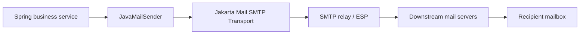
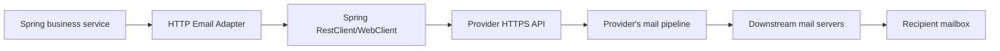
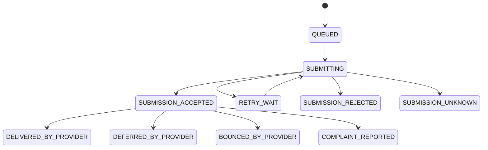
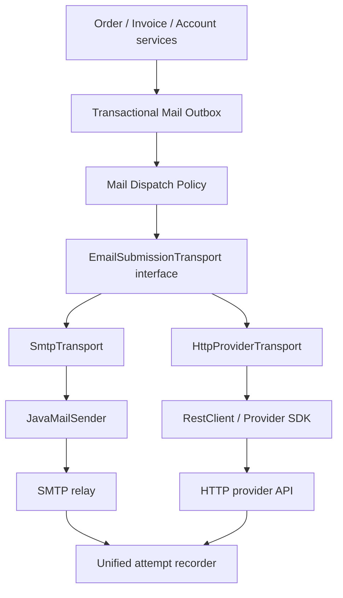
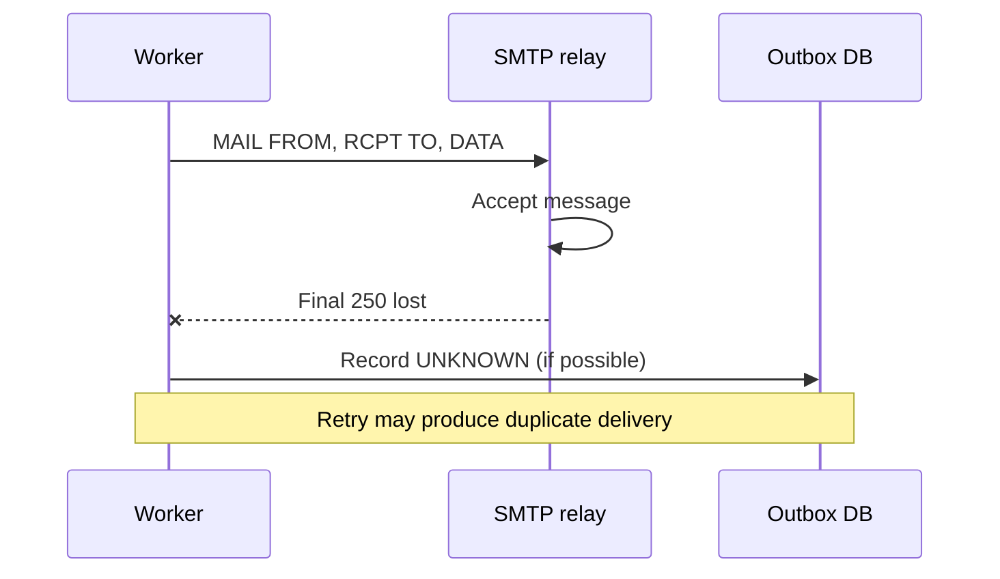
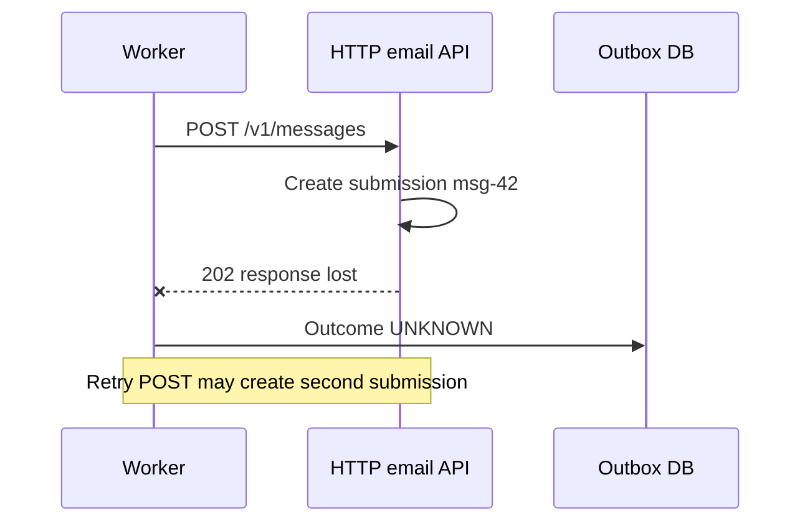
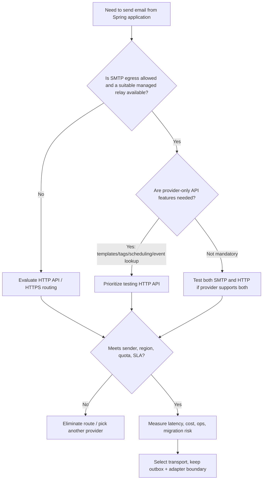

# Choosing an SMTP Relay vs. an HTTP Email Provider

When a **Spring Framework Mail** application needs to send email, the choice rarely stops at "do we have `JavaMailSender` or not." The development team must decide **whether to connect to an SMTP relay** or **call an email provider's HTTP API**. Both paths can send transactional emails, account verification, invoices, security alerts, or marketing emails, but they differ in protocol, authentication, content representation, limits, outcome observability, operations, portability, and vendor coupling.

Several mistakes stem from overly simplistic questions:

- "SMTP is a standard, so is it always better than an HTTP API by default?"
- "Does HTTP returning 202 mean the email landed in the Inbox?"
- "If we use an API, are duplicates impossible and is a transactional outbox unnecessary?"
- "Since Spring Boot supports SMTP out of the box, do we not need to design retries?"
- "Can we just swap the SMTP hostname for an API endpoint during migration?"

There is no single answer for every workload. **The right decision depends on business contracts, required control, provider characteristics, and the team's operational capacity.** This *Architectural Decisions* chapter builds a practical evaluation framework, then illustrates how to keep application design stable even when transports change.

Examples use Java 21, Spring Framework 6.x/Spring Boot 3.x, Jakarta Mail, `JavaMailSender`, and Spring `RestClient`. `example.test` addresses, endpoints, and HTTP responses in this article are **illustrative assumptions**, not the real API of any specific provider. When implementing, verify the documentation, contract, endpoints, permissions, quotas, and semantics of the provider you actually use.

> **Clarify upfront:** Both an SMTP relay and an HTTP email provider are **recipients of a send request**. Acceptance into a provider/SMTP relay's queue does not prove the message reached the final mailbox, let alone landed in the Inbox folder.

## 1. What Are the Two Options in Practice?

### 1.1. SMTP Relay

The application uses an SMTP client to send a MIME message via an SMTP submission/relay endpoint. In the Spring ecosystem, the common path is:



The application configures hostname, port, TLS mode, authentication, sender identity, and SMTP timeouts. A code snippet:

```java
SimpleMailMessage mail = new SimpleMailMessage();
mail.setFrom("orders@example.test");
mail.setTo("buyer@example.test");
mail.setSubject("Order confirmation");
mail.setText("Order ORDER-1042 has been recorded.");

javaMailSender.send(mail);
```

For HTML, inline images, and attachments, `MimeMessage`/`MimeMessageHelper` is typically used. SMTP is a standardized protocol in many respects; you can switch to another relay while keeping a substantial portion of the MIME-sending application. However, **sender configuration, TLS, authentication, quotas, error responses, DKIM, webhooks, and operational policies can still vary by provider**.

An SMTP relay does not have to be self-operated: many email service providers offer a **managed SMTP endpoint**, alongside an HTTP API, dashboard, logs, and event webhooks.

### 1.2. HTTP Email Provider

The application calls an HTTP(S) endpoint exposed by the email service provider, usually sending a JSON payload:



A conceptual request:

```http
POST /v1/messages HTTP/1.1
Host: api.mail-provider.example.test
Authorization: Bearer <REDACTED>
Content-Type: application/json

{
  "from": {"email": "orders@example.test"},
  "to": [{"email": "buyer@example.test"}],
  "subject": "Order confirmation",
  "text": "Order ORDER-1042 has been recorded.",
  "metadata": {"notificationId": "MAIL-8821"}
}
```

This is an **illustrative schema**; there is no guarantee any real provider accepts these exact fields/URLs. A provider may use an `api-key` header, Bearer token, HMAC, differently structured JSON, a template-ID send endpoint, or a multipart/raw MIME endpoint.

HTTP APIs often let you leverage provider-specific capabilities: provider-hosted templates, message tags, per-recipient substitutions, campaign/transactional streams, sandboxes, scheduling, analytics, event callbacks, delivery logs, and idempotency keys **when the provider has a matching contract**.

### 1.3. Same Destination, Different Transport

```text
              Business email intent
                        |
              Mail delivery abstraction
                 /             \
                v               v
        SMTP adapter         HTTP adapter
         |                       |
    JavaMailSender             RestClient
         |                       |
     SMTP relay             Email HTTP API
         \                       /
            Provider delivery pipeline
                        |
                 Mailbox recipient
```

Both paths still ultimately rely on email infrastructure and SMTP between mail servers. Choosing an HTTP API **does not mean the email is finally delivered to Gmail/Outlook over HTTP**. It changes how **the application submits the send request** to the provider.

## 2. High-Level Comparison Table

| Criterion | SMTP Relay | HTTP Email Provider |
|---|---|---|
| Submission protocol | SMTP over TCP, typically STARTTLS/implicit TLS | HTTPS, typically JSON or MIME API |
| Spring client | `JavaMailSender` / Jakarta Mail | `RestClient`, `WebClient`, or provider SDK |
| Standardization | SMTP + MIME are widely standardized | API schema/endpoints are usually provider-specific |
| Authentication | SMTP AUTH, app password, OAuth/SASL, sometimes IP allowlist | API key, Bearer/OAuth, request signing, mTLS per provider |
| TLS/ports | 587 STARTTLS; 465 implicit TLS; endpoint per docs | 443 HTTPS is common |
| HTML, inline, attachments | Natively supported via MIME | Depends on schema, size limits, base64/multipart, or raw MIME |
| Provider-stored templates | Not a standard SMTP feature | Often a dedicated API feature |
| Custom metadata/tags | Possible via headers, not fully portable | Usually explicit fields, provider-dependent |
| Synchronous feedback | SMTP reply code/phase | HTTP status + provider error code/response |
| Delivery events/bounces | No webhooks in SMTP protocol; provider may add them | Providers often include events/webhooks if offered |
| Rate/concurrency limits | SMTP sessions, messages/recipients, account quota | Requests/s, recipients/s, credits/account quota |
| Submission idempotency | SMTP does not standardize end-to-end idempotency keys | Some providers support it; verify contract |
| Portability | Relatively high at the MIME/SMTP layer | Usually needs provider-specific adapter/SDK when switching |
| Operational observability | SMTP logs, replies, provider dashboard/event API if available | Structured API errors, IDs, events/dashboard if available |
| Egress restrictions | Some networks block SMTP ports | HTTPS 443 is often easier, though proxies/firewalls/policies still exist |
| Cost | Depends on plan and billing units | Depends on plan and billing units; neither is inherently cheaper/costlier |
| Retry/outbox | **The application must still design it** | **The application must still design it** |

Two traps to avoid:

1. Do not attribute every good feature to HTTP and every gap to SMTP. **The same provider** can give clear message IDs, analytics, bounce webhooks, reputation dashboards, and quotas for both SMTP and HTTP submissions.
2. Do not treat the table above as an API guarantee. Specific capabilities must be verified by **provider, service tier, account, region, sender domain, traffic type, and implementation time**.

## 3. Decision Criterion #1: Business Requirements

Before picking a transport, describe:

- Is the email **transactional** (OTP, password reset, invoice, alert) or **bulk/marketing**?
- Is the email's validity window short—for example, fast-expiring OTPs?
- Is **persisting send intents durably** required after the business transaction commits?
- Do you need tags/metadata, per-recipient substitutions, campaign tracking, or preference management?
- Do you need **webhooks** for bounces/complaints/deliveries and suppression management?
- Are there data residency, retention duration, encryption, or audit requirements?
- Are there multiple providers/tenants/accounts requiring policy-based routing/failover?
- What is the acceptable duplicate tolerance and allowed retry window?
- What is the team's capacity to operate SMTP, DNS, quotas, DKIM/DMARC, webhooks, and telemetry?

### 3.1. OTP Email Example

An OTP might require:

```text
time-to-submit target  < 10 seconds
token expiry          = 5 minutes
priority              = high
dedupe key            = verificationSessionId + eventType
provider              = whichever route is approved and healthy
```

These numbers are illustrative. What matters is not whether HTTP returns 202 or SMTP returns 250, but **queue age, rate quotas, ability to submit before expiry, accepted/unknown outcomes, and OTP re-issuance strategy**. If both transports meet the target, choose based on observability, cost, security, and integration depth.

### 3.2. Invoice with Attachment Example

A PDF invoice may require:

- Keeping content immutable as of issuance time.
- Properly formatted Unicode/HTML/plain-text alternatives.
- Valid attachment bytes within MIME size limits.
- Auditing notification ID, attempt ID, and provider message ID.
- Ability to retry after an outage without issuing a second invoice.

SMTP + `MimeMessageHelper` can be convenient because MIME is native. An HTTP API can also fit, but requires accounting for base64 overhead and field size limits; a provider may support raw MIME upload or a dedicated attachment endpoint. Do not pick a path solely because "sending PDFs via SMTP must be better."

### 3.3. Large Marketing System Example

If you need campaign scheduling, unsubscribe groups, provider-side template versioning, categories/tags, per-recipient analytics, and preference management, an **HTTP API** is often worth evaluating closely because many ESPs expose these features cleanly via APIs. Still, do not assume HTTP is automatically compliant or safe for bulk mail: both options must obey consent, suppression, anti-abuse policies, and applicable local laws.

### 3.4. Best-Effort Email

For low-importance mail where losing a notification on a process crash is acceptable, keep the design simple with a bounded executor and a well-configured SMTP relay. If the business truly requires not losing intents, use an **outbox** regardless of transport. Pipeline reliability is not decided by the word "SMTP" or "HTTP."

## 4. Decision Criterion #2: Network Environment and Security

### 4.1. SMTP Often Has Multiple Connection Modes

| Mode | Common Port | Semantics |
|---|---:|---|
| SMTP submission with STARTTLS | 587 | Connect via SMTP then upgrade to TLS |
| SMTP submission with implicit TLS | 465 | TLS handshake from the very start |
| SMTP server-to-server/relay | 25 | Different policies and egress; not default-appropriate for apps |

Ports are **conventions**, not the sole indicator of security mode. An endpoint can use a custom port, require OAuth, or enforce IP allowlists. With required STARTTLS, verify that TLS is genuinely established and hostname/certificate validation is active; never disable validation in production to bypass config errors.

### 4.2. HTTP Is Often Convenient in HTTPS-Only Networks

Some cloud/corporate networks block outbound SMTP ports, especially port 25, or require special egress approvals. HTTPS port 443 typically traverses existing proxies/firewalls, yet still involves:

- Corporate HTTP proxies and certificate trust settings.
- DNS resolution, mTLS, WAF, API endpoint allowlists.
- Provider egress IP allowlists/regional rules.
- TLS certificate/hostname verification.
- Managing API keys as secrets.

If the environment **forbids SMTP egress** while allowing HTTPS APIs, HTTP can be the easier choice to operate. Still, verify the actual route rather than assuming "HTTPS always works."

### 4.3. Credentials and Authorization Differ

SMTP may use dedicated SMTP username/password credentials, application passwords, SASL/OAuth, or IP-auth relays. HTTP APIs typically use API keys/tokens, sometimes scoped granularly by sender/domain, template, or subaccount. Both require:

- Secret manager, rotation, access auditing, no hardcoding.
- Least-privilege permissions per environment/tenant.
- Never putting secrets into logs, exception traces, or public configs.
- Revoking/rotating on incidents and never casually sharing prod/test credentials.
- Checking sender identity separately from connection authentication.

**Successful AUTH does not mean the sender domain is permitted.** An SMTP relay can accept AUTH and then reject `MAIL FROM`; an HTTP API can return a permission error even with a valid token.

### 4.4. TLS Does Not Replace Sender Authentication

TLS protects the application ↔ provider link (when properly verified). It does not prove to the receiving side who issued the email. Email sender identity/deliverability still requires SPF, DKIM, DMARC, and proper provider configuration, whether the application submits via SMTP or HTTPS API.

## 5. Configuring an SMTP Relay in Spring Boot

Spring Boot can auto-configure `JavaMailSenderImpl` when the mail starter/dependencies and matching bean/config conditions are present. An illustrative STARTTLS SMTP submission configuration:

```yaml
spring:
  mail:
    host: smtp.example.test
    port: 587
    username: ${SMTP_USERNAME}
    password: ${SMTP_PASSWORD}
    default-encoding: UTF-8
    properties:
      "[mail.smtp.auth]": "true"
      "[mail.smtp.starttls.enable]": "true"
      "[mail.smtp.starttls.required]": "true"
      "[mail.smtp.ssl.checkserveridentity]": "true"
      "[mail.smtp.connectiontimeout]": "5000"
      "[mail.smtp.timeout]": "10000"
      "[mail.smtp.writetimeout]": "10000"
```

These timeout values are in milliseconds in common Jakarta Mail SMTP configurations. They do not establish an overall deadline covering DNS, template rendering, attachment downloads, the entire SMTP session, DB updates, and retries. Ports/TLS modes must match endpoint docs; with implicit TLS (commonly 465), configuration differs—for example `mail.smtp.ssl.enable=true` rather than assuming changing the port alone suffices.

### 5.1. Sending Plain Text with SimpleMailMessage

```java
package com.example.mail.smtp;

import org.springframework.mail.SimpleMailMessage;
import org.springframework.mail.javamail.JavaMailSender;
import org.springframework.stereotype.Component;

@Component
public class SmtpTextTransport {

    private final JavaMailSender sender;

    public SmtpTextTransport(JavaMailSender sender) {
        this.sender = sender;
    }

    public void submitText(
            String recipient,
            String subject,
            String text) {

        SimpleMailMessage message = new SimpleMailMessage();
        message.setFrom("orders@example.test");
        message.setTo(recipient);
        message.setSubject(subject);
        message.setText(text);

        sender.send(message);
    }
}
```

This is **synchronous SMTP** code: the thread blocks until transport completes or fails. It can run on a dedicated mail worker/executor so it does not block HTTP requests. Do not embed `submitText(...)` inside an open database transaction assuming SMTP can roll back.

### 5.2. Sending MIME with Plain Text, HTML, and Attachments

```java
package com.example.mail.smtp;

import jakarta.mail.MessagingException;
import jakarta.mail.internet.MimeMessage;

import org.springframework.core.io.ByteArrayResource;
import org.springframework.mail.javamail.JavaMailSender;
import org.springframework.mail.javamail.MimeMessageHelper;
import org.springframework.stereotype.Component;

@Component
public class SmtpMimeTransport {

    private final JavaMailSender sender;

    public SmtpMimeTransport(JavaMailSender sender) {
        this.sender = sender;
    }

    public void submitInvoice(
            String recipient,
            String subject,
            String plainText,
            String htmlText,
            byte[] pdfBytes) throws MessagingException {

        MimeMessage mime = sender.createMimeMessage();
        MimeMessageHelper helper =
                new MimeMessageHelper(mime, true, "UTF-8");

        helper.setFrom("billing@example.test");
        helper.setTo(recipient);
        helper.setSubject(subject);
        helper.setText(plainText, htmlText);

        helper.addAttachment(
                "invoice.pdf",
                new ByteArrayResource(pdfBytes),
                "application/pdf");

        sender.send(mime);
    }
}
```

The example uses `ByteArrayResource` to illustrate a small PDF; for large files or high concurrency, avoid keeping full attachment bytes in heap. Use a re-openable stream resource, size limits, durable staging, and timeouts. MIME serialization may read attachments multiple times; do not hold a closed `InputStream` or a single-read stream without lifecycle guarantees.

### 5.3. SMTP Calls Do Not Automatically Provide a Unified Provider Message ID

When `JavaMailSender.send(...)` returns normally, the API does not necessarily return a lookup-capable provider message ID like an HTTP JSON response. You can obtain the MIME `Message-ID` in some cases, but it is not a universal lookup key across all SMTP relays and may differ from the provider's internal ID.

If deep traceability is required:

- Attach an **application notification ID** to logs/outbox and metadata/headers where permitted.
- Check whether the provider offers SMTP submission events, dashboards, or API lookup.
- Use webhooks/provider message IDs if the service provides them for SMTP submissions.
- Do not claim you can query every SMTP relay by `Message-ID` through a standard API.

### 5.4. SMTP Exceptions Must Be Read by Phase

Spring Mail can throw:

- `MailAuthenticationException`: SMTP AUTH failed.
- `MailSendException`: one or more emails failed to send.
- `MailParseException`: address/content parsing error.
- `MailPreparationException`: MIME preparation error.

Nested Jakarta Mail `MessagingException` and provider-specific subclasses may carry reply codes/failed recipients. For a multi-recipient email, `MailSendException` does not by default provide a standardized per-`RCPT TO` status; check the SMTP implementation's semantics and partial-send configuration.

## 6. Calling an HTTP Provider with RestClient

For Spring Framework 6.1+ and Spring Boot 3.2+ in appropriate configurations, `RestClient` is a synchronous HTTP client option well suited for mail-sending workers. `WebClient` fits when the system uses a reactive pipeline or needs an async/nonblocking model; **there is no need to use WebClient merely because the HTTP provider is an "API."**

### 6.1. Application Configuration Namespace

```yaml
app:
  email:
    http:
      base-url: https://api.mail-provider.example.test
      api-key: ${EMAIL_PROVIDER_API_KEY}
      connect-timeout: 5s
      read-timeout: 10s
      sender: orders@example.test
```

`app.email.http` is **custom application configuration**; Spring Boot does not automatically turn it into an HTTP email sender. You must write properties binding, validate HTTPS endpoints/tokens, and configure the HTTP request factory and timeouts for your client stack.

### 6.2. Illustrative API DTOs

```java
package com.example.mail.http;

import java.util.List;
import java.util.Map;

public record ProviderEmailRequest(
        String from,
        List<String> to,
        String subject,
        String text,
        String html,
        Map<String, String> metadata
) {}

public record ProviderSubmitResponse(
        String id,
        String status
) {}
```

Depending on the ESP, real JSON may require:

- `from` as an email/name object, not a String.
- `to` as an array of objects rather than an array of Strings.
- `personalizations` or `recipients` with different semantics.
- `content` as an array of MIME types.
- `templateId` alongside dynamic data.
- Base64 `attachments` or multipart upload.
- `metadata`, `tags`, `category` with specific limits/field names.

This is why provider DTOs should be isolated inside an adapter instead of letting application business services depend directly on external schemas.

### 6.3. RestClient Example

```java
package com.example.mail.http;

import org.springframework.http.HttpHeaders;
import org.springframework.http.MediaType;
import org.springframework.http.ResponseEntity;
import org.springframework.web.client.RestClient;

public final class HttpEmailClient {

    private final RestClient client;

    public HttpEmailClient(
            RestClient.Builder builder,
            String baseUrl,
            String apiKey) {

        this.client = builder
                .baseUrl(baseUrl)
                .defaultHeader(
                        HttpHeaders.AUTHORIZATION,
                        "Bearer " + apiKey)
                .build();
    }

    public ResponseEntity<ProviderSubmitResponse> submit(
            ProviderEmailRequest request) {

        return client.post()
                .uri("/v1/messages")
                .contentType(MediaType.APPLICATION_JSON)
                .body(request)
                .retrieve()
                .toEntity(ProviderSubmitResponse.class);
    }
}
```

This client illustrates an **assumed schema and endpoint**. In a real application, the adapter should wrap results/exceptions into domain outcomes, configure HTTP timeouts/TLS, enforce log redaction, and manage token rotation. By default with `retrieve()`, HTTP 4xx/5xx responses are handled by `RestClient` error semantics rather than automatically becoming a valid `ProviderSubmitResponse`.

### 6.4. Accept Only HTTP Statuses Defined by the Provider Contract

Avoid writing:

```java
if (status >= 200 && status < 300) {
    return "DELIVERED";
}
```

Because:

- HTTP `200` may return resource/operation status.
- HTTP `201` may create a submission object.
- HTTP `202` typically means **the request was accepted for later processing** under HTTP semantics.
- A provider may return `204` on success, with no response ID.

What the adapter is allowed to assert is **what the provider's official documentation states about that specific endpoint**, e.g., "request accepted/queued by provider." Never assign `DELIVERED_TO_INBOX` from HTTP 202, 200, or 201.

### 6.5. Example of Translating HTTP Status into Outcome

A transport layer should separate **HTTP status** from **email state**:

```java
package com.example.mail.transport;

public enum SubmissionOutcome {
    ACCEPTED_BY_PROVIDER,
    TEMPORARY_REJECTED,
    PERMANENT_REJECTED,
    UNKNOWN
}

public record EmailSubmitResult(
        SubmissionOutcome outcome,
        String providerId,
        String providerMessageId,
        String safeErrorCode
) {}
```

Suppose the endpoint is documented to return `202` once the request is accepted:

```java
ResponseEntity<ProviderSubmitResponse> response =
        httpClient.submit(request);

if (response.getStatusCode().value() == 202
        && response.getBody() != null) {
    return new EmailSubmitResult(
            SubmissionOutcome.ACCEPTED_BY_PROVIDER,
            "provider-http",
            response.getBody().id(),
            null);
}

return new EmailSubmitResult(
        SubmissionOutcome.UNKNOWN,
        "provider-http",
        null,
        "UNEXPECTED_SUCCESS_RESPONSE");
```

This **illustrates a hypothetical contract**, not a rule applicable to every provider. For unrecognized responses, avoid asserting accepted/rejected without sufficient evidence.

### 6.6. Authentication Headers Do Not Belong in Logs

HTTP client logging/interceptors can record request headers and bodies. Redact:

- `Authorization`, API keys, cookies/tokens.
- Recipient addresses when unnecessary.
- Subjects/bodies containing personal data.
- Base64 HTML/attachments and sensitive metadata.
- Callback URLs/idempotency data carrying secrets.

If using retries at the HTTP client layer, know whether it is retrying **the HTTP submission request** or only connection setup. Never enable a generic retry interceptor for all POSTs without considering the risk that the server already received the request while the response was lost.

## 7. HTTP Errors: Status Codes Are Not the Whole Story

| HTTP Status / Error | Initial Hint | What to Check |
|---|---|---|
| `400` | Payload validation/syntax | Provider error code, which field is invalid |
| `401` | Missing/invalid auth | Token/secret/scope; usually do not retry continuously |
| `403` | Permission/account/policy | Sender verification, suspension, permissions |
| `404` | Endpoint/template not found | URI/API version/template ID |
| `409` | Conflict | Is it an idempotency conflict or another domain conflict? |
| `413` | Request/message too large | MIME/base64/attachment limits |
| `422` | Semantic validation | Recipient/template/content policy per provider |
| `429` | Rate/quota limit | Retry-After/window/limit scope; avoid retry storms |
| `5xx` | Provider failure | Retry or UNKNOWN per contract and processing stage |
| Connect failure before sending bytes | Transport/network | With proof not submitted, retrying is safer |
| Read timeout after POST sent | Uncertain outcome | Server may have accepted; idempotency/reconciliation |

Do not apply this table mechanically. A provider might encode business errors inside JSON with HTTP 200, return 400 for quotas, or use custom codes outside standard conventions. Use the provider's error catalog/SDK, keep the filtered original code, and map to internal categories.

### 7.1. ResourceAccessException and Timeouts

In Spring `RestClient`, network I/O failures are commonly represented by `ResourceAccessException`. A timeout is **not enough** to know whether the request reached the provider:

```text
Client POSTs /v1/messages
Provider creates submission
Provider response lost
Client gets read timeout
```

If the HTTP client or worker blindly retries POST immediately, it may create two submissions. If the provider offers an **idempotency key contract** for the endpoint, sending the same key can help deduplicate within the provider's scope/TTL; otherwise, consider provider lookup/reconciliation or a duplicate-tolerant retry policy.

### 7.2. HTTP 429 and Retry-After

A provider may return `429 Too Many Requests` with `Retry-After` or quota-window fields. However:

- Check whether the provider actually emits and defines the header.
- The header value can be delta-seconds or an HTTP date.
- Do not trust unbounded or invalid network values without clamping.
- Quotas may apply per account, region, endpoint, recipients/second, or daily credits.
- Retries must be scheduled, not holding a worker thread asleep for minutes.

If multiple replicas share one account, a per-JVM local limiter is insufficient to prevent repeated 429s.

### 7.3. 5xx Does Not Automatically Prove Unprocessed

HTTP 500/502/503 usually suggest server errors; many cases are retryable. Yet for a side-effecting POST, a server may have already created the submission before failing to return the response. Thus a sound policy relies on **provider contract/idempotency semantics**, rather than labeling every 5xx as "not sent."

## 8. MIME, Attachments, and Templates: Transport Is Not Content

A complete email has logical components:

```text
Envelope/Recipients
From, Reply-To, Subject
Plain-text body
HTML alternative
Inline images
Attachments
Headers/Message-ID
Tracking/correlation metadata
```

SMTP submission usually receives **MIME bytes**. With an HTTP API, the provider may accept JSON fields and assemble MIME internally, or support raw MIME requests. This difference affects content portability between the two transports.

### 8.1. SMTP Controls Its Own MIME

Benefits of building `MimeMessage` yourself:

- Full control over `multipart/alternative`, `multipart/related`, attachment filenames, and charsets.
- Ability to add custom headers permitted by policy.
- Test MIME serialization with an SMTP sandbox.
- Ability to archive canonical MIME for replay/investigation when compliant.

Drawbacks:

- The application is responsible for valid multipart structure and MIME encodings.
- Attachment resource/stream lifecycle bugs can occur.
- You must manage template rendering and prevent HTML injection.
- Providers may still enforce different policies/size limits even on valid MIME.

### 8.2. HTTP APIs May Build MIME for the Application

Example API request:

```json
{
  "templateId": "invoice-v3",
  "variables": {
    "customerName": "Test Recipient",
    "invoiceNumber": "INV-42"
  },
  "recipient": "buyer@example.test"
}
```

This is only an **illustrative model**. If the provider hosts templates, you must manage versioning, drift between staging/production, fallback if a template is deleted, template edit permissions, personalization limits, and rollback capability. Provider-side templates make collaboration easy across teams, but create **vendor coupling**: a template ID on provider A cannot be used directly on provider B.

### 8.3. Attachments over HTTP Have Overhead

Many HTTP email APIs require attachment bytes to be **base64**-encoded inside JSON. Base64 expands the encoded payload by roughly 4/3 before JSON/HTTP framing; MIME also has its own transfer-encoding overhead. Therefore:

- Compare **raw file size, encoded request size, and final MIME size**; providers may cap each differently.
- Do not load a 50 MB PDF and unconditionally convert it into a huge base64 string on the heap.
- Consider streaming/multipart/raw MIME endpoints if the provider supports them with a clear contract.
- Use object-store references if supported by the provider/app with authorization/expiry controls.
- Never log base64 attachments when an HTTP request fails.

Do not pick SMTP solely because "HTTP cannot send attachments." The right step is **checking the specific endpoint's capabilities and limits**.

### 8.4. Inline Content-IDs and HTML

With SMTP MIME, applications can embed inline images via Content-ID and reference `cid:logo` in HTML. With HTTP, some providers support `content_id` or an inline attachment type; some do not. If emails need rich HTML or inline assets, run an actual test:

1. Render plain/HTML alternatives with Unicode.
2. Attach an inline logo and a PDF attachment.
3. Send via both SMTP and HTTP API to authorized test mailboxes.
4. Inspect raw MIME/source and rendering on target mail clients.
5. Measure encoded size and provider rejections.

Rendering differences may stem from MIME/rendering/provider transformations, not necessarily the submission protocol.

### 8.5. Tracking Metadata Must Be Managed Separately

An HTTP provider may return a message ID and support tags/metadata:

```text
notificationId = MAIL-8821
businessEvent  = ORDER_CREATED
tenantGroup    = transactional
templateKey    = ORDER_CONFIRMED
```

Do not put sensitive information such as recipient email, OTPs, user tokens, or full order details into tags if they appear in provider-managed dashboards/webhooks. Metadata traverses third-party systems; send only necessary, permitted fields.

With SMTP, custom headers can also carry correlation IDs, but header preservation/provider exposure/lookup capability is not a universal SMTP guarantee.

## 9. Submission Outcomes and Delivery Events Are Two Different Layers

For both SMTP and HTTP, separate:



Not every provider emits all events. A service may report accepted/queued without reporting delivered, or deliver webhooks late/out of order. Downstream state must reflect **what was actually observed**.

### 9.1. SMTP 250 and HTTP 202 Differ in Format, Similar in Milestone

With SMTP, a final `250` reply after DATA typically means the relay accepted the message for further processing. With HTTP, an endpoint may return `202 Accepted` with a provider message ID to confirm the job entered the sending system. Actual semantics still follow the contract:

```text
SMTP:
  transport submit complete -> relay accepted

HTTP:
  API request accepted -> provider job created/queued

Neither:
  proof of final Inbox placement
```

Do not display "Email successfully delivered to inbox" when the application only knows the submission was accepted.

### 9.2. Delivery Feedback When Using SMTP Only

The SMTP protocol itself does not provide webhooks for sent mail. However, an **SMTP relay service** may offer webhooks, dashboards, query APIs, or event exports separately. If you need bounces/complaints, ask:

- Does the provider offer an event feed for SMTP submissions?
- Is there a way to correlate events with application notification IDs/provider message IDs?
- Do event IDs have a uniqueness/deduplication contract?
- How long is event data retained?
- What signature or authentication mechanism does the webhook use?
- What are the exact meanings of "delivered," "deferred," and "bounce" events?

If a relay only accepts SMTP without an event API, the system may lack downstream visibility even though SMTP submission works fine. That is why **provider operational capabilities**, not just transport, must inform the decision.

### 9.3. HTTP Provider Webhooks Are Not Automatically Trustworthy

If an HTTP provider offers webhooks, the receiver must still:

1. Verify signatures/provider authentication per contract; never trust an arbitrary HTTP POST.
2. Validate schema, event timestamps/clock skew, and payload size.
3. Deduplicate event IDs (providers may resend on timeout).
4. Handle out-of-order events: an old event must not irrationally revert a newer state.
5. Map provider message IDs to the exact **attempt**, not merely look up by recipient email.
6. Never write raw webhook payloads containing PII/tokens to open logs.
7. Have replay/reconciliation if webhooks arrive late or fail.

An HTTP API returning 202 and a DELIVERED webhook do not equal end-to-end exactly-once. Webhooks are usually at-least-once and must be processed idempotently.

### 9.4. Bounces/Complaints Are Not Transport Errors

Example:

```text
T0: SMTP 250 after DATA or HTTP 202
T1: Provider attempts delivery downstream
T2: Destination rejects mailbox -> provider bounce event
```

T0 remains submission accepted. T2 is a **delivery failure**. Do not rewrite the attempt history from accepted to "SMTP never received it." Instead, record the downstream event, classify hard/soft bounce per provider policy, and update suppression if appropriate.

### 9.5. Events Can Go Missing

Receiving no bounce event does not prove delivery succeeded; receiving no delivered event does not prove failure. If a business SLA requires proof, ask how long the provider supports querying submissions/deliveries via API/logs and implement reconciliation when events are missing.

## 10. Sender Reputation and Deliverability

Choosing an SMTP relay or an HTTP API **cannot replace** properly configuring valid mail sending. Key factors:

- Verified sender domain and subdomain.
- SPF aligned with envelope sender/`MAIL FROM` and actual sending path.
- DKIM signed with a valid signing domain/key.
- DMARC requiring SPF or DKIM pass **and alignment** with the `From` header.
- Reverse DNS/IP reputation and IP pools when operating your own relay.
- Bounce/complaint handling, suppression, and unsubscribes per mail category.
- Content, volume ramp-up, engagement rates, and reputation.
- Anti-abuse policies of both provider and destination mailboxes.

### 10.1. Switching Transports Within the Same Provider Still Requires Identity Verification

A provider may allow an SMTP account to use verified sender A, while an HTTP API token is scoped only to sender B or another subaccount. Switching from SMTP to HTTP without verifying domain/`From`/custom `MAIL FROM` can cause 403/550 errors, DKIM alignment mismatch, or reduced deliverability.

### 10.2. Switching Providers Requires DNS Verification

If migrating from relay A to HTTP provider B:

```text
Before:
  SMTP A signs DKIM d=example.test
  custom envelope domain bounce-a.example.test

After:
  HTTP B may require new DKIM selector
  custom envelope domain bounce-b.example.test
```

Verify SPF/DKIM/DMARC alignment on route B, domain verification, bounce routing, and reputation. Do not just update `spring.mail.host` or the HTTP base URL and consider the migration done.

### 10.3. Do Not Use Failover to Evade Policy

If provider A rejects mail due to spam/abuse complaints, missing consent, or an unauthorized sender, automatically failing over to provider B merely to bypass filters is an anti-pattern. Failover is appropriate for infrastructure/quota failures within authorized sending bounds, with duplicate risk and compliance evaluated.

## 11. Designing Provider Abstraction: Do Not Let Business Logic Call Vendor APIs Directly

When choosing between SMTP and HTTP, a flexible architecture places a **transport adapter** behind an application-owned interface. Business services create an **email send intent** without knowing whether the provider uses SMTP or HTTPS.



### 11.1. Transport-Independent Business Intent

An illustrative model:

```java
package com.example.mail.domain;

import java.time.Instant;
import java.util.List;
import java.util.Map;
import java.util.UUID;

public record EmailIntent(
        UUID notificationId,
        String tenantId,
        String businessKey,
        String senderIdentityId,
        List<String> recipients,
        String subject,
        String plainText,
        String html,
        List<AttachmentReference> attachments,
        Map<String, String> safeTags,
        Instant expiresAt
) {}

public record AttachmentReference(
        String objectKey,
        String filename,
        String contentType,
        long expectedSize
) {}
```

This is a business-oriented model. It contains no SMTP server password or HTTP API key; credentials belong in transport configuration. Real-world emails also need recipient policies, template versions, consent status, locales, reply-to, idempotency/correlation, data residency, and attachment conditions.

Crucially: do not let `EmailIntent` hold a live `MimeMessage`, `HttpServletRequest`, `SecurityContext`, uninitialized JPA entity, or temporary `InputStream`. An outbox worker may process the job in a different process hours after the request.

### 11.2. Interface for Submitting a Single Attempt

```java
package com.example.mail.transport;

import com.example.mail.domain.EmailIntent;

public interface EmailSubmissionTransport {
    String transportId();
    EmailSubmitResult submit(EmailIntent intent);
}
```

A `submit` method here represents **one attempt**; it does not guarantee survival across restarts or successful delivery. The orchestration/outbox layer manages retries, while the transport adapter is responsible for:

- Serializing the intent to MIME or provider JSON.
- Connecting/authenticating and submitting.
- Normalizing outcomes while preserving filtered provider-specific error metadata.
- Closing/releasing network resources properly.
- Never silently retrying every POST/SMTP call when the outcome could be UNKNOWN.

### 11.3. SMTP Adapter

A concise example showing the boundary:

```java
package com.example.mail.transport.smtp;

import com.example.mail.domain.EmailIntent;
import com.example.mail.transport.EmailSubmitResult;
import com.example.mail.transport.EmailSubmissionTransport;
import com.example.mail.transport.SubmissionOutcome;
import org.springframework.mail.MailException;
import org.springframework.mail.javamail.JavaMailSender;
import org.springframework.mail.javamail.MimeMessageHelper;

public final class SmtpEmailSubmissionTransport
        implements EmailSubmissionTransport {

    private final JavaMailSender sender;
    private final SmtpErrorClassifier classifier;

    public SmtpEmailSubmissionTransport(
            JavaMailSender sender,
            SmtpErrorClassifier classifier) {
        this.sender = sender;
        this.classifier = classifier;
    }

    @Override
    public String transportId() {
        return "smtp-primary";
    }

    @Override
    public EmailSubmitResult submit(EmailIntent intent) {
        try {
            var mime = sender.createMimeMessage();
            var helper = new MimeMessageHelper(
                    mime, true, "UTF-8");

            helper.setFrom("orders@example.test");
            helper.setTo(intent.recipients().toArray(String[]::new));
            helper.setSubject(intent.subject());
            helper.setText(intent.plainText(), intent.html());

            // AttachmentReference is resolved by a controlled
            // resource loader in the production version.
            sender.send(mime);

            return new EmailSubmitResult(
                    SubmissionOutcome.ACCEPTED_BY_PROVIDER,
                    transportId(),
                    null,
                    null);
        } catch (MailException error) {
            return classifier.classify(
                    transportId(), error);
        } catch (jakarta.mail.MessagingException error) {
            return classifier.classifyPreparationFailure(
                    transportId(), error);
        }
    }
}
```

`SmtpErrorClassifier` is an application-written abstraction; the code above **does not fully handle attachments** and only illustrates the adapter. In production, validate sender `From`/recipient policy and stage-specific errors, and never log raw emails. In particular, even when `sender.send(...)` throws `MailException`, the classifier must not automatically conclude `NOT_SENT` for a read timeout after DATA.

### 11.4. HTTP Adapter

```java
package com.example.mail.transport.http;

import com.example.mail.domain.EmailIntent;
import com.example.mail.transport.EmailSubmitResult;
import com.example.mail.transport.EmailSubmissionTransport;

import org.springframework.web.client.ResourceAccessException;
import org.springframework.web.client.RestClientResponseException;

public final class HttpEmailSubmissionTransport
        implements EmailSubmissionTransport {

    private final HttpEmailClient client;
    private final HttpProviderResponseMapper mapper;

    public HttpEmailSubmissionTransport(
            HttpEmailClient client,
            HttpProviderResponseMapper mapper) {
        this.client = client;
        this.mapper = mapper;
    }

    @Override
    public String transportId() {
        return "http-primary";
    }

    @Override
    public EmailSubmitResult submit(EmailIntent intent) {
        ProviderEmailRequest request =
                mapper.buildRequest(intent);

        try {
            var response = client.submit(request);
            return mapper.fromSuccess(response);
        } catch (RestClientResponseException error) {
            return mapper.fromHttpError(error);
        } catch (ResourceAccessException error) {
            return mapper.fromUnknownTransportError(error);
        }
    }
}
```

`HttpProviderResponseMapper` is an application-implemented adapter service. Classify HTTP 429, validation/permission errors, 5xx, and timeouts according to **the provider's contract**, rather than scattering `if (status == 429)` across business services. With a vendor SDK, the adapter should also shield proprietary exception/response types.

### 11.5. Portability Has Practical Limits

Thanks to the interface, when changing transports, business services can remain untouched:

```text
orderCreated -> enqueue EmailIntent
```

However, not every capability translates 1:1:

- Provider A has hosted templates, provider B does not.
- HTTP API A supports idempotency keys, SMTP B does not.
- Event taxonomies differ (delivered, processed, deferred, bounce).
- Mail merge/personalization semantics differ.
- API key scopes, sender verification, and limits differ.
- Unsubscribe groups and marketing compliance differ.

So the abstraction should hide **what is genuinely common**, while providing capability checks and graceful degradation options. Never build a fake "all providers are identical" interface that silently drops tracking/unsubscribes/attachments when switching routes.

## 12. Capability Matrix for Multiple Providers

Instead of a single boolean `usesHttpApi`, store verified capability metadata:

| Capability | Example Question |
|---|---|
| `supportsHtmlAlternative` | Can it send plain text + HTML with valid MIME? |
| `supportsInlineAttachment` | Does it support content-ID/`cid` inline assets? |
| `supportsRawMime` | Does the HTTP endpoint accept raw MIME bytes directly? |
| `supportsHostedTemplates` | Are template versions/variables managed by the provider? |
| `supportsTags` | Are metadata/tags supported? What are limits and PII rules? |
| `supportsIdempotencyKey` | Which endpoints, for how long, and at what account scope? |
| `supportsDeliveryEvents` | Are webhooks/feeds/lookups available? |
| `supportsMessageLookup` | Can provider message IDs be queried? |
| `supportsScheduledSend` | Is provider-side scheduling and a cancel API available? |
| `maxEncodedSize` | Does it measure MIME, JSON base64, or raw upload? |
| `regionalAvailability` | Which regions are permitted to process the tenant? |

Do not infer capabilities from the protocol name. An SMTP relay service may offer better webhooks than a basic HTTP endpoint; an HTTP provider may lack idempotency despite returning clean JSON.

### 12.1. Handling Missing Capabilities

For example, an invoice requires an attachment and delivery audit:

```text
Provider A:
  supports attachments = yes
  supports event lookup = yes

Provider B:
  supports attachments = yes
  supports event lookup = no
```

If downstream audit is mandatory, provider B may be ineligible even if SMTP/HTTP submission succeeds. Never silently downgrade business requirements during failover.

### 12.2. Policy-Based Routing, Not Arbitrary Request Parameters

A routing policy can check:

1. Is the tenant/region allowed to send through this provider?
2. Is the sender identity verified and DKIM/DMARC aligned?
3. Is the transactional/bulk email category permitted?
4. Are size/attachment/template capabilities sufficient?
5. Does the account still have quota/rate/concurrency budget?
6. Is the provider/circuit breaker healthy?
7. Does the notification have a prior attempt outcome of UNKNOWN?
8. Do cost and latency meet the SLA?

Never allow HTTP callers to arbitrarily pass a provider ID to use another tenant's credentials. Routing decisions should be audited per notification/attempt.

## 13. Transaction Boundaries: Outbox Matters More Than Transport

A major risk in both options:

```java
@Transactional
public Order placeOrder(CreateOrderCommand command) {
    Order order = orderRepository.save(...);
    emailTransport.submit(buildIntent(order));
    return order;
}
```

If SMTP accepts or the HTTP API creates a submission, and then the database rolls back, the email may still be sent. Spring's `@Transactional` only manages DB resources (or resources genuinely enlisted in the transaction); it **does not automatically roll back network side effects**.

### 13.1. Transactional Outbox

A more durable pattern:

```mermaid
sequenceDiagram
    participant HTTP as HTTP request
    participant S as Order service
    participant DB as Business DB
    participant W as Mail worker
    participant P as SMTP or HTTP provider
    HTTP->>S: Create order
    S->>DB: BEGIN
    S->>DB: INSERT order + mail_outbox
    S->>DB: COMMIT
    S-->>HTTP: Order created; mail QUEUED
    W->>DB: Claim due mail intent
    DB-->>W: Notification + lease token
    W->>P: Submit via chosen transport
    P-->>W: Accepted / rejected / unknown
    W->>DB: Record attempt outcome
```

This is the **business DB + outbox in the same transaction** pattern, where a worker sends after commit. It eliminates the intent-loss window between DB commit and calling SMTP/HTTP:

- Business rollback ⇒ no committed outbox job ⇒ worker sends no email for that event.
- Business commit ⇒ durable outbox intent surviving process restarts.
- Provider down ⇒ job can still be retried without rolling back the created order.

However, an **outbox does not automatically grant exactly-once SMTP/HTTP submission**, because the provider can accept and the worker can die before persisting status.

### 13.2. Illustrative PostgreSQL Schema

```sql
CREATE TABLE mail_outbox (
    id UUID PRIMARY KEY,
    tenant_id VARCHAR(100) NOT NULL,
    business_key VARCHAR(250) NOT NULL,
    template_key VARCHAR(120) NOT NULL,
    template_version VARCHAR(50) NOT NULL,
    recipient_ref VARCHAR(200) NOT NULL,
    payload_ref VARCHAR(300) NOT NULL,
    preferred_transport VARCHAR(80),
    state VARCHAR(32) NOT NULL,
    attempt_count INTEGER NOT NULL DEFAULT 0,
    next_attempt_at TIMESTAMPTZ NOT NULL DEFAULT NOW(),
    expires_at TIMESTAMPTZ,
    lease_owner VARCHAR(100),
    lease_token UUID,
    lease_until TIMESTAMPTZ,
    created_at TIMESTAMPTZ NOT NULL DEFAULT NOW(),
    accepted_at TIMESTAMPTZ,
    UNIQUE (tenant_id, business_key)
);

CREATE INDEX ix_mail_outbox_due
ON mail_outbox (next_attempt_at, created_at)
WHERE state IN ('QUEUED', 'RETRY_WAIT');

CREATE TABLE mail_attempt (
    id UUID PRIMARY KEY,
    outbox_id UUID NOT NULL REFERENCES mail_outbox(id),
    attempt_number INTEGER NOT NULL,
    transport_id VARCHAR(100) NOT NULL,
    provider_account_id VARCHAR(100),
    started_at TIMESTAMPTZ NOT NULL,
    completed_at TIMESTAMPTZ,
    outcome VARCHAR(60),
    http_status INTEGER,
    smtp_reply_code INTEGER,
    safe_provider_error VARCHAR(120),
    provider_message_id VARCHAR(250),
    UNIQUE (outbox_id, attempt_number)
);
```

This schema is illustrative only. Production needs constraints for state transitions, indexes for lease recovery, retention, and access controls. `http_status` and `smtp_reply_code` are **optional per transport**; do not fake an HTTP status for SMTP or vice versa. An attempt may have richer codes/phases (SMTP enhanced code, provider error category, endpoint operation), so store a versioned normalized outcome when needed.

### 13.3. Atomic Job Claiming

With multiple workers/replicas, never run `SELECT where state='QUEUED'` and immediately send:

```sql
WITH candidate AS (
    SELECT id
    FROM mail_outbox
    WHERE state IN ('QUEUED','RETRY_WAIT')
      AND next_attempt_at <= NOW()
      AND (expires_at IS NULL OR expires_at > NOW())
    ORDER BY next_attempt_at, created_at
    LIMIT 1
    FOR UPDATE SKIP LOCKED
)
UPDATE mail_outbox AS job
SET state = 'SUBMITTING',
    lease_owner = :workerId,
    lease_token = :leaseToken,
    lease_until = NOW() + INTERVAL '2 minutes',
    attempt_count = attempt_count + 1
FROM candidate
WHERE job.id = candidate.id
RETURNING job.*;
```

This is a PostgreSQL example. The claim transaction must commit before the transport call; never hold DB locks while waiting on the network. Create the attempt record in the same claim transaction or use a protocol ensuring consistent attempt ID/persistence.

### 13.4. Fencing Tokens and Lease Limits

When recording the result:

```sql
UPDATE mail_outbox
SET state = :newState,
    lease_owner = NULL,
    lease_token = NULL,
    lease_until = NULL
WHERE id = :outboxId
  AND state = 'SUBMITTING'
  AND lease_token = :leaseToken;
```

If 0 rows are updated, the worker lost its lease or state changed, and must not overwrite. However, fencing **only protects database state**; it does not recall an SMTP DATA or HTTP POST that the old worker may already have sent. Lease expiry is not proof that the provider did not accept the request.

### 13.5. Recording Every Attempt Is Essential

Do not just store `mail_outbox.state=FAILED` and overwrite `lastError` every time. Keep:

```text
notificationId = MAIL-8821
businessKey    = order-created:ORDER-1042

attempt 1:
  transport = smtp-primary
  outcome   = TEMPORARY_REJECTED

attempt 2:
  transport = http-backup
  outcome   = ACCEPTED_BY_PROVIDER
  providerMessageId = msg-test-002
```

Attempt history helps analyze failover, rate limits, costs, and duplicate risk. Do not claim every transport returns a provider message ID; that field may be null.

## 14. Retry and Idempotency: The Most Meaningful Difference

Both SMTP and HTTP run over the network and can hit timeouts, connection resets, provider outages, or lost responses. A notable difference: **some HTTP email APIs have an idempotency key contract**, whereas standard SMTP provides no equivalent across all relays.

### 14.1. SMTP Acceptance and the UNKNOWN Window



If the relay persisted the message while the client missed the final reply, it may proceed with delivery. Client-side `MailSendException`/socket timeouts **do not prove the mail was not sent**. Identical MIME `Message-ID` values do not guarantee two SMTP providers will deduplicate.

### 14.2. HTTP Acceptance Also Has an UNKNOWN Window



This is the same class of distributed systems problem: **remote side effect occurred while local acknowledgment was lost**. Switching from SMTP to HTTP does not solve this by itself.

### 14.3. HTTP Provider Idempotency Keys, If Supported

Some providers may support a header or field like:

```http
POST /v1/messages HTTP/1.1
Idempotency-Key: email-order-1042
Content-Type: application/json
Authorization: Bearer <REDACTED>
```

This header/contract **is only an example**. Not all providers support `Idempotency-Key`, and some only support dedup by batch, endpoint, or account. When available:

1. Use a **stable key for the same business submission intent** across its retries.
2. Verify what the provider specifies when the same key is sent with the same payload.
3. Check the key's TTL (e.g., hours/days per provider; never assume).
4. Understand the account/subaccount/region scope.
5. Check what error occurs if the same key is sent with a different payload.
6. Verify whether a retried response returns the original submission ID or a different status.
7. Never assume the key stays valid after switching providers.

If the API lacks idempotency, handle UNCERTAIN/UNKNOWN just like SMTP: consider lookup, manual reconciliation, or accepting at-least-once with duplicate-tolerant business semantics.

### 14.4. Internal Idempotency and Provider Idempotency Are Two Layers

| Layer | Example Key | What It Prevents |
|---|---|---|
| HTTP request | `tenantId + clientRequestId` | Client retries creating multiple business requests |
| Business event | `tenantId + orderId + ORDER_CREATED` | Enqueueing multiple email intents for one event |
| Outbox notification | UUID notification ID | Tracking a single send intent |
| Mail attempt | UUID attempt ID | Distinguishing actual transport attempts |
| Provider HTTP (if available) | Stable provider idempotency key | Preventing duplicate provider submissions within supported contract |

Do not use a **new attempt ID per retry** as the provider idempotency key when the goal is provider deduplication of *the same intent*: the key changes and becomes useless. Conversely, never reuse a business key across genuinely distinct sends (such as issuing an authorized revised invoice), as that would wrongly block valid notifications.

### 14.5. Retry Policy Separating Pre- and Post-Submission Errors

```text
Connection refused before request begins
  -> retry with backoff when provider policy allows

SMTP 451 during RCPT TO
  -> temporary rejection; retry subject to quota

HTTP 429 with documented retry guidance
  -> defer until suitable quota window

SMTP AUTH 535 / HTTP 401 credential invalid
  -> pause account; operator action

HTTP 422 invalid sender / SMTP 550 5.7.1 relaying denied
  -> fix sender permissions; do not suppress recipients

Read timeout after DATA or after POST accepted
  -> UNKNOWN; reconcile/idempotency-aware retry
```

Do not collapse every `MailSendException` and `RestClientResponseException` into a boolean `retry=true`. You need error category, scope (recipient/message/account/provider), retry budget, deadline, and whether side effects may already have occurred.

### 14.6. Failover Must Account for Duplicates and Constraints

For example, SMTP provider A returns 421 with evidence of *temporary rejection before accepting DATA*, while HTTP provider B is healthy and authorized for the same domain. Routing policy may allow failover. However, if A lost its final reply after DATA, sending again via B can produce two emails.

Cases where you **must not automatically fail over**:

- Recipient does not exist according to a trustworthy response.
- Unverified sender or account/permission violation.
- Content/policy rejection due to spam/consent.
- Attachment exceeds limits across all routes.
- Tenant data is not permitted to leave the current region.
- Prior attempt outcome is UNKNOWN and duplicates are disallowed.

Do not use an alternate provider to evade anti-abuse controls.

## 15. Quotas, Throughput, and Latency Must Be Measured in the Same Units

SMTP and HTTP may use different limit units:

| Characteristic | SMTP | HTTP |
|---|---|---|
| Concurrency | Active SMTP sessions, connection cap | Active HTTP requests/connections, API concurrency |
| Rate | Messages/s, recipients/s | Requests/s, recipients/s, sends/s |
| Long-term quota | Daily/monthly sends or recipients | Quota credits/messages/recipients |
| Size | Final MIME message size | JSON/request bytes, attachment/base64, final MIME limit |
| Batching | One message with multiple `RCPT TO` has specific semantics | One POST may send a batch/personalizations |
| Throttling | `421`, `451`, provider-specific codes | HTTP `429`, headers/provider-specific codes |

Do not conclude "HTTP is faster than SMTP" simply because the SMTP handshake has multiple commands; if the API queues before returning HTTP 202 while SMTP waits for a reply after DATA, the two endpoints provide **two different acknowledgment milestones**. Measure end-to-end:

```text
T0 business transaction committed
T1 outbox job claimed
T2 provider submit began
T3 provider accepted/rejected
T4 downstream delivered/bounced event
```

Metrics to separate:

- `T1-T0`: outbox queue delay.
- `T3-T2`: transport submission latency.
- `T3-T0`: time-to-submit accepted.
- `T4-T3`: downstream delivery/deferral interval when events exist.
- Rate of UNKNOWN outcomes and retries.
- Whether users see emails on time/within SLA.

### 15.1. Little's Law Is Only a Starting Point

In a stage with arrival rate `λ` and average service time `W`, average in-flight count is near `L=λW` under steady-state conditions. To submit 20/s when each attempt holds a worker for 0.3s on average, average concurrent attempts are around 6.

However, real concurrency sizing is also constrained by:

- Provider max concurrent SMTP sessions.
- HTTP requests/s, rate limits, daily quotas.
- HTTP connection pools and SMTP socket lifecycles.
- MIME rendering/attachment download/CPU.
- Tail latency p95/p99, retries/timeouts.
- Number of replicas sharing the same account.
- Fairness between transactional and bulk traffic.

If the provider quota is 10 sends/s, raising HTTP client threads from 10 to 100 does not turn the quota into 100/s.

### 15.2. Global Rate Limiting

Suppose three pods share one provider account, each with a local limiter of 10 sends/s. Total rate can reach 30 sends/s even though the account allows only 10. You need:

- Distributed token buckets/counters/coordination.
- A centralized dispatcher per provider account.
- Controlled static quota allocation per replica.
- Broker partitions/consumer concurrency scoped by account.

In all cases, provider caps may count **recipient count**, not just HTTP requests/SMTP messages. An HTTP API accepting one request with 100 recipients may consume quota differently from one request with one recipient. Use the exact units from the official contract.

### 15.3. Bounded Executors and Backpressure

If the outbox holds a million notifications, do not claim them all and enqueue a million `MimeMessage`/JSON payloads into RAM. The worker dispatcher should:

1. Claim only when in-flight capacity and quota are available.
2. Use appropriate small batches/leases.
3. Have a bounded executor/queue with an explicit rejection policy.
4. Keep long-term waiting backlogs in durable storage.
5. When quota is exhausted, set `nextAttemptAt` or pause the account.
6. Never use `Thread.sleep` to park thousands of workers waiting to retry.

This applies to both blocking `JavaMailSender` and blocking `RestClient`. Nonblocking `WebClient` can reduce thread counts in some workloads, but does not replace business-level concurrency/rate limits.

## 16. Cost: Compare Total Cost of Ownership, Not Just Price per Thousand Emails

A public pricing page might make an "HTTP API look cheaper" or an "SMTP relay look cheaper," but calculate fully:

\[
\text{TCO}
= \text{provider charges}
+ \text{infrastructure}
+ \text{integration/maintenance}
+ \text{operations/support}
+ \text{risk cost}
\]

Components to examine:

- Monthly messages/recipients and how the provider bills.
- Free tiers, quota tiers, volume discounts, minimum commitments.
- Do transactional and marketing streams have different pricing?
- Do dedicated IPs, subaccounts, regions, log retention, or event exports cost extra?
- Are template hosting, analytics, suppression, API lookups, and support SLAs included in the plan?
- Your own system's webhook processing, object storage, and data transfer.
- Do retries/failed attempts consume quota/billing?
- Staffing to operate SMTP servers, DNS, reputation, and abuse/complaint handling if self-hosted.
- Lock-in/migration effort and cost of testing two providers.

### 16.1. A Self-Hosted SMTP Relay Is Not "Free"

If the organization runs its own Postfix/Exim or equivalent infrastructure, it must operate:

- IP reputation and reverse DNS.
- DKIM signing, SPF, DMARC alignment.
- TLS certificates, AUTH, and abuse prevention.
- Queue management, retry policies, bounce processing.
- Monitoring, audit/retention, backup/disaster recovery.
- Capacity planning, egress restrictions, and after-hours on-call support.

That is a **different operational decision** from using a managed ESP's SMTP endpoint. When comparing against an HTTP email API with an SLA, do not equate "SMTP" with "zero-cost self-hosting."

### 16.2. HTTP SDKs Speed Up Initial Build but Carry Vendor Lock-In Cost

A provider SDK/API can speed up sending and event lookup, but application code can gradually become coupled to:

```text
VendorTemplateId
VendorPersonalizationObject
VendorMessageTags
VendorTrackingSettings
VendorDeliveryEvent
```

During migration, you must write a new adapter, migrate templates/webhooks, and audit business semantics. Maintaining a boundary early reduces cost, though you should not sacrifice genuinely needed features just for an overly generic abstraction.

### 16.3. Cost of Business Failures

A cheaper provider with poor recovery time, insufficient OTP quota, or missing invoice audit trails can raise TCO dramatically. Compliance, data residency, security, and SLA requirements are **mandatory constraints** before optimizing price.

## 17. Decision Framework: Disqualifiers First, Scoring Second

A sound decision framework separates two stages:

1. **Hard constraints:** any option that fails them must be disqualified first, regardless of low price or clean code.
2. **Trade-offs:** among qualifying options, compare cost, portability, integration ease, SLAs, and operations.

### 17.1. Disqualifying Questions

| Mandatory Question | Consequence If Unmet |
|---|---|
| Does the network allow connecting to the endpoint and TLS mode? | That transport cannot be used in the deployment |
| Does the provider accept the tenant's sender domain/From and region? | Cannot route |
| Is there sufficient quota/throughput/size limit for the workload? | Fails SLA |
| Does it satisfy authentication/secret-management policies? | Cannot ship to production |
| Are data residency, retention, and DPA/compliance suitable? | Cannot process data |
| Is there sufficient event evidence/audit if mandated by business? | Fails requirements |
| Does it support required MIME/templates/attachments? | Does not support the use case |
| Are appropriate retry/idempotency/UNKNOWN policies possible? | Fails reliability requirements |

Do not use weighted scores to "compensate" for a mandatory violation. For instance, an HTTP API with great developer experience in a disallowed region cannot win simply because its total score is higher.

### 17.2. Simple Decision Tree



This is a **reference tree**, not an automatic policy allowing you to bypass security/compliance. If the organization already runs an SMTP relay with strong deliverability and monitoring, SMTP can still be optimal even when an HTTP API exists.

### 17.3. Weighted Scorecard (After Hard Constraints)

Each transport can be scored on project-specific criteria:

| Criterion | Evaluation Meaning | Typical Priority |
|---|---|---|
| Reliability & recovery | Outbox, provider state, idempotency, lookup | Very high for transactional |
| SLA/latency | Time-to-submit and time-to-event | High for OTP |
| Integration effort | Spring client, tests, SDK, migration | High for small teams |
| Vendor portability | Switching providers/regions when needed | High for multi-provider |
| Features | Templates, metadata, webhooks, analytics | High for campaigns/transactional insights |
| Operational burden | Secrets, quotas, DNS, logs, support | High if team lacks mail ops |
| Security/compliance | Audit, data residency, IAM | Hard constraint before scoring |
| Cost at expected volume | Fees + ops + retries + support | After hard constraints |

You can assign weights and scores in an internal decision matrix. **Scores must be backed by evidence** from PoCs, contracts, or account dashboards—not opinions like "HTTP is more modern so 5/5."

### 17.4. Decisions by Workload

**Scenario 1 — Small app sending low-volume transactional emails.**

If Spring Boot already has `JavaMailSender`, the network permits SMTP submission, a managed relay has enough quota, and vendor-only API features are unnecessary, an **SMTP relay** is usually quick to ship and easy to port. You still need timeouts, an outbox (for critical mail), bounce handling, and monitoring.

**Scenario 2 — Multi-tenant SaaS needing templates/tags/event tracking.**

If the provider offers a solid HTTP API with sender-scoped credentials, signed webhooks, message lookup, and template versioning, an **HTTP API** can cut integration effort for vendor features. Keep a dedicated adapter and DTOs so business code does not lock into the SDK.

**Scenario 3 — Environment allowing HTTPS egress only.**

If SMTP ports are blocked by network policy and the HTTP endpoint is approved after security review, an **HTTP API** is the viable option. Do not disable firewalls or send over unapproved ports just to keep `JavaMailSender`.

**Scenario 4 — Already operating an internal SMTP relay with clear SLAs.**

If the internal relay handles routing, identity, monitoring, bounces, and incident response effectively, an HTTP vendor may not be worth switching to. **Keeping SMTP** can reduce lock-in, provided the relay meets policy and staffing constraints.

**Scenario 5 — Multi-provider/failover requirement.**

Build the **transport adapter + outbox + routing policy** even if you currently use only one transport. You can combine SMTP A and HTTP B, but never auto-failover when the prior attempt is UNKNOWN or provider B lacks required data residency/capabilities.

**Scenario 6 — Invoices with large PDFs and complex MIME.**

Benchmark both paths in practice: MIME serialization, attachment size, encoding overhead, provider limits, and recipient rendering. SMTP can be convenient for direct MIME control; HTTP can be convenient if the provider supports raw MIME or a good attachment API. Decide from test results, not protocol guesses.

### 17.5. Do Not Design "Hybrid" Before It Is Needed

Being able to support two transports does not mean every email needs two routes. A low-volume system without vendor-specific features and with a stable relay can keep **one transport + a small interface**. Adding routing/failover/health scoring prematurely inflates complexity, test matrices, and duplicate risk.

Principle: the architecture should fit real needs while keeping **a controllable extension path**, not build a universal email platform when the business only sends 20 emails/day.

## 18. Data Residency, Privacy, and Legal Compliance

Choosing a provider is a decision about **which third party receives your data**, not just which Java package you import.

Both an HTTP JSON request and an SMTP MIME message can contain:

- Email addresses and recipient names.
- Order/invoice details.
- Verification/password-reset tokens.
- Attachments containing personal data.
- Tags/metadata and tracking identifiers.
- Sending system IPs/identities.

### 18.1. Questions to Answer

- In which regions does the provider process and store data? Can you pin regions?
- Are appropriate subprocessor/data-transfer terms and a DPA in place?
- How long are content/metadata logs retained?
- Are encryption at rest, retention deletion, and audit exports supported?
- Who can access email content/attachments in the vendor dashboard?
- Does the provider use data for any purpose other than contracted delivery?
- Could webhook destinations leak addresses or bounce reasons?
- Do test accounts/environments use real customer data?

Do not infer data residency from a domain hostname. An HTTPS endpoint in a region does not prove all processing/logging stays in that region.

### 18.2. Compliance Extends Beyond Transport

Even with a self-operated SMTP relay, email still traverses multiple mail servers across the Internet. Submission TLS only protects one hop; email is not inherently end-to-end encrypted. For highly sensitive data, consider sending a **link to an authenticated portal** instead of attachments, per security policy.

For marketing, consent, unsubscribes, suppression, and complaint handling must satisfy regulations and provider policies. If using an HTTP API with unsubscribe groups, that is a supporting feature—it does not transfer compliance responsibility away from your organization.

### 18.3. Secret Scopes and Blast Radius

An API key authorized to send for all domains/tenants is a major exposure risk. So are SMTP credentials shared across all streams. If the provider supports subaccounts/keys per sender/tenant, consider:

- Separating production and staging.
- Separating transactional and bulk where appropriate.
- Restricting permissions by sender/domain/template.
- Rotating and revoking independently.
- Reducing impact if a worker/token is compromised.

Never let an HTTP client accept an arbitrary API key from a request payload, nor mutate username/password on a shared SMTP sender bean per request across concurrent workers.

## 19. Migration Plan from SMTP to HTTP or Vice Versa

Migration is not just changing two configuration lines. A safe plan includes:

### Step 1 — Build a Realistic Inventory

Document:

- Active sending streams (OTP, invoice, transactional, campaign).
- Sender domains, envelope `From`, `Reply-To`, DKIM selectors.
- MIME/HTML/templates/attachments and their sizes.
- Send counts, recipients, peak rates, p95 latency.
- Error handling/retry/duplicate policies.
- Webhooks, bounce suppression, analytics, audits.
- Idempotency/business event keys.
- SMTP/network credentials, firewalls/proxies.

Do not start by replacing `JavaMailSender.send(...)` calls with `RestClient.post(...)` across business code. First introduce the abstraction/outbox so routing can change centrally.

### Step 2 — Define a Common Contract and Provider-Specific Adapters

Define `EmailIntent`/`EmailSubmitResult` with:

- Stable notification/business key.
- Sender/recipient, template version, payload reference.
- Transport ID/provider account.
- Normalized outcome, safe error category.
- Provider message ID if available.
- Attempt timestamps and response phase/code.

Keep provider-specific fields in adapter/event mappings rather than distorting delivery semantics to fit an overly simplistic enum.

### Step 3 — Prepare Sender Identity, DNS, and Webhooks

Before sending production traffic:

- Verify domains/senders on the new provider.
- Configure DKIM/SPF/custom `MAIL FROM`/DMARC alignment.
- Enable production access (remove sandbox restrictions).
- Check quotas, message/attachment sizes, sender permissions.
- Set up webhook endpoints, signature verification, event deduplication.
- Place secrets in the secret manager and test rotation.
- Verify data residency/compliance.

### Step 4 — Compare Using Authorized Test Traffic

Send authorized test emails through both transports:

```text
Simple text + Unicode
HTML/plain alternative
Inline image
Small PDF attachment
Invalid recipient test
Rate limit / temporary failure simulation
Network timeout simulation
Webhook delivered/bounce test
```

Measure time-to-submit, provider IDs, MIME rendering, responses/errors, encoded payload sizes, and event correlation. Never use sensitive customer data in a sandbox.

### Step 5 — Canary Routing per Intent

Select a subset of notifications via feature flag or tenant group **before creating an attempt**. Persist the route decision in the DB:

```text
notification MAIL-8821:
  preferredTransport = http-primary
  routePolicyVersion = 2026-11
```

Never configure **both SMTP and HTTP to send the same notification** just for "side-by-side comparison"; that sends duplicate emails to recipients. For shadow testing, only render/validate or call a sandbox/dry-run endpoint with an explicit contract—never submit twice for real.

### Step 6 — Monitor and Expand

Track:

- Submission acceptance/error categories by transport.
- Queue delay and retry/UNKNOWN outcomes.
- Bounce/complaint rates by stream/provider.
- Template/attachment/size rejections.
- Quota/account throttling.
- Cost at actual volume.
- Data/PII incident signals.

If signals degrade, pause expansion and investigate root causes—never ramp traffic to "warm up" a provider before understanding errors.

### Step 7 — Controlled Migration Rollback

If the new HTTP provider suffers an outage, you can fail back to the old SMTP relay for **unsubmitted, eligible notifications**, or attempts that were clearly rejected. However, a job with an UNKNOWN HTTP POST outcome needs reconciliation before resending over SMTP if duplicates are unacceptable.

During rollback, preserve:

- Outbox notification ID/business key.
- Attempt history across both transports.
- Sender identity/capability constraints.
- Reason codes and the actor/system making the decision.
- Provider webhook mappings for older attempts still receiving events.

Do not shut down old webhooks immediately upon switching routes: emails submitted before migration can still produce bounce/complaint events later.

## 20. Testing Both Transports Side by Side

A proof of concept should do more than send one "Hello World" email. It must **verify the design boundaries** that affect the decision: MIME, authentication, quotas, retries, idempotency, events, and crash recovery.

### 20.1. Unit Tests for Transport Abstraction

Business services should know neither HTTP endpoints nor SMTP hostnames. Test that:

1. The application service constructs `EmailIntent` with business key, sender, recipient, and payload.
2. The router selects a transport based on tenant/traffic-type policy.
3. `EmailSubmissionTransport.submit(...)` is called with the expected intent.
4. Provider ID/outcome is recorded via an independent interface.
5. Callers cannot pick arbitrary routes or another tenant's sender credentials.

Tests can use fake transports to verify routing logic. However, **fake transports do not prove the SMTP/HTTP protocol works**, so separate integration tests remain necessary.

### 20.2. SMTP Integration Test

Use an SMTP sandbox like GreenMail or Mailpit with a real `JavaMailSenderImpl` pointed at localhost:

```text
Input:
  From = orders@example.test
  To = recipient@example.test
  Subject = Unicode "Xác nhận đơn hàng"
  Body = plain + HTML
  Attachment = small fixture PDF

Expected:
  Test SMTP server receives one message
  From/To/Subject are correct
  MIME alternatives/attachment bytes match
  No email leaves controlled test network
```

Skeleton example:

```java
import static org.junit.jupiter.api.Assertions.*;

import com.icegreen.greenmail.util.GreenMail;
import com.icegreen.greenmail.util.ServerSetup;
import org.junit.jupiter.api.Test;
import org.springframework.mail.javamail.JavaMailSenderImpl;

class SmtpRelayIT {

    @Test
    void submitsToControlledRelay() throws Exception {
        GreenMail smtp = new GreenMail(
                new ServerSetup(
                        0,
                        "127.0.0.1",
                        ServerSetup.PROTOCOL_SMTP));

        smtp.start();
        try {
            JavaMailSenderImpl sender = new JavaMailSenderImpl();
            sender.setHost("127.0.0.1");
            sender.setPort(smtp.getSmtp().getPort());

            var message = sender.createMimeMessage();
            var helper =
                    new org.springframework.mail.javamail
                            .MimeMessageHelper(
                                    message, false, "UTF-8");

            helper.setFrom("orders@example.test");
            helper.setTo("recipient@example.test");
            helper.setSubject("Xác nhận đơn hàng");
            helper.setText("Thông báo thử nghiệm.");

            sender.send(message);

            assertTrue(smtp.waitForIncomingEmail(5000, 1));
            assertEquals(1, smtp.getReceivedMessages().length);
        } finally {
            smtp.stop();
        }
    }
}
```

This is a **test skeleton** requiring a Jakarta Mail-compatible GreenMail dependency and proper Spring test setup. The test only proves the test server accepted the submission. It **does not** simulate production provider reputation, spam filtering, or guaranteed Inbox delivery.

### 20.3. HTTP Integration Test with a Mock Server

For HTTP, use MockWebServer, WireMock, or `MockRestServiceServer` matching your configured Spring HTTP client. Cases to simulate:

```text
POST /v1/messages -> 202 + providerMessageId
POST /v1/messages -> 400 invalid payload
POST /v1/messages -> 401 invalid API key
POST /v1/messages -> 403 sender permission denied
POST /v1/messages -> 429 rate limited + Retry-After
POST /v1/messages -> 500 ambiguous server error
POST /v1/messages -> read timeout after request was received
```

Assert all of:

- URL, method, content type, and auth header match (without printing secrets in assertion failure logs).
- JSON schema matches the simulated contract.
- Timeouts and HTTP statuses map to appropriate normalized outcomes.
- A 202 does not become `DELIVERED_TO_INBOX`.
- A 429 schedules a retry rather than looping infinitely inside the same worker.
- A read timeout after POST does not automatically become "definitely not submitted."
- When idempotency is enabled, retries send the **same stable key**.

### 20.4. Testing Provider-Specific Error Semantics

Provider A might return:

```json
{
  "error": {
    "code": "SENDER_NOT_VERIFIED",
    "message": "Sender domain not verified"
  }
}
```

Provider B may use a different format/code. Test that each provider's adapter translates this to `SENDER_NOT_AUTHORIZED` without suppressing the recipient and triggers operator domain remediation. Never infer root cause by substring-matching "sender" in unstable error text.

### 20.5. Testing Attachment Equivalence

A useful test when comparing SMTP vs. HTTP:

1. Construct the same `EmailIntent` with plain/HTML and a small attachment.
2. Send via SMTP sandbox and inspect received MIME.
3. Send via a fake HTTP endpoint and verify the JSON/multipart/raw MIME request matches the contract.
4. Compare the **semantics** of the content: recipient, subject, body, attachment bytes, filename, media type.
5. Do not compare raw MIME bytes against a JSON payload by byte equality; the two transports have different serializations.

Verify MIME/encoded request sizes to pick safe size caps before rollout.

### 20.6. Testing Webhook Authentication and Idempotency

For providers with webhooks:

- Events with valid signatures are accepted.
- Invalid signatures/unknown keys are rejected.
- Replaying the same provider event ID causes no second side effect.
- Out-of-order delivered/bounced events do not corrupt the state machine.
- Provider message IDs map to the exact right attempt.
- Provider A's events cannot be injected into provider B's attempts.
- Oversized payloads/malformed JSON are handled safely.

A synthetic POST to your webhook endpoint does not prove the provider signs that way; run contract tests with official verifier fixtures/SDKs or an authorized staging webhook.

### 20.7. Testing Outbox Transactions and Concurrency

Use a production-equivalent database (such as PostgreSQL/Testcontainers if production uses PostgreSQL):

```text
Business DB transaction rollback
  -> 0 business rows, 0 email intent rows

Business DB transaction commit
  -> 1 business row, 1 email intent row

Two workers claim same due row concurrently
  -> only one valid lease owner

Worker crashes after claim
  -> intent survives; recovery policy applies

Provider accepts; DB result write fails
  -> attempt becomes uncertain/recovery-needed
```

Never test multi-replica idempotency solely with in-memory fakes or `synchronized`. Unique constraints, row locks, and transaction isolation must be verified against a database with production-equivalent semantics.

### 20.8. Fault Injection After Provider Acceptance

Two critical scenarios:

```text
SMTP:
  Relay reads complete DATA
  Relay accepts but final 250 is withheld
  Client times out

HTTP:
  API server creates submission
  API server drops response
  Client times out
```

In both cases, **never assert that submission definitely failed**. The system must preserve UNKNOWN state and apply provider idempotency/reconciliation or a duplicate-tolerance policy. This test catches dangerous generic retry interceptors.

## 21. Real Incidents: Comparing How to Investigate

### 21.1. "SMTP works locally, production connection times out"

Check:

1. Hostname/port and DNS in the production namespace.
2. Network egress policies, security groups, firewalls, SMTP port restrictions.
3. SMTP STARTTLS vs. implicit TLS; certificate validation.
4. Connect/read/write timeouts and proxies/corporate networks.
5. Provider account/IP allowlists and region restrictions.
6. Whether too many SMTP sessions are being opened.

If the network blocks SMTP while allowing the HTTPS API, that is a strong reason to consider HTTP. Never disable TLS/certificate validation to bypass errors.

### 21.2. "HTTP returned 202, but the user hasn't seen the email"

Distinguish:

```text
Application submitted request
Provider accepted/queued request
Provider attempted downstream delivery
Recipient mailbox accepted/deferred/rejected
End-user inbox placement
```

Look up the provider message ID, event feed, webhooks/delivery logs, bounces/complaints, and suppression policies. Do not retry simply because the customer hasn't seen the Inbox after a few seconds, as that can create duplicates.

### 21.3. "Switched from SMTP to API, bounce events vanished"

Check:

- Does the API account have webhooks/event subscriptions enabled?
- Were webhook secrets/signatures updated for the new account?
- Did event names/schemas change?
- Was the provider message ID saved upon HTTP 202?
- Is the event handler mistakenly matching IDs against old SMTP attempts?
- Is the webhook endpoint blocking traffic/failing cert checks?
- Are events dropped when the handler times out or the DB is unavailable?

Do not treat "HTTP API always includes webhooks" as guaranteed. Configure and verify them.

### 21.4. "Provider returns 429 even with a small worker pool"

Worker count differs from request rate. One fast worker can submit many requests/second; multiple pods add up to exceed account limits. Quotas may also count recipients rather than requests. Verify quota units and scope; use a global limiter and backoff per provider guidance.

### 21.5. "Many SMTP 550 errors after migration"

Do not suppress all recipients. Check the phase:

```text
AUTH -> success
MAIL FROM -> 550 5.7.1 sender not authorized
```

This may be sender/domain verification rather than the recipient mailbox. Inspect `From`/header identity, envelope `MAIL FROM`, DKIM alignment, and provider account permissions. Only certain 550 errors at `RCPT TO` indicate an invalid recipient; read enhanced codes and provider-specific details.

### 21.6. "HTTP timeout followed by failover to SMTP sent two emails"

If the HTTP provider already created the submission while the response was lost, the backup SMTP route submits a second copy. Two providers do not share an idempotency store. Record the prior attempt as UNKNOWN, use provider lookup if available, or enforce an explicit duplicate policy. If the business forbids double sends, hold for reconciliation/manual review instead of failing over immediately.

### 21.7. "PDF works over SMTP but is rejected over HTTP"

Verify:

- Raw PDF bytes and base64 JSON size.
- Request body/content-length limits at gateway/provider.
- Separate final MIME size cap.
- Attachment field encoding, filename charset, content type.
- API account tier/sandbox restrictions.

Do not conclude "HTTP cannot send PDFs" from a single 413 or 422 error; check endpoint capabilities.

### 21.8. "New provider accepts email, but DKIM is not aligned"

Check signing domain `d=`, `From` header, SPF envelope domain, DMARC result, DNS propagation, and custom `MAIL FROM`. HTTPS transport does not align DKIM automatically; the provider must be configured and identity-verified properly.

## 22. Submission Failure Investigation Runbook

A unified procedure for both SMTP and HTTP:

**Step 1 — Identify the source of truth.** Is there an outbox notification ID? Is the job QUEUED, SUBMITTING, RETRY_WAIT, ACCEPTED, UNKNOWN, or FAILED? Do not rely solely on the end client's HTTP response.

**Step 2 — Inspect the attempt.** Identify transport ID, provider account/region, sender identity, template version, attempt timestamps, trace IDs, and message size.

**Step 3 — Distinguish the phase.** Did SMTP fail at CONNECT/TLS/AUTH/MAIL FROM/RCPT/DATA? Did HTTP fail before connect, return 4xx/5xx, or time out after POST? If unknown, mark UNKNOWN/UNCLASSIFIED rather than guessing.

**Step 4 — Check identity/quota configuration.** Verified sender, SPF/DKIM/DMARC, credentials/scopes, account quotas, retry-after, rate/concurrency, and region policies.

**Step 5 — Decide on retry.** Clear temporary rejection → backoff. Permanent validation → fix payload. Auth/sender permission → pause account. Unknown → idempotency-aware reconciliation.

**Step 6 — Check downstream.** If accepted, inspect webhooks/provider message ID/delivery events per contract; never resend just because the Inbox shows nothing yet.

**Step 7 — Check outbox and data.** If a request timed out, did the business transaction commit? Is there an idempotency key? Are there duplicate events/attempts? Never roll back or delete accepted rows just to clean up a dashboard.

**Step 8 — Record RCA and changes.** Store safe reason codes, config/secret changes, quota evidence, test results, and guardrails. Avoid logging raw message content or credentials.

## 23. Common Architectural Mistakes and Misconceptions

**"Spring supports JavaMailSender, so SMTP is always the best choice."** Spring offers a convenient SMTP client, but the choice also depends on network, quotas, provider features, compliance, reliability, and operational needs.

**"HTTP is newer technology, so it must be faster and more reliable than SMTP."** Submission protocol alone does not guarantee downstream delivery or SLAs; a fast 202 endpoint may simply be enqueueing.

**"An HTTP email API eliminates the need for an outbox."** HTTP POST is still an external side effect that does not roll back with the business database; the crash window after commit and before publish remains.

**"SMTP is standardized, so switching providers needs no testing."** AUTH/TLS, sender verification, enhanced errors, quotas, MIME sizes, and webhooks still differ.

**"HTTP API returning 202 means delivered."** Usually that is an accepted/queued milestone per endpoint contract, not proof of Inbox placement.

**"SMTP 250 means the mail landed in the inbox."** Code 250 after DATA indicates SMTP relay acceptance, not confirmation that the final mailbox received it.

**"HTTP 200/201/202 all have the exact same semantics."** Read the endpoint contract; status codes and bodies can represent different processing stages.

**"Getting an HTTP JSON response ID prevents duplicates completely."** If the server processed the request and the response was lost, the app has no ID to query; only provider idempotency/reconciliation reduces risk per contract.

**"Same Message-ID is enough to deduplicate SMTP."** SMTP has no global idempotency key; two relays can accept the same message.

**"Any REST POST 5xx error was definitely not processed."** The remote side effect may have occurred before the server errored while returning a response.

**"If the API key is valid, the sender domain is allowed."** Account/key scope and sender verification are two separate concerns.

**"Switching to HTTP removes the need for SPF/DKIM/DMARC."** Sender authentication and domain alignment still govern email deliverability.

**"SMTP ports 465 and 587 only differ by number."** Implicit TLS and STARTTLS have different handshakes/configurations; never disable TLS validation.

**"Having webhooks guarantees exactly-once delivery events."** Webhooks can arrive duplicated, delayed, or out of order; receivers need signature verification and idempotency.

**"Every provider has the exact same definition of delivered."** A provider may define delivered as mailbox-server acceptance, without proving Inbox placement.

**"HTTP always sends smaller attachments than SMTP."** Base64/JSON and MIME both incur overhead; measure encoded request and final message sizes.

**"One API request with multiple recipients counts as one email against quota."** Some providers bill/rate-limit per recipient, credit, or batch rule; read official limit/billing units.

**"Adding worker threads always increases throughput."** If the provider is already throttling, higher concurrency can raise error rates and retry costs.

**"@Transactional covers SMTP or HTTP too."** Spring database transactions do not roll back external network side effects.

**"An @Async task is durable enough for invoices/OTPs."** An in-memory executor queue can lose jobs on process crash; a durable outbox/queue has an explicit durability contract.

**"Configuring failover means retrying with another provider on any exception."** If the prior attempt is UNKNOWN, duplicates can occur; abuse/consent rejections must not be bypassed via another provider.

**"Using the provider SDK directly in controllers is fastest."** Initial integration may be quick, but business logic locks into provider responses/DTOs and becomes hard to test or migrate.

**"Having an adapter makes all provider features equivalent."** No; templates, tagging, raw MIME, event taxonomies, and idempotency are capabilities requiring validation and conditional routing.

**"Mocking JavaMailSender or MockRestClient is enough to verify delivery."** Mocks only check interactions; they do not simulate real network/protocol behavior or downstream deliverability.

**"The cheapest provider on the pricing page is always the best choice."** Account for TCO, quotas, SLAs, support, compliance, and incident costs.

## 24. Practice Exercises

### Exercise 1 — Choose a Transport for a Small Spring Boot App

Suppose an app sends 200 confirmation emails/hour, already has a managed SMTP relay, needs no provider-hosted templates, and allows SMTP egress. Write a 1-page architecture decision explaining why SMTP may suffice and what conditions would require evaluating HTTP.

### Exercise 2 — HTTP API in an SMTP-Restricted Network

Simulate an environment blocking outbound ports 587/465 while allowing HTTPS 443 via allowlist. Design an HTTP email adapter, secret/token rotation, and a fake provider endpoint; do not disable firewalls to test SMTP outside policy.

### Exercise 3 — Secure SMTP Configuration

Create Spring Boot `spring.mail.*` settings for required STARTTLS with connect/read/write timeouts and hostname verification. Send a test email via `JavaMailSender` to an SMTP sandbox. Verify that when the server lacks TLS, the client never silently falls back to plaintext.

### Exercise 4 — API JSON Contract

Write `ProviderEmailRequest` and `RestClient` for a test endpoint accepting POST and returning 202 with an ID. Map it to `ACCEPTED_BY_PROVIDER`, not `DELIVERED_TO_INBOX`. Write unit tests for 400, 401, 403, 429, and 5xx.

### Exercise 5 — MIME/Attachment Parity

Send the same plain/HTML content, Unicode, and a small PDF through an SMTP sandbox and a fake HTTP API. Inspect semantic fields and encoded sizes. Document scenarios where inline CID capability could be lost if a provider does not support it.

### Exercise 6 — Provider Idempotency

Simulate an HTTP provider supporting idempotency keys with a defined TTL and scope. Have the worker time out after POST and retry with the same stable key and payload. Verify the fake server returns the same submission ID per the contract test. Compare with SMTP where no equivalent guarantee exists.

### Exercise 7 — UNKNOWN Outcomes

Create two fake transports: an SMTP relay that accepts DATA then drops the final reply; an HTTP server that creates a submission then drops the response. Confirm both lead to UNKNOWN, do not immediately requeue, and do not auto-fail over to the other route.

### Exercise 8 — Transactional Outbox

Create order + `mail_outbox` tables and write to both inside one `@Transactional` service. Trigger a rollback and verify both order and intent disappear. Commit successfully, restart the worker, and verify the job is still submitted.

### Exercise 9 — Multi-Replica Concurrency

Have two workers claim the same outbox notification concurrently; use PostgreSQL transactions/row locking so only one worker gets a valid lease. Test lease expiry and stale-result updates with an expired token.

### Exercise 10 — Provider-Account-Level Rate Limiting

Assume a provider limits 10 messages/s and 4 connections, while the app runs 3 pods with 5 workers each. Design a distributed limiter and connection cap, and test that neither limit is breached; do not equate requests/s with recipients/s.

### Exercise 11 — DKIM/DMARC Migration

For the `From` domain `example.test`, SMTP provider A and HTTP provider B require different DKIM selectors. Write a checklist to verify DNS, custom `MAIL FROM`, SPF/DKIM alignment, and authorized pre-canary testing.

### Exercise 12 — Webhook Verifier

Build a webhook receiver using a provider signature verifier from a simulated contract. Send the same event ID twice, one event with an invalid signature, and out-of-order delivered/bounced events. Confirm idempotency and no invalid state regressions.

### Exercise 13 — Multi-Provider Routing

A tenant requires a specific region and raw MIME attachments. Provider A supports both; B does not. The router must exclude B even when B is healthy and cheaper. Test that policy never downgrades hard constraints.

### Exercise 14 — TCO Comparison

Given two hypothetical pricing sheets, build a worksheet covering provider volume, retries, attachments/egress, event retention, support, DNS/SMTP operations, and migration cost. Choose a transport based on projected project data, not a single unit price.

### Exercise 15 — Canary Migration

Shift 5% of test notifications from SMTP A to HTTP B (illustrative ratio), ensuring each notification takes only **one** actual route. Keep webhook A active for older attempts, monitor errors/queue age, and define a rollback procedure if B goes down.

### Exercise 16 — Incident Runbook

Simulate "provider returned accepted, but customer has not received the email." Write investigation questions across application outbox, provider submission, downstream delivery, bounces, and Inbox placement. Clearly separate known facts from unknowns.

## 25. Checklist Before Finalizing the Decision

### Business Requirements

- Are transactional, OTP, invoice, security, and bulk workloads distinguished?
- Are time-to-submit SLAs and expiry/queue age defined?
- Is the required level of delivery/bounce/complaint events known?
- Are duplicate tolerance and idempotency semantics defined?
- Are template hosting, tags, scheduling, or per-recipient substitutions required?
- Do any mail types require special audit/replay or retention?

### Technical and Security Capabilities

- Are SMTP egress/HTTPS proxies permitted per environment?
- Are TLS mode, hostname verification, and credentials aligned with the provider?
- Are sender domains and DKIM/SPF/DMARC alignment verified?
- Do API keys/SMTP auth have least-privilege scopes, rotation, and secret management?
- Do the provider/region meet data residency and DPA/retention rules?
- Have MIME sizes, attachments, inline CIDs, Unicode, and HTML/plain alternatives been tested?
- Are HTTP response codes and provider error schemas documented?
- Does the HTTP provider genuinely support idempotency keys and message lookup/webhooks?
- For SMTP, is a provider-side event API/lookup available if required by business?

### Reliability and Operations

- Is there a transactional outbox if email intents must not be lost after DB commit?
- Are there business/request unique keys and attempt IDs across transports?
- Does the worker use atomic claim/lease/fencing without holding DB locks during SMTP/HTTP calls?
- Do retries classify temporary/permanent/unknown outcomes based on evidence?
- Are blind retries avoided after POST/DATA when the response is lost?
- Is there a cluster-wide rate limiter/concurrency cap per provider account?
- Are executor queues bounded, backlogs durable, and backpressure explicit?
- Is ACCEPTED separated from downstream DELIVERED/BOUNCED and Inbox placement?
- Do webhooks verify signatures, deduplicate events, and handle out-of-order delivery?
- Are metrics tracked for queue age, attempts, throttling, unknown outcomes, bounces, and provider latency?

### Migration and Testing

- Is there an abstraction keeping business code independent of provider SDKs/schemas?
- Does the capability matrix document non-portable features?
- Are there SMTP sandbox and fake HTTP provider tests for errors/timeouts?
- Are there database concurrency/crash tests for the outbox?
- Is canary routing free from double-submitting the same notification?
- Are old webhooks/provider accounts kept active long enough for late events?
- Is there a dedicated rollback plan for prior UNKNOWN attempts?
- Is the decision documented with evidence, TCO, and hard constraints?

## 26. Conclusion

**An SMTP relay and an HTTP email provider are two ways of submitting email send requests to service infrastructure, not two inherently different delivery guarantee tiers.** SMTP benefits from protocol standardization, native MIME, and direct integration via `JavaMailSender`. An HTTP API can be convenient in HTTPS-only networks and offer metadata/template features, structured error codes, message lookup, and provider webhooks, in exchange for tighter coupling to the provider's API schema and capabilities.

Do not choose based on labels like "legacy SMTP" or "modern HTTP." Start with **hard constraints** on network, sender identity, security, compliance, quotas, MIME, and SLAs; then measure integration effort, time-to-submit, downstream feedback, vendor lock-in, support, and total cost. A managed SMTP relay can provide strong analytics/webhooks; an HTTP API does not necessarily provide idempotency keys or every desired feature.

In Spring Framework Mail, a resilient architecture lets business services create an **EmailIntent** and persist a **transactional outbox** when reliability is needed, while workers invoke a policy-selected **EmailSubmissionTransport**. The SMTP adapter uses `JavaMailSender`, and the HTTP adapter uses `RestClient`/SDK; both normalize accepted/rejected/unknown outcomes, enforce rate/concurrency limits, record attempt history, and track delivery events independently.

Finally, **neither transport eliminates distributed-systems failure windows on its own**: an SMTP relay can accept and lose the 250 reply; an HTTP provider can create a submission before the client times out. An outbox protects send intent, provider idempotency can help within its supported contract, and reconciliation/duplicate-risk policies are essential for UNKNOWN outcomes. Maintaining clear boundaries lets an application choose or migrate between SMTP and HTTP on solid engineering grounds without compromising business reliability.


