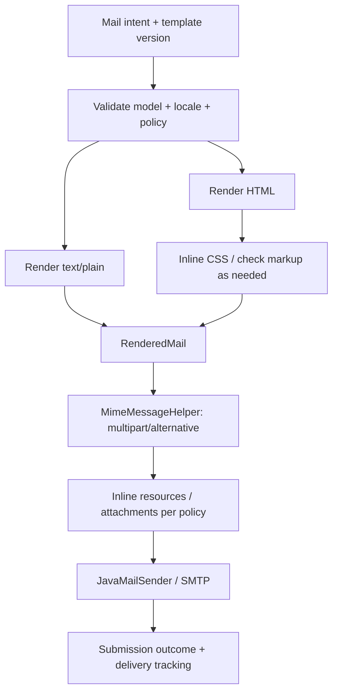

# Choosing a Template Engine by Content Requirements in Spring Framework Mail

In a Spring Boot application, sending an email with `JavaMailSender` is relatively straightforward. However, as the number of email types grows, the hard part is no longer calling SMTP, but **managing content**: wording that varies by language, order data, product lists, brand layouts, call-to-action buttons, inline images, conditional content, or edit requests from the content team.

An OTP verification email with just a few lines of text does not require the same architecture as a multi-block newsletter, a detailed invoice table, or a tenant-personalized report. Choosing a template engine solely because the project already uses it for Web MVC can pull unnecessary capabilities into email. Conversely, concatenating HTML strings by hand for every email makes maintenance, translation, escaping, and testing increasingly brittle.

**Choosing a template engine by content requirements** is an architectural decision: determining what data enters a template, who is allowed to edit it, how complex the HTML is, whether layouts/partials/looping logic are needed, which email clients must be supported, whether plain-text and multi-language versions are required, how templates are versioned, and at which stage of the sending workflow content is rendered.

> **Distinguish roles:** `JavaMailSender` and `MimeMessageHelper` handle building and sending emails via MIME/SMTP; **a template engine produces content strings**, typically HTML and/or plain text. Swapping template engines does not by itself solve TLS, SPF/DKIM, SMTP throttling, bounces, retries, or guaranteed Inbox placement.

This lesson belongs to the **Architectural Decisions** chapter of **Spring Framework Mail**. Examples use Java 17+, Spring Boot, and Jakarta Mail. The goal is to provide an explainable selection methodology, concrete implementation patterns, security/operational criteria, and a decision checklist rather than assuming one engine is best for every email type.

## 1. Start with Content Requirements, Not Library Names

Before picking Thymeleaf, FreeMarker, Mustache, or a provider template system, describe each email category as a **content product**.

| Email Category | Content | Dynamic Level | Initial Suggestion |
|---|---|---|---|
| OTP / verification code | A few sentences, code, and expiration | Low | Plain text or minimal template |
| Password reset | Instructions, link, security warning | Low–medium | Simple text + HTML |
| Order confirmation | Order details, item list, totals | Medium–high | Engine with loops, conditionals, layouts |
| Invoice | Structured info, tables, PDF attachment | Medium | HTML template + separate PDF pipeline |
| System notification | Title, body, CTA, translations | Medium | Shared layout + locale |
| Periodic report | Multiple tables, metrics, conditional display | High | Capable engine, normalized model, snapshots |
| Marketing email | Content blocks, branding, responsive, unsubscribe | High | Layout/component workflow and separate approval process |
| Per-tenant email | Custom logo, colors, language, URLs, legal text | High | Versioned template registry + policies |

These examples only suggest directions. One product may use **a single unified engine** because the operational cost of running multiple engines outweighs per-email optimization; another may reasonably use a text formatter for OTPs and Thymeleaf for reports.

### 1.1. Ten Questions to Answer

1. Is the content `text/plain` only, or is `text/html` also needed?
2. Are repeating lists, conditionals, and business-state branches required?
3. Are shared layouts, headers/footers, and multiple reusable blocks needed?
4. How many languages and regional variants exist?
5. Who edits templates: developers, product/content teams, partners, or tenants?
6. Are preview, approval, history, and content rollback required?
7. Does content include sensitive data like OTPs, recovery links, invoices, or PII?
8. Must the renderer run separately from mail workers or outside the JVM?
9. What are the expected traffic, render SLA, and resource limits?
10. If a template changes while a job is waiting to retry, **which version** must be sent?

Without answering these questions, a template-engine syntax comparison matrix easily devolves into personal preference.

### 1.2. Separate Mandatory Requirements from Nice-to-Haves

Example for a transactional email module:

**Mandatory:** Vietnamese/English, HTML + plain text, default HTML escaping, shared header/footer, fixture-based testability, no arbitrary expression execution by senders.

**Nice-to-have:** live preview, email components, drag-and-drop, no-code editor, A/B testing.

Do not build a dynamic database-backed template system with an editor just because "marketing might need it later." The costs of versioning, sandboxing, approvals, and permissions are substantial.

## 2. Email HTML Is Not Web Page HTML

Modern browsers and email clients do not share the same rendering capabilities. A React page using CSS Grid, JavaScript, external stylesheets, and custom fonts may look great on the web yet render broken in several mail clients.

### 2.1. Constraints to Account for from the Start

- Many email clients strip JavaScript, forms, and certain HTML elements.
- Modern CSS support varies; some clients rely on idiosyncratic rendering engines.
- Inline CSS is generally preferred for compatibility, though not all inline CSS works everywhere.
- Table-based layouts remain common when broad client support is required.
- Dark mode can alter or invert colors unexpectedly.
- External image URLs may be blocked or loaded through proxies.
- Fonts may fall back; never place critical information solely inside images.
- Some clients clip/truncate large HTML emails.
- Links, CTAs, unsubscribes, preheaders, and plain-text versions all affect user experience.

**Do not pick a template engine because it can render complex HTML** and assume mail clients will display it properly. The engine is just one layer in the pipeline.

### 2.2. The Complete Content Pipeline



Here the template engine is used at the render step. MIME, attachments, sender verification, submission, queueing, and delivery are separate responsibilities.

## 3. Template Engine Selection Matrix

Common choices in the Java/Spring ecosystem:

| Solution | Key Characteristics | Considerations | Initial Fit |
|---|---|---|---|
| **Simple strings/formatting** | No heavy engine added; easy for a few variables | Easy to concatenate broken HTML, lacks layout/escaping | Very small text emails |
| **Thymeleaf** | HTML templates read close to native HTML; fragments/layouts and Spring integration | Must configure resolver/escaping properly; do not misuse MVC view resolution | HTML emails with multiple variants, layouts, locales |
| **FreeMarker** | Strong template logic, macros, includes; convenient for text and HTML | Separate template language; control auto-escaping/sandboxing | Reports, tables, complex conditional content |
| **Mustache** | Relatively logic-less; simple model, sections/partials | Limited expressiveness; awkward when content rules multiply | Easily governed templates, logic kept in Java |
| **Dedicated email engine/components** | Email-specific components/layouts and compilers | Adds build/runtime steps, versions, and toolchain | Specialized HTML email design |
| **Provider-side templates** | Provider offers editor/campaign workflow | Vendor lock-in, API coupling, access permissions, version drift | Marketing/transactional if provider fits |
| **Dedicated renderer service** | Decouples rendering from mail transport, reusable across systems | Adds network boundary, SLA, auth/consistency | Large systems with many event sources |

**Mustache** and other engines still require proper auto-escaping configuration; "logic-less" does not mean content is protected against all injection classes. **FreeMarker** can fit plain-text emails very well, not just HTML. **Thymeleaf** also has a TEXT template mode; it is not limited to HTML.

### 3.1. Weighted Factors

One decision method is scoring each criterion:

| Criterion | When Weight Is High | What to Prioritize |
|---|---|---|
| HTML safety | Content includes many user-supplied values | Default escaping, render rule reviews |
| Display logic | Heavy tables/arrays/conditionals | Engine with clear loops/conditions |
| Reusability | Dozens of templates sharing a brand | Layouts/fragments/macros/partials |
| Author skill | Content team needs to edit | Approachable syntax, preview, approval |
| Multi-language | Many locales | Clear resolvers/messages/bundles |
| Testability | Critical transactional emails | Deterministic rendering, fixtures, versioning |
| Operations | Many workers/tenants | Caching, publish/rollback, quotas |
| Template security | Editor/tenant customization exists | Sandboxing/allowlists/approvals |
| Portability | Multiple SMTP providers | Provider-independent renderer |
| Time to implement | A few simple emails | Minimize dependencies/complexity |

Do not score mechanically if a requirement is a **hard constraint**—for instance, tenant-supplied templates must not execute arbitrary expressions. A safety constraint can disqualify an option outright regardless of its rich features.

## 4. Architectural Boundaries: MailCommand, Renderer, and Sender

A maintainable design usually **does not let business services both compose HTML and configure SMTP**:

```text
OrderService
    |
    v
MailCommand {
  templateKey, templateVersion, recipient,
  locale, immutable model, idempotencyKey
}
    |
    v
MailRenderer
    |
    v
RenderedMail {
  subject, plainText, html, resources
}
    |
    v
MailTransportGateway
    |
    v
JavaMailSender
```

Interfaces allow swapping template engines without touching SMTP call sites:

```java
public interface MailRenderer {
    RenderedMail render(MailRenderRequest request);
}

public record MailRenderRequest(
        String templateKey,
        String templateVersion,
        java.util.Locale locale,
        java.util.Map<String, Object> model) {
}

public record RenderedMail(
        String subject,
        String plainText,
        String html) {
}
```

This is an **illustrative contract**; in a real project, typed models can replace `Map<String,Object>` to avoid wrong keys/types and support compile-time validation. For attachments/inline resources, `RenderedMail` can be extended with safe descriptor lists instead of embedding unbounded bytes into events.

### 4.1. Why Not Return MimeMessage Directly from the Renderer?

Ideally the renderer knows only **content**, not SMTP hosts, usernames/passwords, providers, or network side effects. It can return text + HTML, letting the MIME builder/sender add From/To, Content-ID, and attachments and submit.

In special cases, a renderer might return a prepared `MimeMessage` if the architecture accepts the coupling; however:

- Hard to unit test plain-text/HTML parts without initializing Jakarta Mail.
- Risk of depending on email transport state.
- Easy to inject unvalidated tenant-supplied data into headers.
- Hard to reuse the renderer with a provider REST API.

Separating boundaries is a **design choice**, not an absolute Spring mandate.

### 4.2. Do Not Let Templates Decide Business Behavior

A template may decide **presentation** when a field is absent, but business services must decide:

- Is the email allowed to be sent?
- Is the recipient address authorized to receive the notification?
- Are consent/suppression checks required?
- Has the OTP/token expired?
- Which tenant owns the data?
- Which sender identity is approved?

Do not turn a template conditional into the enforcement point for authorization or business transactions.

## 5. When Is a Full Template Engine Unnecessary?

For short emails with fixed, rarely changing content, a text-formatting function may suffice. Example task-completion notification email:

```java
public String renderPlainNotification(
        String safeTaskName,
        String stateLabel) {

    return """
            Task: %s
            Status: %s

            This is an automated email. Please do not reply.
            """.formatted(safeTaskName, stateLabel);
}
```

This fits when `safeTaskName` and `stateLabel` are normalized, bounded in length, and used strictly as plain text. It cannot produce safe HTML; do not take that string and concatenate it into `<div>...`.

### 5.1. Error-Prone Formatting Situations

With `String.format`/`formatted`:

- `%` signs in templates carry format semantics.
- Variable substitution via `replace(...)` can unintentionally replace text inside values.
- Dates/times/currencies must be locale-formatted, never default `toString()`.
- When HTML is assembled manually, escaping is easily missed.
- Long content, lists/conditionals, and translations make the method unwieldy.

With `MessageFormat`:

- Single-quote and brace syntax have special semantics.
- Locale-based formatting must be understood carefully.
- It is not an HTML sanitizer and does not handle HTML escaping.

**Do not adopt a new engine just to substitute two placeholders**, yet do not cling to a homegrown "mini template language" once includes/layouts and complex conditionals are needed.

### 5.2. Plain-Text Resource File Option

Even without a template engine, text can live in `src/main/resources/mail/text/...` and integrate with translations/resource bundles:

```text
mail/text/order-confirmed_vi.txt
mail/text/order-confirmed_en.txt
```

The benefit is reviewing content as an independent asset rather than embedded in Java methods. Ensure UTF-8 charset, version alongside releases, and test for missing placeholders.

### 5.3. When to Upgrade Beyond a Plain Formatter?

Signs include:

- Each email has multiple branches by product/locale.
- Shared footers, legal notices, and brand components appear.
- Multiple HTML blocks are introduced.
- Content teams frequently revise wording.
- Preview and approval workflows are needed.
- Per-tenant emails have differing content.

At that point, the cost of a mainstream engine is usually lower than maintaining custom content logic.

## 6. Thymeleaf: A Strong Choice for Layout-Based HTML Emails

**Thymeleaf** fits when templates should look close to natural HTML, using attributes for data rendering, loops, conditionals, and fragments. It is often a convenient option for Spring apps keeping templates in the codebase.

Email-relevant capabilities:

- `th:text` to insert text into HTML with proper escaping.
- `th:each` to iterate lists.
- `th:if`/`th:unless` for conditional presentation.
- `th:href` and `th:src` to bind URLs/assets.
- `th:replace`/`th:insert` for fragments/layouts.
- `Context` with `Locale` for regional rendering.
- Template resolvers and caching for classpath resources.

### 6.1. Spring Boot Dependencies

Gradle example:

```groovy
dependencies {
    implementation 'org.springframework.boot:spring-boot-starter-mail'
    implementation 'org.springframework.boot:spring-boot-starter-thymeleaf'
}
```

To avoid confusion with MVC view templates, configure an **email-specific template engine**:

```java
package com.example.mail.template;

import org.springframework.context.annotation.Bean;
import org.springframework.context.annotation.Configuration;
import org.thymeleaf.TemplateEngine;
import org.thymeleaf.templatemode.TemplateMode;
import org.thymeleaf.templateresolver.ClassLoaderTemplateResolver;

@Configuration
public class MailTemplateConfiguration {

    @Bean("mailHtmlTemplateEngine")
    public TemplateEngine mailHtmlTemplateEngine() {
        ClassLoaderTemplateResolver resolver =
                new ClassLoaderTemplateResolver();

        resolver.setPrefix("mail/html/");
        resolver.setSuffix(".html");
        resolver.setTemplateMode(TemplateMode.HTML);
        resolver.setCharacterEncoding("UTF-8");
        resolver.setCacheable(true);
        resolver.setCheckExistence(true);

        TemplateEngine engine = new TemplateEngine();
        engine.setTemplateResolver(resolver);
        return engine;
    }
}
```

This configures **Thymeleaf core** for email templates. If the project needs full Spring message expressions, Spring beans, or Spring-specific dialects, consider `SpringTemplateEngine` and its matching resolver—without letting templates arbitrarily access beans/secrets. Dedicated bean names and `@Qualifier` prevent accidentally injecting the HTTP MVC engine.

### 6.2. HTML Template with Structured Data

Place file `src/main/resources/mail/html/order-confirmation.html`:

```html
<!doctype html>
<html lang="en" xmlns:th="http://www.thymeleaf.org">
<head>
    <meta charset="UTF-8">
    <title>Order Confirmation</title>
</head>
<body>
    <table role="presentation" width="100%" cellspacing="0"
           cellpadding="0" style="border-collapse:collapse">
        <tr>
            <td style="padding:24px">
                <h1>Order confirmed</h1>
                <p>
                    Hello <strong th:text="${customerName}">Customer</strong>,
                </p>
                <p>
                    Order code:
                    <strong th:text="${orderCode}">ORD-000</strong>
                </p>
                <table role="presentation" width="100%">
                    <tr th:each="item : ${items}">
                        <td th:text="${item.name}">Product</td>
                        <td th:text="${item.displayPrice}">$0</td>
                    </tr>
                </table>
                <p th:if="${hasTracking}">
                    <a th:href="${trackingUrl}">Track order</a>
                </p>
            </td>
        </tr>
    </table>
</body>
</html>
```

This template illustrates conditionals and loops. Real templates must verify HTML/CSS on target mail clients, accessibility, small-screen layouts, preheaders, alt text, footers, and plain-text versions.

### 6.3. Rendering Templates with Context

```java
package com.example.mail.template;

import java.util.Locale;
import java.util.Map;
import org.springframework.beans.factory.annotation.Qualifier;
import org.springframework.stereotype.Component;
import org.thymeleaf.TemplateEngine;
import org.thymeleaf.context.Context;

@Component
public class ThymeleafHtmlMailRenderer {

    private final TemplateEngine engine;

    public ThymeleafHtmlMailRenderer(
            @Qualifier("mailHtmlTemplateEngine")
            TemplateEngine engine) {
        this.engine = engine;
    }

    public String renderOrder(
            Locale locale,
            Map<String, Object> model) {

        Context context = new Context(locale);
        context.setVariables(model);

        return engine.process("order-confirmation", context);
    }
}
```

`model` must be built from validated application data and permitted values. Never pass entire JPA entities, servlet requests, user principals, or the Spring `ApplicationContext` into the template context.

### 6.4. Escaping and the th:utext Pitfall

With `customerName = "<script>alert(1)</script>"`, `th:text` inserts it into text context using engine escaping; `th:utext` inserts HTML **unescaped** and easily becomes XSS/HTML injection.

Never use:

```html
<div th:utext="${customerProvidedHtml}"></div>
```

for customer-supplied data. If there is a genuine *trusted HTML fragment* from a content system, clearly define the trust boundary, sanitizer/allowlist, approval, and mail-client testing. **Email clients have their own script-blocking defenses, yet web preview/admin apps can still suffer XSS when rendering raw HTML.**

### 6.5. Using Fragments to Reduce Duplication

A project with many templates can organize:

```text
mail/html/
  fragments/
    header.html
    footer.html
    button.html
  order-confirmation.html
  password-reset.html
  invoice-ready.html
```

Conceptual example:

```html
<div th:replace="~{fragments/footer :: footer}"></div>
```

Inside fragments/layouts, enforce brand parameters and legal notices via policy; do not let individual templates omit mandatory footers simply because of email type.

### 6.6. Notes on URL Handling

`th:href` generates the attribute, but does not ensure the URL belongs to an allowed domain. A `trackingUrl` from an untrusted email or request can lead to phishing, unsafe link schemes, or token leakage.

Better for the application to:

1. Obtain the base URL from trust-checked config per environment/tenant.
2. Build URLs via a URI builder with proper encoding.
3. Restrict to the `https` scheme and allowed hosts/paths.
4. Pass the validated URL into the template.
5. Never write full reset tokens/links into logs.

The template handles presentation only; it does not determine which data a URL is authorized to access.

## 7. FreeMarker: Flexible for Tables, Macros, and Conditional Content

**FreeMarker** shines when emails have rich dynamic structures like lists, tables, conditionals, or reusable macros/includes. It is frequently chosen in systems already using FTL with many newsletters or reports.

Typical constructs:

- `${...}`: interpolate expressions per output format.
- `<#list ...>`: loops.
- `<#if ...>`: conditionals.
- `<#include ...>`: include other templates.
- `<#macro ...>`: define reusable blocks.
- `Configuration` to configure template loading, encoding, exception policy, and caching.

### 7.1. Dependencies and Configuration

Gradle example:

```groovy
dependencies {
    implementation 'org.springframework.boot:spring-boot-starter-mail'
    implementation 'org.springframework.boot:spring-boot-starter-freemarker'
}
```

You can create a dedicated email configuration:

```java
package com.example.mail.template;

import freemarker.template.Configuration;
import freemarker.template.TemplateExceptionHandler;
import org.springframework.context.annotation.Bean;

@org.springframework.context.annotation.Configuration
public class FreeMarkerMailConfiguration {

    @Bean("mailFreemarkerConfiguration")
    public Configuration mailFreemarkerConfiguration() {
        Configuration config =
                new Configuration(Configuration.VERSION_2_3_32);

        config.setClassLoaderForTemplateLoading(
                getClass().getClassLoader(), "/mail/freemarker");
        config.setDefaultEncoding("UTF-8");
        config.setTemplateExceptionHandler(
                TemplateExceptionHandler.RETHROW_HANDLER);
        config.setLogTemplateExceptions(false);
        config.setWrapUncheckedExceptions(true);
        config.setFallbackOnNullLoopVariable(false);
        return config;
    }
}
```

`Configuration.VERSION_2_3_32` is an API compatibility version in this example, **not a mandatory version**. When applying, use the dependency version aligned with Spring Boot and verify the actual FreeMarker version present. For HTML emails, enable escaping via **HTML output format**; do not send a text-mode template assuming it auto-escapes HTML.

### 7.2. HTML Template with Explicit Escaping

File `src/main/resources/mail/freemarker/invoice-ready.ftlh`:

```html
<#ftl output_format="HTML" auto_esc=true>
<!doctype html>
<html lang="en">
<body>
    <h1>Invoice is ready</h1>
    <p>Hello ${customerName},</p>
    <p>Invoice number: ${invoiceNumber}</p>
    <#if lines?has_content>
      <table role="presentation" width="100%">
        <#list lines as line>
          <tr>
            <td>${line.label}</td>
            <td>${line.amountText}</td>
          </tr>
        </#list>
      </table>
    </#if>
    <p><a href="${invoiceUrl}">View invoice</a></p>
</body>
</html>
```

Auto-escaping mitigates HTML injection at text/attribute insertion points. It **does not verify** that URLs use safe hosts/schemes or that text contains no forbidden data. Never use `?no_esc` on user- or partner-supplied content.

### 7.3. Rendering by Locale

```java
package com.example.mail.template;

import freemarker.template.Configuration;
import freemarker.template.Template;
import freemarker.template.TemplateException;
import java.io.IOException;
import java.io.StringWriter;
import java.util.Locale;
import java.util.Map;
import org.springframework.beans.factory.annotation.Qualifier;
import org.springframework.stereotype.Component;

@Component
public class FreeMarkerMailRenderer {

    private final Configuration configuration;

    public FreeMarkerMailRenderer(
            @Qualifier("mailFreemarkerConfiguration")
            Configuration configuration) {
        this.configuration = configuration;
    }

    public String renderInvoice(
            Map<String, Object> model,
            Locale locale) throws IOException, TemplateException {

        Template template = configuration.getTemplate(
                "invoice-ready.ftlh", locale, "UTF-8");
        StringWriter output = new StringWriter();
        template.process(model, output);
        return output.toString();
    }
}
```

Do not instantiate a new `Configuration` per job. `Configuration` should be finalized before sharing across workers; changing loaders/template sources/caches at runtime requires an explicit publish strategy.

### 7.4. Where Should Macros and Includes Live?

```text
mail/freemarker/
  macros/
    buttons.ftlh
    invoice-table.ftlh
  fragments/
    legal-footer.ftlh
  invoice-ready.ftlh
  payment-failed.ftlh
```

Macros can render CTAs/buttons or standard table rows. However, do not move tax calculation, invoice access checks, or payment-status logic into FTL expressions. Business logic must finish before the renderer receives the model.

### 7.5. Data Considerations

A powerful FreeMarker template can invoke getters/methods on model objects depending on object wrapper/config. Avoid passing entities/service objects with sensitive methods; prefer immutable DTOs or Maps containing precomputed values. For templates from untrusted sources, **do not execute them as trusted templates** merely because auto-escaping is enabled; require sandboxing/approval or a more restricted format.

## 8. Mustache: Simplifying Logic Inside Templates

**Mustache** fits when you want relatively simple templates using placeholders, sections, and partials, while keeping data decisions, business conditionals, and formatting in Java.

Example:

```html
<!doctype html>
<html lang="en">
<body>
  <h1>Order confirmed</h1>
  <p>Hello {{customerName}},</p>
  <p>Order code: {{orderCode}}</p>
  {{#items}}
    <p>{{name}}: {{displayPrice}}</p>
  {{/items}}
  {{^items}}
    <p>No items to display.</p>
  {{/items}}
</body>
</html>
```

Sections display or iterate collections; inverted sections handle empty cases. Mustache supports partials in many implementations for reusing headers/footers.

### 8.1. Pros

- Harder for templates to accumulate complex computational logic than expression-rich engines.
- Easier to hand templates to content-oriented authors when guidelines exist.
- Data is explicitly determined in the Java-built model.
- Fits many notification emails with moderate layouts.

### 8.2. Trade-offs to Accept

- Currency/date/time formatting and complex branching should happen beforehand.
- Multi-level visibility conditionals can bloat the model with Boolean flags.
- As business logic grows, model builders can become bulky.
- Partial inheritance/layouts vary by implementation and must be verified rather than assumed identical to FreeMarker/Thymeleaf.
- Escaping must be verified per implementation/mode, especially for raw HTML.

### 8.3. Rendering Pattern with Mustache.java

An example with the `com.samskivert.mustache` implementation:

```java
import com.samskivert.mustache.Mustache;
import com.samskivert.mustache.Template;
import java.io.StringReader;
import java.util.Map;

public String renderMustache(
        String trustedTemplate,
        Map<String, Object> safeModel) {

    Template compiled = Mustache.compiler()
            .escapeHTML(true)
            .compile(new StringReader(trustedTemplate));

    return compiled.execute(safeModel);
}
```

This code is specific to one implementation, not a universal API across all Mustache libraries. In production, compile/cache trusted templates by `templateKey/version` instead of compiling from source on every send. Never let external callers submit arbitrary Mustache strings to run under service privileges.

### 8.4. Watch Out for Raw HTML Syntax

Some Mustache implementations support unescaped output via triple braces:

```html
<div>{{{trustedHtmlFragment}}}</div>
```

Never use this syntax with user input. If the product requires rich HTML blocks, verify whether they are fragments from a trusted component library, have sanitization/approval, and could cause XSS in internal previews.

### 8.5. Mustache or FreeMarker?

A key question: *how much presentation logic does the team want inside template files?*

- If placeholders and show/hide sections suffice, Mustache is often enough.
- If heavy macros, structured loops, formatting, and complex tables are needed, FreeMarker may be more convenient.
- If designers prefer working with HTML attributes and fragments, Thymeleaf may feel more intuitive.

There is no absolute winner; the project team's ability to review, test, and maintain long-term is what matters most.

## 9. Templates Managed at the Email Provider

Some SMTP/email API providers offer tools for dynamic templates or marketing campaigns. The application can send a `templateId` and model, and the provider renders it.

```text
Application
  -> MailSendRequest {
       providerTemplateId,
       model,
       recipient
     }
  -> Provider API
  -> Provider renders content
  -> Delivery pipeline
```

Potential strengths include:

- Editor/preview for content teams.
- Approval workflows or version history if supported by the provider.
- Provider-native template/campaign experiments.
- Less HTML rendering responsibility inside the application.

However, major trade-offs exist:

- **Vendor lock-in:** template syntax and IDs are tied to the provider.
- **Version drift:** live template content may change before a job retries.
- **Data:** models containing customer names, order info, and links flow to the provider.
- **Security:** provider-side template edit permissions, API keys, and tenant boundaries.
- **Observability:** hard to know the exact HTML rendered without snapshots/audits.
- **Testing:** local unit tests cannot easily reproduce the provider's renderer.
- **Failover:** when failing over to provider B, provider A's template ID may not exist.

### 9.1. Provider Templates Are Not JavaMailSender Templates

`JavaMailSender` sends a `MimeMessage` already prepared by the application. To let the provider render by `templateId`, you typically must call the provider's corresponding API instead of simply `JavaMailSender.send(...)`, unless the provider documents an explicit SMTP extension/API.

Do not pass `templateId` in the Subject or a custom header assuming an SMTP relay will render it.

### 9.2. When to Choose Provider-Managed Templates?

- Content teams edit frequently and the provider's editor/approval workflow fits.
- The project accepts vendor coupling and knows how to export/migrate.
- Template versions are pinned or snapshotted per contract.
- Personal data is permitted to be sent to the provider.
- Test/preview pipelines and fallbacks are defined.

For legal or security emails with strict audit requirements, carefully evaluate the ability to reconstruct **the exact content actually sent**, template export/recovery rights, and freeze/version workflows.

## 10. Component-Based Email Rendering and MJML

When rich HTML emails have many components, Thymeleaf/FreeMarker can still produce final markup, but **authoring responsive, client-compatible HTML** may benefit from a dedicated layer:

```text
Design tokens + components
    |
    v
Email markup source (e.g., MJML/components)
    |
    v
Build/compile -> email-compatible HTML
    |
    v
Template variables + content render
    |
    v
MIME alternative + SMTP
```

**MJML** is a markup language/compiler targeting email HTML, not a Spring Mail library or SMTP sender. It can complement the design workflow, but does not replace dynamic data rendering or authorization.

### 10.1. Compile at Build Time or Runtime?

**Build time:** the compiler runs in CI/CD, and HTML artifacts are committed/published by version.

- Pro: no Node/renderer process inside mail workers, predictable performance.
- Must ensure compiled artifacts preserve the Java engine's placeholders/syntax.
- Every layout change needs a publish/rollback workflow.

**Runtime:** the renderer compiles layouts on send.

- Flexible for dynamically edited templates.
- Consumes CPU and adds runtime dependencies, expanding failure surface.
- Must sandbox untrusted templates and govern caching.

For high-volume transactional emails with infrequent layout changes, compile-time or publish-time is usually easier to operate than unbounded runtime compilation.

### 10.2. React Email or UI Component Libraries

A front-end team may prefer authoring emails in React-based components or similar tools, exporting HTML, and handing it to Spring workers to send. This requires a **clear contract between renderer and mail transport**:

- HTML output and text fallback.
- Escaping/URL policies.
- Template/component versioning.
- Localization.
- Images/assets.
- Content size limits.
- Trace IDs and failure handling.

Never pass raw JSX/React code to `JavaMailSender` expecting mail clients to run JavaScript. HTML must be rendered into client-compatible content before MIME assembly.

## 11. A Good Email Usually Includes Both text/plain and text/html

Template engine selection should not rest on HTML alone. A quality transactional email usually has **two versions of the same content**:

```text
MimeMessage
└── multipart/alternative
    ├── text/plain; charset=UTF-8
    └── text/html;  charset=UTF-8
```

Clients can pick the appropriate part. The plain-text version also helps accessibility, HTML-restricted environments, and debugging. **Never assume stripping HTML tags produces a good plain-text version**: link anchors, tables, reading order, and hidden preheaders can become garbled.

### 11.1. Two Templates from One Model

Example:

```text
Template key: ORDER_CONFIRMATION
Template version: v6
Locale: vi-VN
Model:
  customerName
  orderNumber
  itemSummaries[]
  totalAmountText
  orderDetailsUrl

Render output:
  subject: "Xác nhận đơn hàng ORD-2026-001"
  text:    "Chào An,..."
  html:    "<!doctype html>..."
```

Both versions are rendered from the **same business snapshot** to avoid HTML quoting total A while text quotes total B. For token-bearing emails, plain and HTML should carry the exact same challenge/link with its deadline.

### 11.2. JavaMailSender + MimeMessageHelper

A sample gateway:

```java
package com.example.mail.transport;

import jakarta.mail.MessagingException;
import jakarta.mail.internet.MimeMessage;
import org.springframework.mail.javamail.JavaMailSender;
import org.springframework.mail.javamail.MimeMessageHelper;

public final class SmtpMailGateway {

    private final JavaMailSender sender;

    public SmtpMailGateway(JavaMailSender sender) {
        this.sender = sender;
    }

    public void submit(
            String from,
            String recipient,
            RenderedMail rendered) throws MessagingException {

        MimeMessage mime = sender.createMimeMessage();
        MimeMessageHelper helper = new MimeMessageHelper(
                mime, true, "UTF-8");

        helper.setFrom(from);
        helper.setTo(recipient);
        helper.setSubject(rendered.subject());

        helper.setText(
                rendered.plainText(),
                rendered.html());

        sender.send(mime);
    }

    public record RenderedMail(
            String subject,
            String plainText,
            String html) {
    }
}
```

This snippet assumes the model is already validated and the renderer returns non-null text and HTML. `MimeMessageHelper.setText(plainText, htmlText)` creates the proper alternative body parts. The helper uses `multipart=true` in case attachments/inline parts are added, though mixed multipart is not required when sending text only.

**Important:** `sender.send(...)` can throw `MailException`; the signature above only declares `MessagingException` for MIME preparation, which does not mean all send failures are checked exceptions. The worker layer should classify and persist submission outcomes.

### 11.3. Never Log RenderedMail

`RenderedMail` may contain customer names, order details, reset tokens, or contract text. Avoid:

```java
log.info("Rendered mail={}", rendered);
```

A Java record's `toString()` prints every field, easily leaking message bodies. Log `mailJobId`, `templateKey`, `templateVersion`, `locale`, render duration, and encoded outcome—never dump HTML/text.

### 11.4. Choosing an Engine for the Subject

The Subject is usually a short string, yet still requires:

- Localization.
- Proper information ordering.
- Omitting unnecessary confidential data.
- Reasonable length limits.
- Stripping control characters/CRLF from user input to prevent header injection.
- UTF-8 encoding via Jakarta Mail/`MimeMessageHelper`.

You can render the Subject with a separate text template or controlled formatting in Java. **There is no need to use an HTML engine to render Subject** and risk putting markup into headers.

## 12. CSS, Layout, Preheaders, and Accessibility Are Tool Selection Criteria

A template engine can output valid markup and still look broken on certain clients. Therefore, when picking an engine, clarify who owns **email layout** and compatibility testing.

### 12.1. Email-Style Layout

A simple layout:

```html
<!doctype html>
<html lang="en">
<head>
  <meta charset="UTF-8">
  <meta name="viewport" content="width=device-width, initial-scale=1">
</head>
<body style="margin:0;padding:0;background:#f5f5f5">
  <table role="presentation" width="100%"
         cellspacing="0" cellpadding="0" border="0">
    <tr>
      <td align="center" style="padding:24px">
        <table role="presentation" width="600"
               cellspacing="0" cellpadding="0" border="0"
               style="max-width:600px;width:100%;background:white">
          <tr>
            <td style="padding:32px;font-family:Arial,sans-serif">
              <h1 style="margin:0 0 16px">Notification</h1>
              <p>Email content...</p>
            </td>
          </tr>
        </table>
      </td>
    </tr>
  </table>
</body>
</html>
```

This illustrates table-based email structure, not a complete template or a guarantee of identical rendering across all email clients. Use responsive techniques supported by your real target clients.

### 12.2. CSS Inlining

If the team writes CSS in `<style>` blocks or stylesheets, the pipeline may include a post-render **CSS inlining** step. Be careful:

- A CSS inliner can alter markup/attributes.
- Rendering dynamic values directly into CSS without context awareness can cause style injection.
- Never take an arbitrary raw CSS string from an untrusted tenant and inject it into the layout.
- Render/test both before and after inlining.
- CSS inlining does not replace escaping/HTML sanitization.

For simple themes, allowlisted color/spacing tokens and classes/inline styles are much easier to govern than arbitrary CSS inside templates.

### 12.3. Preheaders

A preheader is the preview text snippet some clients show in the inbox list. It can be a field on `RenderedMail` or a hidden HTML block using a tested technique:

```text
subject:    "Order ORD-2026-001 has been confirmed"
preheader:  "View order details and estimated delivery time."
```

Never repeat OTP codes, medical details, or sensitive data in the preheader since it can appear on lock screens and inbox previews.

### 12.4. Accessibility

- Use properly ordered headings.
- Provide clear link/CTA text.
- Add `alt` text on meaningful images.
- Never replace all content with images.
- Ensure contrast and font fallbacks.
- Never rely on color alone to convey status.
- Keep the plain-text version complete with all critical info.

Choosing an engine with convenient table/fragment syntax only improves authoring speed. **Accessibility must be verified on the rendered HTML output.**

### 12.5. Dark Mode and Mobile

Dark mode can alter email background and text colors. Do not assume "Thymeleaf rendered cleanly, so dark mode looks right." Create test snapshots/previews for desktop/mobile across target clients; with per-tenant themes, verify contrast for colors, text, and logos.

## 13. Multilingual Support, Locales, and Time

A Vietnamese-only template might not need a locale-aware resolver yet. Once English, Japanese, regional addresses, or currency formats appear, localization becomes an **architectural constraint**.

### 13.1. What Must Be Localized

| Component | Example |
|---|---|
| Subject | "Xác nhận đơn hàng" vs "Order confirmed" |
| CTA | "View invoice" vs localized equivalent |
| Plain text | Sentence order and instructions |
| HTML text | Headings, labels, footer |
| Dates/times | `dd/MM/yyyy` vs other formats |
| Currency | VND, USD, JPY per locale/business rules |
| Product names | Possibly translated labels |
| Legal notices | May vary by country/tenant |
| Unsubscribe/privacy text | Per mail category and policy |

Not every field is a word-for-word swap from Vietnamese to English. Some languages alter sentence structure and pluralization; templates/bundles must be flexible enough.

### 13.2. Where Should Locale Come From?

Locale should come from an authoritative source:

1. Recipient's stored preference.
2. Business workflow language if applicable.
3. Tenant default locale.
4. Product-defined fallback.

Never default to `Locale.getDefault()` on worker machines; containers may run with different locales and output can shift across deployments.

### 13.3. Format Data Before Rendering

Example:

```java
import java.math.BigDecimal;
import java.text.NumberFormat;
import java.time.Instant;
import java.time.ZoneId;
import java.time.format.DateTimeFormatter;
import java.util.Currency;
import java.util.Locale;

public record OrderDisplayModel(
        String totalAmountText,
        String createdAtText) {
}

public OrderDisplayModel formatOrder(
        BigDecimal total,
        Currency currency,
        Instant createdAt,
        ZoneId recipientZone,
        Locale locale) {

    NumberFormat money = NumberFormat.getCurrencyInstance(locale);
    money.setCurrency(currency);

    String amountText = money.format(total);
    String dateText = DateTimeFormatter
            .ofPattern("dd MMM uuuu HH:mm", locale)
            .withZone(recipientZone)
            .format(createdAt);

    return new OrderDisplayModel(amountText, dateText);
}
```

`NumberFormat` is mutable, so create it per rendering scope/thread or synchronize appropriately. `DateTimeFormatter` is immutable and safely reusable. For currency, determine rounding/scale by business rules before rendering rather than relying solely on UI formatters.

### 13.4. Timezones and Deadlines

Password-reset example:

```text
"Link valid until 16:30 on 12/11."
```

If the recipient is in another timezone, this wording can mislead. Store deadlines as `Instant` and render in an explicitly chosen/stated timezone; never use server local time as an implicit identity.

When retrying 30 minutes later, verify the token is still valid. Never assume a template saying "link valid for 30 minutes" extends the token.

### 13.5. Locale-Specific Templates or Message Bundles?

**Separate templates per locale:**

```text
order-confirmation_vi.html
order-confirmation_en.html
```

Suitable when layout/sentence order differs substantially. Trade-off: updating layouts in multiple files.

**One template + message bundles:**

```text
messages_vi.properties
messages_en.properties
```

Suitable when layout is shared and mostly labels differ. Ensure the engine resolves messages properly and defines behavior for missing keys.

**Hybrid:** shared layout + locale-specific content partials is a practical pattern for many languages.

### 13.6. Testing Missing Translations

When a template references `order.total` and one locale lacks the key:

- Never send literal `??order.total??` or internal placeholders to production email.
- Define a controlled fallback, or fail rendering before SMTP.
- Add CI/review tests to detect missing keys.
- When falling back, log error code/locale metadata without logging personal data.

Never silently fall back to English when a recipient requires a legally mandated language and policy forbids fallback.

## 14. Template Security: Escaping, Injection, and Untrusted Data

A template engine inserts data, but does not make that data inherently safe. Emails can contain customer names, ticket titles, addresses, product descriptions, or third-party notes. All such values are **untrusted input** even when fetched from an internal database.

### 14.1. Distinguish Insertion Contexts

| Context | Example | Control |
|---|---|---|
| HTML text node | Customer name inside `<p>` | HTML escaping |
| HTML attribute | `href`, `alt` | Attribute escaping + validation |
| URL | Confirmation link | Scheme/host/path allowlist, encoding |
| CSS value | Tenant color, image URL | Allowlisted design tokens, no raw CSS |
| Plain text | Order description | Normalize control chars/length |
| MIME Subject | Subject with dynamic input | Header validation, encoding |
| Template source | Editor-submitted template | Approval/sandbox, no arbitrary execution |

HTML escaping **does not replace URL validation**. A `javascript:...` URL with escaped quotes is still unsafe. Filtering `<script>` alone is also insufficient against other HTML injection/XSS vectors in web previews.

### 14.2. Only Templates from Trusted Sources May Execute

Engines with powerful expression languages can access properties or methods on model objects. If a tenant can edit raw templates with arbitrary syntax, they might probe unintended properties, create expensive loops, or abuse engine capabilities.

A principle:

```text
Trusted template source (code/approved registry)
    + validated allowlisted model
    + safe template engine configuration
    -> rendered content

Untrusted template source
    -> NOT automatically executable with full engine privileges
```

For partner/user-authored templates, consider:

- Providing only a schema-constrained block-based editor.
- Allowing only text edits, validated image URLs, and palette colors.
- Bounding template size, block count, and iteration counts.
- Requiring approval/publish before use.
- Isolating the renderer if rich syntax must run.
- Never exposing Spring beans, secrets, file handles, or classloaders in context.
- Bounding CPU/time/memory and network access of the renderer.

Do not treat `Mustache` or any "logic-less" engine as an absolute sandbox; safety still depends on implementation, custom lambdas/helpers, partial resolvers, and model data.

### 14.3. Server-Side Template Injection (SSTI)

A dangerous bug is taking a user-submitted template string and compiling/executing it with application privileges:

```java
// Never use for untrusted user-supplied template sources.
String templateSource = httpRequest.getParameter("template");
String result = templateEngine.process(
        templateSource, context);
```

Additionally, Thymeleaf's `TemplateEngine.process(String, Context)` expects a **template name** by default, not a literal template body; the snippet illustrates the *anti-pattern of accepting arbitrary names/sources* rather than a pattern valid in every configuration. Whether name or body, callers must never choose resources outside an allowlist or read unauthorized internal templates.

Template names should be server-resolved enum/registry keys such as `ORDER_CONFIRMATION@v7`, never arbitrary paths like `../../secrets`.

### 14.4. Trusted HTML Fragments Need a Policy

When business requires rich-formatted HTML snippets, never pipe unvetted CMS raw HTML into `th:utext` or `?no_esc`.

Approach:

1. Build fragments from approved components.
2. Sanitize with an explicit allowlist HTML sanitizer if the source is rich text.
3. Disallow scripts, forms, iframes, event handlers, and unsafe schemes.
4. Bound HTML length/depth.
5. Inspect rendered HTML output as well.
6. Render previews in a sandbox/with proper escaping.

An email client may block certain active content, yet an admin dashboard rendering previews directly via `innerHTML` or unescaped templates remains vulnerable. Do not rely on mail-client defenses to protect admin systems.

### 14.5. Model Validation

Models should have an explicit schema:

```java
public record OrderConfirmationView(
        String customerDisplayName,
        String orderCode,
        java.util.List<OrderLineView> lines,
        String totalAmountText,
        java.net.URI orderDetailsUrl) {
}

public record OrderLineView(
        String name,
        String quantityText,
        String lineAmountText) {
}
```

When building the model, validate maximum item counts, field lengths, and URL allowlists. Never pass a full `OrderEntity` with lazy-loaded relations or objects containing payment tokens into a template.

### 14.6. Data Leakage via Render Exceptions

A "variable not found" error can contain field names, template paths, or surrounding content. Never log the full model when the renderer throws:

```java
catch (TemplateInputException ex) {
    log.warn(
            "mailRenderFailed jobId={} template={} failureClass={}",
            jobId, templateKey, "INVALID_RENDER_MODEL");
}
```

For deeper debugging, use restricted diagnostics with proper redaction/retention; never dump OTPs, password-reset links, or customer addresses.

## 15. Multi-Tenant Branding and Content Edit Permissions

When each tenant has its own logo, colors, brand name, and footer, engine selection must account for **tenant isolation** and publish policies.

### 15.1. Separate Brand Data from Template Logic

A design contract:

```text
Template: INVOICE_READY@v5
Locale: vi-VN
Tenant brand:
  displayName = "Store ABC"
  logoAssetId = "logo-approved-23"
  primaryColorToken = "brand-blue"
  supportUrl = approved HTTPS URL

Business model:
  invoiceNumber
  amountText
  deadlineText
```

Never let tenants supply arbitrary values like:

```text
customHtml = "<script>...</script>"
customCss  = "url(http://internal-host/...)"
templateExpression = ...
```

Instead, expose validated fields or a finite block schema.

### 15.2. Two Multi-Tenant Support Models

**One shared template, different models:** easier to maintain and test; fits when only logo/colors/support address vary.

**Per-tenant template overrides:** more flexible, but requires managing:

- Template ownership and versioning.
- Edit/approve/publish permissions.
- Pre-publish validation.
- Default fallbacks that never leak another tenant's content.
- Cache partitioning by tenant.
- Retention of older versions.
- Rollback/incident response.

If template registry lookup omits `tenantId` from the cache key, one tenant may receive another tenant's content/branding. That is a far worse bug than a wrong logo color.

### 15.3. Role Permissions

| Role | Suggested Permissions |
|---|---|
| Template viewer | View previews/metadata within tenant |
| Content editor | Author drafts for authorized tenants |
| Approver | Approve tested versions |
| Publisher | Activate new versions |
| Security reviewer | Inspect risky templates/assets |
| Mail operator | Monitor render/send outcomes without editing templates |

Never let "edit template" permissions implicitly grant access to production PII. Previews should use synthetic data or sanitized fixtures.

## 16. Versioning, Caching, and Reproducibility

A template changing **while an email job is waiting** is a very real risk. Suppose:

```text
10:00 business creates email job ORDER_CONFIRMATION
10:01 job waits for SMTP provider recovery
10:10 content team publishes template v8
10:15 worker retries the job created at 10:00
```

Should the job use v7 or v8?

There is no single right answer for every business case. However, there must be an **explicit decision**, not accidental dependence on whichever cache is warm on a worker.

### 16.1. Three Versioning Strategies

| Strategy | Meaning | Best Fit |
|---|---|---|
| Render at enqueue, store snapshot | Content fixed when job is created | Audits/sensitive transactions |
| Pin template version, render at send | Model + template version fixed | Balances storage and reproducibility |
| Always render latest version | Retries may alter content | Only when explicitly accepted by business |

For password resets/OTPs, besides versioning, check token expiry too; an old snapshot does not revive an expired link.

### 16.2. Pros and Cons of Snapshots

**Pros:**

- Retries can use the exact previously approved content.
- Easy to audit/reconcile.
- Unaffected by subsequent template publishes.

**Cons:**

- Stored HTML/text may contain PII/tokens.
- Increases storage and encryption/retention obligations.
- Links/tokens may expire.
- Sometimes a wrong wording needs correction and resending the old copy is undesirable.

If snapshots contain secrets, avoid stuffing full HTML into widely replicated outbox events/broker payloads. Store a private reference with tight permissions and TTL.

### 16.3. Pinning Immutable Template Versions

A job:

```json
{
  "mailJobId": "82a54eae-e814-4eb6-b23f-779e51c59541",
  "templateKey": "ORDER_CONFIRMATION",
  "templateVersion": "v7",
  "locale": "vi-VN",
  "modelSnapshotRef": "private-ref-102",
  "senderIdentity": "transactional"
}
```

The worker renders the exact `(templateKey, version, locale, tenant)`. If v7 was deleted while jobs still reference it, that is a lifecycle bug; retain old versions until corresponding jobs complete or expire.

### 16.4. Cache Keys Must Have Full Scope

Example:

```text
cacheKey = tenantId
         + templateKey
         + version
         + locale
         + outputKind
```

`outputKind` separates subject, text, and HTML. Never cache **RenderedMail containing per-customer data** by template key; cache only **compiled templates or verified sources**. Using personalized rendered output in a shared cache with an incomplete key can send one person's data to another.

### 16.5. Hot Reload and Publishing

For classpath templates, changes usually ship with deployments. For DB/CMS templates, enforce:

1. Create a new draft version.
2. Validate syntax, dependencies, and model schema.
3. Render previews with safe fixtures.
4. Inspect content/HTML/links/legal footers.
5. Approve and publish an immutable version.
6. Emit version-scoped invalidation/cache refresh events.
7. Monitor render errors on the new version.
8. Roll back the active version pointer if needed.

Never edit the **contents of an already published version** as a "quick fix" if older jobs depend on it; create a new version and follow an audited migration policy.

## 17. When in the Email Workflow Should Rendering Happen?

Three common placements:

### 17.1. Synchronous Rendering in the Business Request

```text
HTTP request
  -> business update
  -> render HTML/text
  -> JavaMailSender.send
```

Simple, but carries drawbacks:

- Request latency depends on rendering and SMTP.
- If SMTP runs inside a DB transaction, rollback cannot recall mail.
- Timeouts encourage callers to retry the whole request, causing duplicates.

Suitable for low-importance emails or small systems with explicit synchronous contracts; for critical transactions, decoupling into a job is usually necessary.

### 17.2. Post-Commit Rendering in a Mail Worker

```text
Business transaction:
    save order + mail_job/outbox
        |
        v
Worker:
    claim -> validate -> render -> MIME -> submit
```

Benefits:

- Does not hold HTTP requests during rendering/sending.
- Enables retries, backpressure, and durable state.
- Supports pinning template versions/model snapshots.

Note: **rendering can fail** due to missing variables or missing templates; classify these differently from SMTP transport failures. Avoid useless HTTP/SMTP retries on permanent template errors.

### 17.3. Dedicated Renderer Service

```text
Mail worker
  -> Render API (templateKey/version/modelRef)
  -> RenderedMail
  -> MIME builder
  -> SMTP
```

When multiple backends share the same template catalog, a renderer service helps standardize branding/layouts. However, it adds a network boundary, timeouts, auth, rate limiting, idempotency, latency, and sensitive-data handling.

A Render API must never let callers request another tenant's templates or return raw HTML containing unauthorized PII. Templates and models also need versioning/checksums to avoid inconsistent outputs.

### 17.4. Avoid Re-Rendering Unnecessarily Across Retries

Once MIME is built and SMTP times out, retrying the same logical job by re-rendering with "latest" data can alter message content under the same idempotency key. Depending on policy, store a snapshot or pinned version + immutable model; when content genuinely must change, classify it as a revision or a new mail intent.

## 18. Attachments, Inline Images, and Links in Templates

Template engines usually render **text/HTML**, while MIME attachments and inline resources are managed by `MimeMessageHelper`.

### 18.1. An HTML Fragment with a CID Image

Template:

```html

```

Java:

```java
MimeMessage mime = sender.createMimeMessage();
MimeMessageHelper helper =
        new MimeMessageHelper(mime, true, "UTF-8");

helper.setFrom("no-reply@example.org");
helper.setTo("customer@example.invalid");
helper.setSubject("Notification");
helper.setText(plainText, renderedHtml);

helper.addInline(
        "brand-logo",
        new org.springframework.core.io.ClassPathResource(
                "mail/assets/logo.png"),
        "image/png");

sender.send(mime);
```

**Call `setText(...)` before `addInline(...)`** per `MimeMessageHelper` usage so the inline resource is placed into the MIME structure properly in common cases.

### 18.2. Inline vs. Attachment

- `addInline(...)` creates a resource referenced by HTML via CID.
- `addAttachment(...)` creates a standalone file attachment.
- `` is a remote resource dependent on mail clients, privacy settings, and network.

Picking a template engine does not make attachments appear automatically. The renderer must return resource references/metadata, or the gateway must receive attachment lists from the validated business intent.

### 18.3. Never Let Templates Directly Access File Paths

Never let tenants/content editors put paths like `C:\secrets\...` or `/etc/...` into templates for Java loaders to read automatically. Asset references should resolve through an **approved asset registry**:

```text
brandLogoAssetId = "asset-logo-2026"
  -> server resolves owned asset
  -> validates MIME/type/size
  -> attaches via controlled resource
```

If the file was deleted or belongs to another tenant, fail rendering/preparation with an appropriate failure code; never substitute another file with the same name.

### 18.4. Remote Images and Link Tracking

Marketing emails may use tracking pixels, link redirects, or remote images. Consider:

- Consent/privacy requirements.
- Link domains and HTTPS.
- Scope of data permitted inside URLs.
- Image blocking by mail clients.
- Provider link rewriting/open tracking capabilities.
- Never treat pixel loads as definitive proof the recipient read the email.

For security emails like OTPs, avoid adding trackers or unnecessary URLs.

## 19. Performance, Caching, and Scaling Mail Rendering

When emails carry heavy dynamic data or high volume, render cost depends on:

- Compiling templates from source vs. using compiled template caches.
- Model size, loops, and fragment counts.
- CSS inlining, asset processing, PDF or related document generation.
- Template loader queries against classpath/database/CMS.
- Concurrent worker counts and CPU/memory limits.

Measure **each stage separately** instead of benchmarking only `JavaMailSender.send(...)`. SMTP/network latency can dwarf template rendering time.

### 19.1. Measure Cold Cache and Warm Cache Separately

Metrics to capture:

| Step | What to Measure |
|---|---|
| Template resolve | Time to locate version/locale/tenant |
| Compile/cold load | Uncached latency |
| Warm render | Latency with compiled template |
| Model formatting | Formatting currencies, dates/times, URLs |
| CSS inlining | HTML transformation cost |
| MIME preparation | Building alternative parts and resources |
| SMTP submission | Transport stage, not rendering |

Do not scale up worker counts merely because the queue looks slow if the real bottleneck is provider quota or object storage fetching attachments.

### 19.2. Cache the Right Objects

Safe object to cache:

```text
Compiled template:
  (tenantId, templateKey, version, locale, outputKind)
```

Dangerous object to cache with an overly broad key:

```text
Rendered HTML:
  "Hello customer A, your balance..."
```

If A's rendered body is cached under `templateKey` and reused for B, the system can leak PII. Cache rendered content only with explicit identity/scope/retention and clear business justification.

### 19.3. Resource Limits

A policy should bound:

- Table row counts and string lengths.
- HTML and text output sizes.
- Fragment/include counts and nesting depth.
- Image/attachment reference counts.
- Render duration and concurrent render requests.
- Remote template/asset fetch latency.
- Data permitted inside template contexts.

Specific numbers depend on business and provider limits, with no universal default. If a report has hundreds of thousands of rows, generate a file in a protected pipeline and send an access-controlled link instead of stuffing everything into HTML.

### 19.4. Thread Safety

Never share mutable `Context`, `StringWriter`, `NumberFormat`, or mutating Maps across mail worker threads. A configured template engine/configuration shared per the library's thread-safety contract is typically appropriate, but **do not mutate configuration/loaders while workers are rendering** without a publish/versioning mechanism.

## 20. Distinguish Render Errors from SMTP Send Errors

A template missing variable `invoiceUrl` is a content-preparation failure, not a transport failure. If workers classify every exception as `SMTP_FAILED`, on-call may troubleshoot credentials or trigger futile retries.

Reference application enum:

```java
public enum MailFailureClass {
    TEMPLATE_NOT_FOUND,
    TEMPLATE_VERSION_MISSING,
    TEMPLATE_SYNTAX_ERROR,
    MISSING_RENDER_VARIABLE,
    INVALID_RENDER_MODEL,
    UNSAFE_CONTENT_OR_URL,
    ASSET_NOT_AVAILABLE,
    HTML_TOO_LARGE,
    SMTP_AUTHENTICATION,
    SMTP_THROTTLED,
    SMTP_SUBMISSION_UNKNOWN
}
```

### 20.1. Appropriate Retry by Root Cause

| Error | Handling Direction |
|---|---|
| Missing template key/version | Fix registry/deployment; do not blindly retry SMTP |
| Model missing required variable | Validate/fix snapshot; do not send incomplete content |
| Template syntax error | Roll back/publish fixed version |
| Missing locale-specific translation | Approved fallback or fail rendering |
| CMS temporarily unavailable | May retry load with backoff |
| Asset storage timeout | May retry if resource remains valid |
| URL outside allowlist | Security/policy reject |
| HTML exceeds size limit | Trim/summarize content |
| SMTP throttle | Backoff, rate limiter |
| Uncertain SMTP outcome | Reconcile before resending |

### 20.2. Never Send Blank Emails When Templates Fail

Wrong:

```java
String html;
try {
    html = renderer.render(request);
} catch (Exception ex) {
    html = "";
}
sender.send(buildMime(html));
```

The system could send empty emails or omit critical information. When rendering fails, mark the job `RENDER_FAILED`/`DEAD_LETTER` per policy and handle separately. Falling back to plain text is **valid only when pre-designed and approved**, never silently collapsing to an empty string.

### 20.3. Protect Data When Logging Errors

Never log the full `MailRenderRequest` or model because it may hold tokens/PII. Log `mailJobId`, template key/version, locale, failure class, and duration. For detailed debugging, use restricted diagnostic logging with redaction/retention.

### 20.4. Re-Rendering on Retry

If rendering succeeded but SMTP failed, a retry can:

1. Reuse the exact rendered snapshot if still valid.
2. Re-render from the **pinned template version + immutable model snapshot**.
3. Create a **new intent** if business content changed.

Do not silently switch to the latest template during retry under the same idempotency key if changing content could mislead recipients—especially for invoices and security emails.

## 21. Testing Templates: Content Must Be Correct, Not Just Renderable

A well-chosen engine must allow unit testing content **without connecting to SMTP**. For transactional emails, regressions in amounts, URLs, customer names, or deadlines have real-world impact.

### 21.1. Unit Tests with Fixtures

Example checking output from `ThymeleafHtmlMailRenderer`:

```java
import static org.junit.jupiter.api.Assertions.*;
import java.util.List;
import java.util.Locale;
import java.util.Map;
import org.junit.jupiter.api.Test;

class MailTemplateRenderingTest {

    // In a real test, inject or initialize the renderer
    // with the configured mailHtmlTemplateEngine.
    private ThymeleafHtmlMailRenderer renderer;

    @Test
    void rendersOrderWithExpectedSections() {
        String html = renderer.renderOrder(
                Locale.forLanguageTag("vi-VN"),
                Map.of(
                        "customerName", "An",
                        "orderCode", "ORD-2026-001",
                        "items", List.of(Map.of(
                                "name", "Sách Java",
                                "displayPrice", "120.000 ₫")),
                        "hasTracking", false,
                        "trackingUrl", "https://example.org/orders"));

        assertTrue(html.contains("ORD-2026-001"));
        assertTrue(html.contains("Sách Java"));
        assertFalse(html.contains("th:each"));
    }
}
```

This is a **test skeleton**; initialize the renderer and template resources before running. The goal is illustrating assertions on **rendered HTML**. In real projects, use DTOs/fixtures matching the mail model contract and add HTML structure checks.

### 21.2. Testing HTML Escaping and URL Policies

Input:

```text
customerName = <script>alert("hello")</script>
```

Expected output: the user sees that literal text, with no actual script element in the HTML. You can use an HTML parser in tests to inspect the DOM instead of matching entity encodings verbatim, since renderers may encode entities differently while remaining valid.

Other cases:

- Ampersands, quotes, less-than/greater-than characters.
- Vietnamese, emojis, and complex Unicode.
- Subjects containing CRLF or control characters.
- URLs with disallowed schemes.
- Hosts outside the allowlist.
- Oversized strings or lists with too many items.
- Null/missing fields.

Ensure policy validation blocks dangerous URLs **before** templates interpolate values, rather than treating HTML escaping as sufficient.

### 21.3. Testing Missing Variables

```text
Given:
  INVOICE_READY@v4 requires invoiceNumber
When:
  model lacks invoiceNumber
Then:
  INVALID_RENDER_MODEL
  no SMTP call
```

Do not treat an invoice email containing literal `null` or a blank invoice number as success. Validate DTOs with Bean Validation or service-specific rules prior to rendering.

### 21.4. Testing Locales and Fallbacks

```text
locale=vi-VN -> Vietnamese subject and body
locale=en-US -> English subject and body
locale=fr-FR -> fallback or error per policy
missing legal-footer key -> no silent success
```

If language-specific legal obligations apply, never silently fall back to another version when policy forbids fallback.

### 21.5. Snapshot Testing

Snapshots store expected HTML/text output for fixtures. They catch unexpected layout or wording changes, yet:

- Do not prove compatibility with Gmail/Outlook/mobile clients.
- Require fixing locale, timezone, template version, dates, and random IDs.
- Oversized snapshots tempt reviewers to approve without reading.
- Store only synthetic data; never commit production PII into the repository.

Combine snapshots with content/DOM assertions and visual previews for critical emails.

### 21.6. Testing the Plain-Text Version

Verify the plain-text part:

- Contains no HTML tags or unrendered placeholders.
- Includes links/URLs that HTML only shows behind CTAs.
- Has accurate amounts/order codes/deadlines.
- Has readable reading order for screen readers/text clients.
- Preserves mandatory legal notices.

When testing HTML alone, it is easy for the plain-text version to go stale or miss information.

## 22. Testing MIME and SMTP Submission with a Sandbox

Even after the renderer returns `RenderedMail`, `MimeMessageHelper` can still be called in the wrong order or miss charsets. Verify end-to-end in an isolated environment.

```text
Render service
    -> RenderedMail(subject, text, html)
    -> MimeMessageHelper
    -> JavaMailSenderImpl
    -> local SMTP sink
```

### 22.1. Integration Test Scenario

Use Mailpit, GreenMail, or an appropriate test SMTP server:

1. Start the test SMTP server with dedicated configuration.
2. Build a synthetic fixture model.
3. Render the exact pinned template version/locale.
4. Send via `JavaMailSender` to the test server.
5. Capture MIME and assert Subject/From/To.
6. Assert `multipart/alternative` contains both text and HTML.
7. Assert Content-Type and UTF-8 encoding.
8. If CIDs are used, assert HTML `cid:...` matches the inline part's Content-ID.
9. If attachments exist, assert sanitized filename, media type, and bytes.
10. Ensure no unrendered placeholders remain.

There is no need to send real emails over the Internet to verify MIME construction; an SMTP sink suffices for many integration tests. Testing real delivery/inbox placement is a separate objective.

### 22.2. Testing Pre-Transport Error Guards

If a template has a syntax error:

```text
template syntax invalid
  -> RENDER_FAILED
  -> no JavaMailSender.send invocation
```

If the model contains a disallowed URL:

```text
URL validation rejected
  -> UNSAFE_CONTENT_OR_URL
  -> no MIME submission
```

If SMTP AUTH fails:

```text
render successful
  -> MIME built
  -> SMTP_AUTHENTICATION failure
  -> template stays unchanged
```

These three cases prevent misdiagnosing root causes and retrying in the wrong place.

### 22.3. Visual Previews Differ from Production Delivery

A Chrome preview does not fully represent email clients. When brand/layout matters, test across target email clients under conditions like mobile, dark mode, blocked images, long text, text-only, and unloaded logos.

Never use real customer mailboxes, real tokens, or internal files as visual test fixtures. If production data previews are needed in admin tools, enforce dedicated authorization and masking.

## 23. Observability for Mail Rendering

Milestones should be clearly distinguished:

```text
mail_job_created
mail_template_resolved
mail_render_started
mail_render_completed
mail_render_failed
mail_mime_prepared
mail_submission_started
mail_submitted
mail_delivery_event
```

**`mail_render_completed` is not `mail_submitted`.** Successful rendering only proves content was generated, not that SMTP was called or accepted by the provider.

### 23.1. Safe Structured Logging

```json
{
  "event": "mail_render_completed",
  "mailJobId": "933fbceb-fb56-46ba-b824-834b481378b0",
  "templateKey": "ORDER_CONFIRMATION",
  "templateVersion": "v7",
  "locale": "vi-VN",
  "engine": "thymeleaf",
  "durationMs": 13,
  "htmlBytes": 8420,
  "textBytes": 720
}
```

Numbers are illustrative. Logging `jobId` aids tracing under access control, but never log raw HTML, OTPs, recipients, or full models.

### 23.2. Recommended Metrics

| Metric | Meaning |
|---|---|
| `mail.render.duration` | Render duration by template family/engine |
| `mail.render.failures` | Errors by failure class |
| `mail.render.output.bytes` | HTML/text sizes |
| `mail.template.resolve.failures` | Missing key/version/locale |
| `mail.template.cache.hit` | Cache hits |
| `mail.template.cache.miss` | Cache misses/cold loads |
| `mail.template.publish.failures` | Invalid version publish attempts |
| `mail.jobs.render.pending` | Pre-render backlog |
| `mail.mime.prepare.failures` | MIME construction failures |
| `mail.submission.failures` | SMTP failures tracked separately |

Tags should have bounded cardinality: `engine`, `mailType`, `templateFamily`, `failureClass`, `environment`. Never put `mailJobId`, recipient emails, model hashes, or raw URLs/tokens into metric tags due to high cardinality and PII exposure.

### 23.3. Distributed Tracing

```text
mail.job.process [jobId=J100]
  -> mail.model.validate
  -> mail.template.resolve [version=v7]
  -> mail.render.text
  -> mail.render.html
  -> mail.mime.build
  -> mail.smtp.submit
```

When jobs cross queues and multiple instances, use durable correlation IDs or span links as appropriate. Never keep a single span open for hours across retries. Span attributes must also exclude private data.

## 24. Recommended Choices Across Four Real-World Scenarios

### 24.1. Project A — OTP and Password Reset Only

**Requirements:**

- A few lines of text and a link.
- Vietnamese/English content.
- Short deadline per email.
- No dynamic blocks or lists needed.
- Security and deliverability matter more than ornate design.

**Reasonable approach:** `text/plain` or a simple template engine for text/HTML, with a validated model and URL validation. If the app already uses Thymeleaf, a small template also works fine; do not build a dynamic editor/template registry or dedicated renderer service just for two email types.

**Core point:** token generation, expiry, rate limits, idempotency, and URL security live outside templates. The template displays the deadline accurately, but never decides whether a token is still valid.

### 24.2. Project B — E-Commerce with Many Transactional Emails

**Requirements:**

- Order confirmation, payment, shipping, invoices.
- Item lists, conditional CTAs, per-order details.
- Shared brand layout/signature.
- Locales, multi-currency.
- Template releases/rollbacks aligned with sprints.

**Reasonable approach:** Thymeleaf or FreeMarker with code-managed templates, release-immutable versions, and typed view models. Shared fragments/macros, text alternatives, mail workers/outbox, and integration tests against an SMTP sink.

**Rationale:** provides loops/conditionals/layouts without needing a full CMS for every paragraph. Choosing Thymeleaf vs. FreeMarker depends on team familiarity, syntax review habits, and expressiveness needs.

### 24.3. Project C — Multi-Campaign Marketing

**Requirements:**

- Content team edits frequently.
- Multiple CTAs, images, content blocks, and branding.
- Mobile/dark-mode previews, approvals, and unsubscribes.
- A/B testing/campaign analytics.

**Reasonable approach:** consider provider-managed templates/editors or component-based email authoring tools paired with publish/version workflows. If rendering in-house, a Java engine can inject data variables while layouts are compiled/tested via an email-specific pipeline.

**Rationale:** the bottleneck is not string interpolation speed, but enabling content teams to manage content, layout QA, and compliance.

**Mandatory point:** consent/suppression and unsubscribes cannot be mere conditionals inside templates; they belong to sending policy.

### 24.4. Project D — White-Label Multi-Tenant SaaS

**Requirements:**

- Each tenant has its own logo, colors, footer, and domain.
- Shared template family; some tenants permitted overrides.
- Must prevent data/brand cross-contamination across tenants.
- Versioning/approval and auditing required.

**Reasonable approach:** tenant-partitioned template registry, pinned versions, approved branding tokens, scoped caching, and an escaping server-side engine. Grant template editing strictly by trust level:

- Standard tenants: change allowlisted fields/logos/colors only.
- Enterprise tenants under special contracts: sandboxed custom drafts/approvals.
- Internal admins: publish with audit trails.

**Rationale:** isolation/permissions are mandatory criteria, while engine syntax is secondary.

### 24.5. You Do Not Have to Force One Engine Everywhere

An architecture can define:

```text
MailRenderer interface
    |
    +-- TextMailRenderer       -> OTP
    +-- ThymeleafMailRenderer  -> Transactional HTML
    +-- ProviderTemplateClient -> Campaign
```

However, supporting multiple engines increases:

- Dependencies to maintain and patch.
- Security and syntax review surface per engine.
- Build/test/preview standards.
- Caching/versioning complexity.
- Team operational knowledge required.

Use multiple engines only when content or workflow benefits genuinely outweigh governance overhead.

## 25. Architecture Decision Record (ADR) for Template Engines

A good decision records not only "chose Thymeleaf," but also **rationale and consequences**.

### 25.1. Sample ADR

```markdown
# ADR-EMAIL-001: Template engine for transactional mail

## Status
Accepted

## Context
- 15 transactional templates in Vietnamese and English.
- Requires HTML + text, item lists, CTAs, shared footer.
- Templates reviewed by developers in source control.
- Mail worker runs on Java 17 + Spring Boot.
- Content must be reproducible by version during retries.

## Options Considered
1. Java String/MessageFormat
2. Thymeleaf
3. FreeMarker
4. Provider-managed templates

## Decision
- Use Thymeleaf for HTML.
- Separate templates/resources for plain text.
- Typed view models + pinned template versions.
- Render in worker after outbox commit.
- Verify CSS and MIME independently.

## Rationale
- Easy to review HTML/fragments.
- Team is experienced with Thymeleaf.
- Avoids coupling to provider template APIs.
- Satisfies current locale and conditional needs.

## Risks and Mitigations
- Email CSS differs from web -> visual regression testing on mail clients.
- Raw HTML injection -> th:text and URL allowlists.
- Version drift -> immutable publish and version pinning.
- Data leakage -> no raw model/body logs.

## Triggers to Re-Evaluate
- Tenant overrides grow sharply.
- Content team needs a developer-free editor.
- Template release cycle becomes a bottleneck.
```

This is a sample ADR, not a mandate to choose Thymeleaf. A team standardized on FreeMarker or requiring provider-managed marketing templates can reach a different, equally sound decision.

### 25.2. Decision Acceptance Criteria

Before moving the ADR to Accepted, you may require a proof of concept demonstrating:

- Accurate rendering of the most complex in-scope email.
- HTML/text generated from the same view model.
- Dynamic loops and conditionals.
- Shared header/footer.
- Proper escaping against malicious inputs.
- Locale and number/date formatting.
- CSS preview on target email clients.
- Version pinning/retry behavior.
- SMTP sink testing.
- Observability of render failures and latency.

Do not benchmark a dozen engines for a system with two plain-text emails; keep evaluation proportional to architectural scope.

## 26. Migration Path from String-Concatenated HTML to a Template Engine

Suppose an existing system has:

```java
String html = "<h1>Hello " + customerName + "</h1>"
        + "<p>Order " + orderCode + " confirmed.</p>";
```

Common problems: missing escaping, hard localization, duplicated HTML, no preview or version testing.

A low-risk migration path:

### Step 1 — Document Existing Behavior

- List of email types.
- Input fields and data sources.
- Subject, text/html bodies.
- Locales and links/domains.
- Images/attachments.
- Required legal/suppression sections.

Avoid changing all wording at the same time as migrating template engines; it makes distinguishing regressions from copy edits difficult.

### Step 2 — Introduce the MailRenderer Interface

Keep SMTP independent:

```text
Business -> MailCommand -> MailRenderer -> RenderedMail
                                      -> MimeBuilder -> JavaMailSender
```

Initially, a `LegacyStringMailRenderer` implementation can wrap the old code. Once the new engine is ready, swap implementations without touching business call sites.

### Step 3 — Migrate One Email Type

Prioritize a type that:

- Has thorough fixtures/test data.
- Has few variants.
- Lacks sensitive tokens or special rules while the team ramps up.
- Allows straightforward HTML/text output comparison.

Migrate to the first template version; verify MIME/locale and visual differences.

### Step 4 — Standardize the View Model

Do not use ORM entities directly. Build typed models with constraints:

```text
Order
  -> OrderConfirmationView
      customerDisplayName
      orderCode
      displayLineItems
      totalAmountText
      orderDetailsUrl
```

Keep business calculations in the domain layer, validation in input builders, and presentation in the renderer.

### Step 5 — Build Tests and Previews

Establish:

- HTML/text unit tests.
- Escaping/URL tests.
- Locale tests.
- SMTP sink tests.
- Snapshots or visual diffs for key layouts.

Only after testing these boundaries should you migrate remaining templates.

### Step 6 — Separate Versions and Roll Out

If mail jobs remain pending when deploying the new renderer, define how old copies are preserved:

- Pin versions inside jobs.
- Retain compiled/source old versions as long as needed.
- Use canary rollout.
- Keep a rollback pointer in the template registry.

Never let new workers render old pending jobs with the latest template if business requires content as of enqueue time.

### Step 7 — Retire the Legacy Path Safely

Once all email types are migrated:

- Confirm no legacy jobs still need the old renderer.
- Retain required audit data per retention policy.
- Remove obsolete HTML string-concatenation code.
- Simplify dependencies/configuration.
- Update documentation for content teams and operators.

Never delete old template resources while any retry-pending job still references them.

## 27. Runbook and Common Pitfalls When Choosing a Template Engine

### 27.1. HTML Renders Correctly, Yet Email Clients Display It Broken

**Symptom:** web preview looks clean, but in certain mail clients the layout breaks or buttons disappear.

**Common causes:** inconsistent CSS/HTML support, blocked images, dark mode recoloring, or provider/client markup rewriting.

**Remediation:**

1. Inspect the final sent HTML (not just template source).
2. Check MIME Content-Type, charset, and alternative structure.
3. Compare specific mail clients/versions.
4. Run a CSS inliner/layout compiler if required by the pipeline.
5. Check image blocking/dark mode.
6. Test across the officially supported client matrix.

**Do not:** replace Thymeleaf with FreeMarker merely because HTML uses incompatible CSS. Both engines can emit the same broken HTML.

### 27.2. Customer Values Render as HTML Tags or Scripts

**Symptom:** a product name containing `<b>...` renders as markup.

**Causes:** unescaped output, untrusted "trusted fragments," or raw HTML concatenation.

**Remediation:** use escaped expressions, validate models, restrict CMS HTML, sanitize true rich text, and test both email output and admin previews.

### 27.3. Template Renders, Yet Placeholders Remain Literal

**Symptom:**

```text
Hello ${customerName}
```

or:

```text
Hi {{customerName}}
```

**Causes:** wrong engine/mode, file bypassed the renderer, template syntax belongs to another engine, or missing data.

**Remediation:** verify template key/version, output format, resolver, and model; add "no unrendered placeholders" tests for required fields.

**Do not:** send raw template source straight to SMTP since `JavaMailSender` does not evaluate placeholders.

### 27.4. Garbled Vietnamese Diacritics

**Possible causes:** template resource encoding, reader encoding, `MimeMessageHelper` charset, SMTP/MIME serialization, or an incorrect bytes-to-String conversion.

**Remediation:** enforce UTF-8 end-to-end across resources, renderer, model, MIME helper, and test with an SMTP sink. Never decode UTF-8 bytes to String with the platform default charset.

### 27.5. Email Sent with Wrong Tenant's Branding

**Causes:** missing tenant in template/cache keys, mutable shared theme object, or asset resolver skipping ownership checks.

**Remediation:** audit cache scopes, tenant authorization, asset registry, and run concurrent multi-tenant integration tests. This is an isolation breach that can leak data, not merely a UI glitch.

### 27.6. Retries Send Different Content from the First Attempt

**Causes:** reading active/latest template after content team published a new version, re-querying mutated business data, or lacking snapshots.

**Remediation:** define a snapshot/pinning strategy; persist template version and model reference; replay the exact version or issue a newly approved mail intent.

### 27.7. HTML and Plain Text Disagree in the Same Email

**Causes:** rendered from two different data sources, different locales, or business model mutated between renders.

**Remediation:** construct an immutable model snapshot and locale once, render both outputs from that same snapshot, and assert critical fields match.

### 27.8. Missing Template on Deployment

**Symptom:** `TemplateInputException`, FreeMarker template not found, or renderer returns an empty file.

**Causes:** wrong classpath prefix/suffix, resources omitted from packaging, key/version mismatch, or stale loader cache.

**Remediation:** inspect deployed artifact, key/locale/tenant/version, resource packaging, and cache policy. Never fall back blindly to another same-named template.

### 27.9. Rendering Is Too Slow

**Causes:** compiling every time, huge nested loops, DB queries inside getters, remote asset fetches during rendering, or heavy runtime CSS compilation.

**Remediation:** measure resolve/compile/render/inlining/MIME separately; use typed precomputed models, compiled caches, size limits, bounded workers, and timeouts. Do not tune SMTP when the bottleneck is template rendering.

### 27.10. Provider Template Changes Without Application Awareness

**Causes:** provider-managed template ID points to a live mutable draft without version pinning/auditing.

**Remediation:** use versioned provider templates where supported, log publish history, restrict editor permissions, and export/snapshot sent content when audits require it.

### 27.11. Database Template Executes Dangerous Expressions

**Causes:** letting external editors store raw template source and rendering under an overly privileged engine.

**Remediation:** narrow the data model, omit service beans, enforce block schemas/allowlists, require approvals, sandbox if needed, bound resources, and audit publishers.

### 27.12. HTML Email Too Large or Clipped by Clients

**Causes:** embedding entire huge reports/tables into the body, excessive inline styles/assets.

**Remediation:** set output size budgets, send concise summaries, attach safely prepared files or send access-controlled links; never raise limits indefinitely.

## 28. Decision and Implementation Checklist

### Requirements and Selection

- [ ] Categorized email types by text/HTML needs and complexity.
- [ ] Identified audience and supported email clients.
- [ ] Answered who edits, approves, and publishes templates.
- [ ] Determined needed extent of layouts/partials/macros/loops/conditionals.
- [ ] Defined locales/timezones/currencies and fallback rules.
- [ ] Evaluated plain formatters, Thymeleaf, FreeMarker, Mustache, and provider templates against actual needs.
- [ ] Recorded an ADR with rationale, trade-offs, and re-evaluation triggers.
- [ ] Avoided adding multiple engines without clear benefit.

### Architectural Separation

- [ ] No business logic inside templates.
- [ ] Renderer separated from transport/SMTP credentials.
- [ ] Typed view model or allowlisted schema in place.
- [ ] Both `text/plain` and `text/html` generated per policy.
- [ ] Subject/preheader validated separately.
- [ ] MIME, attachments, and inline resources managed by the proper component.
- [ ] No SMTP calls inside long database transactions.
- [ ] Outbox/job state and idempotency in place for critical emails.

### Security

- [ ] HTML escaping enabled and tested.
- [ ] No raw HTML/unescaped expressions for user data.
- [ ] Links validated for scheme/host/path and properly encoded.
- [ ] Privileged renderers never fetch untrusted URLs/assets.
- [ ] Template sources have trust boundaries, RBAC, and approvals.
- [ ] No service beans, ORM entities, or secrets passed in models.
- [ ] Callers cannot supply arbitrary filesystem/resource template names/keys.
- [ ] Tenant scope included in template/asset/cache lookups.
- [ ] No raw models, HTML, OTPs, reset links, or attachment bytes logged.

### Versioning and Operations

- [ ] `templateKey`/version/locale/tenant recorded in mail jobs.
- [ ] Decided between render-at-enqueue, pinned version, or latest.
- [ ] Cache/invalidation/rollback strategy in place.
- [ ] Old template versions retained while retry-pending jobs exist.
- [ ] Content snapshot retention and encryption aligned with PII/token sensitivity.
- [ ] Quotas for model size, output bytes, and render time.
- [ ] Metrics split between render failures/latency and SMTP.
- [ ] Missing template/variable handling prevents sending empty emails.

### Testing

- [ ] Fixtures exist per email type and locale.
- [ ] Tests verify text/HTML share the same business snapshot.
- [ ] Tests cover escaping, URL validation, and injection.
- [ ] Tests cover missing variables and nonexistent versions.
- [ ] Snapshots/visual previews cover target email clients.
- [ ] Tests verify UTF-8 and Vietnamese characters.
- [ ] SMTP sink tests verify MIME alternatives, CIDs, and attachments.
- [ ] Tests verify multi-tenant branding isolation and concurrency.
- [ ] Tests verify retry rendering preserves version and deadlines.
- [ ] No production recipients/secrets/data used in automated tests.

## 29. Frequently Asked Questions

**Does Spring Framework Mail include a default template engine?** No. `JavaMailSender` and `MimeMessageHelper` handle sending/building MIME, while content rendering uses Thymeleaf, FreeMarker, Mustache, or a custom approach chosen by the application.

**If we only need an OTP email, which engine should we pick?** If content is very short, plain text/resource formatting may suffice. If the project already uses a shared engine, reusing it is also reasonable. What matters most is validation, deadlines, URL/token security, and testability.

**When is Thymeleaf a good fit?** When you want HTML close to native markup using `th:text`/`th:each`/`th:if`, fragments/layouts, locales, and clean Spring integration.

**When is FreeMarker a good fit?** When templates feature lists/tables, macros/includes, rich presentation conditionals, and the team knows FTL syntax.

**Is Mustache always safer because it is logic-less?** No. Safety still depends on implementation, escaping, raw HTML syntax, partial resolvers, models, and template-source trust boundaries.

**Is the engine with the most features always best?** No. Unused features add learning curve, security review, and operational cost. Pick capabilities sufficient for your content and team.

**Can two template engines coexist in one project?** Yes, provided there is a shared renderer interface and a clear rationale for each engine. Weigh dependency, testing, and maintenance overhead.

**Can Java String.format be used for HTML?** Technically yes, but escaping and layout reuse are easily missed. Limit it to small plain-text content or tightly controlled cases.

**Can Thymeleaf render plain text?** Yes, it has a dedicated TEXT template mode. You are not required to use the Thymeleaf HTML engine for Subject/text; a separate resource formatter also works.

**Is FreeMarker only for HTML?** No. It can render plain text and other outputs too; configure output format and escaping per context.

**Does a template engine create multipart/alternative automatically?** No. It usually produces text/HTML strings; `MimeMessageHelper.setText(plainText, htmlText)` packages the two body parts.

**Is a plain-text version needed if HTML exists?** Yes, whenever aligned with product requirements. It improves client compatibility and accessibility and avoids emails that break when HTML is disabled.

**Should plain text be generated by stripping all HTML tags?** Not always. Tables, CTAs, links, and reading order can lose meaning. It is better to render a purposeful text template from the same view model.

**Why does HTML email render differently from web pages?** Email clients vary widely in HTML/CSS support, may block images, and alter colors in dark mode. This is a layout/rendering compatibility issue, not just an engine choice.

**Does Thymeleaf inline CSS automatically?** Do not assume email HTML is client-compatible merely because Thymeleaf rendered it. If CSS inlining/layout compilation is needed, add a dedicated step and test output.

**Can MJML be used alongside Thymeleaf/FreeMarker?** Yes. MJML/layout compilers generate email-friendly HTML, while the Java engine injects dynamic data. Ensure compilation preserves placeholders and versioning.

**Can React Email be used and sent with JavaMailSender?** Yes, if rendered into final HTML/text through a controlled build/render pipeline. SMTP does not execute React or JavaScript.

**When should the provider render templates?** When content teams need provider-side editors/campaign workflows and you accept API coupling, versioning constraints, data/permission flows, and migration cost.

**Can a provider template ID be passed directly through JavaMailSender?** Not by default. `JavaMailSender` sends MIME; provider rendering normally requires a dedicated API/contract. Never assume a custom header will be interpreted by the provider.

**Do provider-managed templates guarantee better Inbox placement?** No such guarantee exists. Deliverability depends on authentication, reputation, consent, content, and many other factors; the choice of renderer does not solve them.

**Should total-amount calculation logic live in templates?** No. Calculations, rounding, and business validation belong in the domain/model layer; templates only display confirmed values.

**Can JPA entities be passed directly to templates?** Avoid doing so. Entities carry lazy relationships, unintended methods, PII, and transaction coupling. Use normalized typed view models.

**Does HTML escaping block all dangerous URLs?** No. Text/attribute escaping does not validate schemes or hosts. Validate URLs against an allowlist before rendering.

**Should `th:utext` or `?no_esc` be used?** Only when HTML fragments are verified trusted with explicit review/sanitization policies. Never use them for untrusted user data.

**Can tenant-supplied templates be rendered directly?** Not by default. Require scoping, approval, sandboxing/allowlists, and resource limits; never allow expressions to reach service beans or another tenant's data.

**Should tenants input arbitrary CSS colors?** Allowlisted design tokens/palettes are much safer. Raw CSS can break layouts, create security issues, or trigger unwanted external resource loads.

**Should locale come from the host server?** No. Take it from user preference, workflow, or tenant config, then fall back per policy. Worker machines may have different default locales.

**How should dates/times be formatted in emails?** Store instants as `Instant`, pick the recipient's timezone/locale, format before rendering, and ensure deadlines remain valid at send time.

**Should retries use the latest template?** Only when explicitly approved by business. For critical transactional content, pin an immutable version or snapshot so retries do not alter message meaning.

**If a newly published template has a bug, how do we roll back?** Publish a fixed version or roll back the active pointer in a controlled manner. Jobs with pinned versions need an explicit policy; never silently mutate an immutable version.

**Should rendered HTML be cached for speed?** Be careful: personalized content is easy to leak across recipients. Usually cache compiled templates/sources and render separately per model.

**Must cache keys include tenant ID?** Yes whenever template sources or branding vary by tenant; omitting tenant scope can mix content or data across tenants.

**Does Subject need its own template engine?** Not mandatory. Subject can use a small text template or formatter with CRLF, charset, and length validation.

**Can templates create attachments directly?** Templates can reference logical asset IDs, while MIME attachments and file access belong to a protected pipeline. Never let templates read arbitrary filesystem paths.

**Does successful rendering mean the email was sent?** No. Rendering, MIME preparation, SMTP submission, and provider delivery are distinct stages.

**If a template fails, should SMTP be retried?** No. Without valid rendered content, there is nothing valid to send. Fix the template/model or use a pre-designed fallback.

**What if a CMS-hosted template is temporarily unreachable?** Retry loading with backoff if transient, or use an approved cached immutable version. Never substitute a different template with unrelated content.

**Must every email client be tested?** Depends on criticality and user base. For layout/brand-heavy HTML emails, run visual tests across target clients rather than checking only in a browser.

**What does an SMTP sink test prove?** It proves MIME was built and accepted by the test SMTP server—not real mailbox delivery or inbox placement.

**How do you benchmark which engine is faster?** Measure cold compile, warm render, model preparation, inlining, and output size separately on representative fixtures. Never mix SMTP network latency into rendering benchmarks.

**Is an ADR worth writing for a small choice?** A short note with context, options, decision, and review triggers is usually enough. For multi-tenant SaaS or campaign workflows, a detailed ADR prevents trend-driven engine churn.

## 30. Related Technical References

- **Spring Framework Mail:** `JavaMailSender`, `JavaMailSenderImpl`, `MimeMessageHelper`, `SimpleMailMessage`, and `MailException`.
- **Jakarta Mail:** `MimeMessage`, `Multipart`, `Content-Type`, `Content-Disposition`, inline Content-ID, and charsets.
- **Spring Boot:** Mail auto-configuration, dependency management, `spring.mail.*`, externalized secrets, and configuration profiles.
- **Thymeleaf:** `TemplateEngine`, `SpringTemplateEngine`, `ClassLoaderTemplateResolver`, `Context`, expression attributes, fragments, and template modes.
- **Apache FreeMarker:** `Configuration`, `Template`, FTL syntax, macros/includes, HTML output format, and auto-escaping.
- **Mustache.java:** placeholders, sections, partials, and HTML escaping per implementation.
- **MJML and email component tooling:** compilers/layouts targeting HTML email; verify build-time artifacts and client compatibility.
- **Email provider documentation:** dynamic templates, publish/version APIs, test sends, rate limits, and permissions.
- **RFC 5322, RFC 2045–2049:** Internet Message Format and MIME `multipart/alternative`.
- **Spring Transaction Management:** `@Transactional`, transactional outbox, event phases, and mail job durability.
- **OWASP XSS Prevention / Input Validation / Server Side Template Injection guidance:** context-sensitive encoding, validation, template trust boundaries.
- **JUnit 5, SMTP sinks, HTML parsers, and visual test services:** content, MIME, and email-client compatibility tests.
- **Micrometer / OpenTelemetry:** render latency/error metrics, tracing, and cardinality.

---

**Key takeaway:** choosing a template engine for Spring Framework Mail must start from **content requirements and content-change workflows**, not library names. Simple text emails may need no heavy engine; Thymeleaf excels at near-native HTML and fragments; FreeMarker shines with macros, tables, and presentation logic; Mustache keeps templates minimal; provider-managed templates or component tooling fit when editor/campaign workflows are needed. Regardless of choice, separate **domain model → renderer → RenderedMail → MimeMessageHelper → JavaMailSender**, generate HTML and text from the same snapshot, escape/validate contextually, pin template versions across retries, isolate tenants, and test output across supported mail clients. A template engine is only one piece of a production email system—it never replaces MIME correctness, SMTP reliability, idempotency, authorization, or sensitive-data protection.
