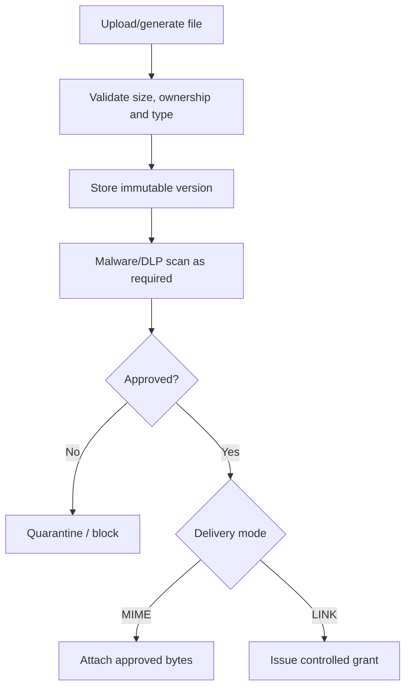
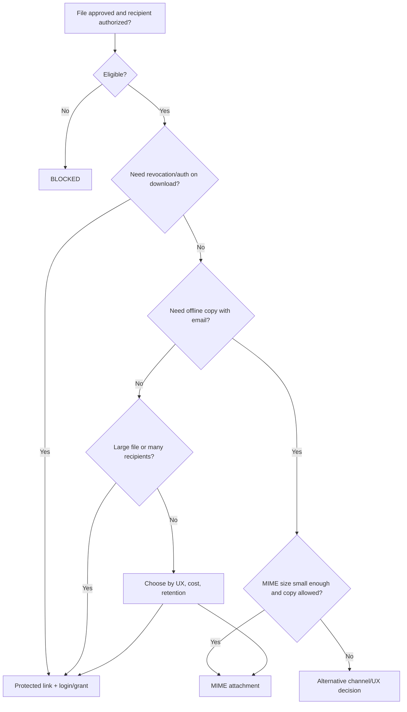

# Choosing Inline Attachments vs. Object Storage Links

In **Spring Framework Mail**, when sending invoices, contracts, reports, images, data exports, or guides, the application must decide **whether to embed data directly in the MIME email** or **send only an HTTPS link to a document in object storage**. Both can be implemented with `JavaMailSender`, yet they differ in SMTP load, offline accessibility, download authorization, revocability, forwarding risk, retention, cost, and reliability.

A small attached PDF can be convenient for users because it sits right inside the email. Yet a 30 MB file may be rejected by SMTP size limits; if a sensitive document is forwarded, the sender cannot revoke copies already delivered to other mailboxes. Conversely, sending an object storage link keeps the email small and can authenticate downloaders, but links can expire, get prefetched by scanners, or fail when the application/download service goes down.

**The right decision is not just picking a `MimeMessageHelper.addAttachment(...)` overload or rendering an `<a href="...">` tag.** You must choose a document distribution contract: may data be copied externally, must recipients log in, must files open offline, may links be forwarded, how long does access last, and what counts as success.

This article presents both models thoroughly, distinguishes attachments from CID inline resources, and compares MIME size, UX, performance, security, and compliance; then shows implementation patterns using Spring Mail, private object storage, an authorization endpoint, outbox, workers, and tests. Example policies, URLs, and service names are illustrative and should be adapted to your real system.

## 1. Distinguish MIME Attachment, CID Inline, and Object Storage Link

Three mechanisms are often lumped together as "inline":

| Mechanism | Where Do the File Bytes Live? | Purpose |
|---|---|---|
| **MIME attachment** | File bytes live inside the MIME message, typically `Content-Disposition: attachment` | Attaching PDFs, CSVs, documents |
| **Inline MIME resource** | Bytes live inside the MIME message and are referenced by `Content-ID` | Logos, images displayed inside HTML via `cid:...` |
| **Object storage link** | Bytes live in private storage; email carries only a URL or deep link | Authorized document downloads over HTTPS |

In this article, **"inline attachment" primarily means a file embedded directly inside the email**, contrasted with an object storage URL. The `MimeMessageHelper.addInline(...)` API is a specific inline MIME case, not a general replacement for PDF attachments.

Example:

```html
<p>Your invoice is ready.</p>

<a href="https://app.example.org/downloads/opaque-grant">Download invoice</a>
```

Here the logo can be a CID inline image, while the invoice is delivered via a link. If the invoice is sent as a MIME attachment, the PDF sits in its own MIME part without needing a URL.

## 2. Diagrams of Both Architectures

### A. Attaching Directly to the Email

```text
Domain action
     |
     v
Notification / outbox
     |
     v
Mail worker
     |
     v
Read approved file bytes
     |
     v
MimeMessageHelper.addAttachment(...)
     |
     v
JavaMailSender.send(...)
     |
     v
SMTP -> recipient mailbox
             |
             v
     Open attachment locally
```

The file bytes are encoded and transmitted inside the email. Once a copy reaches the receiving system, the sender's ability to revoke it is severely limited.

### B. Sending a Protected Link

```text
Domain action
     |
     v
Store immutable file version
     |
     v
Scan + approve + create download grant
     |
     v
Notification / outbox
     |
     v
Mail worker renders stable HTTPS link
     |
     v
SMTP -> recipient mailbox
             |
             v
         Click link
             |
             v
     App validates auth/grant
             |
             v
     Private object store/CDN
             |
             v
         Download bytes
```

The second path has **two independent pipelines**: one for sending email and one for document access. SMTP success does not prove the recipient can download the file.

## 3. Architectural Comparison Table

| Criterion | MIME Attachment | Object Storage Link |
|---|---|---|
| Email size | Grows with file bytes + MIME encoding | Light, mostly HTML/text/URL |
| SMTP limits | Easily impacted by large files | Largely independent of file size at submission |
| Offline file access | Possible once email/file is downloaded | Requires downloading over HTTPS first |
| Mail client experience | Familiar attached file | Opens browser/portal |
| Access after email forwarding | File copy travels with the email | Depends on authentication and grants |
| Revocation | Cannot revoke already-delivered copies | Can block future access |
| Copy count | Multiplies across recipients/forwards | Source stored centrally; downloads create copies |
| When bandwidth is consumed | Primarily during SMTP send | Primarily when recipients download |
| Retention | Outside control once delivered | Manageable at storage and grant layers |
| Multi-recipient documents | Each email copy carries the file | Object can be reused with per-recipient permissions |
| Sensitive files | Risk of long-lived copies | Easier to control with proper login/authorization |
| Large files | Usually unsuitable | Usually suitable |
| States to track | MIME + SMTP + delivery | SMTP + grant + HTTP download |
| Post-delivery dependencies | Minimal once attachment is downloaded | App, auth, and storage/CDN must stay up |
| Access tracking | No standard download proof from mail | Has HTTP events, though scanners add noise |
| Cost | SMTP upload, mailboxes, retries | Object storage, HTTP/CDN egress, auth service |

Neither choice is universally right. Define the specific requirements of **the document, recipients, and access lifecycle** before choosing.

## 4. Start with Business Questions

1. Must the recipient retain an independent file copy, or only view it while authorized?
2. What is the typical file size, maximum size, and are there multiple files?
3. Is it sent to one recipient, several, or tens of thousands?
4. Can the file contain personal data or secrets?
5. Do recipients need offline viewing?
6. Must the downloader's identity be verified on each download?
7. Must access be revocable when a user cancels service, an employee leaves, or a tenant is suspended?
8. How long must the file be kept, and are compliance/audit records required?
9. Do recipients have portal accounts, or must they access without logging in?
10. Could the email be opened weeks or months later?
11. Is it acceptable for links to traverse mail-security scanners?
12. Do the download service, storage, and identity provider have matching SLOs?
13. Is immutability of document content after send time required?
14. Are there data residency rules or mandated delivery channels?

Answers about **access control and retention** usually matter more than the convenience of a single API call.

## 5. MIME Attachments Are Larger Than the Source File

Binary data in attachments is typically transmitted as base64. For `n` raw bytes, the pure base64 body is roughly `4 × ceil(n / 3)` bytes: nearly 33% larger, before adding MIME boundaries, headers, line folding, and body text.

Example:

```text
Original binary file:     about 12 MiB
Base64 content:          about 16 MiB
Actual MIME size:        greater than 16 MiB
```

Therefore, you cannot assume "SMTP provider limit is 20 MB" means you can attach a 20 MB binary file. Many systems cap **total message size**, and the recipient's server may have stricter limits than your sending relay.

You need to:

- Set file thresholds well below the message limit.
- Account for HTML/text, headers, and inline images.
- Leave headroom for encoding/overhead.
- Verify limits per provider/route/account.
- Test against an SMTP test server and authorized provider environment.
- Never retry infinitely if a message was rejected for exceeding size limits.

### Planning Estimate

\[
\text{MIME size} \approx \text{body bytes} + 1.33 \times \sum \text{attachment bytes} + \text{overhead}
\]

This is an **estimate**; measure message size after MIME serialization if the application must enforce tight limits.

## 6. Recipient Count Multiplies Total Load

Suppose you send a 12 MiB file to 1,000 recipients, each receiving an individual message. The base64 payload alone is roughly 16 MiB per email, totaling about 16 GiB of submission data before MIME overhead.

If you store one file in object storage and send protected links, SMTP transmits far less data. HTTP egress occurs only when links are opened, though it can also include repeat downloads, scanner fetches, cache misses, and forwards.

Distinguish:

| Path | When Are File Bytes Transferred? |
|---|---|
| MIME | Inside SMTP messages/forwards; can multiply by recipients |
| Link | When downloaded from storage/CDN; can multiply by downloads |

Do not assume object storage is always cheaper: total cost also depends on provider rates, storage, CDN/egress, download counts, authorization operations, and retention.

## 7. When Direct Attachments Usually Fit

Typical cases:

- Small files, such as a finalized PDF receipt.
- Recipients expecting files in traditional email workflows.
- Recipients without portal accounts.
- Files needed offline after downloading mail.
- Policy permits delivering an **independent copy** to the recipient's mailbox.
- Content must be a fixed snapshot traveling with the email.
- Attachment size sits comfortably below send/receive limits with headroom.
- The system wants to avoid depending on a download service months later.

For example, an accounting team receiving PDF invoices into an automated ingestion pipeline may require an **actual attached file**, not a manual download link.

Even small files should not be attached directly if they are too sensitive and viewing rights must be revocable or checked per session.

## 8. When Protected Links Usually Fit

- Large files or many attachments.
- One file shared across many recipients.
- Sensitive data requiring authentication and revocable access.
- Files that belong in a central document repository.
- Recipients already have a reasonable portal/login flow.
- Documents with versioning, retention, and legal holds.
- High email volumes where MIME bandwidth becomes a bottleneck.
- Need to decouple SMTP throughput from file downloads.
- Need to enforce download quotas or file-type controls.
- Ability to operate the download service, storage, and CDN.

Do not pick links just because the email-sending code is shorter. A link needs its own **authorization, expiry, retention, download UX, and error handling**.

## 9. Never Use Public Bucket URLs for Sensitive Documents

Example to avoid for personal/private documents:

```text
https://bucket.example.org/invoices/customer-123.pdf
```

If an object is public, anyone with the URL can download it. Naming files with hard-to-guess UUIDs **does not replace authorization**. Likewise, never let clients submit an arbitrary object key and have the backend issue a signed link without verifying owner/tenant.

Tighter model:

```text
Email -> https://app.example.org/downloads/<grantId>
      -> identify requester
      -> check grant, document, tenant and recipient
      -> private object storage
```

Private bucket, scoped credentials, policy-checked requests, scanned content, and pinned object versions.

## 10. Three Common Download Link Models

### Login-Required Link

The email points to the application; the recipient signs in and the app checks permissions. This is a strong option when recipients already have accounts and documents are sensitive.

Pros:

- Permissions can be checked on **every download**.
- Access can be revoked if a user is suspended or changes tenants.
- Access can be audited per policy.
- Does not treat possessing the email link as proof of identity.

Cons: adds a login step; SSO may behave awkwardly when opening links from another mail client or device.

### Bearer-Grant Link

An opaque token can allow downloading without an account, bounded by TTL and scope. However, **anyone holding the token can exercise that access** without extra authentication.

Requirements:

- Sufficiently random, unguessable token.
- Token hash/verifier stored appropriately.
- TTL and revocation.
- Rate limiting.
- Never leak tokens in logs/analytics.
- Protection against scanner prefetching.
- No open redirects.
- Bound strictly to the approved file/version and scope.

Do not call a bearer grant "recipient authentication" when no identity factor is verified.

### Direct Presigned URL

Storage can issue a signed URL with GET permission and a short lifetime.

Pros: data streams directly from storage/CDN, offloading the application server.

Risks:

- The URL acts as a bearer capability.
- Can be forwarded/copied/logged.
- May expire before the user opens the email.
- Can be hard to revoke immediately while still inside its TTL.
- Browsers see the signed URL and may keep it in history.

When used, treat a signed URL as a **temporary credential**, not a permanently safe public link.

## 11. Distinguish Stable Email Links from Short-Lived Storage URLs

A generally suitable pattern:

```text
Email:
  https://app.example.org/downloads/grant-A

When recipient clicks:
  validate account/session/grant and current policy
  -> generate short-lived signed GET for object version
  -> redirect or stream
```

Benefits:

1. Links sent via SMTP do not break merely because the queue waited too long.
2. Links remain openable days later within the permitted window.
3. Grants can be revoked in the database.
4. You can switch object storage providers while old emails still route through the application.
5. Tenant/role checks run at actual download time.
6. Signed storage URLs never appear directly in email bodies.

**Do not generate a 10-minute signed URL and embed it into an email a user might read two days later.** If using short-lived URLs, generate them only after the recipient passes authorization and initiates the download.

## 12. TTL and Retention Must Align with Needs

A link may be opened minutes, hours, weeks, or months later. Define:

- Until when is the link valid?
- Can a replacement be requested after expiry?
- Will the file still exist in object storage?
- If a user changes roles/tenants, is the grant still valid?
- If the file is updated, which version does the link serve?

Failure example:

```text
File retention: 24 hours
Download grant validity: 14 days

Recipient clicks on day 5:
  grant valid, object missing -> 404
```

Another failure:

```text
Outbox retry window: 48 hours
Temporary source file removed after HTTP request

Worker at hour 6:
  cannot read attachment
```

Align minimums across all active requirements:

```text
Source retention >= necessary send/retry lifetime
Source retention >= active download-grant lifetime
Plus approved evidence/record retention where required
```

There is no single default TTL suitable for every document class.

## 13. Revocation Does Not Recall Already-Delivered Copies

With MIME attachments:

- Once the file hits the mailbox, the sender has no control over the recipient's copy.
- Recipients can download, forward, save to personal cloud storage, or back it up.
- Deleting the file from sender storage does not delete distributed copies.

With protected links:

- Grants can be revoked to deny **future** downloads.
- Permissions can be evaluated on every click.
- Lifetimes and versions can be constrained.

However:

- Files downloaded prior to revocation still exist.
- Issued signed URLs may stay valid until expiry depending on provider.
- CDNs/caches may retain data if misconfigured.

**Links improve control over future access; they do not guarantee recalling already-distributed documents.**

## 14. Email Forwarding Is Part of the Threat Model

An email with a MIME attachment can be forwarded along with the entire file. For sensitive data, the new recipient keeps a copy.

An email with a link, when forwarded, has two cases:

- **Public/bearer link:** the new recipient can open it.
- **Link requiring user/tenant authorization:** the new recipient can be blocked even though they see the URL.

If the product wants to allow sharing access via forwarding, build an audited share/grant mechanism instead of silently letting anyone with the URL download the file.

If new recipients must not open the file, enforce identity-based authorization or additional verification. Randomizing URLs alone is insufficient.

## 15. Email Scanners Can Open URLs Automatically

Mail-security gateways and phishing filters may fetch URLs right after an email arrives. Some systems follow redirects, load resources, or prefetch previews.

Consequences:

- An HTTP GET does not prove the real recipient clicked.
- A one-time link consumed on GET may be burned by a scanner first.
- HTTP requests may appear before the user ever reads the email.
- Link scanners generate download traffic and skew analytics.

**Never attach critical side effects to GET.** For example, `GET /confirm-transfer` should never confirm a bank transfer or sign a contract. Use authentication + a confirmation UI + a controlled POST action when required.

For one-time download grants, include an appropriate verification/confirmation step so scanners do not "burn" the download. Never rely on user-agent filtering alone as a complete security control.

## 16. URLs Are Easily Persisted in Many Places

Links carrying tokens in queries or paths can be recorded in:

- Browser history.
- Reverse proxy/load balancer access logs.
- Security inspection products.
- Email tracking and analytics.
- Screenshots, clipboards, and forwarded messages.
- `Referer` headers if the download page loads uncontrolled third-party content.

A URL like:

```text
https://app.example.org/download?email=customer@example.net&token=secret
```

is inappropriate for sensitive data.

If using bearer grants:

- Use opaque random tokens.
- Never embed emails, OTPs, or guessable user IDs.
- Redact tokens in access logs.
- Never load third-party scripts on token-bearing pages.
- Set appropriate `Referrer-Policy` and cache policies.
- Enforce rate limits and revocation.
- Never record full signed URLs in audits/metrics.

If bearer links are unnecessary, login-based app links reduce the risk of URLs being misused by unauthorized holders.

## 17. Two Ways to Serve Bytes After Authorization

### Stream Through the Application Server

```text
Recipient -> app auth -> application streams object -> recipient
```

Pros:

- Authorization checked on every download.
- Per-user rate/byte throttling possible.
- Raw storage URLs never exposed.
- Direct control over `Content-Disposition`/HTTP headers.

Cons:

- Increases application CPU/network bandwidth.
- Large files must be streamed, never `readAllBytes`.
- Download resume/range/timeouts must be engineered.
- Requires autoscaling/capacity under heavy traffic.

### Redirect to a Signed Storage URL

```text
Recipient -> app auth -> 302 -> storage/CDN signed GET
```

Pros: offloads the app, leverages storage/CDN.

Cons: signed URL exposed to the browser for its TTL; hard to revoke immediately; final HTTP response headers are governed by storage/CDN.

**Do not set `Content-Disposition` and `no-store` only on the 302 redirect expecting storage's file response to inherit them.** Configure headers on whatever actually serves the bytes.

## 18. Creating MIME Attachments with JavaMailSender

Example for a small file already checked for authorization, size, and content type:

```java
import jakarta.mail.internet.MimeMessage;
import org.springframework.core.io.ByteArrayResource;
import org.springframework.mail.javamail.JavaMailSender;
import org.springframework.mail.javamail.MimeMessageHelper;

public final class InvoiceAttachmentMailer {

    private final JavaMailSender sender;

    public InvoiceAttachmentMailer(JavaMailSender sender) {
        this.sender = sender;
    }

    public void send(
            String approvedRecipient,
            byte[] validatedPdfBytes
    ) throws Exception {

        MimeMessage message = sender.createMimeMessage();

        MimeMessageHelper helper =
                new MimeMessageHelper(
                        message,
                        true,
                        "UTF-8"
                );

        helper.setFrom("billing@example.org");
        helper.setTo(approvedRecipient);
        helper.setSubject("Your invoice");
        helper.setText(
                "Your invoice is attached.",
                "<p>Your invoice is attached.</p>"
        );

        helper.addAttachment(
                "invoice.pdf",
                new ByteArrayResource(validatedPdfBytes),
                "application/pdf"
        );

        sender.send(message);
    }
}
```

`ByteArrayResource` works well when the entire file is already in memory and size-bounded. It can supply fresh streams whenever Jakarta Mail serializes/re-reads.

**Never use unvalidated file bytes, arbitrary unverified recipients, or log raw MIME messages.**

## 19. The Single-Use InputStreamResource Pitfall

Risky example:

```java
try (InputStream input = Files.newInputStream(path)) {
    helper.addAttachment(
            "report.pdf",
            new InputStreamResource(input),
            "application/pdf"
    );
}

// input is already closed; Jakarta Mail may read only during send.
sender.send(message);
```

`InputStreamResource` wraps an already-open stream and is typically single-use. MIME attachments/inline parts may be read lazily or multiple times.

Appropriate sources:

- `ByteArrayResource` for small bounded byte arrays.
- `FileSystemResource` for stable, persistent files.
- Custom `InputStreamSource` returning a fresh stream each time.
- Custom `DataSource` with proper lifecycle/readability.

Moving `send` inside the `try` block still does not satisfy the *repeatable source* requirement. Never pass an open stream across `@Async` or an outbox.

## 20. Streaming Large Files with InputStreamSource

For files in object storage, create a source that opens a fresh stream each time:

```java
import java.io.IOException;
import java.io.InputStream;
import org.springframework.core.io.InputStreamSource;

public final class ObjectAttachmentSource
        implements InputStreamSource {

    private final AttachmentStore storage;
    private final String key;
    private final String version;

    public ObjectAttachmentSource(
            AttachmentStore storage,
            String key,
            String version
    ) {
        this.storage = storage;
        this.key = key;
        this.version = version;
    }

    @Override
    public InputStream getInputStream() throws IOException {
        return storage.openReadStream(key, version);
    }
}

public interface AttachmentStore {
    InputStream openReadStream(
            String key,
            String version
    ) throws IOException;
}
```

Usage:

```java
InputStreamSource source =
        new ObjectAttachmentSource(
                storage,
                approved.objectKey(),
                approved.version()
        );

helper.addAttachment(
        approved.safeFilename(),
        source,
        approved.mediaType()
);
sender.send(message);
```

`approved` and `storage` are application abstractions.

Every call to `getInputStream()` must return a fresh stream starting at byte zero of the **same immutable object version**. The stream must remain accessible until the sender finishes reading and throughout the retry window.

Streaming reduces heap usage, yet **cannot bypass SMTP message-size limits**. For truly large files, links are a different architectural choice, not merely a different byte-reading trick.

## 21. Inline CID for Images in HTML

When displaying a logo inside the body:

```java
MimeMessage message = sender.createMimeMessage();

MimeMessageHelper helper =
        new MimeMessageHelper(
                message,
                MimeMessageHelper.MULTIPART_MODE_MIXED_RELATED,
                "UTF-8"
        );

helper.setFrom("notifications@example.org");
helper.setTo("customer@example.net");
helper.setSubject("Notification");

helper.setText(
        "Hello!",
        "<p>Hello!</p>"
      + ""
);

helper.addInline(
        "brand-logo",
        new org.springframework.core.io.ClassPathResource(
                "mail/logo.png"
        ),
        "image/png"
);

sender.send(message);
```

`setText` should be called before `addInline` when assembling related MIME parts as `MimeMessageHelper` expects.

CID images increase email size and carry their own mail-client compatibility quirks. They do not turn large documents into HTTP-downloadable files. If using HTTPS image URLs instead of CID, many clients block remote images, and every fetch has privacy/tracking implications.

## 22. Sending Protected Download Links in HTML and Plain Text

Emails containing links should include both text and HTML:

```java
import jakarta.mail.internet.MimeMessage;
import org.springframework.mail.javamail.JavaMailSender;
import org.springframework.mail.javamail.MimeMessageHelper;
import org.springframework.web.util.HtmlUtils;

public final class DownloadLinkMailer {

    private final JavaMailSender sender;

    public DownloadLinkMailer(JavaMailSender sender) {
        this.sender = sender;
    }

    public void send(
            String approvedRecipient,
            String trustedDownloadUrl
    ) throws Exception {

        MimeMessage message = sender.createMimeMessage();

        MimeMessageHelper helper =
                new MimeMessageHelper(message, false, "UTF-8");

        helper.setFrom("documents@example.org");
        helper.setTo(approvedRecipient);
        helper.setSubject("Document is ready");

        String safeAttribute =
                HtmlUtils.htmlEscape(trustedDownloadUrl);

        helper.setText(
                "Download document: " + trustedDownloadUrl,
                "<p>Your document is ready.</p>"
              + "<p><a href=\"" + safeAttribute + "\">"
              + "Download document</a></p>"
        );

        sender.send(message);
    }
}
```

`trustedDownloadUrl` **must** be built from a configured HTTPS base URL and a server-issued grant ID. HTML escaping is necessary, yet **does not replace URL validation**. Never accept an arbitrary URL from a request and place it into an email: the service could be abused to send phishing links.

In real applications, use a template engine (such as Thymeleaf/FreeMarker) and a validated context instead of concatenating HTML strings.

Thymeleaf template example:

```html
<p>Your document is ready.</p>
<p><a th:href="${downloadUrl}">Download document</a></p>
<p>If you did not request this document, please ignore this email.</p>
```

In a real template, `${downloadUrl}` is placed using standard Thymeleaf variable expression syntax after Markdown rendering.

## 23. Download Endpoints Must Verify Permissions Before Issuing URLs

A Spring MVC skeleton:

```java
import java.net.URI;
import java.time.Clock;
import org.springframework.http.HttpHeaders;
import org.springframework.http.HttpStatus;
import org.springframework.http.ResponseEntity;
import org.springframework.security.core.Authentication;
import org.springframework.web.bind.annotation.GetMapping;
import org.springframework.web.bind.annotation.PathVariable;
import org.springframework.web.bind.annotation.RestController;

@RestController
public final class DocumentDownloadController {

    private final DownloadGrantService grants;
    private final PrivateObjectStore storage;
    private final Clock clock;

    public DocumentDownloadController(
            DownloadGrantService grants,
            PrivateObjectStore storage,
            Clock clock
    ) {
        this.grants = grants;
        this.storage = storage;
        this.clock = clock;
    }

    @GetMapping("/downloads/{grantId}")
    public ResponseEntity<Void> download(
            @PathVariable String grantId,
            Authentication authentication
    ) {
        if (authentication == null
                || !authentication.isAuthenticated()) {
            return ResponseEntity
                    .status(HttpStatus.UNAUTHORIZED)
                    .build();
        }

        ApprovedDownload approved =
                grants.requireAuthorized(
                        grantId,
                        authentication.getName(),
                        clock.instant()
                );

        URI temporaryGet =
                storage.createTemporaryReadUrl(
                        approved.objectKey(),
                        approved.version()
                );

        return ResponseEntity.status(HttpStatus.FOUND)
                .header(
                        HttpHeaders.LOCATION,
                        temporaryGet.toString()
                )
                .header(
                        HttpHeaders.CACHE_CONTROL,
                        "no-store"
                )
                .build();
    }
}
```

`DownloadGrantService`, `PrivateObjectStore`, and `ApprovedDownload` are custom application components, not Spring Mail APIs. The example assumes the user signs in via an appropriate Spring Security mechanism.

In a real deployment:

1. Protect the route in security configuration.
2. Verify grant expiry, revoked state, tenant, recipient, and document authorization.
3. Verify file scan status is APPROVED.
4. Sign GET only for the exact object/version with a short TTL.
5. Never log `Location` headers containing signed URLs.
6. Consider returning 404 for some unauthorized cases to avoid leaking document existence, per policy.
7. Set `Content-Disposition`/`Content-Type`/`nosniff` on the **final storage file response**, not only on the redirect response.
8. If near-instant revocation is required, consider streaming the file through the application instead of issuing a still-valid presigned URL.

Authenticating by username alone without tenant/document access checks is insufficient.

## 24. What If the Recipient Has No Account?

You can use a bearer grant record:

```text
download_grant:
  grantId
  tokenVerifierHash
  attachmentId
  objectVersion
  recipientRef
  purpose
  issuedAt
  expiresAt
  revokedAt
  accessPolicy
```

Principles:

- Sufficiently high-entropy token generated with a CSPRNG.
- Do not store the raw token unless needed.
- Enforce download limits/TTL/expiry.
- Never grant access beyond the approved file/tenant.
- Enforce required auditing and redaction.
- Scanners may open the link before the recipient does.
- Avoid letting GET trigger "signed/confirmed" actions.
- Provide a workflow to reissue grants when a recipient loses the link.
- Never treat delivery of an email to an address as proof of who is using the link.

For highly sensitive documents, an extra verification step or portal login may be required despite longer UX.

## 25. Document Versioning: Snapshot or Latest?

When an email is sent on day 1 and the file is updated on day 3, what should a recipient opening it on day 10 see?

| Semantics | Meaning | Use Cases |
|---|---|---|
| **Immutable snapshot** | Link/attachment is bound to the exact version at send time | Invoices, contracts, finalized reports |
| **Latest view** | Link always returns the current version per permissions | Dashboards, living guides |

Never use an overwritable object key when you must prove what content was issued. Pin the object version or use immutable keys.

Metadata:

```text
attachmentId
objectKey
objectVersion
contentLength
mediaType
safeFilename
classification
scanStatus
retentionUntil
```

If an object is modified after scanning but before download/MIME serialization, delivered content could differ from what was approved. Use immutable versions and bind scan status to the version to prevent this drift.

## 26. Requester, Recipient, and Downloader Permissions Can Differ

A document-sending system has three distinct decisions:

1. **Who is allowed to request sending this document?**
2. **Who is allowed to receive the notification or file?**
3. **Who is allowed to download the document at click time?**

For instance, employee A may be allowed to send an invoice to customer B, but after a contract terminates, customer B might lose permission to download newer copies. Person C receiving a forwarded email from B does not automatically gain access either.

With MIME attachments, checking permissions **before sending** is the main boundary, because outbound copies are virtually unrevocable. With links, checking permissions both **before sending** and **on every download** adds protection.

Never treat client-supplied `From`/`To`, URLs, or object keys as proof of authorization.

## 27. One File for Many Recipients: Use Per-Recipient Grants

When sending the same file to multiple people, the object can be shared, yet access rights should be separated:

```text
documentVersion = report-v3
recipient A -> grant-A
recipient B -> grant-B
recipient C -> grant-C
```

This allows individual revocation, per-recipient TTLs, or tenant binding. However, bearer grants can be forwarded, so a grant ID alone does not prove who clicked.

If emails need per-recipient personalization/links, one **logical notification per recipient** is usually easier to manage. A single shared MIME message with multiple To/Cc/Bcc recipients cannot carry different personal links inside the same body without separate sending logic.

Never generate one URL for person A and reuse it for person B in a campaign.

## 28. Outbox and Asynchronous Boundaries

A reliable mail-sending pipeline:

```text
HTTP/API action
     |
     v
Validate + store immutable approved file
     |
     v
Create notification, attachmentRef/grantRef
     |
     v
Commit durable outbox
     |
     v
Worker builds message and submits SMTP
```

Never pass through a queue:

- `InputStream` or `InputStreamResource`.
- Request-scoped `MultipartFile`/servlet `Part`.
- Temporary file paths existing only on Pod A.
- Short-lived presigned URLs generated before the job waits.
- Unscanned/uncommitted files.
- Raw object credentials.

A job should hold:

```json
{
  "notificationId": "notif-401",
  "recipientRef": "recipient-31",
  "deliveryMode": "PROTECTED_LINK",
  "attachmentRef": "attachment-918",
  "objectVersion": "v3",
  "grantRef": "grant-712",
  "templateKey": "document-ready"
}
```

The worker accesses storage using proper service identity/credentials and builds the message from durable references.

## 29. SMTP Retries Are Not Download Retries

Regardless of mode, SMTP submission can produce:

- `SMTP_ACCEPTED`: accepted by next-hop server.
- `KNOWN_REJECTED`: evidence of rejection.
- `UNKNOWN`: uncertain whether the server accepted the message.

A timeout after `DATA` can cause duplicates on retry. If the email carries a link:

- Two email copies may carry the same grant.
- If a new grant is generated per attempt, the recipient may end up with multiple different links.
- If the old grant is unexpectedly revoked, an already-accepted email may fail to open.

Keep `notificationId`, `attachmentVersion`, and `grantRef` stable per **logical notification** according to policy. Each attempt gets its own `attemptId`.

**SMTP accepted does not mean the file was downloaded.** Download lifecycle needs separate states and metrics.

## 30. Links Have Their Own State Machine

```text
Mail submission:
  QUEUED -> SUBMITTING -> SMTP_ACCEPTED
                       -> KNOWN_REJECTED
                       -> UNKNOWN

Download:
  GRANT_ISSUED -> AUTHORIZED -> STARTED -> COMPLETED
               -> EXPIRED
               -> REVOKED
               -> DENIED
               -> STORAGE_FAILURE
```

Do not infer `DOWNLOAD_COMPLETED` merely because the server returned an HTTP redirect; the recipient might not follow the redirect or the connection may drop mid-transfer.

Likewise, an HTTP 200 download does not prove the recipient read or understood the document; a scanner or proxy may have fetched it.

If accurate download auditing is required, define an appropriate evidence level where bytes are actually served and minimize collected personal data.

## 31. Malware and DLP Scanning Before Delivering Files

Both options require file controls:



- Never open untrusted files inside mail workers.
- Never use client filenames as object keys/paths.
- Never allow downloads before scan approval.
- Never automatically unpack unbounded archives.
- Bound file count, size, and nesting depth.
- Scanners do not guarantee absolute safety; policies on file types, sources, and purposes are still needed.
- Bind scan status to the **object version**.

**Links do not automatically make files safer.** They only move distribution from SMTP to HTTP.

## 32. Path Traversal, SSRF, and Cross-Tenant Access

Examples to avoid:

```java
Path path = Path.of(userSuppliedFilename);

helper.addAttachment(
        userSuppliedFilename,
        new FileSystemResource(path)
);
```

Or:

```java
URL remote = new URL(userSuppliedUrl);
// Fetch arbitrary remote URL to attach to email.
```

Risks:

- Path traversal/symlinks/TOCTOU reading out-of-scope files.
- SSRF when fetching internal/metadata endpoints.
- Accessing another tenant's objects.
- MIME header/filename injection.
- File overwritten after approval.

Have clients send a logical `attachmentId`. The backend maps IDs to object keys/versions **after verifying permissions**, approved data sources, and file policies.

For links, never issue signed URLs merely because the caller knows a key.

## 33. Filenames and HTTP Security Headers

With MIME attachments, filenames normally sit in the MIME part's `Content-Disposition`. With object links, download filenames come from HTTP `Content-Disposition`.

Principles:

- Sanitize filenames; strip CR/LF and path separators.
- Use server-generated storage keys, never filenames as paths.
- Apply validated `Content-Type`.
- For files capable of rendering active content, consider `Content-Disposition: attachment`.
- Set `X-Content-Type-Options: nosniff` on file download responses.
- Consider isolated origins/domains for untrusted active content.
- Support Unicode filenames per relevant standards.
- Never rely on browsers guessing MIME types from untrusted extensions.

When redirecting to an object store, **final file response headers must be emitted by the object store/CDN**. Headers on the app's 302 do not protect the file response itself.

## 34. Data Residency, Retention, and Recipient Copies

Object storage enables controlling:

- Bucket/region.
- Object replication.
- Encryption/KMS.
- Tenant permissions.
- Lifecycle/retention/legal holds.
- Download audits and deletion.

Still, once downloaded, the copy on the recipient's device sits outside your system. MIME attachments also pass through SMTP relays and recipient mailboxes whose storage locations the sender may not control.

Define policies by document type, industry, and jurisdiction. Never claim a single TTL or retention period is universally required; use approved policies and design deletion covering backups, logs, caches, exports, and storage.

## 35. Deliverability: Links Do Not Guarantee Inbox Placement

Mail gateways may evaluate:

- Message size and MIME structure.
- Attachment file types or archives.
- Files with malware/macros.
- Domain reputation and TLS.
- URL redirect chains.
- Phishing-like links, shorteners, tracking.
- Alignment between sender identity and link domains.

Turning large files into links avoids size errors, yet can trigger phishing-link risks if domains look unfamiliar or redirects are complex.

Best practices:

- Use organization-managed HTTPS domains.
- Avoid arbitrary URL shorteners.
- Explain clearly why the recipient is receiving the email.
- Include both plain-text and HTML versions.
- Configure sender authentication (SPF/DKIM/DMARC) appropriately.
- Never send links to unapproved files.
- Test through relevant mail gateways/clients if required by the product.

## 36. Experience During Download System Outages

Attachments already downloaded with the email open offline, even if the sending application or object storage goes down.

Links can depend on:

- DNS/TLS/app endpoints.
- Portal login/SSO.
- Grant database.
- Object storage/CDN.
- Active permissions and retention.

If a document is a record that must open years later, consider an attachment copy or a portal with matching SLO and retention commitments.

Never promise "permanent links" when file retention is only a few days. Emails should clearly state expiration or how to request a fresh link.

## 37. Choosing Policies by Classification, Size, and UX

A model:

```java
public enum FileDeliveryMode {
    MIME_ATTACHMENT,
    PROTECTED_LINK,
    BLOCKED
}

public record FileDeliveryContext(
        long contentLength,
        String classification,
        boolean requiresOfflineCopy,
        boolean requiresRevocation,
        boolean recipientHasPortalAccess,
        int recipientCount,
        String notificationType
) {
}

public interface FileDeliveryPolicy {
    FileDeliveryMode choose(FileDeliveryContext context);
}
```

These are application abstractions. Return `BLOCKED` if no delivery mode satisfies policy. **Do not silently strip attachments and send incomplete emails**, nor automatically fall back to public links to bypass SMTP limits.

An illustrative decision tree:



Do not hard-code a single size threshold for every notification when classifications, provider limits, and recipients differ.

## 38. Environment-Aware Policy Configuration

Example **application-specific configuration**, not built-in Spring Boot properties:

```yaml
mail:
  file-delivery:
    small-attachment-max-bytes: 3145728
    require-approved-scan: true
    default-link-ttl-days: 14
    allow-presigned-url-directly-in-email: false
    require-portal-auth-for-sensitive: true
```

Values like 3 MiB and 14 days are illustrative. They must match real SMTP limits, business purpose, and retention rules.

Version the policy and store `deliveryPolicyVersion` when you need to investigate why the same document type was attached yesterday and linked today.

## 39. Metadata and Database Models

Three record groups can be separated:

```text
stored_attachment:
  attachmentId
  tenantRef
  objectKey
  objectVersion
  contentLength
  mediaType
  safeFilename
  classification
  scanStatus
  retentionUntil

download_grant:
  grantId
  attachmentId
  recipientRef
  issuedAt
  expiresAt
  revokedAt
  accessPolicy

mail_notification:
  notificationId
  recipientRef
  templateKey
  deliveryMode
  attachmentId
  grantId
  dueAt
  status
```

One object can back multiple grants, yet revoking one recipient must never break valid grants for others.

If object versioning is unsupported by storage, use immutable keys or explicit snapshot mechanisms. If an object changes after scanning and before sending, unapproved content could be distributed.

## 40. Error Matrix by Approach

| Scenario | MIME Attachment | Protected Link |
|---|---|---|
| File deleted before sending | Source/MIME read failure | Email may send; download later 404s |
| File exceeds message limit | SMTP rejection | Unaffected by SMTP size; HTTP has different limits |
| SMTP timeout after DATA | Possible duplicate message | Possible duplicate email carrying link |
| Recipient forwards email | File can be forwarded | Link forwarded; auth governs access |
| Grant expired | N/A | 403/expired UX |
| Portal/SSO outage | Downloaded file still opens | Cannot download |
| Storage outage at send time | Worker cannot fetch bytes | Email may send link; download unavailable |
| Storage outage after SMTP | Copy already at recipient remains usable | Download fails |
| File version changes | Might attach wrong version | Might download wrong version |
| Policy revocation | Cannot recall delivered attachment | Can block future access |
| Scanner auto-opens URL | No download link | Traffic not representing real reader |
| File too sensitive for copies | Usually inappropriate | Login-based controlled link helps |

Never merge download errors into SMTP state. Both systems can succeed or fail independently.

## 41. Case Study: Small PDF Invoice

Suppose a period-end invoice is a 300 KB PDF that the customer's accounting team needs to archive as a voucher:

- Recipient and issuance policy verified.
- File generated/scanned and version-pinned.
- MIME size safely under limits.
- Recipient accepts receiving an unrevocable copy.
- Receiving system handles PDF attachments.

**MIME attachment** can make sense. Store `attachmentId` and `objectVersion` in the outbox; the worker builds the message with a repeatable source and sends. For auditing, log template/version, notification/attempt ID, and SMTP outcome—no need to store full PDFs in audit logs.

A supplementary link can also be offered to re-check in a portal, but should not replace the attachment when integration contracts require the actual file.

## 42. Case Study: 80 MB Report for Many Employees

An 80 MB report shared across 500 employees:

- Encoded MIME size would be far too large for many mail systems.
- Each attachment copy creates heavy SMTP load.
- Employees already have SSO.
- Report access may need revocation if an employee's permissions change.

**Protected link** is the better fit:

1. Store an immutable object version.
2. Scan the file and mark approved.
3. Issue per-user grants or authorize by entitlement.
4. Send small emails to authorized individuals/groups.
5. On click, verify SSO and permissions.
6. Redirect to a short-lived signed GET or stream the file.
7. Monitor HTTP failures/bytes and a dedicated SLO.

Still plan bandwidth if 500 people download concurrently, and ensure scanners cannot trigger unbounded large-file downloads.

## 43. Case Study: Highly Sensitive Records

Suppose a document contains high-sensitivity personal data requiring restricted access and revocability:

- Never auto-attach the file to email.
- Email only notifies that a document is available.
- Link points to a governed portal.
- Users must sign in at an appropriate assurance level.
- Server checks tenant/ownership and document status on every download.
- Downloads are audited carefully without logging raw files/signed URLs.
- Retention and storage encryption are enforced.
- Plan for portal/identity provider outages.

This approach has heavier UX, yet distributing standalone copies via email may violate product security requirements.

## 44. Testing MIME Attachments

Useful tests:

1. Build a `MimeMessage` with a file using `ByteArrayResource`.
2. Call `message.writeTo(...)` to force MIME serialization.
3. Re-parse MIME and verify decoded attachment bytes.
4. Check `Content-Disposition`, filename, content type.
5. Check Unicode subject/body.
6. Check multiple attachments and inline CIDs.
7. Check a source opening fresh streams multiple times.
8. Check deleted file/permission denied before send.
9. Check MIME size right at policy thresholds.
10. Integrate with a test SMTP server, never production SMTP.

Mockito `verify(mailSender).send(...)` alone is insufficient: mocks never read attachment bytes.

## 45. Testing Protected Links

- HTTPS domain and host belong to the allowlist.
- Links contain no PII/secrets/long-lived presigned credentials.
- Authorized recipients can open per policy.
- Other tenants/other users are denied.
- Expired/revoked grants grant no new access.
- Files without approved scan status are blocked.
- Object versions are pinned properly.
- Signed GET has minimal scope and short TTL.
- Redirects cannot become open redirects.
- Final download responses carry proper MIME type/`Content-Disposition`.
- One-time grants are not consumed merely by scanner GETs.
- No raw tokens appear in logs, traces, or analytics.
- Missing storage objects produce clear errors and runbook steps.
- Recipients opening days later get predictable UX.
- Concurrent downloads/rate limits do not exhaust the service.
- Resume/range requests work appropriately if clients need them.

Tests must exercise the download flow, not just SMTP acceptance.

## 46. Additional Security Tests

| Scenario | Expected Result |
|---|---|
| Caller submits another tenant's attachment ID | Rejected before MIME/link generation |
| Filename contains path traversal or CR/LF | Sanitized/rejected |
| Unscanned object | Content not sent / no grant issued |
| MIME source bytes change between two reads | Prevented via immutable version |
| Presigned URL forwarded | Risk bounded by TTL/scope or auth |
| Link scanner fetch | Does not confirm business actions |
| User changes role after receiving email | Download auth checks current entitlement |
| Grant revoked | No new signed URL generated |
| Signed URL logged | Redacted/restricted access |
| Active-content file type | Appropriate headers/origin isolation |
| Email retried after 24h | Does not reuse expired storage URL from enqueue time |
| Download grant outlives file | Contract/retention tests catch mismatch |
| Provider SMTP message limit hit | Intentional delivery policy fallback/rejection |

## 47. Observability for Both Pipelines

### Mail Submission Metrics

```text
mail_notification_created_total
mail_send_attempt_total
mail_send_accepted_total
mail_send_rejected_total
mail_send_unknown_total
mail_outbox_oldest_age_seconds
mail_message_size_bytes
```

### File/Download Metrics

```text
mail_file_delivery_mode_total
document_download_authorized_total
document_download_denied_total
document_download_expired_total
document_download_failure_total
document_download_bytes_total
document_storage_read_failure_total
```

These are suggested names, not built-in Spring Mail metrics.

Tags should be bounded categories such as `deliveryMode`, `stage`, `errorCategory`, `documentClass`, `route`. Never use recipient email, grant token, object key, signed URL, or notification ID as metric tags.

Audits can store delivery mode, policy version, object/attempt references, and minimal access decisions. Never store attachment bytes or signed URLs in audit logs.

## 48. Runbook: Recipient Reports They Cannot Download the File

**Step 1:** Identify the actual mode: MIME attachment or protected link?

**Step 2:** For MIME, inspect serialization, stream source, total MIME size, file type, provider rejections, mail gateways, and client compatibility.

**Step 3:** For links, inspect domain, grant ID, expiry/revocation, login, tenant, and recipient authorization.

**Step 4:** Verify the object/version still exists, scan is APPROVED, storage permissions, KMS, CDN, and network.

**Step 5:** Inspect redirects, signed URL TTL, GET scope, and `Content-Disposition` on the final file response.

**Step 6:** Check whether mail-security scanners prefetched or consumed one-time access.

**Step 7:** If needed, reissue the grant per policy; never make a bucket public as a quick fix.

**Step 8:** Do not bulk-resend emails if SMTP outcome may have been accepted. Separate download incidents from submission incidents to avoid duplicates.

## 49. Runbook: Email Attachment Blocked Due to Size

1. Measure actual MIME size, not just binary file size.
2. Identify limits of both the SMTP provider and recipient mail gateway.
3. Check file type/scan/quarantine.
4. Check cumulative CID images or multiple attachments.
5. If over a hard threshold, do not hot-retry.
6. Verify whether the recipient can receive a protected link.
7. If switching modes, place the file in private storage with proper scanning/grants.
8. Communicate clearly "download document" instead of "attached file."
9. Audit the reason for switching modes and new notification if needed.
10. Test late link opens, revocation, and recipient authorization.

Never automatically fall back to a public link to bypass an SMTP size limit.

## 50. Common Mistakes

| Mistake | Why It Is Dangerous | Better Practice |
|---|---|---|
| Attaching oversized files because streaming is used | SMTP size limits remain unchanged | Choose links per policy |
| Public bucket links for private documents | Anyone with the URL can view | Private bucket + auth/grants |
| 15-minute presigned URL embedded in email | Late opens hit 403 | App link, sign on click |
| One bearer link shared across all recipients | Cannot revoke per person | Per-recipient grants |
| Using a closed `InputStreamResource` | MIME serialization fails | `ByteArrayResource`/repeatable source |
| Queueing temp file paths | Other worker nodes cannot read them | Durable object key/version |
| Linking to unscanned files | Distributes unsafe data | Quarantine/approval |
| Using `latest` for period-end invoices | Recipients see altered content | Immutable snapshots |
| GET links confirming transactions | Scanners can trigger them | Auth + POST confirmation |
| Logging signed URLs | Leaks bearer credentials | Redaction and short TTL |
| Testing only SMTP send, never downloads | Link bugs surface late | E2E lifecycle tests |
| Untracked retention | Links 404 while grants remain valid | Align file and grant lifetimes |
| Setting security headers only on redirect | Final response stays unprotected | Configure storage/CDN headers |
| Swapping attachment for link silently | Breaks UX/business integrations | Explicit policy/contract |
| Treating HTTP 200 download as read receipt | Scanners/proxies may fetch | Clear state semantics |
| No download/rate limits | Abuse or HTTP overload | Admission/rate limits |
| Deleting object when revoking one grant | Breaks other valid grants | Shared object reference policy |

## 51. Production Decision Checklist

1. Distinguish MIME attachment, CID inline, and object storage link.
2. Establish data classification and authorization for requester/recipient.
3. Files scanned and approved per policy.
4. Calculated post-encoding MIME size.
5. Headroom under provider/recipient message size limits.
6. Determined whether recipients need offline copies.
7. Decided whether forwarding may transfer download access to new recipients.
8. If using links, private buckets and managed HTTPS domains.
9. If using links, proper authentication/grants/expiry/revocation.
10. No short-lived presigned storage URLs inside emails read later.
11. Scanner GETs cause no unintended business side effects.
12. Per-recipient grants issued when needed.
13. Object versions immutable relative to sent snapshots.
14. Attachment and grant retention aligned with outbox/retries.
15. Contingency plan for app/SSO/storage/CDN outages.
16. For MIME, repeatable stream sources and persistent source files.
17. Never pass `MultipartFile`/live `InputStream` through queues.
18. Proper content type, sanitized filename, and `Content-Disposition`.
19. Protection against path traversal, SSRF, and cross-tenant access.
20. Link emails include plain text/HTML and clear expiration UX.
21. SMTP status and HTTP download status tracked separately.
22. Minimal audit trails, metrics, alerts, and runbooks for both pipelines.
23. Tests for MIME bytes, auth, expiry/revocation, and multi-day downloads.
24. Explicit policy version and owner for delivery mode decisions.
25. Never silently downgrade security to work around SMTP errors.

## 52. Key Takeaways

- **MIME attachments** send file copies inside emails; **object storage links** require a separate HTTP download flow.
- `MimeMessageHelper.addInline` serves CID resources inside HTML, not PDF attachments.
- Base64 expands attachments by ~33% before MIME overhead.
- Small files needing offline copies, low sensitivity, and authorized distribution can suit attachments.
- Large files, many recipients, or needs for revocation/authorization suit protected links.
- Presigned URLs are temporary bearer capabilities, not downloader identities.
- App links checking permissions on click are usually better than short-lived signed URLs placed directly in emails.
- Scanners can open links before users; GET never proves a human read it.
- Revoking a link blocks future access only; it does not recall downloaded copies.
- Files/versions must be immutable and scan-approved in both modes.
- For MIME, sources must stay available and return fresh streams whenever Jakarta Mail needs them.
- Streaming saves heap but cannot exceed message-size limits.
- SMTP accepted and download completed are two distinct events.
- Decisions must rest on size, security, UX, entitlement, lifetime, recipient count, and operational capability.

**Conclusion:** Choose **MIME attachments** when you need to deliver a small, self-contained, offline-usable copy with explicit data distribution approval. Choose **protected object storage links** when files are large, recipients are numerous, or centralized management and access checks/revocation are required. In both cases, preserve exact versions, enforce authorization and retention, track SMTP outcomes separately from file downloads, and test real behavior after the email is sent.
