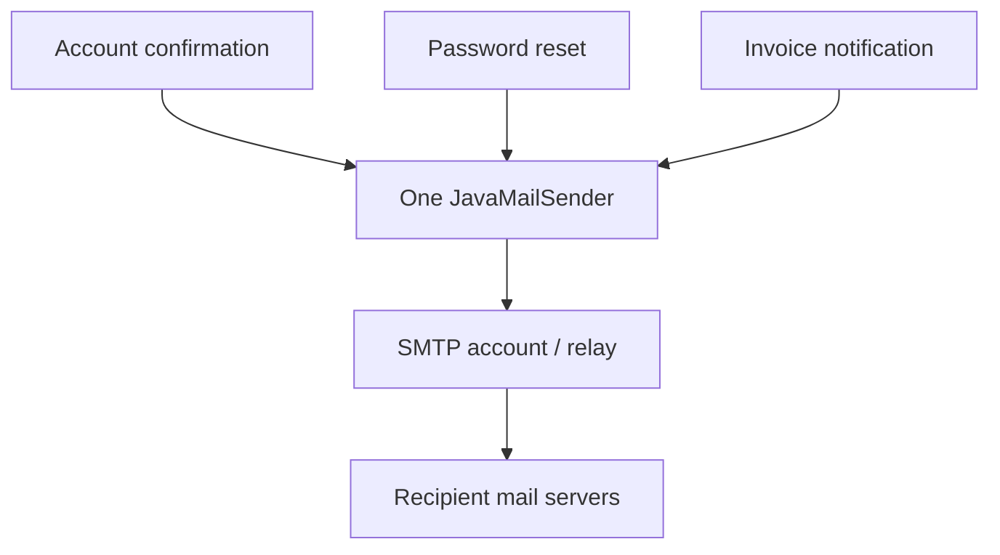
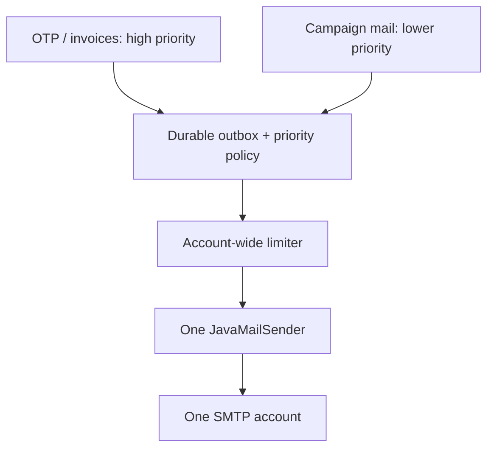
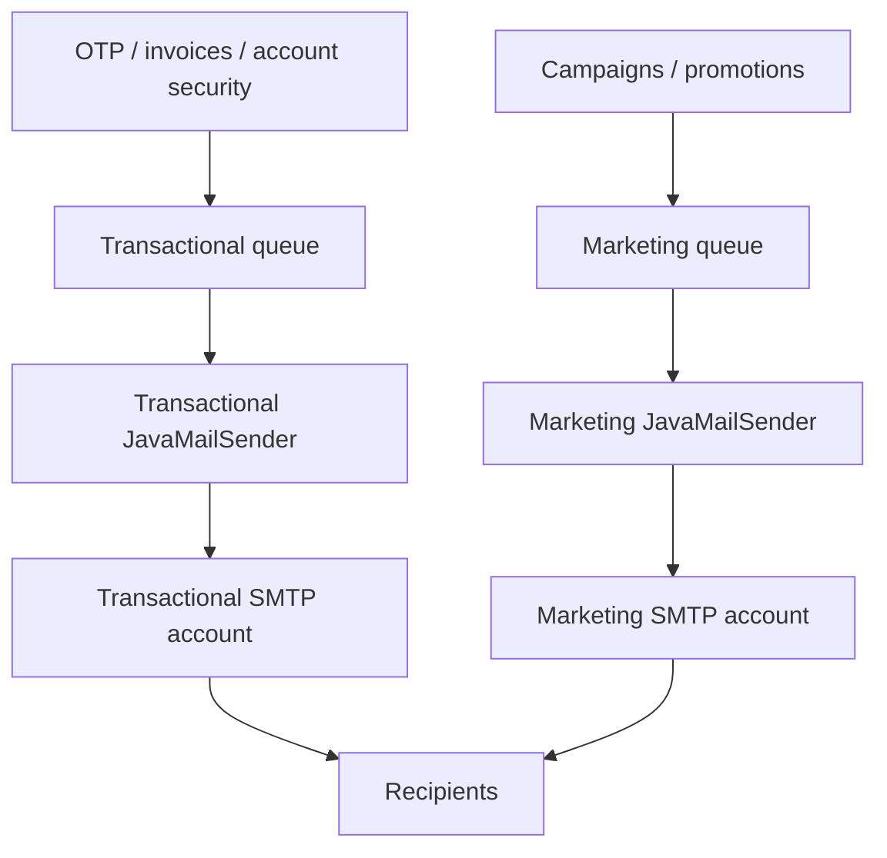
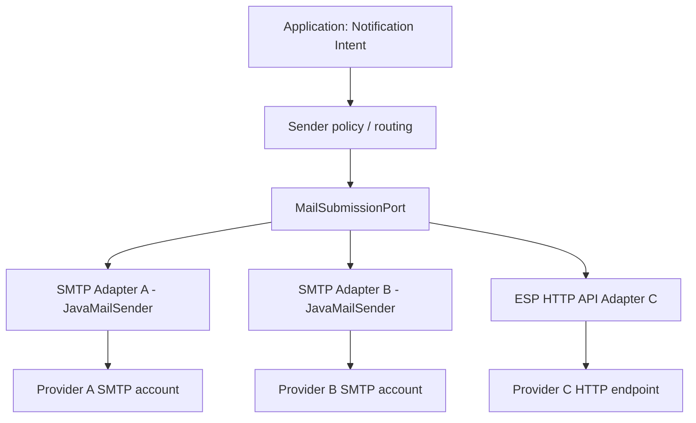
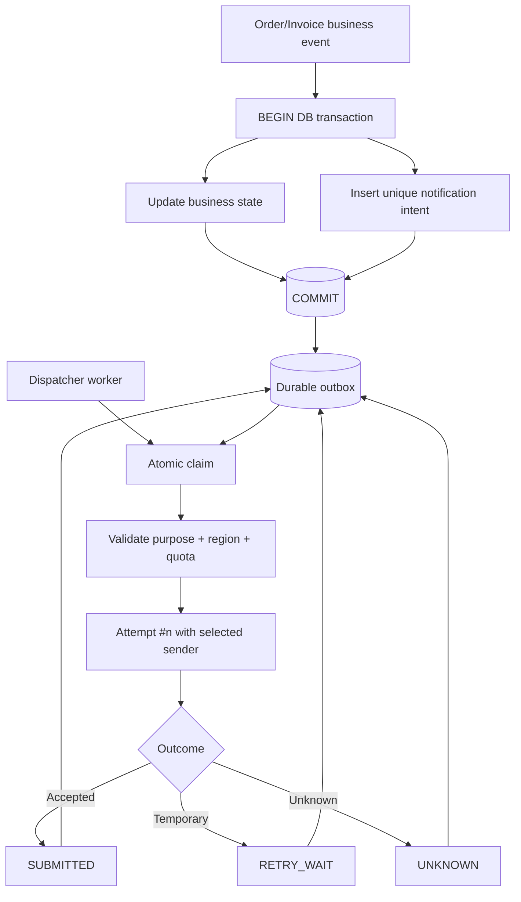

# Choosing One Sender vs. Multiple Senders

A Spring Boot application starts out only sending account confirmation emails through a single SMTP relay. As the product grows, the same system starts sending OTPs, PDF invoices, marketing emails, security alerts, and notifications for multiple customer organizations. The development team faces an architectural decision: **keep using a single `JavaMailSender` or configure multiple senders?** If choosing multiple senders, should they be split by business stream, SMTP account, tenant, provider, data region, or content type? If using only one sender, could critical emails get stuck behind a large marketing blast?

This is a decision in the **Architectural Decisions** chapter of the **Spring Framework Mail** module, not merely a question of "declaring one or two `@Bean`s." A `JavaMailSender` bean describes **how to connect and submit email** to an SMTP transport. It does not inherently represent a business channel, a valid sending domain, a durable queue, tenant authorization, or a failover policy. Multiple senders can provide valuable isolation boundaries, yet they also increase configuration, secrets, quotas, DNS, webhooks, monitoring, and duplicate-send risk if failover is flawed.

This lesson explains options from simple to advanced, provides Spring Mail configuration examples, sender selection strategies, decision matrices, operating multiple SMTP accounts or multiple ESPs, plus testing, migration, and ADR design to avoid premature optimization or unnecessary lock-in.

## 1. Clarify What "Sender" Means

In Java/Spring codebases, several distinct entities are routinely called "sender":

| Concept | Example | Role |
|---|---|---|
| **Spring sender bean** | `JavaMailSender`/`JavaMailSenderImpl` | API to build/send email over SMTP transport |
| **SMTP account** | Username/password or OAuth2 identity on a relay | Sending permissions, quotas, sender identities |
| **SMTP relay / transport endpoint** | `smtp.provider.example:587` | Server accepting submissions |
| **Provider/ESP** | Third-party mail service or internal relay | Sending infrastructure, rate limits, reputation, events |
| **Email From identity** | `notifications@example.com` | Displayed sender header |
| **Envelope sender / Return-Path** | Address used in SMTP `MAIL FROM` | Bounce routing, SPF alignment |
| **Business stream** | Transactional, marketing, alerts | Request category, SLA, consent, priority |
| **Logical notification intent** | "Send invoice I42 to customer U9" | Unit of idempotency/retry/audit |
| **Worker / dispatcher** | Outbox poller, consumer | When and how many emails are submitted |

**A single `JavaMailSender` bean is not restricted to a single `From` header** if the SMTP account/provider allows multiple verified identities, yet that also **does not mean you can set any arbitrary `From`**. Accounts may restrict domains, mailboxes, `Return-Path`, regions, and rate quotas. Similarly, two `JavaMailSender` beans can point to **the same SMTP account**; that alone creates neither two quotas nor two failure domains.

### 1.1. Choosing Bean Count Differs from Choosing Provider Count

There are at least four very different setups:

1. **One bean, one SMTP account, one provider:** the baseline setup.
2. **Two beans, two SMTP accounts on the same provider:** can separate transactional and marketing traffic.
3. **Two beans, two SMTP providers:** can serve data regions or redundancy, but requires managing deliverability and failover.
4. **One application mail port, multiple adapters:** one adapter uses `JavaMailSender`, another calls an ESP HTTP API; here you cannot count `JavaMailSender` beans to deduce business "senders."

Before designing, write down **what you are trying to isolate**: accounts, secrets, queues, quotas, IP/domain reputation, SLAs, compliance, or code dependencies.

## 2. Single-Sender Architecture: A Sound Default for Simple Needs

A small application can use a single `JavaMailSender` auto-configured by Spring Boot from `spring.mail.*`.



### 2.1. Common Spring Boot Configuration

```yaml
spring:
  mail:
    host: ${SMTP_HOST}
    port: 587
    protocol: smtp
    username: ${SMTP_USERNAME}
    password: ${SMTP_PASSWORD}
    default-encoding: UTF-8
    properties:
      "[mail.smtp.auth]": true
      "[mail.smtp.starttls.enable]": true
      "[mail.smtp.starttls.required]": true
      "[mail.smtp.ssl.checkserveridentity]": true
      "[mail.smtp.connectiontimeout]": 5000
      "[mail.smtp.timeout]": 10000
      "[mail.smtp.writetimeout]": 10000
```

This illustrates SMTP submission on port 587 with required STARTTLS and SMTP AUTH. For providers requiring **implicit TLS** on port 465, swap in the appropriate transport settings such as `mail.smtp.ssl.enable=true` rather than blindly copying port 587 config. Use a secrets manager/environment variables; never commit credentials.

### 2.2. A Simple Email-Sending Service

```java
package com.example.mail;

import org.springframework.mail.SimpleMailMessage;
import org.springframework.mail.javamail.JavaMailSender;
import org.springframework.stereotype.Service;

@Service
public class SimpleNotificationSender {

    private final JavaMailSender sender;

    public SimpleNotificationSender(JavaMailSender sender) {
        this.sender = sender;
    }

    public void submitText(
            String recipient,
            String subject,
            String content) {

        SimpleMailMessage email = new SimpleMailMessage();
        email.setFrom("notifications@example.com");
        email.setTo(recipient);
        email.setSubject(subject);
        email.setText(content);

        sender.send(email);
    }
}
```

This code shows **submission**, not a complete production solution: you still need recipient validation, a verified `From`, consent, idempotency, an outbox, and error handling. With a single `JavaMailSender` bean in the context, standard constructor injection is clear and concise.

### 2.3. Benefits of a Single Sender

- Minimal config and fewer secrets.
- Only one TLS/SMTP AUTH endpoint to monitor.
- Simple bean injection, little `@Qualifier` confusion.
- Centralized sender policies, DKIM/SPF/DMARC, and webhooks.
- Fewer steps during credential deployment/rotation.
- Ideal for dev, test, and right-sized workloads.

### 2.4. Drawbacks of a Single Sender

- One account shares quotas/rates/concurrency.
- Marketing bursts can spike queue age for OTP emails if dispatchers lack prioritization.
- A suspended account affects all mail routed through it.
- Isolating reputation between transactional and promotional traffic can be harder.
- Enterprise tenants may require custom sender domains/regions.
- One provider may lack needed APIs/templates/events for every use case.

Yet these issues **do not automatically require multiple `JavaMailSender` beans**: first check whether **priority queues, shared rate limiters, admission control, and outbox workers** on the same provider account solve them.

## 3. Do Not Confuse Higher Throughput with More Sender Beans

Suppose a provider caps an account at 100 recipient units/minute. You declare three beans:

```text
Sender A -> smtp.provider.example / account X
Sender B -> smtp.provider.example / account X
Sender C -> smtp.provider.example / account X
```

If all three use **the same account X**, the quota likely remains 100 recipient units/minute. Three bean objects create zero extra quota; submitting concurrently can actually trigger throttling faster.

### 3.1. What to Measure Before Splitting

- Intent arrival rate (emails/recipients per minute).
- Accepted submission rate per account/provider.
- Queue wait time inside the outbox.
- p95/p99 SMTP attempt latency.
- Provider throttling/rejection frequency.
- Account concurrency/connection limits.
- Split between transactional and marketing volume.
- Attachment volume and message sizes.
- Reputation and bounce/complaint rates by traffic class.
- SLAs for OTPs, invoices, and daily digests.

**A single sender can serve high volume** when infrastructure, quotas, worker pools, and policies match. **Multiple senders can still run slowly** if account quotas, remote bottlenecks, or message sizes remain unchanged.

### 3.2. Never Raise Connections Before Knowing Account Limits

Increasing instances, task executor threads, or `JavaMailSenderImpl` beans all open more parallel SMTP submissions. When the provider caps concurrent connections, enforce a limiter at **account scope**. A local semaphore per pod bounds only one JVM, not the whole cluster.

## 4. When Is One Sender Enough?

One sender is usually suitable when most of these hold:

1. Policy permits only one provider/account.
2. All emails can use verified sender identities on that account.
3. No requirement exists to separate reputation/campaigns.
4. Region/retention/compliance rules are uniform.
5. Streams share compatible SLAs or priority scheduling suffices.
6. The provider supports needed content: plain/HTML, attachments, and size limits.
7. Quotas retain headroom above peak traffic.
8. Monitoring and retries meet business needs.
9. No contractual requirement mandates tenant-dedicated SMTP relays.
10. Operating multiple accounts/adapters costs more than the benefit.

### 4.1. Example of a Small E-Commerce System

- 20,000 transactional emails per month.
- No marketing campaigns.
- One verified domain.
- PDF invoices under account limits.
- No divergent data-region mandates.
- Transactional outbox and provider event integration in place.

A single well-configured sender bean and account is far easier to maintain than creating three senders just because "there are three email types."

These numbers are **illustrative workload figures**, not a universal threshold for splitting senders. Real thresholds depend on quotas, SLAs, providers, message sizes, peak windows, and sending reputation.

### 4.2. One Sender Serving Multiple Priority Lanes



If the bottleneck is **queue scheduling**, splitting priority lanes can protect transactional SLAs without adding an account. If the bottleneck is **account reputation/quota**, that is a real reason to split.

## 5. Sound Signals to Consider Multiple Senders

| Signal | Verification Question | Potentially Suitable Architecture |
|---|---|---|
| Marketing slows down OTPs | Is priority/rate reservation missing first? | Priority queues; potentially separate transactional account |
| One mail stream harms another's reputation | Is there bounce/complaint evidence and shared domain/IP pooling? | Split sending streams/accounts and reputation governance |
| Tenants must send from custom domains | Are domains/accounts verified by the provider? | Per-tenant identity mapping or dedicated accounts |
| Mandatory data regions | Does the current provider/region comply? | Regional senders/adapters with strict routing |
| Single provider outage halts everything | Is a second provider genuinely ready? | Multi-provider routing + duplicate-aware failover |
| ESP API features unavailable over SMTP | Are they required or optional? | HTTP API adapter for specific workloads |
| Peak quota exceeds one account's capacity | Can official quotas/capacity be raised? | Policy-compliant account/provider scaling |
| Separate credentials required | Is there an audit/least-privilege mandate? | Separate sender beans/accounts |
| Tenants hold BYO SMTP contracts | Who owns secrets, abuse prevention, and support? | Dynamic sender registry with dedicated control plane |
| Marketing needs unsubscribes/templates/campaign analytics | Can that stream move outside the core app? | Dedicated marketing platform/adapter |

**Multiple senders is an isolation and capability decision before it is a Java configuration decision.**

## 6. Choose the Isolation Unit: Bean, Account, Provider, or Queue?

Good architectures separate axes intentionally instead of conflating them.

| Axis | What Is Isolated | What Is *Not* Automatically Isolated |
|---|---|---|
| **Sender bean** | `JavaMailSenderImpl` config inside the JVM | Quotas/reputation if sharing an account |
| **SMTP credentials/account** | Permissions, quotas per provider contract, logs | Provider-wide infrastructure outages |
| **Sending domain/subdomain** | Identity, DKIM/DMARC, partial reputation | May still share IP pools/tenant/account quotas |
| **Dedicated IP pool** | Partial sending reputation and warm-up | Code bugs, template flaws, regional policies |
| **Provider** | Infrastructure, outages, API contracts | Recipient MX, ISP-level filtering, app bugs |
| **Region** | Residency/routing per contract | Compliance does not rest on endpoint URLs alone |
| **Queue/worker pool** | Backlogs, concurrency, priorities | SMTP account quotas if sharing an account |
| **Tenant partition** | SLAs, consent, audits, data | Provider rates if all tenants share one account |

### 6.1. Isolation Holds Only If the Provider Truly Provides It

An ESP may enforce quotas at the **organization** level across subaccounts. A custom domain may still ride on a shared IP pool. An EU endpoint may still require explicit data-processing/retention clauses. Never claim "we separated accounts so they cannot affect each other" if the real ceiling sits higher up.

### 6.2. Split Queues First or Split SMTP Accounts First?

If one account is used and marketing mail starves worker threads, separating worker pools and quota reservations can fix it.

If a campaign drives spam complaints that degrade deliverability for the entire sending identity, splitting queues alone **does not** isolate reputation. Check account/domain/IP/config options per provider docs.

## 7. Common Two-Sender Pattern: Transactional vs. Marketing

A common choice once traffic grows:



Benefits achievable with **true account separation**:

- Separate quotas/rate allocations where supported by the provider.
- Separate credentials, sending domains, and identity policies.
- Logs, abuse/suppression, and delivery events separated by stream.
- Ability to pause marketing without impacting OTPs.
- Reputation protection within guarantees offered by the provider.

Yet multiple senders raise new questions:

- Could marketing unsubscribes accidentally block transactional emails?
- Could the transactional sender be abused to bypass marketing quotas?
- Does the marketing account have proper SPF/DKIM/DMARC and bounce handling?
- Does each account actually have independent recipient and connection limits as documented?
- Do both share the same data region and security requirements?

### 7.1. Avoid Self-Healing "Sender-Switching"

If the marketing account hits `429`/SMTP throttling, **never** automatically route marketing through the transactional account to bypass quotas. Doing so breaks isolation, reputation, and established policies. Routers must treat purpose and account permissions as **hard constraints**, not mere preferences.

## 8. Spring Boot Auto-Configuration and Multiple JavaMailSender Beans

In a simple app, Spring Boot auto-configures `JavaMailSender` from `spring.mail.*` when auto-config conditions match. Once you define sender beans manually, **do not assume auto-config still creates an extra "default sender"**: auto-configuration normally backs off when a matching sender bean already exists.

Consequences:

- Injecting solely by `JavaMailSender` becomes ambiguous with multiple beans.
- The project must define explicit bean names, qualifiers, and ownership.
- Each sender needs complete account/transport configuration.
- The Boot starter still helps with dependencies, while the application explicitly configures desired senders.
- `spring.mail.*` has no built-in list schema just by adding `spring.mail.accounts[0]` without custom configuration properties and wiring.

### 8.1. Explicitly Named Multi-Sender Configuration Pattern

Use `@Bean` and `@Qualifier` for two accounts. The example below assumes **both accounts use port 587 with SMTP AUTH and STARTTLS**.

```java
package com.example.mail.config;

import java.util.Properties;

import org.springframework.beans.factory.annotation.Value;
import org.springframework.context.annotation.Bean;
import org.springframework.context.annotation.Configuration;
import org.springframework.mail.javamail.JavaMailSender;
import org.springframework.mail.javamail.JavaMailSenderImpl;

@Configuration
public class MultiSmtpConfiguration {

    @Bean("transactionalMailSender")
    public JavaMailSender transactionalSender(
            @Value("${app.mail.transactional.host}") String host,
            @Value("${app.mail.transactional.port}") int port,
            @Value("${app.mail.transactional.username}") String user,
            @Value("${app.mail.transactional.password}") String password) {

        return createStartTlsSender(host, port, user, password);
    }

    @Bean("marketingMailSender")
    public JavaMailSender marketingSender(
            @Value("${app.mail.marketing.host}") String host,
            @Value("${app.mail.marketing.port}") int port,
            @Value("${app.mail.marketing.username}") String user,
            @Value("${app.mail.marketing.password}") String password) {

        return createStartTlsSender(host, port, user, password);
    }

    private static JavaMailSenderImpl createStartTlsSender(
            String host,
            int port,
            String username,
            String password) {

        JavaMailSenderImpl sender = new JavaMailSenderImpl();
        sender.setHost(host);
        sender.setPort(port);
        sender.setProtocol("smtp");
        sender.setUsername(username);
        sender.setPassword(password);
        sender.setDefaultEncoding("UTF-8");

        Properties props = sender.getJavaMailProperties();
        props.setProperty("mail.smtp.auth", "true");
        props.setProperty("mail.smtp.starttls.enable", "true");
        props.setProperty("mail.smtp.starttls.required", "true");
        props.setProperty(
                "mail.smtp.ssl.checkserveridentity", "true");
        props.setProperty(
                "mail.smtp.connectiontimeout", "5000");
        props.setProperty("mail.smtp.timeout", "10000");
        props.setProperty(
                "mail.smtp.writetimeout", "10000");

        return sender;
    }
}
```

`app.mail.transactional.*` and `app.mail.marketing.*` are **custom application configuration**, not a default Spring Boot namespace that binds two senders automatically.

### 8.2. Illustrative application.yml

```yaml
app:
  mail:
    transactional:
      host: ${TX_SMTP_HOST}
      port: 587
      username: ${TX_SMTP_USERNAME}
      password: ${TX_SMTP_PASSWORD}
    marketing:
      host: ${MKT_SMTP_HOST}
      port: 587
      username: ${MKT_SMTP_USERNAME}
      password: ${MKT_SMTP_PASSWORD}
```

The example avoids hardcoding secrets. In production, use a secrets manager/Vault/Kubernetes Secrets, configure rotation, audit access, separate test/prod environments, and enforce TLS verification. `From` addresses should be **verified identities** configured per sending account, never accepted arbitrarily from HTTP payloads.

### 8.3. Injection via @Qualifier

```java
package com.example.mail.service;

import org.springframework.beans.factory.annotation.Qualifier;
import org.springframework.mail.javamail.JavaMailSender;
import org.springframework.stereotype.Service;

@Service
public class TransactionalEmailService {

    private final JavaMailSender sender;

    public TransactionalEmailService(
            @Qualifier("transactionalMailSender")
            JavaMailSender sender) {
        this.sender = sender;
    }

    public void submitText(String to, String subject, String text) {
        // Build message with verified transactional From...
        // sender.send(...)
    }
}
```

For the marketing service:

```java
@Service
public class MarketingEmailService {

    private final JavaMailSender sender;

    public MarketingEmailService(
            @Qualifier("marketingMailSender")
            JavaMailSender sender) {
        this.sender = sender;
    }

    // Enforce consent, unsubscribe, campaign policies...
}
```

Bean names/qualifiers must be explicit; never rely on compiler-preserved parameter names or Spring guessing "which sender fits."

### 8.4. When to Use @Primary?

`@Primary` can resolve an unqualified injection when multiple candidates exist. However, it carries risks:

- A service accidentally injects the default sender for the wrong purpose.
- New tenants/providers fail to route properly.
- Test contexts containing only the default sender mask production bugs.
- Marketing emails go out through the transactional account simply due to a missing qualifier.

When two business streams have distinct policies, **explicit qualifiers or an application routing abstraction** are far clearer than silently picking a default.

### 8.5. Never Mutate a Singleton JavaMailSenderImpl per Send

Wrong:

```java
public void sendForTenant(Tenant tenant, MimeMessage mime) {
    sharedSender.setUsername(tenant.smtpUsername());
    sharedSender.setPassword(tenant.smtpPassword());
    sharedSender.send(mime);
}
```

If two requests run concurrently, shared sender properties can be overwritten mid-submission, sending under the wrong account or leaking tenant boundaries. `JavaMailSenderImpl` has mutable setters, yet a shared instance must be treated as **immutable runtime configuration**; never mutate host/username/password per request on an active singleton.

With multiple tenants, use a registry/factory/per-account sender instances with independent lifecycles and secret rotation instead of mutating fields on a singleton between requests.

## 9. SMTP Account and Header From Are Different Things

Suppose bean `transactionalMailSender` authenticates as `smtp-user-1`. An email can have:

```text
SMTP AUTH identity: smtp-user-1
Header From: billing@example.com
Header Reply-To: support@example.com
Envelope MAIL FROM: bounces.account1.example.net
```

These identities do not have to be identical strings, yet they must be **permitted by the provider** while satisfying email authentication/alignment and bounce policies.

### 9.1. Verified From per Account

If account A is only authorized to send as `notifications@example.com`, do not let a router set `From: marketing@other-domain.example` expecting the relay to apply valid DKIM signatures.

An account config might include:

```java
public record SenderAccountConfig(
        String key,
        String verifiedFrom,
        String allowedDomain,
        String providerKey,
        String region,
        boolean enabled) {
}
```

This is application metadata, not a built-in Spring Mail class. Validate configs at startup or before dispatch; never let sender accounts invent arbitrary verified domains.

### 9.2. Envelope Sender / Return-Path

`mail.smtp.from` in Jakarta Mail can control the SMTP envelope sender per transport. This is not the `From` header and may obey different provider permissions/policies. When multiple accounts share config templates, never set a single global envelope sender that is invalid for other accounts.

Bounces are commonly managed by providers via `Return-Path`/bounce domains, DSNs, or webhooks. Using multiple senders requires correlating bounce events back to the exact **provider/account/attempt**, not just checking the `From` header.

### 9.3. SPF, DKIM, and DMARC When Splitting Senders

Adding an account/provider can require:

- Verifying domains/sender identities.
- SPF authorization matching the envelope sender.
- DKIM selectors/keys per ESP and testing live signatures.
- DMARC alignment with the `From` domain.
- Bounce domain/`Return-Path` routing.
- IP reputation management and warm-up if using dedicated IPs.
- Tracking current sender requirements of major recipient providers.

**A second bean compiling cleanly does not prove emails from the second account will reach the Inbox.**

## 10. Select Senders by Policy, Not at Random

A simple router may switch by mail purpose. As requirements grow, selectors must weigh multiple inputs:

- `purpose`: OTP, invoice, marketing, security alert.
- `tenant` and verified sending identity.
- `dataRegion`/residency constraints.
- Required capabilities: attachments, native templates, delivery events, scheduling.
- Account/provider enabled status and credential health.
- Quotas, rate capacity, and connection counts.
- Compliance/contractual restrictions.
- Workload isolation, priority, and cost model.
- Retry policy and previous attempt outcomes.

### 10.1. Required vs. Preferred

A **required constraint** must never be violated just to succeed sending—for example:

- Invoice PDF must be attached.
- Must send within the approved region.
- Must use only a tenant-verified sender domain.
- Marketing must obey consent/suppression.
- Contractual encryption/data-handling mandates.

A **preferred property** can adapt to availability/cost while preserving constraints—for example, preferring account A for lower latency.

Routers must never silently drop attachments or use an out-of-region provider merely because sender A errored.

### 10.2. A Selection Metadata Model

```java
public enum MailPurpose {
    OTP,
    INVOICE,
    SECURITY_ALERT,
    MARKETING
}

public record DeliveryRequirements(
        MailPurpose purpose,
        String tenantId,
        String requiredRegion,
        boolean attachmentRequired,
        boolean deliveryEventsRequired) {
}

public record SelectedSender(
        String senderKey,
        String providerKey,
        String accountKey,
        String verifiedFrom) {
}
```

These are application types. `SelectedSender` holds no credentials: secrets belong solely in the infrastructure sender registry. This allows auditing decisions without exposing passwords inside domain objects.

### 10.3. Separate Selection from Submission

```java
public interface SenderSelector {
    SelectedSender select(
            DeliveryRequirements requirements);
}

public interface MailSubmissionPort {
    SubmissionOutcome submit(
            OutgoingEmail email,
            SelectedSender selectedSender);
}
```

`OutgoingEmail` and `SubmissionOutcome` are application-defined contracts. `SenderSelector` can be a small service when rules are simple; do not build a heavy rule engine just for two senders.

Splitting these two steps helps:

1. Validate requirements.
2. Select a sender **authorized** to handle them.
3. Reserve quota/capacity for that sender.
4. Persist attempt + selected sender.
5. Invoke the matching SMTP/API adapter.
6. Record outcomes under the exact provider/account scope.

### 10.4. Sender Selection Must Be Explainable

A decision record can store:

```text
notificationId=N-101
purpose=INVOICE
tenant=T1
requiredRegion=EU
selectedSender=eu-transactional-a
provider=provider-a
account=acct-eu-1
policyVersion=2026-11
reason=REGION_AND_ATTACHMENT_SUPPORTED
```

Never log recipient emails or full messages to explain routing. On retry or failover, you must know which sender the prior attempt used, what outcome occurred, and why the new sender was chosen.

## 11. One Application Port, Multiple Infrastructure Adapters

When provider B supports only an HTTP API or offers native templates, forcing everything through `JavaMailSender` can be unnatural.



Benefits:

- Domain/application code never imports vendor SDKs.
- Business contracts speak of "submitting a notification" rather than SMTP/HTTP details.
- Unit tests use a fake port.
- One adapter can leverage native HTTP idempotency or delivery events where actually supported.
- Simple streams are not forced onto provider-proprietary APIs.

### 11.1. Do Not Over-Abstract

If the whole system currently needs just one SMTP account, injecting `JavaMailSender` directly into an infrastructure service can suffice. Adding six interface layers, weighted routers, simulated providers, and global feature negotiation before real requirements exist expands bug surface.

The pragmatic approach is to **keep a clean boundary**, implementing only the adapters and policies the product genuinely needs.

### 11.2. One Port Does Not Erase Provider Differences

ESPs A and B may differ on:

- Quota units: recipients vs. messages.
- Bounce/complaint event granularity.
- API idempotency TTLs.
- Native template schemas.
- Attachment size/content-type rules.
- Domain verification and DMARC.
- Scheduling support.
- Residency/retention.
- HTTP status/SMTP error handling.

`MailSubmissionPort` should normalize outcomes at the application level **without pretending** every provider supports identical features or returns identical remote message references.

## 12. A Router Example with Two SMTP Beans

For an app with just two static accounts, a dynamic registry is unnecessary:

```java
package com.example.mail.service;

import jakarta.mail.MessagingException;
import jakarta.mail.internet.MimeMessage;
import org.springframework.beans.factory.annotation.Qualifier;
import org.springframework.mail.javamail.JavaMailSender;
import org.springframework.mail.javamail.MimeMessageHelper;
import org.springframework.stereotype.Service;

@Service
public class RoutedSmtpMailService {

    private final JavaMailSender transactional;
    private final JavaMailSender marketing;

    public RoutedSmtpMailService(
            @Qualifier("transactionalMailSender")
            JavaMailSender transactional,
            @Qualifier("marketingMailSender")
            JavaMailSender marketing) {

        this.transactional = transactional;
        this.marketing = marketing;
    }

    public void submit(EmailCommand command) {
        boolean promotional =
                command.purpose() == MailPurpose.MARKETING;

        JavaMailSender selected = promotional
                ? marketing
                : transactional;

        String from = promotional
                ? "campaigns@example.com"
                : "notifications@example.com";

        MimeMessage mime = selected.createMimeMessage();

        try {
            MimeMessageHelper helper =
                    new MimeMessageHelper(mime, true, "UTF-8");
            helper.setFrom(from);
            helper.setTo(command.recipient());
            helper.setSubject(command.subject());

            if (command.htmlText() == null) {
                helper.setText(command.plainText(), false);
            } else {
                helper.setText(
                        command.plainText(),
                        command.htmlText());
            }
        } catch (MessagingException ex) {
            throw new IllegalArgumentException(
                    "Failed to prepare MIME email", ex);
        }

        selected.send(mime);
    }
}
```

A record for the example:

```java
public record EmailCommand(
        String recipient,
        MailPurpose purpose,
        String subject,
        String plainText,
        String htmlText) {
}
```

Put public top-level types in separate files in real Java projects. Switching on `purpose` is only an **illustrative policy**: production still needs validation, consent/suppression, tenants, regions, sender verification, and request identities. Running two beans does not enforce those policies automatically.

### 12.1. Why Must createMimeMessage() Use the Selected Sender?

A `JavaMailSenderImpl`'s configuration can affect default encoding/`Session` and MIME creation properties. Prefer:

```java
MimeMessage mime = selected.createMimeMessage();
selected.send(mime);
```

rather than creating MIME from sender A and sending via sender B assuming all properties/security/encodings match. Jakarta Mail can transport a MIME across senders under certain conditions, yet **sessions/accounts should never be mixed casually**.

### 12.2. Never Share a Mutable MimeMessage Across Threads/Accounts

A `MimeMessage` can have headers, recipients, `Date`/`Message-ID`, or content mutated. Never create one object and let two async senders mutate/send it simultaneously to "race which provider is faster." Build a message snapshot **per transport attempt** from immutable data and the chosen sender.

### 12.3. One Sender for Multiple Purposes Remains Valid

While needs remain simple, the routing logic above can collapse into a single sender. Do not create `marketingMailSender` merely because code has a `MARKETING` enum; split when account separation delivers real value.

## 13. More Flexible Configuration with @ConfigurationProperties

As account settings grow, numerous `@Value` parameters become unwieldy. Spring Boot supports binding config into application-defined typed properties.

Example model:

```yaml
app:
  mail:
    accounts:
      transactional:
        host: ${TX_SMTP_HOST}
        port: 587
        username: ${TX_SMTP_USER}
        password: ${TX_SMTP_PASSWORD}
        tls-mode: STARTTLS_REQUIRED
        from: notifications@example.com
        provider: smtp-a
        region: approved-region
      marketing:
        host: ${MKT_SMTP_HOST}
        port: 465
        username: ${MKT_SMTP_USER}
        password: ${MKT_SMTP_PASSWORD}
        tls-mode: IMPLICIT_TLS
        from: campaigns@example.com
        provider: smtp-a
        region: approved-region
```

The application can declare `@ConfigurationProperties(prefix = "app.mail")` with a nested `Map<String, SmtpAccountProperties>`, validate account keys, hosts, ports, TLS modes, and verified `From` addresses; register explicit beans for a few accounts, or a registry for many. These types are application-designed, **not properties handled out of the box by Spring Boot Mail auto-configuration**.

### 13.1. TLS Modes Must Have Concrete Meaning

A dedicated enum like:

```java
public enum SmtpTlsMode {
    STARTTLS_REQUIRED,
    IMPLICIT_TLS
}
```

helps enforce that:

- `STARTTLS_REQUIRED`: SMTP connection starts plain then upgrades to TLS; set `mail.smtp.starttls.enable=true` and `required=true`.
- `IMPLICIT_TLS`: SSL/TLS from the initial connection; typically `mail.smtp.ssl.enable=true`.
- Hostname verification is enabled in both.
- Certificate trust chains are valid.
- Never enable trust-all/`mail.smtp.ssl.trust=*` to work around certificate errors.
- Ports follow the provider contract; do not hard-code 587 or 465 as a universal rule.

An overly broad `tlsEnabled` boolean fails to distinguish these two transport modes.

### 13.2. Validate Configuration at Startup

If the marketing account has port 0, a missing password, unset `From`, or an invalid TLS mode, fail fast or mark the account unavailable rather than waiting for the first email to fail.

Even after local config validation, **real domain verification and relay permissions** must still be verified via controlled integration/operational checks; successful bean creation proves neither SMTP AUTH nor sending-identity approval.

## 14. When Tenant Count Is Large: Do Not Hand-Wire a Bean per Customer

If the system has only two static accounts, `@Bean` + `@Qualifier` is easy to read. Yet a SaaS platform with thousands of tenants—each optionally supplying its own SMTP server—should not add a `@Bean` method and redeploy for every tenant onboarded.

A **sender registry / factory** can maintain a mapping from account → immutable configuration/sender instance.

```text
Mail intent (tenantId, purpose)
       |
       v
Tenant policy / verified identity
       |
       v
Sender registry lookup(accountKey)
       |
       v
Immutable sender config snapshot
       |
       v
JavaMailSenderImpl instance or provider adapter
       |
       v
SMTP/API submission
```

### 14.1. Registry Requirements

- Never accept arbitrary user-supplied SMTP hosts without validation/approval; prevent SSRF and network abuse.
- Secrets may be read only by privileged infrastructure services.
- Never log credentials.
- Sender instances/configurations must never mutate while in use.
- Caches must have size/TTL bounds and eviction policies so one tenant cannot create unbounded endpoints.
- Rotating credentials requires versioning/safe switchover without breaking in-flight attempts.
- Tenant-specific `From`/`Return-Path` must be verified.
- Rate quotas and concurrency apply per account/tenant/cluster.
- TLS trust/hostname verification must never be weakened.
- Allow only approved regions/endpoints.
- Audit every sender selection by account key and config version.
- Have clear policy if an account is disabled or suspended.

### 14.2. The Sender Registry Must Not Hide Business Policy

The registry returns a transport for an **account key already chosen by authorization/policy**. It must never silently decide "tenant A will use mail server B because its old config errored" if doing so violates tenant contracts or data residency.

### 14.3. Never Share Mutable SMTP Sessions Across Tenants

`JavaMailSenderImpl` holds JavaMail properties and a JavaMail `Session`; never update password/host/properties on a shared singleton serving multiple accounts. Build an immutable sender/session per account configuration or use a proper adapter boundary. For HTTP provider clients, use appropriately scoped credentials and connection pools.


## 15. Splitting Senders to Protect SLAs: Queues and Quotas Must Move Together

Two sender beans will not make OTPs faster if both still pull from a single FIFO queue holding a million marketing emails. When deciding to split, examine **dispatchers, queue scheduling, and account capacity** together.

### 15.1. One Queue for All Emails

```text
mail_outbox FIFO:
  MKT-1, MKT-2, ... MKT-1000000, OTP-1

Worker(s) -> one SMTP account
```

Even if an OTP takes only 100 ms to submit, it may wait behind a marketing batch. If that is the sole issue, raising OTP priority, reserving worker capacity, or splitting queues by class can solve it.

### 15.2. Two Sender Accounts, Two Queue Classes

```text
Transactional queue -> transactional workers -> TX sender/account
Marketing queue     -> campaign workers       -> MKT sender/account

Each stream:
  rate limiter / queue age / retry policy / credentials / monitoring
```

When the provider genuinely grants separate quotas, this design isolates both throughput and blast radius.

### 15.3. Shared Provider-Wide Limits May Still Exist

Two accounts on the same provider may share an organization-level limit. Read provider docs rather than assuming two accounts always get independent quotas. Routing metadata should track whether limits are scoped by:

- SMTP account.
- API key/subaccount.
- Provider organization.
- IP pool.
- Recipient domain.
- Sending region.
- Contractual service plan.

A local semaphore per sender bean only bounds concurrent requests **inside that JVM**. Across multiple pods, quota/rate gates need cluster-wide coordination whenever providers enforce account/org-level caps.

### 15.4. Separate Cost and Priority

When marketing is non-urgent, you can configure:

- Transactional: per-notification deadlines, OTP expiry, short controlled retries.
- Marketing: campaign pacing, quiet hours and consent, delayed retries.
- Security alerts: high priority or dedicated routes when required by policy.

Never route everything through the transactional lane just to get high priority. Priority is a business policy, not a way to bypass quotas or suppression.

## 16. Health, Availability, and Capability: Three Distinct Layers

A configured sender may satisfy feature requirements yet **fail to send right now**.

### 16.1. Static Capability

Example:

```text
sender A:
  SMTP submission: yes
  HTML: yes
  PDF attachment under provider limit: yes
  Delivery webhook: yes
  Region: EU

sender B:
  HTTP submission: yes
  Native template: yes
  API request idempotency: yes (scope/TTL documented)
  Region: US
```

These attributes are relatively stable or governed by config/account entitlements.

### 16.2. Current Health

A sender becomes unhealthy due to:

- DNS/network outage.
- TLS certificate/hostname mismatch.
- Expired SMTP AUTH token.
- Suspended provider account.
- Depleted quota.
- Provider rate throttling.
- Outbound network policy blocking ports.
- Revoked API key permissions.
- Unavailable provider webhooks.
- Regional provider degradation.

### 16.3. Per-Notification Eligibility

A sender may be healthy and support PDFs yet be **ineligible** for an EU tenant's invoice because it only has a US endpoint. Another account may be healthy yet lack domain verification for that tenant.

Routers must evaluate attributes in strict order:

1. **Mandatory compliance**: region, contract, verified `From`, purpose, consent, attachment/feature requirements.
2. **Operational readiness**: enabled, credential health, availability, quota.
3. **Optimization preferences**: latency, cost, distribution/reputation policy.

Never treat "healthy" as permission to bypass compliance.

## 17. Multi-Sender Failover Is Not try/catch Then Send via B

An anti-pattern:

```java
try {
    senderA.send(message);
} catch (Exception ex) {
    senderB.send(message);
}
```

Risks:

- Not every exception proves A **did not receive the email**.
- If a timeout happens after SMTP `DATA`, A may have accepted it.
- A and B have different quotas, regions, `From` domains, suppression lists, and trust policies.
- Resending the same mutable `MimeMessage` via B can carry unintended Session/header coupling.
- Provider B has no knowledge of request idempotency keys processed by A.
- Retrying can produce duplicate emails.

### 17.1. Four Main Outcome Groups

| Outcome of A | Evidence | Can Route to B? |
|---|---|---|
| **No transport attempt** | Local quota gate/route selection failed before network | Yes, if B meets all required constraints |
| **Definitely not received by A** | E.g., connection refused before SMTP transaction starts | Possible per retry/failover policy |
| **Explicitly rejected** | Phase-classified SMTP reply/API rejection | Depends on error: permanent recipient/data failures are not fixed by B |
| **Unknown** | Timeout/lost response when A may have accepted | **No blind failover**; reconcile or apply duplicate-aware policy |
| **Accepted by A** | Final SMTP response/provider evidence | Never send via B merely because delivery events haven't arrived |

### 17.2. Timeout After DATA and the UNKNOWN Outcome

In SMTP, the client sends message data and waits for the final response:

```text
Client                        SMTP relay A
  | ---- MAIL FROM/RCPT TO --> |
  | ---- DATA + MIME --------> |
  | ---- end-of-data --------> |
  |                            | accepts message
  | [connection reset]         |
  | no final reply received    |
```

If A accepted while the client lost the response, the application cannot conclude A did not send. Routing to B risks sending two copies. The honest state is `UNKNOWN`, along with attempt evidence and reconciliation policy.

### 17.3. Provider API Idempotency Is Not Shared Across Providers

Suppose ESPs A and B both support `Idempotency-Key: K` on their HTTP APIs. A and B keep **independent dedup stores**. A accepts and the client times out; B will accept that exact `K` because B has never seen it.

With standard SMTP, the `Message-ID` header likewise does **not** guarantee relays/recipients deduplicate.

### 17.4. A Safer Failover Policy

```text
Select A
   |
   v
Check A: eligibility + quota
   |
   v
Start attempt with A
   |
   +-- Definitively not sent -> may select B (if eligible)
   |
   +-- Explicit temporary rejection -> backoff / policy
   |
   +-- Permanent rejection -> fail/remediate
   |
   +-- Accepted -> SUBMITTED, do not resend blindly
   |
   +-- UNKNOWN -> quarantine/reconcile/decision
```

No single policy fits every email:

- Expired OTPs can be dropped while asking the user to request a new OTP.
- Invoices must keep immutable file snapshots and may need reconciliation.
- Marketing usually must not duplicate when outcomes are uncertain.
- Security alerts sometimes accept controlled duplicates or use another notification channel.

Any failover should create a **new attempt for the same logical notification**, never a brand-new notification intent with a random key.

## 18. The Outbox Pattern Keeps Multi-Sender State Consistent

When a system supports retries/failover, **do not let business services call send directly and return a single boolean**. Separate a logical intent from transport attempts.

### 18.1. Minimal Data Model

```text
mail_outbox
  notification_id
  idempotency_key (UNIQUE under tenant/purpose scope)
  tenant_id
  purpose
  recipient_snapshot
  content_snapshot or immutable template + parameters
  required_region
  required_capabilities
  due_at / expires_at
  status
  selected_policy_version

mail_submission_attempt
  attempt_id
  notification_id
  attempt_no
  sender_key
  provider_key
  account_key
  started_at / finished_at
  state = STARTED | ACCEPTED | REJECTED | UNKNOWN
  transport_stage / error_category
  provider_reference
```

### 18.2. Transactional Outbox Before Transport



When business logic and the outbox share the same database transaction manager, business updates and intent inserts commit/roll back together. SMTP sends happen **outside** transactions holding row locks.

### 18.3. Prevent Two Workers from Sending the Same Intent

If multiple pods poll, reading `PENDING` and updating in two separate statements races. Use atomic claims or equivalent queue consumer ownership:

```sql
WITH due AS (
    SELECT id
    FROM mail_outbox
    WHERE status IN ('PENDING', 'RETRY_WAIT')
      AND due_at <= CURRENT_TIMESTAMP
      AND (
        next_attempt_at IS NULL
        OR next_attempt_at <= CURRENT_TIMESTAMP
      )
    ORDER BY due_at, id
    LIMIT :batchSize
    FOR UPDATE SKIP LOCKED
)
UPDATE mail_outbox m
SET status = 'PROCESSING',
    claim_token = :claimToken,
    lease_until = CURRENT_TIMESTAMP
                  + (:leaseSeconds * INTERVAL '1 second')
FROM due
WHERE m.id = due.id
RETURNING m.*;
```

This is a PostgreSQL pattern; the schema needs matching columns, indexes, transaction boundaries, and expiry logic. Commit the claim **before calling SMTP**; never hold `FOR UPDATE` locks across network I/O.

### 18.4. Fencing Tokens When Recording Results

```sql
UPDATE mail_outbox
SET status = 'SUBMITTED',
    claim_token = NULL,
    lease_until = NULL
WHERE id = :id
  AND status = 'PROCESSING'
  AND claim_token = :claimToken;
```

If affected rows equal 0, the worker likely lost ownership. Tokens block **stale database writes**, not an old SMTP request already sent over the wire.

### 18.5. Multiple Senders Do Not Solve Crashes After Acceptance

A worker sends successfully to A, then the DB becomes unavailable before saving the result. Once the lease expires, another worker can reclaim and resend. `UNKNOWN`/reconciliation states and provider idempotency (when supported) remain essential whether you have one sender or many.

### 18.6. Retry Routing Can Change Over Time

If policy switches from A to B after a deployment:

- Record the sender on **each attempt**.
- Record policy/config versions for auditability.
- Never alter content/recipient snapshots merely because B was selected.
- Never weaken region/consent requirements.
- Never reuse provider A's idempotency key on B assuming deduplication.
- Never automatically resend all notifications already marked `SUBMITTED`.

## 19. Multiple Senders and Idempotency Are Independent Problems

A business intent such as:

```text
invoice-issued:T1:I42:v1:recipient:U9
```

must produce **one** outbox row even if:

- Kafka/RabbitMQ events are redelivered.
- HTTP clients retry.
- Two Spring Boot instances process concurrently.
- Sender A is temporarily unavailable.
- Policy picks B for the next attempt.

### 19.1. Database Unique Key Enforcement

```sql
ALTER TABLE mail_outbox
ADD CONSTRAINT uq_mail_intent
UNIQUE (tenant_id, idempotency_key);
```

Checking `existsByKey` in Java alone fails under concurrency.

### 19.2. Sender Is Not Part of the Logical Key by Default

If the same invoice intent retries through B, do not change `invoice:I42:U9:A` to `invoice:I42:U9:B`: doing so turns a **transport switch** into a new logical notification, defeating deduplication.

The sender key belongs to the **attempt**, not the business identity—unless product requirements explicitly define two distinct intentional notifications.

### 19.3. Manual Resends Differ from Retries

If a user clicks "Resend invoice" after the previous email was submitted, that is an **authorized, audited new operation**. Issue a new resend key per business policy rather than deleting the old unique key to force a resend.

## 20. Multiple Senders Do Not Mean Multiple "Deliveries"

An email sent via `JavaMailSender` and accepted by an SMTP relay is not guaranteed to:

- Reach the recipient MX.
- Land in the Inbox instead of Spam.
- Be read.
- Never bounce later.
- Avoid provider holds/suppression.

Use precise terminology:

| State | Evidence |
|---|---|
| `INTENT_CREATED` | Outbox committed |
| `ATTEMPT_STARTED` | Transport attempt started |
| `ACCEPTED_BY_RELAY` | SMTP/HTTP provider accepted per response/contract |
| `SUBMISSION_UNKNOWN` | Insufficient outcome evidence |
| `DELIVERED` | Provider/DSN reported downstream delivery per documented semantics |
| `BOUNCED` | Provider bounce evidence |
| `COMPLAINED` | Provider received abuse/spam complaint event |

Never treat `sender.send(...)` returning normally as delivered; never compare one provider's "sender success" against another provider's delivery success if they measure different boundaries.

## 21. Security When Managing Multiple SMTP Credentials

One sender usually means one credential set. Multiple senders multiply the secrets, endpoints, and permissions you must govern.

### 21.1. Separate Secrets and Least Privilege

- Use separate credentials when isolation is required.
- Grant send permissions only for necessary verified identities.
- Store secrets in an approved secret management system.
- Never include passwords in `toString()` of config objects.
- Never log `Session` properties or raw SMTP transcripts with AUTH data.
- Plan secret rotation without breaking in-flight requests.
- Separate test/staging/prod secrets and provider accounts.

### 21.2. Never Disable TLS Verification So Every Provider "Just Works"

Never use:

```properties
mail.smtp.ssl.trust=*
mail.smtp.ssl.checkserveridentity=false
```

as a shortcut for portability. If an internal relay uses a private CA, add the proper trust anchor and verify SAN/hostname instead of trusting everything.

### 21.3. Network Egress Policy

When supporting per-tenant SMTP endpoints, guard against SSRF and data exfiltration:

- Connect only to approved hosts/ports.
- Block internal metadata/private IP ranges for untrusted tenant input.
- Guard against DNS rebinding and redirects/proxies (for HTTP ESP adapters).
- Constrain transport regions.
- Enforce rate limits and abuse monitoring.
- Never let tenant A edit tenant B's config.

SMTP connections are not HTTP requests, yet carry the same risk of **server-side connections to attacker-controlled or internal destinations** when arbitrary hosts are permitted.

### 21.4. Never Send the Same MIME Through Two Accounts to "Compare Quality"

Some debugging tools tempt teams to send the same email through A and B to compare performance. If both adapters send **real mail** to the same recipient, that creates duplicates, harms reputation, and annoys users.

Use non-delivering shadow validation, controlled test recipients, or canary partitions where **each intent routes to only one primary** during comparisons.

## 22. Isolating Domain Reputation and Suppression

Sender counts relate to deliverability, yet true isolation must be confirmed with the provider.

### 22.1. Reputation Is More Than Beans/Accounts

Reputation involves:

- Sending domain and subdomain.
- DKIM domain.
- IP pool/dedicated IPs.
- Provider account/subaccount.
- Bounce/complaint rates.
- Recipient engagement.
- Volume patterns and IP warm-up.
- Spam traps and domain-specific policies.

Creating a `marketingMailSender` bean while still sharing the same domain, IP pool, and account **does not isolate reputation**.

### 22.2. Transactional vs. Marketing Identities

When isolation is required, you can use:

```text
notifications.example.com -> transactional mail
campaigns.example.com     -> marketing mail
```

However, DNS records, DKIM, DMARC, `Return-Path`, IP pooling, and deliverability must all be verified on the specific accounts. Never treat changing a subdomain as a mailbox-placement guarantee.

### 22.3. Consent and Suppression Must Stay Consistent

If provider A learns a recipient unsubscribed or hard-bounced, provider B **does not automatically know** unless synchronized.

A multi-sender architecture needs:

- An authoritative business consent/preference source of truth.
- Notification purpose (transactional vs. marketing).
- Local suppression checks prior to sender selection.
- Normalized provider webhook ingestion.
- Recipient-level hard-bounce/complaint updates.
- Clear distinction between marketing unsubscribes and policy-permitted transactional emails.
- Retention/privacy rules when storing addresses/events.
- Synchronization/cross-checks with provider B's suppression lists per contract if it maintains its own.

**Never switch to B to bypass A's suppression list.**

### 22.4. Tracking APIs Are Not a Universal Requirement

A marketing ESP may offer click/open tracking while a transactional SMTP relay does not. Do not force tracking into the required core API of every sender; open tracking is also heavily affected by mail-client privacy protections. Keep optional features in adapter/capability metadata and never treat "opened" as definitive proof a human read the email.

## 23. Webhooks/DSNs Across Multiple Providers

An SMTP `JavaMailSender` usually does not return detailed downstream delivery outcomes. An ESP may offer webhooks for accepted, deferred, delivered, bounced, complained, and unsubscribed events.

With multiple senders/providers:

1. Record the chosen provider/account on each attempt.
2. Store provider references when available.
3. Expose endpoints/handlers verifying signatures per provider.
4. Normalize provider-specific event types into a shared model.
5. Deduplicate webhook redeliveries by provider event identity and scope.
6. Handle out-of-order events without regressing the state machine.
7. Correlate back to the right notification and recipient.
8. Update suppression/consent policies from trustworthy evidence.
9. Retain raw diagnostics with restricted access and TTLs.
10. Never mark delivered on an accepted event alone.

### 23.1. Events May Still Arrive from Old Senders After Migration

If emails went through A yesterday and new traffic moves to B today, A's webhooks can keep arriving for days.

Do not delete `provider=A/account=X/messageReference=...` mappings right when turning off route A for **new submissions**. Keep event handlers and audit lifecycles active until outstanding emails have completed per policy.

### 23.2. Provider B May Not Supply Identical Telemetry

Never fabricate `DELIVERED` events for SMTP B just to make dashboards look uniform. When reliable downstream telemetry is missing, report `delivery_confirmation_unavailable` or omit that metric; compare acceptance rates and delivery rates at their proper layers.

## 24. Multi-Region and Tenant Routing

If a business serves customers across the EU, APAC, and the US, regional sender accounts/ESP endpoints may be needed. The goal is not statically mandating one bean per region, but enforcing **per-intent eligibility**.

### 24.1. Required Residency Constraints

```text
MailIntent:
  tenant = EU-tenant
  requiredRegion = EU
  attachment = regulated-document.pdf

Sender A:
  region = EU
  approved = true

Sender B:
  region = US
  approved = false
```

If A goes down, the router **must not** fail over to B just because B is healthy. Hold in the outbox, alert, and escalate per SLA—never break compliance.

### 24.2. Delivery Paths Still Have External Hops

An EU ESP endpoint does not by itself prove every SMTP hop, recipient mailbox, or log store stays in the EU. You need actual contractual/data-processing controls and architectural data-flow reviews; residency is not solved by a `region` string in a Java record.

### 24.3. Tenant Bring-Your-Own SMTP

A tenant may want to supply its own SMTP server. Decide:

- Who verifies the domain and configures SPF/DKIM/DMARC?
- Who pays fees/quotas and handles support incidents?
- Who stores/rotates credentials?
- Are endpoints/networks restricted to prevent SSRF?
- How are bounces/complaints handled?
- Is failover to a shared provider allowed or forbidden?
- Do SMTP replies/timeouts differ?
- If the account is suspended, how long are intents held?
- Could one tenant sending spam taint shared app/network reputation?

**Per-tenant senders** is a distinct operational product, not just "adding a `Map<String, JavaMailSender>`."

## 25. Observability: Right Dimensions, Zero PII Leakage

A multi-sender system must distinguish **mail intents, routes, accounts, providers, and attempts**.

### 25.1. Suggested Metrics

| Metric | Unit |
|---|---|
| `mail_intents_created_total` | Committed logical notification intents |
| `mail_sender_selection_total{sender,reason}` | How often routers select each sender |
| `mail_sender_ineligible_total{sender,reason}` | How often a sender fails required constraints |
| `mail_account_quota_denied_total{account}` | Local quota-gate denials |
| `mail_submission_attempts_total{sender,result}` | Transport attempts |
| `mail_submission_duration_seconds{sender}` | Submission latency |
| `mail_submission_unknown_total{sender}` | Uncertain outcomes |
| `mail_outbox_pending_count{purpose}` | Pending backlog |
| `mail_outbox_oldest_due_age_seconds{purpose}` | Age of oldest overdue intent |
| `mail_time_to_submission_seconds{purpose}` | From intent commit to accepted |
| `mail_provider_throttles_total{provider,account_class}` | Remote rate rejections |
| `mail_provider_events_total{provider,event}` | Delivery/bounce/complaint events |
| `mail_failover_total{from,to,reason}` | Controlled provider switches |
| `mail_sender_config_errors_total{sender}` | Sender configuration/health errors |

### 25.2. Sender Labels Must Have Bounded Cardinality

If a SaaS platform has 100,000 tenant SMTP accounts, **never** put every account key into a default cluster-wide Prometheus label: time-series cardinality will explode. Use bounded values like provider, region, account tier/class, and purpose; detailed account/tenant IDs belong in access-controlled structured logs, audit databases, and traces.

Never put recipient emails, notification IDs, raw subjects, or provider references in metric labels.

### 25.3. Compare Senders Only on Matching Workloads

Sender A handles short text OTPs; sender B handles PDF invoices and marketing batches. If A has lower p95 latency, A is not automatically a "better provider"—the payload mix and quotas differ.

When evaluating:

- Same notification purpose.
- Same recipient domain mix.
- Same message sizes/capabilities.
- Same time window/region/traffic pattern.
- Same metric layer (acceptance vs. delivered).
- Account quotas and maturity accounted for.

Never compare A's `accepted_rate` against B's `delivered_rate`.

### 25.4. Health Checks Must Not Send Real Mail Recklessly

A liveness probe calling `sender.testConnection()` or sending mail every 10 seconds can exhaust quotas, trigger SMTP AUTH throttling, and leak secrets into logs if debug logging is misconfigured. Run readiness/health checks with appropriate cadence, timeouts, and scope; distinguish "port reachable" from "relay will accept this From/message."

## 26. Costs of Multiple Senders Are More Than SMTP Fees

A realistic decision must account for:

| Cost | Single Sender | Multiple Senders / Accounts / Providers |
|---|---|---|
| Beans/config | Minimal | Increases; may require a registry |
| Credentials/rotation | One set | Multiple sets + access controls |
| DNS/SPF/DKIM/DMARC | One identity setup | Multiple setups and monitoring |
| IP warm-up/reputation | One stream | Multiple streams to manage |
| Quotas/rates | One policy | Different scopes/coordination |
| Bounces/complaints | One event pipeline | Multiple webhook formats/keys |
| Incident response | One provider path | Complex routing/failover and audits |
| Testing | One SMTP integration suite | Contract tests per adapter/account |
| Compliance | One contract set | Multiple regions, DPAs, and data flows |
| Deployment | Minimal config | Added rollout/rollback policies |
| Reliability | Provider/account is one failure domain | Can improve if truly independent, yet increases orchestration bugs |

Therefore, **multiple senders can improve resilience or reduce blast radius**, but only when separation is real and the system has matching capacity, operations, and correctness controls.

## 27. Decision Matrix: Which Model Should You Choose?

Before writing configuration, pick one of these tiers:

| Tier | Architecture | Best Fit | Trigger to Move Up |
|---|---|---|---|
| **A** | One `JavaMailSender`, one account | MVP, simple transactional mail | Genuine isolation, region, feature, or quota gaps |
| **B** | One sender, outbox + priority worker lanes | Distinct SLAs while one account has enough capacity | Account quota/reputation becomes the bottleneck |
| **C** | Two `JavaMailSender` beans, two static accounts | Transactional vs. marketing, two verified identities, least privilege | Dynamic accounts grow or providers differ in protocol |
| **D** | Multiple SMTP accounts via sender registry | Multi-tenant/BYO SMTP, regional accounts | ESP APIs/features beyond SMTP needed |
| **E** | `MailSubmissionPort` + multiple SMTP/HTTP adapters | Multi-provider, native ESP features, regional policy/failover | Operational complexity justified by SLA/compliance |
| **F** | External dedicated messaging/email platform | Large scale, specialized governance, campaigns, and deliverability | Build-vs-buy based on ownership/cost |

### 27.1. First Rule of Selection

If there is no need for separate accounts, features, regions, or SLAs: **choose one sender** and keep the contract simple.

If there are just **two static accounts**: **two beans with explicit `@Qualifier`s** usually suffice.

If there are **many dynamic tenants/accounts**: consider a registry/factory and control plane.

If there are **two providers with different protocols or failover needs**: build an application port with dedicated adapters, handling `UNKNOWN` outcomes and route eligibility instead of just adding another `JavaMailSender`.

### 27.2. Do Not Pick Arbitrary Email-Count Thresholds

One million emails/month spread evenly 24/7 can run smoothly on a provider with headroom; 10,000 OTPs in one minute can blow past quotas unexpectedly. What matters is:

- Peak recipient units.
- p95/p99 end-to-end time-to-submission.
- SLAs and expirations.
- Account/provider limits.
- Required capabilities.
- Failure-domain isolation.
- Deliverability/reputation.
- Operational ownership.

There is no universal rule saying "at 100,000 emails you must have 2 senders."

## 28. Decision Questionnaire

Use these questions with architecture, operations, security, and product teams.

### 28.1. Volume and SLAs

1. How many recipients/second does each email type generate at peak?
2. How do SLAs differ across OTPs, invoices, and marketing?
3. Do any emails expire in 5 minutes or other tight windows?
4. Does the provider meter quotas by messages, recipients, connections, or bytes?
5. Does transactional mail require reserved capacity?
6. During a large campaign, could critical emails wait excessively?

### 28.2. Identity and Deliverability

7. Does each tenant need its own verified `From` domain?
8. Are dedicated IP pools or warm-ups required?
9. Could historical reputation/suppression harm transactional mail?
10. Are SPF/DKIM/DMARC and bounce domains prepared for the new account?
11. Must marketing unsubscribes stay separated from transactional mail?

### 28.3. Security and Compliance

12. Are there data residency/retention constraints?
13. Does the provider account respect per-tenant data access rules?
14. Is credential separation or BYO SMTP required?
15. Are egress allowlists and certificate verification ready for new providers?
16. Who monitors abuse on tenant-supplied SMTP?

### 28.4. Reliability

17. If provider A goes down, does B satisfy all required constraints?
18. Are a durable outbox and per-attempt history in place?
19. Is `UNKNOWN` after SMTP DATA timeout handled properly?
20. Does the remote provider support idempotency with clear TTL/scope?
21. Can submissions be reconciled by provider reference?
22. Are delivery webhooks/DSNs normalized and deduplicated?

### 28.5. Operations and Ownership

23. Who manages accounts, quotas, secrets, and DNS?
24. Who responds to bounce/complaint incidents?
25. Does monitoring distinguish accepted, delivered, and queue age?
26. Are there integration tests for every sender/account?
27. What is the rollback plan if a canary fails?
28. Can provider B be warmed up/verified before live traffic?
29. Who owns migration costs for native templates/tags/events?
30. Will multiple senders genuinely beat optimizing one sender for the SLA?

**If you cannot answer the core questions yet, do not default to adding senders.** Try priority queues and measure account capacity first, then split with evidence.

## 29. Testing a Single Sender Properly

Before discussing multiple accounts, verify the basics:

- `From` is a verified sender.
- Recipients are validated and consent/suppression policies apply.
- UTF-8 subjects/bodies are preserved.
- Plain/HTML alternatives and attachments produce valid MIME.
- SMTP AUTH/STARTTLS or implicit TLS matches the provider.
- Hostname verification is enabled with valid certificate chains.
- Connection/read/write timeouts are configured.
- Temporary/permanent/unknown errors are classified.
- Credentials/full bodies are never logged.
- Outbox pending and acceptance metrics are trustworthy.

### 29.1. Testing MIME Construction with a Real MimeMessage

Mock `JavaMailSender` and return an in-memory real `MimeMessage`:

```java
import jakarta.mail.Session;
import jakarta.mail.internet.MimeMessage;
import java.util.Properties;

when(sender.createMimeMessage()).thenAnswer(
        invocation -> new MimeMessage(
                Session.getInstance(new Properties())));
```

Capture the MIME message and inspect To/From/Subject, `text/plain`/`text/html`, and attachment bytes. Never merely `verify(sender).send(any())`, which misses wrong recipients or `From` addresses.

### 29.2. SMTP Catcher Integration

Use a controlled test SMTP server (such as GreenMail/Mailpit or equivalent) to test transport/wiring; never send real emails to users. If production requires TLS/AUTH, include a test covering TLS/AUTH; a plain localhost SMTP catcher profile is only for tests and does not prove production security config.

## 30. Unit Testing Two Sender Beans

For `RoutedSmtpMailService` from section 12, tests should verify **the right route is chosen** and **the other sender is untouched**.

### 30.1. Testing That Invoices Pick the Transactional Sender

```java
import jakarta.mail.Session;
import jakarta.mail.internet.MimeMessage;
import java.util.Properties;

import org.junit.jupiter.api.Test;
import org.springframework.mail.javamail.JavaMailSender;

import static org.mockito.Mockito.*;

class RoutedSmtpMailServiceTest {

    @Test
    void invoiceUsesTransactionalSender() {
        JavaMailSender transactional =
                mock(JavaMailSender.class);
        JavaMailSender marketing =
                mock(JavaMailSender.class);

        when(transactional.createMimeMessage())
                .thenAnswer(invocation -> new MimeMessage(
                        Session.getInstance(
                                new Properties())));

        RoutedSmtpMailService service =
                new RoutedSmtpMailService(
                        transactional, marketing);

        EmailCommand command = new EmailCommand(
                "buyer@example.net",
                MailPurpose.INVOICE,
                "Invoice I-42",
                "Invoice has been issued.",
                "<p>Invoice has been issued.</p>");

        service.submit(command);

        verify(transactional, times(1))
                .send(any(MimeMessage.class));
        verifyNoInteractions(marketing);
    }
}
```

This unit-tests **routing logic**; it proves neither credentials nor real SMTP endpoints. The method runs because `MimeMessageHelper` builds MIME on a test Jakarta Mail `Session`.

### 30.2. Testing That Marketing Picks the Marketing Sender

Similarly:

- Mock both senders.
- Stub `marketing.createMimeMessage()`.
- Pass `MailPurpose.MARKETING`.
- Verify `marketing.send(MimeMessage)` once.
- Verify transactional had zero interactions.

### 30.3. Testing From per Sender

Use `ArgumentCaptor<MimeMessage>` to verify:

- Invoice route sets `From: notifications@example.com`.
- Marketing route sets `From: campaigns@example.com`.
- Neither uses the other account's `From`.
- MIME `text/plain` and `text/html` are built properly.

In real tests, check decoded addresses and subjects rather than raw MIME boundaries.

### 30.4. Do Not Assert Only the Selected Bean Name

A test proving `SenderSelector.select()` returns `"transactional"` is insufficient if the transport adapter accidentally injects `marketingMailSender`. Test **route-to-bean wiring** in a Spring context or integration test with two distinct SMTP endpoints.

## 31. Spring Context Testing with Real @Qualifier Wiring

Unit tests constructing `new RoutedSmtpMailService(tx, mkt)` check logic without proving Spring DI wiring. A minimal Spring context integration test should verify:

1. Exactly the two expected `JavaMailSender` beans exist.
2. `@Qualifier("transactionalMailSender")` resolves the right bean.
3. `@Qualifier("marketingMailSender")` resolves the right bean.
4. Calling the service through the Spring bean does not fall back to the wrong default sender.
5. No unwanted bean from auto-config or `@Primary` introduces ambiguity.
6. Secrets/configuration are never mixed across accounts.

Example test snippet:

```java
@Autowired
@Qualifier("transactionalMailSender")
JavaMailSender transactionalSender;

@Autowired
@Qualifier("marketingMailSender")
JavaMailSender marketingSender;

@Test
void sendersAreDifferentConfiguredBeans() {
    assertThat(transactionalSender)
            .isNotSameAs(marketingSender);
}
```

This test alone does not verify config accuracy; inspect `JavaMailSenderImpl` properties inside the test context with fake secrets and assert expected host/port/protocol/TLS flags. Never print passwords in logs or assertion failure details.

### 31.1. Testing Two SMTP Catchers

Run two local test SMTP endpoints on distinct ports:

```text
transactional sender -> catcher port A
marketing sender     -> catcher port B
```

Send two notifications:

- Invoice must arrive at catcher A, never at B.
- Campaign must arrive at catcher B, never at A.

This verifies real wiring/config better than a mocked router unit test. Separate TLS/auth tests are still needed if production providers enforce stricter security requirements.

### 31.2. Never Send Production Test Mail Through Both Accounts

Integration tests must explicitly override endpoints/credentials so they never accidentally hit production SMTP. Use egress restrictions/test profiles and fake test recipients appropriately.

## 32. Testing Router Eligibility and Policies

Tests that matter more than "if purpose is MARKETING pick B":

| Scenario | Expected Result |
|---|---|
| Transactional invoice, A verified `From`/attachment OK | Select A |
| Marketing request, account B has suppression/campaign policy | Send only if consent permits |
| EU tenant, sender B is US-only | **Do not** route to B |
| PDF required, B lacks corresponding support/endpoint | Do not send missing attachment |
| Provider A disabled, B eligible | Can select B **before attempt** |
| A denied by local quota gate before transport | Can switch to B if policy allows |
| A times out after DATA | `UNKNOWN`; no blind failover |
| A returns explicit permanent recipient rejection | Do not loop endlessly to B |
| B has not verified tenant's domain | B is ineligible |
| B credentials expired | Report account health failure; never weaken TLS/auth |
| Both A and B unavailable | Retain durable outbox, alert/backoff |
| Marketing routed through transactional via code default | Test must fail |
| Provider quota metered by recipients | Cost model counts recipient units accurately |
| New rule deployed | Policy version/audit explains attempts |

### 32.1. Testing Non-Duplicating Failover

Fake SMTP adapter A can simulate:

- **Definite pre-connect failure:** policy may switch to B.
- **Explicit rejection:** classify then decide.
- **Accepted:** never send to B.
- **Unknown after DATA:** never auto-send to B.

When testing `UNKNOWN`, the fake adapter must model stage/outcome semantics; merely throwing an empty `RuntimeException` cannot verify network semantics.

### 32.2. Testing Crash Windows

- After outbox insert, before commit → rollback.
- After commit, before claim → another worker continues.
- After claim, before SMTP → lease recovery.
- After SMTP accepted, before result commit → duplicate risk, `UNKNOWN` policy.
- After sender policy changes before retry → preserve same intent key/content.
- Webhook A arrives after route B is enabled for new traffic → correlate to the right provider.

## 33. Migration Playbook: From One Sender to Two Senders

### Phase 1 — Measure Baseline and State the Reason

Before changing code:

- Collect intent volume/peaks by purpose.
- Measure accepted throughput, quotas, throttling.
- Measure p95/p99 time-to-submission and queue age.
- Verify complaint/reputation impact if isolation is needed.
- Document past provider outage incidents.
- Lock down a clear business rationale (SLA/isolation/compliance).

Without a problem statement, do not add accounts merely because "production always needs two senders."

### Phase 2 — Classify Traffic and Boundaries

Pick a taxonomy:

```text
TRANSACTIONAL
    OTP
    SECURITY_ALERT
    INVOICE
MARKETING
    CAMPAIGN
    PROMOTION
```

Purposes also require distinct consent/suppression/priority policies. Maintain a single source of truth for classification so two services never classify the same notification differently.

### Phase 3 — Prepare the New Account

Before routing live traffic:

1. Create account/provider configuration.
2. Verify allowed `From` domains.
3. Configure SPF/DKIM/DMARC.
4. Configure bounce/`Return-Path` domain.
5. Verify TLS/certificates/hostnames.
6. Provision secrets with least privilege.
7. Check quota/connection limits and IP warm-up if needed.
8. Set up webhook signatures/handlers.
9. Synchronize suppression/consent per policy.
10. Verify region/retention/contract alignment.

### Phase 4 — Decouple Routing in Code

- Declare static beans/accounts or a registry.
- Use explicit `@Qualifier`s or `SenderSelector`.
- Create an application contract `OutgoingEmail` if missing.
- Keep domain models free of vendor SDK imports.
- Record sender/account on every attempt.
- Ensure business idempotency keys do not depend on sender.
- Add route-to-transport unit/integration tests.

### Phase 5 — Controlled Canary

Select a subset of eligible **new notifications** to route through the new sender per audited policy.

Avoid sending **the same real email** through both accounts to compare. If shadow mode is needed, only render/validate payloads without sending.

Monitor:

- Accepted rate.
- Queue age and p95 submission latency.
- Bounces/complaints.
- DKIM/DMARC pass and reputation indicators.
- Quota/rate throttling.
- Webhook lag and event completeness.
- Cost/recipient units.
- Unexpected `UNKNOWN`/failover counts.

### Phase 6 — Expand Traffic and Define Rollback Policy

Ramp traffic gradually while the new account meets SLAs. If rolling back:

- Route only **new intents / pre-transport jobs** back to the old account per eligibility.
- Never resend already-accepted intents.
- Retain account/provider attempt references.
- Handle `UNKNOWN` via reconciliation and business decisions.
- Never drop suppression/consent records when switching providers.

### Phase 7 — Decommission the Old Route When Appropriate

After migration:

- Pending/processing attempts drained.
- Scheduled messages on the old provider inventoried.
- Old event webhooks still processed across the needed retention window.
- Old provider references/audits preserved.
- Old secrets revoked/rotated.
- Old DNS records removed only after verifying non-use.
- Dashboards/runbooks updated to the new topology.

## 34. Reverse Migration: From Multiple Senders Back to One Sender

More is not always better. Consolidating back makes sense when:

- Traffic dropped significantly.
- One provider satisfies all account features/regions.
- Separate accounts yielded no real reputation or quota benefit.
- Cost of managing secrets/DNS/webhooks/migrations is too high.
- A priority outbox already meets SLAs sufficiently.
- BYO SMTP is no longer in the product contract.

Before consolidating:

1. Verify one account has enough quota for combined peak load.
2. Verify all `From` identities.
3. Verify marketing isolation/consent and suppression handling.
4. Reconcile pending attempts/events.
5. Define how audit references are preserved.
6. Avoid resending already-accepted intents from old accounts.
7. Canary the consolidated traffic and monitor reputation.
8. Keep a controlled rollback plan.

A measured, audited consolidation can make a system **more reliable** by reducing failure paths, even if some redundancy is retired.

## 35. Sample Architecture Decision Record (ADR)

A sender decision should record its rationale and review triggers. Example:

```text
ADR-012: Separate transactional and marketing SMTP accounts

Status:
  Accepted

Context:
  - Transactional OTP submission SLO is at risk
    during campaign bursts.
  - Shared account quota and reputation concerns.
  - Current provider supports separated subaccounts
    and verified sending identities.

Decision:
  - Keep one application MailSubmissionPort.
  - Route transactional intents to account TX.
  - Route marketing intents to account MKT.
  - Use explicit sender configuration and verified From.
  - Persist logical intent before dispatch (outbox).
  - Keep recipient/purpose/consent policy independent
    from transport routing.
  - Failover only when eligibility and outcome allow.

Alternatives considered:
  1. One sender + priority queues only.
  2. Two beans using the same SMTP account.
  3. Split providers immediately.
  4. External marketing platform.

Expected benefits:
  - Capacity and abuse blast-radius separation.
  - Independent credentials, reporting and controls.
  - Better protection of transactional queue age.

Consequences:
  - Extra account, DNS, DKIM/DMARC and monitoring.
  - Account-specific quota/rate policies.
  - Two transport integration test suites.
  - Additional webhook/suppression coordination.

Invariants:
  - One logical notification key, sender-independent.
  - No blind failover after UNKNOWN.
  - Verified sender identity and consent always required.
  - Accepted is not Delivered.

Owner:
  Messaging Platform team

Success metrics:
  - Transactional p95 time-to-submission.
  - Quota rejects / provider account.
  - Bounce and complaint rates.
  - Outbox oldest due age.
  - Operational incidents and cost.

Review triggers:
  - Provider contract/quota changes.
  - New region/tenant requirements.
  - Native ESP features becoming required.
  - New provider onboarding.
  - 90-day evidence of no isolation benefit.
```

### 35.1. An ADR Must Not Merely Say "Use Two Senders Because Best Practice"

An ADR has value when it states:

- The exact problem being solved.
- Unproven assumptions.
- Cheaper alternatives.
- Security/deliverability impacts.
- Cost and operational burden.
- Metrics validating the decision.
- When to re-evaluate.

## 36. Runbook When a Sender Fails

### Step 1 — Identify Sender/Account/Provider

- Notification ID, purpose, tenant, and region.
- Selected sender key, account, provider.
- Attempt ID and timestamp.
- `JavaMailSender` configuration version.
- Accepted/rejected/unknown state.

Never log full recipients/content/secrets while debugging.

### Step 2 — Classify Root Cause

- DNS/TCP/egress?
- TLS certificate/hostname?
- SMTP AUTH credentials?
- Unverified `From` identity?
- Provider quota/rate limit?
- Temporary SMTP 4xx vs. permanent 5xx?
- Oversized payload/attachment?
- Downstream bounce after acceptance?
- Provider webhook lag?

### Step 3 — Check Alternatives

- Does sender B satisfy purpose/region/consent/verified `From`?
- Does B have remaining quota?
- Does B support needed attachment/API capabilities?
- Is B reputationally ready?
- Did A already accept, or is the outcome unknown?
- Does policy permit failover?

### Step 4 — Choose the Right Action

- **Config/TLS/auth failure:** fix config; never disable security checks.
- **Local quota denial:** defer or pick an eligible sender before transport.
- **Explicit temporary rejection:** bounded backoff/rate tuning.
- **Permanent recipient rejection:** fix data/suppression; never send via B just because A rejected.
- **Accepted:** record submitted; never resend when webhooks lag.
- **UNKNOWN:** reconcile, quarantine, or apply duplicate-aware policy.
- **Compliance restriction:** hold in outbox and escalate; never route out-of-region.

### Step 5 — Protect SLAs and Data

- Prioritize transactional intents by expiry/SLA.
- Never flush the entire backlog at once.
- Recheck consent/unsubscribes.
- Monitor queue age, quotas, and sender health.
- Preserve provider/account references.
- Shift new traffic only once the new route is ready.

### Step 6 — Post-Incident Review

- Did one or multiple senders widen the blast radius?
- Was `UNKNOWN` ever blindly failed over?
- Did any sender identity/suppression leak occur?
- Is policy selection auditable?
- Should rate/quota gates or worker priorities change?
- Are new contract tests/ADRs/tracing needed?

## 37. Common Mistakes

### 37.1. Creating Multiple JavaMailSender Beans to Increase Quota

The same account usually keeps the same quota; beans are not resource limits.

### 37.2. Assuming One Sender Means Only One From Address

Providers often allow multiple verified identities, subject to account permissions.

### 37.3. Creating Two Beans with the Same Credentials and Claiming Reputation Isolation

Verify accounts, domains, IP pools, and provider contracts.

### 37.4. Using @Primary to Hide Sender Selection

Unqualified injections can route to the wrong purpose/account. Prefer explicit selection.

### 37.5. Assuming Spring Boot Automatically Binds spring.mail.accounts[0]

Custom configuration properties and bean factories are needed for multiple accounts.

### 37.6. Mutating Username/Password on a Singleton Before Every Request

Races across tenants and sends from the wrong account. Manage sender configs safely.

### 37.7. Storing Provider SDK Classes in Domain Models

Couples business logic to transport; complicates testing and migration.

### 37.8. Building a Complex Routing Engine on Day One

Adds code and failure paths with no real requirement. Start with one small sender/contract.

### 37.9. Using the Marketing SMTP Account to Send OTPs Because It Is Idle

Breaks SLAs, isolation, consent, and reputation. Purpose policy is a hard constraint.

### 37.10. Using the Transactional Account to Bypass Marketing Throttling

Violates traffic-separation intent and risks abuse/provider blocks.

### 37.11. Setting From from Raw HTTP User Input

Sender identities must be verified and authorized.

### 37.12. Assuming Return-Path Equals the From Header

Envelope sender, bounce domain, and `From` header serve distinct roles in DKIM/SPF/DMARC.

### 37.13. Skipping SPF/DKIM/DMARC When Adding a Provider

A working bean does not mean emails are authenticated or deliverable.

### 37.14. Enabling mail.smtp.ssl.trust=* on Certificate Errors

Weakens security. Fix the truststore/certificate/hostname instead.

### 37.15. Letting Tenants Supply Arbitrary SMTP Endpoints Without Egress Controls

Risks connecting to internal services/metadata endpoints and abuse.

### 37.16. Splitting Queues Alone and Assuming Provider Account Quotas Are Isolated

Shared accounts still share quotas, health, and reputation constraints.

### 37.17. Splitting Accounts Without Splitting Priorities/Backpressure

Transactional mail can still get stuck in a huge FIFO outbox.

### 37.18. Adding More Worker Threads While the Provider Is Throttling

Increases attempts/rejections without increasing accepted throughput.

### 37.19. Missing Cluster-Wide Limits

Each pod has a local limiter, yet the sum across pods exceeds the account cap.

### 37.20. Treating Every 4xx/5xx as Eligible for Failover

Must inspect phase, recipient rejections, account/config errors, and provider contracts.

### 37.21. Failing Over on Timeout After SMTP DATA

A may have accepted; B could send a duplicate.

### 37.22. Thinking Message-ID/Idempotency-Key Deduplicates Across ESPs

Providers do not share key stores; SMTP does not mandate MIME-header deduplication.

### 37.23. Including Sender Name in the Business Idempotency Key

Switching senders changes the key and creates a new notification. Sender belongs to attempt metadata.

### 37.24. Treating MailSender.send Success as Delivered

SMTP accepted does not prove Inbox delivery. Delivery events come later.

### 37.25. Dropping Provider References During Migration

Webhooks from the old provider can arrive late; losing mappings breaks correlation.

### 37.26. Dropping Suppression Lists When Switching Providers

Risks sending marketing mail to unsubscribed or hard-bounced addresses.

### 37.27. Running Live A/B Double-Sends as "Shadow Tests"

Sends two real emails to the same recipient. Shadow tests must be non-delivering.

### 37.28. Never Testing Real Bean Wiring

Unit testing a selector does not prove production `@Qualifier` wiring is right.

### 37.29. Mocking MimeMessage Completely and Skipping MIME/Charset Checks

Use a real `MimeMessage` in tests and verify decoded content.

### 37.30. Not Checking Context/Auto-Configuration After Adding Beans

Can introduce injection ambiguity or silently drop the default sender bean.

### 37.31. Not Measuring Queue Age

Fast SMTP attempts still fail system SLOs if an OTP waits 10 minutes in the queue.

### 37.32. Putting Every Account ID into Prometheus Labels

Large SaaS platforms suffer high cardinality and PII leaks. Use bounded dimensions.

### 37.33. Failing to Separate Required Features from Preferences

Could drop attachments, region rules, or consent just to "send successfully."

### 37.34. Treating a Region Field as a Compliance Guarantee

Requires real infrastructure, contracts, and data-flow evaluation.

### 37.35. Lacking Incident Ownership for the Second Account

Credential rotation, quotas, bounces, and webhooks can be neglected.

### 37.36. Adopting Multiple Senders Without Rollback/Canary Plans

Shifting heavy traffic before domain verification and warm-up harms deliverability.

### 37.37. Shutting Down the Old Sender Immediately After Routing New Traffic

In-flight attempts, scheduled sends, and late webhook events still need handling.

### 37.38. Assuming Multiple Senders Are Always More Reliable Than One

Extra code paths and config introduce new failure modes. Decide from evidence and operational maturity.

## 38. Practice Exercises

### Exercise 1 — One Basic Sender

Configure `spring.mail.*` for an SMTP relay requiring STARTTLS and AUTH. Use `JavaMailSender` to send a text email with a verified `From`.

### Exercise 2 — Identify Which "Sender" Is Meant

Compare Spring bean, SMTP account, provider, `From` identity, envelope sender, and outbox worker. Give an example of two beans sharing one account.

### Exercise 3 — Quota Check

Three `JavaMailSender` beans share account X capped at 100 recipients/minute. Explain why creating three beans does not yield 300 recipients/minute.

### Exercise 4 — Split Priorities Before Splitting Accounts

OTPs are stuck behind a marketing backlog in a FIFO queue. Design priority queues/worker reservations on a single SMTP account.

### Exercise 5 — Configure Two Beans

Create `transactionalMailSender` and `marketingMailSender` using `JavaMailSenderImpl` with separate credentials, timeouts, and hostname verification.

### Exercise 6 — @Qualifier

Write transactional and marketing services injecting the right bean. Show the failure when `@Qualifier` is omitted and why `@Primary` alone is unsafe.

### Exercise 7 — SMTP TLS Modes

One account uses port 587 STARTTLS, another uses port 465 implicit TLS. Write both property sets and explain the difference.

### Exercise 8 — Verified From

An HTTP payload passes a `From` outside verified domains. Design validation and select account/`From` from trusted configuration.

### Exercise 9 — Envelope Sender

Distinguish `MAIL FROM`, `From` header, `Reply-To`, and `Return-Path`. Explain their relationship to SPF/DMARC.

### Exercise 10 — Subject/HTML/MIME

Use `MimeMessageHelper` to send plain+HTML via the selected sender and verify UTF-8 MIME output.

### Exercise 11 — Purpose-Based Router

Route `MailPurpose.INVOICE` to the transactional account and `MARKETING` to the marketing account. Write a unit test verifying the other sender is never invoked.

### Exercise 12 — Multi-Constraint Routing

An invoice requires a PDF for an EU tenant. Sender B is US-only and does not support PDFs. How must the router behave when A goes down?

### Exercise 13 — Dynamic Registry

Design a registry for 1,000 tenants, each with its own account. Address caching, secret rotation, sender config immutability, and egress protection.

### Exercise 14 — Account-Level Rate Limiter

Two pods with 8 SMTP workers each share an account limited to 5 concurrent connections. Design a distributed concurrency gate.

### Exercise 15 — Reputation Isolation

Marketing raises complaint rates. Analyze when to split subdomains/accounts/IP pools and why a second bean alone may not suffice.

### Exercise 16 — Consent/Suppression

A recipient unsubscribes from marketing on A. B is added for redundancy. How do you ensure B does not send marketing against the user's choice?

### Exercise 17 — Provider HTTP API

ESP C exposes native templates/idempotency APIs. Design `MailSubmissionPort` with an SMTP adapter and an HTTP API adapter without leaking SDK types into the domain.

### Exercise 18 — Pre-Connect Failover

Sender A refuses connections before sending DATA. Define the conditions allowing routing to B.

### Exercise 19 — UNKNOWN Failover

A times out after SMTP DATA. Explain both possibilities (accepted vs. unaccepted) and why blind failover to B is forbidden.

### Exercise 20 — Provider Key TTL

ESP A supports idempotency for 24 hours; B does not. A notification retries after 48 hours; evaluate duplicate risks.

### Exercise 21 — Outbox Intent

Design a unique notification idempotency key that excludes sender name, storing payload snapshots and recording sender selection per attempt.

### Exercise 22 — Two-Worker Claim

Using PostgreSQL `FOR UPDATE SKIP LOCKED`, two workers claim two different due rows. Prove they cannot send the same row within the claim window.

### Exercise 23 — Fencing Tokens

Worker A loses its lease; B reclaims. Write the result-update SQL with `WHERE claim_token` and explain why it cannot stop an SMTP side effect already sent by A.

### Exercise 24 — Multi-Sender Metrics

Design metrics for accepted rate, queue age, provider throttles, `UNKNOWN` attempts, sender selection, and failover without high-cardinality account IDs.

### Exercise 25 — SMTP Catcher A/B

Run two test SMTP endpoints on different ports. Send an invoice and a campaign, asserting each hits only its expected endpoint without sending production mail.

### Exercise 26 — Spring Context Wiring

Write a Spring Boot integration test verifying distinct beans and accurate `@Qualifier` injection into matching services.

### Exercise 27 — DNS/Deliverability Readiness

Before migrating to provider B, build a checklist for SPF/DKIM/DMARC, `Return-Path`, `From` verification, IP warm-up, and bounce handling.

### Exercise 28 — Canary Rollout

Design a 5% canary migration of new notifications to account B without double-sending any intent. Choose metrics and rollback rules.

### Exercise 29 — Multi-Region

A regulated tenant requires EU routing, while B is US-only. During an EU provider outage, how do you handle SLAs without breaking data residency?

### Exercise 30 — ADR

Write an ADR for "separating transactional and marketing" covering context, choice, alternatives, benefits, costs, invariants, success metrics, and review triggers.

### Exercise 31 — Consolidation

An application has three sender accounts, yet traffic dropped. Design a path back to one account without losing suppression, domain authentication, or pending events.

### Exercise 32 — Incident

After enabling a second account, OTPs went out from the marketing `From` domain and some bounced. Build a runbook tracing bean wiring, verified identities, sender policies, and DNS.

### Exercise 33 — Security Review

Tenants can enter arbitrary SMTP hostnames/ports and passwords. Propose egress controls, secret storage, authz, region restrictions, and account validation.

### Exercise 34 — Cost Model

Provider A bills per recipient; B bills per HTTP request. One MIME message has 5 recipients. Design a cost/quota model comparing equivalent units.

### Exercise 35 — Sender Selection Race

Two workers both read a `PENDING` outbox row and pick two different senders. Design atomic claiming and attempt recording to prevent uncontrolled concurrent submissions.

### Exercise 36 — Operational Review

After 90 days with two senders, isolation benefits are negligible while DNS/webhook/alert costs are high. Propose metrics and a keep-vs.-merge decision.

## 39. Production Checklist

Before implementing a single- vs. multi-sender decision:

- [ ] Clarified whether "sender" means bean, account, provider, region, or business stream.
- [ ] Documented problem statement and target metrics rather than adding beans by habit.
- [ ] Measured peak recipients, queue age, acceptance, throttling, and latency by purpose.
- [ ] Checked whether priority queues/worker sizing on one sender suffice.
- [ ] Verified quota/connection limits at the true account/organization scope.
- [ ] Validated host/port/TLS mode/timeouts/secrets for each account.
- [ ] Never disabled certificate/hostname verification for "multi-provider ease."
- [ ] Verified `From` domains and envelope/bounce policies per account.
- [ ] Prepared SPF/DKIM/DMARC and IP reputation/warm-up.
- [ ] Never mutated a singleton sender config per request.
- [ ] Explicit bean names/`@Qualifier`s; never relied on `@Primary` to hide routing.
- [ ] Enforced purpose, consent, attachment, and region requirements before transport.
- [ ] Audited routing decisions with reason and policy version.
- [ ] Clear lifecycle and ownership for sender config/credential rotation.
- [ ] Outbox intent has a sender-independent business idempotency key.
- [ ] Atomic claim and conditional result updates for multi-instance workers.
- [ ] Sender/provider/account recorded per transport attempt.
- [ ] Temporary/permanent/`UNKNOWN` outcomes distinguished.
- [ ] No blind failover after SMTP DATA timeouts.
- [ ] Never equated SMTP accepted with Delivered.
- [ ] Consistent suppression/consent across multiple providers.
- [ ] Webhook signature verification/dedup/ordering/correlation implemented.
- [ ] Cluster-wide provider quotas/rate gates and priorities where needed.
- [ ] Tests cover route-to-bean wiring, MIME, SMTP transport, and negative failure paths.
- [ ] Canary/non-delivering shadow plan and duplicate-free rollback ready.
- [ ] Runbooks ready for provider outages, credential rotation, and DKIM/DMARC issues.
- [ ] Monitoring uses bounded sender/account/region/purpose labels and queue SLAs.
- [ ] ADR documents benefits, costs, alternatives, and review triggers.

## 40. Summary

Deciding **"One sender or multiple senders"** means choosing **the right level of isolation for your email-sending system**, not merely counting Spring beans:

1. **One `JavaMailSender`** is the sensible default when one account/provider satisfies needs, quotas, identities, and SLAs.
2. If the main problem is backlogs/prioritization, **splitting queue/worker priorities first** before adding accounts may be enough.
3. **Two senders/accounts** make sense when genuinely isolating transactional vs. marketing traffic, verified identities, credentials, quotas, or reputation per provider contract.
4. **Many dynamic accounts** require a sender registry/factory, immutable configurations, secret rotation, tenant authorization, and egress controls—never mutating fields on a singleton sender.
5. **Multiple providers with different protocols** should sit behind an application mail port and dedicated adapters instead of forcing an HTTP ESP API into `JavaMailSender`.
6. **Explicit `@Qualifier`s** and dedicated transport configs prevent account mix-ups; `@Primary` is not a business routing policy.
7. Sender selection must evaluate **purpose, verified `From`, consent, required capabilities, region, quotas, and availability**, not merely whichever endpoint is healthy.
8. **Failover after an `UNKNOWN` outcome risks duplicates**; provider idempotency is not shared across accounts/providers.
9. **Outbox + stable business keys + per-attempt state** let you change senders without altering logical notification identity.
10. **Accepted submission is not delivered to the Inbox**; measure and store provider events separately where available.
11. Multiple senders multiply DNS, SPF/DKIM/DMARC, secrets, quotas, webhooks, monitoring, migration, and incident-ownership costs.
12. Without evidence of benefit, keeping one sender or consolidating back can be simpler and more reliable.

**Rule of thumb:** start with the smallest architecture that meets real requirements; split senders when backed by evidence of isolation, capability, compliance, quota, or reliability needs. Keep business logic transport-independent, enforce accurate accepted/unknown/delivered boundaries, and allow failover only when duplicate-prevention and all other constraints are upheld.

## 41. References

- [Spring Framework Reference — Email](https://docs.spring.io/spring-framework/reference/integration/email.html): `MailSender`, `JavaMailSender`, `MimeMessageHelper`, and MIME email.
- [Spring Framework API — JavaMailSender](https://docs.spring.io/spring-framework/docs/current/javadoc-api/org/springframework/mail/javamail/JavaMailSender.html): contract for sending `MimeMessage`.
- [Spring Framework API — JavaMailSenderImpl](https://docs.spring.io/spring-framework/docs/current/javadoc-api/org/springframework/mail/javamail/JavaMailSenderImpl.html): host/port/credentials/protocol, `Session`, and JavaMail properties.
- [Spring Framework Reference — Dependency Injection](https://docs.spring.io/spring-framework/reference/core/beans/annotation-config/autowired-qualifiers.html): `@Qualifier`, bean selection, and injection.
- [Spring Boot Reference — Sending Email](https://docs.spring.io/spring-boot/reference/io/email.html): `spring.mail.*` and mail sender auto-configuration.
- [Spring Boot Reference — Configuration Properties](https://docs.spring.io/spring-boot/reference/features/external-config.html): external config, typed properties, and profile management.
- [Jakarta Mail API and Specifications](https://jakarta.ee/specifications/mail/): `MimeMessage`, transport, `Session`, and MIME.
- [Eclipse Angus Mail SMTP Provider Properties](https://eclipse-ee4j.github.io/angus-mail/): SMTP AUTH/SSL/STARTTLS and timeout provider configuration.
- [RFC 5321 — SMTP](https://www.rfc-editor.org/rfc/rfc5321): submission phases and reply semantics.
- [RFC 5322 — Internet Message Format](https://www.rfc-editor.org/rfc/rfc5322): `From`, `Reply-To`, `Message-ID`.
- [RFC 2045 — MIME](https://www.rfc-editor.org/rfc/rfc2045): content types and multipart encoding.
- [RFC 3207 — SMTP STARTTLS](https://www.rfc-editor.org/rfc/rfc3207): TLS upgrade.
- [RFC 8314 — TLS for Email Submission](https://www.rfc-editor.org/rfc/rfc8314): securing email submission.
- [RFC 7208 — SPF](https://www.rfc-editor.org/rfc/rfc7208): sender authorization via SPF.
- [RFC 6376 — DKIM](https://www.rfc-editor.org/rfc/rfc6376): email signatures and domain identity.
- [RFC 7489 — DMARC](https://www.rfc-editor.org/rfc/rfc7489): domain alignment/reporting policy.
- [PostgreSQL — SELECT FOR UPDATE / SKIP LOCKED](https://www.postgresql.org/docs/current/sql-select.html): atomic claims in DB queues.
- [PostgreSQL — INSERT ON CONFLICT](https://www.postgresql.org/docs/current/sql-insert.html): preventing duplicate intent creation.
- [Testcontainers — PostgreSQL](https://java.testcontainers.org/modules/databases/postgres/): concurrency/integration tests with a real DB.
- **Transactional Outbox / Idempotent Consumer patterns:** durable notification intent and controlled retries.
- **Ports and Adapters / Hexagonal Architecture:** boundary between application contracts and SMTP/ESP implementations.
- **Official documentation of your actual provider:** sender verification, quota scope, IP pools, domain authentication, bounces/complaints, webhook signatures, data residency, idempotency TTLs, and failover restrictions.

**Conclusion:** One properly configured, monitored, and operated sender beats multiple senders lacking real isolation. When requirements truly demand splitting, split with clear purpose: explicit account and sender policies, clean transport boundaries, durable notification records, auditable sender selection, and failover that never blindly sends duplicates.


