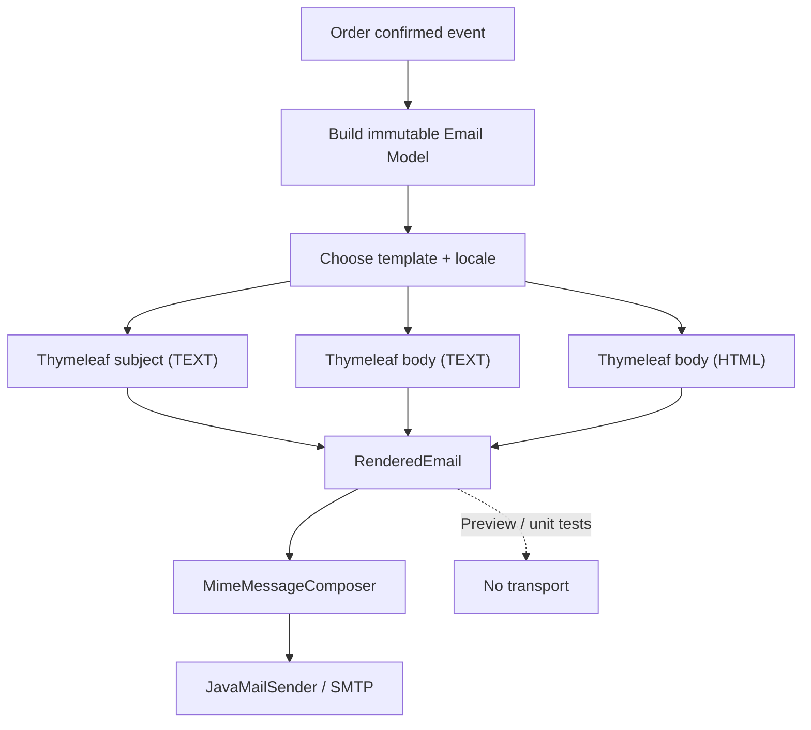

# Rendering Emails with a Template Engine

In a **Spring Framework Mail** application, sending an email containing only a fixed sentence of text is relatively straightforward: create a `SimpleMailMessage` and call `JavaMailSender.send(...)`. However, a real-world product email typically needs the recipient's name, order number, total amount, a button to open details, display language, HTML content, a plain-text version for clients that do not support HTML, and sometimes images or attachments. Assembling all of those parts via Java string concatenation quickly becomes unmaintainable and prone to security vulnerabilities.

This practice project **"Rendering Emails with a Template Engine"** builds a reusable email module in a Spring Boot application:

- Uses **Thymeleaf** as the template engine, keeping presentation in template files instead of embedding long HTML inside Java.
- Renders **subject**, **plain-text body**, and **HTML body** from the same business data model.
- Uses `MimeMessageHelper` to build a MIME message with `multipart/alternative` and UTF-8.
- Handles dynamic data safely, avoiding HTML injection, header injection, and spoofed links.
- Provides a preview/test mode **without sending real emails**.
- Integrates `JavaMailSender` at the delivery/worker layer without mixing rendering with network I/O.
- Tests the renderer, MIME messages, missing template variables, locales, attachments/inline resources, and error scenarios.

This exercise belongs to the **Practice Project** chapter of *Spring Framework Mail*. The examples use Java 21, Spring Framework 6.x, Spring Boot 3.x, Thymeleaf 3.x, and Jakarta Mail. Class names, business models, and the `example.test` domain are illustrative and can be adapted to your project. Check your project's dependency versions when integrating; never run tests against production SMTP configuration.

> **Distinction:** *Rendering* only produces the subject, plain text, and HTML (or MIME) in memory. *Submitting* is the act of sending over SMTP or an HTTP provider. Successful rendering does not mean the email was sent; SMTP accepted does not prove inbox delivery.

## 1. Project Goals and Outputs

We build an **order confirmation** email. The input is data already recorded by the business workflow:

```text
orderId       = ORDER-1042
customerName  = Nguyễn An
total         = 149000.00
currency      = VND
locale        = vi-VN
orderUrl      = https://app.example.test/orders/ORDER-1042
recipient     = customer@example.test
```

Expected outputs:

| Component | Example |
|---|---|
| Subject | Đơn hàng ORDER-1042 đã được ghi nhận |
| Plain text | Greeting, order ID, total amount, and plain-text link |
| HTML | Layout with logo, details table, view-order button, and footer |
| Content encoding | UTF-8 preserving Vietnamese characters properly |
| MIME | Plain text and HTML as two alternatives of the same email |
| Transport | Worker uses `JavaMailSender` to submit after rendering |

**Never generate plain text from HTML** by calling `html.replaceAll("<[^>]*>", "")`. HTML stripping mishandles entities, alt text, links, reading order, and nested markup. A dedicated, structured text template is required.

### 1.1. Definition of Done

A practice project meets requirements when:

1. Templates require no Java code changes for wording, layout, or basic styling edits.
2. One data model renders three distinct outputs.
3. Names containing `<`, `>`, or `&` never turn into executable HTML.
4. Order links are constructed from a **trusted base URL**, never taking an arbitrary host from user input or email.
5. Previews work without sending over SMTP.
6. Unit tests verify rendered values, and integration tests verify MIME alternatives.
7. The delivery service never calls SMTP inside an open database transaction.

### 1.2. Data Flow



Decoupling rendering from transport makes testing fast: the renderer runs without an SMTP server, the composer builds a MIME message without sending it, and the transport adapter handles opening network connections.

## 2. Preparing the Spring Boot Project

In an existing Spring Boot project, add the required dependencies (this is the **`dependencies` section of a `build.gradle` with properly managed plugins and versions**, not a complete build file):

```groovy
dependencies {
    implementation 'org.springframework.boot:spring-boot-starter-mail'
    implementation 'org.springframework.boot:spring-boot-starter-thymeleaf'
    implementation 'org.springframework.boot:spring-boot-starter-validation'
    implementation 'org.springframework.boot:spring-boot-starter-web'

    testImplementation 'org.springframework.boot:spring-boot-starter-test'
}
```

With Maven, the equivalent starters are `spring-boot-starter-mail`, `spring-boot-starter-thymeleaf`, `spring-boot-starter-validation`, `spring-boot-starter-web`, and `spring-boot-starter-test`, with dependency versions managed by the Spring Boot BOM. Never mix incompatible Jakarta Mail, Thymeleaf, or Spring Framework versions.

`spring-boot-starter-web` is only needed if exposing HTTP preview or demo endpoints. A mail worker without an HTTP API can omit the web starter.

### 2.1. Suggested Directory Layout

```text
src/
  main/
    java/com/example/mail/
      MailApplication.java
      config/
        MailTemplateConfiguration.java
        MailDeliveryProperties.java
      model/
        OrderConfirmationModel.java
        RenderedEmail.java
      render/
        OrderConfirmationRenderer.java
      compose/
        OrderConfirmationComposer.java
      delivery/
        OrderConfirmationDelivery.java
      preview/
        MailPreviewController.java
    resources/
      application.yml
      templates/
        mail/
          html/
            order-confirmed.html
          text/
            order-confirmed.txt
            order-confirmed-subject.txt
      mail/
        assets/
          brand-logo.png
  test/
    java/com/example/mail/
      OrderConfirmationRendererTest.java
      OrderConfirmationComposerTest.java
```

Here, the three templates live under `src/main/resources/templates/mail` and the logo under `src/main/resources/mail/assets`. They are packaged onto the classpath at build time. Because these are server-side templates, external users must never be allowed to modify or select these files via API-supplied paths.

### 2.2. Why Create Three Templates?

An email has three parts with distinct purposes:

- **Subject** must be concise, contain no CR/LF, and contain no HTML tags.
- **Plain text** must read cleanly in text-only clients, screen readers, previews, and when HTML is blocked.
- **HTML** handles layout, buttons, tables, styling, and logos.

We can reuse the model and shared wording without forcing plain text to mimic HTML layout. Separating templates also prevents content editors from accidentally corrupting email headers.

## 3. SMTP Configuration for the Practice Environment

First, configure sending to an **SMTP sandbox** or an authorized test capture inbox:

```yaml
spring:
  mail:
    host: ${MAIL_HOST:127.0.0.1}
    port: ${MAIL_PORT:1025}
    default-encoding: UTF-8
    properties:
      "[mail.smtp.connectiontimeout]": "5000"
      "[mail.smtp.timeout]": "10000"
      "[mail.smtp.writetimeout]": "10000"

app:
  mail:
    from: no-reply@example.test
    public-base-url: https://app.example.test
    preview-enabled: false
```

The host/port above target a local SMTP catcher (many test servers listen on port 1025 without AUTH/TLS). **Never use this configuration for production SMTP.** Production must use the actual relay endpoint and security mode, SMTP AUTH with a secret manager, required STARTTLS or implicit TLS, certificate/hostname verification, sender verification, timeouts, and quotas. Never send real mail to `example.test`.

An illustrative production STARTTLS example (verify exact host/port in your relay documentation):

```yaml
spring:
  mail:
    host: ${SMTP_HOST}
    port: 587
    username: ${SMTP_USER}
    password: ${SMTP_PASSWORD}
    properties:
      "[mail.smtp.auth]": "true"
      "[mail.smtp.starttls.enable]": "true"
      "[mail.smtp.starttls.required]": "true"
      "[mail.smtp.ssl.checkserveridentity]": "true"
      "[mail.smtp.connectiontimeout]": "5000"
      "[mail.smtp.timeout]": "10000"
      "[mail.smtp.writetimeout]": "10000"
```

Variables like `MAIL_HOST` and `SMTP_PASSWORD` come from environment variables or a secret manager. Never commit SMTP passwords, production email contents, or OTP tokens to Git.

### 3.1. Previews Should Not Require SMTP

The project's preview mode calls only the renderer and returns HTML or plain text. Never trigger transport calls, store SMTP secrets in preview services, or use real recipient emails. When testing MIME and SMTP, use a controlled SMTP sandbox and synthetic mailboxes.

### 3.2. What Should Each Java Component Own?

| Component | Responsibility | Should Not Do |
|---|---|---|
| `OrderConfirmationModel` | Data to render | Query the DB or hold HTTP requests |
| `OrderConfirmationRenderer` | Select templates, render subject/text/HTML | Open SMTP sockets |
| `RenderedEmail` | Hold immutable rendered outputs | Hold credentials |
| `OrderConfirmationComposer` | Convert rendered output to `MimeMessage` | Perform network sends when composing |
| `OrderConfirmationDelivery` | Submit via `JavaMailSender`, enforce tracking/exception boundary | Open business DB transactions |
| Outbox/worker (extension) | Retries, states, attempt tracking | Keep critical tasks solely in RAM |

These boundaries let the practice project evolve into production without rewriting everything.

## 4. Configuring Thymeleaf for HTML and TEXT

Thymeleaf supports several template modes, of which the two key ones for email are:

- `TemplateMode.HTML`: parses HTML structure, processes `th:*` attributes, and escapes text inserted via `th:text`.
- `TemplateMode.TEXT`: suited for subjects and plain text, supporting inline expressions such as `[[...]]` or `[(...)]` per Thymeleaf syntax.

If you configure only an HTML resolver and render `.txt` files in HTML mode, text expressions or special characters can produce unexpected output. We declare **two resolvers** with distinct template scopes.

### 4.1. The mailTemplateEngine Bean

```java
package com.example.mail.config;

import java.util.Set;

import org.springframework.context.annotation.Bean;
import org.springframework.context.annotation.Configuration;
import org.thymeleaf.spring6.SpringTemplateEngine;
import org.thymeleaf.templatemode.TemplateMode;
import org.thymeleaf.templateresolver.ClassLoaderTemplateResolver;

@Configuration(proxyBeanMethods = false)
public class MailTemplateConfiguration {

    @Bean("mailTemplateEngine")
    public SpringTemplateEngine mailTemplateEngine() {
        ClassLoaderTemplateResolver html =
                new ClassLoaderTemplateResolver();
        html.setPrefix("templates/mail/");
        html.setSuffix(".html");
        html.setTemplateMode(TemplateMode.HTML);
        html.setCharacterEncoding("UTF-8");
        html.setResolvablePatterns(Set.of("html/*"));
        html.setCheckExistence(true);
        html.setOrder(1);
        html.setCacheable(true);

        ClassLoaderTemplateResolver text =
                new ClassLoaderTemplateResolver();
        text.setPrefix("templates/mail/");
        text.setSuffix(".txt");
        text.setTemplateMode(TemplateMode.TEXT);
        text.setCharacterEncoding("UTF-8");
        text.setResolvablePatterns(Set.of("text/*"));
        text.setCheckExistence(true);
        text.setOrder(2);
        text.setCacheable(true);

        SpringTemplateEngine engine = new SpringTemplateEngine();
        engine.addTemplateResolver(html);
        engine.addTemplateResolver(text);

        return engine;
    }
}
```

This bean resolves template names as:

```text
html/order-confirmed
  -> classpath:templates/mail/html/order-confirmed.html

text/order-confirmed
  -> classpath:templates/mail/text/order-confirmed.txt

text/order-confirmed-subject
  -> classpath:templates/mail/text/order-confirmed-subject.txt
```

**Spring Boot auto-configuration note:** defining a custom `SpringTemplateEngine` bean may affect MVC view rendering if Spring Boot's auto-configuration conditions back off or pick it up. In applications that render both emails and Thymeleaf web views, separate email and web configuration explicitly with consistent bean names, qualifiers, resolvers, and MVC view resolvers. Never add a separate engine assuming it cannot affect MVC auto-configuration.

If the application uses Thymeleaf solely for emails (while web APIs return JSON), the setup above is simpler. To avoid competing engines, you can also leverage the global Spring Boot-managed `SpringTemplateEngine` with carefully scoped mail resolvers/namespaces. Choose **one deliberate strategy** suited to your project structure.

### 4.2. Why Use Resolver Patterns?

If both HTML and TEXT resolvers match every template name, one resolver may attempt to load the wrong suffix first, such as `text/order-confirmed.html` instead of `text/order-confirmed.txt`. With `setResolvablePatterns(Set.of("html/*"))` and `Set.of("text/*")`, each resolver handles only its own namespace.

`setCheckExistence(true)` tells the resolver to verify the template exists before claiming the name. When a template is missing, rendering should **fail explicitly** rather than silently sending an empty email.

### 4.3. Caching in Production vs. Development

`setCacheable(true)` avoids repeatedly reading and parsing files when many emails share the same template. During content development, you can disable caching in a local profile to see edits immediately, provided you understand how your custom engine is configured. Never use a cache key that ignores template versions when an outbox holds multiple template versions.

When workers run across multiple replicas, caches live inside each JVM. Updating templates during a rolling deploy can cause two versions to render simultaneously; for auditable emails, record the **template version or snapshot** inside the notification intent.

### 4.4. Never Take Template Names Directly from Users

Anti-pattern:

```java
String template = request.getParameter("template");
String html = templateEngine.process(template, context);
```

Allowing arbitrary template names can cause resource errors, template injection via flawed design, or unauthorized template access. Use an **enum/registry whitelist**:

```java
public enum MailTemplateKey {
    ORDER_CONFIRMED(
            "text/order-confirmed-subject",
            "text/order-confirmed",
            "html/order-confirmed");

    private final String subject;
    private final String plain;
    private final String html;

    MailTemplateKey(
            String subject, String plain, String html) {
        this.subject = subject;
        this.plain = plain;
        this.html = html;
    }

    public String subjectTemplate() { return subject; }
    public String plainTemplate() { return plain; }
    public String htmlTemplate() { return html; }
}
```

A template key is selected by an authorized business event type, never from an arbitrary query-parameter path.

## 5. Creating the Subject Template

File `src/main/resources/templates/mail/text/order-confirmed-subject.txt`:

```text
Đơn hàng [(${order.orderId})] đã được ghi nhận
```

This is a **TEXT mode** template, not a Java format string or standalone Spring Expression Language. Thymeleaf evaluates `[(${order.orderId})]` when invoked via `templateEngine.process(...)` with `order` in the `Context`.

### 5.1. Why Should the Subject Have Its Own Template?

- Easy to change wording and locale without modifying Java code.
- Can vary by business event or template version.
- Can be previewed and tested independently.
- Prevents developers from accidentally putting HTML into the Subject.

### 5.2. Subject Is a Header, Not a Body

The Subject must never contain CR/LF from untrusted input, because some stacks, clients, or header builders are vulnerable to header injection. Always:

1. Use only validated business variables (e.g., an order ID with a strict format).
2. Verify rendered output contains no `\r` or `\n` after stripping trailing template newlines intentionally.
3. Enforce length and charset policies.
4. Let `MimeMessageHelper` encode the header via Jakarta Mail.

Never accept `subjectTemplate` from an HTTP request and allow users to embed arbitrary expressions.

## 6. Creating the Plain-Text Template

File `src/main/resources/templates/mail/text/order-confirmed.txt`:

```text
Xin chào [(${order.customerName})],

Cảm ơn bạn đã đặt hàng.

Mã đơn hàng: [(${order.orderId})]
Tổng tiền: [(${totalFormatted})]

Xem chi tiết đơn hàng:
[(${order.orderUrl})]

Nếu bạn không thực hiện đơn hàng này, vui lòng liên hệ bộ phận hỗ trợ
qua kênh chính thức của ứng dụng.

Trân trọng,
Đội ngũ hỗ trợ
```

This content remains clear even when email clients disable HTML or when users rely on text-only readers. The plain-text link displays the full URL without relying on an HTML `href` attribute.

### 6.1. Plain Text Is Not HTML and Does Not Auto-Sanitize

TEXT mode does not sanitize arbitrary input. If `customerName` contains newlines and a spoofed signature like "Bank Support", the plain-text output can mislead the recipient. For single-line display fields, enforce length limits, Unicode normalization/validation, and reject control characters per policy.

Subjects require even stricter validation because they sit in email headers. Untrusted values like `orderUrl` must be built from a trusted host, never assembled from a recipient's email or request host.

### 6.2. Never Wrap Rendered Plain Text into HTML

Taking plain text and wrapping it inside `<p>` without escaping turns `<` and `&` in names into raw markup. HTML requires its own template with context-appropriate escaping. If you only send text, `SimpleMailMessage` may suffice; this lesson requires both plain and HTML alternatives.

## 7. Creating the HTML Template

File `src/main/resources/templates/mail/html/order-confirmed.html`:

```html
<!DOCTYPE html>
<html lang="vi" xmlns:th="http://www.thymeleaf.org">
<head>
  <meta charset="UTF-8"/>
  <meta name="viewport"
        content="width=device-width, initial-scale=1"/>
  <title>Xác nhận đơn hàng</title>
</head>
<body style="margin:0;padding:24px;background:#f5f7fb;
             font-family:Arial,sans-serif;color:#263238;">
  <table role="presentation" cellpadding="0" cellspacing="0"
         width="100%" style="max-width:620px;margin:auto;
         background:#ffffff;border-collapse:collapse;">
    <tr>
      <td style="padding:28px;">
        
        <h1 style="font-size:23px;line-height:1.3;margin:0 0 16px;">
          Xác nhận đơn hàng
        </h1>

        <p>
          Xin chào
          <strong th:text="${order.customerName}">Tên khách hàng</strong>,
        </p>
        <p>
          Cảm ơn bạn đã đặt hàng. Chúng tôi đã ghi nhận đơn
          <strong th:text="${order.orderId}">ORDER-DEMO</strong>.
        </p>

        <table role="presentation" cellpadding="8" cellspacing="0"
               width="100%" style="border-collapse:collapse;
               margin:20px 0;background:#f7f9fc;">
          <tr>
            <td>Mã đơn hàng</td>
            <td style="text-align:right;font-weight:bold;"
                th:text="${order.orderId}">ORDER-DEMO</td>
          </tr>
          <tr>
            <td>Tổng tiền</td>
            <td style="text-align:right;font-weight:bold;"
                th:text="${totalFormatted}">0 VND</td>
          </tr>
        </table>

        <p style="margin:24px 0;">
          <a th:href="${order.orderUrl}"
             href="https://app.example.test/orders/ORDER-DEMO"
             style="display:inline-block;background:#175cd3;
             color:#ffffff;text-decoration:none;border-radius:6px;
             padding:12px 18px;font-weight:bold;">
            Xem đơn hàng
          </a>
        </p>

        <p style="font-size:13px;color:#667085;">
          Nếu bạn không thực hiện đơn hàng này, hãy liên hệ
          bộ phận hỗ trợ qua kênh chính thức.
        </p>
      </td>
    </tr>
  </table>
</body>
</html>
```

Key features:

- Dynamic text flows through `th:text`, allowing Thymeleaf to **escape HTML entities** when inserting text.
- `th:href` sets the link from `orderUrl`, though **attribute escaping does not verify URL safety**. Build and validate URLs at the application layer.
- The logo uses `cid:brand-logo`; the composer must add the inline resource with the matching Content-ID.
- Critical CSS is inlined because many email clients restrict external stylesheets, scripts, forms, and modern CSS.
- A standalone plain-text alternative is provided so the message does not rely solely on HTML rendering.

### 7.1. Email HTML Differs from Web Pages

Never embed a React/Vue page or a complex Thymeleaf web view into an email. Many mail clients:

- Block JavaScript and forms.
- Block external images by default or proxy image URLs.
- Restrict CSS selectors, media queries, and web fonts.
- Render table layouts more reliably than modern CSS layouts.
- Apply automatic dark-mode color transformations.
- Apply link rewriting and tracking policies.

Keep email HTML simple with fallback layouts and a text alternative. Never include `<script>`, event handlers, or external JavaScript in email templates.

### 7.2. Dynamic Data Must Be Escaped Properly

Suppose the customer name is:

```text
Nguyễn  & Co.
```

With `th:text="${order.customerName}"`, the dangerous markup renders as **escaped text**, not a newly injected `img` element. Conversely:

```html
<!-- Do not use with untrusted data: -->
<span th:utext="${order.customerName}"></span>
```

`th:utext` inserts unescaped content. Use it only when the source is sanitized HTML vetted against an allowlist and rich formatting is genuinely required. Standard business emails rarely need users to supply raw HTML.

### 7.3. Attributes and URLs Require Separate Controls

`th:text` is for text nodes. For attributes, use `th:href` and `th:src`, validating the underlying values independently. Never assemble CSS, JavaScript, HTML fragments, or URLs from user-controlled strings and insert them via `th:utext`.

For order URLs, restrict to HTTPS and application-owned hostnames; simple URL escaping will not stop a link from pointing to a phishing domain. If links carry sensitive tokens, enforce expiration, authorization/replay protection, and avoid logging tokens.

## 8. Designing an Engine-Independent Email Model

Use an immutable Java record for the data to render:

```java
package com.example.mail.model;

import java.math.BigDecimal;
import java.util.Objects;

public record OrderConfirmationModel(
        String orderId,
        String customerName,
        BigDecimal total,
        String currencyCode,
        String orderUrl
) {
    public OrderConfirmationModel {
        Objects.requireNonNull(orderId, "orderId");
        Objects.requireNonNull(customerName, "customerName");
        Objects.requireNonNull(total, "total");
        Objects.requireNonNull(currencyCode, "currencyCode");
        Objects.requireNonNull(orderUrl, "orderUrl");

        if (orderId.isBlank() || customerName.isBlank()) {
            throw new IllegalArgumentException(
                    "Order identity and customer name are required");
        }
        if (total.signum() < 0) {
            throw new IllegalArgumentException(
                    "Total cannot be negative");
        }
    }
}
```

This is **minimal illustrative validation**, not complete production validation. Validate order ID format/length, reject control characters, verify valid currency codes, and enforce trusted HTTPS URLs before rendering. Refund models might allow negative totals, in which case the contract differs; never impose validation that conflicts with business rules.

### 8.1. Why Not Pass JPA Entities Directly into Templates?

Avoid:

```java
Context context = new Context();
context.setVariable("order", orderJpaEntity);
```

Thymeleaf can invoke getters and lazy relationships, triggering unintended queries, `LazyInitializationException`, or leaking internal attributes. Outbox workers also run after the originating entity transaction has closed.

Instead:

- Construct a **curated DTO** from business data.
- Validate fields against the tenant and email purpose.
- Omit any field not authorized to be sent.
- For long-lived auditable emails, store a snapshot or versioned payload in the outbox.

### 8.2. Render Data Differs from Transport Metadata

A notification also needs recipient email, sender identity, template key, locale, notification ID, and TTL. Do not stuff all of those into `OrderConfirmationModel` if they are not used for rendering.

A wrapper might look like:

```java
public record MailNotification(
        String notificationId,
        String recipientEmail,
        String senderIdentity,
        String templateKey,
        String localeTag,
        OrderConfirmationModel model
) {}
```

Separating these boundaries keeps SMTP credentials out of the renderer and keeps database queries for totals out of the composer.

## 9. Building Trusted URLs from Server Configuration

A "View order" link must never take a `host` directly from user input:

```java
// Unsafe if caller controls host:
String url = "https://" + userProvidedHost + "/orders/" + orderId;
```

Use a controlled server-configured domain instead:

```java
package com.example.mail.render;

import org.springframework.web.util.UriComponentsBuilder;

public final class OrderUrlFactory {

    private final String trustedBaseUrl;

    public OrderUrlFactory(String trustedBaseUrl) {
        if (!trustedBaseUrl.startsWith("https://")) {
            throw new IllegalArgumentException(
                    "Order email URL must use HTTPS");
        }
        this.trustedBaseUrl = trustedBaseUrl;
    }

    public String forOrder(String orderId) {
        if (!orderId.matches("[A-Z0-9-]{1,80}")) {
            throw new IllegalArgumentException(
                    "Invalid order ID");
        }

        return UriComponentsBuilder
                .fromUriString(trustedBaseUrl)
                .path("/orders/{orderId}")
                .buildAndExpand(orderId)
                .encode()
                .toUriString();
    }
}
```

This example avoids building paths from arbitrary strings. **In production, checking `startsWith("https://")` alone is insufficient**: parse the base URI, validate scheme, host, and port against an allowlist, and forbid user overrides. Never use an HTTP request's `Host` header without trusted-proxy validation to build links in emails.

If the URL carries a verification token, enforce TTL and single-use semantics per business rules, and avoid recording raw tokens in access logs. Links should match your brand domain to reduce phishing risk.

## 10. Render Output as Immutable Data

```java
package com.example.mail.model;

public record RenderedEmail(
        String subject,
        String plainText,
        String html
) {
    public RenderedEmail {
        if (subject == null || subject.isBlank()) {
            throw new IllegalArgumentException(
                    "Email subject must not be blank");
        }
        if (plainText == null || plainText.isBlank()) {
            throw new IllegalArgumentException(
                    "Plain text content must not be blank");
        }
        if (html == null || html.isBlank()) {
            throw new IllegalArgumentException(
                    "HTML content must not be blank");
        }
        if (subject.contains("\r") || subject.contains("\n")) {
            throw new IllegalArgumentException(
                    "Email subject must be a single line");
        }
    }
}
```

This record sends nothing; it simply holds the three rendered outputs. The composer later turns it into a MIME message. Separating this output lets you:

- Run unit tests without SMTP.
- Preview HTML and text without sending emails.
- Enforce size limits before passing to transport.
- Persist rendered artifacts or hashes/snapshots when business audits require them.
- Classify rendering errors separately from SMTP errors.

## 11. Renderer Using a Fresh Context per Email

```java
package com.example.mail.render;

import com.example.mail.model.OrderConfirmationModel;
import com.example.mail.model.RenderedEmail;

import java.text.NumberFormat;
import java.util.Currency;
import java.util.Locale;

import org.springframework.beans.factory.annotation.Qualifier;
import org.springframework.stereotype.Service;
import org.thymeleaf.context.Context;
import org.thymeleaf.spring6.SpringTemplateEngine;

@Service
public final class OrderConfirmationRenderer {

    private final SpringTemplateEngine templates;

    public OrderConfirmationRenderer(
            @Qualifier("mailTemplateEngine")
            SpringTemplateEngine templates) {
        this.templates = templates;
    }

    public RenderedEmail render(
            OrderConfirmationModel order,
            Locale locale) {

        NumberFormat money =
                NumberFormat.getCurrencyInstance(locale);
        money.setCurrency(
                Currency.getInstance(order.currencyCode()));

        Context context = new Context(locale);
        context.setVariable("order", order);
        context.setVariable(
                "totalFormatted", money.format(order.total()));

        String subject = templates.process(
                "text/order-confirmed-subject", context).strip();

        String plain = templates.process(
                "text/order-confirmed", context);

        String html = templates.process(
                "html/order-confirmed", context);

        return new RenderedEmail(subject, plain, html);
    }
}
```

The renderer creates a **new `Context` on every invocation** rather than holding a mutable `Context` field inside a singleton service. `SpringTemplateEngine` is thread-safe for reuse once configured; never mutate resolvers or dialects while threads are rendering.

`NumberFormat` is mutable and must never be shared across worker threads; creating a new instance per locale call is straightforward. For `VND`, formatting output depends on the locale and JVM localization data; test against your target locale or assert semantic content rather than hardcoding whitespace from another machine.

### 11.1. Choosing a Locale

Example:

```java
Locale vi = Locale.forLanguageTag("vi-VN");
Locale en = Locale.forLanguageTag("en-US");

RenderedEmail result = renderer.render(order, vi);
```

When templates contain hardcoded Vietnamese wording, changing `locale` affects only locale-dependent formatting in Java code and **does not automatically translate the content into English**. Supporting multiple languages requires message bundles or per-locale templates, as shown in the extension section.

### 11.2. Never Swallow Template Errors

If a template file is missing or an expression fails, Thymeleaf throws exceptions such as `TemplateInputException` or `TemplateProcessingException`. Never catch them and return `RenderedEmail("", "", "")`, and never send an empty email body.

Log a safe error category (e.g., `TEMPLATE_NOT_FOUND`, `TEMPLATE_RENDER_FAILED`), notification/template version, and **do not invoke SMTP** when rendering fails. In an outbox, workers decide whether to retry, pause, or dead-letter by cause: a missing template requires fixing the deployment rather than retrying 100 times a second.

## 12. From RenderedEmail to MimeMessage

Spring Framework Mail uses `JavaMailSender` to create and send `MimeMessage` objects. To include both text and HTML in one email, `MimeMessageHelper.setText(plainText, htmlText)` is the right API.

```java
package com.example.mail.compose;

import com.example.mail.model.RenderedEmail;

import jakarta.mail.MessagingException;
import jakarta.mail.internet.MimeMessage;

import org.springframework.core.io.ClassPathResource;
import org.springframework.mail.javamail.JavaMailSender;
import org.springframework.mail.javamail.MimeMessageHelper;
import org.springframework.stereotype.Component;

@Component
public final class OrderConfirmationComposer {

    private final JavaMailSender sender;

    public OrderConfirmationComposer(JavaMailSender sender) {
        this.sender = sender;
    }

    public MimeMessage compose(
            String recipient,
            RenderedEmail rendered) throws MessagingException {

        MimeMessage mime = sender.createMimeMessage();

        MimeMessageHelper helper =
                new MimeMessageHelper(
                        mime,
                        true,
                        "UTF-8");

        helper.setFrom("no-reply@example.test");
        helper.setTo(recipient);
        helper.setSubject(rendered.subject());

        // Create multipart/alternative with both content versions:
        helper.setText(
                rendered.plainText(),
                rendered.html());

        // Content-ID matches src="cid:brand-logo" in HTML.
        helper.addInline(
                "brand-logo",
                new ClassPathResource(
                        "mail/assets/brand-logo.png"),
                "image/png");

        return mime;
    }
}
```

In this example, `no-reply@example.test` is a synthetic sender; production pulls an authorized sender identity from config/policy and never lets requests pick an arbitrary `From`. The logo file must exist on the classpath. The composer **does not send over SMTP**: even though it injects `JavaMailSender` to call `createMimeMessage()`, the method only builds a `MimeMessage` object.

### 12.1. Why Use setText(plain, html)?

Two representations of the same content should be packaged as a MIME alternative so the mail client picks the appropriate one. The API:

```java
helper.setText(plainText, htmlText);
```

handles the MIME structure. Never do:

```java
helper.setText(plainText);
helper.setText(htmlText, true); // Overwrites the previous content.
```

Some mail clients and spam filters view valid plain/HTML pairs favorably, though having a text alternative never guarantees Inbox placement on its own.

### 12.2. Order of setText Followed by addInline

With `MimeMessageHelper`, call `setText(...)` **before** adding inline resources so the MIME multipart structure and CIDs match helper semantics. Add logos and attachments afterward. When a template uses multiple inline resources, each `Content-ID` must be unique and match the HTML:

```text
HTML: 
Java: helper.addInline("brand-logo", resource, "image/png");
```

Never use `cid:https://...` or call `addInline` with a random Content-ID that does not match the HTML name.

### 12.3. Resources Must Remain Readable When MIME Is Serialized

A real-world bug:

```java
InputStream stream = upload.getInputStream();
// Request ends, stream closes ...
// Worker later tries to send MIME using old stream.
```

Jakarta Mail may need to read attachment or inline content during serialization, not only when `addInline` is called. Use `ClassPathResource` for logos or a blob/file resource with a sufficient lifetime; for uploaded request data, persist staged files/objects per policy before enqueuing the mail worker. `ByteArrayResource` suits small files but keeps all bytes in heap. Avoid single-use `InputStreamResource` when transport may read the stream multiple times.

### 12.4. Optional PDF Attachment

To attach an invoice, pass a controlled document:

```java
import org.springframework.core.io.Resource;

public void addInvoice(
        MimeMessageHelper helper,
        Resource invoicePdf) throws MessagingException {
    helper.addAttachment(
            "invoice.pdf",
            invoicePdf,
            "application/pdf");
}
```

Choose filenames, content types, and resources from validated business data; never pass an arbitrary upload filename assuming MIME clients will handle it safely. Enforce byte limits, antivirus/quarantine scans when required, and retention policies. Attachments must still exist across retries.

### 12.5. Logo Not Showing in Browser HTML Preview?

Browsers do not understand `cid:brand-logo` as an ordinary HTTP resource. Therefore, a browser preview may show alt text or a broken-image icon even though the actual MIME email includes the inline part. Never judge inline CID correctness solely from a browser HTML preview; test MIME structure and inspect in a mail client or sandbox.

## 13. Delivery Service Only Submits, Never Re-Renders Arbitrarily

Combine renderer, composer, and transport in a clean service:

```java
package com.example.mail.delivery;

import com.example.mail.compose.OrderConfirmationComposer;
import com.example.mail.model.OrderConfirmationModel;
import com.example.mail.model.RenderedEmail;
import com.example.mail.render.OrderConfirmationRenderer;

import java.util.Locale;

import jakarta.mail.MessagingException;
import jakarta.mail.internet.MimeMessage;

import org.springframework.mail.javamail.JavaMailSender;
import org.springframework.stereotype.Service;

@Service
public final class OrderConfirmationDelivery {

    private final OrderConfirmationRenderer renderer;
    private final OrderConfirmationComposer composer;
    private final JavaMailSender sender;

    public OrderConfirmationDelivery(
            OrderConfirmationRenderer renderer,
            OrderConfirmationComposer composer,
            JavaMailSender sender) {
        this.renderer = renderer;
        this.composer = composer;
        this.sender = sender;
    }

    public void submit(
            OrderConfirmationModel model,
            Locale locale,
            String recipientEmail) throws MessagingException {

        RenderedEmail rendered =
                renderer.render(model, locale);

        MimeMessage mime =
                composer.compose(recipientEmail, rendered);

        sender.send(mime);
    }
}
```

Here `submit(...)` is a blocking SMTP operation. In a real application, this service is called by a **mail worker** after the business transaction and outbox intent have committed. Never call it directly inside an order-saving `@Transactional` method expecting a database rollback to recall an already-sent email.

### 13.1. Render, Compose, and Send Errors Differ

| Stage | Example Failure | Meaning |
|---|---|---|
| Render | Missing template, expression error | SMTP was never opened |
| Validate | Invalid locale, currency, link, or recipient | Fix input or policy |
| Compose | MIME helper error, missing inline resource, attachment read failure | SMTP submission unlikely/incomplete |
| Send | SMTP AUTH, TLS, transient/permanent rejection | Classify provider/recipient failure |
| Send uncertain | Timeout after `DATA`, final reply lost | Provider may have accepted |
| Post-send tracking | DB fails to record `ACCEPTED` | Recovery carries duplicate risk |

Never lump a `MailSendException` together with Thymeleaf errors as "broken template". Conversely, never retry a `TemplateInputException` against SMTP hundreds of times when SMTP was never even called.

### 13.2. Do Not Render Different Content on Each Retry

When using an outbox, email data must remain semantically stable. For example, if an order is edited after the intent is created, a worker retrying 24 hours later must not accidentally send the updated total under the old issuance's subject.

You can store:

- Template key and version.
- Curated render model or immutable snapshot reference.
- Locale, sender identity, and recipient reference.
- Business event key and notification ID.
- Pre-send expiry/revalidation policy (especially for OTPs).

Certain email types, such as marketing subscriptions, must check current consent/suppression at send time. Distinguish **data that needs a snapshot** from **policies that must be re-checked**.

## 14. Preview Mode Only Renders, Never Sends

Previews are useful when internal staff or developers want to inspect HTML before release. They also support automated screenshots in test pipelines if infrastructure exists, yet **previews never replace checking MIME in real mail clients**.

A controller enabled only under the `local` profile:

```java
package com.example.mail.preview;

import com.example.mail.model.OrderConfirmationModel;
import com.example.mail.render.OrderConfirmationRenderer;

import java.math.BigDecimal;
import java.util.Locale;

import org.springframework.context.annotation.Profile;
import org.springframework.http.MediaType;
import org.springframework.web.bind.annotation.GetMapping;
import org.springframework.web.bind.annotation.RequestMapping;
import org.springframework.web.bind.annotation.RestController;

@Profile("local")
@RestController
@RequestMapping("/internal/mail-preview")
public final class MailPreviewController {

    private final OrderConfirmationRenderer renderer;

    public MailPreviewController(
            OrderConfirmationRenderer renderer) {
        this.renderer = renderer;
    }

    @GetMapping(
            value = "/order-confirmed",
            produces = MediaType.TEXT_HTML_VALUE)
    public String previewHtml() {
        return renderer.render(demoModel(), demoLocale()).html();
    }

    @GetMapping(
            value = "/order-confirmed.txt",
            produces = MediaType.TEXT_PLAIN_VALUE)
    public String previewText() {
        return renderer.render(demoModel(), demoLocale()).plainText();
    }

    private static Locale demoLocale() {
        return Locale.forLanguageTag("vi-VN");
    }

    private static OrderConfirmationModel demoModel() {
        return new OrderConfirmationModel(
                "ORDER-1042",
                "Nguyễn An",
                new BigDecimal("149000.00"),
                "VND",
                "https://app.example.test/orders/ORDER-1042");
    }
}
```

When running the `local` profile, you can visit:

```text
GET http://localhost:8080/internal/mail-preview/order-confirmed
GET http://localhost:8080/internal/mail-preview/order-confirmed.txt
```

**Never expose a public preview controller in production.** If a real admin tool requires previews, enforce authentication/authorization, rate limits, tenant-scoped data, XSS protections on custom HTML, log redaction, and avoid real customer emails. `@Profile("local")` reduces accidental exposure in examples, but is safe only when profiles are strictly managed.

### 14.1. Use Only Synthetic Data in Previews

Previews do not need real customer emails. Using synthetic models lets UI/design iterate without touching sensitive data. To preview edge cases, build a fixture set:

```text
normal-name
long-customer-name
html-special-characters
very-large-currency
missing-optional-field
en-US / vi-VN
```

Never let users submit raw Thymeleaf template source into the engine from a public endpoint. Template source is trusted code managed by authorized developers or content admins.

### 14.2. Previewing "Looks Good in HTML" Is Not Enough

Open emails in real email clients or a sandbox to verify:

- Is `multipart/alternative` structured right?
- Does the inline image CID link to the MIME part?
- Dark mode and mobile rendering.
- Link rewriting and alt text.
- Long subject and filename encoding.
- Footer and support links.
- How email clients sanitize or restrict the HTML.

Browser previews give fast layout feedback, not proof of deliverability.

## 15. Unit Testing the Renderer Without an SMTP Connection

A major advantage of this layered design is that rendering tests require only Thymeleaf and template files on the classpath. No SMTP sandbox, Spring web server, or database is needed yet.

### 15.1. JUnit Test with the Real Engine

```java
package com.example.mail;

import static org.junit.jupiter.api.Assertions.*;

import com.example.mail.config.MailTemplateConfiguration;
import com.example.mail.model.OrderConfirmationModel;
import com.example.mail.model.RenderedEmail;
import com.example.mail.render.OrderConfirmationRenderer;

import java.math.BigDecimal;
import java.util.Locale;

import org.junit.jupiter.api.Test;

class OrderConfirmationRendererTest {

    private final OrderConfirmationRenderer renderer =
            new OrderConfirmationRenderer(
                    new MailTemplateConfiguration()
                            .mailTemplateEngine());

    @Test
    void rendersSubjectTextAndHtmlFromSameModel() {
        var order = demoOrder("Nguyễn An");
        var locale = Locale.forLanguageTag("vi-VN");

        RenderedEmail email = renderer.render(order, locale);

        assertEquals(
                "Đơn hàng ORDER-1042 đã được ghi nhận",
                email.subject());
        assertTrue(email.plainText().contains("ORDER-1042"));
        assertTrue(email.plainText().contains("Nguyễn An"));
        assertTrue(email.html().contains("ORDER-1042"));
        assertTrue(email.html().contains("Nguyễn An"));
        assertTrue(email.html().contains(
                "https://app.example.test/orders/ORDER-1042"));
    }

    @Test
    void escapesUntrustedTextInHtml() {
        var order = demoOrder(
                "Nguyễn  & Co.");

        RenderedEmail email = renderer.render(
                order, Locale.forLanguageTag("vi-VN"));

        assertFalse(email.html().contains(
                ""));
        assertTrue(email.html().contains("&lt;img"));

        // Plain text is not HTML, so control characters must be
        // checked separately if the source is untrusted.
        assertTrue(email.plainText().contains(
                "Nguyễn "));
    }

    @Test
    void rejectsHeaderNewlineFromSubjectVariable() {
        var order = new OrderConfirmationModel(
                "ORDER-1042\r\nBcc: attacker@example.test",
                "Nguyễn An",
                new BigDecimal("149000.00"),
                "VND",
                "https://app.example.test/orders/ORDER-1042");

        assertThrows(
                IllegalArgumentException.class,
                () -> renderer.render(
                        order, Locale.forLanguageTag("vi-VN")));
    }

    private static OrderConfirmationModel demoOrder(
            String customerName) {
        return new OrderConfirmationModel(
                "ORDER-1042",
                customerName,
                new BigDecimal("149000.00"),
                "VND",
                "https://app.example.test/orders/ORDER-1042");
    }
}
```

The test runs the **real engine and templates** without touching SMTP. If you refactor the model or renderer, update the fixtures accordingly. Email clients may re-encode MIME bodies later, whereas renderer unit tests verify the strings before serialization.

### 15.2. A Sensible Test Matrix Across Inputs

| Case | What to Verify |
|---|---|
| Normal accented name | UTF-8 preserves all characters |
| Name with `<script>` or `&` | Escaped in HTML, no active markup injected |
| Order ID with CR/LF | Subject validation rejects it |
| Abnormally long order ID | Model validation enforces business policy |
| Invalid currency | Render fails with clear reason; no SMTP call |
| Large amount / decimals | Formatted per locale and currency |
| Missing template | Fails before sending |
| Missing variable | Required fields never silently blanked |
| Invalid URL | Blocked in model factory or validation |
| Different locale | Content/template or message bundle follows policy |

Notably, Thymeleaf may render `null` values as empty strings in certain expressions, so relying solely on the template engine to catch missing fields is insufficient. **Required fields need domain/model validation** before rendering.

### 15.3. Testing a Missing Template

Example:

```java
import org.thymeleaf.context.Context;
import org.thymeleaf.exceptions.TemplateInputException;

@Test
void unknownTemplateFailsExplicitly() {
    var engine = new MailTemplateConfiguration()
            .mailTemplateEngine();

    assertThrows(
            TemplateInputException.class,
            () -> engine.process(
                    "html/not-existing", new Context()));
}
```

Never work around a missing template by falling back to an empty template "just to get it sent"; for invoices or OTP emails, missing content is worse than recording a clear failure and routing the job for handling.

## 16. Verifying MIME Alternatives and Inline Resources

After rendering, verify that `MimeMessageHelper` assembled **plain text**, **HTML**, and **inline images** into a valid MIME tree rather than leaving three disconnected strings in memory.

### 16.1. Testing the Composer Without Opening SMTP

```java
package com.example.mail;

import static org.junit.jupiter.api.Assertions.*;

import com.example.mail.compose.OrderConfirmationComposer;
import com.example.mail.model.RenderedEmail;

import jakarta.mail.Message;
import jakarta.mail.Multipart;
import jakarta.mail.Part;
import jakarta.mail.internet.InternetAddress;
import jakarta.mail.internet.MimeMessage;

import java.util.ArrayList;
import java.util.List;

import org.junit.jupiter.api.Test;
import org.springframework.mail.javamail.JavaMailSenderImpl;

class OrderConfirmationComposerTest {

    @Test
    void createsMimeWithBothAlternatives() throws Exception {
        JavaMailSenderImpl sender = new JavaMailSenderImpl();
        OrderConfirmationComposer composer =
                new OrderConfirmationComposer(sender);

        var rendered = new RenderedEmail(
                "Xác nhận ORDER-1042",
                "Đơn hàng ORDER-1042",
                "<html><body><p>ORDER-1042</p>"
                        + ""
                        + "</body></html>");

        MimeMessage mime = composer.compose(
                "recipient@example.test", rendered);
        mime.saveChanges();

        assertEquals(
                "Xác nhận ORDER-1042", mime.getSubject());

        var recipient = (InternetAddress)
                mime.getRecipients(Message.RecipientType.TO)[0];
        assertEquals(
                "recipient@example.test",
                recipient.getAddress());

        List<String> types = new ArrayList<>();
        collectMimeTypes(mime, types);

        assertTrue(types.contains("text/plain"));
        assertTrue(types.contains("text/html"));
    }

    private static void collectMimeTypes(
            Part part, List<String> types) throws Exception {

        if (part.isMimeType("text/plain")) {
            types.add("text/plain");
        } else if (part.isMimeType("text/html")) {
            types.add("text/html");
        } else if (part.isMimeType("multipart/*")) {
            Multipart multipart =
                    (Multipart) part.getContent();

            for (int i = 0; i < multipart.getCount(); i++) {
                collectMimeTypes(
                        multipart.getBodyPart(i), types);
            }
        }
    }
}
```

Tests can use `JavaMailSenderImpl` to construct messages without configuring an SMTP host because `createMimeMessage()` and `saveChanges()` do not call `send()`. Make sure `mail/assets/brand-logo.png` is on the test classpath when testing full inline resources. With nested MIME multiparts, never assert that all parts sit at the top level; `MimeMessageHelper` can nest `multipart/mixed`, `multipart/related`, and `multipart/alternative`.

### 16.2. Checking CIDs and Attachments

In advanced tests, walk all MIME parts and assert:

- An inline part exists with `Content-ID: <brand-logo>` (normalizing angle brackets when comparing).
- Its `Content-Type` matches the image type, and actual bytes match the fixture.
- The HTML body references `cid:brand-logo`.
- The plain-text part contains no unintended HTML tags outside deliberately displayed data.
- Any attachment part has `ATTACHMENT` disposition, expected filename, and exact bytes.
- UTF-8 charset is preserved in serialized subject and body.

Never merely check the filename `brand-logo.png` in code and assume the email renders cleanly; a MIME resource may fail to read until serialization time.

### 16.3. Clients Vary in Inline Support

One mail client renders inline CIDs natively, while another blocks images or applies dark-mode transformations. These are client-rendering differences. Alongside MIME unit tests, send to a **sandbox mailbox** and inspect on representative clients before production rollout.

## 17. Integration Testing with an SMTP Sandbox

Unit tests for rendering and MIME do not verify:

- TCP connectivity to a relay.
- SMTP EHLO/AUTH/TLS/reply handling.
- Actual MIME bytes accepted by the server.
- Timeouts, quotas, and transport errors.

For integration tests, use a controlled SMTP test server such as GreenMail or Mailpit. Never send to real users.

### 17.1. Practice Workflow

1. Start the local SMTP sandbox using your test tool's setup.
2. Configure `JavaMailSenderImpl` with host `127.0.0.1` and the sandbox port.
3. Render an `OrderConfirmationModel` fixture.
4. Compose a `MimeMessage` with plain text, HTML, and inline logo.
5. Call `sender.send(mime)`.
6. Wait for the server to receive the email within a bounded timeout.
7. Read the raw MIME from the test server and verify Subject, recipient, and alternative parts.
8. Verify no email left the test environment.

### 17.2. GreenMail JUnit 5 Example

```java
import static org.junit.jupiter.api.Assertions.*;

import com.icegreen.greenmail.util.GreenMail;
import com.icegreen.greenmail.util.ServerSetup;

import org.junit.jupiter.api.Test;
import org.springframework.mail.javamail.JavaMailSenderImpl;

class SmtpTemplateDeliveryIT {

    @Test
    void sendsRenderedMessageToTestRelay() throws Exception {
        GreenMail relay = new GreenMail(
                new ServerSetup(
                        0, "127.0.0.1",
                        ServerSetup.PROTOCOL_SMTP));

        relay.start();
        try {
            JavaMailSenderImpl sender =
                    new JavaMailSenderImpl();
            sender.setHost("127.0.0.1");
            sender.setPort(relay.getSmtp().getPort());
            sender.setDefaultEncoding("UTF-8");

            var composer =
                    new OrderConfirmationComposer(sender);
            var rendered = new RenderedEmail(
                    "Xác nhận đơn ORDER-1042",
                    "Đơn hàng ORDER-1042 đã được ghi nhận",
                    "<p>Đơn hàng ORDER-1042 đã được ghi nhận</p>"
                        + "");

            sender.send(composer.compose(
                    "recipient@example.test", rendered));

            assertTrue(
                    relay.waitForIncomingEmail(5000, 1));
            assertEquals(
                    1, relay.getReceivedMessages().length);
            assertEquals(
                    "Xác nhận đơn ORDER-1042",
                    relay.getReceivedMessages()[0].getSubject());
        } finally {
            relay.stop();
        }
    }
}
```

Adjust imports for your project's model and composer packages. GreenMail is a separate test dependency; pick a version compatible with Spring Boot 3's Jakarta Mail rather than mixing legacy `javax.mail`. This test illustrates a basic SMTP sandbox session; if your test server requires mailbox/user setup, configure it per that version's API.

**Important point:** an SMTP sandbox accepting a message is not proof of ISP deliverability or Inbox placement. Real provider testing involves SPF/DKIM/DMARC, reputation, rate/size limits, bounces, and mail clients—never run such tests with customer data or without permission.

## 18. i18n Extension: Locale Does Not Automatically Translate Templates

In the main example, all Vietnamese sentences are hardcoded inside the template files. Calling `renderer.render(model, Locale.US)` changes `NumberFormat` currency formatting, yet phrases like "Xin chào", "Tổng tiền", and "Xem đơn hàng" remain in Vietnamese.

To support real English/Vietnamese localization, **decide on a translation strategy**:

1. One template per language.
2. One template using message bundles for phrases/copy.
3. Shared templates combined with localized data from a controlled content service.

### 18.1. One Template per Language

Example:

```text
templates/mail/html/
  order-confirmed-vi.html
  order-confirmed-en.html

templates/mail/text/
  order-confirmed-vi.txt
  order-confirmed-en.txt
  order-confirmed-subject-vi.txt
  order-confirmed-subject-en.txt
```

Select via an allowlist:

```java
private String supportedLanguage(Locale locale) {
    return switch (locale.getLanguage()) {
        case "vi" -> "vi";
        case "en" -> "en";
        default -> "vi"; // Agreed fallback policy.
    };
}

String suffix = "-" + supportedLanguage(locale);
String htmlTemplate = "html/order-confirmed" + suffix;
```

This is an optional alternative to the current template names in the renderer; create all matching files before enabling it. Never let an arbitrary locale tag turn into an unvalidated template path. If a translation is missing, fall back explicitly and emit a metric/alert; never accidentally send a mixed-language email.

Advantage: content owners can adapt entire layouts per culture and language. Drawback: more files to keep synchronized, especially when an email contains many business fields.

### 18.2. Using Message Bundles for Copy

Another approach:

```text
src/main/resources/messages_vi.properties
src/main/resources/messages_en.properties
```

Example:

```properties
mail.order.title=Xác nhận đơn hàng
mail.order.greeting=Xin chào
mail.order.total=Tổng tiền
mail.order.view=Xem đơn hàng
```

In HTML templates you can use `#{mail.order.title}` if `SpringTemplateEngine` is properly wired to Spring's message resolver / `MessageSource`:

```html
<h1 th:text="#{mail.order.title}">Xác nhận đơn hàng</h1>
```

A template can also receive strings already resolved by a service from Spring `MessageSource`. Never assume a manually constructed engine automatically wires all localization integration without checking beans/message resolvers; test with real locales in a Spring context.

**Important:** properties files have default escaping/encoding rules per framework and config. Explicitly configure UTF-8 in Spring Boot's message source setup and test accented text rather than assuming source file encoding suffices.

### 18.3. Locale, Currency, and Timezone

If the model includes dates or times, never format with the server timezone:

```java
import java.time.Instant;
import java.time.ZoneId;
import java.time.format.DateTimeFormatter;
import java.time.format.FormatStyle;

String formattedTime =
        DateTimeFormatter
                .ofLocalizedDateTime(FormatStyle.MEDIUM)
                .withLocale(Locale.forLanguageTag("vi-VN"))
                .withZone(ZoneId.of("Asia/Ho_Chi_Minh"))
                .format(Instant.parse("2026-11-12T09:00:00Z"));
```

Timezones can come from account or customer preferences, provided `ZoneId` is validated/allowlisted; never use the server default when recipients live across multiple countries.

For currency, watch fraction digits per currency (VND typically has 0 decimals, USD has 2). When using `NumberFormat`, set fraction digits via `Currency.getDefaultFractionDigits()` when the formatting contract requires it; do not rely solely on locale when currency and locale differ.

### 18.4. Fallback Is a Product Decision

Suppose a customer sets locale `fr-FR` but no French email exists yet. Options:

- Fall back to English.
- Fall back to the tenant's default language.
- Suppress an untranslated marketing email to avoid wrong-language copy.
- For mandatory notices, use the legally mandated language.

Pick an explicit policy and record the chosen template/version in the outbox for auditing. Do not assume an "unsupported" locale must always be treated as a fatal system error across every email type.

## 19. Render at Enqueue Time or Inside the Mail Worker?

There are two fundamental architectures:

<text>**Approach A — Render when the business flow creates the notification.**</text>

```text
HTTP/business service
  -> build model
  -> render subject/plain/HTML
  -> persist rendered snapshot in outbox
  -> DB commit
  -> worker submits exact content
```

Pros: content is frozen early, making it easy to audit what was intended. Cons: rendering adds CPU/latency inside the transaction, stores large HTML/PII in the DB, and makes template fixes harder once queued.

<text>**Approach B — Persist intent/model, render when the worker claims the job.**</text>

```text
HTTP/business service
  -> build immutable versioned model
  -> persist model snapshot + template version in outbox
  -> DB commit
  -> worker renders, composes, submits
```

Pros: fast request path, looser coupling to the template engine, worker handles concurrency and attachments. Cons: requires retaining old template versions, payload schemas, and assets long enough; template updates must not alter the meaning of pending emails.

### 19.1. Recommendation for the Practice Project

For order confirmation emails that may retry and must reflect the order state at checkout time, **Approach B with an immutable snapshot + template version** is practical. Workers render from persisted data rather than re-reading arbitrary JPA `Order` fields and sending a modified total.

However, if regulations require storing the **exact approved email text** before commit (such as legal notices or regulated receipts), persist the rendered snapshot or an immutable artifact instead. That decision belongs to the business/legal contract, not template-engine preference.

### 19.2. Minimal Outbox Record

```text
notificationId    = MAIL-8821
businessKey       = tenant-5:ORDER-1042:CONFIRMED
templateKey       = ORDER_CONFIRMED
templateVersion   = v1
locale            = vi-VN
senderIdentity    = orders-default
recipientRef      = CUSTOMER-51
payloadSchema     = order-confirmation-v1
payloadRef        = immutable-order-snapshot-1042
state             = QUEUED
nextAttemptAt     = ...
```

The worker must check tenant scope, TTL, and recipient consent (where required by email type), render using the exact version, and maintain attempt history. Never store SMTP credentials in the outbox, and never put web session JWTs in the payload for later worker use.

### 19.3. Business Transaction Pattern

```java
@Service
public final class OrderApplicationService {

    private final OrderRepository orders;
    private final MailOutboxRepository outbox;

    public OrderApplicationService(
            OrderRepository orders,
            MailOutboxRepository outbox) {
        this.orders = orders;
        this.outbox = outbox;
    }

    @Transactional
    public CreatedOrder confirm(CreateOrderCommand command) {
        Order order = orders.insertIdempotently(command);

        String eventKey =
                "order-confirmed:" + order.getId();

        String mailId = outbox.insertIfAbsent(
                order.getTenantId(),
                eventKey,
                "ORDER_CONFIRMED",
                "v1",
                order.getImmutableEmailPayloadRef());

        return new CreatedOrder(
                order.getId(),
                mailId,
                "QUEUED");
    }
}
```

This is **Java pseudocode using application-defined interfaces/DTOs**, not classes provided by Spring Boot. A unique constraint on `(tenant_id, business_event_key)` in the outbox prevents duplicate intents on HTTP retries. Business inserts and outbox inserts must share the same database transaction manager/resource for atomicity.

### 19.4. Worker Renders and Submits Outside the DB Transaction

Worker logic:

```java
public void process(ClaimedMailJob job) throws Exception {
    // Job already claimed + lease committed in a short transaction.
    OrderConfirmationModel model =
            payloadStore.loadValidatedModel(job.payloadRef());

    RenderedEmail rendered = renderer.render(
            model, Locale.forLanguageTag(job.localeTag()));

    MimeMessage mime = composer.compose(
            job.recipientEmail(), rendered);

    // Invoke SMTP outside any database transaction.
    sender.send(mime);

    // New short transaction records accepted/attempt,
    // guarded by lease token and expected state.
    outcomeRecorder.recordAccepted(job.id(), job.leaseToken());
}
```

`ClaimedMailJob`, `payloadStore`, and `outcomeRecorder` are illustrative abstractions. Production requires `try/finally` permit cleanup, error classification, expiry/retry/dead-letter handling, conditional state updates, observability, and handling `UNKNOWN` SMTP outcomes. Never wrap the entire method in a DB transaction holding locks during SMTP.

### 19.5. Why an Outbox Does Not Guarantee Exactly-Once Email

```text
Worker renders and sends
SMTP relay accepts
Worker crashes before recordAccepted()
Another worker recovers job and retries
Recipient might receive two copies
```

An outbox guarantees *durable intent*, not an atomic transaction spanning database and SMTP. Use business idempotency keys and careful policies for `UNKNOWN` outcomes; SMTP lacks a universal global idempotency key across all providers. Template rendering guarantees identical retry content, yet **cannot deduplicate two submissions already accepted by a relay**.

## 20. Security When Templates Handle Untrusted Data

Emails are often sent outside the organization. Data entering templates must be treated as **untrusted**, even when read from a database (since the database may hold user-submitted input).

### 20.1. HTML Injection vs. Template Injection

**HTML injection:** the application inserts user-supplied names or text into HTML without escaping. Prevention: `th:text` for text nodes, validation, and proper HTML sanitization if rich text is truly accepted.

**Template injection:** the application accepts user-controlled template source or expressions and passes them into the engine for evaluation. Thymeleaf expressions can access application object graphs and logic; never execute arbitrary template/expression input. Keep templates on the classpath or in an access-controlled, approved content store.

Avoid:

```java
// Dangerous design example:
String rawTemplateFromUser = request.getTemplateSource();
// Never configure an engine to evaluate arbitrary user template source
// inside the same trust boundary as application data and secrets.
```

### 20.2. Context-Appropriate Escaping

| Location | Handling |
|---|---|
 HTML text node | `th:text`; never `th:utext` for untrusted input |
 HTML attribute | Use processors like `th:href`, and validate URL/type independently |
 Subject header | No CR/LF, enforce length limits, validate variables |
 Plain text | Control character filtering, line breaks/length checks to prevent spoofing |
 Links | HTTPS + host allowlist + URL encoding + token TTL |
 CSS | Never concatenate CSS from arbitrary input |
 Attachment names | Validate filename, control chars, and length |
 Metadata/tags | Allowlisted fields only; no PII or secrets |

### 20.3. Never Log Raw Rendered Emails

Emails may contain orders, totals, addresses, reset links, OTPs, PDF invoices, health data, or private details. Log instead:

```text
event=mail_render_completed
notificationId=MAIL-8821
templateKey=ORDER_CONFIRMED
templateVersion=v1
locale=vi-VN
renderDurationMs=14
htmlBytes=3840
textBytes=512
```

Do not log:

- Full subjects or bodies in broadly accessible log environments.
- Full recipient emails unless explicitly needed for authorized security/investigation.
- Reset tokens, OTP codes, or signed URLs.
- Attachment bytes or image URLs containing secrets.
- Template data objects via `toString()` if they carry PII.

When content auditing is required, store artifacts or snapshots under encryption at rest, TTL, and access controls rather than scattering copies across structured logs.

### 20.4. Email URLs Must Prevent Phishing

Never mix:

```text
Visible button text: "Open invoice at app.example.test"
Actual href: https://attacker.example.test/collect?token=...
```

Even when Thymeleaf escapes `href`, a malicious URL remains syntactically valid. Construct URLs from server-configured trusted domains, enforce HTTPS, validate redirects/open-redirects on landing endpoints, and never trust unvalidated `Host` or `X-Forwarded-Host` headers.

### 20.5. Content Policy and External Images

Email clients may fetch external images through proxies, generating tracking signals and leaking metadata. When using tracking pixels or external resources, follow privacy and consent policies. For logos, inline CID makes MIME self-contained at the cost of larger size; choose deliberately. Never include unreviewed remote SVGs or scripts in transactional emails.

## 21. Performance and Operations When Rendering at Scale

A renderer that works fine for one email may struggle with a backlog of hundreds of thousands of notifications. Rendering costs stem from template parsing/compilation, expression evaluation, currency/date formatting, loading payloads/attachments, large HTML strings, MIME encoding, and garbage collection.

### 21.1. Reuse the Engine, Create a Fresh Context

```text
SpringTemplateEngine:
  singleton bean, initialized once

Context:
  new object per render call

NumberFormat:
  new object per render call
```

Never instantiate a new `SpringTemplateEngine` per email; that wastes template parsing and caching overhead. Conversely, never share a mutable `Context` across concurrent workers, or variables will leak between customers and tenants. `NumberFormat` is mutable; never share one instance across threads without synchronization.

### 21.2. Render According to Worker Capacity

Avoid:

```java
List<RenderedEmail> rendered =
        oneMillionJobs.stream()
                .map(job -> renderer.render(
                        job.model(), job.locale()))
                .toList();
```

All rendered HTML and text would sit on the heap even though the provider only accepts a small rate per second. Claim small batches matched to concurrency and quota, render close to submission, send/record outcomes, and release references.

```text
Durable outbox
    -> limited claim
    -> render (bounded CPU)
    -> MIME compose
    -> submit (bounded SMTP connections/rate)
    -> attempt update
```

Never let an in-memory render queue grow unbounded, and never claim jobs so early that leases expire before SMTP even starts.

### 21.3. Template Versions During Rolling Deployments

If the outbox holds `ORDER_CONFIRMED:v1` while the new release only ships template `v2`, jobs queued by the old release may fail to render. Options:

- Retain `v1` and `v2` templates for the retention window.
- Store controlled rendered snapshots for emails requiring exact historical reproduction.
- Migrate queued jobs to the new version after business verification.
- Route workers by payload/template version when needed.

Never delete an old template solely because new code no longer triggers it directly. Emails sent right after a deploy may belong to earlier events.

### 21.4. Render Artifact Caches Must Use Proper Keys

For large payloads, you can cache rendered artifacts keyed by `notificationId + templateVersion` or store immutable snapshots, balancing privacy, retention, and invalidation. Never use a global cache key of just `templateName` if cached values contain recipient-specific personal data.

### 21.5. Metrics to Monitor

| Metric | Meaning |
|---|---|
| `mail.render.duration` p50/p95/p99 | Is template processing slowing down? |
| `mail.render.errors` by template/version | Is a new template failing across jobs? |
| HTML/text bytes p95 | Is payload size growing abnormally? |
| MIME encoded size | Is it approaching provider limits? |
| Mail worker active/queue capacity | Is backpressure building? |
| Outbox oldest due age | Are rendering/SMTP violating SLA? |
| SMTP submit latency and outcomes | Is failure in transport or templates? |
| Mail worker GC/heap usage | Are bytes/template data retained too long? |

Never use recipient email, order ID, or notification ID as high-cardinality metric labels. Put IDs in access-controlled logs/traces, and use template key, version, and error category for metrics.

## 22. Troubleshooting When Templates Do Not Render as Expected

### 22.1. Variables Display as Raw Expressions

For example, the email contains:

```text
Xin chào [(${order.customerName})]
```

Likely causes: the file was read raw instead of via `TemplateEngine.process(...)`; the resolver used the wrong template mode; expression syntax is wrong; or another resolver loaded a file with the same name. Fix: test the renderer directly with a `Context` and exact template name without sending SMTP.

### 22.2. TemplateNotFound or TemplateInputException

Check that the file exists under `src/main/resources/templates/mail/...`, the `.html`/`.txt` suffix matches the resolver, the `html/*`/`text/*` pattern matches the template name, casing is exact on Linux, the packaged JAR includes the file, and the template version still exists during rolling deploys.

Never "fix" this by letting users pass arbitrary filesystem paths in production.

### 22.3. HTML Renders, Plain Text Missing

Verify the composer calls:

```java
helper.setText(rendered.plainText(), rendered.html());
```

rather than calling `setText(...)` twice and overwriting. Inspect the actual MIME tree instead of relying on an HTML preview.

### 22.4. Vietnamese Names Have Corrupted Characters

Check UTF-8 on template source files, resolver `setCharacterEncoding("UTF-8")`, `MimeMessageHelper(..., "UTF-8")`, Jakarta Mail subject encoding, MIME charset decoding in the SMTP sandbox/client, and ensure database input wasn't already corrupted before rendering.

Never "fix" this by converting Unicode to ASCII or disabling encoding.

### 22.5. Button Links Point to the Wrong Domain

Check `app.mail.public-base-url`, trusted-proxy settings if any, `OrderUrlFactory`, and `th:href`. Never build links from an untrusted `Host` header. A preview showing `example.test` does not prove production links are right.

### 22.6. CID Logo Not Displaying

Check that the resource exists on the classpath, `helper.addInline("brand-logo", ...)` is called after `setText`, HTML has `src="cid:brand-logo"`, the MIME part's `Content-ID` and content type match, and whether the client blocks inline images. Browser previews cannot resolve `cid:` like an HTTP URL.

### 22.7. HTML Renders Differently in Outlook and Gmail

This is usually an email-client CSS limitation rather than a Thymeleaf bug. Inspect the serialized HTML, inlined CSS, table layouts, dark mode, image policies, alt text, and plain text. Never expect web-only JS/CSS to behave like Chrome inside email clients.

### 22.8. Attachment Fails After Worker Picks Up Job

If the resource was a temporary HTTP upload, it may be deleted by the time the worker runs. Use durable staging, tenant-scoped access control, reasonable TTLs, and reopenable streams. Never store live request `InputStream` objects in the outbox.

### 22.9. MailSendException After Successful Render

This does not mean the template is broken. Check SMTP AUTH, TLS, `From` policies, quotas, recipients, size limits, and network; log the stage as `SEND`. A timeout after `DATA` may occur even if the relay accepted the message; never retry blindly just because rendering succeeded.

### 22.10. New Template Breaks Thousands of Jobs

Check template version, expression errors, missing variables, and rollout status. Pause the broken route/template per policy instead of letting workers retry endlessly. Canary new templates and replay affected jobs carefully after fixing.

## 23. Error Scenarios Matrix

| Scenario | Expected Outcome |
|---|---|
| Missing `order-confirmed.html` | Render fails explicitly; SMTP never called |
| Invalid template name from enum/registry | Never silently fall back to an empty email |
| Missing `orderId` | Model validation or renderer fails with clear reason |
| Name contains `<script>` or `&` | `th:text` escapes it; no dangerous HTML created |
| Subject contains CR/LF | Never build an email header from that string |
| URL has host outside allowlist | Blocked in model or link factory |
| Unsupported locale | Follow fallback policy; never mix languages arbitrarily |
| Logo missing from JAR | Compose/serialization fails; never falsely report sent |
| Attachment exceeds limit | Rejected or staged per policy; no OOM |
| Template v1 deleted while v1 jobs queued | Retain or migrate versions; no infinite retries |
| SMTP AUTH fails | Record transport error; pause provider account if needed |
| Temporary SMTP rejection | Retry with backoff without blocking worker threads |
| SMTP accepted, DB status update fails | Recovery sees uncertain outcome; never treat as `NOT_SENT` |
| Outbox worker restarts | Intent, payload, and template version survive |
| Two workers claim same job | Atomic claim/lease/fencing protects state |
| Preview enabled publicly | Blocked by profile, auth, and authorization |

### 23.1. Three Boundaries to Test Separately

**Renderer boundary:** model + template + locale → subject/plain/HTML.

**Composer boundary:** strings/resources → MIME headers + alternatives + inline/attachment parts.

**Transport boundary:** MIME bytes → SMTP accepted/rejected/uncertain result.

Never lump every assertion into one real-SMTP end-to-end test where you cannot tell whether a failure came from a template, MIME, or provider; and never rely solely on mocked unit tests to claim end-to-end SMTP works.

### 23.2. Fault Injection at Key Milestones

A production-oriented test suite:

```text
Business transaction:
  order insert + mail intent insert
  -> rollback: neither exists
  -> commit: both exist

Mail worker:
  claim job
  -> render error: no SMTP call, safe failure state
  -> compose error: no accepted result
  -> SMTP temporary error: RETRY_WAIT
  -> SMTP accepted: record submit outcome
  -> crash before accepted record: UNKNOWN/recovery policy
```

When testing email rollback, remember SMTP never joins database transactions: never send inside `@Transactional` expecting a DB rollback to unsend an email—that is the exact anti-pattern to avoid.

## 24. Common Design Mistakes

**"The template engine sends the email."** No. Thymeleaf only renders text/HTML; `JavaMailSender` submits over SMTP.

**"An HTML template looks great in a browser, so it will look great in every client."** No. Mail clients impose CSS, image, and dark-mode restrictions unlike browsers.

**"Only an HTML template is needed."** Emails should provide a meaningful plain-text alternative rather than stripping HTML with regex.

**"Calling `setText(text)` then `setText(html, true)` gives both versions."** The second call can overwrite the first; use `setText(plain, html)`.

**"Adding inline resources before setting the body always works."** Always call `setText` before `addInline` and verify CIDs in real MIME output.

**"Plain text is always safe because there is no HTML."** Control characters, line-break spoofing, phishing links, and subject injection still require validation.

**"Thymeleaf sanitizes every URL automatically."** Escaping an HTML attribute does not verify that an HTTPS link points to a trusted domain.

**"`th:utext` is the fix when text is over-escaped."** It disables HTML escaping, creating XSS/injection risks with user-controlled data; prefer `th:text`.

**"Evaluating raw template source from a request is a handy little feature."** That creates a critical trust boundary vulnerability; use an authorized template registry.

**"Passing a JPA entity straight into `Context` is convenient and harmless."** It risks lazy-loading queries, leaking internal fields, and coupling to transaction lifetimes.

**"`Locale.forLanguageTag` translates the entire email automatically."** It only sets the locale; localized wording still needs per-language templates or message sources.

**"A singleton `NumberFormat` saves CPU safely."** `NumberFormat` is mutable; never share it across threads without synchronization.

**"Any input can go into Subject because Jakarta Mail handles it."** Enforce CR/LF checks, length limits, and business-field validation before building headers.

**"Once `MimeMessage` is built, the attachment `InputStream` can close immediately."** Serialization may read resources during submission, requiring valid, reopenable resources.

**"Render and send inside the request transaction to lower latency."** SMTP network I/O does not belong in a DB transaction; errors/timeouts can roll back business work and hold DB locks.

**"`@Async` is durable enough for critical emails."** In-memory queues lose tasks on process crashes; critical mail needs a durable outbox/worker contract.

**"A template cache keyed by `templateName` can cache personalized rendered output."** A shared cache risks leaking one recipient's data to another if keyed improperly.

**"Replacing template v1 with v2 won't affect queued jobs."** Queued jobs may render later; maintain version retention, snapshots, or migration policies.

**"SMTP relay accepted means the email reached the Inbox."** SMTP submission and downstream delivery are separate stages.

**"A Mockito `verify(send)` test proves MIME is valid."** Mocks do not test MIME serialization, Content-IDs, or the SMTP protocol.

**"Just log the rendered HTML to debug."** Emails contain personal info, OTPs/tokens, and attachments; log safe metadata instead of raw content.

## 25. Step-by-Step Practice Exercises

### Exercise 1 — Initialize the Module

Create a Java 21 Spring Boot project with Spring Mail, Thymeleaf, validation, and test dependencies. Build the directory layout from Section 2 and run under the `local` profile. Do not connect to production SMTP.

### Exercise 2 — Two Resolvers

Create `MailTemplateConfiguration` with HTML and TEXT resolvers and `html/*` / `text/*` namespaces. Render `text/order-confirmed` and `html/order-confirmed`; explain why `.txt` files should not share `TemplateMode.HTML`.

### Exercise 3 — Render the Subject

Create `order-confirmed-subject.txt` inserting the order ID. Assert the subject matches expectations, contains no internal CR/LF, and preserves Unicode.

### Exercise 4 — Render Plain Text

Create `order-confirmed.txt` with greeting, order ID, total, and URL. Assert the full link appears verbatim without requiring HTML.

### Exercise 5 — Render HTML

Create `order-confirmed.html` using table layout and inline CSS, `th:text` for name/order/amount, and `th:href` for the link. Test with fixture name `<b>Test</b> & Co` to prove no active markup is injected.

### Exercise 6 — Trusted Links

Write `OrderUrlFactory` reading the base URL from server configuration; enforce HTTPS/hostname allowlist and encode order IDs. Test inputs with path traversal or spoofed hosts and assert rejection.

### Exercise 7 — Currency and Locale Formatting

Render VND with `vi-VN` and USD with `en-US` per policy. Add a date/time field formatted with a validated customer timezone. Compare real output without assuming the server timezone.

### Exercise 8 — MIME Composer

Use `MimeMessageHelper.setText(plain, html)` and embed an inline logo via `cid:brand-logo`. Walk MIME parts and assert plain/HTML alternatives, `Content-ID`, and optional attachments.

### Exercise 9 — Preview Without Sending

Build a local-only `MailPreviewController` with HTML and text routes using synthetic data. Confirm calling preview never triggers SMTP `send(...)`; CID logos need not render in browsers.

### Exercise 10 — SMTP Sandbox

Point `JavaMailSenderImpl` at GreenMail or Mailpit on localhost. Send an email with a Vietnamese subject, plain/HTML parts, and inline logo. Inspect the MIME in the sandbox. Never send to real users.

### Exercise 11 — Template Errors

Point to a nonexistent template name. Confirm the renderer fails explicitly, SMTP is never called, and a safe error category is recorded. Test null/invalid variables in the model.

### Exercise 12 — Subject and HTML Protection

Pass a name containing HTML markup and an order ID with CR/LF in a fixture. Assert HTML text is escaped and subjects with control characters are rejected. Explain why `th:utext` is unsafe here.

### Exercise 13 — Multi-Language

Add English templates or message bundles, locale allowlisting, and fallbacks. Test `vi-VN`, `en-US`, and an unsupported locale; ensure full wording changes rather than only currency formatting.

### Exercise 14 — Outbox Instead of Direct Sending

Persist an outbox intent storing template key/version, model snapshot, and locale in the same transaction as the order. Have a worker render and send via SMTP after commit. Intentionally roll back the order transaction and assert no mail intent exists.

### Exercise 15 — Retries and Template Versions

Leave a template v1 job in the outbox, deploy v2, and process the old job. Ensure v1 remains available or a migration policy runs. Inject a template failure and classify it separately from temporary SMTP errors.

### Exercise 16 — Incident Simulation

Simulate SMTP accepting while the worker fails to update the DB outcome. Analyze why retrying can send duplicates and why a template engine cannot resolve network outcome uncertainty.

### Exercise 17 — Monitoring

Emit metrics for render duration, render errors by template version, MIME size, queue lag, and SMTP accepted/rejected/unknown outcomes. Never log raw HTML, email addresses, or OTPs.

### Exercise 18 — Email Client Review

Open sandbox emails in target clients. Check HTML table layout, plain text, inline logos, dark mode, mobile layout, keyboard accessibility, link labels, and signed/authorized domains.

## 26. Project Handoff Checklist

### Templates and Data

- Are subject, plain-text, and HTML templates all present?
- Do text and HTML resolvers have proper namespaces, template modes, and UTF-8?
- Are users prevented from supplying arbitrary template paths or expressions?
- Is the model validated without passing JPA entities or lazy data directly?
- Are template versions and payload schemas preserved for queued emails?
- Do wording, locale, currency, and timezone have clear fallback rules?
- Are templates free of secrets and unnecessary sensitive data?

### HTML, Links, and MIME

- Do text nodes use `th:text` instead of `th:utext` for untrusted data?
- Does Subject reject CR/LF and invalid fields?
- Are URLs built from a trusted HTTPS host/allowlist?
- Does plain text carry complete information without stripping HTML?
- Is `setText(plain, html)` called correctly?
- Do inline `Content-ID` headers match HTML and existing resources?
- Do attachment resources have valid lifetimes, sizes, and content types?
- Is UTF-8 preserved from template files through MIME serialization?
- Is email CSS compatible with target clients, with alt text and fallbacks?

### Architecture and Security

- Does the renderer only render, the composer only build MIME, and delivery handle sending?
- Does preview avoid network sends and stay restricted to local/admin?
- Is SMTP kept out of business database transactions?
- For critical emails, is there a durable outbox, worker, and retry policy?
- Do workers enforce tenant-scoped access without holding stale HTTP request contexts?
- Are backpressure, rate/connection limits, and timeouts configured?
- Are raw emails, PII, OTPs, tokens, and attachments excluded from logs?
- Is SMTP accepted never misinterpreted as delivered to the Inbox?

### Testing and Operations

- Do renderer unit tests cover Unicode, escaping, missing fields/templates, and subject validation?
- Do composer tests verify alternatives, CIDs, and attachments in MIME?
- Do SMTP sandbox integration tests use a test server without sending real mail?
- Are v1/v2 templates tested across rolling deployments?
- Are outbox rollbacks and worker crash recoveries tested?
- Are `RENDER`, `COMPOSE`, `SEND` errors and `UNKNOWN` outcomes distinguished?
- Are metrics tracked by template version, size, render latency, and SMTP attempts?
- Are runbooks ready for mass template failures, expired payloads, and missing resources?

## 27. Summary

**Rendering emails with a template engine** separates layout and copy from Java code and SMTP transport. In Spring Framework Mail, an effective practice pattern uses **Thymeleaf** to render **subject (TEXT), plain text (TEXT), and HTML (HTML)** from an immutable model, then uses `MimeMessageHelper.setText(plain, html)` to assemble MIME alternatives and attach inline/file resources.

Quality depends on more than a pretty template. You must get **template resolvers, UTF-8 encoding, `th:text` escaping, subject/header validation, trusted links, locales, and resource lifetimes** right. Browser previews speed up layout edits; unit tests verify text/HTML outputs; MIME tests and an SMTP sandbox verify actual message structure. No single test proves Inbox delivery on its own.

For production, keep the renderer network-free, keep business logic out of the composer, and delegate SMTP submission to a delivery service or worker after business commit. For critical emails, persist **template key/version and an immutable payload in a transactional outbox** with retries, attempt states, backpressure, and reconciliation for uncertain SMTP outcomes. That way, the exact same templates can evolve from a local demo into a reliable production mail system without tangling HTML, business rules, and transport in one giant method.


