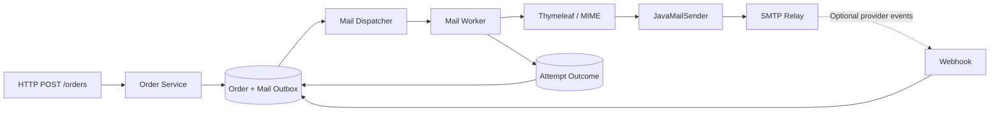

# Adding Metrics, Correlation IDs, and Safe Logging

When a **Spring Framework Mail** application only sends a few test emails, a single successful `JavaMailSender.send(...)` call seems enough. In production, however, emails can be delayed for minutes by an outbox backlog, an SMTP relay can return temporary failures, an attempt can be retried after a restart, or a customer can report never receiving a message even though the system recorded "sent". At that point, a log line saying `"send failed"` is not enough to find the root cause.

The practice project **"Adding Metrics, Correlation IDs, and Safe Logging"** adds observability to the email sending flow in a Spring Boot application:

- **Metrics:** measure send rate, latency, error rate, retries, backlog, and how long a notification waits before provider acceptance.
- **Correlation IDs:** link the same business request across the HTTP request, database transaction, outbox, worker, SMTP attempts, and later provider events.
- **Safe logging:** record metadata for investigation without exposing full email addresses, HTML bodies, attachments, OTPs, reset tokens, or SMTP credentials.
- **Tracing:** distinguish application-managed correlation IDs from trace/span IDs of a distributed tracing system.
- **Testing:** verify that metrics have bounded labels, MDC never leaks across threads, correlation survives outbox/restarts, and logs contain no sensitive data.

This lesson belongs to the **Practice Project** chapter of *Spring Framework Mail*, using examples with Java 21, Spring Boot 3.x, Micrometer, Spring Boot Actuator, SLF4J, Jakarta Mail, and a **transactional outbox + mail worker** architecture. Classes like `MailOutboxRepository`, `MailAttemptService`, or DTOs in the examples are components the application must implement; they are not built-in Spring Boot APIs. Metric names, status taxonomy, and alert thresholds are **illustrative suggestions** that must be tailored to your SLOs and providers.

> **Key limitation:** measuring `JavaMailSender.send(...)` returning normally only marks **SMTP submission accepted as observed by the client/relay**. It does not confirm the email reached the Inbox. Metrics and logs must preserve the distinction between `accepted`, `delivered`, `bounced`, and `unknown`.

## 1. Practice Goals

Suppose the application creates an order, persists a mail intent, and a worker sends via SMTP:



Operational questions we want to answer:

1. How long does it take from order commit to SMTP accepted?
2. Is mail slow due to template rendering, outbox waiting, or SMTP?
3. How many attempts receive SMTP 4xx, 5xx, AUTH errors, timeouts, or `UNKNOWN` outcomes?
4. Has the worker stopped claiming jobs, or is the executor saturated?
5. Does an HTTP request retry create two business events or mail intents?
6. Which email needs investigation when a customer complains? Can we look it up by notification ID without logging the full body?
7. If the process restarts, can prior request logs still be linked to the new worker?
8. If the provider sends a bounce webhook a day later, can we locate the exact submission attempt?
9. If logs are accessed unexpectedly, would OTPs, reset links, email addresses, or attachments be exposed?

### 1.1. Definition of Done

After this practice project, we want:

| Component | Expected Outcome |
|---|---|
| HTTP boundary | Generate or normalize `correlationId`, include it in the response header and MDC |
| Business service | Persist `notificationId` + `correlationId` alongside the durable email intent |
| Worker | Read correlation from the outbox and open an isolated MDC scope per attempt |
| Timer/counter | Measure each SMTP attempt, outcome, and duration with Micrometer |
| Gauge | Expose pending jobs, oldest due age, and active workers with bounded data |
| Logs | Structured events with IDs and safe reason codes, logging no body/PII/secrets |
| Endpoints | Actuator health/metrics/Prometheus configured with appropriate access control |
| Tests | Assert correlation, metric tags, log redaction, and cleanup on success/failure paths |

**Do not equate "lots of logs" with observability.** A system can emit millions of `DEBUG` lines and still not know which jobs sit in the outbox—while leaking large amounts of sensitive data.

## 2. Three Distinct Concepts

### 2.1. Metric

A metric is an aggregated measurement over time: `counter`, `timer`, `gauge`, histogram. For example:

```text
mail.submit.attempts{transport=smtp, outcome=accepted}
mail.submit.duration{transport=smtp, outcome=accepted}
mail.outbox.pending{priority=transactional}
mail.outbox.oldest.due.age{priority=transactional}
```

Metrics answer "how many", "how fast or slow", and "are we breaching an SLO". They do **not** need individual customer emails and generally should not use notification IDs as tags.

### 2.2. Log

A log is a record of a specific event:

```text
event=mail_submission_attempt_finished
correlationId=2dd5a6aa-4131-4c02-9d2e-b8265b2e19f1
notificationId=MAIL-8821
attemptId=ATT-2
transport=smtp
outcome=temporary_rejected
reasonCode=SMTP_RATE_LIMIT
durationMs=873
```

Logs answer "what happened to this attempt", but sensitive data must be excluded and retention/access control enforced.

### 2.3. Correlation ID, Trace ID, and Span ID

**Correlation ID** is an application-chosen linking key; it can span requests, outbox rows, and jobs running hours later. It does not have to correspond to a single active trace.

**Trace ID** in distributed tracing represents a flow of spans/observations; **span ID** represents a specific unit of work. Micrometer Tracing/OpenTelemetry libraries can generate and propagate them when configured.

Do not confuse them:

```text
correlationId : stable ID linking a business workflow
notificationId: ID of a single email intent
attemptId     : ID of a single send attempt
traceId       : ID of a distributed trace
spanId        : ID of a span within a trace
providerId    : ID generated by SMTP/ESP, if any
```

One notification can have multiple `attemptId`s and multiple trace IDs across worker restarts, while still belonging to the same `notificationId` and business event. These IDs do not replace one another.

### 2.4. Why You Need Metrics *and* Logs *and* Tracing

| Question | Useful Signal |
|---|---|
| Are SMTP temporary rejects rising? | Counter by outcome |
| Is SMTP p95 latency increasing? | Timer/histogram |
| How long has the oldest pending mail waited? | Gauge from outbox summary |
| On which attempt did a specific message fail? | Logs/attempt history by notification ID |
| Which request created the post-commit job? | Correlation ID stored in the outbox |
| Is the bottleneck in rendering, SMTP, or DB? | Spans + timers |
| Why did a bounce arrive 3 days later? | Provider event lookup + attempt ID |

Metrics detect symptoms; logs and traces help investigate. **The database outbox/attempt history** is the durable source of truth for business state; never use in-memory counters as proof of exactly how many times an email was sent.

## 3. Spring Boot Dependencies and Project Structure

In a Gradle project with the Spring Boot plugin and appropriate dependency management, add:

```groovy
dependencies {
    implementation 'org.springframework.boot:spring-boot-starter-mail'
    implementation 'org.springframework.boot:spring-boot-starter-actuator'
    implementation 'org.springframework.boot:spring-boot-starter-web'

    runtimeOnly 'io.micrometer:micrometer-registry-prometheus'

    testImplementation 'org.springframework.boot:spring-boot-starter-test'
}
```

This is a **dependencies snippet**, not a complete `build.gradle`. Boot Actuator provides auto-configuration for Micrometer. Include the Prometheus registry if you have a Prometheus scraper; if you use OTLP, StatsD, or another registry, choose the matching dependency/backend. Never mix standalone Micrometer versions that conflict with the Spring Boot BOM.

For actual distributed tracing, add the matching bridge/exporter libraries (e.g., Micrometer Tracing bridge for OpenTelemetry and an OTLP exporter), and configure sampling, export, and a collector according to your architecture. **Having Actuator alone does not mean tracing or trace export is enabled.**

### 3.1. Directory Structure

```text
src/main/java/com/example/mail/
  web/
    CorrelationIdFilter.java
  observability/
    MailMetrics.java
    SafeMailLogger.java
    MailLogContext.java
    OutboxMetricsSnapshot.java
  outbox/
    MailOutboxRepository.java
    MailDispatcher.java
    ClaimedMailJob.java
  worker/
    MailSubmissionWorker.java
    SmtpOutcomeClassifier.java
  provider/
    ProviderWebhookController.java
src/main/resources/
  application.yml
  logback-spring.xml              (optional)
src/test/java/com/example/mail/
  CorrelationIdFilterTest.java
  MailMetricsTest.java
  MailLogSafetyTest.java
  MailWorkerTelemetryTest.java
```

Only create the outbox/worker classes if the project does not already have them; in a running project, integrate observability into the existing flow instead of building a second sending system.

### 3.2. Minimal Actuator Configuration

```yaml
management:
  endpoints:
    web:
      exposure:
        include: health,info,prometheus
  metrics:
    tags:
      application: order-mail-service
    distribution:
      percentiles-histogram:
        mail.submit.duration: true

spring:
  mail:
    host: ${MAIL_HOST:127.0.0.1}
    port: ${MAIL_PORT:1025}
    properties:
      "[mail.smtp.connectiontimeout]": "5000"
      "[mail.smtp.timeout]": "10000"
      "[mail.smtp.writetimeout]": "10000"
```

The SMTP settings here target a local sandbox. Production must use AUTH/TLS/credentials matching your provider. Exposing the Prometheus endpoint is only safe when **protected by network/ingress/auth**; never expose all Actuator endpoints publicly to the Internet. Other Actuator endpoints can expose sensitive configuration or metrics depending on setup, so expose only what is genuinely needed.

**Note:** endpoint availability and names can vary by dependencies and Spring Boot version. Never set `include: "*"` as a default production configuration.

### 3.3. Metric Naming Conventions

Micrometer uses dot notation such as `mail.submit.attempts` and `mail.submit.duration`, while the Prometheus registry converts them to Prometheus conventions (usually underscores plus type/unit suffixes).

Example:

```text
Micrometer Counter: mail.submit.attempts
Prometheus series : mail_submit_attempts_total

Micrometer Timer: mail.submit.duration
Prometheus series: mail_submit_duration_seconds_count
                   mail_submit_duration_seconds_sum
```

Do not append `_total` manually to a Micrometer counter name and cause the exporter to produce unexpected names. Choose a stable naming convention upfront; renaming metrics later requires migrating dashboards and alerts.

## 4. Generating Correlation IDs at the HTTP Boundary

An incoming request may carry an `X-Correlation-ID` header passed by a gateway or client. A safe design must **validate and normalize** it, or generate a new ID if the header is missing or invalid. Never log arbitrary header values directly: a caller could send an oversized string, control characters, or text crafted to forge another log line.

In this example, the standard correlation ID is a **canonical UUID**:

```text
X-Correlation-ID: 7e1ab7c2-d153-4df5-9b5a-63fe29c41b09
```

Systems already using ULIDs or an internal tracing ID standard can keep that format, provided there is a clear policy for maximum length, character set, spoofing/authorization, issuance, and propagation. A correlation ID **is not an authentication token**.

### 4.1. Filter Controlling Header and MDC

```java
package com.example.mail.web;

import java.io.IOException;
import java.util.UUID;
import java.util.regex.Pattern;

import jakarta.servlet.FilterChain;
import jakarta.servlet.ServletException;
import jakarta.servlet.http.HttpServletRequest;
import jakarta.servlet.http.HttpServletResponse;

import org.slf4j.Logger;
import org.slf4j.LoggerFactory;
import org.slf4j.MDC;
import org.springframework.stereotype.Component;
import org.springframework.web.filter.OncePerRequestFilter;

@Component
public final class CorrelationIdFilter extends OncePerRequestFilter {

    private static final Logger log =
            LoggerFactory.getLogger(CorrelationIdFilter.class);

    private static final String HEADER = "X-Correlation-ID";

    private static final Pattern CANONICAL_UUID = Pattern.compile(
            "^[0-9a-fA-F]{8}-[0-9a-fA-F]{4}-[1-8][0-9a-fA-F]{3}-"
                    + "[89aAbB][0-9a-fA-F]{3}-[0-9a-fA-F]{12}$");

    @Override
    protected void doFilterInternal(
            HttpServletRequest request,
            HttpServletResponse response,
            FilterChain chain)
            throws ServletException, IOException {

        String correlationId =
                normalizeOrNew(request.getHeader(HEADER));
        response.setHeader(HEADER, correlationId);

        long started = System.nanoTime();
        boolean completedNormally = false;

        try (MDC.MDCCloseable ignored =
                     MDC.putCloseable("correlationId", correlationId)) {
            try {
                chain.doFilter(request, response);
                completedNormally = true;
            } finally {
                long elapsedMs =
                        (System.nanoTime() - started) / 1_000_000;

                // Do not log query string, form body, or raw URI.
                log.info(
                        "event=http_request_finished method={} "
                        + "httpStatus={} chainCompleted={} "
                        + "durationMs={}",
                        request.getMethod(),
                        response.getStatus(),
                        completedNormally,
                        elapsedMs);
            }
        }
    }

    static String normalizeOrNew(String input) {
        if (input != null
                && input.length() == 36
                && CANONICAL_UUID.matcher(input).matches()) {
            return UUID.fromString(input).toString();
        }
        return UUID.randomUUID().toString();
    }
}
```

Decisions in this filter:

1. Valid headers are kept in canonical form; invalid ones get a fresh UUID.
2. Put the safe ID in the response header so operations can match client reports.
3. Place the ID in **SLF4J MDC** for the synchronous request scope.
4. Use `try-with-resources` so the MDC scope closes even if downstream code throws an exception.
5. Log method/status/outcome/duration without logging query strings or bodies.

**Example limitation:** with async servlet dispatch or error dispatch, the lifecycle may continue after this `chain.doFilter(...)` call. `response.getStatus()` when the filter's `finally` runs may not reflect the final container-handled error status; the `chainCompleted` flag helps distinguish that. If the application uses `Callable`, `DeferredResult`, WebFlux, or custom thread dispatching, design framework-specific propagation/logging instead of assuming this filter covers the entire async lifecycle.

### 4.2. Client-Supplied Headers Are Not Proof of Authorization

An attacker can guess or forge a valid correlation ID. Therefore:

- Never use a correlation ID as an access key for notification/status endpoints.
- Never use it in place of JWT/session/tenant-scoped authorization.
- Never let the ID drive permissions or SMTP account selection.
- Never assume the same ID means two requests came from the same user.
- Rate-limit log/status queries by authenticated identity, not solely by ID.

If a gateway needs a trusted gateway-issued ID, it can set a separate internal header or overwrite untrusted headers at the edge. Hops must agree on **who has authority to issue the root ID**; format validation only blocks malformed data, not source spoofing.

### 4.3. Why Not Log the Verbatim URL?

A URL can contain:

```text
/password-reset?token=...
/orders/123?recipient=user@example.test
/callback?api_key=...
```

Even path segments can carry tokens or email addresses. If you need HTTP route metrics, use a low-cardinality **route template** (such as `/orders/{id}`), never raw URIs or path parameters. Spring Boot Actuator HTTP server observations typically use low-cardinality route tags when framework metadata is available; inspect actual instrumentation to avoid adding duplicate metrics.

## 5. Correlation IDs Must Outlive the Request Thread

MDC is a map attached to a logging thread, **not** durable business storage. Suppose a request writes an order and outbox row, then returns:

```mermaid
sequenceDiagram
    participant C as Client
    participant W as Web thread
    participant DB as Database
    participant M as Mail worker
    participant S as SMTP
    C->>W: POST /orders (correlationId=C1)
    W->>DB: BEGIN; order + outbox(C1)
    DB-->>W: COMMIT
    W-->>C: 201, notificationId=N1, C1
    Note over W: MDC cleared when request ends
    M->>DB: claim outbox N1
    DB-->>M: job includes correlationId=C1
    Note over M: establish worker MDC C1, N1, A1
    M->>S: submit mail
    S-->>M: 250 accepted
    M->>DB: attempt result(A1)
    Note over M: worker MDC cleared/restored
```

If you only call `MDC.put("correlationId", ...)` in the controller, a worker running later will never receive the ID. With a worker in another process or after a restart, no ThreadLocal carries over.

### 5.1. Persisting Correlation in the Outbox Intent

Illustrative schema:

```sql
CREATE TABLE mail_outbox (
    id UUID PRIMARY KEY,
    tenant_id VARCHAR(100) NOT NULL,
    business_event_key VARCHAR(240) NOT NULL,
    correlation_id UUID NOT NULL,
    template_key VARCHAR(120) NOT NULL,
    template_version VARCHAR(50) NOT NULL,
    payload_ref VARCHAR(300) NOT NULL,
    state VARCHAR(32) NOT NULL,
    attempt_count INTEGER NOT NULL DEFAULT 0,
    next_attempt_at TIMESTAMPTZ NOT NULL DEFAULT NOW(),
    lease_owner VARCHAR(120),
    lease_token UUID,
    lease_until TIMESTAMPTZ,
    accepted_at TIMESTAMPTZ,
    created_at TIMESTAMPTZ NOT NULL DEFAULT NOW(),
    UNIQUE (tenant_id, business_event_key)
);

CREATE INDEX ix_mail_outbox_due
    ON mail_outbox (next_attempt_at, created_at)
    WHERE state IN ('QUEUED', 'RETRY_WAIT');
```

The `correlation_id` column can be typed as `UUID` because the example policy mandates canonical UUIDs. If your system uses ULIDs or another opaque correlation string, pick matching types/constraints. Additionally, the attempt table should record `attempt_id`, `notification_id`, `started_at`, `outcome`, `safe_error_code`, and provider message ID (if any) to investigate individual tries.

**Do not equate business event keys with correlation IDs**: one HTTP request can spawn multiple notifications; one business event can be replayed or triggered by a scheduler with no HTTP request. The IDs serve different purposes.

### 5.2. Passing the ID Explicitly to the Application Service

```java
public record CorrelationId(UUID value) {
    public CorrelationId {
        java.util.Objects.requireNonNull(value);
    }
}

@Service
public final class OrderApplicationService {

    private final OrderRepository orders;
    private final MailOutboxRepository outbox;

    public OrderApplicationService(
            OrderRepository orders,
            MailOutboxRepository outbox) {
        this.orders = orders;
        this.outbox = outbox;
    }

    @Transactional
    public CreatedOrder create(
            CreateOrderCommand command,
            CorrelationId correlationId) {

        Order order = orders.insertIdempotently(command);

        UUID notificationId = outbox.insertIfAbsent(
                order.getTenantId(),
                "order-created:" + order.getId(),
                correlationId.value(),
                "ORDER_CONFIRMED",
                "v1",
                order.getImmutableMailPayloadRef());

        return new CreatedOrder(
                order.getId(),
                notificationId,
                "QUEUED");
    }
}
```

`OrderRepository`, `MailOutboxRepository`, `CreateOrderCommand`, and the DTOs are illustrative abstractions. The application service receives a `CorrelationId` normalized at the HTTP boundary; business code should not depend on SLF4J MDC to retrieve essential data.

When a request retries with the same business idempotency key, `insertIfAbsent` should return the existing intent ID if the event already exists, and policy must specify whether **to preserve the original correlation or also record the retry request's correlation in audit logs**. Typically the notification keeps the correlation of the original intent creation, while the retry request logs its own correlation in the request log. Do not arbitrarily overwrite a job's correlation every time a client retries.

### 5.3. What About Jobs Not Originating from HTTP?

Schedulers, batch jobs, webhooks, or CLIs can create emails without an HTTP request correlation ID. They still need an ID:

```java
CorrelationId correlation =
        new CorrelationId(UUID.randomUUID());
```

Record a `triggerType` source such as `scheduled`, `webhook`, or `api` in business audit records when helpful. Avoid assigning a single fixed correlation ID to every daily cron run, as logs become hard to separate across runs.

## 6. Using MDC Safely in the Mail Worker

Mail workers typically use a thread pool. A thread might send an email for tenant A and immediately afterward send one for tenant B. If MDC is not cleared or restored, tenant B's logs can carry tenant A's `notificationId`—both misleading investigations and risking context leakage.

### 6.1. Helper Opening an MDC Scope with try/finally

```java
package com.example.mail.observability;

import java.util.Map;
import java.util.Objects;
import java.util.UUID;

import org.slf4j.MDC;

public final class MailLogContext implements AutoCloseable {

    private final Map<String, String> previous;

    private MailLogContext(Map<String, String> previous) {
        this.previous = previous;
    }

    public static MailLogContext open(
            UUID correlationId,
            UUID notificationId,
            UUID attemptId) {

        Objects.requireNonNull(correlationId);
        Objects.requireNonNull(notificationId);
        Objects.requireNonNull(attemptId);

        Map<String, String> previous =
                MDC.getCopyOfContextMap();

        MDC.clear();
        MDC.put("correlationId", correlationId.toString());
        MDC.put("notificationId", notificationId.toString());
        MDC.put("attemptId", attemptId.toString());

        return new MailLogContext(previous);
    }

    @Override
    public void close() {
        MDC.clear();
        if (previous != null) {
            MDC.setContextMap(previous);
        }
    }
}
```

Inside the worker:

```java
try (MailLogContext ignored = MailLogContext.open(
        job.correlationId(),
        job.notificationId(),
        job.attemptId())) {

    log.info(
            "event=mail_attempt_started templateGroup={} transport={}",
            job.templateGroup(), "smtp");

    submitOneAttempt(job);
}
```

After the scope exits, MDC is restored to its previous context rather than blindly calling `clear()` when nested scopes exist. If the worker started with an empty context, `previous` is simply null. Data in MDC **is only logging metadata**, never an input for deciding tenant or attachment access rights.

### 6.2. Should You Log tenantId?

Tenant ID can help investigate incidents, but tenant identifiers may be sensitive customer data and create high metric cardinality. Only log a **tenant group or internal tenant ID** when policy permits and the log store has proper access control. Never put full recipient email addresses or personal domains into MDC.

When you need to look up a customer, use an authorized internal audit system to map `notificationId` to the recipient rather than printing email addresses into every log event.

### 6.3. Sample Structured Log Output

```text
timestamp=2026-11-12T13:45:12Z
level=INFO
event=mail_attempt_started
correlationId=2dd5a6aa-4131-4c02-9d2e-b8265b2e19f1
notificationId=610e0bb3-3a03-4f10-b2dd-8a889c655be8
attemptId=4dba9c70-a1f5-4d5d-9d5d-a370f026aa89
templateGroup=transactional
transport=smtp
```

A JSON log formatter is not mandatory on day one; a consistent pattern can suffice locally. In production, if your logging platform supports JSON/structured logging, emit structured output so fields like `correlationId` and `notificationId` are indexed and queried accurately instead of parsing free-form prose.

## 7. Propagating MDC Across @Async and Executors

Standard SLF4J MDC uses a thread-bound context. When submitting a task to a `ThreadPoolTaskExecutor`, **do not expect MDC to copy automatically** to the new thread. If your code uses `@Async` or an `ExecutorChannel`, use a `TaskDecorator` to snapshot and restore logging context for tasks **within the same JVM**.

### 7.1. Illustrative TaskDecorator

```java
package com.example.mail.observability;

import java.util.Map;

import org.slf4j.MDC;
import org.springframework.core.task.TaskDecorator;

public final class MdcTaskDecorator implements TaskDecorator {

    @Override
    public Runnable decorate(Runnable task) {
        Map<String, String> captured =
                MDC.getCopyOfContextMap();

        return () -> {
            Map<String, String> previous =
                    MDC.getCopyOfContextMap();

            try {
                if (captured == null) {
                    MDC.clear();
                } else {
                    MDC.setContextMap(captured);
                }

                task.run();
            } finally {
                if (previous == null) {
                    MDC.clear();
                } else {
                    MDC.setContextMap(previous);
                }
            }
        };
    }
}
```

Attaching it to a dedicated executor:

```java
@Configuration(proxyBeanMethods = false)
@EnableAsync
public class AsyncConfiguration {

    @Bean("mailTaskExecutor")
    ThreadPoolTaskExecutor mailTaskExecutor() {
        ThreadPoolTaskExecutor executor =
                new ThreadPoolTaskExecutor();

        executor.setThreadNamePrefix("mail-");
        executor.setCorePoolSize(4);
        executor.setMaxPoolSize(4);
        executor.setQueueCapacity(16);
        executor.setTaskDecorator(
                new MdcTaskDecorator());
        executor.initialize();
        return executor;
    }
}
```

Imports needed in the configuration:

```java
import org.springframework.context.annotation.Bean;
import org.springframework.context.annotation.Configuration;
import org.springframework.scheduling.annotation.EnableAsync;
import org.springframework.scheduling.concurrent.ThreadPoolTaskExecutor;
```

When an async task is submitted while request MDC is active, the decorator captures the IDs. After `task.run()`, it restores the prior MDC so nothing leaks to the next task.

### 7.2. What TaskDecorator Does Not Solve

- Does not survive process crashes, restarts, or network boundaries.
- Does not replace **persisting correlationId in the outbox**.
- Does not automatically copy Spring Security `SecurityContext`, transaction context, or all tracing baggage.
- Captured authentication principals must never be used to authorize sending an email hours later.
- Does not guarantee propagation across `CompletableFuture` callbacks if callbacks run on another uninstrumented executor.
- Does not turn an in-memory task into a durable job.

For mail workers reading jobs from the DB, **prefer re-establishing context from the persisted job** (section 6) rather than relying on MDC captured from an HTTP request. `TaskDecorator` is mainly useful for short-lived asynchronous work inside a single process.

### 7.3. MDC Context Is Not Tracing Context

Copying three MDC keys does not automatically link OpenTelemetry spans into the same distributed trace. To propagate trace/span context, use Micrometer Context Propagation, Micrometer Tracing/OpenTelemetry instrumentation, or the propagation mechanism built for your executor/broker.

Never manufacture a trace ID via `MDC.put("traceId", correlationId)`; that makes logs look traced while spans are not actually in the same trace. For outbox jobs running long after the HTTP request, start a new trace for the attempt and attach **links or correlation attributes** per your tracing strategy instead of keeping an HTTP span open for hours.

## 8. Defining Metrics by Unit of Work

Before calling MeterRegistry, define what you are measuring. A notification is a **send intent**; an attempt is **one transport execution**; a provider delivery event may arrive later.

Example:

```text
Notification MAIL-8821
  attempt 1 -> SMTP 451 temporary rejection
  attempt 2 -> SMTP 250 accepted
  provider event -> delivered
```

Measure accurately:

```text
mail.submit.attempts{outcome=temporary_rejected} += 1
mail.submit.attempts{outcome=accepted} += 1
mail.delivery.events{type=delivered} += 1
```

Attempts = 2, while notification intents = 1. Do not call `send` twice and treat it as "two orders sent". Notification-completion metrics need their own definition to avoid double-counting after retries.

### 8.1. Minimum Metric Set

| Micrometer Name | Type | Definition |
|---|---|---|
| `mail.submit.attempts` | Counter | One transport attempt finished with an outcome |
| `mail.submit.duration` | Timer | Duration of one transport attempt |
| `mail.render.duration` | Timer | Duration of Thymeleaf/payload rendering |
| `mail.compose.duration` | Timer | Duration of MIME assembly before submission |
| `mail.outbox.pending` | Gauge | QUEUED/RETRY_WAIT job count by normalized group |
| `mail.outbox.oldest.due.age` | Gauge (seconds) | Age of the oldest overdue pending job |
| `mail.worker.active` | Gauge | Active attempts running in the worker pool |
| `mail.worker.rejections` | Counter | Tasks rejected by the executor |
| `mail.outbox.claims` | Counter | Claim successes/failures by outcome |
| `mail.recovery.expired.leases` | Counter | Expired leases detected/handled |
| `mail.delivery.events` | Counter | Processed provider events by type |

You do not need to implement every metric on day one. Start with **attempts, duration, pending, oldest age, active, failures**, then expand based on operations. Avoid colliding with metric names already emitted by Spring Boot or JavaMail instrumentation, if any.

### 8.2. Fixed Outcome Taxonomy

```java
package com.example.mail.observability;

public enum MailTransport {
    SMTP("smtp"),
    HTTP_API("http_api");

    private final String tag;

    MailTransport(String tag) { this.tag = tag; }
    public String tag() { return tag; }
}

public enum MailAttemptOutcome {
    ACCEPTED("accepted"),
    TEMPORARY_REJECTED("temporary_rejected"),
    PERMANENT_REJECTED("permanent_rejected"),
    AUTH_FAILURE("auth_failure"),
    UNKNOWN("unknown");

    private final String tag;

    MailAttemptOutcome(String tag) { this.tag = tag; }
    public String tag() { return tag; }
}
```

Set outcomes from an enum; never use `exception.getMessage()` as a metric tag. Exception messages can contain email addresses, hostnames, tokens, attachment paths, timestamps, or varying reply codes—creating **high-cardinality labels** and leaking data.

A system may add `RENDER_FAILURE`, `COMPOSE_FAILURE`, or `PROVIDER_PAUSED`, which represent failures at another stage or a distinct category at the same stage. Keep taxonomy and stage boundaries consistent.

### 8.3. Safe, Bounded Tags

Example tags:

```text
transport = smtp | http_api
outcome = accepted | temporary_rejected | permanent_rejected
          | auth_failure | unknown
template_group = transactional | security | bulk
provider_route = primary | backup
error_category = auth | quota | network | validation | provider
```

Use only bounded, reviewed value sets. Never directly put account names, tenant IDs, raw provider response text, or template names into tags if their cardinality is unbounded.

**Never use these values as metric labels:**

```text
recipientEmail
subject
notificationId
attemptId
correlationId
rawRequestUri
exceptionMessage
providerMessageId
resetToken
fullTenantId (when tenant count is unbounded)
```

Those IDs belong in logs and traces queried per event; creating a new time series for every ID can overwhelm the metrics backend's cardinality, memory, and storage budget. Moreover, metric labels are widely readable across monitoring systems and unsuitable for PII.

## 9. Implementing MailMetrics with Micrometer

A central service keeps components from inventing inconsistent metric names or tags for the same event.

```java
package com.example.mail.observability;

import java.time.Duration;

import io.micrometer.core.instrument.MeterRegistry;
import io.micrometer.core.instrument.Tags;

import org.springframework.stereotype.Component;

@Component
public final class MailMetrics {

    private final MeterRegistry registry;

    public MailMetrics(MeterRegistry registry) {
        this.registry = registry;
    }

    public void recordSubmission(
            MailTransport transport,
            MailAttemptOutcome outcome,
            Duration elapsed) {

        Tags tags = Tags.of(
                "transport", transport.tag(),
                "outcome", outcome.tag());

        registry.counter(
                "mail.submit.attempts", tags).increment();

        registry.timer(
                "mail.submit.duration", tags)
                .record(elapsed);
    }

    public void recordRenderDuration(
            String templateGroup,
            Duration elapsed) {

        // Whitelist category only; do not pass
        // arbitrary user-supplied template names.
        String safeGroup = switch (templateGroup) {
            case "security" -> "security";
            case "transactional" -> "transactional";
            case "bulk" -> "bulk";
            default -> "other";
        };

        registry.timer(
                "mail.render.duration",
                Tags.of("template_group", safeGroup))
                .record(elapsed);
    }
}
```

Call `recordSubmission` **once when an attempt finishes or reaches a final outcome**—not in both `catch` and `finally`, which would double-count. If the worker crashes before recording, in-process metrics may not increment—which is a normal limitation of metrics; attempt history and database recovery track durable state.

### 9.1. Timers Use Monotonic Time

Pattern using `System.nanoTime()`:

```java
long started = System.nanoTime();
try {
    transport.submit(job);
} finally {
    long nanos = System.nanoTime() - started;
    Duration duration = Duration.ofNanos(nanos);
    // Caller determines outcome from result/exception
    // and records the metric exactly once.
}
```

`System.nanoTime()` is right for measuring elapsed duration inside a single JVM; do not subtract `Instant.now()` values for short intervals when the system clock can jump. For durable timestamps in the database, use a UTC clock for queue age and auditing.

### 9.2. Do Not Mix Render Duration into Submit Duration

If `mail.submit.duration` measures the **SMTP network call**, start the timer right before `JavaMailSender.send(...)` and stop it right after. Thymeleaf rendering, PDF generation, and attachment downloads belong in separate metrics.

If you want end-to-end worker time, create `mail.worker.process.duration` defined as render+compose+submit+state update. Never give two metrics the same interval and then sum them on a dashboard.

### 9.3. Counter vs. Timer Count

A `Timer` already records count alongside sum/max distributions, so a separate counter for attempts slightly overlaps with `Timer.count()`. However, a dedicated counter helps track outcomes lacking full duration measurements and makes "attempt finished" explicit. If you keep both, keep **identical boundaries** and never add `mail.submit.attempts` to the timer count in a dashboard.

If you only need attempts by outcome and duration, a single `Timer` tagged by outcome can suffice instead of an extra counter; choose based on backend/query needs rather than feeling forced to emit both.

## 10. Wiring Metrics and Logs into the Mail Worker

A simple worker orchestrator example, assuming the job was already claimed in a short DB transaction:

```java
package com.example.mail.worker;

import java.time.Duration;

import com.example.mail.observability.MailLogContext;
import com.example.mail.observability.MailMetrics;
import com.example.mail.observability.MailTransport;
import com.example.mail.observability.MailAttemptOutcome;

import org.slf4j.Logger;
import org.slf4j.LoggerFactory;
import org.springframework.stereotype.Component;

@Component
public final class MailSubmissionWorker {

    private static final Logger log =
            LoggerFactory.getLogger(MailSubmissionWorker.class);

    private final SmtpSubmissionTransport transport;
    private final SmtpOutcomeClassifier classifier;
    private final MailAttemptOutcomeRecorder recorder;
    private final MailMetrics metrics;

    public MailSubmissionWorker(
            SmtpSubmissionTransport transport,
            SmtpOutcomeClassifier classifier,
            MailAttemptOutcomeRecorder recorder,
            MailMetrics metrics) {
        this.transport = transport;
        this.classifier = classifier;
        this.recorder = recorder;
        this.metrics = metrics;
    }

    public void process(ClaimedMailJob job) {
        try (MailLogContext ignored = MailLogContext.open(
                job.correlationId(),
                job.notificationId(),
                job.attemptId())) {

            long started = System.nanoTime();
            MailAttemptOutcome outcome =
                    MailAttemptOutcome.UNKNOWN;
            String safeCode = "UNCLASSIFIED";

            log.info(
                    "event=mail_attempt_started transport=smtp "
                    + "templateGroup={}",
                    job.templateGroup());

            try {
                transport.submitOne(job);
                outcome = MailAttemptOutcome.ACCEPTED;
                safeCode = "SMTP_ACCEPTED";
            } catch (Exception failure) {
                ClassifiedMailError classified =
                        classifier.classify(failure);

                outcome = classified.outcome();
                safeCode = classified.safeCode();

                // Do not log failure.getMessage() or raw cause
                // to broadly accessible logs.
                log.warn(
                        "event=mail_attempt_transport_failed "
                        + "reasonCode={} outcome={}",
                        safeCode, outcome.tag());
            } finally {
                Duration elapsed = Duration.ofNanos(
                        System.nanoTime() - started);

                metrics.recordSubmission(
                        MailTransport.SMTP, outcome, elapsed);
            }

            // Separate transaction writes attempt + outbox transition
            // provided the lease token/attempt is still valid.
            recorder.recordOutcome(
                    job, outcome, safeCode);

            log.info(
                    "event=mail_attempt_finished "
                    + "outcome={} reasonCode={}",
                    outcome.tag(), safeCode);
        }
    }
}
```

`SmtpSubmissionTransport`, `SmtpOutcomeClassifier`, `ClassifiedMailError`, `ClaimedMailJob`, and `MailAttemptOutcomeRecorder` are **project-defined interfaces/classes**. This code shows clear telemetry boundaries without handling lease, retry, or database transaction details directly. In production, you should also:

- Map render/compose failures at a separate stage rather than catching everything as an SMTP error.
- Ensure `classifier.classify(...)` never throws and loses the outcome; provide an UNKNOWN fallback.
- Persist attempts, TTL, backoff, and state in short transactions guarded by lease tokens/fencing.
- If `recorder.recordOutcome(...)` fails, clearly log a **database acknowledgment failure**; SMTP may have accepted. Never let the request blindly retry as NOT_SENT.
- Handle errors/alerts when the metrics backend or log appender itself fails.

### 10.1. Why Metric Outcomes and Persisted Outcomes Can Diverge

In this example, the counter increments right after the transport call, before the DB recorder commits. If the recorder fails to write:

```text
SMTP returns 250 accepted
mail.submit.attempts{outcome=accepted} += 1
DB UPDATE to SUBMISSION_ACCEPTED fails
worker crashes
```

The metric reports one client-observed accepted attempt, while the outbox DB remains SENDING/UNKNOWN. This is not necessarily a "buggy" metric; they reflect **two different points in time**. Alerts and dashboards must label them clearly instead of treating the accepted counter as the count of committed accepted notifications.

When business reporting needs exact state counts, query/aggregate durable attempt records with reconciliation rather than substituting ephemeral in-memory counters for the database.

## 11. Gauges for Outbox Backlog and Delay

Counting submitted emails does not tell you whether the system is falling behind. If incoming requests enqueue 100 notifications/second while SMTP handles only 20/second, HTTP can stay fast while **outbox queue age grows continuously**.

Two gauges with high operational value:

1. `mail.outbox.pending`: count of QUEUED + RETRY_WAIT jobs (clearly defined).
2. `mail.outbox.oldest.due.age`: seconds from the oldest due job's scheduled time until now; 0 if none is due.

Distinguish **jobs waiting for a future retry time** from **overdue jobs not being picked up**. A notification waiting for a future `nextAttemptAt` is not necessarily backlog trouble. You can measure `totalQueued` and `overdueCount` separately if business SLOs require it.

### 11.1. Avoid Querying the DB on Every Scrape

Anti-pattern:

```java
// Avoid running expensive DB queries on every scrape:
Gauge.builder("mail.outbox.pending", repository,
        repo -> repo.countPending())
        .register(registry);
```

If scrapers run frequently or multiple registries export metrics, gauge evaluation can fire many queries, loading the DB right during an incident. Moreover, a DB outage slows or breaks metrics scrapes, hurting visibility further.

A better pattern for this practice project: a **scheduled snapshot** updates Atomic values, and gauges only read memory. Account for a few seconds of snapshot lag and expose a freshness indicator.

### 11.2. Snapshot Service

```java
package com.example.mail.observability;

import java.time.Instant;
import java.util.concurrent.atomic.AtomicInteger;
import java.util.concurrent.atomic.AtomicLong;

import io.micrometer.core.instrument.Gauge;
import io.micrometer.core.instrument.MeterRegistry;

import org.slf4j.Logger;
import org.slf4j.LoggerFactory;
import org.springframework.scheduling.annotation.Scheduled;
import org.springframework.stereotype.Component;

@Component
public final class OutboxMetricsSnapshot {

    private static final Logger log =
            LoggerFactory.getLogger(OutboxMetricsSnapshot.class);

    private final MailOutboxSummaryRepository repository;
    private final MeterRegistry registry;

    private final AtomicInteger pending = new AtomicInteger();
    private final AtomicInteger sending = new AtomicInteger();
    private final AtomicLong oldestDueAgeSeconds = new AtomicLong();
    private final AtomicLong lastSuccessEpochSeconds = new AtomicLong();

    public OutboxMetricsSnapshot(
            MailOutboxSummaryRepository repository,
            MeterRegistry registry) {
        this.repository = repository;
        this.registry = registry;

        Gauge.builder("mail.outbox.pending",
                pending, AtomicInteger::get)
                .register(registry);

        Gauge.builder("mail.outbox.sending",
                sending, AtomicInteger::get)
                .register(registry);

        Gauge.builder("mail.outbox.oldest.due.age",
                oldestDueAgeSeconds, AtomicLong::get)
                .baseUnit("seconds")
                .register(registry);

        Gauge.builder("mail.outbox.snapshot.age",
                lastSuccessEpochSeconds,
                last -> last.get() == 0L
                        ? Double.NaN
                        : Math.max(0L, Instant.now()
                                .getEpochSecond() - last.get()))
                .baseUnit("seconds")
                .register(registry);
    }

    @Scheduled(
            fixedDelayString = "${app.mail.metrics-refresh-ms:15000}")
    public void refresh() {
        try {
            MailOutboxSummary summary = repository.loadSummary();

            pending.set(summary.pending());
            sending.set(summary.sending());
            oldestDueAgeSeconds.set(
                    summary.oldestDueAgeSeconds());
            lastSuccessEpochSeconds.set(
                    Instant.now().getEpochSecond());
        } catch (RuntimeException failure) {
            registry.counter(
                    "mail.outbox.snapshot.errors").increment();

            // Do not log SQL parameters, secrets, or email content.
            log.warn(
                    "event=mail_metrics_snapshot_failed "
                    + "reasonCode=OUTBOX_SUMMARY_UNAVAILABLE");
        }
    }
}
```

Contracts:

```java
public record MailOutboxSummary(
        int pending,
        int sending,
        long oldestDueAgeSeconds
) {}

public interface MailOutboxSummaryRepository {
    MailOutboxSummary loadSummary();
}
```

The code above uses `@Scheduled`, so scheduling must be enabled in configuration (e.g., `@EnableScheduling`). The repository needs an indexed/well-tuned SQL aggregation query; compute job age using the same clock/source where possible, clamp to non-negative, and return 0 when no job is overdue.

### 11.3. Defining Oldest Due Age

One way to compute it:

```text
eligible jobs:
  state in QUEUED/RETRY_WAIT
  nextAttemptAt <= now

oldestDueAge =
  now - MIN(nextAttemptAt of eligible jobs)

if no eligible jobs:
  oldestDueAge = 0
```

If the system has `SENDING` jobs stuck past their lease, give them a separate metric/alert such as `expiredLeases`. Do not mix `SENDING` into pending age without redefining the metric, or dashboards become confusing.

### 11.4. Snapshot Freshness and Stale Values

During a DB outage, Atomic values hold **stale results**; a dashboard might show a tiny backlog while it is actually growing. That is why `mail.outbox.snapshot.age` and `mail.outbox.snapshot.errors` exist to detect stale data. Before any snapshot succeeds, the code returns `NaN` for age instead of falsely reporting "fresh=0".

Another option is reading aggregations directly in an exporter with explicit caching and database health checks. What matters is defining freshness and preventing metrics scrapes from overloading the system.

### 11.5. Multi-Replica and Aggregation

If every worker replica queries **the same outbox database** and exports a gauge for total pending jobs, Prometheus `sum(mail_outbox_pending)` across replicas **multiplies the backlog by N**. For a shared DB summary, you can:

- Have a single exporter responsible for global gauges.
- Use `max(...)` or select one replica on the dashboard with appropriate synchronization guarantees.
- Partition gauges by actually owned shard/partition and sum only non-overlapping shards.

By contrast, `mail.worker.active` counts local active threads per instance; **summing across replicas** usually makes sense. Before writing PromQL, confirm whether a metric is a global snapshot or a local gauge. Never assume every metric is summable.

### 11.6. Worker Active/Concurrency

If the mail worker executor exposes active thread count, you can export it as a gauge. Do not use this gauge to predict provider throughput: 4 active worker threads might send many messages per second, while an HTTP API might submit batches with many recipients in one request. Concurrency, rate, and backlog need separate metrics.

## 12. Safe Event-Based Logging, Not Object Dumps

Logs should pinpoint the right stage, state, and cause without printing every byte of the email. A standard event set:

| Event | When | Suggested Fields |
|---|---|---|
| `mail_intent_created` | Outbox commit | correlation ID, notification ID, template group |
| `mail_claimed` | Worker claim | notification ID, attempt ID, internal worker ID |
| `mail_render_completed` | Render succeeded | template key/version, duration, byte sizes |
| `mail_compose_failed` | MIME/resource failure | safe reason code, stage |
| `mail_attempt_started` | Before transport call | transport, attempt ID, provider route |
| `mail_attempt_finished` | After attempt | normalized outcome, safe code, duration |
| `mail_retry_scheduled` | Retry policy | attempt count, next attempt timestamp, category |
| `mail_outcome_unknown` | Uncertain whether provider accepted | attempt ID, safe phase if available |
| `mail_dead_lettered` | Retries/TTL exhausted | reason code, notification ID |
| `mail_delivery_event_received` | Verified webhook | provider event ID, normalized event type |

### 12.1. Structured Logging with SLF4J Placeholders

```java
log.info(
    "event=mail_attempt_finished transport={} outcome={} "
    + "reasonCode={} durationMs={}",
    "smtp",
    outcome.tag(),
    safeCode,
    duration.toMillis());
```

IDs in MDC are attached by the log appender/encoder when configured, so you do not have to repeat them in every message template. On a local console, if the pattern omits MDC, logs may lack correlation metadata; configure a consistent pattern/structured format and test that the fields appear in exported output.

### 12.2. Never Log Exception Messages Unconditionally

Especially dangerous:

```java
// Avoid in broadly accessible logs:
log.error("Cannot send email to {}: {}",
        recipientEmail, exception.getMessage(), exception);
```

Provider/client exceptions can include:

- Recipient email addresses and MAIL FROM/RCPT TO.
- SMTP command details.
- HTTP request URLs/headers or response bodies.
- File/attachment paths.
- Snippets of email content or tokens in template variables.
- Sensitive provider/account identifiers.

Better pattern:

```java
SafeMailError error = classifier.classify(exception);

log.warn(
        "event=mail_attempt_failed stage={} "
        + "reasonCode={} outcome={}",
        error.stage(),
        error.safeCode(),
        error.outcome());
```

If stack traces are needed for debugging, send them to **restricted diagnostics** with reviewed access control, retention, and redaction; never emit full stack traces containing email data to general INFO/WARN log streams by default.

### 12.3. Defining SafeMailError

```java
public enum MailStage {
    VALIDATION, RENDER, COMPOSE, CONNECT,
    AUTH, SMTP_ENVELOPE, SMTP_DATA,
    PROVIDER_RESPONSE, OUTCOME_PERSIST
}

public record SafeMailError(
        MailStage stage,
        String safeCode,
        String outcome
) {
    public SafeMailError {
        if (safeCode == null
                || !safeCode.matches("[A-Z0-9_]{1,80}")) {
            throw new IllegalArgumentException(
                    "Unsafe diagnostic code");
        }
    }
}
```

`safeCode` values like `SMTP_AUTH_FAILED`, `SMTP_TEMPORARY_REJECTION`, `TEMPLATE_NOT_FOUND`, or `DATABASE_OUTCOME_UPDATE_FAILED` are produced by a controlled classifier. **Never** turn a raw `exception.getMessage()` into a `safeCode` simply by uppercasing it.

### 12.4. Never Use DEBUG Logging to Dump Emails

A common mistake is turning on SMTP protocol debugging and forgetting to turn it off:

```properties
mail.debug=true
```

SMTP debugging can log protocol transcripts, recipients, server replies, and in some configurations sensitive credentials. Never enable it by default in production. If needed briefly for troubleshooting, enforce strict scope/timeouts, protect credentials and retention, and restrict the log channel. Similarly for HTTP providers, never enable wire logging capturing Authorization headers, JSON bodies, or base64 attachments.

### 12.5. Masking Does Not Replace Not Logging

Regex masking in a log appender is only a **last line of defense**, because secrets come in endless formats and can be split or encoded. The first line of defense is **never passing PII/secrets into log arguments**. For email addresses, prefer logging `notificationId` and looking up recipients in an authorized DB. If you truly need a pseudonymous recipient key for analytics, consider a managed-key HMAC (not plain SHA-256, which is vulnerable to dictionary attacks), with retention/rotation and data-processing review.

## 13. Avoiding High Cardinality and Data Leaks in Metrics

Suppose the system sends 1 million emails per day. If every notification ID becomes a metric label:

```text
mail_submit_attempts_total{
  notificationId="MAIL-000001",
  outcome="accepted"
}
...
mail_submit_attempts_total{
  notificationId="MAIL-1000000",
  outcome="accepted"
}
```

The number of time series grows roughly linearly with email volume, exhausting RAM, backend storage, and budget. Adding `recipientEmail`, `tenantId`, and `providerMessageId` multiplies cardinality across every dimension.

### 13.1. Cardinality Budget

Suppose:

```text
transport      = 2 values
outcome        = 5 values
template_group = 3 values
provider_route = 2 values
```

Theoretical maximum combinations:

\[
2 \times 5 \times 3 \times 2 = 60
\]

60 series for a metric is easy to manage (before instance/region/common tags), whereas adding millions of notification IDs blows the budget. This is only a structural example; real systems must account for all common labels, retention, and cost.

### 13.2. Keep Useful Dimensions, Drop Unsuitable Ones

Prefer:

- `outcome` from a fixed enum.
- `transport` from a bounded list.
- `template_group` instead of arbitrary template IDs when template count is large.
- `error_category` from a stable taxonomy.
- `region` from allowed regions if genuinely needed.

Avoid:

- Arbitrary `exception_class` across hundreds of vendor exception subclasses without normalization.
- Full `smtp_reply_text` or HTTP provider response bodies.
- Timestamps, raw query strings, free-form HTTP headers.
- Full recipient email or tenant ID when cardinality is unbounded.

### 13.3. MeterFilter as an Additional Guardrail

Micrometer's `MeterFilter` can deny or limit tags at the registry level per policy. However, it does not replace properly designed instrumentation. A PII label passed into a metric can still appear before filtering or export in some pipelines, so **not collecting it in the first place** remains safer.

Never use metric labels as a search engine for individual emails; logs and audit DBs with proper access control belong to per-notification investigation.

## 14. Distributed Tracing Visibility with Micrometer Observation

Micrometer provides the **Observation API** to name an operation and attach low-cardinality key-values. Depending on configured observation handlers, an observation can emit metrics, tracing spans, or both.

To get traces in a collector, the project needs the matching Micrometer Tracing bridge/exporter, sampling configuration, and network/permissions. Never assume every Spring Boot app exports traces just because `MeterRegistry` is present.

### 14.1. Creating an Observation for a Worker Attempt

```java
import io.micrometer.observation.Observation;
import io.micrometer.observation.ObservationRegistry;

public final class ObservedMailWorker {

    private final ObservationRegistry observations;
    private final SmtpSubmissionTransport transport;

    public ObservedMailWorker(
            ObservationRegistry observations,
            SmtpSubmissionTransport transport) {
        this.observations = observations;
        this.transport = transport;
    }

    public void submitObserved(ClaimedMailJob job) {
        Observation observation = Observation
                .createNotStarted(
                        "mail.worker.attempt", observations)
                .lowCardinalityKeyValue(
                        "transport", "smtp")
                .lowCardinalityKeyValue(
                        "template_group", "transactional");

        observation.observe(() -> transport.submitOne(job));
    }
}
```

In this example, `SmtpSubmissionTransport.submitOne` is assumed callable as a `Runnable` (throwing no checked exception); a real API returning a result or throwing checked exceptions can use the matching observation variant or an error-classifying wrapper.

If an Observation handler emits metrics, `mail.worker.attempt` may register its own timer. **Do not measure the exact same code with two timers under the same or overlapping meaning and count twice**. You can keep:

- `mail.submit.duration`: network SMTP call.
- `mail.worker.attempt`: full attempt including render/compose/send/state update.

or use a single observation per stage with clear naming.

### 14.2. Beware of High-Cardinality Trace Attributes

Trace spans can carry more detailed attributes than metrics, but that does not mean arbitrary PII belongs there. The tracing vendor/collector may be a third-party system with different retention and access policies than logs.

Prefer:

```text
transport=smtp
operation=mail.submit
template_group=transactional
outcome=unknown
```

Never put `recipientEmail`, SMTP passwords, tokens, raw MIME, sensitive attachment filenames, or HTTP Authorization headers into traces. `notificationId`/`attemptId` should only appear as controlled high-cardinality attributes if tracing backend access and data-handling policy allow it; by default look them up in restricted logs/audit rather than metric labels.

### 14.3. Linking Request Traces to Workers Hours Later

A mail intent might be created at 10:00, sent by a worker at 12:00, and receive a webhook the next day. Never keep an HTTP span "open" for 26 hours to span that chain. Instead:

```text
HTTP trace A
  span: POST /orders
  span: DB order + outbox commit
  persists correlationId=C1, notificationId=N1

Mail worker trace B
  span: claim N1
  span: render N1
  span: SMTP attempt A1
  log metadata references C1, N1

Provider webhook trace C
  span: receive event
  map providerMessageId to attempt A1
  log metadata references C1, N1
```

You can use trace links or baggage per your tracing infrastructure standards if truly needed, but never manually set `traceId=correlationId` in MDC to fake linkage. The correlation ID in the outbox is the durable key linking multiple traces and log streams across the same business workflow.

### 14.4. Sampling and Visibility

10% sampling lowers tracing cost, but does not mean 90% of emails may lack audit records. Separate:

- Durable outbox + attempt records: store business results per policy.
- Metrics: aggregate all instrumented attempts, subject to restart semantics.
- Logs: safe events per policy/rate limits.
- Traces: sampled spans for latency and dependency analysis.

With sampling, a notification without an exported trace still has a correlation ID and audit record; the application must never infer mail status from whether a trace exists.

## 15. Receiving Provider Events and Linking Back to Attempts

After the SMTP relay accepts a message, downstream providers may emit `delivered`, `bounced`, `deferred`, `complained`, or other events. With plain SMTP relays lacking webhooks, you need an event API/log export—or full downstream visibility is unavailable.

When webhooks exist, incoming payloads are not automatically trustworthy. You must:

1. Verify signatures/auth per provider docs; reject invalid events.
2. Enforce size limits, schema validation, and timestamp/replay windows if supported.
3. Deduplicate by `provider + account + eventId` or contract key.
4. Map `providerMessageId` back to **mail attempt ID** (not just recipient email).
5. Recover `correlationId` and `notificationId` from stored attempt/outbox tables.
6. Establish a fresh log scope for the webhook handler; do not reuse stale request MDC.
7. Persist downstream events idempotently and handle out-of-order transitions.
8. Count normalized event types with bounded-tag counters.

### 15.1. Why Attempt ID Matters During Failover

```text
notification MAIL-8821
  attempt A1 -> SMTP relay primary -> timeout UNKNOWN
  attempt A2 -> HTTP provider backup -> ACCEPTED
  delayed bounce event for A1 arrives
```

If the webhook handler looks up only by recipient email, it could wrongly attach A1's bounce to submission A2. Map using provider account/route/message ID/event semantics and store the attempt relationship.

### 15.2. Delivery Event Metrics Do Not Replace Submission Status

```java
public enum DeliveryEventType {
    DELIVERED("delivered"),
    BOUNCED("bounced"),
    DEFERRED("deferred"),
    COMPLAINT("complaint"),
    OTHER("other");

    private final String tag;

    DeliveryEventType(String tag) { this.tag = tag; }
    public String tag() { return tag; }
}

public void recordDeliveryEvent(
        MeterRegistry registry,
        DeliveryEventType event) {

    registry.counter(
            "mail.delivery.events",
            "event_type", event.tag())
            .increment();
}
```

This is an illustrative method inside an observability class, not a valid top-level Java method outside a class. In a real implementation, define whether **the counter counts raw received events or unique processed events**. If a provider retries the same webhook event ID, count `webhook.received` separately from `mail.delivery.unique.events` if needed so duplicate webhooks do not look like double delivery.

### 15.3. Never Log Full Webhook Payloads

Provider webhooks can carry recipient addresses, PII-laden bounce reasons, links, and metadata. After verification, map them to safe categories and IDs. If raw payloads are required for disputes or investigation, store them in a restricted encrypted audit store with retention rather than logging them at INFO.

## 16. Observing with Prometheus

Once Actuator + Prometheus registry are added and the endpoint is exposed on a secure monitoring network, you can typically scrape:

```text
GET /actuator/prometheus
```

Illustrative series:

```text
mail_submit_attempts_total{
  transport="smtp",outcome="accepted"
} 1280

mail_submit_attempts_total{
  transport="smtp",outcome="temporary_rejected"
} 41

mail_submit_duration_seconds_count{
  transport="smtp",outcome="accepted"
} 1280

mail_submit_duration_seconds_sum{
  transport="smtp",outcome="accepted"
} 364.8
```

Exact format and labels depend on the Prometheus registry, common tags, instrumentation, and runtime; these snippets only illustrate series names and semantics. Never put email addresses in labels or expose the endpoint via public ingress.

### 16.1. Viewing Accepted Attempts per Second

PromQL:

```promql
sum(rate(mail_submit_attempts_total{
  outcome="accepted"
}[5m]))
```

This counts **instrumented attempt outcomes**, not necessarily unique or delivered notifications. If app restarts reset counters, `rate` handles counter resets per Prometheus semantics, though it cannot reconstruct un-emitted events; the audit DB remains necessary.

### 16.2. Rejected/Unknown Attempt Ratio

```promql
sum(rate(mail_submit_attempts_total{
  outcome!="accepted"
}[5m]))
/
clamp_min(
  sum(rate(mail_submit_attempts_total[5m])),
  0.000000001
)
```

This is the **ratio of non-accepted attempts**, not the percentage of business emails permanently failing. One notification that hits a temporary error and then succeeds contributes one rejected attempt and one accepted attempt. Document this clearly so nobody reports "every customer is failing".

### 16.3. SMTP p95 Latency

With histograms enabled for `mail.submit.duration`:

```promql
histogram_quantile(
  0.95,
  sum by (le) (
    rate(mail_submit_duration_seconds_bucket[5m])
  )
)
```

This query requires `_bucket` series to exist; if histograms are disabled or no samples exist yet, the result is empty. With tags for provider route or outcome, you can `sum by (le, transport)` to compare SMTP vs. HTTP under consistent instrumentation.

### 16.4. Pending Backlog

If `mail.outbox.pending` is a **global DB snapshot repeated by every replica**, do not `sum` across all instance series; that multiplies the job count. Use `max(mail_outbox_pending)` for a shared DB whose replicas read the same summary, while monitoring snapshot age to detect stale values. If metrics are per-shard, sum across non-overlapping shards instead.

### 16.5. Oldest Due Age and SLOs

A hypothetical policy example:

```text
Transactional email:
  99% of new notifications accepted by provider within 60 seconds

Operational alert:
  oldest due age > 120 seconds sustained for 5 minutes
  and pending > 0
```

Do not treat these numbers as universal SLAs; OTPs have very tight lifetimes, bulk/marketing mail may follow its own schedule, and provider health/quotas vary. **Time-to-provider-acceptance SLO** differs from **time-to-downstream-delivery**, and both differ from Inbox placement.

## 17. Dashboards and Alerts by Operational Purpose

Not every metric deserves an alert. A dashboard should answer "is the mail pipeline healthy right now or falling behind?", while alerts fire when action is needed.

### 17.1. Suggested Dashboard

| Panel | Source | How to Read |
|---|---|---|
| Emails requested | Business/outbox inserts | Incoming demand over time |
| Provider accepted attempts/s | `mail.submit.attempts` | Observed submission throughput |
| Temporary reject / AUTH / UNKNOWN | Attempt outcome counters | Which failures are climbing? |
| Submit duration p50/p95/p99 | `mail.submit.duration` | Is the SMTP relay slow? |
| Render duration | `mail.render.duration` | Are Thymeleaf/PDFs slowing down? |
| Outbox pending + oldest due age | Gauges | Is backlog breaching SLO? |
| Worker active/rejected | Worker metrics | Is the executor saturated? |
| Expired leases | Recovery counters | Are workers crashing/reclaiming often? |
| Dead letters/expired jobs | Durable status aggregation | How many notifications cannot proceed? |
| Delivery/bounce/complaint | Provider events | Are there downstream issues? |
| Snapshot age | `mail.outbox.snapshot.age` | Is dashboard data still fresh? |

For security, OTP, and bulk emails, keep distinct lanes or `template_group`s so different SLOs are not blended into one chart. Even so, keep tag cardinality low and avoid exposing tenants or emails.

### 17.2. Alert Examples

**Pending too long:** if `oldest due age` rises while `pending > 0` continuously, workers may have stopped, the provider may be throttling, or DB claiming is failing.

**Widespread AUTH errors:** if many attempts show `auth_failure` on an account/route, pause that route and inspect credentials/permissions rather than retrying every notification continuously.

**UNKNOWN spike:** many timeouts after DATA or DB result write failures increase duplicate risk. Alerts must link to a reconciliation runbook, never tell operators to "resend everything".

**Worker starvation:** pending rises while claims/s drop near 0 with no new SMTP errors; check scheduler health, DB locks, lease/query errors, and thread pool rejections.

**Bad template rollout:** `mail.render.errors` jumps after deploying a new `templateVersion`; halt the broken route/version before generating thousands of unnecessary failures.

**Stale snapshot:** backlog dashboard freezes on old numbers because DB metrics refresh failed; alert on snapshot age instead of trusting stale gauges.

### 17.3. Do Not Alert on "Every MailSendException"

A single invalid recipient or transient SMTP 451 can be expected. Alerts should consider rate, duration, age, business impact, and sustained windows; this reduces noise and avoids alert fatigue.

### 17.4. Documenting Metrics in Operations Runbooks

Every metric should document:

- Name and unit (seconds, count, bytes).
- Unit of work (attempt, notification, event, job).
- Stage and timer start/stop boundaries.
- Tag names, allowed values, and cardinality budget.
- Scope: local worker, global DB, or per-shard.
- Source of truth and freshness.
- Example PromQL, dashboards, and alerts.
- Owner person or team for changes.

Without this, one team reads `mail.submit.attempts{accepted}` as orders received, while another reads it as emails delivered to the Inbox—and both are wrong.

## 18. Security and Access Control for Telemetry Data

Email often carries personal and sensitive data. Some categories are especially critical: OTPs, reset links, password-change notices, invoices, and financial attachments. Observability design must follow **data minimization**.

### 18.1. Data Never to Put in Broad Logs, Traces, or Metrics

| Data | Why It Is Risky | Alternative |
|---|---|---|
| SMTP username/password/OAuth token | Loss of send control or account compromise | Safe code `AUTH_FAILED` |
| HTTP provider API key | Allows sending/acting as the account | Internal provider route ID |
| Full recipient email | PII, risk of unauthorized access | Notification ID looked up via RBAC audit |
| Full subject/body | May hold secrets or PII | Template key, content category, byte size |
| Reset link/OTP | Enables session or account takeover | Event type, TTL, safe status |
| Raw MIME/attachment | Large, sensitive payloads | Controlled content hash/size if truly needed |
| Raw HTTP/SMPP/SMTP transcript | Contains credentials/recipients/protocol data | Sanitized error stage/code |
| Full provider webhook JSON | Contains recipient and bounce details | Verified event ID + normalized type |
| Untrusted request headers | Log injection and arbitrary input | Validated correlation ID |

Never treat `SHA256(email)` as anonymous: email addresses can be guessed via dictionary attacks. If you need a linkable pseudonymous key, use an approach reviewed for purpose with HMAC/secret rotation and access control.

### 18.2. Access Tiering

A system can separate:

- **General operational metrics:** counters/timers with bounded labels, broadly readable across engineering.
- **Structured application logs:** notification/attempt IDs and safe codes, restricted read access, clear retention.
- **Restricted audit store:** recipient mappings, provider IDs, and investigative details requiring RBAC and tenant scoping.
- **Mail content store:** HTML/PDF/OTP or snapshots only when needed, encrypted with dedicated TTL/retention.

Never use a shared log index as a searchable warehouse for all email contents just for convenience. When deletion or retention requests arrive, you must know every system holding that content.

### 18.3. Correlation ID Is Not an Access Token

If an API exposes:

```text
GET /notifications/{notificationId}
```

authorize by principal/tenant—do not merely check whether the caller sent a matching `X-Correlation-ID`. Clients can forge headers, and notification IDs should not be treated as secrets merely for being UUIDs.

### 18.4. Protecting Actuator Endpoints

- Expose only required endpoints, typically on a management port or private ingress.
- Use network policy, authentication/authorization, or Prometheus service identity per infrastructure.
- Never expose `/actuator/env`, `/configprops`, `/heapdump`, or sensitive endpoints publicly.
- Check whether `health` leaks provider hostnames or account names.
- Encrypt traffic to collectors and manage scraping credentials if used.
- Keep metric labels free of PII even on private endpoints, because telemetry may be forwarded to other backends.

### 18.5. Do Not Let Log Appenders Break the Send Flow

A slow or unresponsive logging sink can block workers if the appender writes synchronously over the network. In production, use asynchronous buffered logging with a bounded queue, defined backpressure/drop policy, and alerts if logs drop.

However, never treat an asynchronous appender as guaranteed zero-loss auditing: in-memory queues lose data on process crashes. When an event requires mandatory audit, write it to the **durable audit/outbox database** in the appropriate transaction; operational logs are supporting signals.

## 19. Testing Correlation IDs and MDC

### 19.1. Unit Testing Normalization

```java
package com.example.mail.web;

import static org.junit.jupiter.api.Assertions.*;

import java.util.UUID;
import org.junit.jupiter.api.Test;

class CorrelationIdFilterTest {

    @Test
    void acceptsValidCanonicalUuid() {
        String input =
                "7e1ab7c2-d153-4df5-9b5a-63fe29c41b09";
        assertEquals(
                input,
                CorrelationIdFilter.normalizeOrNew(input));
    }

    @Test
    void replacesUntrustedOrTooLongHeader() {
        String generated =
                CorrelationIdFilter.normalizeOrNew(
                        "header-value\r\nX-Injected: yes");

        assertDoesNotThrow(() -> UUID.fromString(generated));
        assertEquals(36, generated.length());
        assertFalse(generated.contains("Injected"));
    }

    @Test
    void createsIdWhenHeaderAbsent() {
        String id =
                CorrelationIdFilter.normalizeOrNew(null);

        assertNotNull(UUID.fromString(id));
    }
}
```

Normalization tests need no HTTP server. For integration tests, use `MockMvc` or mock servlet requests/responses to verify the response header carries a valid correlation ID, the log context is populated inside the downstream filter chain, and MDC is cleaned up after the request.

### 19.2. Unit Testing MDC Restore

```java
package com.example.mail.observability;

import static org.junit.jupiter.api.Assertions.*;

import java.util.UUID;

import org.junit.jupiter.api.Test;
import org.slf4j.MDC;

class MailLogContextTest {

    @Test
    void restoresPreviousContextOnSuccess() {
        MDC.put("correlationId", "outer-request");
        MDC.remove("notificationId");

        UUID correlationId = UUID.randomUUID();
        UUID notificationId = UUID.randomUUID();
        UUID attemptId = UUID.randomUUID();

        try {
            try (MailLogContext ignored = MailLogContext.open(
                    correlationId, notificationId, attemptId)) {
                assertEquals(
                        correlationId.toString(),
                        MDC.get("correlationId"));
                assertEquals(
                        attemptId.toString(),
                        MDC.get("attemptId"));
            }

            assertEquals(
                    "outer-request", MDC.get("correlationId"));
            assertNull(MDC.get("attemptId"));
        } finally {
            MDC.clear();
        }
    }

    @Test
    void restoresContextWhenWorkerFails() {
        MDC.clear();
        try {
            assertThrows(
                    IllegalStateException.class,
                    () -> {
                        try (MailLogContext ignored =
                                MailLogContext.open(
                                        UUID.randomUUID(),
                                        UUID.randomUUID(),
                                        UUID.randomUUID())) {
                            throw new IllegalStateException("test");
                        }
                    });
            assertNull(MDC.get("notificationId"));
        } finally {
            MDC.clear();
        }
    }
}
```

Run a similar test on a **single-thread executor**: task A runs with notificationId A and finishes; task B runs on the same thread without A's context. This catches thread-pool context leaks that single-thread synchronous unit tests miss.

### 19.3. Testing MDC with @Async

With `MdcTaskDecorator`:

1. Parent thread sets correlation ID C1.
2. Submit a task reading MDC to the decorator-configured executor.
3. Verify the task sees C1 inside execution.
4. Afterward, submit a task from another parent with C2 or empty context.
5. Verify the executor thread does not retain C1 when the new task runs.
6. In exception tests, verify the decorator still restores context.

Do not use `Thread.sleep(100)` to "wait for the worker"; use `Future.get(timeout)` or a latch with a bounded timeout.

### 19.4. Testing Across Outbox/Restarts

`TaskDecorator` does not prove correlation IDs survive restarts. An integration test should verify:

```text
Request creates business record + outbox with correlationId=C1
DB transaction commits
Worker process A exits/restarts
New worker claims job
Worker logs and attempt record reference C1
```

This is the single most important test for async/durable email. If the system only passes MDC in memory, this test fails immediately when the web request and worker run in separate processes.

## 20. Testing Metrics and Safe Logging

### 20.1. Unit Testing with SimpleMeterRegistry

Micrometer ships `SimpleMeterRegistry`, sufficient for testing counters and timers without running a Prometheus server.

```java
package com.example.mail.observability;

import static org.junit.jupiter.api.Assertions.*;

import java.time.Duration;

import io.micrometer.core.instrument.Counter;
import io.micrometer.core.instrument.Timer;
import io.micrometer.core.instrument.simple.SimpleMeterRegistry;

import org.junit.jupiter.api.Test;

class MailMetricsTest {

    @Test
    void countsAttemptsByFixedOutcome() {
        try (SimpleMeterRegistry registry =
                     new SimpleMeterRegistry()) {

            MailMetrics metrics = new MailMetrics(registry);

            metrics.recordSubmission(
                    MailTransport.SMTP,
                    MailAttemptOutcome.ACCEPTED,
                    Duration.ofMillis(120));

            metrics.recordSubmission(
                    MailTransport.SMTP,
                    MailAttemptOutcome.TEMPORARY_REJECTED,
                    Duration.ofMillis(900));

            Counter accepted = registry
                    .find("mail.submit.attempts")
                    .tags(
                            "transport", "smtp",
                            "outcome", "accepted")
                    .counter();

            Timer temporary = registry
                    .find("mail.submit.duration")
                    .tags(
                            "transport", "smtp",
                            "outcome", "temporary_rejected")
                    .timer();

            assertNotNull(accepted);
            assertNotNull(temporary);
            assertEquals(1.0, accepted.count());
            assertEquals(1L, temporary.count());
            assertEquals(
                    900L,
                    (long) temporary.totalTime(
                            java.util.concurrent.TimeUnit.MILLISECONDS));
        }
    }
}
```

This test proves tags and counts are recorded into the registry; it does **not** prove SMTP sent a real message. With a fake transport returning 451 or timing out, a worker test can verify `MailMetrics.recordSubmission(...)` is called with the expected outcome once per attempt.

### 20.2. Asserting No Sensitive Labels

After running a workflow test, inspect registered meter IDs:

```java
boolean hasForbiddenTag = registry.getMeters().stream()
        .flatMap(meter ->
                meter.getId().getTags().stream())
        .anyMatch(tag -> switch (tag.getKey()) {
            case "recipientEmail", "notificationId",
                 "attemptId", "correlationId",
                 "providerMessageId", "subject" -> true;
            default -> false;
        });

assertFalse(hasForbiddenTag);
```

This is a supporting contract test, not your sole security control. If the app uses third-party libraries that emit metrics, also audit names/tags not listed in the denylist; ideally enforce a **tag-key allowlist** in your mail instrumentation layer.

### 20.3. Log Redaction Test

Simulate an SMTP error whose message contains a test email address or secret token:

```text
Simulated transport exception:
  "Failed for user@example.test token=very-secret-value"

Expected application log:
  event=mail_attempt_transport_failed
  outcome=unknown
  reasonCode=SMTP_REPLY_UNAVAILABLE

Forbidden in log:
  "user@example.test"
  "very-secret-value"
  MIME body / attachment content
```

With Spring Boot Logback logging, a test can attach a `ListAppender<ILoggingEvent>` to the worker's logger and assert:

- `getFormattedMessage()` does not contain the address or token.
- MDC holds the expected correlation/notification/attempt IDs.
- Error logs do not attach the raw `Throwable` when policy forbids it.
- Even when errors happen inside the classifier or recorder, fallback logs still emit safe codes.
- The appender is detached/stopped after the test so it does not affect other tests.

Note that `ILoggingEvent.getFormattedMessage()` is not the entire event output if the appender also formats MDC, markers, stack traces, or custom attributes. Tests should verify the **actual formatted output** used in staging/production when proving zero leakage.

### 20.4. Testing Publisher/Outcome Recorder Failure

Simulate:

```text
SMTP relay accepted request
MailMetrics records accepted attempt
Database update status fails
Worker process ends
```

Expected:

- A log event with a safe code like `DATABASE_OUTCOME_UPDATE_FAILED` or equivalent.
- The outbox job still requires recovery; never reset it to "definitely not sent".
- An alert/reconciliation path exists for the unpersisted result.
- Correlation ID and attempt ID remain searchable in audit/worker logs.
- No automatic immediate resend simply because `SUBMISSION_ACCEPTED` is missing from the DB.

This is a vital real-world scenario because the "accepted" counter and DB status can temporarily disagree. Observability must **surface uncertainty** rather than hiding it behind a `sent=true/false` boolean.

### 20.5. High-Cardinality Regression Test Under Load

Generate many synthetic notification IDs (e.g., 10,000 IDs) and have the worker record metrics across 2–3 outcome tags. Assert that the number of meters/time series for `mail.submit.attempts` **does not grow with notification IDs**, only with allowed tag combinations. No real SMTP is needed for this test.

If meter count grows proportionally with jobs, instrumentation accidentally attached `notificationId` or another arbitrary tag. That is a telemetry design bug, not a Prometheus bug.

### 20.6. Testing Dashboard/Global Gauges

With 3 worker replicas reading the same global outbox summary, verify dashboard queries do not multiply pending counts by 3. When one replica fails to refresh for 2 minutes, snapshot age must signal stale data rather than silently reporting zero.

### 20.7. Checking Tracing Instrumentation

When a tracing bridge/exporter is configured in test or staging:

- HTTP spans carry valid trace IDs.
- Worker attempts get their own spans.
- Logs include trace/span IDs emitted by instrumentation when log correlation is enabled.
- Durable correlation IDs still link both traces across long async delays.
- Spans contain no email addresses, bodies, or tokens in attributes/events.
- Even when sampling drops a trace, business audit/outbox records suffice for investigation.

You do not need every test to export to a cloud tracing backend; an in-memory span exporter or test observation handler matching your dependencies works well.

## 21. Runbook for Email Incidents

### 21.1. "Customer Reports Not Receiving Email"

Investigation steps:

1. Obtain the order/business ID or notification ID from an authorized support tool.
2. Look up the durable outbox record: `QUEUED`, `RETRY_WAIT`, `SENDING`, `SUBMISSION_ACCEPTED`, `UNKNOWN`, `FAILED`, or `DEAD_LETTER`.
3. Look up `correlationId` and confirm the request/business commit event exists.
4. Inspect attempt history by notification ID: attempts, transport, provider route, timestamps, safe error codes.
5. Check metrics/alerts around that timestamp: backlog age, SMTP p95, 4xx/5xx, AUTH, worker rejections.
6. If an attempt was accepted, inspect provider delivery/bounce events if available.
7. Distinguish **submission accepted** from downstream delivery, mailbox filtering, and Inbox placement.
8. Never resend if a prior attempt is `UNKNOWN` without applying duplicate-risk policy.

None of these steps require dumping email bodies into the logging platform.

### 21.2. "Emails Delayed Even Though API Returns 201"

Compare signals:

```text
HTTP latency low
outbox pending rising
oldest due age rising
mail worker attempts/s dropping
```

Possible causes include provider throttling, an SMTP outage, DB claim failures, or stopped workers. Check snapshot freshness first. Do not raise HTTP timeouts when the bottleneck is in the outbox/worker; do not add worker threads if the provider is rate-limiting.

### 21.3. "Metrics Show Accepted, but DB Status Is Still SENDING"

Check DB outcome-update errors, expired leases, worker crash timing, and attempt history. SMTP may have accepted right before the recorder failed. Fixing it by blindly resetting all SENDING → QUEUED can create duplicates. Use reconciliation and lease-token/fenced transitions.

### 21.4. "Worker Logs Are Missing correlationId"

Check:

- Did the HTTP filter generate the ID and pass it to the application service?
- Does the outbox schema persist correlation ID in the same transaction as the intent?
- Does the worker load that field when claiming the job?
- Does `MailLogContext.open(...)` wrap execution?
- Does the log appender/JSON encoder include MDC fields?
- Is an async callback running on another executor without context propagation?
- Is a standalone worker process running where no request MDC ever existed?
- Did a template bug overwrite `ThreadLocal` state without restoring it?

Never try to solve this by copying `SecurityContextHolder` from the earlier request into a post-restart worker; correlation data must live in the durable job.

### 21.5. "Logs Show the Wrong Recipient's Context"

If a thread pool reuses worker threads, MDC can leak from an earlier task. Verify all success/error/timeout paths have `try/finally` restore/clear. Add a multi-task test on a single-thread executor. Also verify whether the bug is only logging context or an actual payload/tenant-scoping leak in transport, as the latter is far more severe.

### 21.6. "Alert: Time-Series Explosion"

Check meter IDs and tags introduced in recent deploys: did `notificationId`, `email`, raw URIs, error messages, or arbitrary tenant IDs sneak in? Disable the offending high-cardinality instrumentation, switch tags to enums/allowlists, and assess backend/retention impact. Do not just throw unlimited RAM at Prometheus while ignoring the label explosion.

### 21.7. "SMTP AUTH Fails, but Logs Have No Stack Trace"

That may be intentional under **log safety policy**. Safe code `SMTP_AUTH_FAILED` plus provider route and timestamp lets you check secret rotation, sender permissions, TLS, and credential validity. When deeper diagnostics are required, use a time-bounded, access-restricted troubleshooting path rather than leaving full debug transcripts enabled by default.

### 21.8. "OTP/Token Found Exposed in Logs"

Incident response steps:

1. Immediately restrict access to the affected log stream/index.
2. Audit timeframe, scope, exposed records, and who accessed them.
3. Revoke/rotate any secrets or tokens potentially compromised per policy.
4. Fix the code/appender so the data is never emitted; do not merely add a regex mask and call it done.
5. Execute retention/deletion per data governance while preserving appropriate evidence.
6. Check downstream collectors/sinks that received copies.
7. Update automated tests and code-review guardrails.

Never paste an exposed token into an issue tracker or another log entry while documenting the incident.

## 22. Common Misconceptions and Anti-Patterns

**"Logging the full email makes debugging fastest."** It risks exposing recipients, reset tokens, invoices, attachments, and personal data. Use IDs, safe codes, and an access-controlled audit store.

**"Logging `exception.getMessage()` is safe because we don't log the request body."** Provider exceptions can embed recipient addresses, SMTP/HTTP transcripts, HTTP response bodies, and file paths.

**"Leaving SMTP debug on in production indefinitely is harmless."** Protocol traces can capture sensitive data; enable only with strict controls, retention, and time bounds.

**"Correlation ID works like a security token."** It is an investigative key, not proof of identity or permission to view a notification.

**"Trust whatever X-Correlation-ID header the client sends."** Headers can be spoofed or abused for log injection. Validate format/length or mint a fresh ID at a trusted boundary.

**"Just calling MDC.put in the controller gives workers the ID."** MDC is thread-local; outbox jobs running after restarts must load the ID from durable storage.

**"MDC propagates automatically across @Async, CompletableFuture, and every executor."** Framework/executor propagation and cleanup are required to avoid leaks.

**"Calling MDC.clear at the end of a task is always right."** Nested scopes may need the prior map restored; manage scope deliberately with `try/finally`.

**"Copying MDC equals distributed tracing."** Trace/span context needs dedicated propagation instrumentation. Manually putting `traceId=correlationId` does not link real spans.

**"No trace means no audit."** Sampling or collector outages drop traces; durable attempt/outbox records remain the business source of truth.

**"Notification ID makes a great metric tag for searching."** High cardinality explodes time series and can leak info. Search per-notification via logs/audit.

**"Tagging exceptionMessage gives richer dashboards."** Free-form messages vary endlessly and leak PII. Use an `error_category`/`safeCode` enum.

**"Querying the DB in a Gauge on every scrape is fine."** Frequent scrapes add DB load during incidents; use scheduled snapshots/aggregations with freshness tracking.

**"Summing outbox gauges across 10 pods gives total backlog."** If every pod queries the same shared DB, summing multiplies backlog by 10.

**"Pending gauge = 0 means the system is healthy."** The snapshot might be stale or not updating; check snapshot freshness and worker health.

**"The accepted counter equals emails delivered to the Inbox."** It only counts accepted submission attempts as instrumented. One notification can have multiple attempts, and Inbox placement happens downstream.

**"SMTP p95 timer includes outbox wait time."** Only if measured from enqueue; network latency and queue age are distinct signals.

**"HTTP 202/SMTP 250 means resend if no bounce arrives."** Lack of a bounce is not proof of non-delivery; resending risks duplicates.

**"Timeouts always mean not-sent."** The provider may have accepted before the client lost the response. Use UNKNOWN when proof is missing.

**"Incrementing a metric guarantees state committed."** Counters can increment before a DB update fails; durable truth comes from attempt state/audit.

**"Logging verbatim request URIs contains no PII."** Paths and query strings sometimes contain reset tokens, recipients, or sensitive order references.

**"Structured logging automatically secures all fields."** JSON makes fields easier to search, not free of PII; field-level minimization is still essential.

**"Regex masking is enough."** Secrets can be encoded or split and slip through; keep sensitive data out of logs from the start.

**"Expose every Actuator endpoint to help SREs."** Several endpoints are sensitive; enforce deliberate exposure, auth, and network policies.

**"For provider webhooks, just log the payload without verifying signatures."** Unverified webhooks can be spoofed to corrupt email state; verify, deduplicate, and validate state transitions.

**"With @Observed, we don't need to check for duplicate metrics."** Observations can register timers alongside manual ones; align boundaries and naming to avoid double-counting.

## 23. Guided Practice Roadmap

### Part A — Enable Actuator and Registry

Add Spring Boot Actuator and the Micrometer Prometheus dependency. Expose only `health`, `info`, and `prometheus` in a test/private network environment. Verify baseline metrics appear without needing production SMTP credentials.

### Part B — Normalize Correlation IDs

Implement `CorrelationIdFilter`. Send three HTTP requests:

1. No `X-Correlation-ID` header.
2. A valid canonical UUID.
3. A string containing CR/LF or excessive length.

Inspect response headers and log context; invalid inputs must be replaced with safe IDs and never echoed verbatim into logs.

### Part C — Correlation Through the Database

Create an order and outbox row in one transaction, persisting `correlationId` alongside `notificationId`. Commit, stop/restart the worker, and verify correlation is still loaded from the outbox. Test a rollback and verify no mail intent committed.

### Part D — MDC Scope

Implement `MailLogContext` and test success, runtime exception, and two tasks sharing a thread. Never let A's `attemptId` appear in B.

### Part E — Async TaskDecorator

Attach `MdcTaskDecorator` to a bounded executor. Submit a task while the parent holds C1, then submit one while the parent holds C2 or no ID. Test propagation and restoration without relying on fixed `Thread.sleep` calls.

### Part F — Per-Attempt Metrics

Implement `MailMetrics` with `SimpleMeterRegistry`. Simulate an accepted SMTP attempt, a temporary rejection, and an unknown outcome; assert counters and timers match outcomes. Never use notification IDs as tags.

### Part G — Render/Compose Timers

Add `mail.render.duration` around Thymeleaf processing and `mail.compose.duration` around MIME assembly. Keep them separate from `mail.submit.duration`; build a fake slow template to demonstrate identifying bottlenecks.

### Part H — Outbox Backlog Gauges

Implement `MailOutboxSummaryRepository` aggregating pending, sending, and oldest due age. Refresh the snapshot every 15 seconds, with gauges reading only memory. Briefly stop the DB to verify snapshot age climbs and the error counter increments.

### Part I — High-Cardinality Regression

Generate 10,000 notification IDs with only enum outcome/transport tags. Verify meter ID count stays near the tag combination count rather than scaling with notifications.

### Part J — Log Safety

Simulate an SMTP error containing `recipient@example.test` and `token=super-secret`. Assert logs output `safeReasonCode` and notification/attempt IDs without the address/token or full exception per policy. Verify the actual formatted log output, not just logger method calls.

### Part K — SMTP Sandbox

Run a GreenMail/Mailpit test server, configure `JavaMailSenderImpl`, and send a mock template email. Record the submission timer and accepted outcome. Remember that the test server receiving mail does not verify Inbox delivery.

### Part L — SMTP Temporary Rejection

Simulate a 451 error, record `TEMPORARY_REJECTED`, attempt history, and `nextAttemptAt`. Increment attempt count once and release the worker slot; avoid tight retry loops while the provider throttles.

### Part M — Accepted Followed by DB Update Failure

Have transport accept, then force the recorder to throw a DB exception. Observe the accepted attempt metric alongside the unpersisted outbox result. Log a safe error and route the job through lease/UNKNOWN recovery rather than blindly resetting or retrying.

### Part N — Delivery Webhooks

Build a fake signed webhook provider. Test that invalid signatures are rejected, duplicate event IDs cause no repeated side effects, events map to the right attempt while preserving correlation ID, and `delivery.events` counts only bounded event types.

### Part O — Tracing

Enable Micrometer Tracing/OpenTelemetry in test/staging with an approved exporter. Observe that the HTTP trace, worker trace, and webhook trace can be distinct while linked by correlation/notification IDs. Verify spans carry no PII or OTPs.

### Part P — Dashboards and Alerts

Build a dashboard showing accepted attempts/s, rejected/unknown rates, submission p95, outbox pending/oldest due age, snapshot age, and active workers. Simulate a worker outage to grow backlog and verify SLO-based alerts fire rather than noisy single-exception alerts.

### Part Q — Multi-Replica Global Gauge

Run three replicas querying the same outbox database. Verify the dashboard does not `sum` three copies of the shared global pending gauge. If sharded, document how non-overlapping shards are summed.

### Part R — Incident Drill

Give learners a `notificationId` with this history:

```text
request accepted and outbox committed
attempt A1 -> SMTP timeout after DATA
outbox state -> UNKNOWN
attempt A2 -> not started
provider event for A1 arrives later
```

Have them investigate using correlation ID, attempt history, safe logs, and metrics—and propose a retry only after evaluating duplicate risk and evidence.

## 24. Production Readiness Checklist

### Correlation and Propagation

- Is there a format/length policy for `X-Correlation-ID` from untrusted clients?
- Are valid headers normalized and invalid ones replaced?
- Is the correlation ID returned in responses for support lookup?
- Are correlation ID, trace ID, notification ID, and attempt ID kept distinct?
- Do business services pass correlation explicitly or via safe contracts rather than relying solely on MDC?
- Does the outbox persist correlation ID in the same transaction as the intent?
- Do workers rebuild MDC from persisted jobs rather than old request ThreadLocals?
- Is MDC restored/cleared on success, error, timeout, and cancellation paths?
- Do `@Async`/executors have TaskDecorator/context propagation where needed?
- Are security context and tenant authorization kept independent of correlation IDs?

### Metrics

- Are attempt, notification, provider event, and backlog units clearly defined?
- Do counters/timers record once per event/attempt as defined?
- Does `mail.submit.duration` measure only network submission without mixing queue delay?
- Are pending, oldest due age, and snapshot freshness gauges present?
- Do error categories separate render failures, SMTP AUTH, provider throttling, and UNKNOWN?
- Are metric tags allowlisted, low-cardinality, and free of emails/IDs/secrets?
- Are global DB gauges guarded against multi-replica overcounting?
- If mixing `@Observed` and manual timers, is double instrumentation prevented?
- Are Prometheus/Actuator endpoints secured?

### Logs and Privacy

- Are event names, safeReasonCodes, and notification/attempt IDs consistent?
- Are `exception.getMessage()` and sensitive stack traces excluded from broad logs?
- Are raw MIME, subjects/bodies, OTPs, reset links, attachments, and SMTP AUTH transcripts excluded?
- Are query strings, arbitrary request headers, and full provider JSON excluded?
- Are recipient lookups restricted to an authorized audit store when support truly needs them?
- Are log retention, encryption, RBAC, and access auditing properly configured?
- Do Logback/structured encoders include MDC cleanly without leaking out-of-policy fields?
- Are log redaction/PII tests verified against final appender output?

### Tracing and Webhooks

- Is a real tracing bridge/exporter configured if end-to-end spans are expected?
- Are trace attributes/baggage free of PII and secrets?
- Do async workers start new/linked traces rather than keeping HTTP spans open for hours?
- Do provider webhooks enforce signature verification, deduplication, and out-of-order handling?
- Are provider message IDs mapped to exact attempts, especially across failovers?
- Are delivery events distinguished from SMTP submission acceptance and Inbox placement?

### Operations and Testing

- Are HTTP header normalization, MDC cleanup, and async propagation tested?
- Is outbox correlation persistence verified across restarts?
- Are Micrometer counters/timers/gauges tested with an appropriate registry?
- Is there a regression test preventing high-cardinality labels?
- Are there SMTP sandbox tests for success, rejection, timeout, and unknown outcomes?
- Are there runbooks for growing backlog, stale snapshots, AUTH outages, log leaks, and accepted-before-DB-ack?
- Do alerts target oldest due age SLOs, error/unknown rates, and worker starvation?
- Is access to logs/metrics/traces tiered according to sensitivity?

## 25. Summary

**Metrics, correlation IDs, and safe logging complement one another when operating Spring Framework Mail.** Metrics surface backlog, SMTP latency, retries, and failures by category; correlation IDs connect HTTP requests with email intents, attempts, and provider events; logs and traces show what happened to each job without exposing email content.

In the practice project, create/validate correlation IDs at the HTTP boundary, **persist them in the transactional outbox**, and re-establish an isolated MDC scope for each worker attempt with guaranteed cleanup. Use Micrometer `Counter`/`Timer` for outcomes and durations, `Gauge` for backlog with freshness tracking, and bounded enum tags. When using distributed tracing, separate trace/span IDs from durable correlation IDs and keep PII out of attributes.

**Safe logging starts by never passing sensitive data into logs**, not by adding regex masking at the end of the pipeline. Log only safe event codes, notification/attempt IDs, and approved metadata; manage audit stores and email content separately. When SMTP accepts but the database fails to persist the outcome or a reply is lost after DATA, record `UNKNOWN`/reconciliation risk rather than claiming Inbox delivery or blindly retrying.

With these metrics, logs, tracing practices, and tests in place, the system can answer "what stage has this email reached, where is it delayed, why did it fail, and what happens next?" while protecting recipient privacy, avoiding high-cardinality telemetry, and maintaining reliable boundaries across business transactions, outbox, workers, and SMTP relays.


