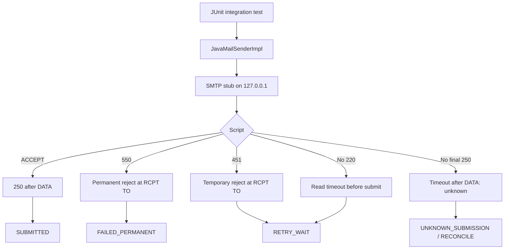
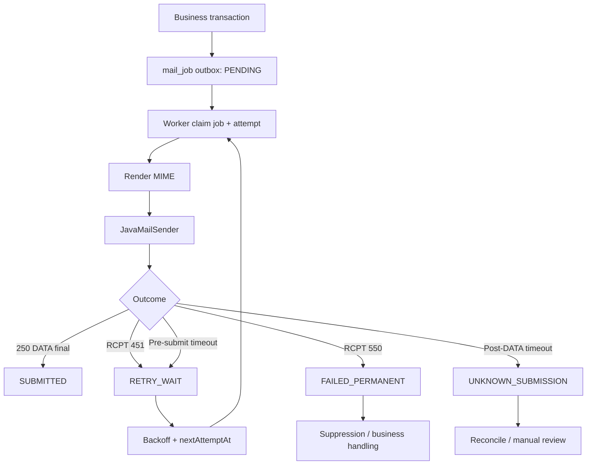
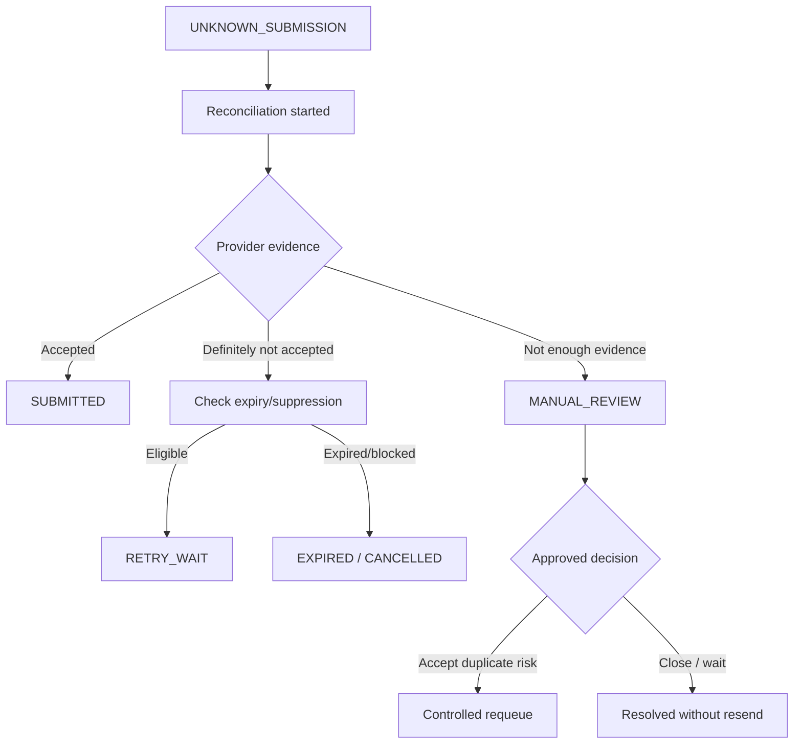

# Simulating Provider Timeouts and Rejected Recipients with Spring Framework Mail

An email built successfully by an application is not guaranteed to be accepted by the SMTP provider. Even when the same `JavaMailSender.send(...)` call throws `MailSendException`, the underlying incident can be completely different:

- **Recipient rejected at `RCPT TO`:** the server returns `550 5.1.1` because the mailbox does not exist; this is usually a permanent error that should not be retried unchanged.
- **Recipient temporarily rejected:** the server returns `451 4.x.x`; retrying after backoff can be appropriate.
- **Provider timeout before sending any SMTP command:** the email was definitely not submitted on that connection, so controlled retries are possible.
- **Provider returns no final result after `DATA`:** the client does not know whether the server accepted and stored the message. Resending immediately can create two emails.

That is why this practice lesson does not rely solely on mocks throwing arbitrary exceptions. We run a **scripted fake SMTP server on loopback**, control exact responses at each protocol step, send emails using Spring Framework Mail, and observe how exceptions, job state, and retry policies behave.

> **Expected takeaway:** learners can distinguish network errors, recipient errors, SMTP acceptance, and uncertain outcomes; write repeatable tests without sending mail over the Internet; and build a failure policy that never mistakenly retries permanently rejected addresses or an attempt the provider may already have accepted.

This lab targets Java 17+ and Spring Boot 3.x/Jakarta Mail applications (e.g., Spring Boot 3.5.x). Commands and code are strictly for **testing environments**. Never use production credentials or mailboxes, and never expose the fake server to public networks.

## 1. Learning Objectives

After this lesson, you will be able to:

1. Trace how a message travels from `MimeMessageHelper` to an SMTP server.
2. Distinguish `connect timeout`, `read timeout`, and `write timeout`.
3. Build an SMTP stub supporting `250`, `451`, `550`, and missing-ACK scenarios.
4. Separate failures occurring **before** `DATA` from failures **after** sending the `<CRLF>.<CRLF>` terminator.
5. Read `MailException`, `MessagingException.getNextException()`, and provider-specific details safely.
6. Build a **transient / permanent / uncertain** classifier.
7. Write JUnit 5 integration tests running entirely on loopback.
8. Design job storage, attempt tracking, backoff retries, expiry, DLQ, and reconciliation.
9. Test the distinction between an SMTP ACK and a subsequent delivery bounce.
10. Write incident runbooks and collect metrics without logging PII or secrets.

## 2. Minimal Concepts Before Practicing

### 2.1. JavaMailSender and MimeMessageHelper

In Spring Framework Mail:

- `JavaMailSender` is the email-sending abstraction.
- `JavaMailSenderImpl` typically uses Jakarta Mail to talk to an SMTP provider.
- `MimeMessageHelper` helps construct `MimeMessage` with From, To, Subject, plain text, HTML, attachments, and inline resources.
- `MailException` is Spring Mail's exception hierarchy translated from lower-level failures.

**Spring Mail does not provide a durable queue, retry ledger, DLQ, or delivery reconciliation.** Those belong to your application architecture, broker, or provider API.

### 2.2. A Typical SMTP Session

```text
Client                                      Fake SMTP server
  |                                              |
  | <------------------- 220 Greeting -----------|
  | -------------------- EHLO ------------------> |
  | <------------------- 250 Capabilities ------- |
  | -------------------- MAIL FROM -------------> |
  | <------------------- 250 -------------------- |
  | -------------------- RCPT TO ---------------> |
  | <------------------- 250 or 451/550 -------- |
  | -------------------- DATA ------------------> |
  | <------------------- 354 -------------------- |
  | -------- body + <CRLF>.<CRLF> --------------> |
  | <------------------- 250 or timeout -------- |
  | -------------------- QUIT ------------------> |
  | <------------------- 221 -------------------- |
```

Only after the final success response to `DATA` does the client have evidence that **the SMTP server accepted responsibility for handling the message in that session**. This **does not mean** the email reached the Inbox, avoided Spam, or will not bounce later.

### 2.3. Why Timeout Position Matters

| Where the Failure Occurs | What the Client Knows | Retry Safety |
|---|---|---|
| TCP connection not yet established | Nothing submitted on that session | Safe to retry after backoff |
| Waiting for `220` greeting | Neither `MAIL FROM` nor `DATA` sent | Safe to retry after backoff |
| Waiting for `RCPT TO` reply | `DATA` not entered in that session | Inspect phase/outcome; controlled retry |
| Server returns `550` at `RCPT TO` | Recipient rejected | Never blindly retry same recipient |
| Server returns `451` at `RCPT TO` | Temporary rejection | Retryable within deadline/backoff |
| Client sent end of `DATA`, no `250` received | **Unknown whether server accepted** | Never auto-retry by default |
| Received `250` after `DATA` | SMTP accepted | Never resend merely because no delivery event arrived |

Note: a timeout at `DATA` **does not prove the server accepted**; it only proves the client lost visibility into the outcome. In this lab, the fake server records that data arrived, whereas on a real network the client cannot infer that without provider evidence.

## 3. Defining the Five Lab Scenarios

We use an SMTP stub selectable across these scenarios:

| Scenario | Simulated Response | Expected Result |
|---|---|---|
| `ACCEPT` | `250` on recipient and after DATA | Sender returns normally |
| `REJECT_550` | `550 5.1.1` at RCPT TO | Permanent recipient rejection |
| `REJECT_451` | `451 4.3.0` at RCPT TO | Temporary recipient rejection |
| `STALL_GREETING` | TCP connects but no `220` sent | Pre-submission timeout |
| `STALL_AFTER_DATA` | Receives DATA terminator, sends no `250` | Uncertain submission outcome |

We assert **what the fake server observed** to validate the fixture, then separate **what the client can know with certainty**. Separating those two perspectives is the core lesson.

### 3.1. Flow Diagram



## 4. Tools, Prerequisites, and Safety Principles

Environment:

- JDK 17 or newer.
- Gradle managed via Spring Boot in your project.
- Spring Boot 3.x with `spring-boot-starter-mail`.
- JUnit Jupiter / `spring-boot-starter-test`.
- **Ephemeral TCP ports** assigned automatically on loopback—never hardcode ports on developer machines.
- No real SMTP accounts, Gmail, or Internet access needed.

### 4.1. Why Not Use a Real Provider to Trigger Errors?

Testing bad passwords, non-existent addresses, or intentional connection timeouts against production SMTP can:

- Trigger anti-abuse rules, rate limits, and account lockouts.
- Accidentally email real people.
- Harm bounce metrics and domain reputation.
- Produce flaky failures as provider policies shift.
- Expose credentials or recipients in debug logs.

A local SMTP stub gives **deterministic**, fast control independent of external providers. It does not simulate full TLS/auth, deliverability, or provider-specific policies; those require dedicated integration tests in authorized environments.

### 4.2. Data Conventions

In the examples:

```text
From:     no-reply@example.test
To:       demo-recipient@example.test
Subject:  SMTP failure lab
Body:     This is a synthetic test message.
```

The `example.test` domain is reserved for synthetic tests; the fake server runs directly on localhost with zero external DNS delivery. Never use real customer email lists in lab exercises.

## 5. Reference Project Structure

```text
mail-failure-lab/
├── build.gradle
├── settings.gradle
└── src/
    ├── main/
    │   └── java/com/example/maillab/
    │       ├── MailFailureLabApplication.java
    │       ├── MailProbeService.java
    │       └── MailFailureInspector.java
    └── test/
        └── java/com/example/maillab/
            ├── ScriptedSmtpServer.java
            └── MailFailureIntegrationTest.java
```

This is a **practice project** layout, not a requirement to modify files in the current repository. Code is provided inline below. Extensions such as database outboxes, RabbitMQ, or webhook simulators are covered in later sections.

### 5.1. Gradle Setup

Example `settings.gradle`:

```groovy
rootProject.name = 'mail-failure-lab'
```

Example `build.gradle` (plugin versions are illustrative; align with your dependency management):

```groovy
plugins {
    id 'java'
    id 'org.springframework.boot' version '3.5.6'
    id 'io.spring.dependency-management' version '1.1.7'
}

group = 'com.example'
version = '1.0.0'

java {
    toolchain {
        languageVersion = JavaLanguageVersion.of(17)
    }
}

repositories {
    mavenCentral()
}

dependencies {
    implementation 'org.springframework.boot:spring-boot-starter-mail'
    testImplementation 'org.springframework.boot:spring-boot-starter-test'
}

tasks.named('test') {
    useJUnitPlatform()
}
```

The examples rely on Jakarta Mail APIs used by Spring Boot 3.x; **never mix legacy `javax.mail.*`** with `jakarta.mail.*`. If your project uses Spring Boot 4.x or another version, verify plugins and package names against your stack and let the BOM manage dependency versions.

### 5.2. Minimal Main Class

```java
package com.example.maillab;

import org.springframework.boot.SpringApplication;
import org.springframework.boot.autoconfigure.SpringBootApplication;

@SpringBootApplication
public class MailFailureLabApplication {
    public static void main(String[] args) {
        SpringApplication.run(
                MailFailureLabApplication.class, args);
    }
}
```

The integration tests construct `JavaMailSenderImpl` directly with the **ephemeral port of the SMTP stub**. No Spring Boot application context startup or real provider is needed.

## 6. Creating JavaMailSenderImpl for Testing

A factory producing a loopback-only sender with no AUTH/TLS because the stub does not implement them:

```java
package com.example.maillab;

import java.util.Properties;
import org.springframework.mail.javamail.JavaMailSenderImpl;

public final class TestMailSenders {

    private TestMailSenders() {
    }

    public static JavaMailSenderImpl forLoopbackPort(int port) {
        JavaMailSenderImpl sender = new JavaMailSenderImpl();
        sender.setHost("127.0.0.1");
        sender.setPort(port);
        sender.setProtocol("smtp");
        sender.setDefaultEncoding("UTF-8");

        Properties properties = sender.getJavaMailProperties();
        properties.put("mail.smtp.auth", "false");
        properties.put("mail.smtp.starttls.enable", "false");
        properties.put("mail.smtp.ssl.enable", "false");
        properties.put("mail.smtp.connectiontimeout", "500");
        properties.put("mail.smtp.timeout", "500");
        properties.put("mail.smtp.writetimeout", "500");
        properties.put("mail.smtp.quitwait", "false");
        properties.put("mail.debug", "false");
        properties.put("mail.debug.auth", "false");

        return sender;
    }
}
```

Timeouts are in **milliseconds**. 500 ms keeps tests fast; this is not a production setting. Never disable TLS/AUTH like this when talking to real providers; the fake test server is a completely different environment.

### 6.1. Distinguishing Timeouts

| Property | Where It Applies | Situation |
|---|---|---|
| `mail.smtp.connectiontimeout` | Waiting to establish TCP connection | Provider unreachable |
| `mail.smtp.timeout` | Waiting to read socket responses | Missing greeting or SMTP reply |
| `mail.smtp.writetimeout` | Socket write limit | Server slow or not reading request |

To simulate a true read timeout, the fake server **accepts the TCP connection and then sends no reply**. Connecting to a port with no listener typically throws `Connection refused`, **not a read timeout**. Those are two distinct tests.

### 6.2. Why Not Use @MockBean for Every Scenario?

Mockito can easily stub:

```java
doThrow(new MailSendException("synthetic failure"))
        .when(sender).send(any(MimeMessage.class));
```

Yet that **does not exercise the SMTP protocol**: it never proves `RCPT TO` received `550`, produces no real `SMTPAddressFailedException` with a reply code, and tests neither session behavior nor ambiguous final `DATA` responses. Mockito fits unit-testing business policy; this lesson adds a **socket-level fake** to learn protocol semantics.

## 7. Building a Controllable SMTP Stub

This is the core of the lab. The fake server accepts **one SMTP connection per test** and listens on `127.0.0.1` with an ephemeral port.

It does not implement TLS, AUTH, full MIME parsing, or outbound delivery. It reads essential SMTP commands, replies in protocol order, and records state markers for test assertions.

### 7.1. ScriptedSmtpServer.java

Place in `src/test/java/com/example/maillab/ScriptedSmtpServer.java`:

```java
package com.example.maillab;

import java.io.BufferedReader;
import java.io.BufferedWriter;
import java.io.IOException;
import java.io.InputStreamReader;
import java.io.OutputStreamWriter;
import java.net.InetAddress;
import java.net.ServerSocket;
import java.net.Socket;
import java.net.SocketException;
import java.nio.charset.StandardCharsets;
import java.util.Locale;
import java.util.concurrent.ExecutorService;
import java.util.concurrent.Executors;
import java.util.concurrent.TimeUnit;
import java.util.concurrent.atomic.AtomicBoolean;
import java.util.concurrent.atomic.AtomicInteger;

public final class ScriptedSmtpServer implements AutoCloseable {

    public enum Scenario {
        ACCEPT,
        REJECT_550,
        REJECT_451,
        STALL_GREETING,
        STALL_AFTER_DATA
    }

    private final Scenario scenario;
    private final ServerSocket serverSocket;
    private final ExecutorService executor;

    private final AtomicBoolean mailFromSeen = new AtomicBoolean();
    private final AtomicBoolean dataCommandSeen = new AtomicBoolean();
    private final AtomicBoolean dataTerminatorSeen =
            new AtomicBoolean();
    private final AtomicInteger recipientCount = new AtomicInteger();

    private ScriptedSmtpServer(Scenario scenario)
            throws IOException {
        this.scenario = scenario;

        // Bind ONLY to IPv4 loopback.
        this.serverSocket = new ServerSocket(
                0,
                1,
                InetAddress.getByName("127.0.0.1"));
        this.serverSocket.setSoTimeout(3_000);

        this.executor = Executors.newSingleThreadExecutor(r -> {
            Thread thread = new Thread(r, "smtp-lab-server");
            thread.setDaemon(true);
            return thread;
        });
        this.executor.submit(this::serveOneConnection);
    }

    public static ScriptedSmtpServer start(Scenario scenario)
            throws IOException {
        return new ScriptedSmtpServer(scenario);
    }

    public int port() {
        return serverSocket.getLocalPort();
    }

    public boolean sawMailFrom() {
        return mailFromSeen.get();
    }

    public boolean sawDataCommand() {
        return dataCommandSeen.get();
    }

    public boolean sawDataTerminator() {
        return dataTerminatorSeen.get();
    }

    public int recipientCommands() {
        return recipientCount.get();
    }

    private void serveOneConnection() {
        try (Socket socket = serverSocket.accept()) {
            socket.setSoTimeout(2_500);

            if (scenario == Scenario.STALL_GREETING) {
                // TCP accepted but DO NOT send SMTP 220.
                // Wait longer than sender read timeout.
                Thread.sleep(1_500);
                return;
            }

            BufferedReader input = new BufferedReader(
                    new InputStreamReader(
                            socket.getInputStream(),
                            StandardCharsets.US_ASCII));

            BufferedWriter output = new BufferedWriter(
                    new OutputStreamWriter(
                            socket.getOutputStream(),
                            StandardCharsets.US_ASCII));

            reply(output, "220 localhost SMTP lab ready");

            String line;
            while ((line = input.readLine()) != null) {
                String command = line.toUpperCase(Locale.ROOT);

                if (command.startsWith("EHLO ")
                        || command.startsWith("HELO ")) {
                    reply(output, "250 localhost");

                } else if (command.startsWith("MAIL FROM:")) {
                    mailFromSeen.set(true);
                    reply(output, "250 2.1.0 Sender accepted");

                } else if (command.startsWith("RCPT TO:")) {
                    recipientCount.incrementAndGet();

                    if (scenario == Scenario.REJECT_550) {
                        reply(output,
                                "550 5.1.1 Recipient mailbox unavailable");
                    } else if (scenario == Scenario.REJECT_451) {
                        reply(output,
                                "451 4.3.0 Temporary recipient failure");
                    } else {
                        reply(output, "250 2.1.5 Recipient accepted");
                    }

                } else if (command.equals("DATA")) {
                    dataCommandSeen.set(true);
                    reply(output, "354 End data with <CRLF>.<CRLF>");

                    String contentLine;
                    while ((contentLine = input.readLine()) != null) {
                        if (contentLine.equals(".")) {
                            dataTerminatorSeen.set(true);

                            if (scenario == Scenario.STALL_AFTER_DATA) {
                                // Received all DATA but intentionally
                                // DO NOT return final 250 acknowledgment.
                                Thread.sleep(1_500);
                                return;
                            }

                            reply(output,
                                    "250 2.0.0 Message accepted by lab");
                            break;
                        }
                    }

                } else if (command.equals("RSET")
                        || command.equals("NOOP")) {
                    reply(output, "250 2.0.0 OK");

                } else if (command.equals("QUIT")) {
                    reply(output, "221 2.0.0 Closing connection");
                    return;

                } else {
                    reply(output, "502 5.5.2 Unsupported command");
                }
            }

        } catch (SocketException ignoredDuringShutdown) {
            // Can happen when test closes server/socket.
        } catch (InterruptedException interrupted) {
            Thread.currentThread().interrupt();
        } catch (IOException ignoredInSocketLab) {
            // This stub is only for tests.
            // Production requires dedicated server error reporting.
        }
    }

    private static void reply(
            BufferedWriter output, String response)
            throws IOException {
        output.write(response);
        output.write("\r\n");
        output.flush();
    }

    @Override
    public void close() throws Exception {
        serverSocket.close();
        executor.shutdownNow();
        executor.awaitTermination(3, TimeUnit.SECONDS);
    }
}
```

### 7.2. Why ServerSocket(0)?

Port `0` asks the OS for an unused ephemeral TCP port. Tests call `server.port()`, avoiding port collisions when multiple tests run on CI or developer laptops.

Binding `127.0.0.1` guarantees the server is never exposed on public network interfaces. Never bind `0.0.0.0` for an unauthenticated stub without TLS.

### 7.3. Why CRLF and Dot-Terminator Reading?

SMTP commands and replies end with `\r\n`. After the server responds `354`, email content streams line by line until a line containing only `.` ends DATA. Thus the stub expects:

```text
DATA
354 End data with <CRLF>.<CRLF>
...message headers and body...
.
250 2.0.0 Accepted
```

In `STALL_AFTER_DATA`, the server sees the terminator yet **returns no `250`**. That is the critical fixture for `UNKNOWN_SUBMISSION`.

### 7.4. Intentional Limitations of the SMTP Stub

- Handles only one SMTP session per instance.
- Does not implement `STARTTLS` or `AUTH`.
- Does not fully parse MIME payloads.
- Does not simulate DSNs, spam filtering, greylisting, or delivery webhooks.
- Records only test markers; does not store emails.
- Reads US-ASCII lines for SMTP commands and terminators; test emails use plain ASCII bodies.
- Has no database or durability.

Accordingly, the stub is suited for simulating **protocol replies and timeouts**, not acting as a production SMTP server.

### 7.5. What Extra Scenarios Can Be Added?

Beyond the core lab, you can add:

- `REJECT_MAIL_FROM_550` to simulate an unauthorized sender identity.
- `REJECT_DATA_552` when a message exceeds size limits.
- `STALL_RCPT` after reading a recipient.
- `CLOSE_CONNECTION_DURING_DATA` to test mid-stream write/read errors.
- `DELAY_250_AFTER_DATA` to test late replies.
- `PARTIAL_RECIPIENT_ACCEPT` with multiple recipients.
- `AUTH_535` for credential failures (requires implementing the AUTH command).

Each additional scenario should assert both what stage the server responded at and what the client can safely infer.

## 8. Building MailProbeService Using Real Spring Framework Mail

To make tests meaningful, **do not mock JavaMailSender**. We only replace the SMTP endpoint with a server socket, while sending runs through `JavaMailSenderImpl` and Jakarta Mail.

File `src/main/java/com/example/maillab/MailProbeService.java`:

```java
package com.example.maillab;

import jakarta.mail.MessagingException;
import jakarta.mail.internet.MimeMessage;
import org.springframework.mail.javamail.JavaMailSender;
import org.springframework.mail.javamail.MimeMessageHelper;

public final class MailProbeService {

    private final JavaMailSender sender;

    public MailProbeService(JavaMailSender sender) {
        this.sender = sender;
    }

    public void submitOneMessage(String recipient) {
        MimeMessage mime = sender.createMimeMessage();

        try {
            MimeMessageHelper helper =
                    new MimeMessageHelper(mime, false, "UTF-8");

            helper.setFrom("no-reply@example.test");
            helper.setTo(recipient);
            helper.setSubject("SMTP failure lab");
            helper.setText(
                    "This is a synthetic test message.", false);
        } catch (MessagingException preparationFailure) {
            throw new IllegalArgumentException(
                    "Cannot prepare synthetic MIME message",
                    preparationFailure);
        }

        // Real call through JavaMailSenderImpl.
        sender.send(mime);
    }
}
```

### 8.1. Separating MIME Preparation Errors from Transport Errors

A `MessagingException` while configuring `MimeMessageHelper` is not an SMTP provider failure. If a recipient address has invalid syntax (e.g., missing `@`), the helper rejects it before opening a socket; that is not "provider returned 550".

To test rejection at `RCPT TO`, pass a **syntactically valid address** such as `demo-recipient@example.test`. The server accepts the syntax and returns `550`.

### 8.2. Why Only One Recipient?

An email with multiple recipients can receive mixed replies:

```text
RCPT TO:<a@example.test> -> 250
RCPT TO:<b@example.test> -> 550
RCPT TO:<c@example.test> -> 451
```

Jakarta Mail's behavior depends on `mail.smtp.sendpartial` and implementation specifics. The core lab intentionally uses one recipient to focus on failure classification; an extension covers partial sends.

## 9. Reading Exceptions and SMTP Codes Structuredly

A recipient failure at `RCPT TO` can wrap several layers:

```text
org.springframework.mail.MailSendException
   |
   +-- failedMessages / messageExceptions
         |
         +-- jakarta.mail.SendFailedException
               |
               +-- org.eclipse.angus.mail.smtp.SMTPAddressFailedException
                     command=RCPT TO
                     returnCode=550
```

With Eclipse Angus Mail (the Jakarta Mail implementation commonly shipped in Spring Boot 3.x), `SMTPAddressFailedException.getReturnCode()` extracts the reply code **without parsing arbitrary provider response text**. That class sits in an implementation-specific package; if you switch Jakarta Mail implementations or versions, swap the inspector adapter rather than coupling domain logic directly to it.

### 9.1. Two-Level Classification

Separate:

**Diagnostic evidence:** which reply code appeared? Was there a `SocketTimeoutException` or `AuthenticationFailedException`?

**Business decision:** retry, fail permanently, dead-letter, or reconcile? That decision also depends on SMTP phase, attempts, job deadline, and send policy.

Example:

```text
Diagnostic: SMTP reply 550 from RCPT TO
Decision:  FAILED_PERMANENT / do not retry unchanged

Diagnostic: SocketTimeoutException
Known phase: before SMTP greeting
Decision:  RETRY_WAIT after backoff

Diagnostic: SocketTimeoutException
Known phase: after DATA terminator
Decision:  UNKNOWN_SUBMISSION / reconcile

Diagnostic: SocketTimeoutException
Phase unknown
Decision:  UNKNOWN_SUBMISSION (conservative default)
```

**Never inspect a generic `SocketTimeoutException` and declare it happened before or after `DATA`** unless the application recorded phase evidence. In our tests the fake server provides that evidence; in production you either capture reliable stage markers or conservatively mark unknown.

### 9.2. MailFailureInspector.java

Place in `src/main/java/com/example/maillab/MailFailureInspector.java`:

```java
package com.example.maillab;

import jakarta.mail.AuthenticationFailedException;
import jakarta.mail.MessagingException;
import java.net.ConnectException;
import java.net.SocketTimeoutException;
import java.util.ArrayDeque;
import java.util.ArrayList;
import java.util.Collections;
import java.util.Deque;
import java.util.IdentityHashMap;
import java.util.List;
import java.util.Set;
import org.eclipse.angus.mail.smtp.SMTPAddressFailedException;
import org.springframework.mail.MailAuthenticationException;
import org.springframework.mail.MailSendException;

public final class MailFailureInspector {

    private static final int MAX_NODES = 64;

    public enum Kind {
        RECIPIENT_REJECTED_PERMANENT,
        RECIPIENT_REJECTED_TEMPORARY,
        SMTP_AUTHENTICATION,
        SOCKET_READ_TIMEOUT,
        CONNECTION_FAILURE,
        UNKNOWN
    }

    public record Diagnostic(
            Kind kind,
            Integer smtpReplyCode,
            List<String> exceptionTypes) {
    }

    public Diagnostic inspect(Throwable failure) {
        if (failure == null) {
            return new Diagnostic(Kind.UNKNOWN, null, List.of());
        }

        Set<Throwable> visited = Collections.newSetFromMap(
                new IdentityHashMap<>());
        Deque<Throwable> pending = new ArrayDeque<>();
        List<String> types = new ArrayList<>();

        pending.push(failure);

        Integer recipientCode = null;
        boolean authFailure = false;
        boolean socketTimeout = false;
        boolean connectionFailure = false;

        while (!pending.isEmpty() && visited.size() < MAX_NODES) {
            Throwable current = pending.pop();
            if (!visited.add(current)) {
                continue;
            }

            types.add(current.getClass().getSimpleName());

            if (current instanceof SMTPAddressFailedException address) {
                // Reply code of an RCPT failure in Angus SMTP.
                recipientCode = address.getReturnCode();
            }

            if (current instanceof MailAuthenticationException
                    || current instanceof AuthenticationFailedException) {
                authFailure = true;
            }

            if (current instanceof SocketTimeoutException) {
                socketTimeout = true;
            }

            if (current instanceof ConnectException) {
                connectionFailure = true;
            }

            Throwable cause = current.getCause();
            if (cause != null && !visited.contains(cause)) {
                pending.push(cause);
            }

            if (current instanceof MessagingException mailError) {
                Exception next = mailError.getNextException();
                if (next != null && !visited.contains(next)) {
                    pending.push(next);
                }
            }

            if (current instanceof MailSendException sendError) {
                for (Exception item :
                        sendError.getFailedMessages().values()) {
                    if (item != null && !visited.contains(item)) {
                        pending.push(item);
                    }
                }
                for (Exception item : sendError.getMessageExceptions()) {
                    if (item != null && !visited.contains(item)) {
                        pending.push(item);
                    }
                }
            }

            for (Throwable suppressed : current.getSuppressed()) {
                if (!visited.contains(suppressed)) {
                    pending.push(suppressed);
                }
            }
        }

        Kind kind;
        if (recipientCode != null
                && recipientCode >= 500 && recipientCode < 600) {
            kind = Kind.RECIPIENT_REJECTED_PERMANENT;
        } else if (recipientCode != null
                && recipientCode >= 400 && recipientCode < 500) {
            kind = Kind.RECIPIENT_REJECTED_TEMPORARY;
        } else if (authFailure) {
            kind = Kind.SMTP_AUTHENTICATION;
        } else if (socketTimeout) {
            kind = Kind.SOCKET_READ_TIMEOUT;
        } else if (connectionFailure) {
            kind = Kind.CONNECTION_FAILURE;
        } else {
            kind = Kind.UNKNOWN;
        }

        return new Diagnostic(
                kind,
                recipientCode,
                List.copyOf(types));
    }
}
```

### 9.3. Scope of the Inspector

This code teaches exception traversal safely:

1. Traverses `getCause()`, `MessagingException.getNextException()`, and `MailSendException` branches.
2. Uses an identity-based visited set to prevent reference cycles and duplicate visits.
3. Caps traversal at 64 exception objects.
4. Stores only exception class names and reply codes—**never raw `getMessage()` text**.
5. For a single recipient, maps `4xx/5xx` from `SMTPAddressFailedException` to a failure kind.

Do not use this version unmodified for **multi-message or multi-recipient batches**, because one `MailSendException` can contain **several distinct reply codes**. The inspector retains only the last recipient code found; production batches need a diagnostic **per mailJob/recipient and SMTP phase**.

Furthermore, `SOCKET_READ_TIMEOUT` here represents `SocketTimeoutException` evidence; it could happen waiting for the greeting, RCPT reply, or final DATA reply. **This kind carries no stage**, so it cannot alone approve safe retries.

### 9.4. Failure Classification Differs from Business Outcome

An SMTP `550` reply at `RCPT TO` does not mean the message was sent and bounced later; it is a **synchronous rejection inside the SMTP transaction**. Conversely, a provider can accept with `250` and emit a bounce later; that belongs to the **delivery feedback stage**, not retroactively marking the old attempt as a failed SMTP submission.

### 9.5. Do Not Rely on exception.getMessage() as Source of Truth

Wrong:

```java
if (exception.getMessage().contains("550")) {
    // Fragile if message is null, multi-error, or reply from another phase.
    return "PERMANENT_RECIPIENT";
}
```

Better: extract structured codes from the library/protocol adapter when available and retain the phase. If a provider lacks structured codes, any reply parser must be bounded, tested, and used strictly as diagnostic evidence—never forwarded verbatim into metrics or HTTP APIs.

## 10. JUnit: The ACCEPT Scenario

All tests below use `MailProbeService` and a sender created via `TestMailSenders.forLoopbackPort(server.port())`. Place `TestMailSenders` from section 6 in `src/test/java/com/example/maillab/TestMailSenders.java` or move it to main sources if reused in an isolated sandbox environment.

File `src/test/java/com/example/maillab/MailFailureIntegrationTest.java`:

```java
package com.example.maillab;

import static org.junit.jupiter.api.Assertions.*;

import java.io.IOException;
import org.junit.jupiter.api.Test;
import org.springframework.mail.MailException;

class MailFailureIntegrationTest {

    private static final String TEST_RECIPIENT =
            "demo-recipient@example.test";

    private final MailFailureInspector inspector =
            new MailFailureInspector();

    @Test
    void acceptedRecipientAndDataReturnsNormally() throws Exception {
        try (ScriptedSmtpServer server =
                ScriptedSmtpServer.start(
                        ScriptedSmtpServer.Scenario.ACCEPT)) {

            MailProbeService service = new MailProbeService(
                    TestMailSenders.forLoopbackPort(server.port()));

            assertDoesNotThrow(() ->
                    service.submitOneMessage(TEST_RECIPIENT));

            assertEquals(1, server.recipientCommands());
            assertTrue(server.sawMailFrom());
            assertTrue(server.sawDataCommand());
            assertTrue(server.sawDataTerminator());
        }
    }
}
```

This is the **baseline control**: the server receives MAIL FROM, RCPT TO, and the DATA terminator, returning a final `250`. `JavaMailSender.send(...)` completes normally.

What can be stated accurately:

- **SMTP submission accepted in the lab**: yes.
- **Relayed to the Internet**: no.
- **Delivered to a real recipient**: no.
- **Landed in an Inbox**: cannot be inferred.

### 10.1. Why Start with a Happy Path Before Errors?

If the fake server mishandles `EHLO` or `DATA`, every later test could fail because of a **broken fixture** rather than the behavior under study. The ACCEPT test minimally verifies the sender and stub speak compatible protocol within this lesson's scope.

## 11. JUnit: Permanently Rejected Recipient — 550

Add this method to `MailFailureIntegrationTest`:

```java
@Test
void rcpt550MeansPermanentRecipientRejection()
        throws Exception {

    try (ScriptedSmtpServer server =
            ScriptedSmtpServer.start(
                    ScriptedSmtpServer.Scenario.REJECT_550)) {

        MailProbeService service = new MailProbeService(
                TestMailSenders.forLoopbackPort(server.port()));

        MailException failure = assertThrows(
                MailException.class,
                () -> service.submitOneMessage(TEST_RECIPIENT));

        var diagnostic = inspector.inspect(failure);

        assertEquals(
                MailFailureInspector.Kind.RECIPIENT_REJECTED_PERMANENT,
                diagnostic.kind());
        assertEquals(550, diagnostic.smtpReplyCode());

        assertEquals(1, server.recipientCommands());
        assertFalse(server.sawDataCommand());
        assertFalse(server.sawDataTerminator());
    }
```

Place this method **inside** `MailFailureIntegrationTest` from section 10, before the final closing brace `}` of the class.

**Meaning:**

1. `demo-recipient@example.test` has valid syntax.
2. The SMTP stub receives `RCPT TO`.
3. The stub responds `550 5.1.1`.
4. The message never enters `DATA`.
5. Jakarta Mail/Spring Mail raises a failure; the inspector extracts the code.
6. Retrying **the same recipient and same payload** makes no sense after a permanent rejection.

### 11.1. Does 550 Always Mean "Mailbox Does Not Exist"?

Not unconditionally. Exact meaning depends on enhanced status codes, the command, and provider policy. For instance, `550` can reflect sender/domain policy rejection. In this stub we **intentionally return 550 at `RCPT TO` with enhanced status `5.1.1`** to model recipient mailbox unavailability. Production classifiers must inspect provider reply semantics, phase, and suppression rules.

### 11.2. Business Action

A state machine might record:

```text
mailJob J100
  attempt A1 -> RCPT_550
  state      -> FAILED_PERMANENT
  reason     -> RECIPIENT_REJECTED
  nextRetry  -> none
```

If your product maintains a suppression list, you can route the recipient to review/suppression per rules and evidence. Never switch to another provider to bypass an anti-abuse permanent rejection.

## 12. JUnit: Temporarily Rejected Recipient — 451

Add this method:

```java
@Test
void rcpt451IsATemporaryRecipientFailure()
        throws Exception {

    try (ScriptedSmtpServer server =
            ScriptedSmtpServer.start(
                    ScriptedSmtpServer.Scenario.REJECT_451)) {

        MailProbeService service = new MailProbeService(
                TestMailSenders.forLoopbackPort(server.port()));

        MailException failure = assertThrows(
                MailException.class,
                () -> service.submitOneMessage(TEST_RECIPIENT));

        var diagnostic = inspector.inspect(failure);

        assertEquals(
                MailFailureInspector.Kind.RECIPIENT_REJECTED_TEMPORARY,
                diagnostic.kind());
        assertEquals(451, diagnostic.smtpReplyCode());

        assertEquals(1, server.recipientCommands());
        assertFalse(server.sawDataTerminator());
    }
```

Here `451 4.3.0` indicates temporary server rejection before DATA. You can schedule a retry **after a wait window**, provided the job has not expired, remains within its retry budget, and provider policy permits.

### 12.1. Do Not Immediately Retry Hundreds of Times

Avoid:

```java
for (int i = 0; i < 100; i++) {
    try {
        sender.send(mime);
    } catch (MailException ignored) {
        // Immediately resend without waiting.
    }
}
```

That causes a retry storm, burns quota, and keeps triggering server rejections. Move the job to `RETRY_WAIT` with `nextAttemptAt` computed via backoff and jitter.

### 12.2. 451 Is Not a Guarantee of Future Success

Temporary errors can persist. If a job exhausts attempts or passes `expiresAt`, policy may transition it to `DEAD_LETTER`, `EXPIRED`, or an equivalent terminal state. "Temporary" is a **protocol classification**, not a command to retry forever.

## 13. JUnit: Timeout Before Receiving SMTP Greeting

`STALL_GREETING` simulates a server accepting TCP yet never sending SMTP `220`:

```text
Client  -- TCP connect -->  Server
Client  <-- no greeting -- Server
Client  -- read timeout -> SocketTimeoutException
```

Test:

```java
@Test
void missingGreetingTimesOutBeforeSubmission() throws Exception {
    try (ScriptedSmtpServer server = ScriptedSmtpServer.start(
            ScriptedSmtpServer.Scenario.STALL_GREETING)) {

        MailProbeService service = new MailProbeService(
                TestMailSenders.forLoopbackPort(server.port()));

        MailException failure = assertThrows(
                MailException.class,
                () -> service.submitOneMessage(TEST_RECIPIENT));

        var diagnostic = inspector.inspect(failure);
        assertEquals(
                MailFailureInspector.Kind.SOCKET_READ_TIMEOUT,
                diagnostic.kind());

        assertFalse(server.sawMailFrom());
        assertFalse(server.sawDataCommand());
        assertFalse(server.sawDataTerminator());
    }
```

**This is a read timeout, not a connect timeout.** TCP connect succeeded, yet the client waited for a greeting and received no data. `mail.smtp.timeout=500` prevents hanging forever.

In this scenario the stub proves no `MAIL FROM`, `RCPT TO`, or `DATA` occurred, so nothing was submitted in the session. The job can retry with backoff if still valid and allowed by policy.

### 13.1. Pre-Greeting Timeout vs. Connection Refused

If a client connects to a port where nothing is listening, the OS returns `ConnectException: Connection refused`. That happens during **TCP connect**, not while waiting for `220`. They point to different infrastructure issues.

Never simulate provider timeouts by putting `Thread.sleep(...)` inside an application service before calling the sender: that only slows your code without testing SMTP protocol handling.

### 13.2. Inference Limits in Production

In production, if logs show only `MailSendException` or `SocketTimeoutException` with no protocol-phase evidence, **never assume the timeout happened before the greeting**. That conclusion is valid here only because our test stub verified it.

## 14. JUnit: Timeout After Sending the DATA Terminator

`STALL_AFTER_DATA` simulates the trickier case:

```text
Client                         Fake SMTP server
  |  MAIL FROM / RCPT TO           |
  |------------------------------> |
  | <----------------------- 250   |
  | DATA                            |
  |------------------------------> |
  | <----------------------- 354   |
  | body + <CRLF>.<CRLF>             |
  |------------------------------> |
  |     server does not return 250 |
  | ------------ timeout --------> X
```

Test:

```java
@Test
void missingFinalAckAfterDataIsUncertain() throws Exception {
    try (ScriptedSmtpServer server = ScriptedSmtpServer.start(
            ScriptedSmtpServer.Scenario.STALL_AFTER_DATA)) {

        MailProbeService service = new MailProbeService(
                TestMailSenders.forLoopbackPort(server.port()));

        MailException failure = assertThrows(
                MailException.class,
                () -> service.submitOneMessage(TEST_RECIPIENT));

        var diagnostic = inspector.inspect(failure);
        assertEquals(
                MailFailureInspector.Kind.SOCKET_READ_TIMEOUT,
                diagnostic.kind());

        assertEquals(1, server.recipientCommands());
        assertTrue(server.sawMailFrom());
        assertTrue(server.sawDataCommand());
        assertTrue(server.sawDataTerminator());
    }
```

### 14.1. Same Exception, Different Conclusion

| Signal | STALL_GREETING | STALL_AFTER_DATA |
|---|---|---|
| TCP accepted | Yes | Yes |
| MAIL FROM sent | No | Yes |
| DATA started | No | Yes |
| Fake server saw DATA terminator | No | Yes |
| Client saw timeout | Yes | Yes |
| SMTP acceptance proven absent? | Yes in this test | **Cannot conclude** |
| Suggested decision | Retry with backoff | Reconcile before resend |

**`server.sawDataTerminator()` is fake-server evidence solely for JUnit**, not data a production client possesses. The provider may have accepted and persisted the mail or dropped it; because the client received no final `250`, the outcome is **UNKNOWN_SUBMISSION**.

### 14.2. Do Not Treat Message-ID as Absolute Deduplication

Preserving a MIME `Message-ID` or provider idempotency key can assist reconciliation when supported, yet SMTP does not guarantee two submissions sharing a `Message-ID` will be delivered once. Resending after a post-DATA timeout can still deliver two messages to the recipient.

### 14.3. SMTP 250 Differs from a Delivery Receipt

`250` after `RCPT TO` accepts only that recipient for the current transaction. `250` after `DATA` marks SMTP acceptance. Even when `JavaMailSender.send(...)` returns normally, the provider can still defer, bounce, or filter the message into Spam afterward.

## 15. Summary of the Five Scenarios and Suggested States

| Scenario | Diagnostic | Illustrative Business State | Immediate Auto-Retry? |
|---|---|---|---|
| ACCEPT | Final SMTP 250 | `SUBMITTED` | No |
| REJECT_550 | Recipient 5xx | `FAILED_PERMANENT` / `DEAD_LETTER` | No |
| REJECT_451 | Recipient 4xx | `RETRY_WAIT` | Not immediately; wait backoff |
| STALL_GREETING | Proven pre-submission timeout | `RETRY_WAIT` | Not immediately; backoff |
| STALL_AFTER_DATA | Final ACK missing | `UNKNOWN_SUBMISSION` | **Never** before reconciling |

State names are application-defined; Spring Framework Mail provides no outbox/job state machine.

## 16. Separating Technical Failures from Retry Policy

`MailFailureInspector` identifies exception/reply kinds. A `MailRetryPolicy` must also evaluate phase evidence, deadlines, attempts, and business rules.

### 16.1. Distinguishing Submission Evidence

```java
package com.example.maillab;

public enum SubmissionEvidence {
    DEFINITELY_NOT_SUBMITTED,
    UNKNOWN,
    CONFIRMED_ACCEPTED
}
```

Assign `DEFINITELY_NOT_SUBMITTED` only when adapter/provider evidence proves SMTP acceptance did not occur. For a generic timeout lacking phase information, pick `UNKNOWN`—the conservative policy that avoids duplicates.

### 16.2. Next Actions

```java
package com.example.maillab;

public enum NextAction {
    KEEP_SUBMITTED,
    SCHEDULE_RETRY,
    FAIL_PERMANENTLY,
    EXPIRE,
    RECONCILE,
    STOP_BY_POLICY
}
```

### 16.3. Sample MailRetryPolicy

```java
package com.example.maillab;

import java.time.Instant;

public final class MailRetryPolicy {

    public NextAction decide(
            MailFailureInspector.Kind kind,
            SubmissionEvidence evidence,
            int attemptsUsed,
            int maxAttempts,
            Instant now,
            Instant expiresAt,
            boolean deliveryAllowed) {

        if (evidence == SubmissionEvidence.CONFIRMED_ACCEPTED) {
            return NextAction.KEEP_SUBMITTED;
        }
        if (!deliveryAllowed) {
            return NextAction.STOP_BY_POLICY;
        }
        if (expiresAt != null && !now.isBefore(expiresAt)) {
            return NextAction.EXPIRE;
        }
        if (evidence == SubmissionEvidence.UNKNOWN) {
            return NextAction.RECONCILE;
        }
        if (kind == MailFailureInspector.Kind
                .RECIPIENT_REJECTED_PERMANENT) {
            return NextAction.FAIL_PERMANENTLY;
        }
        if (kind == MailFailureInspector.Kind
                .SMTP_AUTHENTICATION) {
            // Do not burst-retry when account is rejected for AUTH.
            return NextAction.STOP_BY_POLICY;
        }
        if (attemptsUsed >= maxAttempts) {
            return NextAction.FAIL_PERMANENTLY;
        }

        return switch (kind) {
            case RECIPIENT_REJECTED_TEMPORARY,
                 SOCKET_READ_TIMEOUT,
                 CONNECTION_FAILURE -> NextAction.SCHEDULE_RETRY;
            default -> NextAction.RECONCILE;
        };
    }
}
```

This is a minimal policy for **one recipient**. In a real product, exhausting the retry budget may transition to `DEAD_LETTER`/manual review rather than sharing `FAILED_PERMANENT` with `550`. Important emails also need tenant/sender/recipient policies, provider rate limits, suppression, token expiration, and manual retry limits.

### 16.4. Timeout with Unknown Outcome: Must Reconcile

```java
NextAction action = new MailRetryPolicy().decide(
        MailFailureInspector.Kind.SOCKET_READ_TIMEOUT,
        SubmissionEvidence.UNKNOWN,
        1, 5,
        Instant.parse("2026-11-12T10:00:00Z"),
        Instant.parse("2026-11-12T11:00:00Z"),
        true);

// action == NextAction.RECONCILE
```

Even with four attempts remaining, never auto-resend when the final DATA ACK is missing.

### 16.5. Recipient 550: Do Not Resend Unchanged

```java
NextAction action = new MailRetryPolicy().decide(
        MailFailureInspector.Kind.RECIPIENT_REJECTED_PERMANENT,
        SubmissionEvidence.DEFINITELY_NOT_SUBMITTED,
        1, 5,
        Instant.parse("2026-11-12T10:00:00Z"),
        null, true);

// action == NextAction.FAIL_PERMANENTLY
```

Routing to SMTP provider B to bypass a `550` is not valid by default. Evaluate the rejection reason, anti-abuse rules, and recipient suppression.

### 16.6. Recipient 451 After Deadline Passed

```java
NextAction action = new MailRetryPolicy().decide(
        MailFailureInspector.Kind.RECIPIENT_REJECTED_TEMPORARY,
        SubmissionEvidence.DEFINITELY_NOT_SUBMITTED,
        2, 5,
        Instant.parse("2026-11-12T11:05:00Z"),
        Instant.parse("2026-11-12T11:00:00Z"),
        true);

// action == NextAction.EXPIRE
```

Expired OTPs or reset links must never be resent, even when the SMTP reply is a temporary failure.

## 17. Turning the Lab into a Durable Stateful Mail Worker

With unit/integration tests, we know what exceptions **one send call** throws. A production system also needs to know which jobs remain due, which have expired, and which cannot auto-retry.

Architecture:



In PostgreSQL or another database, this state must be stored outside in-memory Java objects. `@Async` or `ExecutorChannel` does not create a durable queue simply by using worker threads.

### 17.1. Sample PostgreSQL Schema

```sql
CREATE TABLE mail_job (
    id                UUID PRIMARY KEY,
    business_key      VARCHAR(180) NOT NULL UNIQUE,
    recipient_ref     VARCHAR(220) NOT NULL,
    mail_type         VARCHAR(64) NOT NULL,
    state             VARCHAR(40) NOT NULL,
    attempt_count     INTEGER NOT NULL DEFAULT 0,
    max_attempts      INTEGER NOT NULL DEFAULT 5,
    next_attempt_at   TIMESTAMPTZ,
    expires_at        TIMESTAMPTZ,
    claim_token       UUID,
    lease_until       TIMESTAMPTZ,
    version           BIGINT NOT NULL DEFAULT 0,
    last_failure      VARCHAR(80),
    created_at        TIMESTAMPTZ NOT NULL DEFAULT NOW(),
    updated_at        TIMESTAMPTZ NOT NULL DEFAULT NOW(),
    CHECK (attempt_count >= 0),
    CHECK (max_attempts >= 1)
);

CREATE TABLE mail_attempt (
    id                 UUID PRIMARY KEY,
    mail_job_id        UUID NOT NULL REFERENCES mail_job(id),
    attempt_no         INTEGER NOT NULL,
    provider_alias     VARCHAR(80) NOT NULL,
    state              VARCHAR(32) NOT NULL,
    failure_kind       VARCHAR(80),
    smtp_reply_code    INTEGER,
    phase_evidence     VARCHAR(80),
    started_at         TIMESTAMPTZ NOT NULL,
    completed_at       TIMESTAMPTZ,
    UNIQUE (mail_job_id, attempt_no)
);

CREATE INDEX idx_mail_ready
    ON mail_job (next_attempt_at, created_at)
    WHERE state IN ('PENDING', 'RETRY_WAIT');
```

`recipient_ref` is an internal reference to a validated recipient, not necessarily the raw email address. For multi-tenant systems, add `tenant_id` to the business/idempotency key and query filters so one tenant can never view another tenant's jobs.

**Never store SMTP passwords, raw MIME, OTPs, or reset tokens in the attempt table.** When business snapshots are needed, keep them in access-controlled private storage with retention and store only a governed reference.

### 17.2. Claiming Jobs with Ownership

With multiple workers:

```sql
WITH picked AS (
    SELECT id
    FROM mail_job
    WHERE state IN ('PENDING', 'RETRY_WAIT')
      AND next_attempt_at <= NOW()
      AND (expires_at IS NULL OR expires_at > NOW())
    ORDER BY next_attempt_at, created_at, id
    FOR UPDATE SKIP LOCKED
    LIMIT :batch_size
)
UPDATE mail_job AS j
SET state = 'PROCESSING',
    claim_token = :token,
    lease_until = NOW() + INTERVAL '90 seconds',
    attempt_count = attempt_count + 1,
    version = version + 1,
    updated_at = NOW()
FROM picked
WHERE j.id = picked.id
RETURNING j.*;
```

Run this inside a **short transaction**. After committing, the worker calls SMTP outside the database transaction. When writing the outcome, the UPDATE must check `id + claim_token + state` so a stale worker cannot overwrite a job claimed by another worker.

### 17.3. Leases Do Not Create Exactly-Once SMTP

A worker might finish `DATA` and crash before committing `SUBMITTED`. Another worker sees the expired lease and might want to resend. Fencing tokens protect database state, yet **cannot recall an email the provider already accepted**.

If an attempt may have passed DATA, recovery should transition it to `UNKNOWN_SUBMISSION` for reconciliation rather than automatically resending.

### 17.4. Recording Attempt Outcomes Before Entering DLQ

Proper execution order:

1. Claim the job and create an attempt record.
2. Invoke the renderer and sender.
3. Inspect outcome and evidence.
4. Persist the attempt outcome in a transaction.
5. Transition the job to `SUBMITTED`, `RETRY_WAIT`, `FAILED_PERMANENT`, or `UNKNOWN_SUBMISSION`.
6. If manual review is needed, create a review case or outbox event in the same transaction.

Never delete prior attempts on retry. Each SMTP submission must keep its own ID and timestamps for incident tracing.

## 18. Exponential Backoff and Jitter

For `451` and connect/greeting timeouts **proven not submitted**, a retry policy should use backoff:

```text
Attempt 1 -> about 2 seconds
Attempt 2 -> about 4 seconds
Attempt 3 -> about 8 seconds
Attempt 4 -> about 16 seconds
...
Max delay -> 2 minutes
Jitter -> randomized within bounds
```

Jitter prevents jobs from retrying simultaneously as soon as a provider recovers.

### 18.1. Delay Calculation Code

```java
import java.time.Duration;
import java.util.concurrent.ThreadLocalRandom;

public final class RetryBackoff {

    public Duration delayAfterFailure(int attemptsUsed) {
        int exponent = Math.max(
                0, Math.min(attemptsUsed - 1, 20));

        long maxMillis = Duration.ofMinutes(2).toMillis();
        long exponential = Math.min(
                maxMillis,
                2_000L * (1L << exponent));

        long lower = Math.max(1, exponential / 2);
        long jittered = ThreadLocalRandom.current()
                .nextLong(lower, exponential + 1);

        return Duration.ofMillis(jittered);
    }
}
```

These values are illustrative, not universal defaults for all SMTP providers. Check provider contracts for `Retry-After` headers or API rate limits. `ThreadLocalRandom` works well for spreading retry timing; never use it to generate security tokens.

### 18.2. Deadlines Stop Retries

A job should carry `expiresAt` independent of retry delays:

```java
Instant retryAt = now.plus(backoff.delayAfterFailure(attempts));

if (expiresAt != null && !retryAt.isBefore(expiresAt)) {
    // Job will expire before the next retry time.
    // Transition to EXPIRED/DEAD_LETTER per business policy.
}
```

When a worker re-claims the job, check the deadline **again right before SMTP submission**, not only when scheduling.

### 18.3. Never Auto-Retry Permanent 550s

Waiting longer will not make a non-existent recipient address valid. On `550 5.1.1`, notify business/suppression workflows or route to manual review if verified address correction exists. Never put it in the same retry queue as `451`.

### 18.4. AUTH Failures Differ from Timeouts

If SMTP AUTH credentials are wrong, uncontrolled retries can trigger account lockouts. Fix the configuration/secret before running a canary and resuming. Never group `SMTP_AUTHENTICATION` with `CONNECTION_FAILURE` merely because both throw `MailException`.

## 19. Rejected Recipients and Partial Recipient Acceptance

A message can address multiple recipients:

```text
RCPT TO:<alice@example.test> -> 250
RCPT TO:<bob@example.test>   -> 550
RCPT TO:<carol@example.test> -> 451
```

Understand what happened:

- `alice` was accepted during RCPT, though the message has not necessarily passed DATA yet.
- `bob` was permanently rejected at RCPT.
- `carol` was temporarily rejected at RCPT.
- If the client proceeds to send DATA for the accepted recipients, **partial submission** can occur.

### 19.1. mail.smtp.sendpartial

Jakarta Mail's SMTP provider exposes `mail.smtp.sendpartial`, which controls whether sending continues to valid recipients when some recipients are rejected. Never toggle this option just to "make errors go away" without understanding the business contract.

A batch failure does not necessarily mean **nobody received the email**. `SendFailedException` can report:

- `getValidSentAddresses()`.
- `getValidUnsentAddresses()`.
- `getInvalidAddresses()`.

These lists reflect technical status from one send call; they do not replace downstream provider delivery events.

### 19.2. Never Return Full Recipient Lists in Error APIs

A `SendFailedException` can embed recipient email addresses; logging raw messages or returning them in REST error responses leaks PII. Record internal recipient identities and normalized failure codes. For support lookups, provide an RBAC-protected UI.

### 19.3. Extension Exercise

Extend the fake server to return `250` for one recipient, `550` for a second, and `451` for a third. Write two tests with `mail.smtp.sendpartial=false` and `true`. Then:

1. Record outcomes separately per recipient/job.
2. Verify already-submitted recipients are never resent.
3. Retry only temporarily rejected recipients while still eligible.
4. Check whether `DATA` was sent and whether a final `250` arrived.

For emails containing personalized data, **never batch multiple recipients into one MIME message** just to save connections. Splitting logical jobs per recipient simplifies privacy and idempotency.

## 20. Reconciling UNKNOWN_SUBMISSION After a Post-DATA Timeout

This is the most important reliability problem in this lab. Imagine a worker hits a timeout:

```text
10:00:00  Create attempt A1 for mailJob J100
10:00:01  SMTP server accepts MAIL FROM and RCPT TO
10:00:02  Client sends DATA and terminator
10:00:03  Connection lost before final 250
10:00:04  Worker only sees MailSendException/timeout
```

Two real possibilities exist:

**A. Server accepted the message:** the provider queued the message, then the ACK was lost. Resending creates a duplicate.

**B. Server did not accept the message:** the provider failed before committing the message; not resending leaves the notification undelivered.

No algorithm reading only `MailSendException` can distinguish those two worlds reliably. You need additional evidence or a business policy explicitly accepting the risk.

### 20.1. Reconciliation Workflow

1. Record `UNKNOWN_SUBMISSION` on the attempt, keeping `mailJobId` and `attemptId`.
2. Stop automatic retries for that job.
3. Collect the send timestamp window, provider/account alias, and MIME `Message-ID` if present.
4. Query provider activity logs or APIs where supported.
5. Check any captured provider-generated message ID/reply.
6. Correlate verified delivery/bounce webhook events.
7. If provider acceptance is confirmed, mark `SUBMITTED` (do not resend).
8. If definitely not accepted, allow retry within deadline and policy.
9. If still unclear, route to manual review or wait per SLA.

Not every provider exposes a query API by MIME Message-ID. When no evidence source exists, **document reconciliation limits** instead of inferring from "the user says they didn't see the email" that the server definitely never received it.

### 20.2. Reconciliation State Machine



### 20.3. Can SMTP Message-ID Act as an Idempotency Key?

MIME `Message-ID` is an identifier header for referencing an email. It is **not a universally enforced exactly-once key across SMTP relays**. A provider may support an API idempotency key separately, which is a provider-specific contract to verify rather than a built-in `JavaMailSender` feature.

In your application, keep distinct IDs:

```text
mailJobId        = logical send intent
idempotencyKey   = business event + mail type + recipient scope
attemptId        = one SMTP attempt
mimeMessageId    = MIME-level identifier
providerMessageId= provider tracking identifier, if available
```

Never create a new logical job for a retry. If switching providers after an unknown attempt, preserve all prior attempt records and flag the duplicate risk.

### 20.4. Never Hold a DB Transaction Open While Waiting on SMTP

If a transaction stays open until `JavaMailSender.send(...)` returns:

- SMTP timeouts tie up DB connections and locks.
- When the DB rolls back, an email already accepted by the provider cannot be recalled.
- Scaling workers exhausts the connection pool.

Therefore, claim/start attempt and finalize outcome use short transactions, while SMTP network I/O runs outside them.

### 20.5. When Is a Manual Override Permissible?

In some workflows, risking a duplicate is preferable to missing a mandatory notification. Even then, manual overrides require:

- An authorized operator/approver.
- Reviewed evidence.
- Explicit reason code and timestamp.
- Valid job deadline and active consent/suppression checks.
- Rate limits and canary pacing.
- An audit log recording acceptance of duplicate risk.

Never put an unguarded "Retry All Unknown" button on an admin screen without confirmation and policy checks.

## 21. Bounces, Deferrals, and Recipient Rejections: Different Timing

The lab's `REJECT_550` happens **synchronously inside the SMTP transaction at `RCPT TO`**. An email can also be accepted by the relay and then **rejected by a downstream system**.

```text
JavaMailSender.send(mime)
  -> SMTP relay returns 250 after DATA
  -> application state SUBMITTED
  -> relay continues forwarding mail
     +--> delivered
     +--> deferred / retry
     +--> bounced
     +--> filtered / quarantined
```

### 21.1. When the Provider Returns 550 at RCPT TO

The application already received a synchronous error. You do not need to wait for a bounce to know this attempt was rejected, and you can route the recipient to suppression/manual correction per policy.

### 21.2. When the Provider Accepts and Later Emits a Bounce

The application may have recorded `SUBMITTED`. Later, a provider webhook/DSN reports `BOUNCED`. That is a **delivery outcome**, not a reason to rewrite the old attempt as "SMTP send failed".

A state model can separate:

```text
submissionStatus = SUBMITTED
deliveryStatus   = BOUNCED
```

This keeps metrics honest: accepted submissions differ from messages ultimately delivered.

### 21.3. Verify Webhooks Before Updating State

When a provider supports delivery webhooks:

- Verify webhook signatures/tokens.
- Enforce replay protection and deduplicate by event ID within the provider namespace.
- Map events to the exact `providerMessageId` and `attemptId`.
- Handle delayed and out-of-order events.
- Enforce tenant and account scope.
- Never log raw recipients or bodies unnecessarily.

The lab's fake SMTP server **does not emit webhooks**. To test delivery flows, build a separate provider-webhook simulator or HTTP fixture rather than mixing it into SMTP `RCPT TO`.

### 21.4. Why Not Resend When No Delivered Webhook Arrives?

Providers take time to process, recipient mail gateways can defer traffic, and webhooks themselves can lag or retry. Lacking an immediate delivered event **does not prove the email was not received**.

## 22. Safe Logging in This Practice Project

Developers often want to log the full exception:

```java
log.error("SMTP error", failure);
```

In local tests with synthetic data, stack traces help teach cause traversal. In production, exceptions and failed-message maps can embed recipients, SMTP replies, credentials/metadata, or content references.

### 22.1. Sample Structured Log

```json
{
  "event": "mail_attempt_failed",
  "mailJobId": "fd329137-8a1f-453e-8a74-c57c5c671621",
  "attemptId": "5a8df459-8878-42d9-a44c-8f058db64b17",
  "providerAlias": "transactional-primary",
  "failureKind": "RECIPIENT_REJECTED_PERMANENT",
  "smtpReplyCode": 550,
  "phase": "RCPT_TO",
  "decision": "FAIL_PERMANENTLY"
}
```

IDs above are illustrative. Never log raw SMTP usernames, passwords, reset tokens, HTML bodies, or recipient lists by default.

### 22.2. Inspect Exception Types Instead of Dumping Objects

`MailFailureInspector.Diagnostic.exceptionTypes()` returns a list of class names for investigation:

```text
MailSendException
SendFailedException
SMTPAddressFailedException
```

Avoid calling:

```java
log.error("Failed messages={}", exception.getFailedMessages());
```

because map keys can be `MimeMessage` objects holding bodies and recipients. To capture response codes, extract them through an implementation-specific exception adapter and log the normalized code.

### 22.3. Metrics and Cardinality

| Metric | What to Measure |
|---|---|
| `mail.smtp.attempts` | Submission attempts by provider/mail type |
| `mail.smtp.failures` | Failures by error category |
| `mail.smtp.reply.codes` | Distribution of common reply codes |
| `mail.jobs.retry_wait` | Jobs waiting for retry |
| `mail.jobs.failed_permanent` | Recipient/policy rejections |
| `mail.jobs.unknown_submission` | Attempts awaiting reconciliation |
| `mail.jobs.oldest_pending_age` | Age of the oldest pending job |
| `mail.smtp.submission.duration` | Transport call duration |
| `mail.delivery.events` | Provider bounce/delivery feedback |

Use bounded labels such as `providerAlias`, `mailType`, and `failureKind`; never use `mailJobId`, `attemptId`, email addresses, or exception messages as metric tags.

### 22.4. Alerting

An alerting strategy:

**Critical:** `UNKNOWN_SUBMISSION` spikes suddenly or transactional email queue age exceeds SLO.

**Warning:** sustained `451`/temporary rejections per provider, or unusual growth in `550` rates.

**Critical:** widespread SMTP AUTH failures—pause dispatch until credentials are fixed; avoid retry storms.

**Info:** A single `550` recipient can be handled by business/suppression workflows without paging the entire on-call rotation.

Group alerts by cause/provider and rate rather than firing an alert per failed message.

## 23. Unit Testing Retry Policy with Fixed Clock/Instant

The SMTP stub tests protocol behavior. The retry policy should be tested **separately**, without opening sockets for every business deadline case.

### 23.1. Recipient 550 Must Never Auto-Retry

```java
package com.example.maillab;

import static org.junit.jupiter.api.Assertions.assertEquals;

import java.time.Instant;
import org.junit.jupiter.api.Test;

class MailRetryPolicyTest {

    private final MailRetryPolicy policy = new MailRetryPolicy();

    @Test
    void permanentRejectionIsNotRetryable() {
        NextAction action = policy.decide(
                MailFailureInspector.Kind.RECIPIENT_REJECTED_PERMANENT,
                SubmissionEvidence.DEFINITELY_NOT_SUBMITTED,
                1, 5,
                Instant.parse("2026-11-12T10:00:00Z"),
                null,
                true);

        assertEquals(NextAction.FAIL_PERMANENTLY, action);
    }

    @Test
    void temporaryRejectionWithinBudgetSchedulesRetry() {
        NextAction action = policy.decide(
                MailFailureInspector.Kind.RECIPIENT_REJECTED_TEMPORARY,
                SubmissionEvidence.DEFINITELY_NOT_SUBMITTED,
                2, 5,
                Instant.parse("2026-11-12T10:00:00Z"),
                Instant.parse("2026-11-12T11:00:00Z"),
                true);

        assertEquals(NextAction.SCHEDULE_RETRY, action);
    }

    @Test
    void timeoutWithUnknownOutcomeRequiresReconciliation() {
        NextAction action = policy.decide(
                MailFailureInspector.Kind.SOCKET_READ_TIMEOUT,
                SubmissionEvidence.UNKNOWN,
                2, 5,
                Instant.parse("2026-11-12T10:00:00Z"),
                null,
                true);

        assertEquals(NextAction.RECONCILE, action);
    }

    @Test
    void expiredTemporaryFailureMustNotSend() {
        NextAction action = policy.decide(
                MailFailureInspector.Kind.RECIPIENT_REJECTED_TEMPORARY,
                SubmissionEvidence.DEFINITELY_NOT_SUBMITTED,
                2, 5,
                Instant.parse("2026-11-12T11:01:00Z"),
                Instant.parse("2026-11-12T11:00:00Z"),
                true);

        assertEquals(NextAction.EXPIRE, action);
    }

    @Test
    void consentBlockedStopsEvenBeforeRetry() {
        NextAction action = policy.decide(
                MailFailureInspector.Kind.RECIPIENT_REJECTED_TEMPORARY,
                SubmissionEvidence.DEFINITELY_NOT_SUBMITTED,
                1, 5,
                Instant.parse("2026-11-12T10:00:00Z"),
                null,
                false);

        assertEquals(NextAction.STOP_BY_POLICY, action);
    }
}
```

These tests use fixed `Instant.parse(...)` values independent of wall-clock time. When building a production worker, inject `java.time.Clock` into services/schedulers to test deadlines cleanly instead of scattering `Instant.now()` calls.

### 23.2. Adding an Exhausted Attempt Budget Test

```java
@Test
void temporaryFailureAtRetryLimitStopsAutomaticRetry() {
    NextAction action = policy.decide(
            MailFailureInspector.Kind.RECIPIENT_REJECTED_TEMPORARY,
            SubmissionEvidence.DEFINITELY_NOT_SUBMITTED,
            5, 5,
            Instant.parse("2026-11-12T10:00:00Z"),
            null,
            true);

    assertEquals(NextAction.FAIL_PERMANENTLY, action);
}
```

In a real application, a terminal state due to **exhausting the retry budget** should carry a distinct failure reason from a `550`—such as `RETRY_EXHAUSTED`—and typically creates a DLQ/manual-review case.

### 23.3. Adding an Accepted Submission Test

```java
@Test
void acceptedSubmissionMustNeverBeAutoRetried() {
    NextAction action = policy.decide(
            MailFailureInspector.Kind.UNKNOWN,
            SubmissionEvidence.CONFIRMED_ACCEPTED,
            1, 5,
            Instant.parse("2026-11-12T10:00:00Z"),
            null,
            true);

    assertEquals(NextAction.KEEP_SUBMITTED, action);
}
```

Not receiving a delivered webhook within one minute never invalidates a confirmed accepted submission.

## 24. Running the Practice Project

### 24.1. Assembling the Files

From the snippets:

1. Create `settings.gradle` and `build.gradle`.
2. Create `MailFailureLabApplication.java` (not needed to start when running JUnit).
3. Create `MailProbeService.java`.
4. Create `MailFailureInspector.java`.
5. Place `TestMailSenders.java` in `src/test/java/com/example/maillab`.
6. Place `ScriptedSmtpServer.java` in the same test package.
7. Combine the `@Test` methods from sections 10–14 into **one `MailFailureIntegrationTest` class** without duplicating closing braces from individual snippets.
8. Create `MailRetryPolicy.java`, `SubmissionEvidence.java`, and `NextAction.java`.
9. Create `MailRetryPolicyTest.java` and add the two tests from section 23.

**Remember:** every `public class` or `public enum` in Java needs a matching filename. The Java snippets across sections are project building blocks, not one giant single Java file.

### 24.2. Commands to Run JUnit

On Linux/macOS:

```bash
./gradlew test --tests 'com.example.maillab.MailFailureIntegrationTest'
./gradlew test --tests 'com.example.maillab.MailRetryPolicyTest'
```

On Windows PowerShell:

```powershell
.\gradlew.bat test --tests "com.example.maillab.MailFailureIntegrationTest"
.\gradlew.bat test --tests "com.example.maillab.MailRetryPolicyTest"
```

If the project lacks a Gradle wrapper yet, create or invoke Gradle per your environment's build conventions. Never start the Spring Boot app against production SMTP to "test" failures; these tests launch their own loopback fake server.

### 24.3. Expected Behavior When Tests Run Properly

| Test | Sender | Stub State |
|---|---|---|
| `acceptedRecipientAndDataReturnsNormally` | Does not throw | DATA terminator seen |
| `rcpt550MeansPermanentRecipientRejection` | Throws `MailException` | RCPT seen, no DATA |
| `rcpt451IsATemporaryRecipientFailure` | Throws `MailException` | RCPT seen, no final DATA |
| `missingGreetingTimesOutBeforeSubmission` | Throws `MailException` | MAIL FROM not seen |
| `missingFinalAckAfterDataIsUncertain` | Throws `MailException` | DATA terminator seen |

**These are expected outcomes per the fixture**, not a report of a run executed here. In your environment, JavaMail/Angus versions may alter exception hierarchies or reply handling; inspect your logs/library version and adjust the adapter accordingly.

### 24.4. Controlled Diagnostics in Tests

In the local lab using synthetic data, you can print:

```java
var details = inspector.inspect(failure);
System.out.println(details.kind());
System.out.println(details.smtpReplyCode());
System.out.println(details.exceptionTypes());
```

You do not need to dump the entire MIME message or raw SMTP transcript to classify failures. With real production credentials, debug output must remain controlled and redacted.

### 24.5. Do Not Confuse "Server Read DATA" with "Mail Delivered"

`STALL_AFTER_DATA` asserts `sawDataTerminator` on the stub. That flag proves only that the fake server **read through the end of SMTP DATA**—there is no real mailbox, no DNS relay, and no final `250`.

In production, providers do not necessarily expose an API showing this stage. So this test teaches **ambiguity-aware reasoning**, not a way for a client exception to prove server acceptance or failure.

## 25. Actions to Avoid During the Lab

**Never use a real SMTP account with a deliberately wrong password** to trigger `MailAuthenticationException`. That can lock the account. To test AUTH, extend the fake server to advertise EHLO AUTH and reply `535` in isolation.

**Never send to non-existent real addresses** to induce hard bounces. That can trigger anti-abuse penalties unpredictably. Here `example.test` never leaves loopback.

**Never bind port 25/587 on your local host unnecessarily.** Ephemeral ports, loopback binding, and short timeouts avoid conflicts.

**Never enable proxies or TLS trust-all to bypass a protocol error.** The fake server intentionally omits TLS; production SMTP must follow provider TLS/AUTH contracts.

**Never call `Thread.stop()` to "cancel timeouts" in Java.** Use socket timeouts, worker leases, and cooperative task cancellation.

**Never tie a database transaction directly to `sender.send(...)`.** The goal is recording submission outcomes cleanly; databases/outboxes belong in separate, recoverable transactions.

## 26. Common Errors When Running the SMTP Stub

### 26.1. `ConnectException: Connection refused` Instead of `SocketTimeoutException`

Possible causes:

- Server failed to start.
- Sender targeted the wrong port.
- ServerSocket was already closed.
- Sender resolved `localhost` to IPv6 `::1`, while the stub bound `127.0.0.1`.

**Fix:** pass `server.port()` directly and set `sender.setHost("127.0.0.1")`. Never hardcode and guess a fixed port.

### 26.2. "Could not convert socket to TLS"

The stub does not support STARTTLS. If copied production properties retain `mail.smtp.starttls.enable=true` or `mail.smtp.ssl.enable=true`, the client sends a command unsupported by the stub and fails before reaching the target scenario.

**Fix:** disable TLS/AUTH **only in loopback stub tests**. Keep provider-mandated security settings in production.

### 26.3. The 550 Test Throws a Different Exception Class

Causes:

- Different Jakarta Mail/Angus version.
- SMTP implementation wraps exceptions differently.
- Inspector only traversed `getCause()` and missed `MessagingException.getNextException()`.
- Spring Mail's `MailSendException` stores per-message failures separately.

**Fix:** inspect the exception hierarchy with dummy data, verify the implementation package, and adapt reply-code extraction. **Do not bypass protocol simulation by throwing exceptions manually in the fake server** when testing protocol behavior.

### 26.4. Timeout Tests Do Not Time Out

Causes:

- `mail.smtp.timeout` was not set.
- Stub returned `250` sooner than expected.
- `Thread.sleep` in the stub was shorter than the client timeout.
- Wrong scenario selected.

**Fix:** verify `STALL_GREETING` sends no `220` and `STALL_AFTER_DATA` sends no final `250`. With 500 ms timeouts and a 1,500 ms sleep, run under reasonable scheduler conditions; avoid claiming timing tests are immune to extreme machine overload.

### 26.5. The 550 Test Proceeds to DATA

Likely causes: multiple recipients, non-default `mail.smtp.sendpartial`, or altered stub logic. The core lab uses one recipient and returns `550` at RCPT, leaving zero accepted recipients.

**Fix:** restore the single-recipient fixture first, then study partial sends in the dedicated extension.

### 26.6. Flaky Tests Under Parallel Execution

Causes:

- Using a static port with a shared server.
- Two tests hitting one single-connection SMTP stub.
- Test cleanup failed to close sockets/executors.
- Assertions read flags before the server thread updated them.

**Fix:** give each test its own server in `try-with-resources`, use ephemeral ports, and share no mutable global state. For complex event-driven tests, use latches/synchronization rather than `Thread.sleep` in assertions.

### 26.7. Sender Returns Normally, Yet No Email Arrives in a Real Inbox

In this lab, `ACCEPT` means only that the fake server returned `250`, with zero relaying. In production, even a real `250` does not guarantee inbox placement. Track delivery feedback and separate submission from delivery.

### 26.8. Getting `MailParseException` Instead of Provider Rejection

If `MimeMessageHelper.setTo(...)` sees invalid address syntax or MIME construction fails, the sender never opens an SMTP connection. Ensure the test recipient is syntactically valid and the fake server actually records `RCPT TO`.

### 26.9. Stub Never Sends `221` After QUIT

With `mail.smtp.quitwait=false` on the test sender, the client does not linger waiting for `221`. The stub still handles `QUIT` cleanly for a clear happy path. If you remove `quitwait=false`, ensure the stub replies and closes per contract.

### 26.10. Misclassifying 451 as a Permanent Failure

The Java exception can still be `MailSendException` for both `451` and `550`. Never classify solely by outer class; inspect the reply code and phase. `4xx` codes are typically temporary, yet still require retry budgets and deadlines.

## 27. Progressive Extension Exercises

These exercises build from socket testing toward production mail processing. You do not need all of them at once; finish the five core scenarios first.

### 27.1. Exercise A — Add a 552 Rejection on DATA

**Goal:** distinguish errors before DATA, during DATA, and at the end of DATA.

Add scenario `REJECT_DATA_552`:

```text
MAIL FROM -> 250
RCPT TO   -> 250
DATA      -> 354
body + .  -> 552 5.3.4 Message size exceeds limit
```

Questions to answer:

- Did the server accept full responsibility for the email?
- Is this a recipient failure or a message size/content failure?
- Would retrying the exact same MIME payload help?
- Should the worker generate a smaller attachment automatically under the same mail intent?

**Policy expectation:** an explicit `5xx` at final DATA must not trigger blind retries with the same payload. Adjust size/content or use an alternative delivery pattern (e.g., authorized download link) per business policy.

### 27.2. Exercise B — Timeout Waiting for RCPT TO Reply

Add `STALL_RCPT`:

```text
MAIL FROM -> 250
RCPT TO   -> no response
          -> read timeout
```

If reliable evidence proves the client never entered `DATA`, message content was not submitted. Because standard library timeout exceptions rarely carry phase metadata, account for this gap in your failure adapter design.

### 27.3. Exercise C — Provider Returns 421

Simulate `421 4.3.2 Service not available` at EHLO or MAIL FROM. Distinguish:

- Complete network connection failure.
- Structured server rejection.
- Possible provider overload/throttling.

Apply backoff/jitter scoped per provider alias so multiple threads do not stampede the server the moment it recovers.

### 27.4. Exercise D — SMTP AUTH 535

Extend the fake server to advertise and handle AUTH in a fixture:

```text
EHLO
250-AUTH PLAIN LOGIN
...
AUTH ...
535 5.7.8 Authentication credentials invalid
```

**Never enter real credentials.** Use dummy strings and never log auth transcripts. Observe how Spring Mail wraps `AuthenticationFailedException` inside `MailAuthenticationException`, and implement `STOP_BY_POLICY` / route pausing.

If you are unsure how to implement SMTP AUTH safely in the stub, unit-test exception classification with synthetic exceptions rather than building a full auth server.

### 27.5. Exercise E — Handling Rejected Recipients in Multi-Address Sends

Extend the stub to respond:

```text
RCPT TO a@example.test -> 250
RCPT TO b@example.test -> 550
RCPT TO c@example.test -> 451
```

Test `mail.smtp.sendpartial` and inspect `SendFailedException`. Design per-recipient state instead of retrying the entire batch. For personalized content, prefer one mail job per recipient.

### 27.6. Exercise F — Crash After Provider Returns 250

Simulate:

```text
SMTP 250 accepted
  -> worker crashes before DB markSubmitted
  -> job lease expires
  -> recovery sees PROCESSING with no final outcome
```

This is another form of submission ambiguity **even with no timeout in `JavaMailSender`**: the failure occurs across the SMTP/DB boundary. Design recovery so `PROCESSING` is never assumed definitely unsent.

### 27.7. Exercise G — Idempotent Manual Requeue

Design a simulated admin endpoint:

```text
POST /admin/mail-jobs/{id}/requeue
Idempotency-Key: <UUID>
If-Match: <job-version>
```

Backend requirements:

- Actor holds required role and tenant scope.
- Job is in a requeue-eligible state.
- Never requeue `SUBMITTED` or unreconciled `UNKNOWN_SUBMISSION`.
- Never requeue expired OTPs.
- Double-clicks never trigger two attempts.
- Require an audit reason and approval for sensitive mail types.

The admin API only reschedules work; **never call SMTP inside the HTTP request**.

### 27.8. Exercise H — Testing Latency and Queue Pressure

Create 100 synthetic mail jobs under `REJECT_451`, without opening 100 concurrent sockets against the single-connection stub. Instead:

1. Unit-test the scheduler with fake transport outcomes.
2. Bound worker concurrency and retry budgets.
3. Persist jittered `nextAttemptAt` values per job.
4. Verify retries spread out rather than aligning on one timestamp.
5. Measure oldest queued job age.

Never use this test to benchmark a real SMTP provider or generate unapproved load.

## 28. Comparing SMTP Stub Results with Production Reality

| Aspect | Lab Socket-Level Stub | Production SMTP Provider |
|---|---|---|
| Reply codes | Programmed by us | Determined by server/provider policy |
| Transport | Loopback, no TLS/AUTH | TLS/auth, network, firewalls, proxies |
| Data acceptance | Fake returns or withholds 250 | Provider internal queuing/storage |
| Delivery | None | Relaying, deferrals, bounces |
| Failure detail | Full stub state visible | Often only exception + provider logs |
| Determinism | High | Varies with load, network, provider |
| Retry risk | Provable in the lab | Needs evidence, deadlines, reconciliation |
| Recipients | Synthetic | Real PII, consent, suppression |
| Logging | Dummy data | Strict redaction and access control |

### 28.1. What to Unit Test

- `550` / `451` classification.
- Retry budget and expiry rules.
- Suppression and consent checks.
- Backoff/jitter bounds.
- Duplicate business idempotency keys.
- State transitions involving `UNKNOWN_SUBMISSION`.

### 28.2. What to Integration Test

- `JavaMailSenderImpl` executes SMTP sessions accurately.
- Nested exceptions preserve required reply codes.
- Timeout properties take effect.
- Valid MIME message construction.
- Workers persist DB outcomes and claim ownership (with a test database).
- Broker redelivery does not create duplicate jobs.

### 28.3. What to Verify with an Authorized Provider

- SMTP TLS, auth, and sender identity.
- Provider-specific 4xx/5xx reply codes.
- Rate limits and retry-after contracts.
- Partial recipient acceptance behavior if used.
- Provider message IDs and reconciliation capabilities.
- Webhook signatures, event ordering, and bounce handling.
- Real SLOs and delivery outcomes.

Never cite fake-server results as proof of deliverability or real provider behavior in all cases.

## 29. Incident Runbooks Corresponding to Each Lab Scenario

### 29.1. Widespread Provider Timeouts

**Signals:** `SocketTimeoutException` rises for a provider, queue age climbs, throughput drops.

**Investigation:**

1. Determine whether failures occur before or after DATA (when evidence exists).
2. Check DNS, TCP, TLS, SMTP greeting, and provider health.
3. Review connect/read/write timeouts vs. provider latency.
4. Partition attempts into `DEFINITELY_NOT_SUBMITTED` and `UNKNOWN_SUBMISSION`.
5. For definitely unsubmitted jobs, schedule backoff with jitter and quota controls.
6. For unknown jobs, use provider logs/events/manual review.
7. Once the provider stabilizes, canary a few eligible jobs before scaling up.

**Avoid:** cranking up concurrency blindly or requeuing every timeout—especially attempts past DATA.

### 29.2. Sudden Spike in 550 Rejections

**Signals:** `RECIPIENT_REJECTED_PERMANENT` rises for a mail type or provider.

**Investigation:**

1. Check command and phase; 550 at RCPT differs from sender/content errors.
2. Check recipient data sources and validation.
3. Cross-check suppression and hard-bounce policies.
4. Check for bad address imports or domain changes.
5. If an address is wrong, route correction through verified business workflows.
6. Never infinitely resend unchanged messages.

**Avoid:** routing around a policy/anti-abuse permanent rejection via a secondary SMTP provider.

### 29.3. Sudden Spike in 451 Rejections

**Signals:** temporary rejections and retry queues rise together.

**Investigation:** check provider quota, anti-abuse rate limits, system load, wait windows, open connection counts, and transactional vs. bulk traffic mixing. Throttle throughput if needed, apply backoff/jitter, and respect job deadlines.

**Avoid:** tight immediate retry loops with no delay or attempt cap.

### 29.4. Timeout After DATA

**Signals:** missing final acknowledgment; attempts enter `UNKNOWN_SUBMISSION`.

**Investigation:** inspect provider queue IDs, Message-IDs, timestamps, account aliases, event callbacks, and permitted logs. Never guess "sent" or "unsent" without evidence.

**Action:** reconcile, let authorized operators decide per SLA and risk tolerance, and never auto-retry.

### 29.5. AUTH Failures Mixed with Timeouts

**Signals:** some attempts throw `MailAuthenticationException`, while others show transport timeouts.

**Investigation:** group by pod, provider alias, secret version, host/port/TLS mode. Never lump all failures under "provider timeout" or "bad password". Pause the failing AUTH route if needed to prevent account lockout.

### 29.6. SMTP Accepted, but No Delivered Event

**Signals:** `SUBMITTED` completes normally, yet delivery feedback has not arrived.

**Investigation:** check webhook health, provider processing queues, event delays, and recipient gateways. **Never** flip the job to `RETRY_WAIT` merely because no delivered event arrived yet.

### 29.7. Support Asks to Resend an OTP

**Signals:** user reports not receiving the code, and the job is expired or unknown.

**Action:** never resend the old code. If policy allows, direct the user to request a fresh challenge with rate limits and suppression checks. A new challenge is a **new business intent** with a new token and deadline, not a mutation of the old attempt.

## 30. Practice Project Completion Checklist

### Environment and SMTP Stub

- [ ] JDK 17+ and matching Spring Boot / Jakarta Mail dependencies ready.
- [ ] SMTP stub binds strictly to `127.0.0.1` on an ephemeral port.
- [ ] No real usernames, passwords, or mailboxes used.
- [ ] `ACCEPT` scenario returns final `250` after DATA.
- [ ] `REJECT_550` scenario responds at RCPT TO.
- [ ] `REJECT_451` scenario responds at RCPT TO.
- [ ] `STALL_GREETING` scenario withholds `220`.
- [ ] `STALL_AFTER_DATA` scenario withholds final `250`.
- [ ] Sockets and executors are closed cleanly after every test.
- [ ] Clear understanding that the stub does not simulate downstream delivery.

### JavaMailSender and MIME

- [ ] `JavaMailSenderImpl` targets the exact stub port.
- [ ] Connect, read, and write timeouts configured.
- [ ] AUTH/STARTTLS disabled **strictly inside stub tests**.
- [ ] Messages use syntactically valid From, To, Subject, and body.
- [ ] Test recipients are synthetic addresses, never real people.
- [ ] MIME preparation errors separated from SMTP transport errors.
- [ ] No mixing of `javax.mail` and `jakarta.mail`.

### Failure Classification

- [ ] Inspector traverses causes and `MessagingException.getNextException()`.
- [ ] Handles `MailSendException` per-message failures where present.
- [ ] `550` classified as permanent recipient rejection in the lab.
- [ ] `451` classified as temporary recipient rejection in the lab.
- [ ] Distinguishes `SocketTimeoutException` from `ConnectException`.
- [ ] Does not infer SMTP phase solely from outer `MailException`.
- [ ] Defaults to unknown conservatively when phase is uncertain.
- [ ] Never dumps raw `MimeMessage` or failed-message maps into production logs.

### Reliability and Business Logic

- [ ] Distinct `mailJobId` and `attemptId`.
- [ ] Attempt status, evidence, and reply codes persisted durably.
- [ ] `451` retries use backoff, jitter, and attempt budgets.
- [ ] `550` never auto-retries the same recipient.
- [ ] Pre-submission timeouts handled differently from post-DATA timeouts.
- [ ] `UNKNOWN_SUBMISSION` follows a reconciliation/manual workflow.
- [ ] `SUBMITTED` jobs are never resent solely for missing delivery webhooks.
- [ ] Deadlines, consent, and suppression checked before every send.
- [ ] Fencing/leases enforced when multiple workers run.
- [ ] No DB transaction held open across SMTP calls.
- [ ] DLQ/manual review exists for jobs exiting automatic retry.

### Testing

- [ ] Happy-path test runs before failure scenarios.
- [ ] JUnit tests cover all five scenarios.
- [ ] Separate unit tests verify retry policy.
- [ ] Assertions rely on phase markers recorded by the fake server.
- [ ] Tests run independently on ephemeral ports.
- [ ] Zero `Thread.sleep(...)` in application code to fake timeouts.
- [ ] Zero real Internet mail sent by tests.
- [ ] Explicit awareness of what an SMTP stub cannot verify.

### Operations

- [ ] Metrics separate permanent, temporary, timeout, and unknown failures.
- [ ] Logs include job, attempt, and provider alias without secrets.
- [ ] Runbooks distinguish SMTP acceptance from downstream delivery.
- [ ] Alerts watch for spikes in unknown submissions.
- [ ] Canary/resume workflow ready when providers recover.
- [ ] Recipient correction flows go through verified business workflows.
- [ ] Email data protected and governed by retention policies.

## 31. Frequently Asked Questions

**What is a provider timeout?** In this lab, it is when the SMTP server fails to respond within the client's configured wait window. Timeouts can happen during TCP connect, reading the greeting, awaiting command replies, or after DATA.

**Why separate connect timeout from read timeout?** Connect timeout occurs when the TCP connection cannot be established; read timeout occurs after connecting when expected server data never arrives. Location narrows down how far sending progressed.

**Is Connection refused a provider timeout?** Not necessarily. Connection refused usually means the TCP endpoint actively rejected the connection right away, unlike a stalled socket timing out while waiting for data.

**Why not just have Mockito throw MailSendException?** Mockito works well for policy unit tests but skips the SMTP protocol. A socket-level stub proves whether an error arose at RCPT TO, greeting, or after DATA.

**Do I need a real SMTP provider to practice?** No. All core scenarios run against a loopback fake server with zero credentials or Internet connectivity.

**Does the fake SMTP stub deliver email to an inbox?** No. It only scripts SMTP responses and records test markers for JUnit.

**Why use port 0?** The OS allocates a free ephemeral port, preventing collisions in parallel or CI test runs.

**Why bind 127.0.0.1?** The fake server has no AUTH or TLS and is strictly for testing. Loopback binding blocks external network connections.

**Why disable SMTP AUTH/STARTTLS in tests?** The minimal fake server does not implement them. Real providers must enable security per contract; never copy test no-TLS/no-AUTH settings to production.

**What does SMTP 550 mean?** 5xx codes generally denote permanent failures. In this lab, `550 5.1.1` at RCPT TO models mailbox unavailability. In production, evaluate the command, enhanced code, and provider policy.

**What does SMTP 451 mean?** 4xx codes generally denote temporary failures. The lab uses `451 4.3.0` to model a temporary recipient failure suitable for backoff retries.

**Does 451 guarantee a retry will succeed?** No. The provider may keep rejecting or the job may expire. Retries need attempt caps and deadlines.

**Should a 550 be retried via another provider?** Not automatically. If a recipient/domain was permanently rejected or blocked by policy, switching providers to evade it can violate policy and harm reputation.

**What does rejection at RCPT TO mean?** The server returned an error after `RCPT TO`, before DATA began in that session. Here the message body was never sent.

**Is a syntactically invalid address the same as a 550 from the server?** No. `MimeMessageHelper`/Jakarta Mail may reject invalid syntax before opening a socket. The 550 test uses valid syntax so the server actively rejects it.

**Should we inspect the outermost exception?** Yes, though it is not enough—it shows only the boundary failure. Traverse causes, `MessagingException.getNextException()`, and per-message exceptions for SMTP details.

**Is `SMTPAddressFailedException` a standard Jakarta Mail API?** No, it is an implementation-specific class from the SMTP provider (such as Eclipse Angus). Keep that package out of domain layers by wrapping it in an adapter.

**Why can 451 and 550 throw the same outer exception type?** Both are submission failures. Separating transient from permanent needs reply codes and phases, not just checking `MailSendException`.

**When does `JavaMailSender.send(...)` return normally?** When transport completes submission per contract without throwing. That does not prove the message landed in the Inbox.

**Does 250 after RCPT TO mean the send succeeded?** Not yet. The server only accepted that recipient. Message acceptance happens at the final `250` after DATA completes.

**What if the final 250 after DATA is missing?** The outcome is uncertain: the server may or may not have stored the mail. Never auto-resend merely because the ACK vanished.

**What does `server.sawDataTerminator()` prove in the test?** It proves the fake server read through the end of DATA during the test run. Real SMTP clients lack access to that server-side flag, so production cannot rely on it.

**Does a post-DATA timeout guarantee the email reached the provider?** Clients cannot conclude that with certainty. The server might have read bytes without committing, or committed right before the ACK dropped. Reconcile instead.

**Does setting a fixed MIME Message-ID prevent duplicates?** Not under standard SMTP. It aids correlation, not exactly-once delivery.

**What if a provider offers its own idempotency key?** Use it according to the provider API's contract and TTL; that is not a built-in `JavaMailSender`/SMTP guarantee.

**Should every SocketTimeoutException be retried?** No. Pre-greeting timeouts differ from post-DATA timeouts. Without phase evidence, treat it conservatively as unknown.

**Why use backoff and jitter?** To stop workers from hammering a recovering provider simultaneously and causing retry storms.

**Does @Async guarantee retries survive restarts?** No. `@Async` only dispatches to an in-JVM thread pool; durable intents require an outbox or durable queue.

**Does an outbox guarantee an email is sent only once?** Not strictly. An outbox preserves intent, yet crashing after SMTP acceptance before DB update still creates an ambiguous state and duplicate risk if retried blindly.

**Do leases/fencing solve SMTP duplicates completely?** No. They guard database ownership and finalization, but cannot undo an SMTP side effect that already occurred.

**Is SMTP accepted different from delivered?** Yes. Accepted means the relay took responsibility; delivered, bounced, or deferred happen downstream via webhooks, DSNs, or provider APIs.

**Can we resend if no delivered webhook arrives?** Not solely for a missing webhook. Delivery events can lag or be lost; check provider state and business policy.

**Should a bounce after `SUBMITTED` flip the attempt to FAILED?** Never conflate the two stages. Keep submission accepted and record delivery outcome separately.

**Should we log raw SMTP responses?** Not by default, because they can carry recipient PII or sensitive info. Log failure classes, reply codes, and IDs; restrict detailed diagnostics behind access controls, redaction, and retention.

**Should jobs be split per recipient?** For personalized mail, yes. Multi-recipient SMTP batches introduce partial outcomes and complicate privacy and idempotency.

**What if lab tests pass but production throws different exceptions?** Libraries, providers, TLS/AUTH, or policies may differ. Your inspector must match your runtime stack and be verified in authorized integration tests.

**What if CI blocks opening localhost ports?** Some sandbox/network policies restrict sockets. Run socket integration tests on permitted runners or unit-test policies with mocks—while stating clearly that socket-level tests were not run.

**Is Thread.sleep in the fake server okay?** Inside an isolated test stub, it deliberately delays replies to trigger client timeouts. Never use sleeps in production workers to fake provider failures or replace scheduling.

**Can we turn off TLS in production to simplify simulation?** Never. Keep provider-mandated TLS and auth intact; fault injection belongs in test environments, never weakening real security.

**When should jobs enter DLQ/manual review?** When retry budgets run out, permanent/data errors need fixing, or unknown submissions cannot reconcile automatically. Do not send every 451 straight to DLQ on try one when valid retries remain.

**What if an OTP hits 451 and expires?** Never resend the old code. Mark it expired and let the user start a new challenge per policy.

**What is the biggest takeaway from this lab?** Never assume "an exception means the email wasn't sent." Always check **SMTP phase, response code, deadline, and evidence** before deciding between retry and reconciliation.

## 32. Further Reading and Topics

- **Spring Framework Mail:** `JavaMailSender`, `JavaMailSenderImpl`, `MimeMessageHelper`, `MailException`, `MailSendException`, and `MailAuthenticationException`.
- **Jakarta Mail:** `MimeMessage`, `MessagingException`, `SendFailedException`, `getNextException()`, and SMTP transport.
- **Eclipse Angus Mail:** SMTP-specific exceptions like `SMTPAddressFailedException` and SMTP transport properties.
- **RFC 5321 — Simple Mail Transfer Protocol:** SMTP commands, reply codes, `MAIL FROM`, `RCPT TO`, `DATA`, and final acceptance.
- **RFC 3463 — Enhanced Mail System Status Codes:** distinguishing `4.x.x` and `5.x.x` code classes.
- **RFC 5322 — Internet Message Format:** `Message-ID` header and email structure.
- **RFC 2045–2049 — MIME:** Content-Type, charsets, multipart messages, and transfer encodings.
- **Spring Boot Mail Auto-configuration:** `spring.mail.*`, SMTP timeout properties, and dependency management.
- **JUnit 5:** `assertThrows`, `assertDoesNotThrow`, time control, and test lifecycles.
- **Java Networking:** `ServerSocket`, `Socket.setSoTimeout`, buffered streams, thread cleanup, and loopback binding.
- **PostgreSQL:** transactional outbox, `FOR UPDATE SKIP LOCKED`, unique keys, optimistic locking, and leases.
- **Spring Retry / Spring Integration:** backoff, error channels, queues/workers, and async acceptance vs. SMTP submission.
- **Micrometer / OpenTelemetry:** submission failure metrics, retry metrics, queue age, and tracing.
- **SMTP provider documentation:** timeout/reply semantics, quotas, idempotency APIs, delivery webhooks, and reconciliation endpoints.
- **OWASP Logging & Secrets Management:** keeping passwords, email payloads, and tokens out of logs and protecting data during incidents.

---

**Project summary:** Simulating SMTP with a local server socket lets you reproduce two distinct failure classes often conflated into one: **server-rejected recipients** (permanent `550` or temporary `451`) and **provider timeouts** at different protocol stages. When a server rejects at `RCPT TO`, no DATA submission occurred, allowing permanent failure or backoff retry depending on the code. When a timeout strikes before the greeting, retrying can be safe because nothing was submitted in that test session. Once the client sends the `DATA` terminator and never receives a final `250`, however, the outcome becomes **uncertain**, and **resending immediately risks duplicates**. Preserve job/attempt IDs, persist durable outcomes, inspect nested exceptions and reply codes, separate submission from delivery, honor expiry and suppression, and reconcile when evidence is missing. That is the foundation for handling provider failures safely in Spring Framework Mail instead of catching `MailException` and retrying blindly forever.
