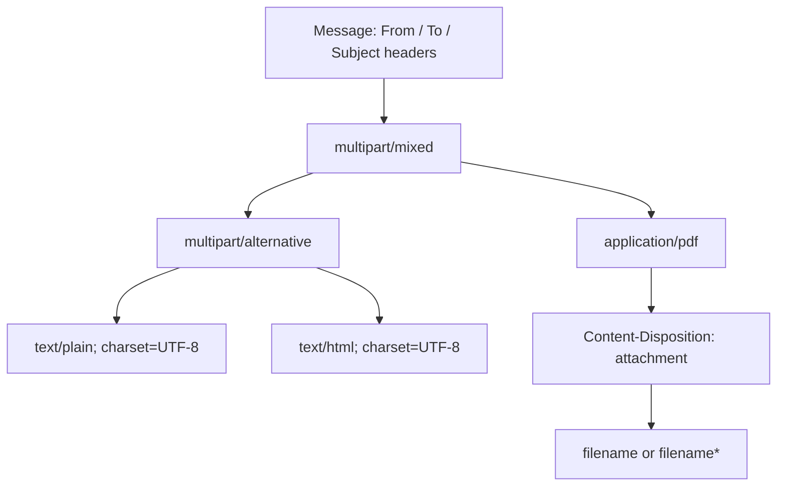
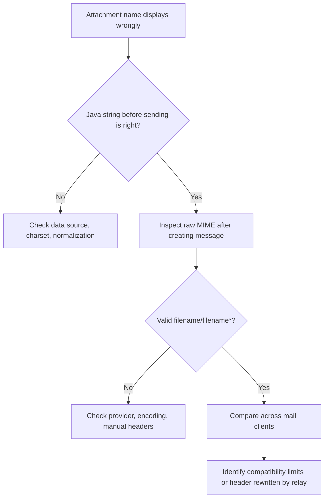

# Filename, display name, and MIME parameter encoding

When sending email from Spring Framework Mail, a Unicode string that looks completely ordinary in Java may have to be represented in an entirely different way inside the actual MIME message. A sender name **“Nhóm hỗ trợ”**, an attachment **“báo cáo tháng 11.pdf”**, the email subject, the email address domain, and HTML content may all contain Vietnamese characters, yet they are governed by **different encoding rules**.

Confusing those rules can cause the recipient to see a file name like `=?UTF-8?...?=`, names turning into garbled characters, attachments losing Vietnamese diacritics, or mail clients displaying a different name from what the application intended to send. This article explains the key name components in MIME, the RFC 2047 and RFC 2231 mechanisms, how Spring's `JavaMailSender` and `MimeMessageHelper` handle them, along with compatibility and safety principles when sending/receiving email.

## 1. “Name” in an email can mean three very different things

Suppose an application sends a PDF report to a customer:

- Sender address: `notifications@example.com`.
- Sender name the recipient sees: **Phòng Chăm sóc Khách hàng**.
- Subject: **Báo cáo tháng 11 đã sẵn sàng**.
- Attachment file name: **báo cáo tháng 11.pdf**.

These are four values with distinct roles:

| Component | Where it lives | Purpose | Mechanism to care about |
|---|---|---|---|
| **Mailbox / addr-spec** | Address in `From:`, `To:`, `Reply-To:` | Identifies the sending/receiving mailbox | Email address syntax; internationalized addresses require SMTPUTF8 infrastructure |
| **Display name / personal name** | Name portion before the address in `From:`, `To:` | Displays a person or organization name | RFC 2047 encoded-word, or direct UTF-8 when infrastructure supports relevant standards |
| **Subject** | `Subject:` header | Title/subject of the message | RFC 2047 encoded-word mechanism or UTF-8 header under suitable conditions |
| **Attachment filename** | `filename` parameter of `Content-Disposition` | Suggested name when saving the attachment | MIME parameter per RFC 2183 / RFC 2231; cross-client compatibility |
| **Content-Type name** | `name` parameter of `Content-Type` | Legacy suggested name | Does not replace the standard role of `Content-Disposition: filename` |

Therefore, **display name is not filename**, and neither is **an email address**. You cannot take the encoded output of one field and paste it verbatim into another field.

An email might be displayed as follows:

```text
Phòng Chăm sóc Khách hàng <notifications@example.com>
To: minh@example.net
Subject: Báo cáo tháng 11 đã sẵn sàng

Attachment: báo cáo tháng 11.pdf
```

That is **how the mail client presents it**. On the wire, header values may have been converted into an ASCII representation or a UTF-8 form allowed by MIME standards. The mail client decodes them before displaying.

## 2. Two headers that determine attachment file names

### 2.1. Content-Disposition and the filename parameter

The `Content-Disposition` header describes how a MIME part should be presented. For attachments, the common pattern is:

```text
Content-Type: application/pdf
Content-Disposition: attachment; filename="report.pdf"
Content-Transfer-Encoding: base64
```

Meaning:

- `Content-Type: application/pdf` states the declared content type.
- `Content-Disposition: attachment` states this is an attached part.
- `filename="report.pdf"` is the **suggested file name** for the mail-reading app.
- `Content-Transfer-Encoding: base64` specifies how the **file data** is represented for MIME transport; it does not encode the file name.

The `filename` parameter is defined in the MIME attachment context by RFC 2183. Mail clients may use it as the name when the user clicks “Download” or “Save attachment”, though it is only a suggested value. Operating systems, mail software, and security policies may alter the name or replace invalid characters.

### 2.2. Content-Type and the name parameter

In older messages, the file name was sometimes placed on `Content-Type`:

```text
Content-Type: application/pdf; name="report.pdf"
Content-Disposition: attachment; filename="report.pdf"
```

The `name` parameter is a legacy mechanism that some mail clients still read for compatibility. When generating new messages, treat **`Content-Disposition: filename` as the primary place describing the file name**, and `Content-Type: name` only as supplementary metadata if libraries or compatibility requirements call for it.

If the two headers conflict:

```text
Content-Type: application/pdf; name="report-old.pdf"
Content-Disposition: attachment; filename="report-new.pdf"
```

different mail clients may pick different names. Applications should never intentionally generate two mismatched names. When receiving emails from untrusted sources, you should be even less inclined to assume a single precedence rule enforced identically by all clients.

### 2.3. Filename does not indicate the real content type

The name `invoice.pdf` **does not prove** the payload is a PDF. A sender can misdeclare `Content-Type` or attach a fake file extension. If an application receives mail and stores files, it must distinguish:

1. **Original display name**: data used for presentation to users.
2. **Internal storage name or key**: usually a system-generated UUID/object key.
3. **Verified content type**: derived from actual inspection if the feature requires safety, not trusting the extension blindly.

Never use a sender-supplied `filename` directly as a file write path.

## 3. RFC 2047: encoding the sender's display name

The `From` header can look like:

```text
From: Support Team <notifications@example.com>
```

With Vietnamese names, environments using traditional ASCII headers need to represent the name via an **encoded-word** per RFC 2047. An encoded-word looks like:

```text
=?charset?encoding?encoded-text?=
```

Where:

- `charset` is typically `UTF-8`.
- `encoding` is typically `B` (Base64) or `Q` (an encoding similar to quoted-printable for headers).
- `encoded-text` holds the encoded content.

Example of a header using Q encoding:

```text
From: =?UTF-8?Q?Nh=C3=B3m_h=E1=BB=97_tr=E1=BB=A3?= <notifications@example.com>
```

Compatible clients decode it so the reader sees **Nhóm hỗ trợ**. In Q-type encoded-words, the underscore `_` represents a **space**; `=HH` sequences represent encoded bytes. This encoding is specific to *encoded-word*, not a general space-replacement rule across all MIME headers.

Similarly, `Subject:` can be encoded with RFC 2047. When calling `MimeMessageHelper.setSubject("Báo cáo tháng 11")`, the library builds the appropriate header according to the supplied charset; applications normally **do not need to build `=?UTF-8?...?=` strings themselves**.

### 3.1. Display name does not replace the email address

Compare:

```text
From: =?UTF-8?Q?Nh=C3=B3m_h=E1=BB=97_tr=E1=BB=A3?= <notifications@example.com>
```

The two parts carry different information:

| Part | Decoded value | Role |
|---|---|---|
| Display name | Nhóm hỗ trợ | Suggested display label, self-declared by the sender |
| Mailbox | notifications@example.com | Address used in the message to identify the mailbox |

Display names can be spoofed by senders and therefore **must not be treated as proof of identity**. Trusting the sending source also involves SPF, DKIM, DMARC, providers, and receiver policies. In particular, an organization name resembling a brand does not mean the email actually belongs to that brand.

### 3.2. Direct UTF-8 in headers cannot always be used

RFC 6532 extends the message format to allow UTF-8 in internationalized email headers; transport over SMTP also requires matching support, typically involving the **SMTPUTF8** extension defined in RFC 6531. Sending systems, relays, and related systems must have appropriate handling capabilities.

When broad compatibility with traditional email systems is required:

- Keep mailbox addresses in ASCII form if business requirements allow.
- Pass Unicode display names and UTF-8 charset to Jakarta Mail/Spring.
- Let the library encode headers using protocol-supported mechanisms.
- Do not arbitrarily enable sending raw UTF-8 headers or Unicode addresses when the provider does not yet support SMTPUTF8.

**IDN and Unicode local parts are two separate problems.** A domain with international characters can be represented in compatible ASCII form via IDNA/Punycode, whereas the part before `@` containing Unicode may require SMTPUTF8 at the protocol level. Do not think merely adding `charset=UTF-8` in the MIME body is enough to deliver to every internationalized address.

## 4. RFC 2231: encoding MIME parameters like filename

### 4.1. Why not use RFC 2047 for filename?

The `filename` parameter follows **MIME parameter** syntax, not a free-text header field. Inserting an encoded-word like:

```text
Content-Disposition: attachment;
  filename="=?UTF-8?B?...?="
```

is not the standard parameter encoding per RFC 2231. Some mail clients still attempt to decode it for compatibility with messages generated by legacy software, while other clients may display literal `=?UTF-8?...?=`.

For Unicode parameter values, the MIME standard extends syntax with **RFC 2231**:

```text
Content-Disposition: attachment;
  filename*=UTF-8''b%C3%A1o%20c%C3%A1o%20th%C3%A1ng%2011.pdf
```

A standards-supporting mail client will display:

```text
báo cáo tháng 11.pdf
```

Distinguish carefully:

- `filename`: ordinary name parameter, e.g., `filename="report.pdf"`.
- `filename*`: extended parameter holding charset, optional language info, and encoded content.
- `UTF-8''`: charset is UTF-8, language portion is empty; the two single quotes are structural delimiters, not characters belonging to the file name.
- `%C3%A1`: UTF-8 bytes represented in percent-encoding, forming the letter “á” after decoding.
- `%20`: space. Do not replace with `+` as some form URL encoders commonly do.

### 4.2. Extended syntax and language

The conceptual pattern is:

```text
parameter*=charset'language'percent-encoded-value
```

Example:

```text
filename*=UTF-8'vi'b%C3%A1o%20c%C3%A1o.pdf
```

The `vi` portion provides a Vietnamese language hint. It **does not change how UTF-8 bytes are decoded**; the charset field determines how bytes turn back into characters. Many real-world messages leave the language field empty.

Do not call `URLEncoder.encode(filename, UTF_8)` and plug it into RFC 2231 without adjustment: `URLEncoder` is designed for URL form data and uses `+` for spaces. MIME parameter encoding must follow exact RFC 2231 syntax and must not break percent signs or meaningful characters.

### 4.3. Long names and parameter continuation

RFC 2231 also defines how to split a long parameter value into multiple numbered segments:

```text
Content-Disposition: attachment;
  filename*0*=UTF-8''b%C3%A1o%20c%C3%A1o%20;
  filename*1*=th%C3%A1ng%2011.pdf
```

Segments `*0*`, `*1*` concatenate in order to form the complete name. Splitting must respect syntax and percent-encoded segments; never arbitrarily split in the middle of a `%HH` escape or byte sequence and produce a malformed header.

MIME headers can also use **line folding**: CRLF followed by a space or tab forming one logical line. Header folding and RFC 2231 parameter continuation are two different mechanisms, though they may appear together.

Do not write your own header-splitting algorithm just to send an attachment. `MimeMessageHelper` and Jakarta Mail/Angus Mail have built-in mechanisms to generate MIME structures; applications should use high-level APIs and test actual behavior on target mail clients when special compatibility requirements apply.

### 4.4. What does ASCII fallback do?

Some older systems do not understand `filename*`. If supporting them is needed, a message can supply a simple ASCII name as a fallback alongside the extended standard name:

```text
Content-Disposition: attachment;
  filename="bao-cao-thang-11.pdf";
  filename*=UTF-8''b%C3%A1o%20c%C3%A1o%20th%C3%A1ng%2011.pdf
```

The parameters express the same intended name at two representation levels. This is a **wire-format example to explain compatibility**, not a promise that Jakarta Mail will always emit both exact parameters when calling `addAttachment()`. Actual behavior depends on provider version, enabled MIME properties, and the receiving mail client.

For applications with strict compatibility constraints, testing real emails on supported clients is more important than assuming one header style works everywhere.

## 5. Quick comparison of encoding standards

| What needs encoding | Sample value | Appropriate approach | What not to do |
|---|---|---|---|
| Sender name | `Nhóm hỗ trợ` | RFC 2047 encoded-word for traditional ASCII headers; handled by library | Put into `filename*` |
| Subject | `Báo cáo tháng 11` | `setSubject` API with UTF-8; library builds header | Manually insert encoded-word and let the library encode it again |
| Attachment file name | `báo cáo tháng 11.pdf` | RFC 2231 MIME parameter via `setFileName`/`addAttachment` | Assume RFC 2047 inside `filename` is understood by all clients |
| Text/HTML content | `Xin chào, Nguyễn!` | `charset=UTF-8` and suitable Content-Transfer-Encoding | Treat body charset as the solution for filename headers |
| Address with Unicode | `tên@example.com` | Check SMTPUTF8 support and address internationalization standards | Treat an address like a display name for encoded-word |
| File name in HTTP download | `báo cáo.pdf` | Content-Disposition per HTTP standards, e.g., RFC 6266 | Copy the entire HTTP mechanism straight into MIME email |

RFC 2231 belongs to MIME email; its syntax resembles parameter extensions in HTTP, yet the two environments have distinct standards and compatibility rules. When writing an HTTP file-download endpoint, do not copy MIME attachment header handling without checking HTTP standards.

## 6. How does a file name travel through a multipart structure?

An email with a text body, an HTML body, and a PDF file is usually organized into multiple MIME parts:



Abbreviated wire-format message:

```text
From: =?UTF-8?Q?Nh=C3=B3m_h=E1=BB=97_tr=E1=BB=A3?= <notifications@example.com>
To: minh@example.net
Subject: =?UTF-8?Q?B=C3=A1o_c=C3=A1o_th=C3=A1ng_11?=
MIME-Version: 1.0
Content-Type: multipart/mixed; boundary="mix-1"

--mix-1
Content-Type: multipart/alternative; boundary="alt-1"

--alt-1
Content-Type: text/plain; charset=UTF-8
Content-Transfer-Encoding: quoted-printable

...
--alt-1
Content-Type: text/html; charset=UTF-8
Content-Transfer-Encoding: quoted-printable

...
--alt-1--
--mix-1
Content-Type: application/pdf
Content-Disposition: attachment;
 filename*=UTF-8''b%C3%A1o%20c%C3%A1o%20th%C3%A1ng%2011.pdf
Content-Transfer-Encoding: base64

JVBERi0xLjQK...
--mix-1--
```

The `JVBERi0xLjQK...` portion merely illustrates Base64 data, not a complete PDF file. Boundary values, nesting depth, folding, and header encoding generated by the library may differ. The example highlights three facts:

1. **Display name and Subject** sit on message-level headers.
2. **Filename** sits on the header of the individual attachment part.
3. **Content-Transfer-Encoding** applies to the MIME part's body; it does not govern how file name parameters are encoded.

If embedding images in HTML via `cid:...`, the image is usually a part with `Content-ID` and a `multipart/related` structure. That differs from files users actively download, even though some clients may list inline images in the attachments list.

## 7. Sending emails with Unicode display names and attachments in Spring

### 7.1. Dependency and configuration

With Spring Boot 3.x and Spring Framework Mail, you can use the starter:

```groovy
dependencies {
    implementation 'org.springframework.boot:spring-boot-starter-mail'
}
```

Example configuration for a local test SMTP server:

```yaml
spring:
  mail:
    host: localhost
    port: 1025
    default-encoding: UTF-8
    properties:
      mail:
        smtp:
          auth: false
          starttls:
            enable: false

app:
  mail:
    from: notifications@example.test
```

This configuration is suitable only for a mock SMTP server or controlled test environment. When using production SMTP, configure TLS, authentication, and secrets per your provider's requirements. `default-encoding` tells auto-configured message creation to use UTF-8 for content parts, yet **does not mean every header and every email address will be sent as raw unencoded UTF-8**.

### 7.2. Sending service with a Vietnamese sender name

Example using `MimeMessageHelper`:

```java
package com.example.mail;

import java.io.UnsupportedEncodingException;

import jakarta.mail.MessagingException;
import jakarta.mail.internet.MimeMessage;
import org.springframework.beans.factory.annotation.Value;
import org.springframework.core.io.ByteArrayResource;
import org.springframework.mail.javamail.JavaMailSender;
import org.springframework.mail.javamail.MimeMessageHelper;
import org.springframework.stereotype.Service;
import org.springframework.web.util.HtmlUtils;

@Service
public class MonthlyReportMailService {

    private final JavaMailSender mailSender;
    private final String fromAddress;

    public MonthlyReportMailService(
            JavaMailSender mailSender,
            @Value("${app.mail.from}") String fromAddress) {
        this.mailSender = mailSender;
        this.fromAddress = fromAddress;
    }

    public void sendMonthlyReport(
            String toAddress,
            String recipientName,
            byte[] pdfBytes
    ) throws MessagingException, UnsupportedEncodingException {
        MimeMessage message = mailSender.createMimeMessage();
        MimeMessageHelper helper =
                new MimeMessageHelper(message, true, "UTF-8");

        // Mailbox is the address; personal name is the display label.
        helper.setFrom(fromAddress, "Nhóm hỗ trợ");
        helper.setTo(toAddress);
        helper.setSubject("Báo cáo tháng 11 đã sẵn sàng");

        String plain = "Hello " + recipientName
                + ", the November report is attached.";
        String html = "<p>Hello <strong>"
                + HtmlUtils.htmlEscape(recipientName)
                + "</strong>, the November report is attached.</p>";
        helper.setText(plain, html);

        // Unicode file name supplied by app, not manually encoded-word.
        helper.addAttachment(
                "báo cáo tháng 11.pdf",
                new ByteArrayResource(pdfBytes),
                "application/pdf"
        );

        mailSender.send(message);
    }
}
```

Key takeaways:

- `setFrom(address, personal)` separates the real address from the display name. Jakarta Mail applies a name representation suited to configuration and charset.
- `new MimeMessageHelper(message, true, "UTF-8")` enables multipart structure and declares the desired encoding for fields/parts built by the helper.
- `setSubject(...)` accepts Unicode in Java; it does not require the application to manually insert RFC 2047 encoded strings.
- `setText(plain, html)` supplies a fallback text version and an HTML version. User-supplied content must be escaped before inserting into HTML.
- `addAttachment(filename, resource, contentType)` accepts the **attachment's display name**; let Jakarta Mail handle MIME header generation.
- `ByteArrayResource` returns a fresh stream on each request, fitting attachment APIs. Avoid single-read stream resources if the library needs to re-read the data.

For large reports, consider streaming or re-openable data sources instead of keeping an entire `byte[]` on the heap. Enforce size and file-type limits before invoking SMTP.

### 7.3. Why is SimpleMailMessage unsuitable?

`SimpleMailMessage` is an abstraction for **plain text** messages with basic fields like From, To, Subject, and Text. It does not represent multi-part MIME structures, attachments, and personal names in the same way `MimeMessageHelper` provides.

If you need:

- attachments;
- inline images;
- parallel text and HTML;
- sender display names with explicit charset;
- custom multipart structures;

then use `MimeMessage`/`MimeMessageHelper`. Do not attempt to assemble MIME headers by appending raw text strings into `SimpleMailMessage` content.

## 8. Keeping file names accurate yet safe

### 8.1. Do not pass uploaded names straight into attachments

Suppose a file name comes from a browser or partner:

```text
../../private/report.pdf
C:\users\alice\Desktop\invoice.pdf
báo cáo tháng 11.pdf
report.pdf
report.pdf<CR><LF>Content-Type: text/html
```

The application must not treat all of these as verified file names. Uploaded names can contain paths, control characters, line breaks, Unicode characters that visually reverse extensions, or abnormally long strings.

A sensible workflow:

1. Accept only files permitted for the user/business flow.
2. Store files using an internal key, never using the raw name as a storage path.
3. Produce an **attachment display name** using an explicit policy: strip path prefixes intentionally, normalize Unicode, and reject dangerous names.
4. Check size, file type, and antivirus/content scanning policies when appropriate.
5. Use `addAttachment(safeDisplayName, ...)`; never concatenate headers manually.

### 8.2. Example name normalization for strict-policy environments

This is **an illustrative policy**, not a complete filter for every operating system:

```java
package com.example.mail;

import java.text.Normalizer;

public final class AttachmentNamePolicy {

    private AttachmentNamePolicy() {}

    public static String prepareDisplayName(String supplied) {
        if (supplied == null) {
            throw new IllegalArgumentException("Missing filename");
        }

        // Accept input with Windows or Unix separators,
        // but never retain paths from the sender's machine.
        String normalizedSeparators = supplied.replace('\\', '/');
        String basename = normalizedSeparators.substring(
                normalizedSeparators.lastIndexOf('/') + 1
        );
        basename = Normalizer.normalize(
                basename, Normalizer.Form.NFC).strip();

        if (basename.isEmpty()
                || basename.equals(".")
                || basename.equals("..")
                || basename.length() > 160) {
            throw new IllegalArgumentException("Invalid filename");
        }

        for (int i = 0; i < basename.length(); i++) {
            char ch = basename.charAt(i);
            if (Character.isISOControl(ch)
                    || Character.getType(ch) == Character.FORMAT
                    || "<>:\"|?*".indexOf(ch) >= 0) {
                throw new IllegalArgumentException(
                        "Unsupported filename character");
            }
        }

        return basename;
    }
}
```

Example:

```java
String safe = AttachmentNamePolicy.prepareDisplayName(
        "C:\\reports\\báo cáo tháng 11.pdf");
// safe = "báo cáo tháng 11.pdf"

helper.addAttachment(
        safe,
        new ByteArrayResource(pdfBytes),
        "application/pdf");
```

**NFC** unifies equivalent Unicode representations, such as precomposed accented characters and base characters plus combining marks. The policy also rejects control characters and Unicode format characters that can mislead display.

For environments downloading files onto Windows, macOS, or Linux, you may also need byte-length limits, reserved device names (such as `CON` on Windows), trailing dots/spaces, duplicate-name rules, and an explicit ASCII fallback option. If the filename is user-supplied data, the UI should indicate when a name is adjusted; never silently introduce material business discrepancies.

### 8.3. Sender display name is also input requiring control

When using user-supplied display names, such as per-tenant company names, check:

- Length limits and control characters, especially CR/LF.
- Prevent tenants from arbitrarily spoofing brand names or mailboxes outside authorized scope.
- Separate the display name strictly from the From address; never accept a freeform header string such as `From: ...\r\nBcc: ...`.
- Separate sender-name presentation policy from verifying sending authorization for the domain.

Even when the library handles escaping and encoding, the application must still verify **permission to use the address** and validate business data.

## 9. Reading file names when receiving emails

Applications may receive or parse MIME to ingest documents from email. In that case, decoding runs in reverse:

```text
MIME bytes / headers from sender
    ↓
Jakarta Mail parser
    ↓
BodyPart.getFileName()
    ↓
Interpreted name value (depends on header/provider)
    ↓
Normalize, validate, store using safe key
```

Illustrative example walking through MIME parts:

```java
package com.example.mail;

import java.io.IOException;
import jakarta.mail.MessagingException;
import jakarta.mail.Multipart;
import jakarta.mail.Part;

public final class MimeAttachmentInspector {

    private MimeAttachmentInspector() {}

    public static void inspect(Part part)
            throws MessagingException, IOException {
        if (part.isMimeType("multipart/*")) {
            Object content = part.getContent();
            if (content instanceof Multipart multipart) {
                for (int i = 0; i < multipart.getCount(); i++) {
                    inspect(multipart.getBodyPart(i));
                }
            }
            return;
        }

        String originalName = part.getFileName();
        String disposition = part.getDisposition();

        if (originalName != null
                || Part.ATTACHMENT.equalsIgnoreCase(disposition)) {
            // Never write originalName directly into a file path.
            // Here you can inspect filename, size, file type,
            // and read part.getInputStream() with a byte limit.
            System.out.println("Attachment part found");
        }
    }
}
```

This snippet is an example of identifying an attachment part, **not a safe file-saving implementation**. Real-world emails also contain nested message structures, inline parts, and malformed MIME. Handling untrusted input requires bounding multipart depth, body size, total part count, decompressed size, and processing time.

### 9.1. Does getFileName always return valid Unicode?

It cannot be guaranteed for every real-world email, because:

- Senders may use standard RFC 2231 `filename*=UTF-8''...`.
- Senders may use non-standard legacy `filename="=?UTF-8?B?...?="` inside the parameter.
- Senders may emit invalid bytes or declare the wrong charset.
- Your application's provider/parser may enable or disable specific compatibility modes.

In typical Jakarta Mail software, `BodyPart.getFileName()` and its parser can decode parameters per provider configuration. Do not unconditionally call `MimeUtility.decodeText()` on every name already decoded by the library: sometimes it causes misinterpretation or **double decoding**.

If supporting legacy emails using encoded-words in parameters is mandatory, implement a **conditional** compatibility branch with sample emails and verify against your exact library version. Do not enable a global non-standard option without understanding its impact on standard emails.

### 9.2. Distinguishing filename, disposition, and Content-ID

A MIME part can have:

```text
Content-Disposition: inline
Content-ID: <company-logo>
Content-Type: image/png
```

That may be an image referenced in HTML via ``. By contrast, a file with `Content-Disposition: attachment` is usually presented as an attachment for the user to save.

However, mail clients can render differently; `inline` parts can still have names or show up in the attachment list. When an application ingests emails automatically, use business intent and part attributes—not merely `getFileName() != null`—to decide whether a file should be processed.

## 10. Easily misunderstood Jakarta Mail properties

In some Jakarta Mail/Angus Mail deployments, you may encounter compatibility options named like:

| Common property name | What does it relate to? | What to be cautious about |
|---|---|---|
| `mail.mime.encodeparameters` | Encoding MIME parameters using extended mechanisms, including RFC 2231 | Need to know library version and property scope |
| `mail.mime.decodeparameters` | Interpreting encoded MIME parameters during parsing | Do not decode a second time when the parser already handled it |
| `mail.mime.encodefilename` | Legacy compatibility encoding filename as RFC 2047 encoded-word | Historical compatibility behavior, not standard RFC 2231 |
| `mail.mime.decodefilename` | Attempting to decode encoded-word in legacy filenames | May alter results received from real-world emails |
| `mail.mime.allowutf8` | Handling raw UTF-8 in headers in specific implementations | Does not replace SMTPUTF8 support requirement on the wire |

**Do not treat these as universal Spring Boot settings you can toggle arbitrarily in every environment.** Some properties are read very early by the implementation, possibly as system properties or at class initialization; defaults and support scope depend on the Jakarta Mail/Angus Mail version and how Spring Boot configures the Session. If you need to change them, consult documentation for the exact version, set them before initializing the mail provider, and inspect the actual MIME output generated.

Preferred approach in typical applications:

1. Pass **original Unicode strings** to Spring/Jakarta Mail APIs.
2. Specify `UTF-8` charset on the helper.
3. Do not manually convert file names into encoded-words.
4. Inspect the verbatim generated MIME when hitting incompatibilities.
5. Enable legacy options only for necessary cases with regression tests.

## 11. Debugging broken file names: inspect both raw MIME and decoded values

If users report a file name turning into `báo cáo.pdf` or `=?UTF-8?B?...?=`, first locate where the bug occurs:



### 11.1. Exporting MIME for observation

You can write the constructed message to an inspection stream **in a test environment**:

```java
import java.io.ByteArrayOutputStream;
import java.nio.charset.StandardCharsets;
import jakarta.mail.internet.MimeMessage;

MimeMessage message = mailSender.createMimeMessage();
// Create MimeMessageHelper, setFrom, setSubject, addAttachment...

message.saveChanges();
ByteArrayOutputStream buffer = new ByteArrayOutputStream();
message.writeTo(buffer);

String wireSample = buffer.toString(StandardCharsets.US_ASCII);
// Use wireSample only for technical analysis in tests;
// never log complete real emails into production logs.
```

**Note:** the snippet above illustrates observation only and does not perform an SMTP send. Actual exported headers and bodies can contain confidential data, customer addresses, attachments, or tokens. Use test data only and handle debug files per data-governance policies.

Do not compare entire raw MIME outputs as immutable strings: random boundaries, line wrapping, folding, Base64/Q encoded-words, and equivalent library choices can change while remaining compliant. Checking decoded semantics and required attributes matters more.

### 11.2. Common failure modes

| Symptom | Possible cause | How to investigate |
|---|---|---|
| `báo cáo.pdf` | UTF-8 bytes decoded under another charset | Check encoding at source and receiver; inspect raw headers |
| Literal `=?UTF-8?B?...?=` appears | Used RFC 2047 in filename parameter position, or client doesn't decode legacy style | Inspect `Content-Disposition` and RFC 2231 syntax |
| File name turns into `report.pdf` | ASCII fallback present or client auto-normalized | Compare `filename`/`filename*` and client precedence |
| Name truncated mid-way | Header too long, broken continuation, or client limits | Inspect folding, `*0*`/`*1*` segments, and length |
| Two clients show two different names | Differing RFC 2231 support or two conflicting parameters | Capture raw MIME and test each mail client |
| Subject works yet attachment fails | Subject header and MIME parameters use different standards | Do not assume `setSubject()` logic applies to filenames |
| Sender name displays wrongly yet address is right | Personal name encoding bug or recipient uses Contact alias | Inspect raw `From` and the mail client's contacts configuration |
| Only emails passing through one relay fail | Relay may rewrite MIME headers or line folding | Compare before and after the relay if systems permit |

Notably, a recipient's address book can **override the displayed sender name** in the UI. Seeing a different name on a client is not sufficient proof that the `From` header was misencoded.

## 12. Testing compatibility across mail clients

A message may be RFC-compliant yet rendered differently by different email applications. A test plan needs both **protocol checks** and **real rendering checks**.

| Scenario | Test input | What to observe |
|---|---|---|
| Simple ASCII name | `report.pdf` | Not unexpectedly altered |
| Accented Vietnamese name | `báo cáo tháng 11.pdf` | Every character decodes properly |
| Mixed characters and languages | `Báo cáo 東京 2026.pdf` | Code points are preserved |
| Spaces, parentheses | `báo cáo (bản cuối).pdf` | No lost characters or broken quoting |
| Very long name | Dozens of Unicode characters | Valid header folding/continuation, no bad splits |
| Duplicate names | Two attachments both named `report.pdf` | Mail client and saving flow do not silently overwrite |
| Unicode sender name | `Nhóm hỗ trợ` | Personal name renders and decodes |
| Unicode subject | `Báo cáo quý IV` | Not double-encoded |
| Name with control chars | CR/LF, tab, bidi format | Handled by input validation policy |
| Legacy email | Filename RFC 2047-encoded in parameter | Compatibility branch does not break standard emails |

When testing at the code level, you can build a `MimeMessage` with `MimeMessageHelper` without real SMTP. After `saveChanges()`, iterate through `BodyPart`s, call `getFileName()`, check disposition and content type, and compare against expected values. An integration test through a mock SMTP server helps further verify serialization and what recipients see.

For testing with real mail, pick test mailboxes on target clients and record application version, platform, environment, and raw headers when possible. Avoid sending files with real customer data just to test file names.

## 13. Step-by-step practice with Spring Framework Mail

### Practice A — Understanding the three header groups

Create a `MimeMessage` sent from `"Nhóm hỗ trợ" <notifications@example.test>`, subject `"Báo cáo tháng 11"`, file `"báo cáo tháng 11.pdf"`, and Vietnamese body text. Identify:

1. Which header represents the display name.
2. Which header holds the Subject.
3. Which part holds the attachment name.
4. Which part requires RFC 2231 parameter encoding.
5. Which part contains Base64 binary data.

### Practice B — Comparing with an ASCII name

Send two equivalent emails:

```text
1) filename: bao-cao-thang-11.pdf
2) filename: báo cáo tháng 11.pdf
```

Inspect raw MIME, recording the actual `filename`, `filename*`, or continuation generated by the mail provider. Then open on a few email clients to compare displayed names. Both messages do not have to share identical header structures; the key criterion is that names decode accurately without producing invalid headers.

### Practice C — Distinguishing name encoding from Content-Transfer-Encoding

Use the same Unicode name while attaching:

- A PDF or ZIP file carrying binary content.
- A UTF-8 text file.

Observe `Content-Type`, `Content-Disposition`, and `Content-Transfer-Encoding` of each part. Explain why file names still must follow MIME parameter rules even though the body may use Base64, quoted-printable, or another valid encoding.

### Practice D — Receiving untrusted MIME

Simulate receiving an email from a partner, where:

```text
Content-Disposition: attachment;
 filename="../../reports/báo cáo.pdf"
```

Explain why the file cannot be saved using that path. Write a display-name normalization step, generate an independent internal storage key, enforce size limits, and validate content type.

### Practice E — Legacy email compatibility

Prepare one message with an RFC 2231 parameter filename and one legacy message using encoded-word inside the parameter. With your current Jakarta Mail/Angus Mail library, inspect `getFileName()` results and distinguish which cases decode automatically versus which require conditional support. Do not apply double decoding to all names.

## 14. Common programming mistakes

**Encoding the attachment name yourself with `MimeUtility.encodeText()` then calling `addAttachment()`.** `encodeText()` serves encoded-words in text headers, not as a general solution for the `filename` parameter. Combined with an auto-encoding provider, this can break or double-encode.

**Using `URLEncoder` as a MIME parameter encoder without handling differences.** Form encoding uses `+` for spaces, whereas RFC 2231 extensions represent bytes via percent-encoding rules matching parameter syntax.

**Assuming `charset=UTF-8` in HTML alone guarantees file names are encoded right.** Body charset and filename encoding are two separate layers.

**Putting the file name into `Content-Type: name` and ignoring `Content-Disposition`.** Some legacy clients understand it, but attachment names should be described via disposition.

**Assuming every client picks `filename*` identically.** Test target mail clients and consider ASCII fallback when compatibility requires it.

**Using the original name as the server storage path.** This is sender-controlled data; a separate storage key and input validation policy are required.

**Trusting the display name as sender identity.** Names in `From` can be spoofed; evaluate the address, domain, and authentication results independently.

**Taking an already decoded name and decoding it again unconditionally.** Some providers already handle RFC 2231; double decoding easily corrupts names, especially in non-standard emails.

**Trying to force all Unicode names into mailbox addresses.** Display names allow expressing Unicode names via header mechanisms, whereas internationalized mailbox addresses have separate SMTPUTF8 and infrastructure compatibility requirements.

## 15. Takeaways when working with MIME filenames

Start from **data semantics before choosing encoding**: email addresses for routing, display names for presenting senders, Subject for titles, `filename` for naming attached parts, and body/attachment payloads for carrying data. Sender names in traditional headers typically go through RFC 2047; file names in MIME parameters should go through RFC 2231; content bytes can be transmitted using Base64 or quoted-printable. Those are distinct encoding layers.

In Spring applications, pass **original Unicode strings** to `MimeMessageHelper.setFrom(address, personal)`, `setSubject(...)`, and `addAttachment(filename, ...)`, with UTF-8 charset and a properly configured provider. Only intervene in headers or compatibility options when a real case is confirmed via raw MIME and target mail clients. Finally, remember that both filename and display name are display data that may come from untrusted sources: they must be validated, normalized, and kept separate from identity, authorization, and internal storage paths.
