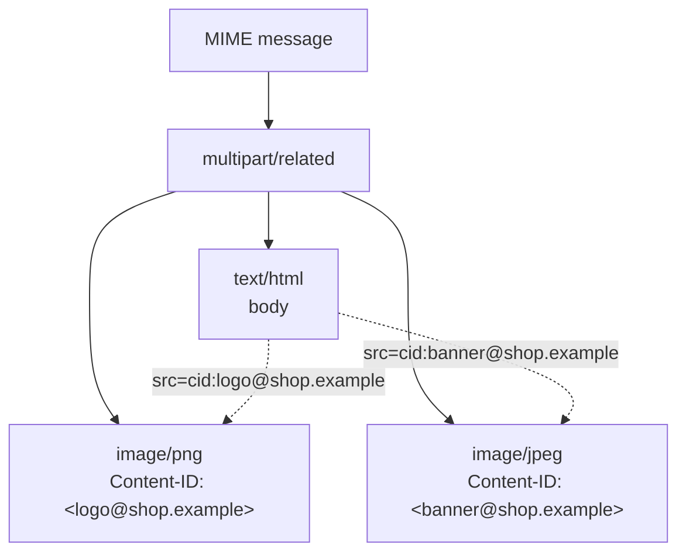

# Content-ID and `cid:` references in HTML emails

When sending an HTML email with Spring Framework Mail, an application may want to place a logo, icon, QR code, or illustration directly inside the message content. A common approach is to **embed the resource as a MIME part** and reference that part using a `cid:` URL in HTML. This mechanism relies on two cooperating components:

- **`Content-ID`** is a header on a MIME content part used to identify that content part within the message.
- **`cid:`** is the URI scheme allowing HTML in the email to point to the MIME part carrying the matching `Content-ID`.

For example, an image MIME part with header `Content-ID: <brand-logo.123@shop.example>` can be referenced in HTML by:

```html

```

The image does not need to reside at a public URL. It is transported with the email as a MIME part, and the email client then looks up the part whose ID matches `cid:` to render the content. However, **not every email client displays inline images the same way**, and Content-ID by itself does not force a mail reader to display images.

## 1. Why do HTML emails need `cid:`?

An HTML email is **message content**, not a web page whose resources are all fetched by a browser over HTTP. When HTML contains:

```html

```

the email client may have to access the network to fetch the image. Some clients block remote images by default, proxy images, or enforce custom policies. If the resource requires authentication or expires, the image may fail to appear.

With `cid:`, the application places the image file right inside the MIME structure:

```text
Email message
├── HTML body
│   └── 
└── Image MIME part
    ├── Content-Type: image/png
    ├── Content-ID: <brand-logo.123@shop.example>
    └── [binary image data, usually Base64-encoded]
```

Upon opening the email, the client decodes the MIME part and links the image to the HTML section. This mechanism is helpful for logos or images that must travel with the message, especially when avoiding dependence on remote URLs for display.

### Comparing three ways to include images in HTML email

| Approach | HTML example | Where does the image live? | Points to consider |
| --- | --- | --- | --- |
| Remote URL | `src="https://.../logo.png"` | Web server/CDN | Remote image loading may be blocked; requires network access |
| Content-ID | `src="cid:logo@shop.example"` | MIME part inside the email itself | Increases email size; depends on MIME structure and client support |
| Data URI | `src="data:image/png;base64,..."` | Base64 directly inside HTML attribute | Uneven support and many clients filter or reject it |

For emails needing broad client compatibility, `cid:` is usually more suitable than embedding large Data URIs in HTML. Even so, the design still needs a **fallback when images fail to load or are hidden**.

## 2. What does `Content-ID` actually identify?

MIME divides a message into **body parts**. Each part can carry its own headers such as `Content-Type`, `Content-Transfer-Encoding`, `Content-Disposition`, and `Content-ID`.

Example image part:

```text
Content-Type: image/png
Content-Transfer-Encoding: base64
Content-Disposition: inline; filename="logo.png"
Content-ID: <logo.2026@shop.example>

iVBORw0KGgoAAAANSUhEUg... [illustrative data]
```

`Content-ID` has syntax similar to `Message-ID`: an identifier enclosed **in angle brackets** `<...>`, often resembling an email address such as `logo.2026@shop.example`. It is **not** an email address for receiving mail and does not need to be a real mailbox. The part after `@` usually helps make the identifier sufficiently unique; it is not where an MTA looks up MX records to fetch images.

A `Content-ID` should:

1. **Match accurately** with the HTML reference, accounting for the corresponding URI syntax.
2. **Be unique across different resource parts** of a single message so clients do not pick the wrong MIME part.
3. **Remain consistent within the scope of one message**: HTML and the MIME part use the same value.
4. Be generated without containing secrets or unnecessary sensitive data.

Per `cid:` URI conventions, the ID in the URL is taken from the `Content-ID` value **without `<` and `>`**. If the ID contains characters requiring URI encoding, the value in `cid:` needs proper percent-encoding. Using simple IDs with letters, digits, hyphens, dots, and `@` avoids confusion.

For emails built with Spring, you normally only pass the ID name (e.g., `logo@shop.example`) to `MimeMessageHelper.addInline(...)`; the helper sets the `Content-ID` header on the part. Do not add `<...>` yourself to the argument if the API already does so.

### How does `Content-ID` differ from other headers and URLs?

| Attribute | Function | Determines `cid:` linkage? |
| --- | --- | --- |
| `Content-ID` | Identifies a MIME body part | **Yes; it is the key that must match `cid:`** |
| `Content-Type` | Indicates data is `image/png`, `image/jpeg`, `text/html`, ... | Does not identify; helps client interpret data |
| `Content-Disposition` | Suggests `inline` or `attachment` display | Does not replace Content-ID; can affect client presentation |
| `Content-Transfer-Encoding` | How data is encoded on the wire (e.g., Base64) | Not an ID; only for decoding |
| `Content-Location` | May associate a location/URI with a part per related MIME mechanisms | Different referencing mechanism, not identical to Content-ID |
| `Message-ID` | Identifies the **entire email** | Not an image/part ID |
| `src="https://..."` | Points to a remote resource URL | Does not reference a MIME part by CID |

An image having filename `logo.png` does not mean HTML can use `src="cid:logo.png"`. **File name, part name, and Content-ID are distinct values.**

## 3. How does `cid:` work in HTML?

In email HTML, a `cid:` URI can appear inside an image's `src` attribute:

```html
<table role="presentation" cellpadding="0" cellspacing="0">
  <tr>
    <td>
      
    </td>
    <td>
      <strong>Your order has been confirmed</strong>
    </td>
  </tr>
</table>
```

When rendering the email, the client attempts to find a MIME part with the header:

```text
Content-ID: <logo.2026@shop.example>
```

If the part is found and the media type is supported, the client can use the part's content to render the image. If not found, the image usually appears broken, hidden, or replaced by `alt`, depending on application and policy.

### Do not write `cid:` like an HTTP URL

All of the following have issues:

```html
<!-- Wrong: adding angle brackets into the cid URI -->
" alt="Logo">

<!-- Wrong: cid is not a web protocol path -->


<!-- Wrong if the actual MIME part carries a different Content-ID -->

```

Standard usage:

```html

```

`cid:` will not cause a web browser to load images if you open the HTML file standalone outside email. A browser has no accompanying MIME parts to resolve. Hence, inspecting an HTML file on a web server only verifies HTML layout, **not Content-ID linkage inside an email message**.

## 4. MIME structure required for embedding images

Two MIME parts sitting next to each other are not enough for all email clients to understand they are related. The structure typically used to combine HTML with embedded images is **`multipart/related`**.



`multipart/related` states that multiple content parts **combine to form a single logical document**. HTML is the root content part, while the images are supporting resources referenced by HTML.

### An illustrative MIME message

```mime
MIME-Version: 1.0
From: notifications@shop.example
To: customer@example.net
Subject: Welcome to Shop
Content-Type: multipart/related; boundary="related-123"; type="text/html"

--related-123
Content-Type: text/html; charset=UTF-8
Content-Transfer-Encoding: quoted-printable

<html>
  <body>
    <p>Welcome!</p>
    
  </body>
</html>

--related-123
Content-Type: image/png
Content-Transfer-Encoding: base64
Content-Disposition: inline; filename="logo.png"
Content-ID: <welcome-logo@shop.example>

[Base64-encoded PNG data, abbreviated for illustration]
--related-123--
```

This is a **MIME syntax diagram for learning**, not a ready-to-use `.eml` file: the Base64 payload has been omitted, and line-wrapping/header encoding has been simplified. A real message has actual MIME boundaries, CRLF, and `Content-Transfer-Encoding` values matching real data.

In this example:

- The `Content-Type: multipart/related` header forms a group of related parts.
- The first part contains HTML referencing `cid:welcome-logo@shop.example`.
- The second part is a PNG image, with `Content-ID: <welcome-logo@shop.example>`.
- `Content-Disposition: inline` suggests this is inline content in the message; the `Content-ID` value remains what `cid:` uses to locate the image.
- `Content-Transfer-Encoding: base64` enables carrying binary image data across SMTP/MIME infrastructure.

### When plain text, HTML, and attachments are all present

In real-world emails, include a **plain text fallback** for clients or users that do not render HTML. Meanwhile, an attached PDF file is an independent attachment, not an image serving HTML. The MIME tree usually has nested layers:

```text
multipart/mixed
├── multipart/related
│   ├── multipart/alternative
│   │   ├── text/plain
│   │   └── text/html     <-- 
│   ├── image/png         <-- Content-ID: <logo@shop.example>
│   └── image/jpeg        <-- Content-ID: <banner@shop.example>
└── application/pdf       <-- attachment, no cid needed
```

This is a **common logical structure**; JavaMail/Spring and email clients may generate or handle other suitable MIME tree variants. Three distinct meanings:

1. **`multipart/alternative`:** one piece of content with multiple representations for the client to pick from, typically `text/plain` and `text/html`.
2. **`multipart/related`:** groups HTML with inline resources referenced by HTML.
3. **`multipart/mixed`:** combines the main message section with independent attachments.

Putting an image file merely as an `attachment` inside `multipart/mixed` and adding `src="cid:..."` in HTML may still render in some clients, yet has poorer compatibility than a purpose-built `multipart/related` structure.

## 5. Sending HTML emails with inline images using Spring Framework Mail

Spring Framework Mail provides `JavaMailSender` to send mail via Jakarta Mail. For HTML, inline images, and attachments, the commonly used API is **`MimeMessageHelper`**.

If using Spring Boot, you can configure SMTP with the dependency:

```groovy
dependencies {
    implementation 'org.springframework.boot:spring-boot-starter-mail'
}
```

Example submission configuration:

```yaml
# application.yml
spring:
  mail:
    host: smtp.provider.example
    port: 587
    username: ${SMTP_USERNAME}
    password: ${SMTP_PASSWORD}
    properties:
      mail:
        smtp:
          auth: true
          starttls:
            enable: true
            required: true
          connectiontimeout: 5000
          timeout: 10000
          writetimeout: 10000
```

The server here is the **SMTP submission relay**, not an image-hosting URL or the domain inside `Content-ID`. Credentials should come from the deployment environment's secret configuration.

### Complete example: logo image from classpath

Suppose the project resource is at:

```text
src/main/resources/
└── mail/
    └── images/
        └── brand-logo.png
```

Mail-sending service:

```java
package com.example.mail;

import java.nio.charset.StandardCharsets;
import java.util.UUID;

import jakarta.mail.MessagingException;
import jakarta.mail.internet.MimeMessage;

import org.springframework.core.io.ClassPathResource;
import org.springframework.core.io.Resource;
import org.springframework.mail.javamail.JavaMailSender;
import org.springframework.mail.javamail.MimeMessageHelper;
import org.springframework.stereotype.Service;

@Service
public class WelcomeMailService {

    private final JavaMailSender mailSender;

    public WelcomeMailService(JavaMailSender mailSender) {
        this.mailSender = mailSender;
    }

    public void sendWelcome(String recipientAddress) throws MessagingException {
        MimeMessage message = mailSender.createMimeMessage();

        MimeMessageHelper helper = new MimeMessageHelper(
                message,
                MimeMessageHelper.MULTIPART_MODE_MIXED_RELATED,
                StandardCharsets.UTF_8.name());

        helper.setFrom("notifications@shop.example");
        helper.setTo(recipientAddress);
        helper.setSubject("Welcome to Shop");

        // The same ID value must appear in both HTML and the MIME part.
        String logoCid = "logo-" + UUID.randomUUID() + "@shop.example";

        String plainText = "Welcome to Shop!";
        String htmlText = """
                <html>
                  <body>
                    <p>Welcome to Shop!</p>
                    
                  </body>
                </html>
                """.formatted(logoCid);

        // Set the HTML body before adding inline resources.
        helper.setText(plainText, htmlText);

        Resource image = new ClassPathResource("mail/images/brand-logo.png");
        helper.addInline(logoCid, image, "image/png");

        mailSender.send(message);
    }
}
```

This snippet relies on Java support for text blocks and `String.formatted(...)` (both available in Java 21), Jakarta Mail, and Spring Framework Mail. Calling `send(...)` requires a ready SMTP server; writing the service does not create a mail server itself.

Key steps:

1. **`createMimeMessage()`** creates a MIME message rather than a simple text email.
2. **`MULTIPART_MODE_MIXED_RELATED`** allows creating a combined structure for HTML, related resources, and attachments if needed.
3. **`setText(plainText, htmlText)`** provides both plain text and HTML representations.
4. **`addInline(logoCid, image, "image/png")`** attaches the image as an inline MIME part, setting `Content-ID` and proper type.
5. **`send(message)`** submits the email over SMTP. MTAs transfer the entire MIME message; image rendering occurs in the email client.

**Call order matters:** with `MimeMessageHelper`, call **`setText(...)` before `addInline(...)`**. The helper's documentation recommends this order because some mail readers may fail to resolve inline resources properly if the order is reversed.

### Why does the example generate one Content-ID per email?

`logoCid` is generated once when creating the email, then used in both HTML and `addInline`. Thus the two references always match within the same message and reduce the risk of duplicate IDs across emails. Using a system-controlled domain in the identifier is a useful convention, yet **that domain part is not a network address to fetch images from**.

For simple examples, a fixed ID like `logo` can also be used in each message as long as the MIME part carries the matching ID. When a system has many images and many email templates, generating unique IDs and sharing them via variables makes maintenance easier.

## 6. Embedding multiple images in the same email

Suppose HTML needs a logo and a QR code. Each image needs **its own Content-ID** and a corresponding MIME part:

```java
MimeMessage message = mailSender.createMimeMessage();
MimeMessageHelper helper = new MimeMessageHelper(
        message, MimeMessageHelper.MULTIPART_MODE_MIXED_RELATED, "UTF-8");

helper.setFrom("tickets@shop.example");
helper.setTo("customer@example.net");
helper.setSubject("E-ticket");

String logoCid = "logo-" + UUID.randomUUID() + "@shop.example";
String qrCid = "qr-" + UUID.randomUUID() + "@shop.example";

String html = """
        <html><body>
          
          <p>Here is your ticket QR code:</p>
          
        </body></html>
        """.formatted(logoCid, qrCid);

helper.setText("Your ticket is ready. Open the HTML version to view the QR code.", html);

helper.addInline(
        logoCid, new ClassPathResource("mail/images/brand-logo.png"), "image/png");
helper.addInline(
        qrCid, new ByteArrayResource(qrPngBytes), "image/png");

mailSender.send(message);
```

The illustrative snippet assumes `qrPngBytes` was generated within business logic; you must import `org.springframework.core.io.ByteArrayResource`, `ClassPathResource`, and the Jakarta/Spring classes as in the prior example. `ByteArrayResource` is a suitable choice when image data is generated in memory: the resource can re-supply streams from the byte array if the mail library needs to read multiple times.

For QR codes carrying sensitive data such as tickets or login links, control expiration and email forwarding risk. Do not put secret tokens into **Content-ID**; tokens, if any, belong in content protected by business design, because an email can still be copied or forwarded.

### Generating `Content-ID` from a template

In systems using a template engine, you can pass `logoCid` into the model and render the image attribute from the variable:

```html
<!-- Thymeleaf syntax example -->

```

Once the template renders, the actual value looks like `cid:logo-...@shop.example`. The application must pass **the exact rendered value** into `helper.addInline(logoCid, ...)`. If HTML is rendered from user data, escape content properly; never allow users to inject arbitrary raw HTML into emails without sanitization.

## 7. Inline image vs. attachment: similar data, different intent

In Spring, the following two APIs differ in meaning:

```java
// Resource referenced by HTML via cid:
helper.addInline("brand-logo@shop.example",
        new ClassPathResource("mail/images/brand-logo.png"), "image/png");

// File downloaded/attached independently by the recipient
helper.addAttachment("invoice.pdf",
        new ClassPathResource("mail/docs/invoice.pdf"));
```

| Comparison point | `addInline(...)` | `addAttachment(...)` |
| --- | --- | --- |
| Purpose | Resource serving HTML content | File sent alongside for reader to view/download |
| Reference in HTML | Uses `cid:<id>` | Has no automatic `cid:` link |
| Typical MIME headers | `Content-ID`, `Content-Disposition: inline` | `Content-Disposition: attachment`, filename |
| Position in structure | `multipart/related` group | `multipart/mixed` group |
| Display | Can be rendered inside HTML | Usually appears as an attached file |

Some email clients still display a paperclip icon when a message contains inline images, or allow saving inline images as files. That is **how the client displays it**, not proof that the application mistakenly called `addAttachment`.

Conversely, an ordinary attachment may carry a Content-ID in some messages created by other systems; looking at filename or `Content-Disposition` alone is insufficient to conclude how HTML references it.

## 8. Understanding `MimeMessageHelper` multipart modes

`MimeMessageHelper` has several multipart modes for creating the MIME tree. Your choice affects how well clients recognize inline resources:

| Mode | Structural idea | When to consider |
| --- | --- | --- |
| `MULTIPART_MODE_NO` | No multipart created | Simple text emails; **do not use for `addInline`** |
| `MULTIPART_MODE_RELATED` | Content + inline resources in `multipart/related` | When grouping HTML and directly related images |
| `MULTIPART_MODE_MIXED` | Parts inside `multipart/mixed` | May suit some clients, yet inline/attachment may get mixed in presentation |
| `MULTIPART_MODE_MIXED_RELATED` | `multipart/mixed` wrapping a `multipart/related` group | Combining HTML, inline images, and attachments; usually the right choice |

Example:

```java
MimeMessageHelper helper = new MimeMessageHelper(
        message, MimeMessageHelper.MULTIPART_MODE_MIXED_RELATED, "UTF-8");
```

The constructor using `multipart=true` is also common; when wanting to **state the desired MIME structure explicitly**, passing the multipart mode constant is clearer to read. Final display still depends on the email client, because MIME structures can be interpreted differently across clients.

In some messages with plain text, HTML, images, and attachments, the helper may create `multipart/alternative`, `multipart/related`, `multipart/mixed` layers. Developers should inspect the actual generated email file when hitting client-specific bugs, rather than solely deducing the tree from the number of `addInline` calls.

## 9. What goes into `Content-ID`?

One ID-generation strategy combines **resource name + unique value + conventional domain**:

```java
String cid = "banner-" + UUID.randomUUID() + "@shop.example";
```

Example output:

```text
banner-2f41c677-4166-4f6a-8594-6d1973c90e07@shop.example
```

This identifier is for internal linking inside the message. Do not use it as a public URL or try to query DNS for `shop.example` to fetch the image.

### Consistency rules

- In the MIME header: `Content-ID: <banner-...@shop.example>`.
- In HTML: ``.
- When calling `addInline`: pass the string **without `<`, `>`, and without the `cid:` prefix**.
- Each distinct image in a message should have its own ID; HTML can reference **the same** MIME part multiple times if repeating the same image.
- If building MIME manually outside the helper, ensure brackets, URI encoding, and MIME headers conform to standards.

**Note on uniqueness:** the MIME standard allows duplicate IDs in special alternative structures representing the same logical content. However, when embedding multiple HTML images yourself, choosing a unique ID per image is a simple practical rule that reduces ambiguity and avoids depending on how clients resolve duplicate IDs.

## 10. Common errors that stop `cid:` images from displaying

### 10.1. Mismatch between URL and header

```html
<!-- In HTML -->

```

```text
# In MIME part
Content-ID: <brand-logo@shop.example>
```

The two values differ, so the client cannot locate a part for `cid:header-logo@shop.example`. The fix is to create the ID once and reuse it in both HTML and `addInline`.

### 10.2. Putting `<...>` into `src` or `addInline` by mistake

The header value usually has brackets; the `cid:` URI and `addInline` argument only want the inner ID. Passing `addInline("<logo@shop.example>", ...)` can make the helper add another pair of brackets, producing a malformed/mismatched header. Distinguish each place's syntax.

### 10.3. Forgetting to create a multipart message

Using `SimpleMailMessage` or creating a helper without multipart enabled and calling `addInline` will fail to build the needed MIME tree. Use `MimeMessage` with a suitable multipart mode:

```java
MimeMessage message = mailSender.createMimeMessage();
MimeMessageHelper helper = new MimeMessageHelper(
        message, MimeMessageHelper.MULTIPART_MODE_MIXED_RELATED, "UTF-8");
```

### 10.4. Adding inline resources before `setText(...)`

```java
// Recommended order:
helper.setText(plainText, htmlText);
helper.addInline(cid, resource, "image/png");
```

Some mail readers may not resolve images properly when MIME part order or structure is built incompatibly. Calling `setText` before `addInline` is the recommended Spring practice.

### 10.5. Resource does not exist or cannot be re-read

For instance, `new ClassPathResource("mail/images/logo.png")` only works if the file actually sits on the runtime classpath and was packaged into the application. Check the relative path under `src/main/resources`, case sensitivity in deployment environments, and resources inside the JAR.

If the image is dynamically generated data, use `ByteArrayResource` instead of a single-read stream. Jakarta Mail may need to reopen the stream while packaging/sending the MIME message; non-repeatable resources easily cause errors or empty content.

### 10.6. Wrong Content-Type or corrupt file

A PNG part should have `Content-Type: image/png`, JPEG uses `image/jpeg`, GIF uses `image/gif` when supported by clients. If the source file is malformed, changing the MIME label will not fix the content. Validate the format and size of embedded files.

### 10.7. HTML stripped by email client

Some clients strip `style`, SVG, scripts, background images, or unsafe HTML attributes. `cid:` inside `` may work while `background-image: url(cid:...)` in CSS fails to show in another client. Prefer basic `` tags with `alt`, explicit dimensions, and layouts that do not depend strictly on images.

### 10.8. Mistaking missing images for SMTP failure

An SMTP relay may have returned `250` and delivered the email successfully, yet the email client still does not render images due to MIME structure or display policies. That is a **client-side MIME/HTML rendering** issue, not necessarily a mail-delivery error. Inspect the raw MIME source or `.eml` file of the received email.

### Quick isolation table

| Symptom | Possible cause | How to check |
| --- | --- | --- |
| Shows `alt` text, no image | Mismatched `cid:` or missing part | Compare `src` with `Content-ID` in MIME |
| Image appears as a paperclip file | Client presents inline part as attachment | Check MIME tree, `related`, `Content-Disposition` |
| Only one image fails | Wrong ID, wrong Content-Type, or corrupt resource | Inspect that specific MIME part |
| All inline images fail | Broken MIME structure or unsupported client | Check `multipart/related` and test another client |
| Image works in web preview, fails in email | Web preview lacks MIME parts | Open real email, inspect `.eml` source |
| Works locally, missing when deployed | Classpath resource missing from JAR or wrong path | Inspect packaged resources |
| Email rejected as too large | Multiple inline images create Base64 overhead | Measure packaged MIME size |
| Gmail/Outlook/mobile behave differently | Differing rendering and security rules | Test on target clients with real MIME messages |

## 11. How to inspect MIME content for diagnosis

When `cid:` images fail to show, reading the email source is more helpful than looking at HTML alone. Many email clients provide **Original / Show source / View message source** or saving the message as `.eml`.

In a sent/received message, verify:

1. `MIME-Version: 1.0` and `Content-Type` headers of the message.
2. Whether the MIME tree has a `multipart/related` group containing HTML and images.
3. Which exact `src="cid:<id>"` the HTML part contains after template rendering.
4. Whether a corresponding MIME part has a matching `Content-ID: <id>`.
5. Whether the image part has a sensible `Content-Type` and real data.
6. If `multipart/alternative` is present, whether HTML sits in the content branch picked by the client.
7. Whether the client blocks images, strips HTML elements, or alters the message upon forwarding.

Example of a minimal pair to look for:

```text
HTML body:
  

Image MIME part:
  Content-ID: <logo-123@shop.example>
  Content-Type: image/png
  Content-Disposition: inline
```

If HTML is right yet no MIME part exists, inspect `addInline`, resources, and message construction. If both HTML and the MIME part match, the issue may lie in **multipart structure** or the **email client**. If no email arrives at all, it is an SMTP submission/delivery problem to solve before diagnosing rendering.

Enabling Jakarta Mail debug logs (`mail.debug`) can show SMTP steps, yet SMTP logs **do not necessarily include sent MIME content** and can expose sensitive metadata. If you need to inspect `.eml`, do so in a secure environment using test addresses/data and avoid writing passwords, tokens, or personal data to public logs.

### Saving raw `.eml` in development

In an internal test environment, you can build a `MimeMessage`, populate content via `MimeMessageHelper`, and write it to a stream/file before sending:

```java
import java.io.OutputStream;
import java.nio.file.Files;
import java.nio.file.Path;

import jakarta.mail.internet.MimeMessage;

// message has been populated using MimeMessageHelper.
message.saveChanges();

try (OutputStream out = Files.newOutputStream(Path.of("sample-mail.eml"))) {
    message.writeTo(out);
}
```

This snippet illustrates **inspecting the packaged structure**, not a mandatory step in production sending flows. Sample message data must be safe to store on a dev machine; never save real emails containing sensitive data this way. The source file can contain Base64 image data, HTML content, and recipient addresses.

## 12. Choosing inline images for real-world needs

Not every image should be embedded as a MIME part. Inline images usually fit **small logos, key icons, or images generated specifically by the app for the message**. Large decorative background images bloat the email, render inconsistently on some clients, and can hit mail size limits.

A few practical guidelines:

- **Reduce image size before embedding.** With Base64 encoding, size grows by roughly one-third over raw bytes, not counting line wrapping, MIME headers, and remaining parts.
- **Provide text fallback.** Essential details like order numbers, appointment times, and support codes must appear as text, not inside images alone.
- **Include `alt` and image dimensions.** This keeps content understandable when images are hidden and reduces layout shifts.
- **Respect the email rendering environment.** Email HTML is not supported as completely as browser HTML; CSS, responsive layouts, and inline image support vary by client.
- **Use trusted images only.** If accepting user-uploaded images, validate media type, size, and process data per system security policies.
- **Keep sensitive data out of IDs and HTML.** CID is an internal linking identifier, not a data-protection mechanism. Emails can be saved, forwarded, or downloaded as `.eml`.
- **Be careful with forward/reply.** Clients may alter or drop MIME parts when forwarding, leaving old HTML `cid:` links without accompanying parts.

### When to use a remote URL instead of `cid:`?

Remote URLs can fit large marketing graphics, frequently updated images, or content that does not need to be packaged inside the email. They reduce email size while depending on network connectivity and client image-loading policies. For small logos or images meant to stay tightly coupled to the message content, `cid:` is a strong option. No approach guarantees 100% image rendering across every mail-reading app.

## 13. Commonly confused questions

**1. Is `Content-ID` the email's `Message-ID`?**

No. `Message-ID` represents the email message, while `Content-ID` identifies a single MIME body part (such as a logo) within the message. An email can have one Message-ID and multiple Content-IDs.

**2. Is a real domain needed in Content-ID?**

You should format IDs like `logo.<unique>@shop.example` for uniqueness. The domain inside the ID is an identifier component; it does not trigger DNS MX lookups or require an image server at that domain.

**3. Should HTML write `cid:<logo@shop.example>` to match the header?**

No. HTML normally writes `cid:logo@shop.example`; the `<...>` brackets belong to `Content-ID` header syntax.

**4. Does `MimeMessageHelper.addInline(...)` fetch the image from `cid:`?**

No. `addInline` takes a resource the application already has (such as `ClassPathResource` or `ByteArrayResource`) and puts it into a MIME part. `cid:` is the reference used when reading/rendering the email.

**5. Why do inline images still appear as attachments?**

Email clients have the right to present MIME parts their own way. Check `multipart/related` structure, `Content-Disposition`, and client support; a paperclip icon does not by itself prove Content-ID is wrong.

**6. Can one CID be reused in two places in HTML?**

Yes. Two `` tags can reference the same MIME part. However, if they are two **different** images, use two distinct IDs and two inline parts.

**7. If Spring `send()` succeeds, will the image definitely render?**

No. Success of `send()` reports the submission result at that moment; it does not guarantee final delivery or how email clients render HTML/MIME.

**8. When using `setText(plainText, htmlText)`, does the plain text version have images?**

No. Plain text does not render HTML `` tags. Write core information in text and treat images as enhancements when the client chooses HTML.

## Conclusion

**`Content-ID` is the MIME part's identifier; `cid:` in HTML is how that part is referenced.** For an image to appear inside Spring email content, the application must create a multipart `MimeMessage` appropriately, write HTML containing `src="cid:<id>"`, and call `MimeMessageHelper.addInline(id, resource, contentType)` with **the same ID**. `multipart/related` expresses the relationship between HTML and resources; `multipart/alternative` supplies a plain text fallback; `multipart/mixed` handles independent attachments. If an image fails to display, inspect the raw MIME message, `Content-ID` values, MIME tree, image data, and email client policies before assuming SMTP failed to send.
