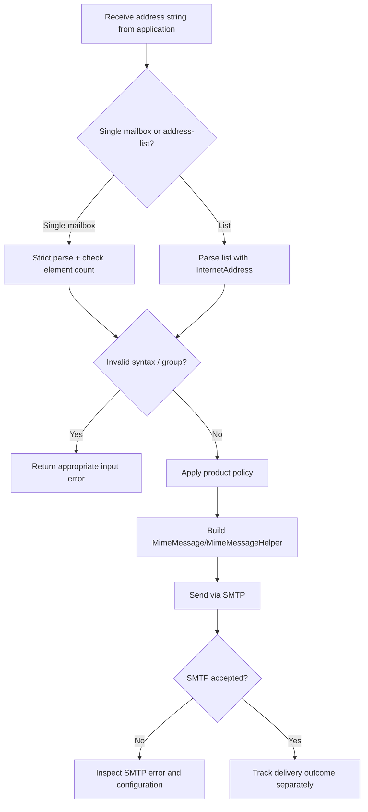

# InternetAddress and Email Address Syntax

In **Spring Framework Mail**, whenever an application sets a sender, recipient, or reply-to address, it is working with a **mailbox address**. An email address may look simple like `alice@example.org`, yet headers such as `From` and `To` can also contain **display names**, multiple addresses, or structures permitted by email standards.

Jakarta Mail provides the `jakarta.mail.internet.InternetAddress` class to represent and process these addresses. Spring Mail uses `InternetAddress` alongside `MimeMessage` and `MimeMessageHelper` when building messages. Understanding address syntax helps prevent parsing errors, distinguish a display name from the actual address, and avoid confusing syntax validation with verifying that an email exists.

## 1. What Are the Parts of an Email Address?

In its most common form:

```text
alice@example.org
│     │
│     └── domain (mail-receiving domain)
└──────── local-part (mailbox name within the domain)

Structure: local-part@domain
```

- **Local-part:** the part before the `@` sign, defined by the receiving domain's mail system. Examples include `alice`, `support`, `first.last`, or `first+news`.
- **Domain:** the part after `@`, used to identify the domain responsible for receiving mail. Examples include `example.org` or `mail.example.net`.
- **Mailbox:** an address representing a mailbox or mail delivery destination at a domain. In common usage, it consists of `local-part@domain` and may include a display name.

Common examples:

| String | Meaning |
|---|---|
| `alice@example.org` | Simple email address. |
| `first.last@example.org` | Local-part containing a dot. |
| `first+promo@example.org` | Local-part containing a plus sign; the meaning of the plus sign depends on the provider. |
| `team@sub.example.org` | Mailbox at a subdomain. |
| `"Linh Nguyen" <linh@example.org>` | **Mailbox with a display name** and the address enclosed in angle brackets. |
| `"Nguyen, Linh" <linh@example.org>` | Display name contains a comma, so it is enclosed in double quotes. |

**Angle brackets** `<...>` in a header enclose the actual address; the part preceding them is the *display name*, not the local-part. For example, `"Customer Care" <support@example.org>` has the address `support@example.org`, while `Customer Care` is the name visible to the recipient.

### Input Field Addresses and Header Addresses Are Not Identical

Users typically enter a simple **addr-spec**, such as `alice@example.org`. However, an email header can contain a complete **mailbox**:

```text
From: "Example Service" <no-reply@example.org>
To: Alice <alice@example.org>, Bob <bob@example.net>
Reply-To: helpdesk@example.org
```

The `To` header in the example above is a **mailbox list**, not a single address. Spring/Jakarta Mail needs to parse the structure properly to determine which part is the display name and which part is the email address.

## 2. Important Syntax Rules

Internet mail address syntax is described in standards such as **RFC 5322** (message/header format) and related SMTP specifications. Real-world systems also enforce their own policies, so you should distinguish between **syntax allowed by the standard** and **common addresses accepted by providers**.

### 2.1. A Local-Part Is Not an Arbitrary String

For a local-part **not enclosed in double quotes**, common ASCII characters include letters, digits, and certain allowed special characters. Dots have specific restrictions:

- Cannot appear at the beginning of the local-part: `.alice@example.org` is not a valid dot-atom form.
- Cannot appear at the end of the local-part: `alice.@example.org` is not a valid dot-atom form.
- Cannot have two consecutive dots in the dot-atom form: `alice..smith@example.org` is invalid in this form.

Examples:

```text
alice@example.org              # common
alice.smith@example.org        # common
alice+orders@example.org       # common
"sales team"@example.org       # local-part with a space, quoted according to mail syntax
alice..smith@example.org       # invalid dot-atom syntax
```

A **quoted local-part** such as `"sales team"@example.org` is permitted by the standard syntax, yet many account registration forms or mail providers do not support it well. Do not equate "valid according to an RFC form" with "usable across every system."

In particular, do not automatically strip dots or everything after a plus sign to "normalize" an address. Such alias rules depend on each mail service; applying them globally can mistakenly merge two different mailboxes.

### 2.2. Domains Have Their Own Rules

In common addresses, a domain consists of labels separated by dots:

```text
user@notify.example.org
      └──┬──┘ └─┬─┘
        sub     domain
```

Domains are **case-insensitive** during DNS lookups; however, **local-parts may be case-sensitive according to the standard**, even though many providers do not treat them that way in practice. Therefore, you should not convert an entire address to lowercase by default when comparing user identities.

Some email syntaxes also allow a **domain-literal**, such as `user@[192.0.2.1]`, though this is not a common format for public mailboxes. In consumer-facing products, you can add a policy that only accepts DNS domain names suited to your requirements.

### 2.3. Size Limits and International Characters

Mail protocols impose length limits measured in **octets (bytes)**—for example, a traditional local-part has a maximum of 64 octets. Protocol limits do not necessarily match product limits or provider-imposed limits.

Display names can contain Vietnamese characters, for example **“Nguyễn Thảo”**, and the mail library will encode the header accordingly. **Addresses with Unicode characters in the local-part** are a different case, involving internationalized email extensions such as **SMTPUTF8**. Do not assume that merely setting UTF-8 in `MimeMessageHelper` means every SMTP relay will accept `người@example.org`.

Internationalized domain names (IDN) also need to be processed according to IDNA/Punycode rules where appropriate. Standard Java code example:

```java
import java.net.IDN;

String asciiDomain = IDN.toASCII("münich.example");
String address = "user@" + asciiDomain;
```

This illustrates converting the **domain part** to ASCII form. You cannot handle every email by splitting the string at the first `@` sign, because quoted local-parts in the full syntax have special cases. For applications that only accept common addresses, clearly define the supported syntax subset and handle it consistently.

## 3. What Does `InternetAddress` Represent?

The `jakarta.mail.internet.InternetAddress` class is an implementation of `jakarta.mail.Address` for Internet mail format addresses. It can store:

- **Address:** the mailbox address, e.g. `alice@example.org`.
- **Personal:** the display name, e.g. `Nguyễn Thảo`.
- Information needed to **parse**, **validate**, and **reformat** a mailbox or address list.

Example:

```java
import jakarta.mail.internet.InternetAddress;
import java.io.UnsupportedEncodingException;

public class AddressDemo {
    public static void main(String[] args)
            throws UnsupportedEncodingException {

        InternetAddress recipient = new InternetAddress(
                "thao@example.org",
                "Nguyễn Thảo",
                "UTF-8"
        );

        System.out.println(recipient.getAddress());
        System.out.println(recipient.getPersonal());
        System.out.println(recipient.toString());
        System.out.println(recipient.toUnicodeString());
    }
}
```

Method meanings:

| API | Meaning |
|---|---|
| `getAddress()` | Gets the address part, such as `thao@example.org`. |
| `getPersonal()` | Gets the display name as a Java string, such as `Nguyễn Thảo`. |
| `toString()` | Formats the address for use in a header; names with non-ASCII characters may be represented using appropriate MIME header encoding syntax. |
| `toUnicodeString()` | Produces a more readable representation with a Unicode name for inspection or display in the application. |
| `validate()` | Checks the syntactic structure of the address object; may throw `AddressException`. |
| `isGroup()` | Indicates whether the object represents a group of addresses using group syntax. |
| `InternetAddress.parse(...)` | Parses an address list into an `InternetAddress[]` array. |

`getPersonal()` does not always return a value: an address like `alice@example.org` without a display name usually has a personal name of `null`.

### Why Does Display Name Encoding Need Handling?

A raw header sent through traditional mail systems follows specific encoding rules. When using:

```java
new InternetAddress("thao@example.org", "Nguyễn Thảo", "UTF-8");
```

Jakarta Mail can encode the display name into an **encoded-word** following MIME rules when generating the header, while `getPersonal()` returns a convenient Unicode string for Java code. This differs from enabling SMTPUTF8 for the **email address itself**. A Unicode display name and a Unicode local-part are two separate technical requirements.

In Spring Mail, prefer APIs that accept a personal name and charset rather than manually concatenating header strings.

## 4. Creating a Mailbox from a String

### 4.1. Creating from a Simple Address

```java
import jakarta.mail.internet.AddressException;
import jakarta.mail.internet.InternetAddress;

InternetAddress recipient = new InternetAddress("alice@example.org");
recipient.validate();
```

The constructor parses the string into an object. Calling `validate()` explicitly expresses the intent to check syntax before using the address in business logic.

### 4.2. Creating from an Address and Display Name

```java
InternetAddress from = new InternetAddress(
        "notifications@example.org",
        "Example Service",
        "UTF-8"
);
```

This approach is useful for setting a sender with a clear brand name without manually wrapping angle brackets or escaping the name.

### 4.3. Parsing an Address with a Display Name

```java
InternetAddress mailbox = new InternetAddress(
        "\"Nguyen, Linh\" <linh@example.org>",
        true
);

mailbox.validate();

String actualAddress = mailbox.getAddress();  // linh@example.org
String displayName = mailbox.getPersonal();    // Nguyen, Linh
```

A comma **inside a quoted name** does not separate two recipients. Passing the entire string to a parser that understands address grammar handles this case accurately, unlike splitting on commas with `String.split(",")`.

## 5. Parsing a Recipient List

A `To` or `Cc` header can contain multiple mailboxes:

```text
"Alice Smith" <alice@example.org>, "Doe, Bob" <bob@example.net>
```

The first comma separates the addresses; the comma in `"Doe, Bob"` is part of the display name. Using `InternetAddress.parse(...)`:

```java
import jakarta.mail.internet.AddressException;
import jakarta.mail.internet.InternetAddress;

String recipients =
        "\"Alice Smith\" <alice@example.org>, " +
        "\"Doe, Bob\" <bob@example.net>";

InternetAddress[] addresses =
        InternetAddress.parse(recipients, true);

for (InternetAddress address : addresses) {
    address.validate();
    System.out.println(address.getAddress());
}
```

Here, the `true` argument requests stricter parsing within the parser's capabilities. However, email parsers exist for compatibility with many historical header variants; **strict mode is not a comprehensive validation policy for user input**.

There are three application scenarios that must be handled explicitly:

| Input | Application Expectation |
|---|---|
| A single email entered by a user in an "Email" field | Allow exactly **one mailbox**; disallow lists or groups if the product does not support them. |
| An admin field allowing multiple recipients | Parse the list, validate each mailbox, and enforce business limits on recipient count. |
| Reading headers of a received email | Use an appropriate header-parsing API, accepting that real-world messages may contain legacy syntax or non-standard data. |

### What Is a Group Address?

Header format also supports **address groups**:

```text
Team: Alice <alice@example.org>, Bob <bob@example.org>;
```

This is a **group** containing multiple mailboxes, not a single mailbox named `Team`. `InternetAddress` provides `isGroup()` and `getGroup(...)` to work with this form.

For APIs where a user may only enter a single address, **reject groups** even though the parser accepts a group as a valid component of an address-list. If the system genuinely needs group support, design a way to expand the list into individual mailboxes and handle empty groups.

## 6. Syntax Checking with `validate()`: What It Can and Cannot Do

`InternetAddress.validate()` helps detect many syntax errors such as missing structural components or invalid delimiters. On failure, the method throws `jakarta.mail.internet.AddressException`.

Example:

```java
try {
    InternetAddress address = new InternetAddress(
            "alice@example.org",
            true
    );
    address.validate();
    // Can continue using according to the application's policy.
} catch (AddressException ex) {
    // Return an appropriate address error response to the user.
}
```

However, **syntax validation does not prove that a mailbox exists or can receive mail**.

| Question | Can `InternetAddress` answer this completely on its own? |
|---|---|
| Does the string have an Internet mail address structure the parser understands? | Can check syntax at the parser/`validate()` level. |
| Is this strictly **one valid mailbox** according to the application form? | Requires additional checks on count and type (not a group), plus product rules. |
| Does the domain resolve via DNS or have suitable MX records? | No; that is a separate job for DNS/mail infrastructure. |
| Does the mailbox `alice@example.org` exist? | No. |
| Does the person submitting the form own the mailbox? | No; usually requires an email verification flow via code/link. |
| Will the SMTP server accept mail sent to the address? | Cannot be inferred from syntax validation alone. |
| Will the email reach the recipient's Inbox? | No; depends on transport, anti-spam policies, and delivery. |

Even when DNS indicates that a domain can receive mail, you still cannot conclude that a specific mailbox exists. Many providers do not disclose this during verification; an address can also be deactivated after verification time.

### Example Function Requiring Exactly One Mailbox

If a registration form allows only **one** recipient email, you can separate parsing from policy enforcement:

```java
import jakarta.mail.internet.AddressException;
import jakarta.mail.internet.InternetAddress;

public final class EmailAddressParser {
    private EmailAddressParser() {}

    public static InternetAddress requireSingleMailbox(String raw)
            throws AddressException {

        if (raw == null || raw.isBlank()) {
            throw new AddressException("Email must not be blank");
        }

        if (raw.indexOf('\r') >= 0 || raw.indexOf('\n') >= 0) {
            throw new AddressException("Email contains newline characters");
        }

        InternetAddress[] parsed = InternetAddress.parse(raw, true);

        if (parsed.length != 1 || parsed[0].isGroup()) {
            throw new AddressException("Exactly one email address is required");
        }

        InternetAddress mailbox = parsed[0];
        mailbox.validate();
        return mailbox;
    }
}
```

This function checks list structure, address type, and newline characters to avoid accepting a multi-recipient header string in a single-email field. It is a **basic syntax validation layer**, not a replacement for product policy: if the form only wants `local@domain` and forbids display names, you must define additional acceptance criteria accordingly.

An application may choose to allow `"Nguyễn Thảo" <thao@example.org>` on an admin page while rejecting that input format on a public registration form. This decision belongs to business requirements; do not assume the parser will automatically enforce the right rule for every case.

## 7. Using `InternetAddress` with Spring `JavaMailSender`

For MIME emails, Spring provides `MimeMessageHelper` to populate headers. The helper offers overloads accepting `InternetAddress`, allowing you to pass pre-parsed objects.

Suppose a Spring Boot application has the `spring-boot-starter-mail` dependency and SMTP configured. Example of sending a plain-text email with a sender display name:

```java
import jakarta.mail.MessagingException;
import jakarta.mail.internet.InternetAddress;
import jakarta.mail.internet.MimeMessage;
import java.io.UnsupportedEncodingException;
import org.springframework.mail.javamail.JavaMailSender;
import org.springframework.mail.javamail.MimeMessageHelper;
import org.springframework.stereotype.Service;

@Service
public class AccountMailService {
    private final JavaMailSender mailSender;

    public AccountMailService(JavaMailSender mailSender) {
        this.mailSender = mailSender;
    }

    public void sendWelcome(String recipientInput)
            throws MessagingException, UnsupportedEncodingException {

        InternetAddress recipient =
                EmailAddressParser.requireSingleMailbox(recipientInput);

        InternetAddress from = new InternetAddress(
                "no-reply@example.org",
                "Demo Application",
                "UTF-8"
        );

        MimeMessage mime = mailSender.createMimeMessage();
        MimeMessageHelper helper =
                new MimeMessageHelper(mime, false, "UTF-8");

        helper.setFrom(from);
        helper.setTo(recipient);
        helper.setReplyTo("support@example.org");
        helper.setSubject("Welcome");
        helper.setText("Your account has been created.");

        mailSender.send(mime);
    }
}
```

Processing flow:

1. `EmailAddressParser.requireSingleMailbox(...)` reads and validates the recipient input.
2. `new InternetAddress(address, personal, "UTF-8")` creates the sender with an **actual address** and a **display name**.
3. `helper.setFrom(from)` writes the **From** header; `helper.setTo(recipient)` writes the **To** header.
4. `helper.setReplyTo(...)` sets where replies should go. The `Reply-To` header does not have to match `From`.
5. `JavaMailSender.send(mime)` hands the message over to the configured SMTP sending infrastructure.

This example illustrates address syntax and Spring integration; it does not separately address queuing strategies, retries, bounce tracking, or mailbox ownership verification.

### Direct Jakarta Mail API

Without the helper, you can work directly with `MimeMessage`:

```java
import jakarta.mail.Message;
import jakarta.mail.internet.InternetAddress;
import jakarta.mail.internet.MimeMessage;

MimeMessage message = mailSender.createMimeMessage();

message.setFrom(
        new InternetAddress("no-reply@example.org")
);

message.setRecipients(
        Message.RecipientType.TO,
        InternetAddress.parse(
                "alice@example.org, bob@example.net",
                true
        )
);

message.setSubject("Notification", "UTF-8");
message.setText("Email content", "UTF-8");

mailSender.send(message);
```

`Message.RecipientType.TO` is the **header recipient type**, with other types being `CC` and `BCC`. When sending, the mail transport uses the recipient list to construct the SMTP envelope. `Bcc` recipients must be passed to the transport without being exposed to other recipients via visible headers.

For typical business code, the helper avoids manually assembling complex headers and charsets.

## 8. Distinguishing `From`, `To`, `Reply-To`, and the SMTP Envelope

An address can appear in multiple places with different meanings:

| Location | Example | Role |
|---|---|---|
| `From` header | `"Example Service" <no-reply@example.org>` | Displayed identity of the author/sender. |
| `To` header | `"Nguyễn Thảo" <thao@example.org>` | Recipient listed in the message content. |
| `Cc` header | `manager@example.org` | Recipient listed in the carbon copy field. |
| `Bcc` header | `audit@example.org` | Blind carbon copy recipient; should not be exposed in headers delivered to other recipients. |
| `Reply-To` header | `support@example.org` | Address that mail clients typically populate when the recipient clicks Reply. |
| SMTP `MAIL FROM` | `bounces@example.org` | **Envelope sender**, commonly used to route delivery failure notifications. |
| SMTP `RCPT TO` | `thao@example.org` | **Envelope recipient**, used to route mail at the SMTP layer. |

`InternetAddress` represents an **address** in these contexts, while **where it is used** determines its function. For instance, `helper.setFrom(...)` sets the `From` header, which does not guarantee it is also the envelope sender. With the Jakarta Mail SMTP provider, settings such as `mail.smtp.from` can specify a separate envelope sender, and the SMTP server may apply its own policies or rewrite information.

Furthermore, a **displayed identity is not proof of sender authentication**. Anyone constructing a syntactically valid message can set a brand-like display name. Whether the receiving system trusts the source depends on sending authorization, SPF/DKIM/DMARC, server policies, and other protections.

## 9. Why Not Split Addresses Using Regex or Commas?

A short regex such as `^[^@]+@[^@]+$` may recognize the basic shape of an address, but it cannot properly handle:

- Quoted display names, such as `"Nguyen, Linh" <linh@example.org>`.
- Valid special characters in the local-part.
- Quoted local-parts, such as `"sales team"@example.org`.
- Multi-mailbox lists and group syntax.
- Unicode display names, comments, or encoded header representations.
- Syntactic edge cases, historical contexts, and provider-specific policies.

Similarly, calling `split(",")` on a header string splits incorrectly if a comma appears inside a quoted name. When the data is genuinely an **address-list**, use `InternetAddress.parse(...)`; when the data is a **single standard registration address**, apply a single-mailbox policy to the parse result and restrict the allowed syntax to match product requirements.

Regex can still be useful for simple policies, such as when a product only supports common ASCII local-parts, but a hand-written regex should not be treated as a complete parser for all email headers.

## 10. Newlines and Safety When Placing Input into Headers

Email headers are line-delimited; untrusted data containing `\r` or `\n` must never be concatenated directly into headers. If an application builds a header string manually like:

```text
To: <user-supplied value>
```

and concatenates it with `Subject` and other headers, injected newline characters can alter the header structure (*header injection*). Instead of manually assembling headers:

- Accept user input through address-aware APIs such as `InternetAddress` and `MimeMessageHelper`.
- Validate input separately for single-mailbox fields; reject control characters and multi-address strings if disallowed.
- When an application permits user-defined display names, use APIs supporting personal names and encoding rather than concatenating `"Name <mail>"` without proper escaping.
- Do not rely on `InternetAddress.validate()` as the sole filter for display content, application policy, or anti-spoofing.

For sensitive data, logs should record a send request ID and appropriate processing outcome, avoiding logging full email addresses or entire headers unless required for operations.

## 11. Unicode Data and Common Pitfalls

### Vietnamese Display Names

```java
InternetAddress address = new InternetAddress(
        "thao@example.org",
        "Nguyễn Thảo",
        "UTF-8"
);
```

This is standard usage. The local-part and domain remain ASCII, while the display name is encoded according to header rules.

### Domains with Unicode

```text
user@münich.example
```

The application may need to convert the domain to an IDNA ASCII representation compatible with the infrastructure in use. You must validate each label, domain rules, and policies against homograph/lookalike domain spoofing. This responsibility goes beyond simple `InternetAddress` parsing.

### Local-Parts with Unicode

```text
người@example.org
```

This case requires internationalized email extensions, specifically **SMTPUTF8** support from the sending system and intermediate relay hops. Do not infer that an SMTP connection supporting TLS, or a header with a UTF-8 charset, means the entire delivery path supports Unicode mailboxes.

### Converting Uppercase to Lowercase

```text
User.Name@example.org
user.name@example.org
```

Many popular services treat these two addresses as the same mailbox, yet the standard does not permit general-purpose applications to make that assumption for the local-part. When designing unique account rules, consider your product's policies and provider behavior, avoiding altering user data without justification.

## 12. Common Errors and How to Diagnose Them

| Symptom | Possible Cause | Resolution |
|---|---|---|
| `AddressException` while parsing | Invalid address syntax, missing component, or malformed list | Show clear feedback, check allowed raw input, and call parse/`validate()` as appropriate. |
| Entered one email but parser returns multiple items | User pasted a whole list into a single-mailbox field | Check `parsed.length == 1`, and reject when the product allows only one address. |
| Display name containing a comma is split into two recipients | Manually using `split(",")` | Switch to an address parser or collect each mailbox in separate fields. |
| Vietnamese name in `From` shows corrupted characters | Not using an appropriate API/charset when creating the personal name | Use the `InternetAddress` constructor with a `charset` parameter or `MimeMessageHelper` encoding support. |
| `getPersonal()` returns `null` | Input only contained an addr-spec without a display name | This can be valid data; do not require a name if business logic does not need one. |
| `validate()` succeeds yet email is not received | Valid syntax does not guarantee DNS, SMTP, or mailbox existence | Check SMTP logs, bounces, delivery events, and the mailbox verification flow. |
| Displayed `From` differs from the SMTP login account | Header sender, authentication account, and envelope sender are distinct concepts | Verify sending permissions/verified addresses and provider configuration. |
| Unicode address rejected by SMTP | Infrastructure lacks SMTPUTF8 support or domain rules are incompatible | Check EAI/SMTPUTF8 support across all relevant components. |
| Mailbox looks valid yet the system rejects it | Product or provider policy restricts the accepted address set | Distinguish standard syntax errors from operational policy errors. |

### Simple Troubleshooting Flow



The key takeaway is to handle things at the right layer: **parsing** catches structural errors, **application rules** decide what kinds of addresses are acceptable, and the **SMTP/receiving system** determines transport and delivery success.

## 13. Key Takeaways for Using `InternetAddress`

- `InternetAddress` represents mailboxes and address lists using Internet mail syntax; it separates the **actual address** (`getAddress()`) from the **display name** (`getPersonal()`).
- `InternetAddress.parse(...)` handles lists with display names and commas more accurately than manual string splitting.
- `validate()` is a **syntax** check, not proof that a mailbox exists, belongs to the user, or will receive email.
- For single-email fields, check for **one element, not a group**, and then apply the product's address policy.
- Use `MimeMessageHelper` and overloads accepting `InternetAddress` to set `From`, `To`, `Cc`, `Bcc`, and `Reply-To`; never concatenate raw headers from user input.
- Unicode display names, IDN domains, and Unicode local-parts are **different concerns**; SMTPUTF8 relates to internationalized address support at the transport layer.
- Do not confuse the `From` header with the SMTP login account, envelope sender, or proof of sender authentication.

When accepting an address in a Spring Mail application, the first question to answer is: **is this a single mailbox, an address list, or a header string that already includes a display name?** Choosing the right data model, using `InternetAddress` to parse/format, and validating business conditions separately makes the mail-sending flow clearer, safer, and easier to troubleshoot.
