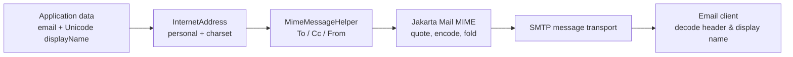
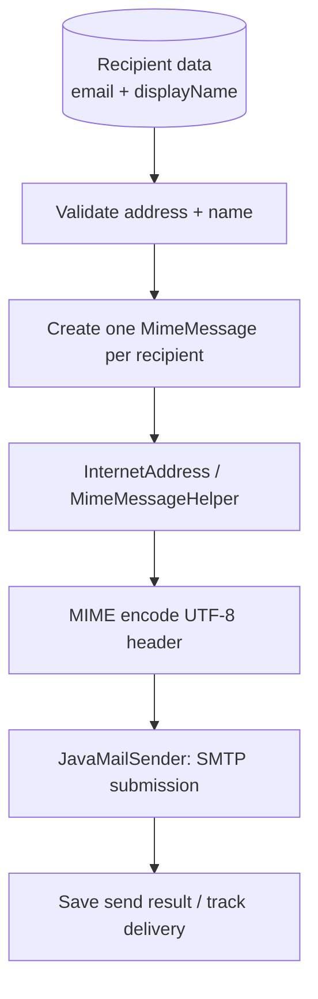

# Display-Name Addresses and Recipient Name Encoding

In an inbox, users typically see **“Nguyễn Văn An”** rather than just `an@example.net`. This name helps identify senders and recipients, yet behind the scenes an email must store both the **display name** (*personal name*) and the **email address** (*addr-spec*). When a name contains Vietnamese diacritics, commas, double quotes, or Unicode characters, the application must represent it according to **email header** rules.

For **Spring Framework Mail**, this is an everyday task: systems send order notifications, welcome messages, verification codes, or support emails to recipients with Vietnamese names. Arbitrarily concatenating `"Nguyễn Văn An <an@example.net>"` into a header can produce malformed syntax or broken encoding, causing email clients to display garbled text or misparse recipients. Spring helps build standards-compliant emails via `JavaMailSender`, `MimeMessageHelper`, and Jakarta Mail types.

The goal of this lesson is to understand **display-name address structure, recipient name encoding rules, how to use Spring Mail APIs, and the related security and routing boundaries**.

## 1. Display Name and Email Address Are Two Separate Components

Consider two ways of showing the same recipient:

```text
an@example.net

Nguyễn Văn An <an@example.net>
```

In the second form:

- **`Nguyễn Văn An`** is the *display name* (also called *personal name* or *phrase*).
- **`an@example.net`** is the actual email address, consisting of the part before `@` (*local-part*) and the domain name after `@` (*domain*).
- **`<` and `>`** enclose the `addr-spec` when an address is written with a display name.

In Internet Message Format (RFC 5322) terminology, an address written as a name alongside an address is a **`name-addr`**. A recipient address can be written directly as an `addr-spec` or as a `name-addr`:

```text
mailbox = name-addr / addr-spec

addr-spec example:
    an@example.net

name-addr example:
    "Nguyen Van An" <an@example.net>
```

The snippet above is a conceptual representation, not the complete RFC grammar. The display name **does not determine the destination mailbox**; the address inside the angle brackets is what gets used as the recipient at the header level, while the **SMTP envelope** carries its own recipient list.

### Where Do Display Names Appear?

| Header | Readable Example | Meaning |
|---|---|---|
| `From:` | `Support Center <support@example.com>` | Name of the person or organization presented as the sender. |
| `To:` | `Nguyễn Văn An <an@example.net>` | Recipient shown in the To field. |
| `Cc:` | `Accounting Department <finance@example.net>` | Visible carbon-copy recipient. |
| `Reply-To:` | `Support Team <help@example.com>` | Address an email client may suggest when the user clicks Reply. |
| `Bcc:` | Usually absent from the copy received by recipients | Blind carbon-copy recipient included in the delivery envelope without exposing them to other recipients. |

**A display name is not proof of identity.** A malicious sender can set a name mimicking a well-known company. Verifying the sending source involves the address, domain, SPF, DKIM, DMARC, and receiving system policies—never relying solely on a friendly-looking name.

## 2. Syntax of Addresses with Display Names

### 2.1. Pure ASCII Names

For names containing only simple ASCII letters, addresses can look like this:

```text
To: Alice Smith <alice@example.net>
Cc: Support Team <support@example.com>
From: Order Service <orders@example.com>
```

Angle brackets delimit the address. Email clients typically show the display name when reading a message and may reveal the full address when the user opens details.

### 2.2. Names with Commas, Quotes, or Special Characters

Commas in an address list normally separate **multiple recipients**. If a person's name contains a comma, that name must be represented using proper quoting/encoding rules:

```text
To: "Doe, Jane" <jane@example.net>, John <john@example.org>
```

If concatenated manually:

```text
To: Doe, Jane <jane@example.net>
```

a header parser may misinterpret `Doe` as a standalone address element or report a syntax error. Likewise, names containing `"` or `\` must be properly escaped when represented as a quoted string.

Common cases in real-world data:

- `ABC Company, Support Department`: name containing a comma.
- `An "Minh"`: name containing double quotes.
- `Lê Thị Mỹ Duyên`: name with Vietnamese diacritics.
- `International Sales – APAC`: name with a Unicode dash.
- `Customer Care Team 🌷`: name with an emoji, requiring client compatibility consideration.

**The safe approach is to use address-building APIs** such as `InternetAddress` or `MimeMessageHelper`, letting the library handle quoting and encoding. Never use string concatenation to build `To:`/`From:` headers from user-supplied input.

### 2.3. A Single To Field Can Contain Multiple Mailboxes

```text
To: Alice Smith <alice@example.net>,
    "Doe, Jane" <jane@example.org>,
    Support <support@example.com>
```

This list contains three mailboxes. The commas between mailboxes are **separators**, whereas the comma inside `"Doe, Jane"` belongs to the display name.

An application can also send an email to multiple addresses without listing all of them in `To:`, such as when using `Bcc`. Therefore, **you should not rely on the `To:` header to infer the complete list of recipients delivered via SMTP**.

## 3. Why Do Vietnamese Recipient Names Need Encoding?

In practice, a display name can include Unicode characters such as `ễ`, `ă`, `Đ`, and `ộ`. Traditional RFC 5322 headers are defined around ASCII syntax, so non-ASCII names are typically represented using the **encoded-word** mechanism from **RFC 2047**.

Example:

```text
Logical display name:
    Nguyễn Văn An

Logical address:
    an@example.net

Human-readable header at application layer:
    To: Nguyễn Văn An <an@example.net>

A valid RFC 2047 header representation:
    To: =?UTF-8?Q?Nguy=E1=BB=85n_V=C4=83n_An?= <an@example.net>
```

Email readers still see **“Nguyễn Văn An”**: the email client receives the encoded-word, decodes it, and renders the name normally. The `=?UTF-8?Q?...?=` string is the **wire representation in the header**, not content intended for users to read.

Do not confuse **character/format encoding** with **security encryption**. Encoded-words merely represent Unicode names in headers for compatibility; they do not make the name secret or protect it from eavesdropping.

### 3.1. Structure of an RFC 2047 Encoded-Word

An encoded-word has the form:

```text
=?charset?encoding?encoded-text?=
```

| Part | Meaning | Example |
|---|---|---|
| `=?` and `?=` | Marks the start and end of an encoded-word | `=?...?...?...?=` |
| `charset` | Character set used before converting to ASCII text | `UTF-8` |
| `encoding` | How bytes are represented in encoded-word format | `B` or `Q` |
| `encoded-text` | Encoded content | Base64 or Q-encoded string |

**`B`** uses Base64 to represent data; **`Q`** is similar to quoted-printable with rules specific to encoded-words, where an underscore `_` represents a space. For example:

- `=E1=BB=85` is the three UTF-8 bytes of the character `ễ`.
- `=C4=83` is the two UTF-8 bytes of the character `ă`.
- `_` represents a space between words in the display name.

A library may choose `B` or `Q` depending on content and implementation. Do not compare raw encoded-word strings to test whether two names are identical; **the same name can be represented by multiple equivalent header strings**.

### 3.2. Limits and Folding During Encoding

An RFC 2047 encoded-word has a maximum length of **75 ASCII characters per encoded-word**, including delimiters. If a name is long, the library may split it across multiple encoded-words and **fold** the header onto multiple lines:

```text
To: =?UTF-8?B?...name-part-1...?=
 =?UTF-8?B?...name-part-2...?= <an@example.net>
```

This is a schematic example; `...` is not actual Base64 data. When working with real headers, always use output generated by a MIME library.

Under RFC 5322, a header line has a hard limit of 998 characters excluding CRLF, and should be kept around 78 characters for readability/compatibility. RFC 2047 also specifies strict rules for encoded-words and the length of lines containing them.

**Do not split encoded-words at arbitrary Java character offsets.** Cutting in the middle of a multi-byte UTF-8 character, an escape sequence, or Base64 chunks renders the header undecodable. This is the MIME library's job.

### 3.3. Header Encoding Differs from Body Encoding

An email might look like:

```text
To: =?UTF-8?Q?Nguy=E1=BB=85n_V=C4=83n_An?= <an@example.net>
Subject: =?UTF-8?B?...?=
MIME-Version: 1.0
Content-Type: text/plain; charset=UTF-8
Content-Transfer-Encoding: quoted-printable

[Body content after transfer encoding]
```

There are **two distinct layers of rules**:

1. **`To:`, `From:`, `Subject:` headers:** person names, subjects, and other fields require encoding per header rules.
2. **MIME body:** the body has its own charset and `Content-Transfer-Encoding`, such as `quoted-printable`, `base64`, or another appropriate mechanism.

Configuring `charset=UTF-8` for the body **does not mean you can insert arbitrary Unicode bytes directly into traditional SMTP headers**. Conversely, properly encoding a name in a header does not automatically give the body the right charset.

## 4. Recipient Display Name vs. Internationalized Email Address

This is a very common point of confusion:

```text
Nguyễn Văn An <an@example.net>
|------------| |------------|
 display name   ASCII address

Nguyễn Văn An <nguyễn@example.net>
|------------| |----------------|
 display name   Unicode local-part
```

First case: a **Unicode display name**, while `an@example.net` is a standard ASCII address. The name can be encoded with **RFC 2047** without turning the `addr-spec` into Unicode.

Second case: **the email address itself contains Unicode characters** in the local-part. This is an **Email Address Internationalization (EAI)** concern involving **SMTPUTF8** (RFC 6531) and UTF-8 headers (RFC 6532), which requires proper support across sending and receiving infrastructure. **Never use RFC 2047 encoded-words to encode a local-part or email address itself and treat it as a valid address.**

| Scenario | General Handling |
|---|---|
| Name `Nguyễn Văn An`, address `an@example.net` | Use `InternetAddress` with `personal` and UTF-8 charset; the MIME library encodes the name. |
| Unicode local-part, e.g. `nguyễn@example.net` | Requires SMTPUTF8 support and internationalized address handling across the entire delivery path. |
| Internationalized domain name | May require IDNA/compatible ASCII representation (A-label/Punycode) or infrastructure supporting internationalization. |
| Encoded display name looks right but address is wrong | Encoding the display name does not fix address syntax or routing errors. |

Enterprise systems with broad compatibility requirements often choose **ASCII email addresses** while allowing **Unicode display names**. If a product needs EAI support, you must design and test compatibility with providers and receiving servers; **simply setting UTF-8 in Spring does not guarantee an SMTPUTF8 address can be delivered**.

## 5. How Spring Framework Mail Builds Display-Name Addresses

### 5.1. Key Components

| Component | Role |
|---|---|
| `JavaMailSender` | Spring abstraction for creating and sending emails; common implementations use Jakarta Mail transport. |
| `MimeMessage` | Object representing a MIME email with headers, body, and recipients. |
| `MimeMessageHelper` | Spring utility for populating `From`, `To`, `Cc`, `Bcc`, `Subject`, body content, and attachments. |
| `InternetAddress` | Jakarta Mail type representing a mailbox, holding both the address and personal name. |
| `MimeUtility` | Jakarta Mail API providing helpers for encoded-word and MIME header operations. |
| `SimpleMailMessage` | Utility for simple plain-text emails; for Unicode display names, prefer explicit address/MIME APIs. |

With Spring Boot's mail starter:

```groovy
dependencies {
    implementation 'org.springframework.boot:spring-boot-starter-mail'
}
```

Example SMTP submission configuration with STARTTLS:

```yaml
spring:
  mail:
    host: ${MAIL_HOST}
    port: 587
    username: ${MAIL_USERNAME}
    password: ${MAIL_PASSWORD}
    default-encoding: UTF-8
    properties:
      mail:
        smtp:
          auth: true
          starttls:
            enable: true
            required: true
          connectiontimeout: 5000
          timeout: 5000
          writetimeout: 5000
```

`spring.mail.default-encoding: UTF-8` is a helpful default charset setting when creating MIME messages in Spring Boot. However, **pass the charset explicitly when constructing personal names with `InternetAddress` or `MimeMessageHelper`** so you do not rely on defaults across different code paths. Environment variables must be supplied via deployment configuration or a secret manager; never commit SMTP passwords to Git.

### 5.2. Approach 1: `MimeMessageHelper.addTo(address, personal)`

When adding a recipient with a display name:

```java
import jakarta.mail.MessagingException;
import jakarta.mail.internet.MimeMessage;
import org.springframework.mail.javamail.JavaMailSender;
import org.springframework.mail.javamail.MimeMessageHelper;
import org.springframework.stereotype.Service;

import java.io.UnsupportedEncodingException;
import java.nio.charset.StandardCharsets;

@Service
public class WelcomeMailService {

    private final JavaMailSender mailSender;

    public WelcomeMailService(JavaMailSender mailSender) {
        this.mailSender = mailSender;
    }

    public void sendWelcome(String emailAddress, String displayName)
            throws MessagingException, UnsupportedEncodingException {

        MimeMessage mimeMessage = mailSender.createMimeMessage();
        MimeMessageHelper helper = new MimeMessageHelper(
                mimeMessage, false, StandardCharsets.UTF_8.name());

        helper.setFrom("hello@example.com", "Support Team");
        helper.addTo(emailAddress, displayName);
        helper.setSubject("Welcome to the system");
        helper.setText("Thank you for registering an account.", false);

        mailSender.send(mimeMessage);
    }
}
```

Notes:

- `addTo(String, String)` takes the **address** and **personal name** separately; code does not manually assemble `"Name <email>"`.
- The constructor `MimeMessageHelper(..., false, "UTF-8")` uses non-multipart mode because the example sends only plain text, while declaring the charset.
- `setFrom(String, String)` likewise sets the **sender display name** and sender address.
- Although `addTo(...)` is convenient, the application must **validate inputs** before calling it, especially user-supplied addresses and personal names that may contain control characters.
- `mailSender.send(...)` submits the email through SMTP infrastructure, though success does not guarantee the recipient has opened the message.

Here, `MimeMessageHelper` and Jakarta Mail handle quoting, encoding, and header serialization; the application is responsible for input data and sending policies.

### 5.3. Approach 2: Creating `InternetAddress` Explicitly

When you want to make the boundary between address and display name explicit in the data type, use the three-argument constructor:

```java
import jakarta.mail.internet.InternetAddress;
import java.io.UnsupportedEncodingException;
import java.nio.charset.StandardCharsets;

InternetAddress recipient = new InternetAddress(
        "an@example.net",
        "Nguyễn Văn An",
        StandardCharsets.UTF_8.name());

recipient.validate();
helper.setTo(recipient);
```

**Explanation:**

1. The first parameter is the **actual address**.
2. The second parameter is the **display name**.
3. The third parameter specifies the charset for MIME-encoding the personal name.
4. `validate()` checks certain address syntax rules; it does **not** check whether the mailbox exists or the user owns it.
5. `helper.setTo(recipient)` sets the To recipient; unlike `addTo(...)`, `setTo` **sets/replaces the To list** of the current message.

`InternetAddress` also provides `setPersonal(String personal, String charset)`. For example, once an address is created, you can call `recipient.setPersonal("Nguyễn Văn An", "UTF-8")` to update its display name.

Example with a name containing a comma:

```java
InternetAddress finance = new InternetAddress(
        "finance@example.net", "ABC Company, Accounting Department", "UTF-8");
helper.setTo(finance);
```

The API models the name and address as two separate values, avoiding recipient-list parsing errors caused by commas inside names.

### 5.4. When to Use `setTo` vs. `addTo`?

| Method | Meaning | Appropriate Scenario |
|---|---|---|
| `helper.setTo(InternetAddress)` | Sets a single To recipient, replacing the existing To list | A single primary recipient. |
| `helper.setTo(InternetAddress[])` | Sets the To list | Multiple recipients with their respective personal names. |
| `helper.addTo(String, String)` | Appends a To recipient | Incrementally adding recipients with display names. |
| `helper.addCc(String, String)` | Appends a Cc recipient with a display name | Public carbon copy. |
| `helper.addBcc(String, String)` | Appends a Bcc recipient with a display name | Blind carbon copy; Bcc identities should not be exposed. |

When sending personalized bulk emails, **each recipient should get their own separate message** if the subject, body, or personal details differ. Putting many `To` addresses on one message exposes the recipient list to everyone; meanwhile, `Bcc` is no substitute for proper per-recipient delivery, privacy, and tracking design.

## 6. How Real Headers Are Generated and Decoded

### 6.1. From Java Objects to MIME and the Email Client



Suppose the application sets two values:

```text
emailAddress = "an@example.net"
displayName  = "Nguyễn Văn An"
```

From there, the MIME object can serialize into a header like:

```text
To: =?UTF-8?Q?Nguy=E1=BB=85n_V=C4=83n_An?= <an@example.net>
```

The client decodes `=?UTF-8?Q?...?=` back into the original name. This is only **one of several valid representations**; Jakarta Mail may choose a different encoding or folding layout.

### 6.2. Reading Addresses from a Message

When processing parsed addresses, work with `Address`/`InternetAddress` objects rather than searching for substrings between `<` and `>`.

Example Java snippet operating on a valid `MimeMessage`:

```java
import jakarta.mail.Address;
import jakarta.mail.Message;
import jakarta.mail.internet.InternetAddress;
import jakarta.mail.internet.MimeMessage;

Address[] recipients = mimeMessage.getRecipients(
        Message.RecipientType.TO);

if (recipients != null) {
    for (Address address : recipients) {
        if (address instanceof InternetAddress mailbox) {
            String actualAddress = mailbox.getAddress();
            String personalName = mailbox.getPersonal();

            // actualAddress: "an@example.net"
            // personalName:   "Nguyễn Văn An" (if present)
        }
    }
}
```

`getAddress()` and `getPersonal()` represent the two parts of a mailbox in the API. The personal name may be `null` if the header only contains an address or if no name was provided. When parsing emails **received from external sources**, still treat both the address and name as untrusted data even if the library parsed them successfully.

### 6.3. Should You Call `MimeUtility.encodeText` Manually?

Jakarta Mail includes header-encoding APIs such as `MimeUtility.encodeText(...)`. However, when you use `InternetAddress(..., personal, charset)` or `MimeMessageHelper.addTo(..., personal)`, the library already handles name encoding.

**Do not pre-encode a personal name and pass an encoded-word string into an API that expects a plain Unicode name.** Double-encoding can cause headers to display literal `=?UTF-8?...?=` strings or become difficult to decode.

What not to do:

```java
// Wrong approach: the name is already turned into an encoded-word before
// being passed to an API responsible for encoding the personal name.
String encoded = MimeUtility.encodeText("Nguyễn Văn An", "UTF-8", null);
helper.addTo("an@example.net", encoded);
```

Pass the **logical value** instead:

```java
helper.addTo("an@example.net", "Nguyễn Văn An");
```

Direct encoding APIs are appropriate when you are genuinely constructing or manipulating a specialized low-level header and understand its API contract. For standard recipient headers, prefer typed abstractions.

## 7. To, Cc, Bcc, and the SMTP Envelope

Display names make headers readable, but **the addresses SMTP actually delivers to live in the envelope**.

Example displayed message:

```text
From: Support Team <support@example.com>
To: Nguyễn Văn An <an@example.net>
Cc: Customer Care <care@example.org>
Subject: Support request details
```

At the SMTP layer, a sending session may look like:

```text
MAIL FROM:<bounce@example.com>
RCPT TO:<an@example.net>
RCPT TO:<care@example.org>
DATA
...
```

Key differences:

| Field | What Is It Used For? |
|---|---|
| `From:` | Sender identity displayed in the header; may include a display name. |
| `To:` / `Cc:` | Public recipient lists in the header; may include display names. |
| `Bcc:` | Blind carbon-copy recipients; normally omitted from copies delivered to other recipients. |
| `MAIL FROM` | Reverse-path of the SMTP envelope, typically used to receive bounces/DSNs. |
| `RCPT TO` | Destination addresses to which SMTP routes delivery on the current hop. |
| `Reply-To:` | Address an email client may use when the recipient chooses to reply. |

**Display names do not appear in SMTP `RCPT TO:<...>` syntax.** An SMTP server does not route mail based on the string `Nguyễn Văn An`. Nor should you assume every email with a `To:` header was actually delivered to that address: you must inspect your sending pipeline, provider policies, and delivery outcomes.

### Bcc and Privacy

Suppose an application needs to send a general announcement to 100 customers. Placing everyone in `To:` exposes all names and addresses to every recipient. Using `Bcc:` hides the list from public headers, yet sending to 100 recipients in a single message still introduces issues with personalization, per-recipient failure tracking, and provider sending limits.

For transactional emails with private information, the right design is usually **a separate email per recipient**. For bulk announcements, use a channel or sending mechanism that supports private recipient lists. Never inject `Bcc` via raw string concatenation; use the email API so the library separates headers and envelope properly.

## 8. Validating and Normalizing Display Name Data

The MIME library handles encoding and quoting, yet **the application must still validate data coming from forms, databases, or external systems**.

### 8.1. Keep Data Separate from the Start

Store them separately:

```json
{
  "emailAddress": "an@example.net",
  "displayName": "Nguyễn Văn An"
}
```

Avoid storing only a single combined field like:

```text
Nguyễn Văn An <an@example.net>
```

and later having to split strings on spaces, commas, `<`, and `>` to recover the address. Names can contain special characters; parsing raw RFC 5322 strings is far more complex than naive string splitting.

### 8.2. Control Characters and Header Injection

Malicious input can contain newline characters:

```text
Input name:
    Alice\r\nBcc: outsider@example.org
```

If an application builds headers via string concatenation, it becomes vulnerable to **email header injection**: the name input can be interpreted as a new header field. Some libraries check or sanitize such cases, but you should never rely on the assumption that "the library will definitely fix every malicious input."

Principles:

1. Keep the email address and display name as two distinct fields in DTOs and databases.
2. Use typed APIs like `InternetAddress` and `MimeMessageHelper` instead of string concatenation.
3. Reject CR/LF and control characters in user-supplied personal names.
4. Enforce a reasonable length limit on names per product policy; overly long strings bloat headers even when MIME can fold them.
5. Validate address syntax using an appropriate library, without claiming an address exists just because parsing succeeded.
6. Restrict where users are allowed to specify `From`, `Reply-To`, `Cc`, and `Bcc`; this is an application policy concern, not merely an encoding issue.

### 8.3. Example Name Normalization Function

```java
import java.text.Normalizer;

public final class DisplayNames {
    private DisplayNames() {}

    public static String clean(String raw) {
        if (raw == null) {
            throw new IllegalArgumentException("Display name is required");
        }

        String name = Normalizer.normalize(
                raw.trim(), Normalizer.Form.NFC);

        if (name.isBlank()) {
            throw new IllegalArgumentException("Display name is blank");
        }
        if (name.codePoints().anyMatch(Character::isISOControl)) {
            throw new IllegalArgumentException(
                    "Display name contains control characters");
        }
        if (name.codePointCount(0, name.length()) > 120) {
            throw new IllegalArgumentException("Display name is too long");
        }
        return name;
    }
}
```

**NFC** normalizes equivalent Unicode representations into the common composed form. For example, an accented character can be entered either as a precomposed character or as a sequence of code points; normalization helps handle data more consistently. **NFC does not verify identity, does not prevent all Unicode spoofing, and does not replace email address verification**.

The 120-code-point limit is an **example product rule**, not a limit imposed by RFC 2047 or Spring Mail for every name. Applications with special internationalization needs may set a different limit while still ensuring valid MIME output.

When using it:

```java
String displayName = DisplayNames.clean(input.displayName());
helper.addTo(input.emailAddress(), displayName);
```

The application still needs a separate authentication/authorization policy to decide **which addresses a requester is permitted to send to**.

### 8.4. Do Not Treat Display Name as a Trusted Identifier

Consider two mailboxes:

```text
Example Bank <notice@bank-example.com>
Example Bank <attacker@untrusted.example>
```

Identical display names do not prove identical senders. Some email clients hide or abbreviate the address and emphasize the display name, which can deceive users. In mail-receiving applications or automated classification systems, rely on the address/domain, authentication results, and source trust policies rather than comparing display names.

In sending applications, the `From` name should usually be fixed to the brand or authorized sending unit, whereas the `To` name can come from a verified recipient profile. Do not let users arbitrarily set a sender name like "Security System" to impersonate another entity.

## 9. Common Errors When Sending Emails with Unicode Names

### 9.1. Recipients See Garbled Characters Like `Nguy?n V?n An`

Possible causes:

- The name was already corrupted in the database or data-reading pipeline.
- Using the wrong charset before constructing `InternetAddress`.
- Decoding bytes into strings using an incorrect charset.
- Manually building raw headers or double-encoding.
- An email client or intermediate mail gateway handling MIME improperly.

**How to pinpoint the corruption:** inspect the original Unicode data at the application layer, how `InternetAddress`/`MimeMessageHelper` is constructed, and the serialized MIME header when diagnosing. Avoid logging entire user emails excessively in production.

### 9.2. Header Displays Literal `=?UTF-8?B?...?=`

If users see the literal encoded-word instead of the decoded name, the header may have been malformed, double-encoded, or mishandled by a non-compliant email client. Check whether the application passed the **logical name** to the address API; do not encode the name yourself and then hand it to a library that encodes it again.

### 9.3. A Name with a Comma Gets Split into Multiple Recipients

For example, `"ABC Company, Accounting Department"` gets parsed as two recipients when the application manually concatenates `To:`. Replace this with `new InternetAddress(address, personal, "UTF-8")` or `helper.addTo(address, personal)`.

### 9.4. The Name Is Correct Yet the Email Does Not Reach the Recipient

Display name and header encoding can be completely valid while the email still fails because of:

- An incorrect address or non-existent destination mailbox.
- SMTP/provider policies rejecting the recipient, domain, or sending account.
- Domain authentication issues, sender reputation, quotas, or spam filters.
- Transport errors occurring after SMTP submission returned success.

Do not conclude "Unicode in the recipient name caused the failure" without concrete evidence from an SMTP response, DSN/bounce, or provider logs. Distinguish **header formatting**, **SMTP submission**, and **delivery** failures.

### 9.5. Is Calling `setText(..., "UTF-8")` Enough to Fix Display Names?

No. `setText` handles the **body**; display names live in **address headers**. You must pass the personal name through an address API with the appropriate charset and let the library generate the MIME header.

### 9.6. Should You Edit Recipient Names Directly in Raw Headers After Building the Message?

No. Calling `setHeader("To", ...)` with a hand-built string can break encoding/folding or create mismatches with the recipients used during sending. For standard address fields, update them **via `MimeMessageHelper` or `MimeMessage.setRecipients(...)` using `InternetAddress`**.

## 10. Real-World Application Scenario

A Spring Boot system needs to send payment confirmations to three customers:

| ID | Display Name | Email |
|---|---|---|
| 1 | Nguyễn Văn An | `an@example.net` |
| 2 | Morning Star Company, Purchasing Dept | `purchasing@example.org` |
| 3 | Emma "Em" Davis | `emma@example.com` |

Each customer receives personalized invoice content. Suitable design:



Example iterating over each order in a worker:

```java
for (InvoiceNotification item : pendingInvoices) {
    MimeMessage mime = mailSender.createMimeMessage();
    MimeMessageHelper helper = new MimeMessageHelper(
            mime, false, "UTF-8");

    helper.setFrom("billing@example.com", "Billing Department");
    helper.addTo(
            item.recipientEmail(),
            DisplayNames.clean(item.recipientDisplayName()));
    helper.setSubject("Invoice " + item.invoiceCode());
    helper.setText(item.plainTextBody(), false);

    mailSender.send(mime);
    // Store submission result per item/recipient;
    // track bounces/DSNs via an event system if needed.
}
```

`InvoiceNotification` in this example is an application-defined business DTO with accessors `recipientEmail()`, `recipientDisplayName()`, `invoiceCode()`, and `plainTextBody()`; it is not a built-in Spring class. For high-volume sending, combine this with an outbox/queue, rate limiting, idempotency, and per-recipient error handling; the loop demonstrates creating independent messages with display names.

### Why Not Use One Message for All Three Customers?

Putting all three in the same `To:` field lets everyone see one another's names/addresses and forces them to receive the same content. When invoices contain private or separate business data, this is a serious privacy breach. With a fresh `MimeMessage` per recipient, both the display name and content match the intended recipient, and it becomes easy to correlate send results and bounces.

## 11. Self-Check Questions

1. In `Nguyễn Văn An <an@example.net>`, which part is the display name and which part determines the recipient address? Which part does the SMTP server use for delivery?
2. Why does `"Doe, Jane" <jane@example.net>` require proper quoting rules when placed in a `To:` list?
3. Is `=?UTF-8?Q?Nguy=E1=BB=85n_V=C4=83n_An?=` a "security-encrypted" name? How does `Q` differ from `B`?
4. Why is setting `spring.mail.default-encoding: UTF-8` or a body charset insufficient to guarantee every Unicode email address can be delivered?
5. Write an `InternetAddress` call creating a recipient for `lan@example.org` with the name `Trần Thị Lan` using UTF-8.
6. A name submitted from a form contains `\r\nBcc: attacker@example.org`. Where should the application validate input, and which API should it use instead of manually building headers?
7. If sending individual messages to 100 customers, explain why one `MimeMessage` per recipient can be more appropriate than placing everyone in `To:`.
8. Why do two emails sharing the display name `“Support Team”` not necessarily come from the same trusted organization?

## 12. Conclusion and References

**A display name is part of an email header and is distinct from the delivery address.** For Vietnamese and Unicode names, Jakarta Mail typically represents the personal name using RFC 2047 encoded-words to maintain compatibility with traditional headers. In Spring Framework Mail, use `MimeMessageHelper.addTo(address, personal)`, `setFrom(address, personal)`, or `InternetAddress(address, personal, "UTF-8")`. Supply the name in its original Unicode form so the library encodes and folds it properly.

Always distinguish between **display name**, **addr-spec**, **To/Cc/Bcc headers**, **SMTP envelope**, and **SMTPUTF8 for internationalized email addresses**. Validate inputs, avoid manual header concatenation, safeguard privacy, and never treat a display name as proof of sender authenticity.

Foundational specifications:

- **RFC 5322 — Internet Message Format:** `mailbox` and `name-addr` address structures, headers, and folding.
- **RFC 2047 — MIME Header Extensions for Non-ASCII Text:** encoded-words, `B`/`Q` encodings, and representing Unicode names in traditional headers.
- **RFC 6531 — SMTP Extension for Internationalized Email:** SMTPUTF8.
- **RFC 6532 — Internationalized Email Headers:** UTF-8 internationalized email headers.
- **RFC 5321 — Simple Mail Transfer Protocol:** SMTP envelope, `MAIL FROM`, and `RCPT TO`.
- **Jakarta Mail API and Spring Framework Mail:** `InternetAddress`, `MimeMessage`, `MimeMessageHelper`, `JavaMailSender`.
