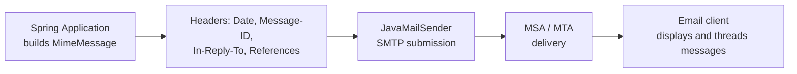
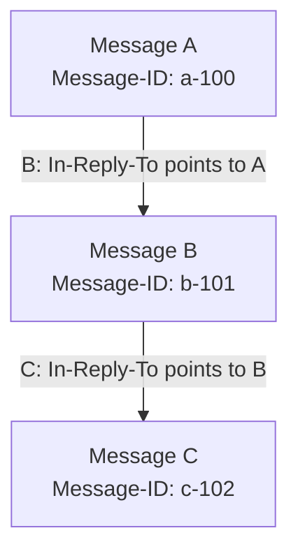
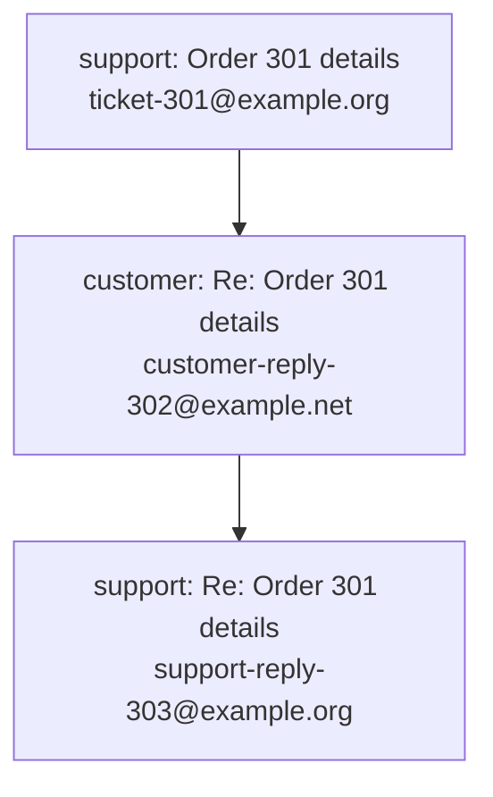

# `Date`, `In-Reply-To`, and `References` Headers in Spring Framework Mail

When sending emails with **Spring Framework Mail**, applications typically focus on sender, recipient, subject, and body. However, an email also carries headers that tell recipients **when the message was created** and **which conversation it belongs to**. Three key headers for this purpose are:

- **`Date`:** when the message was composed or issued from the sender's perspective.
- **`In-Reply-To`:** the previous message (or messages) to which the current email is directly replying.
- **`References`:** the chain of related message identifiers, typically representing the conversation's ancestor history.

These are **Internet Message Format** headers, not SMTP parameters specifying where to deliver mail. In Java, Spring Mail uses `JavaMailSender` and Jakarta Mail (`MimeMessage`) to generate, attach, and transmit these headers to the SMTP server.

The goal of this lesson is to understand how these three headers work alongside `Message-ID`, recognize them in real emails, and use them properly when a Spring application sends a new email or replies to an existing one.

## 1. Where Do Headers Live in an Email?

An RFC 5322 email message consists of a **header** section and a **body** section, separated by a blank line. Each header line contains a field name, a colon, and a value.

Example of an email sent at 15:30 in Vietnam:

```text
From: notifications@example.org
To: customer@example.net
Date: Thu, 12 Nov 2026 15:30:00 +0700
Message-ID: <welcome-481@example.org>
Subject: Welcome to Example
MIME-Version: 1.0
Content-Type: text/plain; charset=UTF-8

Your account has been created.
```

Each field serves a distinct purpose:

| Header | Meaning | Primary Effect |
|---|---|---|
| `From` | Address or identity of the message author | Displayed sender |
| `To` | Displayed recipient | Information inside message content |
| `Date` | Origination time declared by the sender | Time display, sorting, and certain app logic |
| `Message-ID` | Identifier of a specific message | Referencing and building conversation threads |
| `In-Reply-To` | ID of the message directly replied to | Links the new message to its parent message |
| `References` | Chain of IDs related to the conversation | Helps build the conversation tree/thread |
| `Subject` | Displayed subject | Search and grouping hints, though not a replacement for IDs |

The `Date` header normally appears on both initial emails and replies. By contrast, an email starting a new conversation usually **does not need** `In-Reply-To` or `References`; those fields are meaningful only when prior messages exist.

### Separating Message Headers and the SMTP Envelope

These headers belong to message content transmitted during SMTP's `DATA` phase. To transport mail, SMTP also uses **envelope** information such as `MAIL FROM` and `RCPT TO`. Do not confuse `From:` in headers with `MAIL FROM` in SMTP, or assume `References` affects how an MTA resolves the receiving domain.



**SMTP delivers the message**; how an email client displays dates and groups messages relies on these headers combined with the client's own threading algorithms.

## 2. The `Date` Header: Sender-Declared Origination Time

`Date` represents when the message was created and issued by the sender (origination date), formatted per RFC 5322 date-time syntax.

Example:

```text
Date: Thu, 12 Nov 2026 15:30:00 +0700
```

Components:

| Component | Example Value | Explanation |
|---|---|---|
| Day of week | `Thu,` | Thursday, English abbreviation; optional in syntax |
| Day | `12` | Day of the month |
| Month | `Nov` | Abbreviated English month name |
| Year | `2026` | Four-digit year |
| Time | `15:30:00` | Hours, minutes, seconds; seconds may be omitted in syntax |
| Time zone | `+0700` | UTC offset +07:00 |

In `Date`, `+0700` is a **numeric timezone offset**, not a zone name such as `Asia/Ho_Chi_Minh`. Email clients may render the time in the reader's local timezone. Thus:

```text
Date: Thu, 12 Nov 2026 15:30:00 +0700
Date: Thu, 12 Nov 2026 08:30:00 +0000
```

Both values represent **the exact same instant**. Their local clock times differ due to different timezone offsets.

### Date vs. Received and Arrival Time

During delivery, SMTP servers may prepend `Received` headers to record each receive/relay hop. `Date` and `Received` describe **two different kinds of timestamps**:

- `Date` reflects the time declared by the message creator.
- `Received` records server processing traces at each hop, including timestamp and hop details.
- When an email appears in an inbox also depends on MTA processing, queues, receiving mail services, and client sync behavior.

Abbreviated example:

```text
Date: Thu, 12 Nov 2026 15:30:00 +0700
Received: from smtp.example.org by mx.example.net
        with ESMTP; Thu, 12 Nov 2026 15:32:11 +0700
```

This suggests the message claims to have been created at 15:30 and the destination server received it at 15:32. Still, **do not treat `Date` as absolute, trusted proof**: the sender's system clock may be skewed, or the header may be intentionally forged. When exact delivery timing is needed, consult server traces, logs, and provider records.

### Send Date When Applications Save Drafts or Use Queues

Suppose an application builds a message at 10:00 while a worker actually sends it at 10:20. Calling `setSentDate` at creation time sets `Date` to **10:00**; updating it when the worker submits the mail sets it to **10:20**.

Both timestamps can matter to business logic, so define clear conventions:

- `createdAt`: when the send request or draft was recorded.
- `submittedAt`: when the worker started or completed SMTP submission.
- `deliveredAt`: when the system obtained corresponding delivery evidence.
- `Date` in MIME: the origination timestamp chosen and declared in the message.

Do not force all of them into a single value. For asynchronous jobs, store business timestamps in your database/logs and manage `Date` under an explicit application policy.

## 3. The `Message-ID` Header: Foundation of Reply Chains

Before diving into the two conversation-linking headers, you must understand **`Message-ID`**. It is an identifier assigned to **one specific email message**.

```text
Message-ID: <notice-482@example.org>
```

Key characteristics:

1. The identifier generally has the form `<id-left@id-right>`, wrapped in `<` and `>`.
2. IDs must be generated with appropriate uniqueness across messages; putting your domain on the right reduces collisions.
3. **Every new email in a conversation needs its own `Message-ID`**, including replies.
4. `In-Reply-To` and `References` hold **Message-IDs of prior messages**, not email addresses, database IDs, or `Subject` values.
5. An ID placed inside HTML/plain-text body content **does not become** the email's `Message-ID`.

Example of a conversation:

```text
Message A: Message-ID: <a-100@example.org>
Message B: Message-ID: <b-101@example.net>   (replies to A)
Message C: Message-ID: <c-102@example.org>   (replies to B)
```

`Message-ID` differs from job/outbox IDs created by your application. For example, `notification_102` is a database row ID; to correlate it with an email, the application must **store a mapping** between the internal ID and the actual `Message-ID`.

With Jakarta Mail, `MimeMessage.getMessageID()` reads the message's identifier if present. When a new message is prepared and sent, the library may generate a `Message-ID` while finalizing MIME. Do not guess or hardcode a shared ID across sends, nor assume calling `setHeader("Message-ID", ...)` before `saveChanges()` preserves the ID across every sending path.

## 4. The `In-Reply-To` Header: Which Message Is This Replying To?

`In-Reply-To` contains one or more `msg-id` values of the message(s) the sender is replying to.

In ordinary conversations, the most common value is the **Message-ID of the single parent message**:

```text
Message-ID: <b-101@example.net>
In-Reply-To: <a-100@example.org>
```

This means Message B is a reply to Message A. When Message C replies to B:

```text
Message-ID: <c-102@example.org>
In-Reply-To: <b-101@example.net>
```

Thus, `In-Reply-To` expresses a **direct parent link**:



Special cases may reply to multiple messages at once, allowing `In-Reply-To` to hold multiple Message-IDs. However, most application conversation flows only need **one parent ID**. Never put email addresses such as `<support@example.org>` there merely because they share angle-bracket syntax; you need the **actual Message-ID of the parent message**.

### In-Reply-To Is Not Reply-To

These two fields have similar names yet completely different functions:

| Header | Function | Example |
|---|---|---|
| `Reply-To` | Specifies the email address where replies should be sent | `Reply-To: helpdesk@example.org` |
| `In-Reply-To` | Identifies the message being replied to | `In-Reply-To: <ticket-01@example.org>` |

In Spring, `MimeMessageHelper.setReplyTo(...)` sets the reply email address **`Reply-To`**, **not `In-Reply-To`**. To control threading, you must add `In-Reply-To` and `References` on `MimeMessage`.

## 5. The `References` Header: Identifier History of a Conversation

`References` typically contains the **ordered list of Message-IDs of preceding messages**, from oldest to most recent. It helps email clients reconstruct message relationships without relying solely on guessing from subject lines.

Continuing the three-message example A, B, and C:

```text
Message A:
  Message-ID: <a-100@example.org>

Message B replies to A:
  Message-ID: <b-101@example.net>
  In-Reply-To: <a-100@example.org>
  References: <a-100@example.org>

Message C replies to B:
  Message-ID: <c-102@example.org>
  In-Reply-To: <b-101@example.net>
  References: <a-100@example.org> <b-101@example.net>
```

Key points:

- C's `In-Reply-To` names **B** as its direct parent.
- C's `References` contains **A and B**, in conversation order.
- C's own `Message-ID` **is not added to C's own `References`**. C's ID will appear later when a Message D replies to C.

### Rules for Building References When Replying

Following RFC 5322's guidance for constructing `References`:

1. If the **parent message has `References`**, take that list and **append the parent's `Message-ID`**.
2. If the parent has no `References` yet its **`In-Reply-To` contains a single Message-ID**, start with that ID and append the parent's `Message-ID`.
3. If no suitable ancestor information exists, start with the **parent's `Message-ID`**.

Branching reply example:

```text
                    A <a@example.org>
                   / \
                  /   \
    B <b@example.org>   X <x@example.net>
               |
    C <c@example.org>

B: In-Reply-To: <a@example.org>
   References: <a@example.org>

C: In-Reply-To: <b@example.org>
   References: <a@example.org> <b@example.org>

X: In-Reply-To: <a@example.org>
   References: <a@example.org>
```

`References` on both C and X include A because both belong to branches of the same exchange. However, C does not include X's ID in its ancestor chain; X is not a message C directly replied to.

### Do Identical References Guarantee Identical Grouping Across All Clients?

No. The RFC defines field syntax and semantics, yet the **"conversation view" UI is decided by each email client**. Some clients inspect `Message-ID`, `In-Reply-To`, and `References`; others also consider subject, participants, timestamps, or proprietary heuristics. Therefore:

- Having standard headers **improves the likelihood** of messages grouping into the same thread.
- You cannot guarantee Gmail, Outlook, Thunderbird, and every webmail client will render the exact same thread.
- A `Re: ...` subject line **is insufficient** to establish parent–child links when standard Message-IDs are missing.
- Changing recipients, subject, or participants too drastically can alter grouping even when reference IDs are valid.

## 6. Complete Example: Creating an Email, Replying, and Following Up

### First Email

```text
From: support@example.org
To: customer@example.net
Date: Thu, 12 Nov 2026 09:00:00 +0700
Message-ID: <ticket-301@example.org>
Subject: Order 301 details

Your order has been received.
```

The first message has neither `In-Reply-To` nor `References` because it starts a new conversation.

### User Replies to First Email

```text
From: customer@example.net
To: support@example.org
Date: Thu, 12 Nov 2026 09:15:00 +0700
Message-ID: <customer-reply-302@example.net>
In-Reply-To: <ticket-301@example.org>
References: <ticket-301@example.org>
Subject: Re: Order 301 details

Can I change the shipping address?
```

This message links into the conversation because it accurately references `<ticket-301@example.org>`.

### Spring Application Replies to Customer

```text
From: support@example.org
To: customer@example.net
Date: Thu, 12 Nov 2026 09:20:00 +0700
Message-ID: <support-reply-303@example.org>
In-Reply-To: <customer-reply-302@example.net>
References: <ticket-301@example.org> <customer-reply-302@example.net>
Subject: Re: Order 301 details

You can update the address before the order is handed over for shipping.
```

The third message creates a new `Message-ID`, sets `In-Reply-To` to the second message's ID, and preserves the ancestor `References` chain. If the user replies to this third message again, they append the third ID to the next reply's `References`.

### Conversation Tree View



Each `Date` indicates the sender-declared time. **Relational edges** in the tree are supported by `In-Reply-To`, while the ancestor list resides in `References`.

## 7. How Does Spring Mail Set Date?

In Spring Framework Mail, you typically work with `JavaMailSender` and `MimeMessageHelper`. For the `Date` header, the appropriate API is:

```java
MimeMessage mimeMessage = javaMailSender.createMimeMessage();
MimeMessageHelper helper = new MimeMessageHelper(mimeMessage, "UTF-8");
helper.setSentDate(new java.util.Date());
```

Or directly on Jakarta Mail:

```java
MimeMessage mimeMessage = javaMailSender.createMimeMessage();
mimeMessage.setSentDate(new java.util.Date());
```

Both set the **sent date of the message**. Prefer typed `Date` APIs rather than building strings manually:

```java
// Do not manually build a Date header from an arbitrary string.
mimeMessage.setHeader("Date", userSuppliedDate);
```

Using the setter lets Jakarta Mail format the date per email standards and avoids missing timezone offsets or syntax errors.

### Reading Date from an Existing Message

Given a `MimeMessage` parsed from a received or stored email:

```java
java.util.Date sentDate = mimeMessage.getSentDate();
String[] rawDateHeaders = mimeMessage.getHeader("Date");
```

`getSentDate()` returns the parsed `Date` when available; it may return `null` if the header is missing or unparseable. `getHeader("Date")` lets you inspect the raw text when diagnosing malformed data.

When persisting timestamps in your system, use `Instant` or a timezone-aware temporal type rather than storing the raw display string. To convert for domain logic:

```java
Instant sentAt = sentDate == null ? null : sentDate.toInstant();
```

`Instant` represents an absolute point in time; choosing a timezone for display belongs to the UI/application layer.

## 8. Setting In-Reply-To and References in Spring Mail

`MimeMessageHelper` covers many common headers, yet lacks dedicated setters for every threading field. To set `In-Reply-To` and `References`, call `setHeader(...)` on `MimeMessage`.

Simple example:

```java
MimeMessage message = mailSender.createMimeMessage();
MimeMessageHelper helper = new MimeMessageHelper(message, "UTF-8");

helper.setFrom("support@example.org");
helper.setTo("customer@example.net");
helper.setSubject("Re: Order details");
helper.setText("We have received your response.", false);
helper.setSentDate(new java.util.Date());

message.setHeader("In-Reply-To", "<customer-reply-302@example.net>");
message.setHeader(
        "References",
        "<ticket-301@example.org> <customer-reply-302@example.net>");

mailSender.send(message);
```

Both header values **must come from genuine Message-IDs of previous emails**. They must not be fabricated guesses derived from order codes or customer addresses.

### Reply Mail Service Using Stored References Chains

In an application supporting threaded email conversations, you can store `parentMessageId` and `ancestorMessageIds` (the IDs from the parent's `References`) to construct replies.

```java
package com.example.notification;

import jakarta.mail.MessagingException;
import jakarta.mail.internet.MimeMessage;
import java.nio.charset.StandardCharsets;
import java.util.ArrayList;
import java.util.Date;
import java.util.List;
import org.springframework.beans.factory.annotation.Value;
import org.springframework.mail.javamail.JavaMailSender;
import org.springframework.mail.javamail.MimeMessageHelper;
import org.springframework.stereotype.Service;

@Service
public class ConversationMailService {
    private final JavaMailSender mailSender;
    private final String fromAddress;

    public ConversationMailService(
            JavaMailSender mailSender,
            @Value("${app.mail.from}") String fromAddress) {
        this.mailSender = mailSender;
        this.fromAddress = fromAddress;
    }

    public void reply(
            String recipient,
            String originalSubject,
            String replyBody,
            String parentMessageId,
            List<String> parentReferences) throws MessagingException {

        String safeParentId = requireSafeMessageId(parentMessageId);
        List<String> references = new ArrayList<>();

        // parentReferences is the ancestor chain extracted from the parent message.
        if (parentReferences != null) {
            for (String ancestorId : parentReferences) {
                references.add(requireSafeMessageId(ancestorId));
            }
        }
        // The reply's References includes ancestors plus the parent message ID.
        if (references.isEmpty()
                || !references.get(references.size() - 1).equals(safeParentId)) {
            references.add(safeParentId);
        }

        MimeMessage message = mailSender.createMimeMessage();
        MimeMessageHelper helper = new MimeMessageHelper(
                message, false, StandardCharsets.UTF_8.name());

        helper.setFrom(fromAddress);
        helper.setTo(recipient);
        helper.setSubject("Re: " + originalSubject);
        helper.setText(replyBody, false);
        helper.setSentDate(new Date());

        message.setHeader("In-Reply-To", safeParentId);
        message.setHeader("References", String.join(" ", references));

        mailSender.send(message);
    }

    private static String requireSafeMessageId(String value) {
        if (value == null
                || value.length() > 500
                || !value.matches("<[^<>\\s@]+@[^<>\\s@]+>")) {
            throw new IllegalArgumentException("Invalid Message-ID");
        }
        return value;
    }
}
```

In this example:

1. `parentMessageId` is the `Message-ID` of the **message directly being replied to**.
2. `parentReferences` holds the **parsed and ordered IDs** from the parent's `References`, e.g. `["<ticket-301@example.org>"]`.
3. `references.add(safeParentId)` completes the ancestor list for the new email.
4. `setHeader("In-Reply-To", ...)` records the direct parent link.
5. `setHeader("References", ...)` records the ancestor chain.
6. `helper.setSentDate(...)` sets the message origination time.
7. `mailSender.send(...)` submits the message to the configured SMTP server; it does not guarantee every mail client renders it in the exact same thread.

`requireSafeMessageId` in this example is a **simplified format check** accepting simple IDs and blocking newline injection via the ID string. It does not implement every `msg-id` syntax variant allowed by the RFC. For emails ingested from diverse external sources, use an appropriate parser and header validation policy while enforcing length limits.

In production, also normalize `Re:` prefixes to avoid `Re: Re: Re: ...`, authorize allowed recipients, handle null subjects, and cap the number/size of IDs in `References`. These are application policies separate from the meaning of the three headers.

### SMTP Configuration in Spring Boot

To send messages, the application needs the Mail starter and an SMTP endpoint:

```groovy
dependencies {
    implementation 'org.springframework.boot:spring-boot-starter-mail'
}
```

```yaml
spring:
  mail:
    host: ${SMTP_HOST}
    port: 587
    username: ${SMTP_USERNAME}
    password: ${SMTP_PASSWORD}
    properties:
      "[mail.smtp.auth]": true
      "[mail.smtp.starttls.enable]": true
      "[mail.smtp.starttls.required]": true
      "[mail.smtp.ssl.checkserveridentity]": true
      "[mail.smtp.connectiontimeout]": 5000
      "[mail.smtp.timeout]": 10000
      "[mail.smtp.writetimeout]": 10000

app:
  mail:
    from: ${SMTP_FROM}
```

These SMTP properties configure the **mail-sending transport**, while `Date`, `In-Reply-To`, and `References` define **semantic metadata inside the message**. The two configuration groups serve different functional layers.

**Version note:** these examples use `jakarta.mail`, matching Spring Framework 6+ / Spring Boot 3+. Spring Framework 5 / Boot 2 projects may use `javax.mail` and should adjust imports to match their dependencies.

## 9. Where Do Parent Message-ID and References Come From?

In applications supporting email replies, **inputs must come from a clear source**:

- If the system **receives emails** via IMAP, POP3, provider webhooks, or an internal gateway, extract `Message-ID`, `References`, and `In-Reply-To` from the received message.
- If the system **only sends emails**, it can store the outbound `Message-ID` alongside the business record. Keep in mind that libraries and SMTP servers may manage or rewrite IDs during sending.
- If a user replies to an external email and the application lacks parent message data, **you cannot reliably reconstruct a reference chain from `Subject` alone**.

For an existing `MimeMessage`, Jakarta Mail provides:

```java
String parentId = parentMessage.getMessageID();
String[] referencesHeaders = parentMessage.getHeader("References");
String[] inReplyToHeaders = parentMessage.getHeader("In-Reply-To");
```

`getHeader(...)` returns **raw header strings**. A single `References` value may contain **multiple Message-IDs**, and headers may be folded across lines. Therefore, you cannot treat each element of `referencesHeaders` as strictly one Message-ID. You must **parse the `msg-id` list** rather than blindly calling `split(" ")`: whitespace and header folding can appear between IDs, and RFC syntax includes edge cases.

Logical value example:

```text
References: <ticket-301@example.org>
            <customer-reply-302@example.net>
```

Both IDs should be stored in order:

```text
[
  "<ticket-301@example.org>",
  "<customer-reply-302@example.net>"
]
```

Later, when replying to a message whose `Message-ID: <support-reply-303@example.org>`, the new References value becomes:

```text
References: <ticket-301@example.org>
            <customer-reply-302@example.net>
            <support-reply-303@example.org>
```

Here, `support-reply-303` is the **parent message's ID**, not the new ID of the newly created reply.

### Persisting Threading Data in the Database

A business model might include:

| Field | Role | Example |
|---|---|---|
| `conversationId` | Internal ID of a support/order thread | `case-301` |
| `messageId` | The email's own `Message-ID` | `<ticket-301@example.org>` |
| `parentMessageId` | Message-ID of the direct parent message | `<customer-reply-302@example.net>` |
| `references` | Ordered list of ancestor IDs | `[<ticket-301@...>, <customer-reply-302@...>]` |
| `createdAt` | Record creation time in the system | `Instant` |
| `submittedAt` | When SMTP accepted the submission request | `Instant` |
| `dateHeader` or `originationAt` | Timestamp declared in the email's `Date` | `Instant` / parsed metadata |

Do not use `conversationId` as a **replacement** for `Message-ID`. Internal IDs are essential for querying and authorization, yet external email clients only see actual email headers.

### When Emails Are Sent via JavaMailSender and the Actual ID Must Be Saved

A `MimeMessage` may not have a `Message-ID` immediately after `createMimeMessage()`. The ID is typically assigned during send preparation (`saveChanges()`). When correlation is needed:

1. Build the message and send it via a controlled sending path.
2. Read `getMessageID()` after the library has finalized the message, if the object still retains it.
3. Store the ID with the business record and correlate against logs or provider IDs when available.
4. If you must assign and preserve a fixed ID across retries, design and verify compatibility with Jakarta Mail, how `JavaMailSender` invokes `saveChanges()`, and SMTP provider policies. Never assume a manually set value before sending is guaranteed to remain unaltered.

In particular, **Message-ID differs from an MSA queue ID**: a server may return an internal code such as `queued as ABC123`; that code is for server log lookup and is not necessarily the `Message-ID` inside the email.

## 10. Differences Between Easily Confused Headers

| Header / Data | Which Layer? | Meaning |
|---|---|---|
| `Date` | Message header | Sender-declared origination timestamp |
| `Received` | Trace header | Processing trace from receiving/relaying server hops |
| `Message-ID` | Message header | Unique identifier for a single message |
| `In-Reply-To` | Message header | Points to the parent message being replied to |
| `References` | Message header | Related IDs along the conversation history |
| `Reply-To` | Message header | Suggested email address to receive replies |
| `Subject` | Message header | Displayed topic; not a reliable identifier |
| `MAIL FROM` | SMTP envelope | Envelope sender for transport/bounces |
| `RCPT TO` | SMTP envelope | Recipient address for SMTP delivery |
| `conversationId` | Internal data | Message grouping inside your business application |

A common mistake is calling `helper.setReplyTo(...)` expecting the email to join an existing thread. That only changes the reply destination address; it provides no Message-ID relationship. Conversely, setting `In-Reply-To` alone does not ensure replies go to the right inbox; `To` and `Reply-To` must still be set properly.

## 11. Handling Edge Cases

### Parent Message Lacks a Message-ID

Standards-compliant emails normally carry a `Message-ID`, yet real-world messages can lack one or contain a malformed ID. Without a reliable parent ID, the application cannot build a proper `In-Reply-To` for the reply.

In that case, the application can still send the email with an appropriate subject and body, accepting that the destination client **may treat it as a new conversation**. Never fabricate a "fake" parent ID from a subject or email address.

### Parent Has In-Reply-To but No References

If the parent has a single valid `In-Reply-To`, you can use that ID as the initial ancestor chain and append the parent's `Message-ID`. If the parent's `In-Reply-To` contains multiple IDs or is ambiguous, construct `References` carefully based on the actual data.

### References Becomes Too Long

Long exchanges can cause `References` to grow continuously. RFCs specify line-length and header-folding rules; some systems also enforce header or total message size limits. Do not append thousands of IDs into a single header unchecked. If you apply a trimming policy, evaluate its impact on thread reconstruction.

### Replying to Multiple Messages at Once

`In-Reply-To` can hold multiple `msg-id` values, though client threading algorithms may not render multiple parents cleanly. When designing notification or customer-support applications, it is usually simpler to pick **one direct parent message** and put that parent's ancestors in `References`.

### Should Forwarded Emails Include In-Reply-To?

Forwarding passes message content to another recipient rather than acting as a **direct reply** within the same conversation. Therefore, do not copy the old message's `In-Reply-To` and `References` onto every forwarded email by default. Choose behavior based on business intent and desired client rendering.

### Threading Across Multiple Channels

If a user replies via webmail while agents work inside a ticketing system, the system may need a mapping between ticket IDs and `Message-ID` values. Not every email in an external thread necessarily maps 1:1 to an internal ticket, or vice versa. Authorization and business state transitions must still be evaluated independently.

## 12. Security and Trustworthiness of Header Data

Headers are untrusted input when an application receives external mail. Never treat `Date`, `Message-ID`, `In-Reply-To`, or `References` as proof of identity or access rights.

Key practical safeguards:

1. **Prevent header injection:** never pass unchecked strings containing CR/LF into `setHeader(...)`. Parse `msg-id` values, reject malformed data, and enforce length limits before reuse.
2. **Do not treat Date as trusted time:** the sender's clock may be wrong or spoofed. For logs and audits, use timestamps from infrastructure you control and correlate as needed.
3. **Do not use threading as authentication:** an attacker can forge `In-Reply-To` pointing to a known conversation ID. Only link internal records after checking required permissions and authentication signals.
4. **Protect metadata:** `References` can leak IDs of older emails. Never include IDs and contents from a private exchange in an email sent to the wrong recipient.
5. **Limit header count and size:** prevent malformed messages, excessive memory usage, or provider rejections caused by oversized reference chains.
6. **Log selectively:** log task IDs, send milestones, and relevant errors; avoid logging entire email sources containing customer data or tokens.

The presence of `Date` and `References` **does not prove an email is trustworthy**, just as `Subject` does not prove the sender owns a domain. Email authentication and business authorization controls belong at their proper layers.

## 13. Verifying That Headers Were Built Correctly

During development, send test emails to an SMTP sink such as **Mailpit** or a test mailbox and inspect the **raw message source**. Many webmail clients also offer "Show original", "View source", or "View message headers".

When reviewing a three-message chain, compare:

| Message | `Message-ID` | `In-Reply-To` | `References` |
|---|---|---|---|
| A (initial) | `<a@example.org>` | None | None |
| B (replies to A) | `<b@example.net>` | `<a@example.org>` | `<a@example.org>` |
| C (replies to B) | `<c@example.org>` | `<b@example.net>` | `<a@example.org> <b@example.net>` |

If headers match the table yet a client still fails to group messages as expected, check that **specific client's** compatibility and grouping policies. Never falsify `Date` or reuse a single `Message-ID` across multiple messages to force threading.

When sending from Spring, you can inspect the `MimeMessage` object directly before SMTP submission:

```java
String[] replyLinks = message.getHeader("In-Reply-To");
String[] referenceHeaders = message.getHeader("References");
Date createdDate = message.getSentDate();
```

This retrieves what is currently inside the message object; values may still differ from the final copy processed by the library or provider. To confirm delivery status, rely on dedicated SMTP/provider logs and responses. Reading headers on the object **is not equivalent** to verifying the recipient received the email.

### When Mail Clients Do Not Thread Messages

Possible reasons include:

- The parent `Message-ID` is missing, malformed, or does not match the actual ID of the earlier email.
- `In-Reply-To` points to the wrong message; `References` lacks the ancestor chain or orders IDs incorrectly.
- The application assigned a `Message-ID` that the library or provider later replaced.
- Duplicate copies were sent with differing IDs, or conversely multiple distinct emails shared one ID.
- An email client applies proprietary grouping rules combining subject, participants, and timestamps.
- Conversation view is disabled, or messages reside in different mailboxes/folders.

When investigating, inspect raw headers on both the **parent** and **child** messages and cross-check against IDs persisted in the database. Looking at two matching subject lines alone is rarely enough.

## 14. Frequently Asked Questions

**Is Date when the email arrives in the inbox?** No. It is the origination time declared by the sender. Arrival or relay processing times may differ and are reflected by traces such as `Received` or provider events.

**Can Date be set in UTC?** Yes. For example, `+0000` is UTC, whereas `+0700` is UTC+07. Use a date, time, and offset representing an actual instant in valid RFC syntax.

**Should Date be set manually as a string?** In Spring/Jakarta Mail, prefer `MimeMessageHelper.setSentDate(Date)` or `MimeMessage.setSentDate(Date)` to avoid formatting mistakes.

**Does In-Reply-To hold the replying person's email address?** No. It holds the `Message-ID` of the parent message, not a `From`, `To`, or `Reply-To` address.

**Does References include the current message's ID?** Normally no. It holds ancestor IDs. The current message's ID lives in its own `Message-ID` header.

**Does every email need In-Reply-To and References?** No. An initial email has no parent and therefore needs neither header. They apply to replies and referenced messages.

**Is changing Subject to `Re:` enough to thread emails?** No. `Re:` is a human-readable cue, while direct message links and history are expressed via `In-Reply-To` and `References`. Some clients also apply their own grouping heuristics.

**Does calling `helper.setReplyTo(...)` set In-Reply-To?** No. `setReplyTo` sets the reply email address. To thread messages, call `message.setHeader("In-Reply-To", ...)` and `message.setHeader("References", ...)` with valid IDs.

**Can Message-ID be derived from an internal ticket ID?** You can design an email ID generator using internal data as long as it satisfies syntax and uniqueness rules, while controlling how Jakarta Mail finalizes/sends the message and verifying the ID survives to the recipient. A bare ticket ID does not automatically become a valid `Message-ID`.

**Does changing Date guarantee a new email appears right after an older one?** Not guaranteed. Clients use multiple factors to sort and group messages. Artificially altering `Date` also corrupts temporal metadata.

## 15. Reference Standards

- **RFC 5322 — Internet Message Format:** defines `Date` (`orig-date`), `Message-ID`, `In-Reply-To`, and `References`, along with rules for building reference chains on reply.
- **RFC 5321 — Simple Mail Transfer Protocol:** clarifies message headers versus SMTP commands used to transport mail.
- **Jakarta Mail API — `jakarta.mail.internet.MimeMessage`:** `setSentDate`, `getSentDate`, `setHeader`, `getHeader`, and `getMessageID`.
- **Spring Framework Mail — `JavaMailSender`, `MimeMessageHelper`:** integration classes helping Spring applications build/send MIME messages and set standard headers.

---

**Key takeaway:** `Date` answers **when the sender issued the message**; `In-Reply-To` answers **which message this directly replies to**; `References` describes **the chain of Message-IDs leading up to this message**. To make Spring Mail produce emails belonging to a conversation thread, retrieve the **parent message's actual Message-ID**, build `In-Reply-To` and `References` accurately, and give the outgoing email its own fresh `Message-ID`. Standard headers help clients recognize message relationships, but they do not replace tracking actual send/delivery timestamps or guarantee identical thread rendering across every email client.
