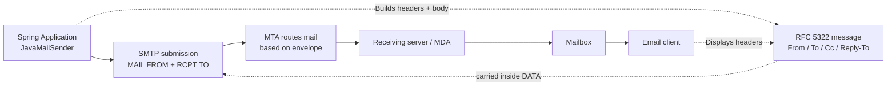

# Distinguishing Envelope Addresses from Email Header Addresses

In email architecture, a message typically has **two address layers**: **SMTP envelope addresses** used by servers to route mail, and **message header addresses** used to describe the sender, recipients, and reply destination. These two layers can match, yet **they do not have to be identical**.

With Spring Framework Mail, understanding this distinction is vital when sending notifications, emailing multiple recipients, using Bcc, setting a support inbox as `Reply-To`, or handling bounced mail. Confusing `From:` with `MAIL FROM`, or `To:` with `RCPT TO`, can lead developers to misconfigure bounce addresses, misunderstand routing, or expose confidential recipient addresses.

Example of an invoice email:

```text
SMTP envelope:
  MAIL FROM:<bounces+invoice-184@shop.example>
  RCPT TO:<alice@company.example>

Email headers:
  From: "Shop Billing" <invoices@shop.example>
  To: "Alice" <alice@company.example>
  Reply-To: support@shop.example
  Subject: Invoice 184
```

In this case, the invoice is delivered **to Alice**, the user sees **Shop Billing** as the sender, clicking **Reply** sends responses to **support@shop.example**, and delivery failure notices normally return to **bounces+invoice-184@shop.example**. All four roles coexist on one email while serving different purposes.

## 1. Where Are the Two Address Layers Formed?

Email has two protocol layers to distinguish:

| Layer | Foundational Standard | Contents | Who Primarily Uses It? |
| --- | --- | --- | --- |
| **SMTP envelope** | RFC 5321 (SMTP) and related extensions | Reverse-path from `MAIL FROM`, forward-path from each `RCPT TO` | SMTP client, Mail Submission Agent (MSA), Mail Transfer Agent (MTA), DSN handlers |
| **Message headers** | RFC 5322 (Internet Message Format), MIME, and extensions | `From:`, `To:`, `Cc:`, `Reply-To:`, `Sender:`, `Subject:`, ... | Mail clients, end users, filters, identity authentication mechanisms |

In SMTP, the envelope belongs to the **mail transfer transaction**. Once the server accepts `DATA`, the payload contains headers followed by the body. The envelope is declared via SMTP commands **outside** the `DATA` payload; therefore, opening an `.eml` file reveals headers without necessarily showing every `RCPT TO` from the original transaction.



**Core point:** the SMTP envelope decides **where to deliver** and **where to send failure reports**; message headers describe **who the message presents as sender, who the displayed recipients are, and where to reply**. Headers matter for authentication and policies, yet they do not replace the SMTP session's envelope.

## 2. Envelope Sender: `MAIL FROM`

An SMTP client begins an email transfer transaction with:

```smtp
C: MAIL FROM:<bounces@shop.example>
S: 250 2.1.0 Sender OK
```

The address inside `MAIL FROM` is called the **reverse-path** or **envelope sender**. It is the destination where mail systems send delivery failure notices—especially Delivery Status Notifications (DSNs) after a relay accepted the message and a subsequent hop failed.

This address can be:

- `bounces@shop.example` — a dedicated mailbox collecting bounced mail.
- `bounce+order-184@shop.example` — a tagged address linking a bounce back to a specific message.
- An address on a domain managed by an email service provider when the provider processes bounces for your app.
- **An empty value `<>`** in special cases, such as sending delivery-error notices with a null reverse-path to prevent bounce loops.

Null reverse-path example:

```smtp
C: MAIL FROM:<>
S: 250 2.1.0 OK
C: RCPT TO:<bounces@shop.example>
S: 250 2.1.5 OK
```

**`MAIL FROM:<>` is not invalid address syntax.** It is an intentional empty envelope sender in SMTP. If an error notification itself fails to deliver, the server must not generate another bounce back to that DSN's envelope sender because the reverse-path is already empty.

### How Does `MAIL FROM` Differ from `From:`?

```text
MAIL FROM:<bounces@shop.example>          # SMTP command, for delivery/bounce
From: "Shop Billing" <invoices@shop.example>  # Message header, displayed sender
```

These two values are completely valid when different. A dedicated bounce address lets operations track failures without flooding interactive user inboxes with automated bounces.

When sending through an intermediate SMTP service, the provider may set or rewrite the envelope sender per its policies. Thus, to confirm the `MAIL FROM` value **actually going out on the wire**, inspect the SMTP transcript or provider logs rather than relying only on the email's `From:` field.

## 3. Envelope Recipient: `RCPT TO`

The actual recipients of an SMTP transaction are declared by **one or more** `RCPT TO` commands:

```smtp
C: MAIL FROM:<bounces@shop.example>
S: 250 2.1.0 Sender OK
C: RCPT TO:<alice@company.example>
S: 250 2.1.5 Recipient OK
C: RCPT TO:<audit@shop.example>
S: 250 2.1.5 Recipient OK
```

The server knows it must handle two recipients from **two SMTP commands**, even though the subsequent message might contain only:

```text
From: invoices@shop.example
To: alice@company.example
Subject: Invoice 184
```

`audit@shop.example` can receive a blind copy **without ever appearing in `To:` or `Cc:`**. Conversely, if an address appears in `To:` without being included in the submitted recipient set, that header alone does not make SMTP deliver to it.

MTAs use each envelope recipient's domain to choose the next hop: looking up DNS MX records, delivering to an internal domain server, or forwarding via a configured relay. Across multiple domains, a system may split transactions or queues by domain, and delivery outcomes per recipient can differ.

### One `RCPT TO` Can Be Rejected While Another Succeeds

```smtp
C: RCPT TO:<alice@company.example>
S: 250 2.1.5 OK
C: RCPT TO:<missing@company.example>
S: 550 5.1.1 User unknown
```

This example shows SMTP outcomes can be **per envelope recipient**. `To:` in message headers is insufficient to know who was accepted, who was rejected, and who remains in retry. Bulk mail systems must record outcomes per recipient or via provider delivery events.

## 4. Message Headers: `From:`, `To:`, `Cc:`, `Bcc:`, `Reply-To:`

Headers appear at the top of the email content, before the blank line separating them from the body. They follow Internet Message Format rules; some hold **mailbox addresses**, while others hold display names, dates, subjects, or metadata.

| Header | Primary Meaning | Does It Directly Replace `MAIL FROM`/`RCPT TO`? |
| --- | --- | --- |
| **`From:`** | Apparent author/sender represented in the message | No. Not synonymous with `MAIL FROM` |
| **`Sender:`** | Entity transmitting the message on the author's behalf when distinct | No. Not an SMTP command |
| **`To:`** | Displayed primary recipients | No. Listing a name in headers does not guarantee an `RCPT TO` |
| **`Cc:`** | Recipients displayed as receiving a copy | No. They receive mail only if given corresponding envelope recipients |
| **`Bcc:`** | Blind carbon-copy recipients during composition/sending | No. Bcc recipients are delivered via envelope; the Bcc header must be handled to avoid leaking the list |
| **`Reply-To:`** | Where users/clients are advised to send replies | No. Not the DSN/bounce destination |
| **`Return-Path:`** | Header typically added at final delivery recording the reverse-path | Reflects the envelope sender at final delivery, yet setting the header yourself does not alter the envelope |
| **`Message-ID:`** | Message identifier for referencing and threading | No. Not an SMTP envelope ID |

Header example:

```text
From: "Shop Billing" <invoices@shop.example>
Sender: mailer@shop.example
To: "Alice Nguyen" <alice@company.example>
Cc: accounting@shop.example
Reply-To: support@shop.example
Date: Thu, 12 Nov 2026 08:30:00 +0700
Subject: November invoice
Message-ID: <invoice-184.20261112@shop.example>
```

Quotes and display names let email clients present senders and recipients more cleanly. **A display name is not a mail-delivery address**: in `"Shop Billing" <invoices@shop.example>`, the mailbox is `invoices@shop.example`, while `Shop Billing` is just a name.

### `From:` and `Sender:`

`From:` describes the author of the message; `Sender:` describes the transmitting agent when it differs from the author. In automated systems, both may appear depending on the message-building workflow. However, **`Sender:` is still a message header**. It does not replace the SMTP envelope sender and does not choose the bounce mailbox.

### `Reply-To:` Controls User Replies

Example:

```text
From: invoices@shop.example
Reply-To: support@shop.example
```

When the recipient clicks Reply, mail clients usually populate `support@shop.example` as the recipient of the **new reply email**. This header does not instruct SMTP to route DSNs to support. The bounce destination for the original email still comes from the reverse-path in the original SMTP transaction's envelope.

### `To:` and `Cc:` Are Not Absolute Delivery Lists

In standard mail-sending libraries, the library typically reads `To`, `Cc`, and `Bcc` to build the envelope recipient list. **That is behavior of the sending software**, not a rule forcing MTAs to parse `To:` for routing. An SMTP client can deliberately submit `RCPT TO` values differing from displayed addresses.

This happens in blind copies, mailing lists, aliases, forwarding, email gateways, and multi-recipient internal systems.

## 5. `Bcc`: Why Do Blind-Copy Recipients Still Receive the Email?

`Bcc` (*Blind Carbon Copy*) demonstrates the difference between the two address layers most clearly. Suppose an email is sent to:

- Alice in `To:`;
- Bob in `Cc:`;
- Audit team in `Bcc:`.

SMTP can carry the following envelope:

```smtp
MAIL FROM:<bounces@shop.example>
RCPT TO:<alice@company.example>
RCPT TO:<bob@partner.example>
RCPT TO:<audit@shop.example>
DATA
From: notifications@shop.example
To: alice@company.example
Cc: bob@partner.example
Subject: Notification

Notification content.
.
```

`audit@shop.example` receives a copy because of `RCPT TO`, **even though that address does not appear in the delivered message headers**. An MTA does not need `Bcc:` inside `DATA` to route to audit.

### How Is the `Bcc:` Header Handled?

When implementing Bcc, sending software can produce protocol-compliant copies in several ways, such as:

1. **Stripping the `Bcc:` header** from delivered copies while keeping Bcc addresses in the envelope.
2. Leaving an **empty `Bcc:`** indicating blind recipients exist without revealing them.
3. Producing a separate copy for Bcc recipients with appropriate Bcc information per policy.

Email clients and sending systems vary in behavior. Some libraries retain a `Bcc:` field on the initial message object; before delivering to recipients, ensure the header is handled per privacy requirements. **Never assume putting `Bcc:` on a `MimeMessage` guarantees every gateway strips the header from every copy.** When privacy is critical, inspect actual MIME messages delivered through your infrastructure or send separate messages.

### Can Hidden Addresses in `To:` Receive Mail?

Bcc is not the only case. A message can omit visible mailboxes in `To:` while still having valid `RCPT TO` entries. For example, mailing lists or bulk notices may use:

```text
To: undisclosed-recipients:;
```

This is a group syntax listing no mailboxes in headers; the actual recipients still come from the SMTP envelope. Client display varies, and this line should not be mistaken for missing addresses.

## 6. `Return-Path:` and Bounces: Where Confusion Strikes Most Often

The `Return-Path:` header is normally added **when the final delivery system deposits the email into a mailbox**, recording the reverse-path received from SMTP. A delivered message might contain:

```text
Return-Path: <bounces+invoice-184@shop.example>
Received: from smtp.provider.example by mx.company.example ...
From: invoices@shop.example
To: alice@company.example
Reply-To: support@shop.example
Subject: Invoice 184
```

During initial sending, applications should not manually add `Return-Path:` to "choose a bounce address." Mail infrastructure may strip, rewrite, or replace that header; **the envelope sender declared in `MAIL FROM` is what governs the SMTP error return path**.

With Spring/Jakarta Mail, envelope sender configuration uses SMTP transport mechanisms, such as **`mail.smtp.from`** when using an SMTP provider supporting it. Calling `helper.setFrom(...)` primarily controls the `From:` header; providers may fall back to that value as the default reverse-path if no separate envelope setting exists.

### Common Bounce Scenarios

| Scenario | Envelope Sender | What Happens on Delivery Failure |
| --- | --- | --- |
| Order notification | `bounces@shop.example` | Server may send a DSN to the bounce-collection mailbox |
| Email with per-message tracking | `bounce+order-184@shop.example` | System correlates bounce to the order via the tagged address |
| Third-party SMTP service | Provider-managed bounce domain | Provider handles bounces and provides webhooks/events/APIs |
| Failure DSN itself | `MAIL FROM:<>` | Empty reverse-path prevents error-notification loops |

Some systems embed recipient or message identifiers into the envelope sender address, a technique known as **Variable Envelope Return Path (VERP)**. This does not alter the email's displayed `From:` header.

**Not every rejected email produces a separate bounce.** If a server rejects during the SMTP session itself, the sending client sees the error synchronously and can notify the application. DSNs are typically used for failures occurring **after** a server accepted responsibility for delivery. Anti-spam gateways may enforce different policies; never infer complete delivery state from message headers alone.

## 7. Complete SMTP Example: Envelope Differing from Headers

Suppose an application sends a confirmation email to Alice while blind-copying an internal audit system. Abbreviated transcript:

```smtp
S: 220 smtp.provider.example ESMTP ready
C: EHLO app.shop.example
S: 250-smtp.provider.example
S: 250 SIZE 20971520
C: MAIL FROM:<bounces+order-184@shop.example>
S: 250 2.1.0 Sender OK
C: RCPT TO:<alice@company.example>
S: 250 2.1.5 Recipient OK
C: RCPT TO:<audit@shop.example>
S: 250 2.1.5 Recipient OK
C: DATA
S: 354 End data with <CRLF>.<CRLF>
C: From: "Shop" <orders@shop.example>
C: To: "Alice" <alice@company.example>
C: Reply-To: care@shop.example
C: Subject: Order 184 confirmed
C: MIME-Version: 1.0
C: Content-Type: text/plain; charset=UTF-8
C:
C: Your order is confirmed.
C: .
S: 250 2.0.0 Message accepted as Q184
C: QUIT
S: 221 Bye
```

In real sessions, submission servers typically require TLS and authentication before accepting `MAIL FROM`; `EHLO` and `AUTH` steps are omitted here to focus on addresses. Per SMTP rules, `DATA` ends with a line containing only a single period.

Key takeaways from the transcript:

1. **`MAIL FROM` is `bounces+order-184@shop.example`**, so delivery failure reports can return to this bounce handler.
2. **Two `RCPT TO` commands were accepted**, giving the transaction two SMTP recipients.
3. **`From:` is `orders@shop.example`**, letting Alice recognize the message source when reading.
4. **`To:` shows only Alice**; audit is an envelope-driven recipient absent from headers.
5. **`Reply-To:` is `care@shop.example`**; Alice's Reply action typically addresses this mailbox.
6. The `250` response after `DATA` only states **the relay accepted responsibility for further processing**. It does not confirm either recipient read—or even received—the message in their inbox.

### What If You Edit `To:` Without Changing `RCPT TO`?

Suppose the SMTP envelope still carries `RCPT TO:<alice@company.example>`, yet the MIME header says:

```text
To: bob@partner.example
```

The SMTP server still delivers the message to **Alice** because Alice is the transaction recipient. Once in Alice's mailbox, her UI may display "To: Bob," causing confusion. This is one reason applications should use proper recipient APIs rather than editing header strings.

Conversely, adding `To: alice@company.example` inside `DATA` does not cause the server to invent a new `RCPT TO`. Normal mail libraries read `To/Cc/Bcc` to populate envelope recipients before starting SMTP; if a developer drives an SMTP session manually, the two lists can diverge.

## 8. How Does Spring Framework Mail Build Headers and Envelopes?

Spring provides `JavaMailSender` and `JavaMailSenderImpl` to send via Jakarta Mail. Two common message-building styles:

- **`SimpleMailMessage`**: simple plain-text email with `setFrom`, `setTo`, `setCc`, `setBcc`, `setReplyTo`, `setSubject`, and `setText`.
- **`MimeMessage` + `MimeMessageHelper`**: supports HTML, text alternatives, attachments, inline resources, and standard email headers.

When calling `JavaMailSender.send(...)` with SMTP transport, the library normally collects recipients from the message for `RCPT TO` commands and derives the reverse-path from transport config or the default sender. Still, **`MAIL FROM` remains an SMTP transport property, distinct from the MIME `From:` header**.

### Spring Boot Configuration with a Separate Envelope Sender

Example with an SMTP server supporting submission on port 587:

```groovy
dependencies {
    implementation 'org.springframework.boot:spring-boot-starter-mail'
}
```

```yaml
# application.yml
spring:
  mail:
    host: smtp.provider.example
    port: 587
    username: ${SMTP_USERNAME}
    password: ${SMTP_PASSWORD}
    properties:
      mail.smtp.auth: true
      mail.smtp.starttls.enable: true
      mail.smtp.starttls.required: true
      mail.smtp.from: bounces@shop.example
      mail.smtp.connectiontimeout: 5000
      mail.smtp.timeout: 10000
      mail.smtp.writetimeout: 10000
```

Where Jakarta Mail SMTP transport supports `mail.smtp.from`, this property configures the **envelope sender `MAIL FROM`** for send sessions. By contrast, `setFrom("orders@shop.example")` on the message sets the **`From:` header**.

Notes:

- **`mail.smtp.from` generally applies at the sender/session level**, not automatically per recipient. Never mutate JavaMail properties on a shared `JavaMailSenderImpl` across concurrent threads to swap bounce addresses per request.
- SMTP providers may require domain verification, restrict allowed senders, or rewrite the reverse-path; application config does not guarantee identical final headers or bounce addresses.
- Credentials belong in environment secrets/config; never commit live SMTP credentials to a repository.
- In **plain Spring Framework**, declaring `spring.mail.*` in YAML does not automatically create a `JavaMailSenderImpl` without Spring Boot's auto-configuration.

### `JavaMailSender` and `MimeMessageHelper` Example

```java
import jakarta.mail.MessagingException;
import jakarta.mail.internet.MimeMessage;

import org.springframework.mail.javamail.JavaMailSender;
import org.springframework.mail.javamail.MimeMessageHelper;
import org.springframework.stereotype.Service;

@Service
public class InvoiceMailService {

    private final JavaMailSender mailSender;

    public InvoiceMailService(JavaMailSender mailSender) {
        this.mailSender = mailSender;
    }

    public void sendInvoiceNotice(String customerAddress)
            throws MessagingException {
        MimeMessage message = mailSender.createMimeMessage();
        MimeMessageHelper helper = new MimeMessageHelper(message, "UTF-8");

        helper.setFrom("invoices@shop.example");       // Header From:
        helper.setTo(customerAddress);                  // Header To:
        helper.setReplyTo("support@shop.example");      // Header Reply-To:
        helper.setSubject("Your invoice is ready");
        helper.setText("Your invoice is ready to view.");

        // SMTP transport MAIL FROM is configured separately
        // via spring.mail.properties.mail.smtp.from.
        mailSender.send(message);
    }
}
```

With the configuration above, the application requests:

```text
SMTP envelope (expected):
    MAIL FROM:<bounces@shop.example>
    RCPT TO:<customerAddress-value>

Message headers:
    From: invoices@shop.example
    To: <customerAddress-value>
    Reply-To: support@shop.example
    Subject: Your invoice is ready
```

When the API send succeeds, `JavaMailSender` confirms submission to the relay under server-accepted conditions. Forwarding failures at later hops can surface asynchronously as bounces/events outside the `sendInvoiceNotice(...)` call.

**Key takeaway:** Spring code expresses sending intent and constructs headers. To confirm which envelope sender and recipients went out after provider policies ran, inspect SMTP transport/relay logs and the delivered message when investigating.

### Common API-to-Protocol Mapping

| API or Setting | Primary Effect | Note |
| --- | --- | --- |
| `SimpleMailMessage.setFrom(...)` | Sets From on the created message | Transport may use it as default MAIL FROM unless overridden |
| `MimeMessageHelper.setFrom(...)` | Sets `From:` header | Not a dedicated envelope-sender setter |
| `setTo(...)`, `setCc(...)`, `setBcc(...)` | Sets recipient fields on the message | JavaMailSender normally derives envelope recipients from these; verify Bcc privacy |
| `setReplyTo(...)` | Sets `Reply-To:` header | Does not route bounces to Reply-To |
| `spring.mail.properties.mail.smtp.from` | Configures `MAIL FROM` for the corresponding SMTP transport | Typically applies per sender/session and is subject to provider policy |
| Manually adding `Return-Path:` header | Creates a header field in the message | **Not** a reliable way to change `MAIL FROM` |
| `mailSender.send(message)` | Submits message over mail transport | Does not equate to inbox delivery |

## 9. When Multiple Recipients and Blind Copies Are Needed

A Spring application can address multiple recipients:

```java
MimeMessage message = mailSender.createMimeMessage();
MimeMessageHelper helper = new MimeMessageHelper(message, "UTF-8");

helper.setFrom("news@shop.example");
helper.setTo("alice@company.example");
helper.setCc("manager@shop.example");
helper.setBcc("audit@shop.example");
helper.setSubject("Notification");
helper.setText("Notification content.");

mailSender.send(message);
```

At the API layer, the email has three recipient groups. SMTP transport usually sends `To`, `Cc`, and `Bcc` as `RCPT TO` recipients. Still, **how the `Bcc:` header is handled in outgoing content** depends on the library, SMTP server, and copy generation. When strict confidentiality of blind-copy addresses is required, inspect the raw MIME copies delivered through your infrastructure.

For bulk notifications to many customers, an easy-to-govern privacy pattern is **creating a separate message per recipient**, paired with a queue and provider rate limits. This also supports content personalization and per-customer delivery tracking without exposing large lists via `To` or `Cc`.

### When Envelope Recipients Must Differ Completely from Headers

`JavaMailSender.send(MimeMessage)` is a convenience API that does not expose a separate `RCPT TO` parameter. If a specialized design requires **sending to an SMTP recipient set completely distinct from all header recipients**, you may need low-level Jakarta Mail transport APIs (`sendMessage(message, Address[] recipients)`) or provider-specific capabilities. In that case, the application owns authorization, Bcc policy, and delivery state tracking.

Never expect editing `To:` or `Bcc:` strings after sending to retroactively adjust an already-executed SMTP envelope.

## 10. Relationship to SPF, DKIM, and DMARC

Distinguishing envelope from headers is foundational to understanding email authentication. Each mechanism checks a different identity:

| Mechanism | Key Identity | Remember |
| --- | --- | --- |
| **SPF** | Domain used in SMTP `MAIL FROM` (or HELO/EHLO as applicable, especially for null reverse-path) | Checks whether the sending IP is authorized by the corresponding envelope domain |
| **DKIM** | Signing domain in `DKIM-Signature: d=...` | Verifies the cryptographic signature over signed headers/body; does not authenticate `From:` alone |
| **DMARC** | Domain in the **`From:`** header and SPF/DKIM alignment | Requires at least one SPF or DKIM pass aligned with the From header per policy |

Example:

```text
MAIL FROM: bounce@mailer.provider.example
From: billing@shop.example
DKIM-Signature: ... d=shop.example; ...
```

Here, SPF may pass for `mailer.provider.example`, yet **not align** with `From: shop.example` if the two domains do not share an organizational domain under DMARC rules. If DKIM passes with `d=shop.example`, DMARC can still pass via the DKIM branch. Without either aligned SPF or aligned DKIM passing, DMARC can fail depending on evaluation and policy.

Consequently:

- Changing `Reply-To:` does not make SPF or DMARC pass.
- Switching `From:` to a new domain without configuring domain authentication at your provider can lead to rejections or spam placement.
- Using a bounce address on another domain changes the evaluated SPF identity, though a stream can still pass DMARC via aligned DKIM.
- Never treat `Return-Path:` seen in a mailbox as the sole proof of authentication: diagnosing requires `Authentication-Results` from trusted servers, SMTP logs, and DNS records.

### Anti-Spoofing Notes

The `From:` header is message content that software can populate freely. Seeing `"CEO" <ceo@company.example>` as a display name does not establish sender authenticity. Email clients and gateways must rely on authentication outcomes and policies.

`Reply-To:` can legitimately differ from `From:` (for instance, automated mail from `no-reply` wanting replies sent to support); even so, it is a signal worth inspecting when evaluating suspicious emails.

## 11. Mailing Lists, Aliases, and Forwarding Separate the Two Layers

An email's delivery path can change after submission while headers largely keep their original values.

### Mailing Lists

A sender submits:

```text
MAIL FROM:<anna@company.example>
RCPT TO:<team@lists.example>
To: team@lists.example
```

The list server receives the message and initiates separate deliveries to members. During redistribution:

```text
MAIL FROM:<list-bounces@lists.example>
RCPT TO:<member1@partner.example>
RCPT TO:<member2@partner.example>
To: team@lists.example
```

`team@lists.example` in the header still reflects the mailing-list context, while **the redistribution's envelope recipients are the actual members**. Mailing list software may also adjust `List-Id`, `Reply-To`, `Sender`, or `From` per policy.

### Aliases and Forwarding

If `sales@company.example` is an alias for `anna@company.example`, a sender submits `RCPT TO:<sales@company.example>`. After receipt, the internal mail system delivers to Anna's mailbox even though `To:` still reads `sales@company.example`.

If a mailbox forwards mail to another domain, the forwarding system updates the envelope recipient to the new target. Some forwarders also rewrite the envelope sender using **Sender Rewriting Scheme (SRS)** to preserve SPF across forwarding. Users still see the original author's `From:`, because headers do not have to be rewritten every time the envelope routes onward.

That is why when investigating delayed, lost, or bounced emails, inspecting `To:` alone is insufficient to trace every real hop.

## 12. Inspecting and Diagnosing Sent Messages

To investigate accurately, separate evidence from both layers:

| Source | What You Can Observe | What You Should Not Infer |
| --- | --- | --- |
| **Raw message / `.eml`** | `From:`, `To:`, `Cc:`, `Reply-To:`, `Message-ID:`, possibly `Return-Path:` and `Received:` | Does not necessarily show all `RCPT TO` values from prior SMTP sessions |
| **SMTP transcript** | `MAIL FROM` command, each `RCPT TO`, per-transaction `250/4xx/5xx` responses | Does not prove the user opened the email |
| **MTA / relay logs** | Queue ID, routing path, accepted/rejected recipients, retries, bounces | May lack full body or internal delivery outcomes |
| **DSN / provider events** | Bounced, deferred, delivered per provider definitions, affected recipient | Does not mean read; events can arrive late or duplicate |
| **Mailbox / email client** | Received headers, body, and rendering | Does not accurately show all original Bcc addresses |

When debugging Spring:

1. Record the business ID, recipient address, recipient domain, and submission timestamp. Avoid dumping full addresses into widely shared logs.
2. Check which host/port `JavaMailSender` uses, whether `mail.smtp.from` is set, and whether the provider rewrites senders.
3. Inspect sent messages via a mail-capture tool or test client to verify expected headers.
4. When confirming the true envelope, inspect SMTP transcripts or relay logs. Remember SMTP debug logs may hold sensitive metadata—never enable them publicly.
5. If mail goes missing, check logs/DSNs by **actual envelope recipient**, not solely `To:`.
6. When using Bcc, verify **each delivered copy** omits hidden addresses from headers/body; consider per-recipient messages.

### Why Might `Return-Path:` Be Missing on a Newly Created Message?

`Return-Path:` is typically added at **final delivery**. Thus, a freshly constructed `MimeMessage` in your application will usually lack this header even though SMTP transport still uses `MAIL FROM` when sending. Conversely, seeing `Return-Path` on a received `.eml` reflects whatever value the delivering system recorded at delivery time, potentially after relays or forwarding.

Do not force a manual `Return-Path:` header as a substitute for envelope configuration. To change where bounces go, use your SMTP provider's supported features or the appropriate SMTP transport property.

### Diagnostic Clues

| Symptom | What to Distinguish | Investigation / Fix |
| --- | --- | --- |
| Recipient clicks Reply yet mail goes to the wrong inbox | Is `Reply-To:` or `From:` steering replies? | Check headers and `setReplyTo` config |
| Bounces land in a personal mailbox | Is `MAIL FROM` falling back to default `From:`? | Check `mail.smtp.from` and relay policy |
| `To:` header lists Alice, yet Bob received the mail | Who was the real `RCPT TO`? | Check SMTP transcript, aliases/forwarding, delivery system |
| Bcc recipient exposed | Did headers or body contain the Bcc address? | Inspect raw MIME at each target; change sending pattern if needed |
| SPF passes yet DMARC fails | Is SPF aligned with `From:`; how is DKIM? | Check `MAIL FROM`, DKIM signature, and DNS |
| `send()` succeeds yet hard bounce arrives | Relay accepted it, then destination MX rejected later? | Correlate queue ID and DSN/provider events per recipient |
| One recipient succeeds while another is rejected | Are `RCPT TO` results per recipient? | Store delivery status per recipient; avoid resending to those already delivered |

## 13. Real-World Scenarios with Spring Framework Mail

### Scenario A: Transactional Email with a Dedicated Support Address

A store sends automated notices from `orders@shop.example`, wants customer replies directed to `help@shop.example`, and uses `bounces@shop.example` to collect DSNs.

```text
MAIL FROM:<bounces@shop.example>
RCPT TO:<customer@company.example>
From: orders@shop.example
To: customer@company.example
Reply-To: help@shop.example
```

**Expected outcome:** customers see the orders team as sender, Reply goes to helpdesk, and the bounce processor updates delivery statuses. Calling `setReplyTo("help@shop.example")` alone will not route bounces to helpdesk.

### Scenario B: Sending to a Customer and a Bcc Recipient

An application sends an invoice to a customer and wants an operations agent to receive a blind copy. Over SMTP, both the customer and the agent need envelope recipients. In headers, the agent must not be exposed on the customer's copy. **How Bcc is built in MIME and how servers deliver copies must be verified**, because privacy is essential.

At higher scale, sending one separate message per recipient simplifies personalization, data protection, and per-recipient tracking.

### Scenario C: Email to a Group List

An application sends `To: engineers@lists.example` using the same list address as the envelope recipient. The mailing list then fans out to actual members. When one member reports not receiving it, the application's SMTP logs show only delivery **to the list**, not necessarily individual final recipients. Check the list-management system's logs/DSNs.

### Scenario D: Sending via a Third-Party SMTP Service

An application sets `From: billing@brand.example`, while the provider uses `MAIL FROM:<bounce-id@provider.example>`. This can be completely valid; the provider handles bounces and exposes webhooks. However, because envelope and header domains differ, pay close attention to SPF and DKIM alignment for DMARC, and verify `brand.example` per the provider's instructions.

## 14. Self-Check Questions

**1. If `From:` is `support@shop.example`, do bounces always return there?**

No. Bounces route according to the SMTP envelope reverse-path (`MAIL FROM`) or the provider's bounce mechanism, which can differ from `From:`.

**2. If `To:` lists two addresses, does an MTA automatically deliver to both?**

MTAs rely on envelope recipients supplied by the SMTP client via `RCPT TO`. Sending libraries usually convert `To/Cc/Bcc` into recipients, yet an MTA does not blindly read `To:` inside `DATA` as its delivery list.

**3. Why does an email sent via Bcc still reach the mailbox when the recipient's address isn't in `To:`?**

Because the Bcc address was submitted as an envelope recipient; visible headers may be stripped or altered to keep the list private.

**4. Does `Reply-To:` change `MAIL FROM`?**

No. It guides mail clients when users reply. `MAIL FROM` belongs to SMTP transport.

**5. Why might `Return-Path:` appear in a mailbox copy even though it wasn't on a newly created `MimeMessage`?**

Because `Return-Path:` is typically added by the final delivery system when depositing the message into a mailbox to record the reverse-path.

**6. Is Spring's `MimeMessageHelper.setFrom(...)` enough to customize the bounce address?**

No, not if the application requires a guaranteed distinct envelope sender. Configure SMTP transport—such as `mail.smtp.from` where supported—or use provider-specific features.

**7. Does `MAIL FROM` differing from the `From:` header immediately cause DMARC to fail?**

Not necessarily. DMARC requires alignment on at least one passing branch (SPF or DKIM); DKIM can align with the `From` header even if the envelope sender uses a different domain.

**8. Is `MAIL FROM:<>` invalid SMTP syntax?**

No. A null reverse-path is intentional and standard, notably for delivery status notifications.

## Conclusion

**SMTP envelope addresses** live in `MAIL FROM` and `RCPT TO` commands, governing delivery targets and error return paths in an SMTP transaction. **Header addresses** such as `From:`, `To:`, `Cc:`, and `Reply-To:` describe how the message is presented and how users interact with it; `Return-Path:` typically records the reverse-path once delivered into a mailbox. In Spring Framework Mail, use `JavaMailSender`/`MimeMessageHelper` to build messages, configure the envelope sender at the SMTP transport layer when needed, and inspect SMTP transcripts or provider events to verify delivery. Keeping these two layers distinct helps you handle **Bcc, bounces, forwarding, mailing lists, SPF, and DMARC** accurately—without drawing false conclusions from email headers alone.
