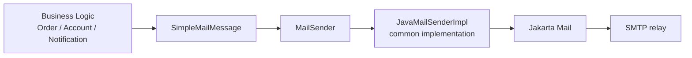
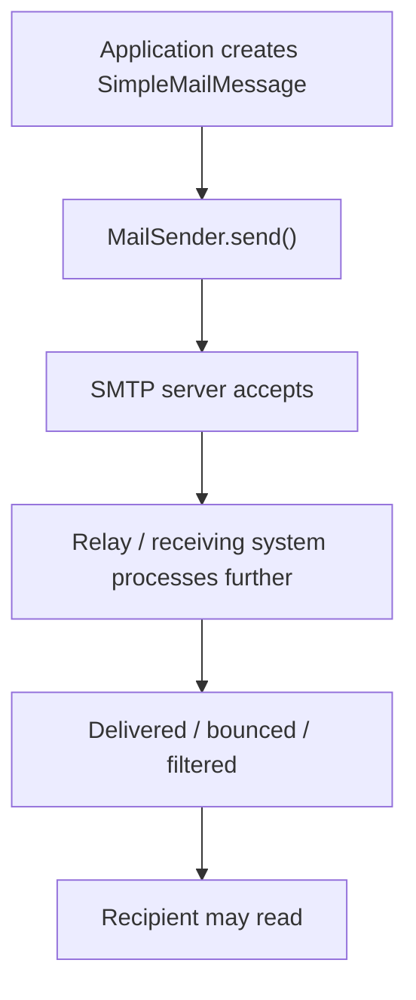
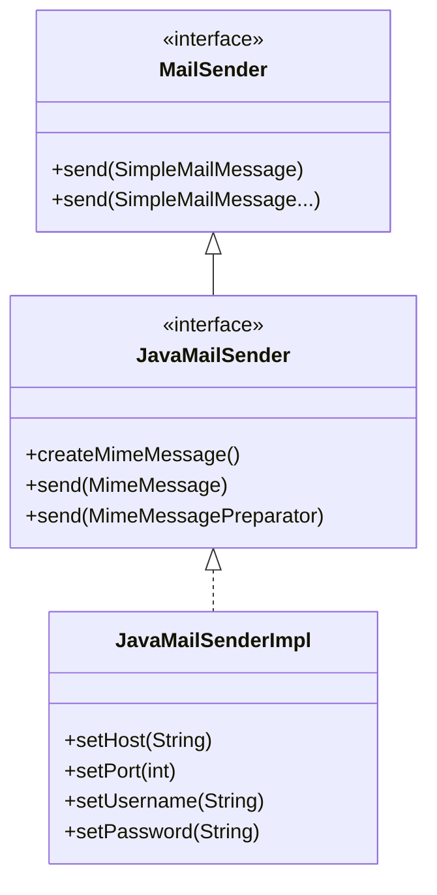
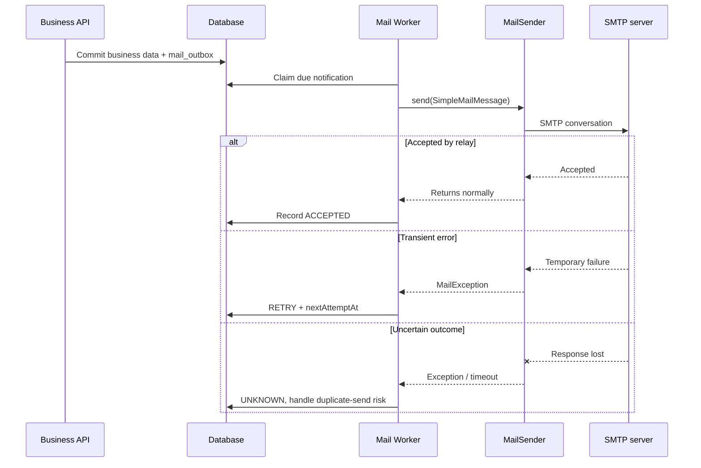

# MailSender and the Simple Mail Sending Contract

In Spring Framework Mail, the first step to sending an email does not necessarily mean working directly with the SMTP protocol, `MimeMessage`, or Jakarta Mail objects. Spring provides a small abstraction named **`MailSender`**, which takes mail data in the form of a **`SimpleMailMessage`** and performs the send operation. For a notification consisting only of a sender, recipients, a subject, and plain text, these two types are enough to build a clear, replaceable, and easily testable mail-sending flow.

What matters is understanding **the contract of the send call**. What does it mean when `mailSender.send(message)` returns normally? Which errors are reported to the caller? Does Spring automatically queue, retry, confirm that the recipient read the message, or guarantee no duplicate emails? A good design needs to answer those questions before placing an email-sending operation into a business workflow.

This lesson focuses on the Spring Framework Java Mail API: `org.springframework.mail.MailSender`, `org.springframework.mail.SimpleMailMessage`, and the common implementation via `org.springframework.mail.javamail.JavaMailSender`. The examples use Spring Boot 3.x, Java 21, and Jakarta Mail; the principles regarding the API contract also apply when configuring plain Spring Framework.

## 1. What is MailSender?

`MailSender` is **Spring's high-level interface** for sending simple text emails. It puts the focus on *sending a message*, rather than requiring business code to create SMTP connections or construct MIME manually.

At its core, the interface has two methods:

```java
package org.springframework.mail;

public interface MailSender {

    void send(SimpleMailMessage simpleMessage) throws MailException;

    void send(SimpleMailMessage... simpleMessages) throws MailException;
}
```

Key points to recognize immediately:

- **Input** is a single `SimpleMailMessage` or a group of `SimpleMailMessage` instances.
- **Return value** is `void`. The contract does not return a `messageId`, a receipt, or a delivery-status object.
- **Errors** are represented by `MailException` and its subclasses. In Spring, `MailException` is a runtime exception; callers are not forced to declare `throws` or `catch` in method signatures.
- **The actual transport** is decided by the implementation. The interface does not require a service to know the SMTP host, port, username, password, or how Jakarta Mail creates a session.
- **Content scope** corresponds to simple messages; if you need HTML, attachments, inline images, or complex MIME structures, use `JavaMailSender` and `MimeMessage`.

Responsibility diagram:



Business code only needs to depend on `MailSender` if the current requirement is truly plain-text mail. This approach creates a boundary that is easy to replace with a fake/stub in tests, without coupling every service to a specific SMTP implementation.

## 2. What Data Does SimpleMailMessage Represent?

`SimpleMailMessage` is a **mutable** Java object containing the basic fields of a plain-text message. Commonly used properties include:

| Field | Common API | Meaning |
|---|---|---|
| Sender | `setFrom(String)` | Address displayed in the From field; must be permitted by the provider |
| Primary recipients | `setTo(String...)` | One or more recipient addresses |
| Carbon copy recipients | `setCc(String...)` | Recipients publicly listed in the Cc header |
| Blind carbon copy recipients | `setBcc(String...)` | Bcc recipients; normally omitted from the delivered message headers |
| Reply address | `setReplyTo(String)` | Address recipients should reply to, which may differ from From |
| Subject | `setSubject(String)` | Email subject line |
| Body | `setText(String)` | Plain-text body of the message |
| Sent time | `setSentDate(Date)` | Sent timestamp value declared in the message |

Example of creating a message:

```java
import org.springframework.mail.SimpleMailMessage;

SimpleMailMessage message = new SimpleMailMessage();
message.setFrom("notifications@example.test");
message.setTo("learner@example.test");
message.setReplyTo("support@example.test");
message.setSubject("Chào mừng bạn");
message.setText("""
        Xin chào!

        Tài khoản học tập của bạn đã được tạo.
        Đây là một email thử nghiệm.
        """);
```

For Vietnamese content, you must configure an appropriate character encoding for the sending implementation, typically UTF-8. `SimpleMailMessage` holds the data as `String` in memory; converting it into the actual email message is performed by the mail implementation.

### 2.1. What SimpleMailMessage Does Not Do

You should not treat `SimpleMailMessage` as a simplified `MimeMessage` that can still do everything. It **provides no API** to:

- create HTML content with a plain-text fallback part;
- send file attachments;
- set a `Content-ID` for inline images;
- control individual MIME parts and per-part headers;
- specify `Content-Disposition` or charset per MIME part;
- work with `MimeMultipart`, `MimeBodyPart`, or `DataSource` chains.

If you call `message.setText("<h1>Hello</h1>")`, normal recipients will see **the raw HTML character string as plain text**, rather than receiving a properly formatted HTML email. When rich content requirements appear, switch to `MimeMessage`/`MimeMessageHelper`, rather than hand-crafting MIME headers into `setText()`.

### 2.2. SimpleMailMessage is Mutable: Create a Message per Send Attempt

This object allows calling setters after creation. If you share a single instance as a shared variable and mutate the recipient across multiple requests, threads can observe unintended data. That is especially dangerous when sending emails to different users.

You should **create a new instance for each send intent**:

```java
public void sendGreeting(MailSender sender, String recipient) {
    SimpleMailMessage message = new SimpleMailMessage();
    message.setFrom("notifications@example.test");
    message.setTo(recipient);
    message.setSubject("Welcome");
    message.setText("Welcome to the platform.");
    sender.send(message);
}
```

If many emails share static configuration, `SimpleMailMessage` provides a copy constructor from a template message. Each send modifies its own copy:

```java
SimpleMailMessage template = new SimpleMailMessage();
template.setFrom("notifications@example.test");
template.setReplyTo("support@example.test");

SimpleMailMessage message = new SimpleMailMessage(template);
message.setTo("learner@example.test");
message.setSubject("Notification");
message.setText("Notification content");

mailSender.send(message);
```

When using a shared template, do not continue mutating the original concurrently from multiple threads. A dedicated message-builder class or a factory creating new instances is usually easier to manage than sharing a mutable object.

## 3. What Does the send(SimpleMailMessage) Contract Actually Promise?

Suppose a service calls:

```java
mailSender.send(message);
```

After the call, there are two outcome categories observable by code:

1. **The method completes normally:** the implementation reports no error at the time of processing the send operation.
2. **The method throws `MailException`:** the implementation detected a preparation, authentication, or sending error; the caller must handle or propagate it according to business rules.

With common SMTP-based implementations, the call typically performs network work **synchronously** on the calling thread until transport completes or encounters an error/timeout. The `MailSender` interface itself does not define an SLA, a maximum runtime, or a durable queue mechanism.

### 3.1. Sending Successfully Does Not Mean Delivered to the Inbox

An email goes through multiple stages:



When the SMTP server returns an acceptance response after the message data, you can interpret that the relay has taken responsibility for processing the message at that hop. Whether the email lands in the inbox or is later rejected by the receiving system is a different matter. `send()` does not wait for the recipient to open the email, does not necessarily receive final delivery events, and does not return a read/open receipt.

Therefore:

| Evidence the application has | What can be concluded | What cannot be concluded |
|---|---|---|
| Created `SimpleMailMessage` | Constructed send data in memory | The message has gone over the network |
| `MailSender.send()` returns normally on a common SMTP transport | The send operation to the SMTP relay is considered complete by the implementation | The message has definitely reached the inbox or been read |
| `send()` throws `MailException` | An error was detected by the implementation | Every recipient was definitely not accepted |
| Provider `delivered` event exists | The provider recorded a delivery milestone according to its own definition | The user has read or interacted with it |
| `bounce` event exists | A rejection/return response came from sending/receiving infrastructure | The cause is necessarily the email content or the application |

In particular, when the connection drops after the client finishes sending data but before receiving the acceptance response, the application may **not know for sure whether the SMTP server accepted the email**. Blindly retrying can cause the recipient to receive two emails. Therefore, `send()` behavior should not be advertised as exactly-once.

### 3.2. No Cross-Database-and-SMTP Transaction

Calling `send()` does not automatically participate in a database transaction. For example:

```java
@Transactional
public void createOrderAndSendEmail(CreateOrderCommand command) {
    // Save order data to the database
    orderRepository.save(...);

    // Send via SMTP; operation outside the database
    mailSender.send(...);
}
```

This is sketch code to **identify boundaries**, not a method that compiles as-is.

If SMTP accepts the email and the database transaction then rolls back, there is no corresponding SMTP rollback operation. Conversely, if the database commits first and the JVM stops before calling `send()`, the intended email can be lost. For critical notifications requiring recovery, record the **send intent** in an outbox within the same business data transaction, and have a worker send it outside that transaction.

`MailSender` solves **how to request sending an email**, whereas a Transactional Outbox, queue, retry, and status tracking solve **the durability of the sending workflow**.

## 4. The Two Overloads of MailSender

### 4.1. Sending a Single SimpleMailMessage

The most common overload:

```java
void send(SimpleMailMessage simpleMessage) throws MailException;
```

Example:

```java
SimpleMailMessage message = new SimpleMailMessage();
message.setTo("alice@example.test");
message.setFrom("noreply@example.test");
message.setSubject("Lesson notification");
message.setText("You have a new lesson.");

mailSender.send(message);
```

Each call is one send request at the application level. When this operation runs inside an HTTP request, waiting on SMTP can slow down the response.

### 4.2. Sending a Batch of SimpleMailMessage

The second overload:

```java
void send(SimpleMailMessage... simpleMessages) throws MailException;
```

Example:

```java
SimpleMailMessage first = new SimpleMailMessage();
first.setFrom("noreply@example.test");
first.setTo("alice@example.test");
first.setSubject("Notice A");
first.setText("Content A");

SimpleMailMessage second = new SimpleMailMessage();
second.setFrom("noreply@example.test");
second.setTo("bob@example.test");
second.setSubject("Notice B");
second.setText("Content B");

mailSender.send(first, second);
```

Varargs lets you pass multiple messages in a single API call; the implementation may optimize connection usage. **This is not an atomic transaction**. There is no guarantee that either all emails are accepted or none are accepted. If one message or recipient fails, those already sent successfully beforehand cannot be recalled.

For business notifications requiring independent retries, manage **each send request separately**. When sending in batches, account for partial success, per-message failures, and how to identify which messages can be retried.

### 4.3. A Single SimpleMailMessage with Multiple Recipients

One message can specify multiple recipients:

```java
SimpleMailMessage message = new SimpleMailMessage();
message.setFrom("team@example.test");
message.setTo("alice@example.test", "bob@example.test");
message.setCc("supervisor@example.test");
message.setBcc("audit@example.test");
message.setSubject("Meeting schedule");
message.setText("The meeting schedule has been updated.");

mailSender.send(message);
```

Over SMTP, a single message can go through multiple `RCPT TO` commands. Some addresses may be accepted while others are rejected. Statuses need to be handled per recipient if the system requires accurate retries and reliable reporting.

**To, Cc, and Bcc are not equivalent regarding privacy.** Recipients in To/Cc see the public addresses; Bcc addresses are normally not included in headers visible to other recipients. When sending personal notifications or emailing a list of customers, create a separate email per recipient to avoid exposing addresses across customers and to make tracking each person's outcome easier.

## 5. JavaMailSender as the Common Concrete Implementation

An abstract interface does not open an SMTP connection by itself. In the Spring ecosystem, `JavaMailSender` extends `MailSender` to support sending MIME, and `JavaMailSenderImpl` is the common implementation built on Jakarta Mail.



A `JavaMailSenderImpl` can be injected via **`MailSender`** because it implements that interface. The design benefit is that a service only sees the capabilities it needs:

```java
import org.springframework.mail.MailSender;

public class RegistrationNotificationService {

    private final MailSender mailSender;

    public RegistrationNotificationService(MailSender mailSender) {
        this.mailSender = mailSender;
    }

    // Only sends SimpleMailMessage, so no dependency on JavaMailSender is needed.
}
```

Only when a new requirement calls for HTML or attachments should you switch the abstraction of the service needing that feature to `JavaMailSender`. Not every email-sending service has to depend on the MIME API from the start.

### 5.1. How Does Spring Boot Configure JavaMailSender?

With Spring Boot, you typically add the starter:

```groovy
dependencies {
    implementation 'org.springframework.boot:spring-boot-starter-mail'
}
```

Then provide mail configuration, for example in `application-local.yml` for a mock SMTP environment:

```yaml
spring:
  mail:
    host: localhost
    port: 1025
    default-encoding: UTF-8
    properties:
      mail:
        smtp:
          auth: false
          starttls:
            enable: false

app:
  mail:
    from: noreply@example.test
```

Spring Boot provides conditional auto-configuration to create a `JavaMailSenderImpl` bean when the required libraries and configuration are present, while backing off if the application already provides a suitable bean. For injection to succeed, the application must have a bean satisfying the `MailSender` type. **Merely declaring the dependency without host configuration or a suitable bean does not guarantee the mail sender is ready to operate.**

A mock SMTP server such as Mailpit can be run with:

```bash
docker run --rm --name mailpit -p 1025:1025 -p 8025:8025 axllent/mailpit
```

- SMTP: `localhost:1025`.
- Web UI for viewing mail: `http://localhost:8025`.
- In Docker Compose, if the app runs in another container, use the SMTP service name instead of `localhost`.

The configuration above is for practice only. Real SMTP servers usually require authentication and TLS, along with a sending account / From address authorized by the provider. Avoid storing passwords directly in committed configuration files.

### 5.2. Configuring Real SMTP with Finite Timeouts

General example for SMTP submission supporting STARTTLS on port 587:

```yaml
spring:
  mail:
    host: ${SMTP_HOST}
    port: ${SMTP_PORT:587}
    username: ${SMTP_USERNAME}
    password: ${SMTP_PASSWORD}
    default-encoding: UTF-8
    properties:
      mail:
        smtp:
          auth: true
          starttls:
            enable: true
            required: true
          connectiontimeout: 5000
          timeout: 10000
          writetimeout: 10000

app:
  mail:
    from: ${MAIL_FROM}
```

The three Jakarta Mail timeouts here are measured in **milliseconds**:

- `connectiontimeout`: wait limit for opening a connection.
- `timeout`: wait limit for reading a response.
- `writetimeout`: time limit for writing data.

These are illustrative values only and should be tuned to your provider and system latency tolerances. If the provider uses implicit TLS on port 465, SSL settings must match that mode; do not blindly reuse the STARTTLS configuration for port 587. Enable security and verify server certificates according to policy.

### 5.3. Manual Configuration in Plain Spring Framework

If you do not use Spring Boot auto-configuration, you can create the `JavaMailSenderImpl` bean manually:

```java
package com.example.mail;

import org.springframework.context.annotation.Bean;
import org.springframework.context.annotation.Configuration;
import org.springframework.mail.MailSender;
import org.springframework.mail.javamail.JavaMailSenderImpl;

@Configuration
public class LocalMailConfiguration {

    @Bean
    MailSender mailSender() {
        JavaMailSenderImpl sender = new JavaMailSenderImpl();
        sender.setHost("localhost");
        sender.setPort(1025);
        sender.setDefaultEncoding("UTF-8");
        sender.getJavaMailProperties()
                .put("mail.smtp.auth", "false");
        return sender;
    }
}
```

This is an **unauthenticated local** configuration, used to understand the bean creation mechanism. In production, host, port, TLS, and credentials must come from an appropriate configuration source, never hardcoded.

If an application needs both the simple API and MIME, you can declare a bean returning `JavaMailSender` and inject it into services as `MailSender` or `JavaMailSender` depending on their needs. Choosing the interface depends on the caller's requirements, not on whether the SMTP server is simple or complex.

## 6. Writing a Business Service That Depends Only on MailSender

Example: after a user enrolls in a course, the system needs to send a plain-text notification to a verified address. The service receives a recipient email and a course title from the business layer.

```java
package com.example.mail;

import org.springframework.beans.factory.annotation.Value;
import org.springframework.mail.MailSender;
import org.springframework.mail.SimpleMailMessage;
import org.springframework.stereotype.Service;

@Service
public class EnrollmentNotificationService {

    private final MailSender mailSender;
    private final String fromAddress;

    public EnrollmentNotificationService(
            MailSender mailSender,
            @Value("${app.mail.from}") String fromAddress) {
        this.mailSender = mailSender;
        this.fromAddress = fromAddress;
    }

    public void sendEnrollmentNotice(
            String recipientAddress, String courseTitle) {

        SimpleMailMessage mail = new SimpleMailMessage();
        mail.setFrom(fromAddress);
        mail.setTo(recipientAddress);
        mail.setSubject("Course enrollment successful");
        mail.setText("""
                Hello!

                You have successfully enrolled in the course: %s

                This is an automated notification email.
                """.formatted(courseTitle));

        mailSender.send(mail);
    }
}
```

The code clearly reveals the contract:

1. **Business input**: a verified recipient address and a course title.
2. **Message creation**: populates only the fields supported by a simple plain-text email.
3. **Sending via abstraction**: calls `MailSender.send(mail)`, without opening an SMTP socket directly.
4. **Outcome**: if no exception is thrown, the send operation at the mail sender layer completed according to the implementation; if an exception is thrown, it propagates to the caller.

From a business perspective, you should separate **having enrolled in the course** from **having sent the notification email**. If sending the email fails, you do not necessarily have to cancel the enrollment. The behavior depends on product requirements: you can record the send intent in an outbox so a worker can recover it.

### 6.1. Validating Input at the Appropriate Layer

Do not let a service accept arbitrary input and pass it straight into sender/recipient addresses and message content:

- Recipient addresses should be checked for syntax, send authorization, and compliance with security policies.
- The `From` address must fall within the scope allowed by the application and provider, not chosen arbitrarily by the caller.
- User-supplied text content must be length-controlled and avoid putting sensitive data into emails unnecessarily.
- If the email contains action links, build URLs based on a trusted domain; never use raw `Host` headers or URLs supplied by untrusted parties.
- Never write email bodies, OTPs, password-reset tokens, or SMTP passwords into regular logs.

Having a `setTo()` API does not replace send-permission checks at the business layer. A user must not be able to trigger unlimited emails to someone else's address just because the backend has a MailSender available.

## 7. The MailException Hierarchy Contract

`MailException` is the base exception class for the mail module in Spring. Depending on the error detected during execution, implementations can throw different subclasses.

| Exception type | Usually related to | Handling direction |
|---|---|---|
| `MailAuthenticationException` | SMTP authentication failed | Check credentials, configuration, send permissions; usually alert operations |
| `MailSendException` | Send operation failed | Classify the underlying cause; may include per-message results |
| `MailParseException` | Message data cannot be parsed/constructed validly | Fix input data or message construction |
| `MailPreparationException` | Failed to prepare message, especially with MimeMessagePreparator | Fix template or MIME preparation step |
| `MailException` in general | A mail error abstracted by Spring | Transition workflow to an error state; do not retry blindly by default |

Note: an application that only uses `SimpleMailMessage` usually cares most about send and authentication errors. The MIME preparation exceptions become more meaningful when using the extended `JavaMailSender` API. This table describes the general Spring Mail ecosystem, **and does not claim that every error originates from the same overload**.

Example handling at a worker boundary:

```java
import org.springframework.mail.MailAuthenticationException;
import org.springframework.mail.MailException;
import org.springframework.mail.MailSendException;

public void deliver(SimpleMailMessage message) {
    try {
        mailSender.send(message);
        deliveryState.recordAcceptedByTransport();
    } catch (MailAuthenticationException ex) {
        deliveryState.recordConfigurationFailure("SMTP_AUTH");
        throw ex;
    } catch (MailSendException ex) {
        deliveryState.recordSendFailure("SMTP_SEND");
        throw ex;
    } catch (MailException ex) {
        deliveryState.recordMailFailure("SPRING_MAIL");
        throw ex;
    }
}
```

This is a **flow-handling sketch**: `deliveryState` is an application-defined component, not a Spring API. Likewise, `recordAcceptedByTransport()` only marks an adapter milestone, not a confirmation that the email reached the recipient's inbox.

### 7.1. MailSendException and Partial Results

When sending multiple messages, `MailSendException` can hold a list/map of errors corresponding to failed messages via `getFailedMessages()`. In addition, the exception can wrap the underlying Jakarta Mail cause.

That **does not turn all remaining parts into proof of inbox delivery**. The failed-messages map is built by the implementation from failures it observed; there can still be cases of uncertain status when a connection drops at the SMTP boundary.

If the business requires tracking each recipient individually, design each recipient as an independent send request carrying its own `notificationId` and database status. That makes retrying and monitoring much easier to control than a multi-recipient send or a large varargs call.

### 7.2. Retries Should Not Be Decided by Exception Name Alone

Some errors are recoverable after waiting, such as SMTP `421`, `450`, or `451`; others require fixing data or configuration, such as nonexistent addresses, invalid credentials, or broken templates.

For production systems:

1. Preserve the error category, SMTP reply code, and enhanced status code if provided by the server/provider.
2. Distinguish transient errors, permanent errors, configuration errors, and **uncertain** outcomes.
3. For transient errors, retry using backoff with jitter, bounded retry counts, and a finite deadline.
4. For configuration errors, raise an alert and prioritize fixing the root cause rather than retrying indefinitely.
5. When SMTP may have accepted the message but the response was lost, weigh the risk of duplicate delivery and provider reconciliation options.

You should not write `catch (MailException ex) { mailSender.send(message); }` and consider that a retry strategy. Immediately resending on the failing thread can increase load on an already overloaded SMTP server and cause uncontrolled duplication when requests are replayed.

## 8. MailSender Does Not Manage Retries or Durable Queues

A common misconception is that because Spring has a mail abstraction, it will automatically handle all delivery failures. In reality, `MailSender` only defines **the send-call contract**. The following capabilities belong to the broader system:

| Need | Guaranteed by MailSender itself? | Component typically responsible |
|---|---|---|
| Creating plain-text messages | Yes, via `SimpleMailMessage` and the implementation | Mail-creating service + MailSender |
| Sending over the configured transport | Performed by the implementation | JavaMailSenderImpl / provider |
| Persisting send intent across JVM restarts | No | Database outbox or durable queue |
| Controlled retries after transient errors | Not part of the MailSender contract | Retry policy + worker |
| Preventing duplicate send intents from the same event | No | Business key + unique constraint |
| SMTP exactly-once guarantee | No | Cannot be assumed from SMTP alone; handle duplicates at the business layer |
| Tracking bounced/delivered events | No | Provider webhooks/events/API |
| Automatic SPF/DKIM/DMARC verification | No | Domain infrastructure and sending provider |
| Measuring backlog, SLA, alerting | No | Application metrics, tracing, alerting |

### 8.1. Architecture When Email Has High Importance

When sending order confirmations, verification codes, or notifications requiring recovery, a flow can be designed as follows:



Here:

- **Business logic** determines when a notification is needed.
- **Outbox** stores the send intent tied to the business transaction.
- **Worker** decides when to send and retry.
- **MailSender** performs the current send attempt.
- **Provider feedback** (if available) updates the outcome after the SMTP-accepted milestone.

This layering keeps `MailSender` in its proper scope instead of placing the reliability of the entire system onto a single `void send(...)` method.

### 8.2. Synchronous or Asynchronous?

With the common `JavaMailSenderImpl`, calling `send()` blocks on I/O on the running thread. You can call it from an HTTP controller, an `@Async` service, or a worker; where you call it directly affects latency and durability:

- **Inside an HTTP request**: easy to learn and implement; slow SMTP lengthens responses, and mail errors can fail the request.
- **Inside an `@Async` method**: does not block the HTTP request, but in-memory tasks can still be lost if the JVM stops.
- **Inside an outbox-reading worker**: requires a database and claim/retry mechanics, in exchange for send intents surviving restarts.

For non-critical notifications or internal tools, a direct call may suffice. For business-critical emails, choosing a durable queue should be based on fault tolerance and operational requirements.

## 9. Testing Services Using MailSender Without a Real SMTP Server

Because `MailSender` is a small interface, it is easy to substitute it with an object that records messages. This lets you verify **what email the service asked to send**, separated from whether an SMTP server accepts the message.

### 9.1. Fake MailSender to Capture Messages

Example of a simple fake:

```java
package com.example.mail;

import java.util.ArrayList;
import java.util.List;
import org.springframework.mail.MailSender;
import org.springframework.mail.SimpleMailMessage;

public final class CapturingMailSender implements MailSender {

    private final List<SimpleMailMessage> captured = new ArrayList<>();

    @Override
    public void send(SimpleMailMessage message) {
        // Copy immediately so later mutations to message do not skew test results.
        captured.add(new SimpleMailMessage(message));
    }

    @Override
    public void send(SimpleMailMessage... messages) {
        for (SimpleMailMessage message : messages) {
            send(message);
        }
    }

    public List<SimpleMailMessage> captured() {
        return List.copyOf(captured);
    }
}
```

This fake is intended only for single-threaded tests in this example. Do not use it in place of real SMTP in production, and if tests use multiple threads, synchronize access to the list.

### 9.2. Testing Service Behavior

You can instantiate `EnrollmentNotificationService` directly without starting a Spring ApplicationContext:

```java
package com.example.mail;

import static org.junit.jupiter.api.Assertions.assertEquals;

import org.junit.jupiter.api.Test;
import org.springframework.mail.SimpleMailMessage;

class EnrollmentNotificationServiceTest {

    @Test
    void sendsPlainTextEnrollmentNotice() {
        CapturingMailSender sender = new CapturingMailSender();
        EnrollmentNotificationService service =
                new EnrollmentNotificationService(
                        sender, "noreply@example.test");

        service.sendEnrollmentNotice(
                "learner@example.test", "Spring Framework Mail");

        assertEquals(1, sender.captured().size());
        SimpleMailMessage actual = sender.captured().get(0);
        assertEquals("noreply@example.test", actual.getFrom());
        assertEquals("learner@example.test", actual.getTo()[0]);
        assertEquals(
                "Course enrollment successful",
                actual.getSubject());
        assertEquals(
                true,
                actual.getText().contains("Spring Framework Mail"));
    }
}
```

This test proves **the contract between the service and MailSender**: the service populates the right addresses, subject, and body and submits one message. It does **not** test SMTP configuration, TLS, or how Jakarta Mail serializes data into MIME.

### 9.3. Testing Errors from MailSender

To test failure behavior, you can use a mock/fake that throws `MailSendException` and observe how the service/worker reacts. For example:

```java
import org.springframework.mail.MailSendException;
import org.springframework.mail.MailSender;

MailSender failingSender = new MailSender() {
    @Override
    public void send(SimpleMailMessage message) {
        throw new MailSendException("Simulated SMTP failure");
    }

    @Override
    public void send(SimpleMailMessage... messages) {
        throw new MailSendException("Simulated SMTP failure");
    }
};
```

To use this snippet, add `import org.springframework.mail.SimpleMailMessage`. The fake shows how to inject intentional errors to test caller logic. Timeouts, SMTP reply codes, and real acceptance behavior should still be tested separately against a test SMTP server.

### 9.4. Integration Testing with Mock SMTP

An integration cycle can run as follows:

1. Start a mock SMTP server such as Mailpit or an equivalent test server.
2. Configure `spring.mail.host` and `spring.mail.port` to point to that server.
3. Call the service to send mail through the real `JavaMailSenderImpl` bean.
4. Query the test server's inbox to verify From/To/Subject/body.
5. Test stopping the server or returning errors to observe exceptions/timeouts.

The distinction between the two test layers is clear:

| Test | What is proven | What is not proven |
|---|---|---|
| Unit test with fake `MailSender` | Service constructs and passes the right data to the abstraction | SMTP works |
| Integration test with mock SMTP | Configuration, serialization, and path to the test server work | Real domain is verified and mail reaches the Internet |
| Controlled test with a real provider | Connectivity, credentials, TLS, and actual provider behavior | Inbox delivery for every recipient at all times |

## 10. When to Use MailSender, When to Switch to JavaMailSender?

Selection rules depend on content and capability needs:

| Scenario | Recommendation |
|---|---|
| Plain-text email, one or a few recipients | Inject `MailSender`, create `SimpleMailMessage` |
| Internal reminders, simple status notifications | `MailSender` is enough if MIME is not needed |
| HTML content with a plain-text alternative | `JavaMailSender` + `MimeMessageHelper` |
| Attaching PDF, CSV, images | `JavaMailSender` + `MimeMessageHelper` |
| Unicode sender display names and advanced headers | `MimeMessageHelper` is appropriate |
| Messages with inline images or complex multipart | `JavaMailSender`/`MimeMessage` |
| Needs durable delivery, retries, deduplication | Choose MailSender or JavaMailSender by content **and** add an outbox/worker |

For example, when requirements change from text to HTML, you can use:

```java
import jakarta.mail.internet.MimeMessage;
import org.springframework.mail.javamail.JavaMailSender;
import org.springframework.mail.javamail.MimeMessageHelper;

MimeMessage mimeMessage = javaMailSender.createMimeMessage();
MimeMessageHelper helper =
        new MimeMessageHelper(mimeMessage, true, "UTF-8");
helper.setFrom("noreply@example.test", "Support Team");
helper.setTo("learner@example.test");
helper.setSubject("Notification");
helper.setText(
        "Plain text content",
        "<p><strong>HTML</strong> content</p>");

javaMailSender.send(mimeMessage);
```

The illustrative snippet requires handling/declaring `MessagingException` and `UnsupportedEncodingException` in the enclosing method per the API signatures. When using HTML in practice, user data must be escaped appropriately for its context; never concatenate raw HTML from untrusted input.

The key takeaway: **`JavaMailSender` extends `MailSender`**. Upgrading how content is constructed does not necessarily change business decisions about when to send, retries, send authorization, or persisted status.

## 11. Common Mistakes When Learning MailSender

### “send() not throwing an exception means the recipient read the email”

False. The call only conveys information at the sending layer observable by the implementation. Delivered, bounced, and opened are distinct concepts. Name states after the evidence you actually have, such as `ACCEPTED_BY_SMTP` rather than `READ_BY_RECIPIENT`.

### “With Spring Boot, MailSender works even without configuration”

Do not assume that. You need the dependency, an appropriate bean, and transport configuration; auto-configuration is conditional. If no bean satisfies `MailSender`, constructor injection will fail during context startup.

### “SimpleMailMessage.setText() can send HTML”

`setText()` is plain text. Putting HTML tags into it is not equivalent to MIME HTML. Use `MimeMessageHelper` for HTML content.

### “Varargs send() is all-or-nothing”

There is no atomicity guarantee across emails. When sending in a batch and an error occurs partway through, account for partial outcomes rather than automatically resending the entire batch.

### “You can share one SimpleMailMessage and change the recipient per request”

`SimpleMailMessage` is mutable. Use a fresh instance or a separate copy for each send attempt; never let customer A's data leak into customer B's request.

### “Every MailException should be retried immediately”

Authentication, syntax, and template errors will not resolve on their own. Classify errors and apply backoff/limits. Timeouts also leave open the case where it is unknown whether the server already received the email.

### “Putting send() inside @Transactional makes SMTP roll back too”

SMTP lies outside the database transaction. If you must avoid losing send intent between commit and sending, use an outbox and a worker.

### “Adding @Async means emails can never be lost”

`@Async` moves work to an in-JVM executor but does not provide durable persistence on its own. A JVM shutdown can lose tasks sitting in memory.

### “Mail notifications can contain any address and content”

Even plain-text systems still require send-permission checks, address verification, rate limits, data-protection policies, and preventing SMTP relay abuse.

## 12. Hands-On Exercise: From Interface to Real Contract

### Part A — Minimal MailSender

Create a Spring Boot application with `spring-boot-starter-mail` and a mock SMTP server. Write a `TextNotificationService` injecting only `MailSender`, with the method:

```java
void sendNotice(String recipient, String subject, String text);
```

Inside the method, create a new `SimpleMailMessage`, set `From`, `To`, `Subject`, and `Text`, and call `send(message)`. Send Vietnamese content and inspect the result in the mock SMTP web UI.

### Part B — Testing the Error Contract

Replace the mail sender with a fake that throws `MailSendException`. Determine whether the error propagates or is converted to a status in the caller. State clearly why **there is insufficient evidence** to claim the message never reached the SMTP server in all timeout scenarios.

### Part C — Batch Sending and Multiple Recipients

Create two `SimpleMailMessage` instances and use `send(first, second)`. Then create one message with two `To` addresses. Distinguish **two separate send messages** from **one message with two recipients**, and explain the impact on privacy, partial failures, and retries.

### Part D — Writing Unit Tests Without SMTP

Write `CapturingMailSender` and verify that the service sets the expected addresses, Subject, and text. Then expand the failure test with a fake sender throwing `MailException`. Explain which contract the fake test verifies and what requires a separate integration test.

### Part E — Evaluating Business Boundaries

Suppose an API both saves an order and calls `send()`. Analyze two cases:

1. SMTP accepts the message and the database transaction then rolls back.
2. The database commits successfully and the application stops before sending.

From those two scenarios, design an outbox to hold the send intent and a worker that calls `MailSender` after data has committed. Do not alter the `MailSender` contract; only add the orchestration components.

## 13. Contract Summary to Remember

`MailSender` is intentionally small: **it accepts `SimpleMailMessage` and performs the send operation, or reports errors via `MailException`**. `SimpleMailMessage` is a **plain-text** structure containing basic sender/recipient fields, is mutable, and should be created fresh for each send. `JavaMailSenderImpl` typically handles transport via Jakarta Mail and SMTP, while `JavaMailSender` extends capabilities to MIME.

When `send()` completes normally, treat that as a result at the sender/SMTP boundary, **not proof that the email reached the inbox or was read**. When the call fails, classify the error, recognize the possibility of partial acceptance or uncertain status, and decide on retries in the appropriate orchestration layer. This separation keeps Spring services with a clean API while allowing the operational system to evolve from test emails to durable notification processing.
