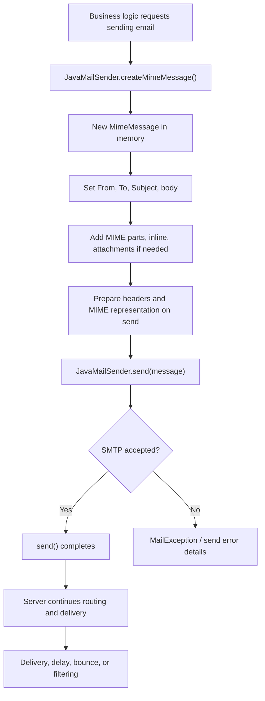

# MimeMessage and the Message Creation Lifecycle

In **Spring Framework Mail**, an email can start as a Java object with no recipients, subject, or body yet; it is then populated with headers, MIME body parts, and attachments, and finally transferred to an SMTP server. The object representing that message is **`jakarta.mail.internet.MimeMessage`**.

Understanding the **`MimeMessage` creation lifecycle** helps separate three things often lumped together: *building email content in memory*, *preparing MIME data for transmission*, and *sending the email to a mail server*. It is also the foundation for handling encoding, attachments, send failures, retries, and mail-sending code reuse.

## 1. What Is `MimeMessage`?

`MimeMessage` is a **Jakarta Mail** class representing an email message in Internet mail format, including headers and content that can be encoded per the MIME (*Multipurpose Internet Mail Extensions*) standard.

A simple plain-text email may contain:

```text
From: no-reply@example.org
To: user@example.net
Subject: Welcome
MIME-Version: 1.0
Content-Type: text/plain; charset=UTF-8

Your account is ready.
```

When HTML, inline images, or attachments are needed, a `MimeMessage` can hold **a tree of MIME parts** instead of a single text string. For example, the body may be `multipart/alternative`, `multipart/related`, or `multipart/mixed` with multiple nested parts.

Crucial point: **`MimeMessage` is an object describing an email, not an SMTP connection, and it does not mean the email has been sent.**

In Spring Framework Mail, components typically collaborate as follows:

| Component | Role in the lifecycle |
|---|---|
| `JavaMailSender` | Spring interface for creating `MimeMessage` instances and sending email. |
| `JavaMailSenderImpl` | Common implementation integrating with Jakarta Mail/SMTP infrastructure. |
| `MimeMessage` | Holds headers and content of an email; mutable prior to sending. |
| `MimeMessageHelper` | Spring utility class for setting sender, recipients, subject, text/HTML, inline resources, and attachments. |
| Jakarta Mail `Session` | Supplies context and properties to mail infrastructure; not an HTTP session or user login session. |
| SMTP transport | Transmits the prepared message to the SMTP server and receives server responses. |

A Spring Boot application with `spring.mail.*` configuration typically receives an auto-configured `JavaMailSender` bean from `spring-boot-starter-mail`. With plain Spring Framework, the application can register and configure `JavaMailSenderImpl` itself.

## 2. Lifecycle Diagram of a `MimeMessage`

The lifecycle below is an **application processing model**, not a formal state machine with fixed enums in the API:



It can be divided into six stages:

1. **Creation:** obtain an empty `MimeMessage` from `JavaMailSender`.
2. **Construction:** populate headers, recipients, text content, or MIME multipart structure.
3. **Finalization:** the mail library updates related headers and prepares the transmission representation.
4. **Sending:** `JavaMailSender` uses the mail transport to transmit to the SMTP server.
5. **Receiving SMTP result:** the server accepts or rejects the send operation.
6. **Post-SMTP delivery:** the mail system routes the message to the receiving server and mailbox; this stage lies outside the direct lifecycle of the Java call.

Keep in mind that **a successful send from `JavaMailSender`** generally confirms only that the mail server accepted the message during the SMTP session, not that the email appeared in the Inbox.

## 3. Stage 1: Creating the Message via `JavaMailSender`

Standard creation in Spring:

```java
import jakarta.mail.internet.MimeMessage;
import org.springframework.mail.javamail.JavaMailSender;

// mailSender is injected by Spring into the service class.
MimeMessage message = mailSender.createMimeMessage();
```

`createMimeMessage()` creates an object matching the sender's configuration. At this point the message does not yet have complete business headers and body. You must supply recipients, content, and other required details before sending.

Why create via `mailSender.createMimeMessage()` instead of `new MimeMessage(session)` directly?

- The sender already knows the mail context configured by the application, avoiding building an extra `Session` unnecessarily.
- It aligns with the `JavaMailSender` interface, making it easy to swap the sender across application environments.
- You can use the same message creation flow for both simple emails and multipart emails.

In Spring, the `JavaMailSender` bean is typically shared across many services. **Create a separate `MimeMessage` for each send**; sharing the sender does not mean sharing a single message being modified across threads.

### Comparison with `SimpleMailMessage`

| `SimpleMailMessage` | `MimeMessage` |
|---|---|
| Spring utility object for plain-text email. | Jakarta Mail object representing a message with headers and MIME body. |
| Uses simple setter APIs like `setText(String)`. | Supports charsets, multiple MIME parts, HTML, inline images, and attachments. |
| Sent via `mailSender.send(simpleMessage)`. | Sent via `mailSender.send(mimeMessage)`. |
| Suitable for plain-text notifications. | Suitable for both simple notifications and complex emails. |

Not every email needs MIME multipart. A `MimeMessage` can also contain a single `text/plain` body.

## 4. Stage 2: Setting Headers and Email Body

There are two common ways to populate content: using the Jakarta Mail API directly or using Spring's `MimeMessageHelper`.

### 4.1. Using the `MimeMessage` API

```java
import jakarta.mail.Message;
import jakarta.mail.MessagingException;
import jakarta.mail.internet.InternetAddress;
import jakarta.mail.internet.MimeMessage;
import java.io.UnsupportedEncodingException;
import java.util.Date;
import org.springframework.mail.javamail.JavaMailSender;

public void sendPlainText(JavaMailSender mailSender)
        throws MessagingException, UnsupportedEncodingException {

    MimeMessage message = mailSender.createMimeMessage();

    message.setFrom(new InternetAddress(
            "no-reply@example.org",
            "Demo Application",
            "UTF-8"
    ));

    message.setRecipients(
            Message.RecipientType.TO,
            InternetAddress.parse("user@example.net", true)
    );

    message.setSubject("Welcome", "UTF-8");
    message.setText("Your account is ready.", "UTF-8");
    message.setSentDate(new Date());

    mailSender.send(message);
}
```

Operations in the example:

- `setFrom(...)` sets the **From** header, representing the sender identity to the reader.
- `setRecipients(RecipientType.TO, ...)` sets the `To` recipient list. `RecipientType.CC` or `BCC` can be used when needed.
- `setSubject(..., "UTF-8")` sets the subject and specifies appropriate encoding.
- `setText(..., "UTF-8")` creates a text body with the appropriate charset.
- `setSentDate(...)` sets the sent timestamp on the message; the sender may fill in the date if the application has not set it.
- `mailSender.send(message)` is when the application hands the message off for actual sending.

Message setup happens **in memory**. Calling `setSubject(...)` or `setText(...)` does not open a connection to the SMTP server.

Note that the **From** header in `MimeMessage` does not necessarily match the **envelope sender** passed in the SMTP `MAIL FROM` command. With SMTP transport, the envelope may be determined by separate configuration or provider policy.

### 4.2. Using `MimeMessageHelper` to Reduce Manual MIME Work

In Spring Framework Mail, this is the convenient approach for business code:

```java
import jakarta.mail.MessagingException;
import jakarta.mail.internet.MimeMessage;
import org.springframework.mail.javamail.JavaMailSender;
import org.springframework.mail.javamail.MimeMessageHelper;
import org.springframework.stereotype.Service;

@Service
public class WelcomeMailService {
    private final JavaMailSender mailSender;

    public WelcomeMailService(JavaMailSender mailSender) {
        this.mailSender = mailSender;
    }

    public void sendWelcome(String recipient) throws MessagingException {
        MimeMessage message = mailSender.createMimeMessage();
        MimeMessageHelper helper =
                new MimeMessageHelper(message, false, "UTF-8");

        helper.setFrom("no-reply@example.org");
        helper.setTo(recipient);
        helper.setSubject("Welcome");
        helper.setText("Your account is ready.");

        mailSender.send(message);
    }
}
```

The `false` argument indicates that the helper **does not initialize multipart at creation time**. This is the simple choice when sending only a single plain-text body.

`MimeMessageHelper` **does not replace `MimeMessage`**; it operates directly on the `message` instance passed to its constructor. If other code holds a reference to the same message, changes made through the helper appear on that message.

### 4.3. Headers Are Not the Entire Content

A `MimeMessage` consists of multiple layers of information:

| Group | Example | API |
|---|---|---|
| Sender | `From` | `setFrom(...)` or `helper.setFrom(...)` |
| Recipients | `To`, `Cc`, `Bcc` | `setRecipients(...)`, `helper.setTo(...)`, `helper.setCc(...)` |
| Reply | `Reply-To` | `setReplyTo(...)` or `helper.setReplyTo(...)` |
| Subject | `Subject` | `setSubject(...)` or `helper.setSubject(...)` |
| Sent time | `Date` | `setSentDate(...)` |
| Content | `text/plain`, `text/html`, multipart | `setText(...)`, `setContent(...)`, `helper.setText(...)` |
| Related resources | Images using `cid:...` | `helper.addInline(...)` |
| Attachments | PDFs, images, downloadable docs | `helper.addAttachment(...)` |

Certain technical headers such as `MIME-Version`, `Content-Type`, `Content-Transfer-Encoding`, and `Message-ID` may be computed, updated, or normalized by the mail library when the message is finalized. Avoid filling all of those headers manually with raw strings when the API already handles them.

## 5. Stage 3: Building MIME Multipart

A message with complex content is no longer a single string; it can be a tree of parts:

```text
MimeMessage
└── multipart/mixed
    ├── multipart/related
    │   ├── multipart/alternative
    │   │   ├── text/plain
    │   │   └── text/html
    │   └── image/png (inline, Content-ID: <logo>)
    └── application/pdf (attachment: guide.pdf)
```

Three common multipart types:

| Type | Primary semantics |
|---|---|
| `multipart/alternative` | Alternative representations of the same content, typically plain text **first** and HTML **second**. |
| `multipart/related` | Resources bound to the main body part, such as images referenced in HTML via `cid:logo`. |
| `multipart/mixed` | Parts belonging to the same email that are relatively independent, typically the body and attachments. |

### Example: An Email with Plain Text, HTML, an Inline Image, and a PDF

Suppose the project contains:

```text
src/main/resources/
└── mail/
    ├── logo.png
    └── guide.pdf
```

A service can construct the email:

```java
import jakarta.mail.MessagingException;
import jakarta.mail.internet.MimeMessage;
import org.springframework.core.io.ClassPathResource;
import org.springframework.mail.javamail.JavaMailSender;
import org.springframework.mail.javamail.MimeMessageHelper;
import org.springframework.stereotype.Service;

@Service
public class GuideMailService {
    private final JavaMailSender mailSender;

    public GuideMailService(JavaMailSender mailSender) {
        this.mailSender = mailSender;
    }

    public void sendGuide(String recipient) throws MessagingException {
        // 1. Create a new MimeMessage for each send attempt.
        MimeMessage message = mailSender.createMimeMessage();

        // 2. Choose structure with outer mixed and inner related.
        MimeMessageHelper helper = new MimeMessageHelper(
                message,
                MimeMessageHelper.MULTIPART_MODE_MIXED_RELATED,
                "UTF-8"
        );

        helper.setFrom("no-reply@example.org");
        helper.setTo(recipient);
        helper.setSubject("User guide");

        // 3. Two equivalent content versions; HTML references CID.
        String plain = """
                Hello!
                Please read the attached guide.pdf file.
                """;

        String html = """
                <html>
                  <body>
                    
                    <h1>Hello!</h1>
                    <p>Please read the attached guide.pdf file.</p>
                  </body>
                </html>
                """;

        helper.setText(plain, html);

        // 4. Add inline image AFTER setting the body.
        helper.addInline(
                "logo",
                new ClassPathResource("mail/logo.png"),
                "image/png"
        );

        // 5. Attachment independent of inline image.
        helper.addAttachment(
                "guide.pdf",
                new ClassPathResource("mail/guide.pdf"),
                "application/pdf"
        );

        // 6. Send the finalized MimeMessage object.
        mailSender.send(message);
    }
}
```

In the example, `helper.setText(plain, html)` sets up two versions of the content in a `multipart/alternative` structure. Calling `addInline("logo", ...)` adds an image part whose Content-ID matches `cid:logo` in the HTML, and `addAttachment(...)` creates the attached PDF part.

**The order of calling `setText(...)` before `addInline(...)` is very important for compatibility.** Some mail clients handle inline images incorrectly if the MIME parts are constructed in the wrong order. Spring's helper assists in building the structure, though it cannot guarantee every mail client renders it identically.

### A Single Message Creation Can Have Multiple Data Additions

You can set the subject first, then build the body and attachments. However, once code enters the sending phase, **do not continue modifying the same object from another thread**. Treat each message as a private draft for one send operation, and finish building it before calling `send(...)`.

## 6. `MimeMessageHelper` and Multipart Modes

Whether the helper initializes multipart affects how parts are nested.

```java
new MimeMessageHelper(message, false, "UTF-8");
```

Suitable for a simple single body.

```java
new MimeMessageHelper(
        message,
        MimeMessageHelper.MULTIPART_MODE_MIXED_RELATED,
        "UTF-8"
);
```

Suitable when you need a body, inline resources, and independent attachments.

The following table summarizes the constants:

| Mode | Overall structure | Notes |
|---|---|---|
| `MULTIPART_MODE_NO` | Does not proactively create multipart | For single-part emails. |
| `MULTIPART_MODE_MIXED` | Root `multipart/mixed` | May be less favorable for distinguishing inline images from attachments in some clients. |
| `MULTIPART_MODE_RELATED` | Root `multipart/related` | Groups the body and display-related resources. |
| `MULTIPART_MODE_MIXED_RELATED` | Outer `mixed`, inner `related` | Common choice when both inline resources and attachments are present. |

The constructor `new MimeMessageHelper(message, true, "UTF-8")` also enables multipart and typically uses the default mode supporting `mixed/related`; specifying the constant explicitly helps readers immediately see the intended message organization.

There is no requirement to always enable multipart for every email. If there is only text, a non-multipart message is simpler and avoids unnecessary parts.

## 7. Finalization Stage: When Does `saveChanges()` Happen?

`MimeMessage` is a **mutable** object. Setting recipients, subject, body, and MIME parts updates state in memory. Before data is written to the wire, the mail library needs a consistent representation of headers and content.

Jakarta Mail provides:

```java
message.saveChanges();
```

This method updates related headers based on current content, such as MIME headers and `Message-ID` when appropriate. It is part of the message finalization mechanism in preparation for writing/sending.

**In a sending flow using `JavaMailSender`, applications normally do not need to call `saveChanges()` manually.** The sender implementation handles preparing/updating the message on send per its contract. Calling it manually does not send the email by itself, and calling it and then continuing to edit the message can require updating headers again before sending.

### Lifecycle of `Message-ID`

`Message-ID` is a header identifying a message, typically generated by the mail library or mail system when the message is finalized. It is **not**:

- A business transaction ID for an order.
- A queue ID returned by the SMTP server after `DATA`.
- A receipt guaranteeing the recipient read the email.

If the application needs to correlate a send attempt with business logic, it should have its own **dedicated send request ID** in the system and record any retrievable message/provider IDs. Do not rely on assuming `Message-ID` is always present or unchanged immediately after `createMimeMessage()`, while the message is not yet finalized.

### Exporting MIME for Inspection

`MimeMessage` provides the method:

```java
message.writeTo(outputStream);
```

This method writes the message in Internet mail format to an `OutputStream`; it is useful when inspecting raw MIME source or integrating with another mail-processing system. However, **writing a message to a stream is not SMTP sending**. Nor does it guarantee that all metadata added by the final mail server (such as `Received` headers) is present.

Do not log or export full real email contents to uncontrolled observation targets: headers and bodies may contain personal addresses, verification codes, login links, or sensitive attachments.

## 8. Sending Stage: `JavaMailSender.send(...)`

After creating and populating all fields:

```java
mailSender.send(message);
```

At this point, Spring delegates the work to the mail sender implementation. A typical SMTP flow consists of:

1. Connecting to the SMTP server using the configured hostname, port, and timeouts.
2. Establishing TLS and authenticating if required by the server/policy.
3. Declaring the sending envelope via `MAIL FROM` and recipients via `RCPT TO`.
4. Sending the prepared headers/body in the `DATA` step.
5. Receiving the SMTP result and closing or returning connection resources per the implementation.

`send(...)` on the standard sender is a **synchronous call**: the calling thread waits until the SMTP send operation finishes or fails. If an HTTP controller calls `send(...)` directly, mail server and network latency can impact HTTP response time.

Part of the flow:

```text
Application                 SMTP server
    |                             |
    |  MAIL FROM:<...>            |
    |---------------------------->|
    |  RCPT TO:<...>              |
    |---------------------------->|
    |  DATA                       |
    |---------------------------->|
    |  Headers and MIME body      |
    |---------------------------->|
    |  250 Accepted / queued      |
    |<----------------------------|
    |                             |
  send() completes          Continue processing, relay
```

When the server accepts the message, `send(...)` can complete normally. Yet the message can still be delayed, bounced, filtered as spam, or fail later. **The state where the application sent to SMTP** and **the state where the recipient received the message** are two different levels of outcome.

## 9. Sending with `MimeMessagePreparator`

Spring Mail also supports supplying a function that prepares the `MimeMessage` for the sender. This is a way to wrap **creation and content population** in a callback:

```java
import org.springframework.mail.javamail.MimeMessageHelper;
import org.springframework.mail.javamail.MimeMessagePreparator;
import org.springframework.mail.javamail.JavaMailSender;

public void sendNotice(JavaMailSender mailSender, String recipient) {
    MimeMessagePreparator preparator = mimeMessage -> {
        MimeMessageHelper helper =
                new MimeMessageHelper(mimeMessage, false, "UTF-8");

        helper.setFrom("no-reply@example.org");
        helper.setTo(recipient);
        helper.setSubject("Notification");
        helper.setText("The system has recorded your request.");
    };

    mailSender.send(preparator);
}
```

In this form:

- The application describes **how to prepare** the message via a lambda.
- The sender creates a `MimeMessage` and invokes the preparator to fill in the data.
- After preparation, the sender performs the send operation.

This approach is useful when you want to encapsulate composition rules in a dedicated function. It is still a **mail-sending** mechanism, and does not automatically turn the call into an async queue or add durable retry behavior.

Regarding exceptions, errors during message preparation can be represented by Spring using exceptions from the `MailException` family, while SMTP errors are also mapped to this exception family; inspect the underlying cause to diagnose the exact stage.

## 10. At Which Stage Do Exceptions Occur?

The same email-sending task can fail when **constructing content** or during **transport**:

| Stage | Error example | Common manifestation |
|---|---|---|
| Setting recipient addresses | Malformed address string | `AddressException` or `MessagingException` when using Jakarta Mail APIs. |
| Building MIME/headers | Data, encoding, or MIME manipulation error | `MessagingException`; may be wrapped by `MailException` when using Spring callbacks. |
| Reading attachments | Resource does not exist, unreadable stream | May occur when creating the part or when the library actually reads data to send. |
| Opening SMTP connection | Wrong host, unreachable network, timeout | Typically leads to `MailSendException` or transport-related exceptions. |
| Authentication | Wrong username/password or server rejection | May be `MailAuthenticationException`. |
| Sending envelope/body | Server rejects recipient or content | SMTP errors reflected via `MailException`, possibly wrapping a Jakarta Mail/provider cause. |
| Delivery after acceptance | Bounce, spam filtering, nonexistent mailbox | May **not** appear as an exception from `send(...)`; requires data from mail infrastructure. |

An example of handling transport errors:

```java
import org.springframework.mail.MailException;

try {
    mailSender.send(message);
    // Record: send operation to SMTP completed.
} catch (MailException ex) {
    // Record failure status, cause, and appropriate retry schedule.
    // Do not log passwords or full emails containing sensitive information.
}
```

Earlier, if code uses `MimeMessage` or `MimeMessageHelper` directly, setters can throw `MessagingException` and require separate handling/declaration.

Do not retry all errors indefinitely. For instance, invalid credentials require fixing configuration; transient errors like timeouts can be retried under a bounded policy. If the network disconnects **right after the server may have accepted the message**, the application sometimes cannot determine for sure whether the message was received; retrying can cause duplicate sends.

## 11. When Is a `MimeMessage` Considered Finished?

You can use the following milestones to describe practical state:

| Milestone | What exists in the application? | What can be concluded? |
|---|---|---|
| After `createMimeMessage()` | New object in the JVM. | Not enough business content yet. |
| After setters / helper | Desired sender, recipients, body, and attachments exist. | Draft has been constructed; not sent yet. |
| After MIME/header preparation | May have `Message-ID`, `MIME-Version`, `Content-Type`, and complete encoding. | Message is ready to write to stream/transport; does not mean SMTP received it. |
| After `send(...)` returns without error | Sender completed the send operation to SMTP. | SMTP processed it per the send transaction; Inbox not confirmed. |
| After mail system reports delivered | Delivery info exists from provider or receiving system. | Evidence exists that the message was accepted at the reported delivery point; does not mean it was read. |

These are milestones **observable at different layers**, not a built-in `status` property on `MimeMessage`.

In particular, `MimeMessage` does not persist send status to a database by itself. Once the JVM shuts down, the in-memory object disappears unless the application saved the send request or required data in durable storage.

## 12. Reusing Messages, Multiple Recipients, and Resending

### 12.1. Create a New Message for Every Send

`MimeMessage` is a mutable object; sending concurrently from multiple threads on **the same instance** risks mixing recipients, content, headers, and attachments. Safe pattern:

```java
for (String recipient : recipients) {
    MimeMessage message = mailSender.createMimeMessage();
    MimeMessageHelper helper =
            new MimeMessageHelper(message, false, "UTF-8");

    helper.setFrom("no-reply@example.org");
    helper.setTo(recipient);
    helper.setSubject("Personal notification");
    helper.setText("Content for " + recipient);

    mailSender.send(message);
}
```

This illustrates creating separate instances; at large scale, add rate limits, queuing, retries, and user-data protection. If the exact same email is sent to multiple people at once, you can place an appropriate recipient list on **one message**; that decision relates to `To`/`Cc`/`Bcc` visibility and recipient-list privacy policy.

### 12.2. Avoid Editing a Message After Sending

At the API level, a `MimeMessage` object still exists after `send(...)`. However, reusing the same instance for a new business action introduces subtle dependencies:

- `Date` and `Message-ID` headers may not reflect the intent of the new send.
- Content/attachments might carry data from the previous recipient.
- Attachment data sources may only support reading once.
- When multiple tasks modify the same message, the outcome becomes ambiguous.

Therefore, store **the business data to be sent** (template, recipient, parameters) and create a new `MimeMessage` for each send attempt. Do not treat `MimeMessage` as a shared mutable template across the whole application.

### 12.3. Attachments Are Often Read When Writing the Message to the Stream

`MimeMessageHelper.addAttachment(...)` accepts data sources such as `Resource` or `InputStreamSource`. When using a custom stream source, ensure that every time the mail library requests data it can open a fresh readable stream from the beginning; an already-consumed stream can cause sending to fail or produce corrupted data.

Example using a pre-generated byte array for a repeatable source:

```java
import org.springframework.core.io.ByteArrayResource;

byte[] pdfBytes = reportGenerator.generatePdf();
helper.addAttachment(
        "report.pdf",
        new ByteArrayResource(pdfBytes),
        "application/pdf"
);
```

The example assumes `reportGenerator.generatePdf()` is a business method returning PDF bytes. Watch the byte array size if attachments are large, as well as provider email size limits.

## 13. Creating a `MimeMessage` from Existing Email Content

Messages do not always start completely from scratch. `JavaMailSender` can create a message from an `InputStream` containing already-formatted mail content:

```java
import jakarta.mail.internet.MimeMessage;
import java.io.InputStream;

// rawEmailStream contains an email in Internet Message/MIME format.
MimeMessage parsed = mailSender.createMimeMessage(rawEmailStream);
```

This applies when reading or forwarding an existing message. However, an existing email already containing `Date`, `Message-ID`, `Received`, recipient lists, or other headers may not be suitable for sending as a brand-new notification. When business logic wants to **create a new email**, create a fresh message and pick the content you need rather than preserving all headers from the old copy.

In addition, the parser can read data produced by external systems, including non-strictly-standard data. Before using an external message for further sending, the application must enforce rules for handling headers, attachments, size limits, and trusted content sources.

## 14. Message Lifecycle and Business Transactions

Suppose a user places an order and the application needs to send a confirmation:

```text
HTTP request
   ↓
Save order to database
   ↓
Create MimeMessage
   ↓
JavaMailSender.send(...)
   ↓
Return HTTP response
```

This synchronous model is easy to understand, though there are trade-offs to consider:

- If SMTP is slow, the HTTP response can also be slow.
- If sending the email occurs before the database transaction commits, the email might be sent while the business transaction rolls back.
- If the business transaction commits and sending fails, the order exists without a notification.
- If the application crashes between the two operations, you need a way to identify which send requests are incomplete.

In systems requiring high reliability, you can store **the mail-send request** in a durable queue or **transactional outbox** in the same transaction as the business operation, and have a worker read the requests:

```text
Business flow
  ├── Save order
  ├── Save "email to send" record in the same transaction
  └── Commit

Mail worker
  ├── Read pending send record
  ├── Create a new MimeMessage from stored data
  ├── JavaMailSender.send(...)
  └── Record status / controlled retry
```

In this design, `MimeMessage` is typically created **when the worker processes the send request**, from stored data, rather than placing a mutable Java object into a queue. Even so, asynchronous processing does not guarantee exactly-once delivery; you must design duplicate handling and cases where it is unclear whether SMTP received the message.

## 15. Observing the Lifecycle When Troubleshooting

When an email does not turn out as expected, identify which stage the issue belongs to:

| Symptom | Stage to inspect | Suggestion |
|---|---|---|
| Missing `To` or empty subject | Message construction | Check input data and corresponding setters/helper calls. |
| Vietnamese headers display incorrectly | Header creation, charset | Use UTF-8 when setting subject/personal name; avoid assembling raw MIME headers manually. |
| HTML email shows only text or duplicate content | MIME part construction | Check `setText(plain, html)` and `multipart/alternative` structure. |
| Image `cid:logo` does not appear | Related part construction | Check Content-ID, part placement, and order (`setText(...)` before `addInline(...)`). |
| Attachment missing or unreadable | Attachment data source / MIME | Check `Resource`, stream contents, file type, and size. |
| SMTP reports authentication error | Transport | Check host, port, TLS, credentials, and auth policy. |
| `send(...)` succeeds without error but recipient does not see mail | After SMTP acceptance | Check queues, bounces, spam, policies, and provider logs/telemetry. |
| Two identical emails reach the same recipient | Retry or duplicate request handling | Check event IDs, send status, and retry policy. |

To inspect message structure without sending real mail, development environments can use a mail-catching server like Mailpit or GreenMail and view the raw MIME source. When inspecting, distinguish headers created by the application from headers added later by mail servers.

## 16. Common Confusions

**"`createMimeMessage()` has already sent the email."**  
False. It only creates a Java object. Actual sending begins at `send(...)` or an equivalent transport mechanism.

**"Every call to `setText(...)` appends a new content part."**  
Do not assume that. Setters can overwrite the current content. If you need both plain text and HTML, use the `setText(plainText, htmlText)` overload or build an appropriate `multipart/alternative` structure yourself.

**"Calling `saveChanges()` means the message is ready and durably saved."**  
`saveChanges()` updates the message's internal information; it does not send over SMTP and does not persist business data to a database.

**"`MimeMessageHelper` is a different email from `MimeMessage`."**  
The helper only operates on the `MimeMessage` instance it received. The object passed to `mailSender.send(...)` is still that same message.

**"One `MimeMessage` can be shared across multiple recipients and edited concurrently."**  
Because the message is mutable, doing so risks mixing data. Create one instance per independent send operation.

**"`MailSender.send(...)` completing means the recipient read the email."**  
The send call only observes the stage of sending to SMTP. Whether the email reaches the Inbox or is opened and read are downstream steps with different data sources.

## 17. Remembering the Message Creation Flow in Spring Mail

When writing an email-sending feature, you can trace the sequence of operations:

```java
MimeMessage message = mailSender.createMimeMessage();
// Populate From, To, Subject, body, and MIME parts.
mailSender.send(message);
```

- **`createMimeMessage()`**: creates a new email object in memory.
- **Setters / `MimeMessageHelper`**: builds headers, text/HTML, inline resources, and attachments.
- **MIME finalization**: the mail library updates required technical metadata before or during sending.
- **`send(...)`**: communicates with the SMTP server and reports errors if the send operation fails.
- **Downstream mail infrastructure**: handles relaying, bounces, filtering, and delivery; these cannot be inferred solely from the state of the `MimeMessage` object.

The clearest operational rule is **create a new `MimeMessage` per send request, construct it completely, and then send it**, storing separate business state if retries or delivery tracking are needed. Keeping clear boundaries among the message object, the SMTP transaction, and delivery outcomes makes Spring Mail code easier to understand and troubleshoot.
