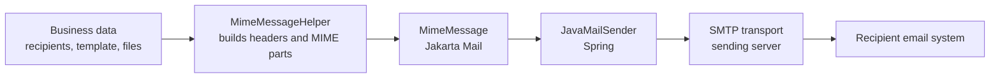
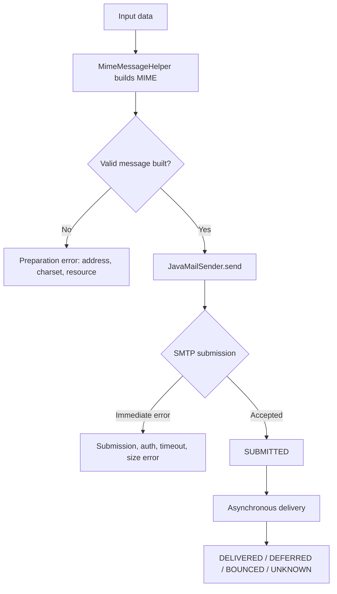

# MimeMessageHelper as a MIME Creation Helper Class

A simple notification email only has recipients, a subject, and a short block of text. Yet real-world emails often also need a Vietnamese sender display name, HTML content, a plain-text version, an inline logo in the body, a PDF invoice, or multiple recipients. In those cases, manually setting every header and every MIME part of a `MimeMessage` quickly becomes hard to read, prone to structural mistakes, and error-prone with encoding.

In **Spring Framework Mail**, `MimeMessageHelper` is a utility class that helps construct MIME messages through a high-level API. This class collaborates with **Jakarta Mail's `MimeMessage`** and **Spring's `JavaMailSender`**: one component represents the email, one assists in filling content with proper structure, and one performs the send operation.

Example:

```java
MimeMessage message = mailSender.createMimeMessage();
MimeMessageHelper helper = new MimeMessageHelper(message, true, "UTF-8");

helper.setFrom("notifications@example.com", "Notification System");
helper.addTo("an@example.net", "Nguyễn Văn An");
helper.setSubject("Registration confirmation");
helper.setText("<h1>Registration successful</h1>", true);

mailSender.send(message);
```

Key point: **`MimeMessageHelper` is not a protocol and does not send emails directly**. It is a tool that assists with **constructing message content**; `JavaMailSender` is the API that sends via the configured mail transport. This lesson goes from MIME mechanics, helper constructors, and methods to HTML examples, attachments, inline images, charsets, error handling, and code organization in Spring applications.

## 1. Where MimeMessageHelper Fits in Spring Mail

### 1.1. Three Objects with Three Responsibilities

| Component | Library | Role |
|---|---|---|
| `JavaMailSender` | Spring Framework Mail | Abstraction for creating and sending MIME emails; provides overloads accepting `MimeMessage` or `MimeMessagePreparator`. |
| `MimeMessage` | Jakarta Mail (`jakarta.mail.internet`) | Object representing an Internet message: headers, recipients, MIME body, and content parts. |
| `MimeMessageHelper` | Spring Framework (`org.springframework.mail.javamail`) | Helper API for setting addresses, subject, text, HTML, multipart, inline resources, and attachments on `MimeMessage`. |

Flow diagram:



`MimeMessageHelper` holds a reference to the `MimeMessage` passed to its constructor. Methods like `setSubject`, `setText`, or `addAttachment` **mutate that message**, rather than creating a new email on every call. Once all content parts are complete, the application passes **that exact `MimeMessage` object** to `mailSender.send(message)`.

### 1.2. When to Use `SimpleMailMessage` vs. `MimeMessageHelper`?

| Requirement | `SimpleMailMessage` | `MimeMessageHelper` + `MimeMessage` |
|---|---|---|
| Plain-text email, no attachments | Suitable | Suitable |
| HTML content | Not the target of this API | Directly supported |
| `text/plain` + `text/html` in the same email | No | Supported |
| PDF, CSV, image attachments | No | Supported |
| Embedded images using `cid:` | No | Supported |
| Unicode sender/recipient names and MIME encoding | More limited | Provides personal-name and charset APIs |
| Controlling multipart MIME structure | No | Provides multipart modes |

You do not need `MimeMessageHelper` for every email; if you only send simple text notifications, `SimpleMailMessage` is concise. When **MIME** is needed, `MimeMessageHelper` saves you from manipulating `MimeMultipart`, `MimeBodyPart`, `DataHandler`, and headers manually.

## 2. What Is MIME and Why Do We Need a Helper?

**MIME (Multipurpose Internet Mail Extensions)** extends email structure to carry multiple content types. A MIME message can contain:

- Plain text (`text/plain`).
- HTML content (`text/html`).
- Two alternative representations of the same content (`multipart/alternative`).
- Images referenced inside HTML (`Content-ID` and `cid:...`).
- Attachments (`Content-Disposition: attachment`).
- Multiple parts combined via boundaries (`boundary`) inside `multipart/*`.

Conceptual structure example of an order confirmation email with an invoice:

```text
MimeMessage
├── From: "Order Team" <orders@example.com>
├── To: "Nguyễn Văn An" <an@example.net>
├── Subject: Order confirmation
└── multipart/mixed
    ├── multipart/related
    │   ├── multipart/alternative
    │   │   ├── text/plain; charset=UTF-8
    │   │   └── text/html; charset=UTF-8
    │   └── image/png; Content-ID: <brand-logo>
    └── application/pdf; Content-Disposition: attachment
```

This is a **typical MIME structure**. The concrete structure depends on the multipart mode, library, and added content; do not assume every message has the exact same number of MIME layers.

Common multipart groups:

| Type | Meaning |
|---|---|
| `multipart/alternative` | Multiple representations of **the same content**, usually text/plain and text/html; the email client picks a renderable part. |
| `multipart/related` | Parts with dependent relationships, such as HTML and images referenced via `cid:`. |
| `multipart/mixed` | Independent parts sent together in the message, typically including attachments. |

If you assemble `MimeBodyPart` and `MimeMultipart` manually for every case, the application must set `Content-Type`, `Content-Transfer-Encoding`, `Content-Disposition`, `Content-ID`, and nesting order accurately. **`MimeMessageHelper` groups common tasks into clearly named methods**, letting Jakarta Mail handle many MIME packaging details.

## 3. Instantiating MimeMessageHelper and Choosing a Multipart Mode

### 3.1. Non-Multipart: Single Body Only

```java
MimeMessage mimeMessage = mailSender.createMimeMessage();
MimeMessageHelper helper =
        new MimeMessageHelper(mimeMessage, false, "UTF-8");

helper.setTo("user@example.net");
helper.setSubject("Hello");
helper.setText("Plain text content.", false);
mailSender.send(mimeMessage);
```

The `false` argument means the helper **does not initialize a multipart structure**. This fits when a message needs only one text or HTML body part, with no attachments and without two simultaneous text versions.

If you later call `addAttachment` or `addInline` on a non-multipart helper, the application will fail because the helper was not configured for multiple content parts. You cannot fix that simply by setting `Content-Type` manually in the text body.

### 3.2. Multipart: Attachments, Inline Resources, or Two Alternative Bodies

```java
MimeMessage mimeMessage = mailSender.createMimeMessage();
MimeMessageHelper helper =
        new MimeMessageHelper(mimeMessage, true, "UTF-8");
```

With the constructor taking `multipart=true`, Spring initializes a multipart MIME structure. In modern Spring Framework versions, the default mode when multipart is enabled is **`MULTIPART_MODE_MIXED_RELATED`**, suitable for many cases with inline resources and attachments.

You can select the mode explicitly using `MimeMessageHelper` constants:

```java
MimeMessageHelper helper = new MimeMessageHelper(
        mimeMessage,
        MimeMessageHelper.MULTIPART_MODE_MIXED_RELATED,
        "UTF-8");
```

Primary modes:

| Constant | Meaning | When to consider |
|---|---|---|
| `MULTIPART_MODE_NO` | No multipart used | Single text/HTML part only, no attachments, no inline parts. |
| `MULTIPART_MODE_MIXED` | Parts placed under root `multipart/mixed` | Simple mixed structure; mail clients may vary in how they render inline parts. |
| `MULTIPART_MODE_RELATED` | Uses `multipart/related` | Content has related parts, especially embedded images; test carefully if attachments also exist. |
| `MULTIPART_MODE_MIXED_RELATED` | Root `multipart/mixed`, with a `multipart/related` area for body and inline resources | Pragmatic choice for HTML + embedded images + file attachments. |

**The multipart mode is a message-structure decision**, not a UI setting. Different email applications handle nested MIME structures differently. If your product sends mail to a specific set of clients, verify rendering on those clients during content testing.

### 3.3. Charset in the Constructor

The third argument `"UTF-8"` is used for appropriate MIME parts constructed by the helper, keeping Vietnamese content and personal names represented consistently. Never rely on the OS default encoding to guess how to convert Unicode strings into emails.

Vietnamese name example:

```java
helper.setFrom("support@example.com", "Trung tâm hỗ trợ");
helper.addTo("an@example.net", "Nguyễn Văn An");
helper.setSubject("Đơn hàng đã được xác nhận");
helper.setText("Xin chào An, đơn hàng của bạn đã thành công.", false);
```

Jakarta Mail can represent names in headers using the RFC 2047 **encoded-word** mechanism. This is a representation encoding, not security encryption. **Unicode display names** do not imply email addresses with Unicode in the local-part are supported everywhere; internationalized addresses may require **SMTPUTF8** along the sending path.

## 4. Commonly Used Methods

### 4.1. Headers and Recipient Information

| Method | Purpose |
|---|---|
| `setFrom(...)` | Sets the sender address displayed in `From:`; overloads with `personal` support display names. |
| `setTo(...)` | Sets `To` recipients; overloads support a single address, an array of addresses, or `InternetAddress`. |
| `addTo(...)` | Adds a `To` recipient; includes an `addTo(address, personal)` overload. |
| `setCc(...)` / `addCc(...)` | Sets or adds public carbon-copy recipients. |
| `setBcc(...)` / `addBcc(...)` | Sets or adds blind carbon-copy recipients. |
| `setReplyTo(...)` | Sets the reply destination address, which may differ from `From`. |
| `setSubject(...)` | Sets the email subject. |
| `setSentDate(...)` | Sets the sent timestamp on the email header when business logic needs control over it. |
| `setPriority(...)` | Attaches a priority indicator (usually via header); does not force receiving systems to prioritize delivery. |

**`set...` and `add...` do not mean the same thing:** `setTo`/`setCc` typically set the list on that field, whereas `addTo`/`addCc` append recipients. When display names contain commas or Vietnamese characters, separate the address and name via the `personal` overload rather than concatenating raw strings.

Example:

```java
helper.setFrom("billing@example.com", "Billing Department");
helper.addTo("an@example.net", "Nguyễn Văn An");
helper.addCc("accountant@example.org", "Accounting Team");
helper.setReplyTo("support@example.com");
helper.setSubject("November electronic invoice");
```

The `Reply-To` field helps email clients suggest a reply address. It does not alter the **bounce** receiving address in the SMTP envelope; the envelope sender `MAIL FROM` is a separate concept.

### 4.2. Text and HTML Content

The helper has three common ways:

```java
// Plain text
helper.setText("Hello!", false);

// HTML content
helper.setText("<p><strong>Hello</strong>!</p>", true);

// Both alternative representations of one message body
helper.setText(
        "Hello! This is plain-text content.",
        "<p><strong>Hello</strong>! This is HTML content.</p>");
```

The snippet above shows **three alternative choices**, not three calls to execute back-to-back on the same message. The two-string overload `setText(String plainText, String htmlText)` creates **`multipart/alternative`** content and **requires the helper to be in multipart mode**.

Choices:

- **Plain text:** fits simple notifications, is accessible, and has few rendering quirks.
- **HTML only:** used when formatting is needed, though some clients may restrict it or fall back to other views.
- **Text + HTML:** usually the best choice for styled transactional emails, letting email apps choose the appropriate format while keeping a fallback.

`setText(..., true)` **is not an HTML sanitizer for malicious markup**. If HTML content is built from user data, escape or sanitize it safely at the template rendering step. Never feed raw user HTML directly into emails merely because the helper accepts `html=true`.

### 4.3. Adding Attachments

```java
FileSystemResource pdf =
        new FileSystemResource(Path.of("reports", "invoice.pdf"));

helper.addAttachment("invoice.pdf", pdf);
```

Structurally, an attachment is an independent MIME part, typically having:

```text
Content-Type: application/pdf; name="invoice.pdf"
Content-Disposition: attachment; filename="invoice.pdf"
Content-Transfer-Encoding: base64
```

This is a typical header example: actual encoding and filename parameters can vary by file, charset, and library. **The displayed filename** can differ from the filename on disk; for example, the application reads an internal file name and attaches it as `invoice-2026-11.pdf`.

`addAttachment` overloads accept various data sources such as `File`, `InputStreamSource`, or `DataSource` depending on needs. With `InputStreamSource`, the source should supply **a fresh `InputStream` on every read**. A single-use stream can fail when Jakarta Mail serializes MIME multiple times.

### 4.4. Images Displayed in HTML: `addInline`

When HTML contains:

```html

```

the application needs to add a MIME part with a matching `Content-ID`:

```java
helper.setText(
        "You have a new notification from the company.",
        "<html><body>" +
        "<p>You have a new notification.</p>" +
        "" +
        "</body></html>");

helper.addInline(
        "company-logo",
        new ClassPathResource("mail/company-logo.png"),
        "image/png");
```

In HTML, `cid:company-logo` references the part with Content-ID `<company-logo>`. The helper handles the header notation; the application passes only **the logical ID without angle brackets**. **Call `addInline` after `setText`**, as this order helps email clients properly recognize the HTML part and related resources.

An inline image is still data transmitted with the email; it is **not a link to a file hosted on a web server**. Some clients block images, handle CIDs differently, or let users disable images; always provide `alt` text and avoid putting critical information exclusively inside images.

## 5. Complete Example: Order Confirmation Email with HTML, Logo, and PDF

Suppose a Spring Boot system needs to send an email with:

1. Sender `Order Team <orders@example.com>`.
2. Recipient `Nguyễn Văn An <an@example.net>`.
3. Plain-text fallback, HTML version, inline logo, and PDF invoice file.
4. UTF-8 headers so recipient names and Vietnamese content display properly.

Add the mail dependency to the Spring Boot project using Gradle:

```groovy
dependencies {
    implementation 'org.springframework.boot:spring-boot-starter-mail'
}
```

Configure SMTP submission in `application.yml`:

```yaml
spring:
  mail:
    host: ${MAIL_HOST}
    port: 587
    username: ${MAIL_USERNAME}
    password: ${MAIL_PASSWORD}
    default-encoding: UTF-8
    properties:
      mail:
        smtp:
          auth: true
          starttls:
            enable: true
            required: true
          connectiontimeout: 5000
          timeout: 10000
          writetimeout: 10000

app:
  mail:
    from: ${MAIL_FROM:orders@example.com}
```

This is an illustrative configuration for port **587 + STARTTLS**. Servers using implicit TLS on port 465 require corresponding settings (such as `mail.smtp.ssl.enable`). Credentials must be supplied via environment variables or a secrets manager and use only authentication methods supported by the provider.

Place the sample image at `src/main/resources/mail/company-logo.png` so `ClassPathResource("mail/company-logo.png")` finds it on the classpath at runtime.

Service example:

```java
import jakarta.mail.MessagingException;
import jakarta.mail.internet.MimeMessage;
import org.springframework.beans.factory.annotation.Value;
import org.springframework.core.io.ClassPathResource;
import org.springframework.core.io.FileSystemResource;
import org.springframework.mail.javamail.JavaMailSender;
import org.springframework.mail.javamail.MimeMessageHelper;
import org.springframework.stereotype.Service;

import java.io.IOException;
import java.io.UnsupportedEncodingException;
import java.nio.file.Files;
import java.nio.file.Path;
import java.nio.charset.StandardCharsets;

@Service
public class OrderConfirmationMailer {

    private final JavaMailSender mailSender;
    private final String fromAddress;

    public OrderConfirmationMailer(
            JavaMailSender mailSender,
            @Value("${app.mail.from}") String fromAddress) {
        this.mailSender = mailSender;
        this.fromAddress = fromAddress;
    }

    public void sendOrderConfirmation(
            String recipientAddress,
            String recipientName,
            String orderCode,
            Path invoicePdf)
            throws MessagingException, IOException {

        if (!Files.isRegularFile(invoicePdf) ||
                !Files.isReadable(invoicePdf)) {
            throw new IllegalArgumentException(
                    "Invoice PDF must be a readable file");
        }

        MimeMessage message = mailSender.createMimeMessage();
        MimeMessageHelper helper = new MimeMessageHelper(
                message,
                MimeMessageHelper.MULTIPART_MODE_MIXED_RELATED,
                StandardCharsets.UTF_8.name());

        helper.setFrom(fromAddress, "Order Team");
        helper.addTo(recipientAddress, recipientName);
        helper.setReplyTo("support@example.com");
        helper.setSubject("Order confirmation " + orderCode);

        String plainText = "Order " + orderCode
                + " has been recorded. Please see the attached invoice.";

        // Example using business-controlled data.
        // When using arbitrary user input, escape properly for HTML context.
        String htmlText = """
                <html>
                  <body>
                    
                    <h1>Order Confirmation</h1>
                    <p>Your order has been recorded.
                       Please see the attached PDF invoice.</p>
                  </body>
                </html>
                """;

        helper.setText(plainText, htmlText);

        // Add inline resource after setting the HTML body.
        helper.addInline(
                "company-logo",
                new ClassPathResource("mail/company-logo.png"),
                "image/png");

        helper.addAttachment(
                "invoice-" + orderCode + ".pdf",
                new FileSystemResource(invoicePdf));

        mailSender.send(message);
    }
}
```

In real projects, `orderCode` and `recipientName` must be validated before entering subjects, filenames, or HTML. When generating HTML with customer-specific content, using a template engine with escaping is safer and easier to maintain than string concatenation.

**Execution flow of the example:**

1. `JavaMailSender.createMimeMessage()` creates the message object.
2. `MimeMessageHelper` is created with a multipart mode supporting mixed/related combination and UTF-8 charset.
3. The helper sets addresses, headers, plain text, and HTML.
4. The helper attaches the inline logo and PDF invoice.
5. `JavaMailSender.send(message)` hands the message over to the SMTP transport.

The file is read when the library builds/serializes MIME for sending. Having the helper accept a path does not mean the file necessarily exists, is readable, or is authorized to be sent; the application must check file source, access permissions, and size limits per policy.

### 5.1. What Happens If the Multipart Argument Is Omitted?

If you change the constructor to:

```java
new MimeMessageHelper(message, false, "UTF-8");
```

then the helper has no structure to hold attachments and inline resources. The corresponding calls will fail; the `setText(plainText, htmlText)` overload also requires multipart. Therefore, the mode must be chosen upfront when constructing the message based on **the required structure**, rather than trying to change structure after filling all content.

### 5.2. Why Can a 10 MiB File Make an Email Larger Than 10 MiB?

Binary files are normally `base64`-encoded in MIME. Every 3 original bytes become 4 characters, plus line-break characters and headers/boundaries. For large files, the line-wrapped base64 portion can be roughly **1.37 times the original size**. Thus, measure against the **entire MIME message** limit accepted by your provider, not just `Files.size(invoicePdf)`.

Never base64-encode a file manually before calling `addAttachment`. Doing so can accidentally attach the encoded string as a text file or cause double encoding.

## 6. Using MimeMessagePreparator to Encapsulate Message Creation

Besides creating `MimeMessage` yourself and calling `send(message)`, Spring supports a **`MimeMessagePreparator`** callback. This callback receives a `MimeMessage` supplied by the sender and fills in its content.

```java
import org.springframework.mail.javamail.JavaMailSender;
import org.springframework.mail.javamail.MimeMessageHelper;
import org.springframework.stereotype.Service;

@Service
public class SecurityAlertMailer {

    private final JavaMailSender mailSender;

    public SecurityAlertMailer(JavaMailSender mailSender) {
        this.mailSender = mailSender;
    }

    public void sendLoginAlert(String recipient) {
        mailSender.send(mimeMessage -> {
            MimeMessageHelper helper =
                    new MimeMessageHelper(mimeMessage, false, "UTF-8");

            helper.setFrom("security@example.com", "Security Alert");
            helper.setTo(recipient);
            helper.setSubject("New login notification");
            helper.setText(
                    "Your account just had a new login.",
                    false);
        });
    }
}
```

Here, the Java lambda corresponds to `MimeMessagePreparator`. Spring invokes the callback to prepare content before sending.

Advantages:

- Wraps message-building logic in a clear block.
- Helps decouple content-creation code from the sending mechanism in certain designs.
- Eliminates the need to call `createMimeMessage()` manually before `send(preparator)`.

However, **the callback still runs inside the send call** and does not make email sending asynchronous. To send via a queue or worker, the application must design that mechanism separately.

## 7. Details on Attachments and Inline Resources

### 7.1. Attachments vs. Inline Resources

Suppose an HTML email has a logo and a PDF invoice:

```text
HTML:


MIME:
image/png
Content-ID: <brand-logo>
Content-Disposition: inline

application/pdf
Content-Disposition: attachment; filename="invoice.pdf"
```

With `addInline("brand-logo", resource, "image/png")`, the content is typically referenced inside HTML. With `addAttachment("invoice.pdf", resource)`, email clients usually display the file as a downloadable attachment.

**There is no absolute guarantee on client UI:** some apps may display inline images as attachments or block images. Valid MIME structure is a necessary condition, yet the reading experience also depends on the email client.

### 7.2. Repeatable Data Sources

When Jakarta Mail writes a message to a stream, the library may read file content to compute/encode or write multiple times. For `InputStreamSource` inputs, prefer objects that supply **a fresh stream each time**:

```java
// File can be reopened whenever needed.
helper.addAttachment(
        "report.pdf",
        new FileSystemResource(reportPath));

// Small data already in memory; stream can be reopened.
helper.addAttachment(
        "export.csv",
        new ByteArrayResource(csvBytes),
        "text/csv");
```

This snippet requires importing:

```java
import org.springframework.core.io.ByteArrayResource;
import org.springframework.core.io.FileSystemResource;
```

**`InputStreamResource` wrapping an existing stream is generally unsuitable for attachments that must be read multiple times**, because an exhausted stream cannot rewind itself. For large data, `ByteArrayResource` also has the drawback of keeping everything in RAM; `FileSystemResource` or an on-demand reopenable source is usually better.

### 7.3. Content Type and Filenames

For files with recognizable extensions, the helper can rely on default content-type resolution. Still, never rely solely on filename extensions to assume data is safe. When you know the exact file type, pass the content type explicitly:

```java
helper.addAttachment(
        "monthly-report.csv",
        new ByteArrayResource(csvBytes),
        "text/csv");
```

Filenames with Vietnamese diacritics or special characters require proper header/parameter encoding; email apps and providers may handle them differently. Safe, predictable filenames free of control characters with accurate extensions are generally more compatible. Never let users trick the app into sending dangerous file types simply by renaming the extension.

### 7.4. Do Not Use Inline Images Exclusively for Critical Data

If an email contains an OTP code or account recovery link, include **text-readable content**. Never draw codes or URLs solely inside an inline image, because images may be blocked, fail to load, or be inaccessible to assistive tools.

## 8. Charset, Display-Name Addresses, and Headers

### 8.1. Why Should UTF-8 Be Configured Explicitly?

Java applications work with Unicode strings. Emails travel across disparate systems and must represent headers/bodies per MIME rules. With Vietnamese, many characters occupy multiple UTF-8 bytes; if headers or bodies are built with an inappropriate charset, recipients can see corrupted characters.

```java
MimeMessageHelper helper =
        new MimeMessageHelper(message, true, "UTF-8");

helper.setFrom("no-reply@example.com", "Thông báo hệ thống");
helper.addTo("an@example.net", "Nguyễn Văn An");
helper.setSubject("Xác nhận địa chỉ email");
helper.setText(
        "Chào An, địa chỉ của bạn đã được xác nhận.",
        false);
```

The helper works with Jakarta Mail to construct headers and MIME bodies. **Do not manually construct a `To: Nguyễn Văn An <...>` header by string concatenation and `setHeader`**, because you would have to implement quoting, encoded-word, and line folding properly yourself.

### 8.2. Recipient Addresses Must Be Validated Separately

Display name and address are two distinct pieces of data:

```json
{
  "emailAddress": "an@example.net",
  "displayName": "Nguyễn Văn An"
}
```

A name containing commas such as `Công ty ABC, Bộ phận mua hàng` is tricky if you concatenate `"Name <address>"` and later split on commas. Instead:

```java
helper.addTo(
        "purchase@example.net",
        "Công ty ABC, Bộ phận mua hàng");
```

For addresses requiring syntax validation, Jakarta Mail provides `InternetAddress`:

```java
import jakarta.mail.internet.InternetAddress;

InternetAddress recipient = new InternetAddress("an@example.net");
recipient.validate();
helper.setTo(recipient);
```

`validate()` checks syntax at the library level; **it does not prove the mailbox exists, does not prove ownership of the address, and does not guarantee mail delivery**. For untrusted input, the application also needs rules checking CR/LF characters, length, format, and permission to send to that address.

### 8.3. Preventing Header Injection and HTML Injection

If a recipient name contains:

```text
Alice\r\nBcc: outsider@example.net
```

concatenating strings to build raw headers can cause user data to be interpreted as a new `Bcc` header field. Use the helper's typed API and **reject control/CR/LF characters** in fields used for headers.

If user data is inserted into HTML, such as `customerName`, escape it according to HTML context:

```html
<!-- Inside a template engine with escaping support -->
<p th:text="|Hello, ${customerName}!|">Hello</p>
```

The snippet above uses Thymeleaf syntax and applies only if the project uses Thymeleaf and binds the corresponding variable; `MimeMessageHelper` **does not render templates itself**. The template engine produces a safe HTML string, which the helper then places into the MIME message. In Thymeleaf, `th:text` escapes HTML; `th:utext` renders unescaped content, so use `th:utext` only for trusted, sanitized content.

## 9. Combining a Template Engine with MimeMessageHelper

In applications with multiple email types, avoid embedding entire HTML documents as long Java strings inside services. One way to organize:

```text
src/main/resources/
  templates/
    mail/
      order-confirmation.html
  mail/
    company-logo.png

com.example.mail/
  MailTemplateRenderer.java
  OrderConfirmationMailer.java
  MailNotificationService.java
```

Responsibilities:

1. **Template renderer:** accepts business data and generates HTML/text strings, applying context-aware escaping.
2. **Mail composer:** uses `MimeMessageHelper` to set sender/recipients, subject, text/plain, HTML, inline resources, and attachments.
3. **Mail sender:** passes `MimeMessage` to `JavaMailSender`.
4. **Notification workflow:** manages send intents, retries, status, and feedback tracking if high reliability is required.

Conceptual API example:

```java
String html = templateRenderer.render(
        "mail/order-confirmation", templateModel);
String plain = plainTextRenderer.renderOrderConfirmation(order);

MimeMessage message = mailSender.createMimeMessage();
MimeMessageHelper helper = new MimeMessageHelper(
        message, true, "UTF-8");
helper.setTo(customerEmail);
helper.setSubject("Order confirmation");
helper.setText(plain, html);
mailSender.send(message);
```

`templateRenderer`, `plainTextRenderer`, and `templateModel` are **application-defined components**, not built-in Spring Mail APIs. If using Thymeleaf, FreeMarker, or another engine, those dependencies and template rendering logic live in a separate layer, while the helper simply receives the resulting strings.

**Not every email needs HTML.** If the use case only needs readable text, a plain-text design is usually simpler and more reliable.

## 10. Common Traps When Using MimeMessageHelper

### 10.1. Enabling Multipart When Unnecessary?

A text-only message can use `multipart=false`. Enabling multipart does not automatically break an email, but makes the MIME structure more complex. Choose based on need: plain/simple HTML does not require multipart; plain+HTML, inline, or attachments need the appropriate mode.

### 10.2. Forgetting to Enable Multipart When Adding Attachments

```java
MimeMessageHelper helper =
        new MimeMessageHelper(message, false, "UTF-8");
helper.addAttachment("report.pdf", resource); // Incompatible with NO mode.
```

The fix is choosing a multipart constructor from the start, such as `true` or `MULTIPART_MODE_MIXED_RELATED`, before adding parts.

### 10.3. Calling `addInline` Before `setText`

Many mail clients parse MIME parts sequentially. When HTML needs `cid:` images, call **`setText` first, `addInline` second**, following `MimeMessageHelper` recommendations. If images do not appear, check Content-ID, `cid:`, part creation order, and differences among email clients.

### 10.4. Sending Only HTML and Skipping text/plain

HTML-only emails may render poorly in some clients or constrained environments. For transactional emails requiring accessible content, use `setText(plainText, htmlText)` to create both versions of the same content. Avoid placing crucial information exclusively in HTML or images.

### 10.5. Using a Single-Use `InputStreamResource`

When MIME is serialized, attachment sources may be asked to open a stream multiple times. If only a single consumed `InputStream` exists, read errors or empty attachments can occur. Use a reopenable source such as `FileSystemResource`, or `ByteArrayResource` for small payloads.

### 10.6. Manually Base64-Encoding Files Before `addAttachment`

`addAttachment` and Jakarta Mail handle MIME transfer encoding. If the application manually base64-encodes a file and passes the encoded text as the raw file, recipients may download **base64 text instead of a PDF**, or the content gets double-encoded. Pass the original file/data with the correct content type.

### 10.7. Believing UTF-8 Solves Every Email Address Format

UTF-8 represents **display names** and bodies. However, email addresses containing Unicode before `@` fall under Email Address Internationalization, which has separate requirements for SMTPUTF8 and infrastructure support. Do not assume `new MimeMessageHelper(..., "UTF-8")` guarantees sending to any Unicode local-part.

### 10.8. Sending Successfully Equals Landing in the Inbox?

No. Completing `mailSender.send(...)` may only mean the transport handed the message to the SMTP submission server. Downstream receiving servers can still reject, filter, or mark it as spam. If business logic needs delivery tracking, build dedicated **delivery event/webhook, DSN, or bounce processing**. `MimeMessageHelper` only assists with building the MIME message.

### 10.9. Building HTML with Unescaped Strings

HTML content is not automatically sanitized by the helper. User input injected directly into HTML emails can break layout or inject unwanted links or markup. Render through a template engine with escaping, validate inputs, and use trusted link origins.

### 10.10. Assuming a MIME Part's Data Already Resides in Memory

When adding a `FileSystemResource`, you typically store **a reference to the file source**, not necessarily copying all bytes into the message at `addAttachment` time. If the file is deleted/modified before sending or when the library rereads it, errors can occur. In asynchronous sending systems, ensure attachment sources remain present and accessible throughout the send window; persist files durably or take snapshots as needed.

## 11. Errors, Timeouts, and Operations

`MimeMessageHelper` can throw `MessagingException` when creating/modifying MIME structures and `UnsupportedEncodingException` on personal-name operations depending on the overload. `JavaMailSender` can throw `MailException`-family exceptions during sending, such as configuration, authentication, connectivity, or SMTP issues.

Distinguish two phases:



Common cases:

| Symptom | Cause category to inspect | Handling direction |
|---|---|---|
| `IllegalStateException` when adding attachment | Helper not in multipart mode | Initialize with the right mode before building content. |
| `MessagingException` when creating MIME | Header, message structure, or data source error | Inspect root cause and API call; do not retry indefinitely. |
| File/logo not found | Wrong path or resource not packaged into the app | Check `FileSystemResource`/`ClassPathResource` source. |
| Vietnamese text displays garbled | Wrong charset or header encode/double-encode | Use UTF-8 consistently and typed APIs for personal names and MIME. |
| HTML shows but `cid:` logo does not | Wrong Content-ID, multipart mode, or client blocks images | Verify `cid:`, `addInline`, and HTML/part arrangement. |
| SMTP rejects large email | MIME base64 + attachment exceeds server limit | Reduce size, check SIZE/quota, or send a download link. |
| Send fails with auth/timeout | Transport config, credentials, or network infrastructure | Classify error and configure reasonable retries. |
| Sender returns success, recipient does not see it | Filtered, delayed, or bounced at later hop | Monitor provider delivery events/DSN. |

### Size Management

There is no standard Spring Boot `spring.mail.max-size` setting that guarantees an email will reach every provider. Applications should enforce policies on individual files, total attachments, and overall MIME message size. A 10 MiB PDF can expand to roughly 13.7 MiB for base64 alone, before headers and other MIME parts.

### Connection and Timeout Management

Example transport properties in Spring Boot configuration:

```yaml
spring:
  mail:
    properties:
      mail:
        smtp:
          connectiontimeout: 5000
          timeout: 10000
          writetimeout: 10000
```

Values above are in milliseconds and serve as SLA-dependent examples. They bound network operation waits, **and do not make email sending asynchronous by themselves**. For critical business notifications, consider a queue/outbox and worker to durably record send intents and control retries.

### Decoupling Sending from HTTP Requests

When a user triggers a web action, you do not have to block on SMTP before returning a response. One implementation approach:

1. The business transaction saves data and an **email-to-send** event into an outbox.
2. A worker picks up the event and builds the message using `MimeMessageHelper`.
3. `JavaMailSender` performs submission; the worker records outcomes and attempt metadata.
4. If a bounce or delivery event arrives, the application updates recipient status via a separate mechanism.

This reduces request blocking and enables controlled retries. However, **a mail API does not provide exactly-once delivery merely by using the helper**; timeouts or network failures can leave submission status uncertain. Design deduplication/reconciliation aligned with your provider and business rules.

## 12. Practice Exercises

### Exercise 1: Text or MIME?

A system sends two kinds of emails:

- A: a "Your account has been created" notification, plain text only.
- B: an invoice email containing HTML, a text fallback, a logo, and a PDF file.

Choose between `SimpleMailMessage` and `MimeMessageHelper` for each type. For B, which multipart mode should be used to support both a related area and mixed attachments?

### Exercise 2: Creating a Vietnamese Recipient Name

Write code to send a text email to `an@example.net` with display name `Nguyễn Văn An`, sender `Hệ thống hỗ trợ`, and subject `Xác nhận yêu cầu`. Use UTF-8 and the API that separates email address from personal name.

### Exercise 3: HTML and CID

Given HTML:

```html
<p>Thank you for your purchase.</p>

```

Identify:

1. Which mode must the helper be initialized with?
2. When adding the image, what `contentId` should be passed to `addInline`?
3. Should `setText` or `addInline` be called first?
4. Why include a `text/plain` version if images fail to render?

### Exercise 4: Single-Read Attachment

A developer wraps an HTTP upload stream in `InputStreamResource` and passes it straight to `addAttachment`. When sending, the attachment is sometimes empty or fails to read. Explain why some `InputStreamSource` implementations need to be openable multiple times, and how to use a durable temporary file or `ByteArrayResource` in the proper context.

### Exercise 5: Send Outcome

`mailSender.send(mimeMessage)` throws no exception, yet a few minutes later the system receives a `550 5.1.1` bounce notice. Identify the responsibilities of `MimeMessageHelper`, `JavaMailSender`, and the bounce-handling system in this scenario.

## 13. Key Takeaways and References

**`MimeMessageHelper` is a helper class for building MIME messages, not an email transport class.** In Spring Framework Mail, it helps:

- Set sender, recipients, subject, and reply-to through a clear API.
- Create text/plain, text/html, or both as multipart/alternative.
- Add attachments and inline resources via `addAttachment` and `addInline`.
- Apply UTF-8 charset and proper MIME mechanisms for Vietnamese content.
- Choose the multipart structure suited to each message type.

Create a `MimeMessage` with `JavaMailSender`, instantiate the helper with **the multipart mode matching your needs**, construct the content, and then send **that exact message**. For inline images, set text/HTML before calling `addInline`. For attachments, ensure data sources are repeatable and comply with size/security policies. For user-supplied data, validate addresses, control characters, and HTML escaping.

Useful technical references:

- **Spring Framework Reference — Email:** `MailSender`, `JavaMailSender`, `MimeMessageHelper` model, sending attachments and inline resources.
- **Spring Framework API — `MimeMessageHelper`:** constructors, `MULTIPART_MODE_*`, `setText`, `addAttachment`, `addInline`, and address methods.
- **Jakarta Mail API — `MimeMessage` and `InternetAddress`:** email representation, headers, and mailboxes.
- **RFC 2045–2049 — MIME:** content-part formatting, transfer encoding, and encoded-word.
- **RFC 5322 — Internet Message Format:** headers, addresses, lines, and folding.
- **RFC 5321 — Simple Mail Transfer Protocol:** message transfer at the SMTP layer.

A well-crafted MIME message is **structurally valid**, **readable across many email clients**, and **safe when placing business data into headers/HTML**. `MimeMessageHelper` makes the structural part easier to write; delivery reliability, security, and content policies still require dedicated application design.
