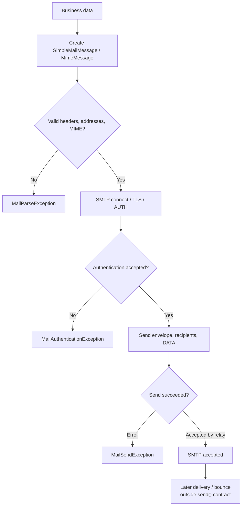
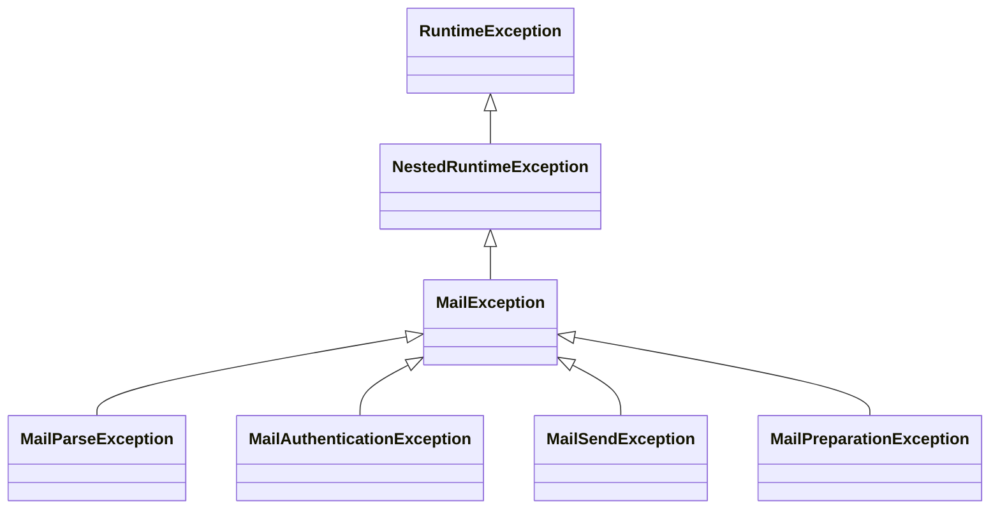
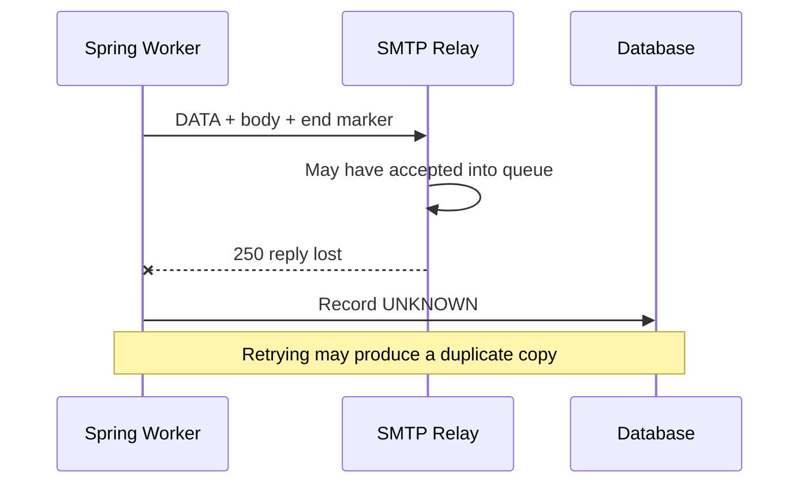
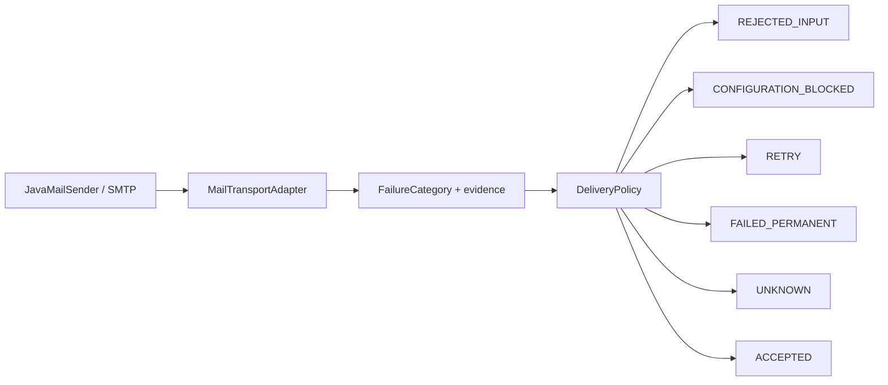
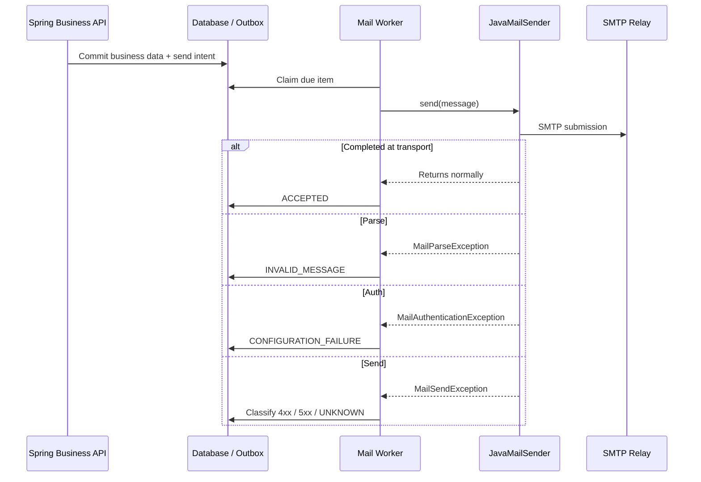

# Distinguishing MailParseException, MailAuthenticationException, and MailSendException

When integrating email sending with **Spring Framework Mail**, the three exception types `MailParseException`, `MailAuthenticationException`, and `MailSendException` frequently appear side by side in documentation and logs. Although all three belong to the `MailException` family, they represent **three distinct failure categories**: a message that cannot be parsed or validly constructed, authentication failure against the mail server, and errors occurring while transmitting/sending the message.

Distinguishing them accurately enables the application to react appropriately. A syntactically invalid recipient address must be fixed in input; a wrong SMTP password requires a configuration fix; an SMTP server returning a temporary error code may call for retrying after a wait. Most dangerously, treating every `MailSendException` as proof that no email left the application can fail: in some cases the server already accepted the message while the reply was lost, or only part of a message batch or recipient list failed.

This lesson uses Spring Framework 6.x, Spring Boot 3.x, Java 21, and Jakarta Mail in its examples. The error-classification principles also apply when a plain Spring application configures `JavaMailSenderImpl` directly. The focus is on **API contracts and error-handling policies**, independent of any specific SMTP provider.

## 1. Where the Three Exceptions Sit in the Sending Flow

An email passes through several stages:

1. The application gathers business data such as recipients, subject, body, or attachments.
2. Spring/Jakarta Mail constructs a `SimpleMailMessage` or `MimeMessage`, checking and assembling headers/MIME parts.
3. The mail transport connects to the SMTP relay and performs appropriate steps such as EHLO, TLS, and AUTH.
4. The client sends the envelope, `MAIL FROM`, `RCPT TO`, `DATA`, and content.
5. The SMTP relay returns a response—accepting, rejecting, or dropping the connection mid-way.
6. If the relay accepts, downstream systems continue routing/delivering the email, and bounces may occur later.

The three exceptions typically mark different boundaries:



The diagram depicts **typical scenarios**, not a rule that every implementation always throws one exact exception type on the same line of code. For instance, a connection error prior to AUTH may be reported by `JavaMailSenderImpl` as `MailSendException`; an error inside a MIME preparation callback may be `MailPreparationException`. Inspect nested causes and operational context.

## 2. Quick Comparison Table

| Criterion | `MailParseException` | `MailAuthenticationException` | `MailSendException` |
|---|---|---|---|
| Core meaning | Unable to parse or construct valid message data | Failed to authenticate with the mail server | Failure while executing send, connecting, or transmitting message |
| Common stage | Message and MIME header creation/preparation | SMTP AUTH or transport authentication step | Transport setup, SMTP envelope/data transfer, sending multiple messages |
| Examples | Invalid address/header, MIME conversion failure | Wrong username/password, expired credentials, auth permission denied | Timeout, SMTP 4xx/5xx, closed connection, rejected recipient |
| Inputs to inspect | Addresses, subject, MIME structure, template data | Secrets, username, AUTH method, account permissions | SMTP code, failure stage, recipients, server status |
| Retry immediately with same data? | Usually **no**; fix data or programming bug | Usually **no**; fix config or verify provider status | **Depends on cause**: transient, permanent, or uncertain outcomes |
| Can partial results occur? | No send evidence in typical message-build errors | Usually no body sent if AUTH was rejected | **Possible**, especially with multiple messages/recipients |
| Operational action | Return data error or log message-build bug | Alert operator, inspect secrets/account | Classify, track, schedule retry, or halt |

**Rule of thumb:** *Parse* concerns **the message**, *Authentication* concerns **mail-server login permissions**, and *Send* concerns **executing delivery**. Even so, the exception name is only the starting point for investigation; it does not replace error codes and concrete evidence.

## 3. MailException as the Base Class of Spring Mail's Exception Hierarchy

These exceptions all descend from `org.springframework.mail.MailException`, a Spring runtime exception. Being unchecked, `MailSender.send(...)` can declare `throws MailException` to document the contract without forcing callers to `catch` or declare `throws`.

Simplified hierarchy:



These names belong to Spring:

```java
import org.springframework.mail.MailException;
import org.springframework.mail.MailParseException;
import org.springframework.mail.MailAuthenticationException;
import org.springframework.mail.MailSendException;
import org.springframework.mail.MailPreparationException;
```

Do not confuse them with **Jakarta Mail** exceptions such as:

```java
import jakarta.mail.MessagingException;
import jakarta.mail.AuthenticationFailedException;
import jakarta.mail.SendFailedException;
import jakarta.mail.internet.AddressException;
```

Jakarta Mail describes errors at the protocol and message-building layers; Spring can **wrap** those errors in one of the `MailException` classes so services work against a consistent API. The specific Spring wrapper type and cause chain structure can differ by call path, implementation, and mail provider version.

`MailPreparationException` is also worth knowing even though it sits outside this lesson's trio: it typically relates to a `MimeMessagePreparator` callback failing to prepare a message. Do not force every pre-send error exclusively into `MailParseException`.

## 4. MailParseException: Message Parsing or Construction Failures

### 4.1. When Can It Occur?

`MailParseException` indicates a failure while **preparing/parsing email data**. In Spring JavaMail, operations that create and convert `MimeMessage` or set headers can trigger Jakarta Mail errors that Spring translates into this exception along applicable paths.

Common error sources:

- Email addresses cannot be validly parsed under the active parser rules.
- Invalid From/To/Cc/Bcc specifications or malformed header structures.
- Data the library must convert into headers/MIME messages cannot be processed.
- Application code constructs `MimeMessage` improperly or passes unsuitable data during message creation.

Problematic input examples:

```text
recipient = "alice@@example.com"
recipient = "not-an-address"
from      = "bad-address<CR><LF>Bcc: attacker@example.test"
```

These illustrate **risk scenarios**, not a guarantee that every parser rejects these exact strings at the exact same point. Some APIs store addresses as plain strings and defer validation; some validate during `setTo()`, others during `send()`; strictness depends on the library and configuration.

### 4.2. Distinguishing Syntax Errors from Nonexistent Mailboxes

The following two cases are not the same:

1. `alice@@example.com`: addr-spec syntax is invalid and rejected by the parser.
2. `nobody@example.com`: syntax appears valid, yet the mailbox may not exist; the SMTP server may reject it at `RCPT TO` or bounce it after the relay accepts it.

The second case **is not automatically a `MailParseException`**. If the SMTP server replies `550 5.1.1`, the failure sits in the sending/SMTP flow and usually must be read from `MailSendException` or related causes.

This informs user-facing API design: validation can catch formatting errors early, yet must never promise that passing validation means the address exists or will receive email.

### 4.3. Example of Pre-Validating Input Before Calling MailSender

A simple mail service can separate validation from transport:

```java
package com.example.mail;

import jakarta.mail.internet.AddressException;
import jakarta.mail.internet.InternetAddress;
import org.springframework.mail.MailSender;
import org.springframework.mail.SimpleMailMessage;
import org.springframework.stereotype.Service;

@Service
public class WelcomeMailService {

    private final MailSender mailSender;

    public WelcomeMailService(MailSender mailSender) {
        this.mailSender = mailSender;
    }

    public void sendWelcome(String recipient) {
        String address = requireAddress(recipient);

        SimpleMailMessage mail = new SimpleMailMessage();
        mail.setFrom("notifications@example.test");
        mail.setTo(address);
        mail.setSubject("Welcome");
        mail.setText("Your account has been created.");

        mailSender.send(mail);
    }

    private static String requireAddress(String value) {
        if (value == null || value.isBlank()) {
            throw new IllegalArgumentException("Missing recipient address");
        }
        try {
            InternetAddress[] parsed = InternetAddress.parse(value, true);
            if (parsed.length != 1) {
                throw new IllegalArgumentException("Exactly one recipient required");
            }
            parsed[0].validate();
            return parsed[0].getAddress();
        } catch (AddressException ex) {
            throw new IllegalArgumentException("Invalid recipient address", ex);
        }
    }
}
```

This is **early validation** at the business boundary; the example throws `IllegalArgumentException` on invalid input. It does not throw `MailParseException` proactively. When Spring/Jakarta Mail itself detects errors during message creation/sending, the corresponding wrapper may be `MailParseException`.

The `InternetAddress.parse(..., true)` and `validate()` pattern checks structure at the library level; it **does not verify DNS, mailbox existence, send permissions, domain reputation, or SMTPUTF8 support**. If only a single address is permitted, business rules should reject strings representing multi-address lists.

### 4.4. How to Handle MailParseException When It Occurs?

Reasonable response:

1. Record which send notification was being prepared via `notificationId` and error category.
2. Identify the input or MIME/header step causing the error.
3. If the user can correct the input, return an appropriate validation error.
4. If caused by templates or code, transition to a fix-needed state and alert the owning team.
5. **Do not auto-retry the exact same unchanged data** on an endless schedule.

In logs, never print the entire `MimeMessage`, recipient list, tokens, passwords, or message body. Exception messages themselves can embed sensitive substrings; apply proper redaction policies.

## 5. MailAuthenticationException: Failed to Authenticate with SMTP

### 5.1. Typical Scenario

Once the application has a valid message, the mail provider usually opens a connection and may require SMTP AUTH. `MailAuthenticationException` indicates **authentication failed**, usually because the provider rejected credentials or the auth mechanism.

Possible causes include:

- Wrong `username` or `password`.
- Credentials expired, locked, revoked, or lacking SMTP permissions.
- Provider requires an application password/token or a different AUTH mechanism while the app uses legacy config.
- The authenticated account is not authorized to send with the chosen From address; depending on the provider, this may also surface as a send/policy error instead of `MailAuthenticationException`.
- Provider temporarily unavailable at the auth step; inspect error codes and service status to distinguish from misconfiguration.

Conceptual log example:

```text
org.springframework.mail.MailAuthenticationException:
    Authentication failed
Caused by: jakarta.mail.AuthenticationFailedException:
    535 5.7.8 Authentication credentials invalid
```

`535 5.7.8` is an example of an SMTP server rejecting credentials; codes and text vary by provider. A `535` error counts as a failure for the active credentials, **and must not be retried hundreds of times with the exact same credentials**.

### 5.2. Do Not Confuse TLS Errors with AUTH Errors

SMTP submission normally uses one of two modes:

- Port **587 + STARTTLS**: the connection upgrades to TLS as supported by the provider, followed by AUTH when appropriate.
- Port **465 + implicit TLS**: TLS is established from the very beginning.

If a TLS handshake or certificate verification error happens **before** the AUTH step, an implementation may report a connection/send error such as `MailSendException`, rather than `MailAuthenticationException`. Inspect the deeper `cause` to tell certificate, protocol, hostname, and AUTH failures apart.

**Never resolve TLS errors by disabling certificate verification or dropping TLS requirements** in production.

### 5.3. Configuring Spring Boot with SMTP AUTH

Configuration example for a server supporting STARTTLS on port 587:

```yaml
spring:
  mail:
    host: ${SMTP_HOST}
    port: ${SMTP_PORT:587}
    username: ${SMTP_USERNAME}
    password: ${SMTP_PASSWORD}
    default-encoding: UTF-8
    properties:
      mail:
        smtp:
          auth: true
          starttls:
            enable: true
            required: true
          connectiontimeout: 5000
          timeout: 10000
          writetimeout: 10000

app:
  mail:
    from: ${MAIL_FROM}
```

Timeouts are in milliseconds and are illustrative only. Real SMTP setups must pull secrets from environment variables or an access-controlled secrets manager; never place passwords in repositories or logs. If the provider uses implicit TLS on port 465, configure SSL appropriately per provider docs rather than keeping port 587 STARTTLS settings.

Troubleshooting steps for authentication errors:

1. Check values **actually loaded by the application**: host, port, active profile, username (a masked identifier may be logged), TLS mode.
2. Verify credentials are provisioned for the right environment and SMTP account.
3. Check whether the account or SMTP AUTH is locked or disabled.
4. Inspect provider error codes, service health, and account policies.
5. Rotate secrets or fix configuration per operational procedures, then retry in a controlled manner.

**Recommended operational action:** pause the sending queue for the failing provider/account and raise a configuration alert for operators. Prevent millions of messages from failing retries concurrently and locking the account further.

### 5.4. Is Authentication Always a Permanent Error?

Do not answer with an absolute label. Bad credentials clearly **do not self-heal if data stays unchanged**. However, some servers return temporary 4xx errors during AUTH when an auth service is overloaded or unavailable. Therefore, the handling layer should record both **the Spring exception type** and **provider codes/conditions** if available.

Safe default stance: treat `MailAuthenticationException` as **a configuration or access-permission error requiring intervention**. Place it into short, bounded retries only when evidence shows a transient infrastructure glitch, paired with rate limiting to avoid login-failure loops.

## 6. MailSendException: Errors During the Sending Process

### 6.1. Broader Scope Than Many People Think

`MailSendException` typically arises when the implementation cannot complete the send operation. It is the **broadest** of the three exceptions in terms of possible underlying outcomes.

Example causes:

- Unable to open an SMTP connection due to DNS, timeout, connection refused, or server unavailability.
- Connection closed while sending the envelope or DATA.
- Server returns `421`, `450`, `451`, `452`, or other codes.
- Server rejects recipients, sender, or policy with 5xx codes.
- One message in a batch fails while another was accepted.
- I/O error makes it **impossible to tell** whether the server received the email.

Conceptual log example:

```text
org.springframework.mail.MailSendException:
    Mail server connection failed
Caused by: java.net.SocketTimeoutException:
    Connect timed out
```

Or:

```text
org.springframework.mail.MailSendException:
    Failed messages: ...
Caused by: jakarta.mail.SendFailedException: ...
```

Do not rely solely on the exception's prose text: the exact same `MailSendException` class can wrap recoverable errors or permanent rejections. A failed `send()` call **is not enough evidence** to retry all recipients blindly.

### 6.2. SMTP 4xx and 5xx Codes

SMTP responds with three-digit codes:

| Group | Protocol meaning | Examples | Initial handling direction |
|---|---|---|---|
| `2xx` | Command accepted | `250` after DATA | Record relay acceptance |
| `4xx` | **Temporary** rejection | `421`, `450`, `451`, `452` | Retry later with backoff while message remains valid |
| `5xx` | **Permanent** rejection for current command | `550`, `553` | Analyze cause; usually requires data/policy fix |

Extended examples:

```text
451 4.3.0 Temporary local problem - try again later
550 5.1.1 Recipient address rejected: user unknown
```

The leading digit of enhanced status codes `4.Y.Z` or `5.Y.Z` also aids classification. Still, SMTP codes **only carry meaning within the command's context**: an error at RCPT TO differs from an error after DATA; providers may also use additional codes for policy or rate limits.

**Key takeaway:** `MailSendException` does not mean "transient error". Analyze the reply code and root cause before scheduling retries.

### 6.3. Sending Multiple Emails: MailSendException Can Report Partial Failure

`MailSender` and `JavaMailSender` support sending a batch of messages:

```java
SimpleMailMessage first = new SimpleMailMessage();
first.setFrom("noreply@example.test");
first.setTo("alice@example.test");
first.setSubject("Notice A");
first.setText("Content A");

SimpleMailMessage second = new SimpleMailMessage();
second.setFrom("noreply@example.test");
second.setTo("bob@example.test");
second.setSubject("Notice B");
second.setText("Content B");

mailSender.send(first, second);
```

In Spring's JavaMail implementation, a `MailSendException` can hold a map of failed messages:

```java
import java.util.Map;
import org.springframework.mail.MailSendException;

try {
    mailSender.send(first, second);
} catch (MailSendException ex) {
    Map<Object, Exception> failed = ex.getFailedMessages();

    // failed records messages identified as errored by the implementation.
    // Do not assume messages absent from the map were read by recipients.
    System.out.println("Failed message count: " + failed.size());
}
```

`MailSendException.getFailedMessages()` returns a map of recorded failed messages, though exact object keys, causes, and error aggregation depend on the send path/implementation. Additionally, `getMessageExceptions()` helps retrieve exceptions associated with sending messages.

**Exercise extra caution** if a single `SimpleMailMessage` has multiple To/Cc/Bcc addresses. A failed message does not always mean zero recipients were accepted. Jakarta Mail may carry valid, sent, or unsent recipient details inside `SendFailedException`; inspect the transport/provider layer before retrying per recipient.

When emailing independent customers, a far more reliable pattern is creating **one delivery record per recipient** with its own `notificationId`/idempotency key; retries will never accidentally resend an entire batch.

### 6.4. Socket Errors After DATA: Uncertain Outcomes

A critical scenario:

1. The client finishes sending DATA and the end-of-message marker.
2. The SMTP relay receives it and may have enqueued the message.
3. The network connection drops before the client reads the `250` reply.
4. Jakarta Mail/Spring reports an I/O error as `MailSendException`.
5. The application **cannot know for sure** whether the relay accepted the email.



Timeouts before establishing a connection likely indicate nothing was sent, yet not all timeouts occur before DATA. Therefore, retry decisions must factor in **communication phase and potential acceptance**, rather than checking the exception name alone.

Standard SMTP **does not provide an idempotency key** guaranteed across all servers. An identical `Message-ID` header does not guarantee receiving systems deduplicate copies either. If your provider offers an API supporting idempotency or status lookup by provider ID, leverage it per its contract; with plain SMTP, accept distributed communication limits and design business workflows to tolerate or mitigate duplicates.

## 7. Why Should You Avoid a Single catch(MailException)?

Code like this compiles, yet lacks an explicit error policy:

```java
try {
    mailSender.send(message);
} catch (MailException ex) {
    // Mistake: treating every exception as a transient network error.
    scheduleRetryImmediately(message);
}
```

It can:

- Infinitely retry an invalid address or broken MIME structure.
- Repeatedly log in with bad credentials and get the provider account locked.
- Resend to all recipients even when some were already accepted by SMTP.
- Trigger a retry storm when SMTP is overloaded.
- Misreport outcomes if the relay already accepted the email and the response was lost.

A cleaner structure **classifies at the mail-sending adapter boundary**, then delegates to workflow policy:



Where:

- `REJECTED_INPUT`: fix data; do not retry as-is.
- `CONFIGURATION_BLOCKED`: alert and pause sends using the broken credentials/provider.
- `RETRY`: confirmed transient error; schedule bounded retry.
- `FAILED_PERMANENT`: provider definitively rejected the current data.
- `UNKNOWN`: insufficient evidence to conclude whether SMTP accepted it.
- `ACCEPTED`: relay accepted per transport evidence.

These are **suggested business states**, not built-in enums in Spring Framework Mail.

## 8. Java Example: Classifying the Three Exceptions at the Sending Boundary

Suppose an application sends plain-text emails and needs a structured outcome for the orchestration layer. You can catch the three exceptions individually and handle remaining Spring Mail errors:

```java
package com.example.mail;

import org.springframework.mail.MailAuthenticationException;
import org.springframework.mail.MailException;
import org.springframework.mail.MailParseException;
import org.springframework.mail.MailSendException;
import org.springframework.mail.MailSender;
import org.springframework.mail.SimpleMailMessage;
import org.springframework.stereotype.Component;

@Component
public class MailTransportAdapter {

    private final MailSender mailSender;

    public MailTransportAdapter(MailSender mailSender) {
        this.mailSender = mailSender;
    }

    public AttemptResult send(SimpleMailMessage message) {
        try {
            mailSender.send(message);
            return new AttemptResult(AttemptKind.ACCEPTED, "TRANSPORT_OK");
        } catch (MailParseException ex) {
            return new AttemptResult(
                    AttemptKind.INVALID_MESSAGE, "MAIL_PARSE");
        } catch (MailAuthenticationException ex) {
            return new AttemptResult(
                    AttemptKind.CONFIGURATION_FAILURE, "MAIL_AUTH");
        } catch (MailSendException ex) {
            // Insufficient info to conclude retry yet.
            // Dedicated layer must check SMTP code, cause, phase, partial results.
            return new AttemptResult(
                    AttemptKind.REQUIRES_SEND_DIAGNOSIS, "MAIL_SEND");
        } catch (MailException ex) {
            return new AttemptResult(
                    AttemptKind.OTHER_MAIL_FAILURE, "MAIL_OTHER");
        }
    }

    public enum AttemptKind {
        ACCEPTED,
        INVALID_MESSAGE,
        CONFIGURATION_FAILURE,
        REQUIRES_SEND_DIAGNOSIS,
        OTHER_MAIL_FAILURE
    }

    public record AttemptResult(AttemptKind kind, String safeErrorCode) {}
}
```

This example intentionally **does not define retry based on the `MailSendException` name**. `REQUIRES_SEND_DIAGNOSIS` simply means the next step must inspect provider details. In real systems, the adapter can capture the SMTP code, enhanced code, timestamp, affected message/recipient, and outcome certainty before returning to the workflow.

The snippet also **avoids logging raw exceptions** because error messages and headers may contain sensitive data. A safe/stable error code is better suited for metrics and general logs; detailed diagnostics require restricted access.

### 8.1. Note on Catch Order

All of these exceptions inherit from `MailException`. Always catch **specific subtypes before the general supertype**:

```java
try {
    mailSender.send(message);
} catch (MailParseException ex) {
    // Message creation/parsing error.
} catch (MailAuthenticationException ex) {
    // Authentication error.
} catch (MailSendException ex) {
    // Send error needing further classification.
} catch (MailException ex) {
    // Remaining mail errors.
}
```

If you put `catch (MailException ex)` first, subsequent specific catch blocks become unreachable and Java fails to compile.

### 8.2. Do Not Assume Every Caller Error Is a Transport Error

The example above accepts a pre-built `SimpleMailMessage`. If business code throws `IllegalArgumentException` while validating recipients or a template engine throws while rendering before calling the adapter, those errors sit **outside** the three caught Spring Mail types. Enforce a dedicated validation contract on inputs.

Conversely, when using `JavaMailSender.send(MimeMessagePreparator)`, errors from the preparation callback may be wrapped by Spring as `MailPreparationException`, not necessarily `MailParseException`. Handling policies should separate preparation from sending rather than forcing everything into three buckets.

## 9. How to Read the Cause Chain Properly

To diagnose `MailSendException`, look beneath the top-level Spring wrapper. You may encounter:

- `jakarta.mail.SendFailedException`: sending issue, possibly carrying recipient details.
- `jakarta.mail.AuthenticationFailedException`: Jakarta Mail auth error, usually wrapped appropriately by Spring.
- `jakarta.mail.MessagingException`: general Jakarta Mail cause; may link to another exception via `getNextException()`.
- `java.net.SocketTimeoutException`, `ConnectException`, `UnknownHostException`: network/DNS infrastructure failures.
- Provider-specific SMTP exceptions that may expose an API for the SMTP reply code; package and class names vary across providers/versions.

Spring `MailSendException` also supports:

```java
try {
    mailSender.send(message);
} catch (MailSendException ex) {
    Exception[] messageErrors = ex.getMessageExceptions();
    Map<Object, Exception> failed = ex.getFailedMessages();
    // Convert into controlled diagnostic data.
}
```

The snippet requires `import java.util.Map`. Not every scenario populates useful `messageErrors` or `failed` entries; for a general connection failure, do not assume the map enumerates per-recipient status.

When walking `MessagingException.getNextException()`, note that this is Jakarta Mail's own chaining mechanism and differs from standard `Throwable.getCause()`. Avoid unbounded loops over untrusted structures and never print sensitive data from exception messages.

### 9.1. Classify Using Evidence Rather Than Substrings

Fragile code patterns like this fail easily:

```java
if (ex.getMessage().contains("451")) {
    retry();
}
```

`ex.getMessage()` wording varies by provider, may omit the SMTP code, or may contain `451` inside unrelated text. Free-text parsing is brittle.

Better approach:

1. Use the provider exception's official API to extract the **SMTP reply code** if present.
2. Identify the failure phase: connection, AUTH, MAIL FROM, RCPT TO, or DATA.
3. For `4xx` evidenced as a temporary SMTP reply, consider retry.
4. For `5xx` with a permanent cause, stop retrying as-is and report the failure.
5. For I/O errors with unknown state after DATA, record `UNKNOWN` and apply duplicate-handling policy.
6. When data is missing, return **insufficient information for classification** rather than arbitrarily labeling it `TEMPORARY`.

## 10. Handling Strategy per Exception

| Exception / scenario | Suggested internal state | Retry | Responsible owner/team |
|---|---|---|---|
| `MailParseException` due to invalid recipient syntax | `INVALID_MESSAGE` | No, until input is fixed | Business service or caller |
| `MailParseException` due to MIME build error | `INVALID_MESSAGE` | No, until template/code is fixed | Developers / template owners |
| `MailAuthenticationException` due to wrong password | `CONFIGURATION_FAILURE` | Pause, fix credentials | Operations / secrets management |
| Confirmed transient 4xx AUTH error | `TEMPORARY_AUTH_FAILURE` | Bounded, throttled | Worker and operations |
| `MailSendException` with SMTP `451` | `RETRY` | Yes, backoff + limits | Delivery worker |
| `MailSendException` with SMTP `550 5.1.1` | `FAILED_PERMANENT` | No for current address | Recipient data management |
| `MailSendException` pre-connect timeout | `RETRY`/`NETWORK_FAILURE` | Possible, respecting quotas | Worker / infrastructure |
| `MailSendException` lost reply after DATA | `UNKNOWN` | Per duplicate-risk policy | Delivery workflow |
| Partial recipients accepted | Track per recipient | Retry only confirmed unaccepted targets | Delivery workflow |
| `MailPreparationException` rendering template | `PREPARATION_FAILURE` | Usually fix data/template | Developers / content authors |

Do not turn this table into a rigid `switch` lacking provider metadata. For example, SMTP `550` may reflect policy interpreted uniquely by a provider; persist safe codes/details to aid investigation.

## 11. Combining with an Outbox and Controlled Retries

In applications requiring durable sending, catching exceptions is only **one step of the workflow**. A common pattern persists send intent to an outbox table inside the business transaction and lets a worker claim due records.



A minimal outbox table can track:

```sql
CREATE TABLE mail_outbox (
    id UUID PRIMARY KEY,
    business_key VARCHAR(200) NOT NULL UNIQUE,
    recipient VARCHAR(320) NOT NULL,
    template_id VARCHAR(100) NOT NULL,
    payload_json TEXT NOT NULL,
    status VARCHAR(40) NOT NULL,
    attempts INTEGER NOT NULL DEFAULT 0,
    next_attempt_at TIMESTAMP NULL,
    last_error_category VARCHAR(80) NULL,
    last_smtp_code INTEGER NULL,
    lease_until TIMESTAMP NULL,
    created_at TIMESTAMP NOT NULL,
    updated_at TIMESTAMP NOT NULL
);
```

This is an **illustrative schema**. Real systems also need owner/fencing-safe claiming and lease reclamation, payload data protection policies, multi-recipient handling, and provider event reconciliation. Indexes, timestamp types, locking/transactions, and concurrency strategies depend on your database.

### 11.1. Routing Pseudocode

```text
item = claimDueOutboxItem()
try:
    send(item)
    mark ACCEPTED

catch MailParseException:
    mark INVALID_MESSAGE
    alert owning service / template team if needed

catch MailAuthenticationException:
    mark CONFIGURATION_FAILURE
    pause affected mail account/provider; alert operator

catch MailSendException:
    inspect provider reply code, phase, recipient and partial results
    if confirmed temporary:
        if attempts and deadline allow:
            mark RETRY, schedule backoff with jitter
        else:
            mark EXHAUSTED
    else if confirmed permanent:
        mark FAILED_PERMANENT
    else:
        mark UNKNOWN, apply duplicate-aware policy

catch other MailException:
    mark MAIL_FAILURE_NEEDS_CLASSIFICATION
```

The pseudocode deliberately avoids hardwiring `MailSendException -> RETRY`. In particular, if `MailSendException` reports partial message success, retrying the whole group risks creating duplicates.

### 11.2. Backoff, Retry Limits, and Expiration

A simple example:

```text
Temporary failure #1 → wait ~1 minute
Temporary failure #2 → wait ~2 minutes
Temporary failure #3 → wait ~4 minutes
Temporary failure #4 → wait ~8 minutes
...
Capped at 30 minutes, plus jitter, max 8 attempts
```

Numbers illustrate policy only, not Spring Mail defaults. Jitter prevents workers from retrying simultaneously at the exact same instant. If an email carries an OTP valid for only 5 minutes, retrying after 20 minutes is pointless even if `maxAttempts` has not been reached.

Persist retry schedules using `next_attempt_at` instead of sleeping threads inside HTTP requests. A long in-memory or `@Async` retry does not survive a JVM shutdown.

## 12. Illustrating Specific Scenarios

### Scenario A: Recipient Syntax Error

The application receives `"alice@@example.com"` and tries to build/send a `MimeMessage`. The parser detects the invalid address and code sees a `MailParseException` (or an appropriate validation exception on another path).

**Handling point:** the caller must fix the recipient; do not keep retrying because identical data remains invalid. Log a safe error code and avoid dumping raw malicious inputs.

### Scenario B: Invalid SMTP Credentials

The message is validly constructed, yet SMTP replies:

```text
535 5.7.8 Authentication credentials invalid
```

Spring may report `MailAuthenticationException`. Hundreds of send requests sharing that account will fail together.

**Handling point:** pause the account's outbound queue, raise an alert, verify the active profile/secret, and fix credentials or AUTH permissions before resuming. Never accelerate retries with the same broken credentials.

### Scenario C: SMTP Temporarily Overloaded

The message is valid and AUTH succeeded. At a send step, the server replies:

```text
451 4.3.0 Temporary local problem
```

Spring may report `MailSendException` with the Jakarta Mail/provider cause. The orchestration layer records a transient failure, increments `attempts`, and sets `next_attempt_at` with backoff.

**Handling point:** perform bounded retries after waiting while watching overall load/rate limits. If the provider keeps failing until the budget expires, mark `EXHAUSTED` and surface details to operations.

### Scenario D: One Recipient Valid, One Rejected

A message targets two recipients. The relay accepts one address and rejects the other. Transport behavior depends on configuration and provider; the caller may receive `MailSendException` containing or pointing to partial-failure details.

**Handling point:** persist per-recipient outcomes where possible; never auto-retry both without investigation. When high reliability and privacy are required, create one send request per recipient.

### Scenario E: SMTP Server Accepted, Yet ACK Lost

After the client finishes DATA, the relay accepts it, yet the connection drops before the client sees `250`. On Spring's side, a timeout `MailSendException` may appear.

**Handling point:** this is `UNKNOWN`. Retrying risks duplicates; there is no way to deduce certainty from the exception alone. Apply a business-risk policy, leverage provider idempotency/status APIs if available, and ensure links inside the email are safe under duplicate delivery.

## 13. Testing Error Classification in Spring

To verify that caller logic picks the right branch, **unit tests should inject exceptions intentionally**. Then integration tests with a mock or stub SMTP server verify the real error shapes produced by your mail provider setup.

### 13.1. Testing Branching with a Fake MailSender

Because `MailSender` has two overloads, create a fake that throws the desired exception:

```java
package com.example.mail;

import org.springframework.mail.MailException;
import org.springframework.mail.MailSender;
import org.springframework.mail.SimpleMailMessage;

final class FailingMailSender implements MailSender {

    private final MailException failure;

    FailingMailSender(MailException failure) {
        this.failure = failure;
    }

    @Override
    public void send(SimpleMailMessage message) {
        throw failure;
    }

    @Override
    public void send(SimpleMailMessage... messages) {
        throw failure;
    }
}
```

Use JUnit 5 to test the adapter:

```java
package com.example.mail;

import static org.junit.jupiter.api.Assertions.assertEquals;

import org.junit.jupiter.api.Test;
import org.springframework.mail.MailAuthenticationException;
import org.springframework.mail.MailParseException;
import org.springframework.mail.MailSendException;
import org.springframework.mail.SimpleMailMessage;

class MailTransportAdapterTest {

    private static SimpleMailMessage sample() {
        SimpleMailMessage mail = new SimpleMailMessage();
        mail.setFrom("noreply@example.test");
        mail.setTo("learner@example.test");
        mail.setSubject("Test");
        mail.setText("Content");
        return mail;
    }

    @Test
    void reportsInvalidMessage() {
        MailTransportAdapter adapter = new MailTransportAdapter(
                new FailingMailSender(new MailParseException("Invalid MIME")));

        assertEquals(MailTransportAdapter.AttemptKind.INVALID_MESSAGE,
                adapter.send(sample()).kind());
    }

    @Test
    void reportsAuthenticationProblem() {
        MailTransportAdapter adapter = new MailTransportAdapter(
                new FailingMailSender(
                        new MailAuthenticationException("Auth failed")));

        assertEquals(
                MailTransportAdapter.AttemptKind.CONFIGURATION_FAILURE,
                adapter.send(sample()).kind());
    }

    @Test
    void sendErrorRequiresFurtherDiagnosis() {
        MailTransportAdapter adapter = new MailTransportAdapter(
                new FailingMailSender(new MailSendException("SMTP 451")));

        assertEquals(
                MailTransportAdapter.AttemptKind.REQUIRES_SEND_DIAGNOSIS,
                adapter.send(sample()).kind());
    }
}
```

These tests verify **Spring-exception classification contracts**. They do not prove an email went over SMTP, do not prove code `451` actually came from a server, and do not verify final retry logic. `new MailSendException("SMTP 451")` only creates a simulated error; never infer from message strings in production.

### 13.2. Controlled Integration Testing

A test environment can combine:

1. **Mailpit** or a fake SMTP server to inspect valid emails.
2. An SMTP stub capable of rejecting AUTH, returning 4xx/5xx per step, or closing connections mid-DATA.
3. A test database for outbox and retry state.
4. A provider sandbox when testing specific behaviors like error codes, quotas, and SMTPUTF8 handling.

| Scenario | Observations to verify |
|---|---|
| Invalid message/headers | Preparation-stage exception; workflow does not retry blindly |
| Wrong credentials | Auth exception; config flagged broken and alert emitted |
| SMTP returns 451 | Matching `MailSendException`/cause; retry with backoff |
| SMTP returns 550 | Permanent classification per response; no endless retries |
| Network loss before connect | Network error and matching retry state |
| Network loss after DATA | Never claims with certainty that message was unreceived |
| Two messages, one fails | Accepted message is not resent |
| Multiple recipients in one message | Verify partial acceptance per provider |
| Worker stops after claiming | Record returns to processing queue via lease/timeout |

Never use real customer mailboxes in automated tests, and never disable TLS security in production just to simulate failures.

## 14. Observing Failures Without Exposing Sensitive Data

Long-running applications need per-error-category metrics, not just a log line saying "Cannot send mail".

Structured log example:

```json
{
  "event": "mail.delivery_attempt",
  "notificationId": "7c78089a-8c56-49dc-b092-c3bb144aa652",
  "provider": "primary-smtp",
  "attempt": 2,
  "category": "MAIL_SEND",
  "smtpCode": 451,
  "enhancedStatus": "4.3.0",
  "decision": "RETRY",
  "durationMs": 1534
}
```

Useful metrics:

| Suggested metric | Meaning |
|---|---|
| `mail_attempts_total{category,provider}` | Count of transport successes or each failure group |
| `mail_parse_failures_total{template}` | Spikes in invalid templates or send data |
| `mail_auth_failures_total{provider}` | Credential/AUTH permission issues |
| `mail_send_failures_total{smtp_class}` | Transient vs. permanent SMTP error trends |
| `mail_unknown_outcomes_total` | Duplicate risk or indeterminate status counts |
| `mail_outbox_pending_count` | Number of pending send requests |
| `mail_oldest_due_age_seconds` | Backlog age exceeding SLA |

Use only **low-cardinality labels** in metrics; `notificationId`, full email addresses, and raw exception strings do not belong in metric labels. In logs, avoid storing recipients/subject/body and secrets; when detailed investigation is needed, use internal IDs with access controls.

When `MailAuthenticationException` spikes across sends, alerts should pinpoint the affected account/provider so credentials can be fixed. When `MailParseException` spikes on a newly updated template, check template data/rendering. When `MailSendException` spikes on 4xx codes, check quotas and queue depth. Different failure groups require **different remediation paths**, even when charted together on an overall email-failure dashboard.

## 15. Common Misconceptions

**Confusing MailParseException with a nonexistent address.** A syntactically valid address may still not exist; that is typically detected when SMTP rejects the recipient or via a bounce, not when the parser checks string syntax.

**Assuming every login failure is MailSendException.** Spring JavaMail typically distinguishes auth errors with `MailAuthenticationException` when the mail transport recognizes an AUTH failure; however, TLS, connection, or other implementations may wrap differently. Inspect the cause chain.

**Assuming MailSendException is always retryable.** It spans 4xx, 5xx, I/O, and partial failures. Classify based on SMTP codes, stage, and provider.

**Assuming MailSendException means nobody received anything.** With multiple messages or recipients, and when replies are lost after DATA, some messages may already be accepted. Retrying everything risks duplicates.

**Catching MailException before its subclasses.** Java will not allow specific catch blocks afterward to run; always catch specific exceptions first before the fallback.

**Logging full stack traces and messages for every mail error.** Exceptions can contain recipient addresses, header content, or sensitive provider details. Log normalized error codes and restrict access to full diagnostics when needed.

**Using @Async and thinking failures cannot be lost.** `@Async` only switches execution threads; it does not create a durable queue. For critical sends, persist send intent and track processing state.

**Treating send() returning normally as DELIVERED.** Completing the send at the sender/relay layer does not prove the email reached the inbox or was read; downstream milestones require provider feedback.

## 16. Comprehensive Hands-On Exercise

Build a Spring Boot service that sends course-enrollment confirmation emails using `spring-boot-starter-mail`. Separate the code into **a content-building service**, **`MailTransportAdapter`**, and **a delivery worker**.

**Step 1 — Valid message:** create a `SimpleMailMessage`, send it to a mock SMTP server, and observe Vietnamese subject/body rendering. For HTML or attachments, switch to `MimeMessage`/`MimeMessageHelper`.

**Step 2 — Syntax failure:** intentionally supply invalid recipient/header input in tests. Identify whether the exception arises in validation, helper, or sender; classify it as `INVALID_MESSAGE` and do not retry unchanged data.

**Step 3 — Auth failure:** use an SMTP stub rejecting AUTH to observe `MailAuthenticationException` or the actual wrapper. When it occurs, ensure the worker does not loop login attempts; emit an alert and mark configuration as needing attention.

**Step 4 — Send failures:** use a stub returning `451` and `550` at different phases. Track `MailSendException`, actual SMTP codes, and `RETRY` vs. `FAILED_PERMANENT` paths. Enforce max attempts, jitter, and notification deadlines.

**Step 5 — Partial failure:** create two emails or one multi-recipient email; have one recipient rejected. Design per-item state persistence so already-accepted targets are not retried.

**Step 6 — Uncertain state:** drop the connection after DATA before the server reply. Record `UNKNOWN` and explain why `MailSendException` alone is insufficient evidence to declare total failure.

**Step 7 — Observability:** add logs and metrics for the three error groups, backlog, and unknown outcomes. Never place email bodies, secrets, or customer lists into metric labels.

After completing this exercise, you should be able to explain: **whether an error belongs to message data, authentication permissions, or the send process; whether evidence shows partial server acceptance; and whether the next step is fixing data, fixing config, bounded retrying, or investigating an uncertain state**. That is how to use Spring Framework Mail's three exceptions as technical signals driving a reliable sending workflow, rather than merely three class names to `catch`.
