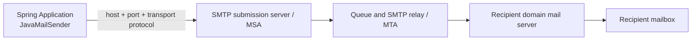
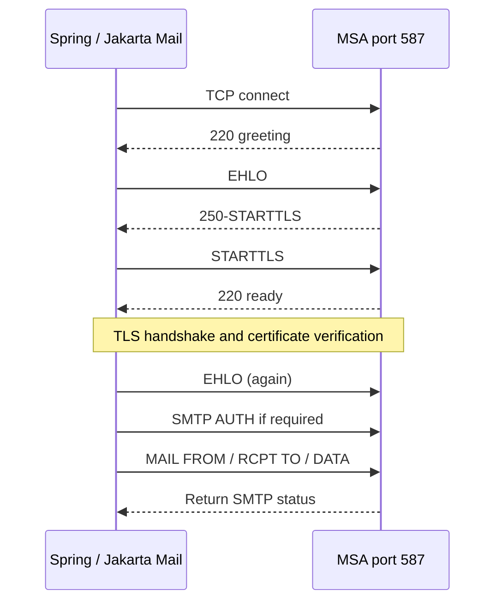
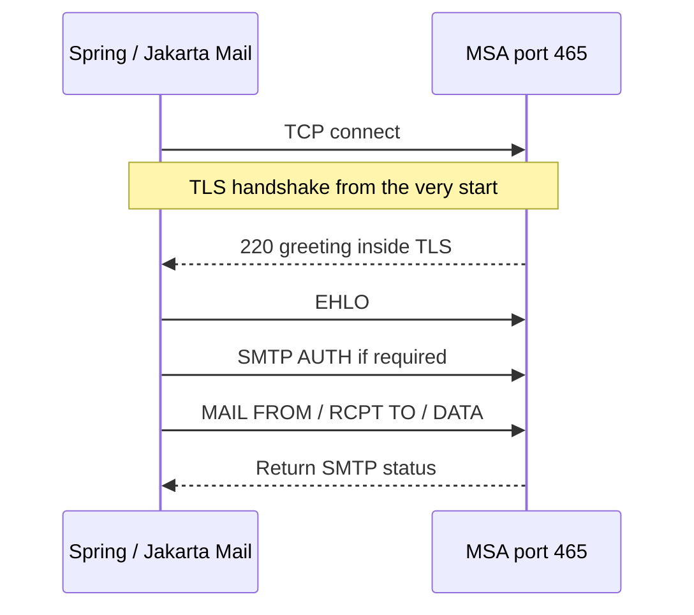
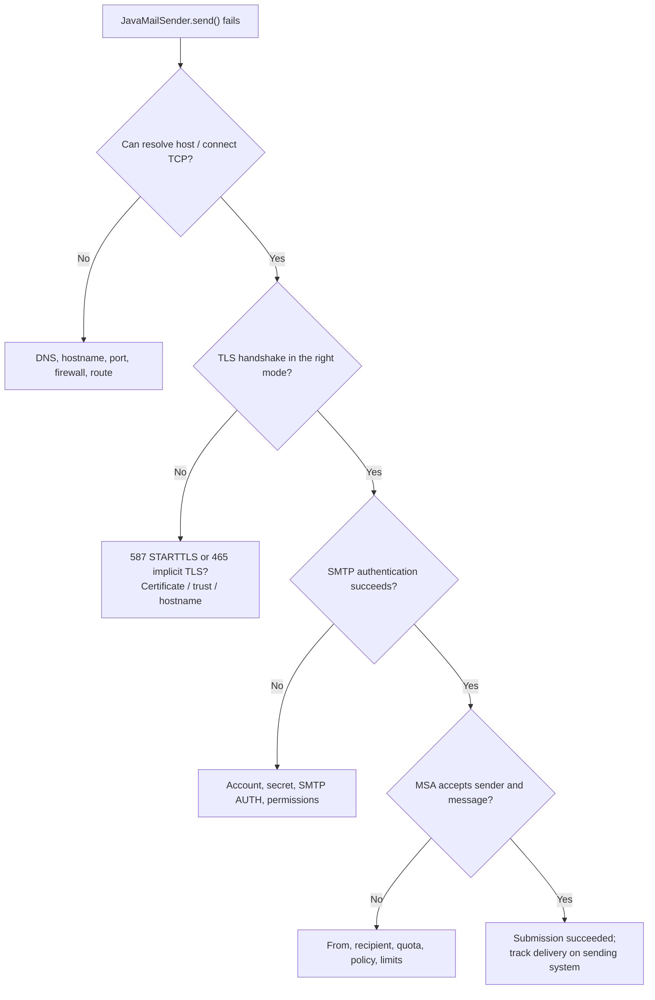

# Configuring Mail Server Host, Port, and Protocol in Spring Framework Mail

For a Spring application to send email, `JavaMailSender` needs to know **which server to connect to**, **through which port**, and **which transport protocol to use**. The three core parameters are `host`, `port`, and `protocol`. They define the destination of the outgoing mail connection; requirements such as TLS, authentication, and timeouts are configured separately.

A proper configuration is more than just filling in three values so the program compiles. For example, port **587** typically requires SMTP followed by upgrading to TLS via **STARTTLS**, whereas port **465** typically requires **TLS right from connection establishment**. If you choose the right hostname but use the wrong TLS mode, the application still cannot send mail.

This lesson explains the meaning of each field, how to configure them with Spring Boot and plain Spring Framework, the relationship between `smtp`/`smtps` and common ports, and how to identify the root cause when connections fail.

## 1. Where do host, port, and protocol fit in the email sending flow?

A Spring application typically acts as an **SMTP client**. It builds the message content, then submits the message to an authorized **Mail Submission Agent (MSA)** or SMTP relay. The receiving server handles queuing and further delivery.



Example parameters provided by an SMTP provider:

```text
SMTP host:      smtp.provider.example
SMTP port:      587
SMTP protocol:  smtp
Security:       STARTTLS required
Authentication: username/password or provider-supported mechanism
```

Meaning:

- **`host`**: the hostname or address of the SMTP server to which the application will open a connection.
- **`port`**: the TCP port on which that server's SMTP service is listening.
- **`protocol`**: the transport name used by JavaMail/Jakarta Mail to send messages, usually `smtp`; in some configurations `smtps` is also used.

To send real emails, you also typically need **authentication**, **TLS**, **timeouts**, and authorization to use the sender address. The three host/port/protocol fields only solve the first step: defining how to connect to the mail sending service.

### Distinguishing outgoing mail servers from incoming mail servers

The input to `JavaMailSender` is an SMTP submission endpoint, **not an IMAP/POP3 server address for reading an inbox**.

| Task | Common protocol | Application example |
|---|---|---|
| Submit outgoing email from Spring | SMTP submission | `JavaMailSender` |
| Transfer email between mail servers | SMTP transfer | MTAs |
| Read and synchronize inbox | IMAP | Mail client or mail-reading application |
| Download messages via POP3 model | POP3 | Mail client or mail-fetching application |

Even when a provider uses the same commercial domain for both sending and receiving services, the **hostname, port, and protocol** of the two services can still differ. Do not replace `smtp.provider.example` with `imap.provider.example` just because it belongs to the same email account.

## 2. `host`: SMTP server address

`host` is typically a **DNS hostname** such as:

```text
smtp.provider.example
mail.internal.example
127.0.0.1
```

In Spring Boot:

```yaml
spring:
  mail:
    host: smtp.provider.example
```

In plain Spring Framework:

```java
JavaMailSenderImpl sender = new JavaMailSenderImpl();
sender.setHost("smtp.provider.example");
```

**Host is a machine name, not a full URL.** Avoid values such as:

```text
smtp://smtp.provider.example:587    # wrong: combines scheme and port into host
https://smtp.provider.example        # wrong: HTTPS URL is not an SMTP hostname
user@smtp.provider.example           # wrong: this looks like an email address
smtp.provider.example:465           # wrong: port already has its own field
```

The correct approach is to separate them into:

```text
host     = smtp.provider.example
port     = 587
protocol = smtp
```

If you use an IP address instead of a hostname, the configuration may connect over TCP, but **TLS certificate verification may fail** when the certificate is issued for a hostname. In production, use the official hostname published by the provider so that it matches DNS and the TLS certificate.

### Is the SMTP host the recipient's MX record?

Usually **no**. A Spring application submits email to **a preconfigured submission server**. The backend MTA system routes the message to recipient domains, typically via DNS MX.

For example:

```text
The application sends email to:
  alice@example.net
  bob@another.example

Yet the application's JavaMailSender still connects to:
  smtp.provider.example:587
```

There is no need to look up each recipient's MX record in the application service. Doing so would turn the application into part of the mail transfer infrastructure, bringing along other operational responsibilities such as queuing/retrying, IP reputation management, and forwarding policies.

### Choosing a host by environment

The same email-sending code can use different endpoints:

| Environment | Example host | Purpose |
|---|---|---|
| Local | `localhost` or container service name `mailpit` | SMTP sink for viewing test mail without sending to the Internet |
| Development / staging | SMTP sandbox or test account | Integration testing and sending policy checks |
| Production | Official SMTP submission endpoint | Real email delivery |
| Internal network | Admin-provided relay host | Sending through internal email infrastructure |

Note: `localhost` always refers to **the exact machine/container running the application**. If Spring runs in its own container, `localhost` does not automatically point to an adjacent SMTP sandbox container; you must use a hostname resolvable within the corresponding network/container setup.

## 3. `port`: TCP port of the SMTP service

`port` identifies the logical address of the service on the host. Common ports:

| Port | Common purpose | Security setup |
|---|---|---|
| **25** | SMTP transfer between MTAs; sometimes internal relay | May use STARTTLS depending on server policy |
| **587** | Message submission from an application or mail client to an MSA | Initial SMTP, then **STARTTLS** |
| **465** | Message submission with TLS right from connection start | **Implicit TLS** |
| **2525** | Alternative port supported by some providers | Depends on provider policy; usually requires STARTTLS |
| **1025** | Example port for a local SMTP sink | Usually no TLS/AUTH in controlled test networks |

When a Spring application sends email through an SMTP provider, prefer **the submission endpoint designated by the provider**, typically 587 or 465.

### Port 587: STARTTLS

With port 587, the client opens a TCP connection, performs the initial SMTP exchange, sends `STARTTLS` to upgrade the channel, and only then performs SMTP AUTH/message submission according to policy.



Here, distinguish between two properties:

- `mail.smtp.starttls.enable=true`: allows Jakarta Mail to use STARTTLS when the server supports it.
- `mail.smtp.starttls.required=true`: requires STARTTLS to succeed; do not silently send plaintext if the server does not support it or the upgrade fails.

For credentials and business emails over untrusted networks, **require STARTTLS** on 587 and verify the TLS certificate.

### Port 465: implicit TLS

With port 465, TLS begins **immediately after TCP connects**. Only after the TLS handshake does the client receive the SMTP greeting and send `EHLO`.



With Jakarta Mail, the common configuration keeps `protocol=smtp` and enables `mail.smtp.ssl.enable=true`. The word `ssl` in the property name is **a legacy API name**; it requests establishing TLS from the start, not using obsolete SSL versions.

If a client uses port 587's connection pattern against an endpoint that only accepts implicit TLS on 465, both sides may wait on each other or drop the connection; the same happens when mistakenly using implicit TLS on 587.

### Port 25 and distinctions to understand

Port 25 has traditionally served MTA-to-MTA traffic. It **does not always mean plaintext**, because SMTP transfer can also use STARTTLS. However, many cloud providers and ISPs restrict outbound TCP 25 to reduce spam. Business applications generally should not pick port 25 on their own when a dedicated submission port is available.

On internal networks, administrators may provide an SMTP relay on port 25 or a custom port with network-based authentication. Follow that relay's exact policy rather than assuming every SMTP server uses username/password or always uses 587.

## 4. `protocol`: Jakarta Mail's SMTP transport

In `JavaMailSenderImpl`, the `protocol` field specifies the transport that Jakarta Mail uses when sending mail. The most common value is:

```text
smtp
```

In Spring Boot:

```yaml
spring:
  mail:
    protocol: smtp
```

In Java:

```java
sender.setProtocol("smtp");
```

`smtp` is **the email sending protocol**, not the name of an encryption layer. You can use `smtp` with **587 + STARTTLS** or with **465 + implicit TLS** by enabling the right properties.

### What is the difference between `smtp` and `smtps`?

Jakarta Mail can provide the `smtps` transport to run SMTP over an immediate TLS connection. However, for Spring Mail, you are **not required to change `protocol` to `smtps` when using port 465**.

Two configurations can serve the same TLS endpoint:

| Approach | `protocol` | `port` | Typical properties |
|---|---|---:|---|
| SMTP + STARTTLS | `smtp` | 587 | `mail.smtp.starttls.enable=true` and `required=true` |
| SMTP + implicit TLS | `smtp` | 465 | `mail.smtp.ssl.enable=true` |
| SMTPS transport (when supported by provider) | `smtps` | 465 | Corresponding transport properties prefixed with `mail.smtps.*` |

The **`smtp` + `mail.smtp.ssl.enable=true`** approach is usually clearer and more consistent with common Spring Boot configurations: host, port, and protocol continue using `smtp`, while security settings are specified separately.

If you intentionally choose the `smtps` transport, check for a compatible Jakarta Mail provider and use properties prefixed with **`mail.smtps.*`**, such as `mail.smtps.auth`, `mail.smtps.connectiontimeout`, and `mail.smtps.timeout`. Some `mail.smtp.*` settings for the `smtp` transport do not automatically apply to the `smtps` transport. Therefore, avoid renaming the protocol while leaving all properties unchanged and assuming they will still take effect as before.

### Do not use IMAP or POP3 as JavaMailSender's protocol

The `spring.mail.protocol` value is for **sending** mail. Setting `imap` or `pop3` there does not turn `JavaMailSender` into a mail-reading tool; those two protocols belong to the **receiving/mailbox access** category with different APIs. Use the sending transport corresponding to the provisioned submission server.

### Protocol is also not a URL scheme

The following values represent different concepts:

```text
spring.mail.host: smtp.provider.example     # hostname
spring.mail.port: 587                      # TCP port
spring.mail.protocol: smtp                 # Jakarta Mail transport
mail.smtp.starttls.enable: true            # TLS mode
mail.smtp.auth: true                       # SMTP AUTH client setting
```

Do not enter `protocol: smtp://`, `protocol: tls`, or `protocol: 587`. They are not standard SMTP transport names expected by `JavaMailSenderImpl`.

## 5. Configuring Spring Boot with `application.yml`

Spring Boot can auto-configure a `JavaMailSender` from the **Spring Boot Mail starter** and the `spring.mail.*` property group when auto-configuration conditions are met.

### Dependency

With Gradle:

```groovy
dependencies {
    implementation 'org.springframework.boot:spring-boot-starter-mail'
}
```

With Maven:

```xml
<dependency>
    <groupId>org.springframework.boot</groupId>
    <artifactId>spring-boot-starter-mail</artifactId>
</dependency>
```

Examples in this lesson use modern Spring Boot and Jakarta Mail. When using Spring Boot 2 / Spring Framework 5, imports under the older `javax.mail` package may differ; the fundamental understanding of host/port/protocol remains unchanged.

### A. SMTP submission configuration on port 587 + STARTTLS

Here is an example suited for an MSA requiring SMTP AUTH and STARTTLS:

```yaml
spring:
  mail:
    host: ${SMTP_HOST}
    port: 587
    protocol: smtp
    username: ${SMTP_USERNAME}
    password: ${SMTP_PASSWORD}
    properties:
      "[mail.smtp.auth]": true
      "[mail.smtp.starttls.enable]": true
      "[mail.smtp.starttls.required]": true
      "[mail.smtp.ssl.checkserveridentity]": true
      "[mail.smtp.connectiontimeout]": 5000
      "[mail.smtp.timeout]": 10000
      "[mail.smtp.writetimeout]": 10000

app:
  mail:
    from: ${MAIL_FROM}
```

With this example, environment variables could be:

```text
SMTP_HOST=smtp.provider.example
SMTP_USERNAME=mailer@example.org
SMTP_PASSWORD=(secret provided via environment)
MAIL_FROM=notifications@example.org
```

Choose the right account and sending permissions per your provider's documentation. Do not put real secrets into source code or git. Some providers require an **app password**, OAuth2, or token instead of a regular email password; the AUTH configuration must match the mechanism supported by the server.

Property explanations:

| Property | Purpose |
|---|---|
| `spring.mail.host` | Hostname of the SMTP submission server |
| `spring.mail.port` | TCP port on which the server listens |
| `spring.mail.protocol` | Transport protocol, here `smtp` |
| `spring.mail.username`, `password` | Authentication credentials for the MSA if needed |
| `mail.smtp.auth` | Enables the SMTP AUTH mechanism of the SMTP transport |
| `mail.smtp.starttls.enable` | Enables client support for STARTTLS upgrade |
| `mail.smtp.starttls.required` | Requires STARTTLS negotiation to succeed |
| `mail.smtp.ssl.checkserveridentity` | Verifies the hostname on the TLS certificate |
| `mail.smtp.connectiontimeout` | Time to wait when establishing a TCP connection (milliseconds) |
| `mail.smtp.timeout` | Timeout for reading data |
| `mail.smtp.writetimeout` | Timeout for writing data |
| `app.mail.from` | **Application-defined** property to pick the `From` address |

The `spring.mail.properties` group is where corresponding properties are passed down to Jakarta Mail. The `mail.smtp.*` names inside square brackets are **literal keys** of the transport; Spring Boot does not interpret them as `spring.mail.host` or `spring.mail.port`.

### B. SMTP submission configuration on port 465 + implicit TLS

When a provider requires implicit TLS, a common configuration is:

```yaml
spring:
  mail:
    host: ${SMTP_HOST}
    port: 465
    protocol: smtp
    username: ${SMTP_USERNAME}
    password: ${SMTP_PASSWORD}
    properties:
      "[mail.smtp.auth]": true
      "[mail.smtp.ssl.enable]": true
      "[mail.smtp.ssl.checkserveridentity]": true
      "[mail.smtp.connectiontimeout]": 5000
      "[mail.smtp.timeout]": 10000
      "[mail.smtp.writetimeout]": 10000
```

Here **`protocol` is still `smtp`**. The important difference lies in `port: 465` and `mail.smtp.ssl.enable=true`. This mode starts TLS from the beginning, so `STARTTLS` from the port 587 example is not needed.

You cannot simply change `587` to `465` while leaving the rest of the configuration unchanged and expect it to work. Similarly, do not enable `mail.smtp.ssl.enable=true` on 587 if the provider expects an SMTP greeting followed by STARTTLS.

### C. SMTP sandbox configuration for local development

If the application runs alongside an SMTP sink such as Mailpit, you can use a local-specific configuration:

```yaml
# application-local.yml — isolated SMTP sink example
spring:
  mail:
    host: localhost
    port: 1025
    protocol: smtp
    properties:
      "[mail.smtp.auth]": false
      "[mail.smtp.starttls.enable]": false

app:
  mail:
    from: local@example.test
```

These no-TLS/no-AUTH values are **only appropriate in a controlled development environment**. If Spring runs in a container, replace `localhost` with the Docker service name or SMTP sink address reachable from that container.

### D. Environment-based configuration and default values

Spring Boot supports placeholders so you do not have to modify code when switching environments:

```yaml
spring:
  mail:
    host: ${SMTP_HOST}
    port: ${SMTP_PORT:587}
    protocol: smtp
    username: ${SMTP_USERNAME}
    password: ${SMTP_PASSWORD}
```

`${SMTP_PORT:587}` means use `SMTP_PORT` if present, otherwise use `587`. Because TLS also depends on the port, when an environment needs to switch from 587 to 465, you must change **the entire security property group**, not just the port. A readable way to manage this is to use dedicated profiles for each SMTP endpoint type or configure deployments with a consistent set of values.

## 6. Plain Spring Framework: configuring `JavaMailSenderImpl` in Java

If you do not use Spring Boot auto-configuration, the application can create the `JavaMailSenderImpl` bean manually.

```java
package com.example.mail;

import java.util.Properties;
import org.springframework.context.annotation.Bean;
import org.springframework.context.annotation.Configuration;
import org.springframework.mail.javamail.JavaMailSender;
import org.springframework.mail.javamail.JavaMailSenderImpl;

@Configuration
public class MailConfiguration {

    @Bean
    JavaMailSender javaMailSender() {
        JavaMailSenderImpl sender = new JavaMailSenderImpl();
        sender.setHost(System.getenv("SMTP_HOST"));
        sender.setPort(587);
        sender.setProtocol("smtp");
        sender.setUsername(System.getenv("SMTP_USERNAME"));
        sender.setPassword(System.getenv("SMTP_PASSWORD"));
        sender.setDefaultEncoding("UTF-8");

        Properties properties = sender.getJavaMailProperties();
        properties.put("mail.smtp.auth", "true");
        properties.put("mail.smtp.starttls.enable", "true");
        properties.put("mail.smtp.starttls.required", "true");
        properties.put("mail.smtp.ssl.checkserveridentity", "true");
        properties.put("mail.smtp.connectiontimeout", "5000");
        properties.put("mail.smtp.timeout", "10000");
        properties.put("mail.smtp.writetimeout", "10000");

        return sender;
    }
}
```

In the example above:

- `setHost(...)` is **the destination**.
- `setPort(587)` is **the TCP port**.
- `setProtocol("smtp")` selects **the SMTP transport**.
- `setUsername(...)` and `setPassword(...)` supply credentials for connection setup if required by the server.
- The `mail.smtp.*` properties control TLS, AUTH, and timeouts.

This is a simple configuration example. In real applications, inject configuration via `@ConfigurationProperties` or an equivalent configuration mechanism, validate required variables, and retrieve secrets from an authorized secret manager. Do not rely on `System.getenv(...)` returning `null` unnoticed until mail sending occurs.

### Using the `smtps` transport when specifically required

For applications choosing `smtps` instead of `smtp`, configure the properties for the corresponding transport:

```java
JavaMailSenderImpl sender = new JavaMailSenderImpl();
sender.setHost("smtp.provider.example");
sender.setPort(465);
sender.setProtocol("smtps");
sender.setUsername(System.getenv("SMTP_USERNAME"));
sender.setPassword(System.getenv("SMTP_PASSWORD"));

Properties props = sender.getJavaMailProperties();
props.put("mail.smtps.auth", "true");
props.put("mail.smtps.ssl.checkserveridentity", "true");
props.put("mail.smtps.connectiontimeout", "5000");
props.put("mail.smtps.timeout", "10000");
props.put("mail.smtps.writetimeout", "10000");
```

This example illustrates **how the transport name governs the property prefix**; it is only suitable if the application's Jakarta Mail runtime includes the corresponding `smtps` provider. For common setups on 465, using `protocol=smtp` with `mail.smtp.ssl.enable=true` is usually simpler.

### Configuring JavaMailSender does not create an SMTP server

Creating a `JavaMailSenderImpl` bean only creates a **mail sending client**. The application still needs a running SMTP service, DNS/network reachability, an authorized account, and a valid sender address. Spring does not automatically start an MSA just because the bean is declared.

## 7. Using the configured bean in an email-sending service

Once host, port, and protocol are configured, business code only needs to inject `JavaMailSender` and should not repeat endpoint details in every method:

```java
package com.example.mail;

import org.springframework.beans.factory.annotation.Value;
import org.springframework.mail.SimpleMailMessage;
import org.springframework.mail.javamail.JavaMailSender;
import org.springframework.stereotype.Service;

@Service
public class NotificationMailService {

    private final JavaMailSender sender;
    private final String fromAddress;

    public NotificationMailService(
            JavaMailSender sender,
            @Value("${app.mail.from}") String fromAddress) {
        this.sender = sender;
        this.fromAddress = fromAddress;
    }

    public void sendNotification(String recipient) {
        SimpleMailMessage message = new SimpleMailMessage();
        message.setFrom(fromAddress);
        message.setTo(recipient);
        message.setSubject("System Notification");
        message.setText("Your task has completed.");
        sender.send(message);
    }
}
```

`SimpleMailMessage` fits simple text emails. For HTML, attachments, or inline resources, use `MimeMessage` and `MimeMessageHelper`. Regardless of which message type is created, the `JavaMailSender` bean still uses the same configured endpoint and transport.

When calling `send(...)`, Jakarta Mail typically opens the SMTP connection, authenticates if needed, sends the envelope and content, and reads the MSA's response. **A successful return from the method does not mean the email has reached the recipient's inbox**; it usually only confirms that the submission hop completed according to the sending server's response.

## 8. Related configuration properties with different roles

Host, port, and protocol are easily confused with other properties because they all reside under `spring.mail.*`.

| Property | Role | Does it replace host/port/protocol? |
|---|---|---|
| `spring.mail.host` | SMTP submission server | Is host |
| `spring.mail.port` | Server TCP port | Is port |
| `spring.mail.protocol` | Corresponding `smtp` or `smtps` transport | Is protocol |
| `spring.mail.username` | Authentication identity | No |
| `spring.mail.password` | Authentication secret | No |
| `spring.mail.default-encoding` | Default charset for messages | No |
| `spring.mail.properties.*` | Jakarta Mail configuration such as TLS, AUTH, timeouts | Supplements and controls transport behavior |
| `spring.mail.test-connection` | Requests mail connection verification on startup (if supported by auto-config) | No |
| `app.mail.from` | Application-defined property for the sender address | No |

### Are `spring.mail.host` and `mail.smtp.host` the same thing?

Jakarta Mail has transport properties such as `mail.smtp.host` and `mail.smtp.port`. However, when using Spring Boot and `JavaMailSenderImpl`, the clearest approach is to set:

```yaml
spring:
  mail:
    host: smtp.provider.example
    port: 587
    protocol: smtp
```

And place additional transport options separately under `spring.mail.properties`. Do not declare conflicting host/port values in two different places; precedence differences make configuration hard to understand and troubleshoot.

### When port or protocol is omitted

`JavaMailSenderImpl` has defaults for certain settings (for instance, the common sending protocol is `smtp`); if port is not explicitly configured, the transport may use defaults based on the provider and TLS mechanism. Do not rely on defaults in production because:

1. Provider SMTP services typically require a specific submission port.
2. Defaults do not determine whether an endpoint needs STARTTLS or implicit TLS.
3. Running on a different network may face different outbound port restrictions.

Always **explicitly declare the port and security mode** per the provider's documentation, even when `smtp` is the default protocol.

## 9. Quick layer-by-layer configuration verification

When sending fails, identify which layer the failure occurs at before changing code:



### Checking DNS and TCP

If the application runs on Windows PowerShell, you can test TCP connectivity:

```powershell
Resolve-DnsName smtp.provider.example
Test-NetConnection smtp.provider.example -Port 587
```

On other operating systems, equivalent DNS resolution and TCP check tools can be run from **the same network environment where the application executes**.

A successful TCP connection only confirms that a socket can be opened to host/port; **it does not prove that SMTP, TLS, AUTH, or sending permissions work**.

### Checking STARTTLS and implicit TLS

If OpenSSL is available, run:

```bash
# Port 587: connect SMTP then upgrade with STARTTLS
openssl s_client -starttls smtp \
  -connect smtp.provider.example:587 \
  -servername smtp.provider.example

# Port 465: immediate TLS connection
openssl s_client \
  -connect smtp.provider.example:465 \
  -servername smtp.provider.example
```

Inspect the certificate and hostname, paying attention to verification errors. Do not disable certificate verification or use trust-all-hosts mode just to bypass TLS errors.

### Checking SMTP connection via JavaMailSender

`JavaMailSenderImpl` provides a `testConnection()` method to test connecting to the mail server with the current configuration:

```java
import org.springframework.mail.MailException;
import org.springframework.mail.javamail.JavaMailSenderImpl;

public void verifySubmissionConnection(JavaMailSenderImpl sender) {
    try {
        sender.testConnection();
        System.out.println("Connected to SMTP server successfully.");
    } catch (MailException ex) {
        System.err.println("Failed to connect to SMTP: " + ex.getMessage());
    }
}
```

This checks the **SMTP connection/session**, not a test email delivered to a recipient. For example, an MSA might accept AUTH yet reject the `From` address or `RCPT TO` afterward.

In Spring Boot, where supported by the environment and version, `spring.mail.test-connection=true` can request a connection check at application startup. Depending on infrastructure, this causes startup to fail if SMTP is temporarily down. Choose a check strategy that fits your application's availability requirements; do not use it as a substitute for monitoring sending and delivery failures.

## 10. Common troubleshooting table for host, port, and protocol

| Symptom | Likely cause | How to resolve |
|---|---|---|
| `UnknownHostException` | Wrong hostname, DNS cannot resolve | Check `spring.mail.host`, DNS, and the network where the app runs |
| `Connection refused` | Right host but no listener on port or server blocked it | Verify the provider's port and SMTP service |
| `Connection timed out` | Firewall, route, proxy, or cloud policy blocking connection | Check outbound policy and TCP reachability from the actual environment |
| `SSLHandshakeException` | Wrong TLS mode, certificate/trust issue, or wrong hostname | Check 587/STARTTLS vs 465/implicit TLS, certificates, and DNS |
| Long hang when connecting to 465 | Client expects plaintext SMTP banner while server waits for TLS | With `protocol=smtp`, enable `mail.smtp.ssl.enable=true` |
| `530 Must issue STARTTLS first` | Server requires TLS before AUTH or sending mail | Enable `starttls.enable` and `starttls.required` on 587 |
| `535 Authentication failed` | Wrong secret, SMTP AUTH mechanism, or unauthorized account | Check SMTP account, app password/OAuth2, and permissions |
| `550` or `554 Relay denied` | Invalid auth/sending permission or relay policy | Check `From`, envelope sender, sending rights, and MSA policy |
| Protocol not supported | `spring.mail.protocol` value has no transport provider | Choose `smtp` or appropriate provider; verify dependencies |
| `mail.smtp.*` does not take effect as expected | `smtps` transport selected while still using `smtp` properties | Use the matching property prefix for the transport or use `smtp` + implicit TLS |
| Works on laptop but fails in container/cloud | Context mismatch for `localhost`, different DNS, or blocked outbound traffic | Verify the real endpoint from the container, network rules, and secrets |
| `send()` succeeds but email never arrives | Submission succeeded; failure at delivery or filtering stage | Check provider events, queue ID, bounces, and inbox/spam |

A Spring Mail exception may wrap errors from Jakarta Mail or sockets/TLS. Inspect the **root cause** and the stage at which the error occurs. Blindly changing ports based on error codes often leads to inconsistent configurations.

## 11. Deployment scenarios: choosing the right configuration set

| Scenario | Host | Port | Protocol and TLS |
|---|---|---:|---|
| Using an SMTP provider with STARTTLS | Provider-issued `smtp.*` host | 587 | `smtp` + STARTTLS required |
| Provider requires SSL/TLS from the start | Provider-issued submission host | 465 | `smtp` + `mail.smtp.ssl.enable=true` |
| Internal relay with custom network setup | Admin-issued internal host | Per system | Per relay policy; may differ from Internet submission |
| Using a local SMTP sink | `localhost` or test service name | e.g., 1025 | `smtp`, per test security settings |
| Sending email via HTTP API | Provider's API endpoint | HTTPS 443 | Use HTTP client/SDK; do not configure `JavaMailSender` as SMTP |
| Application wants to read inbox | IMAP/POP3 endpoint | Per receiving protocol | Use a mail-reading API; do not use `JavaMailSender` to access an inbox |

Application configuration examples may vary by provider, but **host, port, protocol, and TLS mode must form a consistent set**. You cannot deduce the right port solely from the domain name, nor deduce that SMTP AUTH is enabled just because the server supports TLS.

### Systems with multiple SMTP senders

Some applications send transactional emails and marketing emails through two different providers. In that case, you can define multiple `JavaMailSenderImpl` beans with clear names and `@Qualifier` annotations, each with its own host, port, protocol, and secrets:

```java
@Bean("transactionalMailSender")
JavaMailSender transactionalMailSender() {
    JavaMailSenderImpl sender = new JavaMailSenderImpl();
    sender.setHost("smtp.transactional.example");
    sender.setPort(587);
    sender.setProtocol("smtp");
    // Add credentials, required STARTTLS, TLS hostname check, and timeouts.
    return sender;
}

@Bean("bulkMailSender")
JavaMailSender bulkMailSender() {
    JavaMailSenderImpl sender = new JavaMailSenderImpl();
    sender.setHost("smtp.bulk.example");
    sender.setPort(465);
    sender.setProtocol("smtp");
    // Add credentials, implicit TLS, hostname check, and timeouts.
    return sender;
}
```

This illustration only shows how to organize **multiple independent endpoints**, not a complete production sending setup. Each bean must have complete TLS/AUTH settings and verified `From` permissions per provider; calling services must inject the appropriate bean. Do not put multiple comma-separated hostnames in a single `spring.mail.host` expecting Jakarta Mail to fail over automatically unless you have explicitly built failover support.

## 12. Operational and security notes

1. **Read exact parameters from your SMTP provider.** Confirm submission hostname, port, TLS mode, AUTH requirements, and allowed sender identities. Do not guess the hostname from the email domain.
2. **Protect credentials.** Use environment variables or a secret manager, apply least privilege, and separate accounts by environment. Never keep passwords in a committed `application.yml`.
3. **Verify TLS.** When using 587, require STARTTLS; when using 465, enable implicit TLS. Verify hostname/certificates; do not configure `mail.smtp.ssl.trust=*` in production to bypass errors.
4. **Set explicit timeouts.** Configure connection, read, and write timeouts so the application does not wait indefinitely when an SMTP server is unresponsive.
5. **Control email data.** Validate permission to use the `From` address, rate limits, size, and content types. Do not expose personal data or tokens in SMTP debug logs.
6. **Track submission separately from delivery.** An MSA returning success means it accepted the message for further processing; to know whether it was delivered or bounced, use provider events and sending system logs.
7. **Design retries carefully.** Transient failures and SMTP `4xx` responses can be retried with limits and backoff; configuration/`5xx` errors usually require fixing the root cause. An MSA accepting a message while the client loses the response can cause duplicate sends on retry.
8. **Avoid calling mail servers directly inside long HTTP requests.** For high-volume systems or durability requirements, consider a queue/outbox and email-sending worker to limit impact on API response times.

## 13. Frequently asked questions

**Are `spring.mail.host` and `spring.mail.port` alone enough to send email?** Only when the SMTP server allows connecting and sending under that configuration. Many MSAs also require TLS, SMTP AUTH, and authorization to use the `From` address.

**Should I set `spring.mail.protocol: smtp` or `smtps` on port 465?** A common configuration is **`smtp` with `mail.smtp.ssl.enable=true`** on 465. `smtps` can be used with a suitable provider, but it requires properties with the corresponding `mail.smtps.*` prefix.

**Does `smtp` mean sending unencrypted email?** No. `smtp` with STARTTLS on 587 or implicit TLS on 465 both protect the connection. The transport protocol and TLS mode are two settings that must work together.

**Can I put `smtp://smtp.provider.example:587` into host?** No. `host` takes a hostname; `port` and `protocol` are separate fields. Do not combine URL scheme, port, or user info into host.

**Is port 25 always wrong?** No. Port 25 serves SMTP transfer flows and sometimes internal relays. However, for a Spring application submitting outbound mail through a provider, use the designated submission endpoint, usually 587 or 465.

**Why does 587 work locally on my machine but fail in production?** It may be due to differences in DNS, firewalls, network policies, secrets, TLS trust stores, or SMTP server policies. Check each layer from the exact host/container running the application.

**Does changing the host change `From`?** Not automatically. `host` is where messages are submitted; `From` is the field displaying the message author. However, the new MSA may require verifying the sender address/domain before allowing submission.

**Can the same JavaMailSender be used for recipients across different domains?** Yes. The application submits messages to the configured MSA; the sending infrastructure routes them to recipient domains. There is no need to change host per email's `To`.

**Does `spring.mail.test-connection=true` prove email sending works?** No. Testing the connection only helps catch certain host/port/TLS/AUTH issues. Failures involving sender address, recipient, quota, or delivery can still happen during actual sending.

**If a provider only offers a REST API, how do I configure JavaMailSender?** `JavaMailSender` is an API for sending over SMTP. For providers that only support an HTTP API, use the appropriate SDK/HTTP client and configure the HTTPS endpoint and authentication separately.

## 14. Technical references

- **Spring Framework Mail — `JavaMailSender` and `JavaMailSenderImpl`:** APIs for configuring `host`, `port`, `protocol`, and sending messages.
- **Spring Boot Mail Properties:** the `spring.mail.*` and `spring.mail.properties.*` configuration groups for the SMTP transport.
- **Jakarta Mail SMTP Transport:** `mail.smtp.*`, `mail.smtps.*`, SMTP AUTH, STARTTLS, implicit TLS, and timeout properties.
- **RFC 5321 — Simple Mail Transfer Protocol:** principles of SMTP and email relaying.
- **RFC 6409 — Message Submission for Mail:** message submission functionality over port 587.
- **RFC 3207 — SMTP STARTTLS:** upgrading an SMTP connection to TLS.
- **RFC 8314 — Cleartext Considered Obsolete (TLS for Email Submission and Access):** covers implicit TLS submission on port 465.

---

**Mental model to remember:** `host` answers **where to connect**, `port` answers **which TCP port to connect through**, and `protocol` answers **which sending transport Jakarta Mail uses**. With Spring Mail, common configurations are **`smtp` + port 587 + required STARTTLS** or **`smtp` + port 465 + implicit TLS**. Both require the right hostname, proper authentication/sending permissions, valid TLS certificates, and a way to track submission results.
