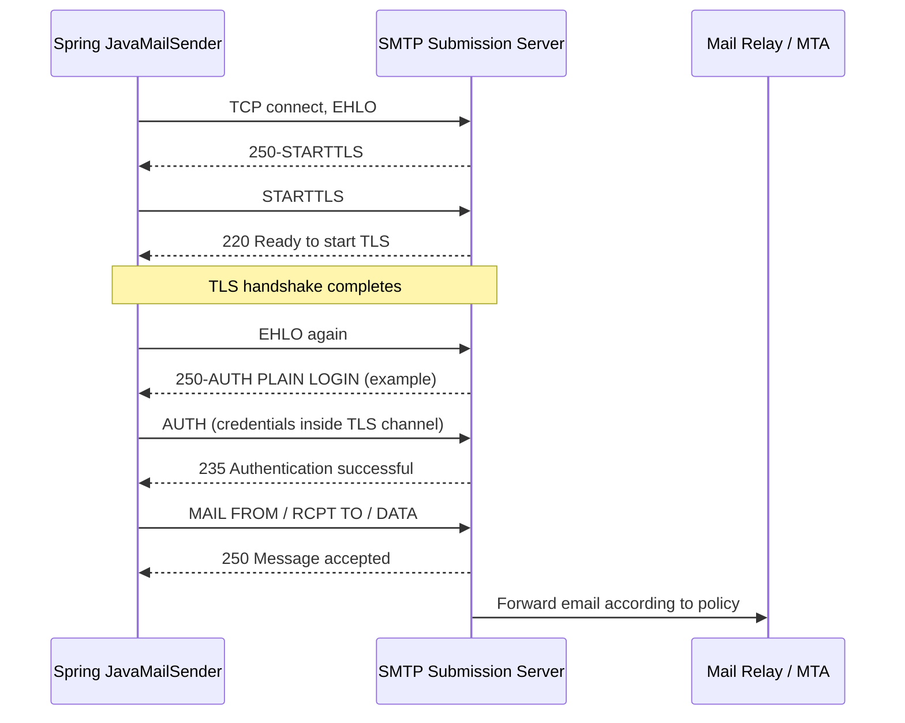
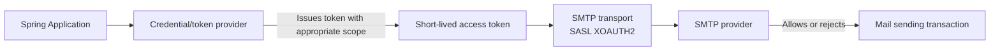

# Username, Password, and Authentication Credentials When Configuring a Mail Sender

For a Spring application to send email through a provider's SMTP server, the application typically must prove that it is **authorized to use the mail-sending service**. Most SMTP submission services require authentication credentials, usually a **username and password**, transmitted via the **SMTP AUTH** mechanism over a TLS-protected connection.

In Spring Framework Mail, these credentials are configured on `JavaMailSender` or `JavaMailSenderImpl`. They belong to **the connection from the application to the SMTP server**; they are not the email content, not the recipient address, and not necessarily identical to the `From:` address seen by recipients.

For example, an e-commerce system might use:

```text
SMTP server: smtp.provider.example
SMTP port:   587
SMTP username: mailer-account-42
SMTP password: [secret value, retrieved from secret store]

Email From: "Shop Example" <notifications@shop.example>
Email To:   customer@company.example
```

`mailer-account-42` is **the SMTP login identity**. `notifications@shop.example` is **the displayed sender identity**; whether the SMTP account is allowed to use that `From:` address also depends on the provider's policy.

## 1. Distinguishing the SMTP account from email addresses

Email has several concepts that are all easily lumped together as "the sender." They need to be separated:

| Component | Where does it live? | What is it used for? | Example |
| --- | --- | --- | --- |
| **SMTP username** | Application config / SMTP AUTH | Authenticates the account authorized to use the SMTP relay | `mailer-account-42` or `notifications@shop.example` |
| **SMTP password / token** | Application secret / SMTP AUTH | Proves permission to use the SMTP account | App password, service credential, or OAuth2 access token |
| **SMTP host** | Mail sender config | Server the application connects to for message submission | `smtp.provider.example` |
| **`From:` header** | RFC 5322 message content | Displayed sender when receiving the message | `notifications@shop.example` |
| **Envelope `MAIL FROM`** | SMTP command in transaction | Reverse-path, commonly used for DSN/bounces | `bounces@shop.example` |
| **`Reply-To:`** | Message header | Suggested destination when the user clicks Reply | `support@shop.example` |
| **`RCPT TO`** | SMTP command in transaction | Actual recipient to whom the SMTP server delivers the message | `customer@company.example` |

**A username does not have to look like an email address.** Many providers require a full mailbox address, while others issue a dedicated username, API identifier, or service identifier string. Use the exact value specified in the provider's SMTP settings rather than inferring it from `From:`.

Likewise, successful SMTP AUTH **does not automatically allow spoofing any `From:` address**. The server can still reject the message at `MAIL FROM`, `RCPT TO`, or after `DATA` if the sending domain is unverified, the account lacks permission, or the message violates policy.

## 2. How does SMTP AUTH work?

SMTP AUTH is an extension of Extended SMTP (ESMTP). The SMTP client (here, the transport used by Jakarta Mail/Spring) queries the server's capabilities via `EHLO`. The server may advertise supported authentication mechanisms, such as `PLAIN`, `LOGIN`, or `XOAUTH2`.

In the common model using port 587, the application performs:



The steps proceed as follows:

1. **Connect:** the application opens a connection to the configured SMTP submission server.
2. **`EHLO`:** the server advertises available ESMTP features.
3. **`STARTTLS`:** if configured, both sides upgrade the connection to TLS. After the handshake succeeds, the client must send `EHLO` again because the capability list may change.
4. **`AUTH`:** the transport sends authentication credentials using a mechanism supported by both sides.
5. **Send mail:** once authorized, the application proceeds with the SMTP transaction using `MAIL FROM`, `RCPT TO`, and `DATA`.
6. **Relay:** the SMTP relay accepts the message and routes it through MTAs; whether the recipient actually receives the email is a separate stage.

### Illustrative transcript, intentionally free of real credentials

```smtp
S: 220 smtp.provider.example ESMTP ready
C: EHLO app.shop.example
S: 250-smtp.provider.example
S: 250-STARTTLS
S: 250 SIZE 26214400
C: STARTTLS
S: 220 Ready to start TLS

[TLS handshake completes]

C: EHLO app.shop.example
S: 250-smtp.provider.example
S: 250-AUTH PLAIN LOGIN
S: 250 SIZE 26214400
C: AUTH [mechanism and payload redacted]
S: 235 2.7.0 Authentication successful
C: MAIL FROM:<bounces@shop.example>
S: 250 2.1.0 Sender OK
C: RCPT TO:<customer@company.example>
S: 250 2.1.5 Recipient OK
C: DATA
S: 354 End data with <CRLF>.<CRLF>
C: From: notifications@shop.example
C: To: customer@company.example
C: Subject: Welcome
C:
C: Welcome to Shop.
C: .
S: 250 2.0.0 Message queued
C: QUIT
S: 221 Bye
```

The transcript is abbreviated. In practice, SMTP transaction lines use CRLF; authentication payloads vary by mechanism. Never put usernames/passwords or Base64 AUTH strings into real log examples: **Base64 is only a representation encoding, not security encryption**.

### Common authentication mechanisms

| Mechanism | How to understand it | Notes |
| --- | --- | --- |
| **PLAIN** | Sends credentials in a standardized SASL format, typically Base64-encoded | Only use over an authenticated TLS connection; Base64 does not protect secrets |
| **LOGIN** | Username/password mechanism common across many SMTP services | Often supported for compatibility; still requires TLS and provider policy compliance |
| **XOAUTH2** | Uses an OAuth2 access token via SMTP SASL | Requires token issuance/refresh workflow and provider support; cannot arbitrarily swap a password for any token |

**SMTP AUTH differs from SPF, DKIM, and DMARC.** SMTP AUTH verifies **whether the application is authorized to use the relay to send mail**. SPF/DKIM/DMARC help receiving systems evaluate the sending domain's identity and the message. An email can be accepted by the SMTP server after AUTH yet still be rejected by the receiving system due to SPF, DKIM, DMARC, or anti-spam policy.

## 3. SMTP ports and TLS requirements related to username/password

Credentials can be exposed if transmitted over an improperly protected connection. When configuring a sender, the port, TLS protocol, and authentication requirements must **match the specific SMTP service**.

| Port | Common usage | Connection protection | For Spring applications |
| --- | --- | --- | --- |
| **587** | Message submission | Initial SMTP connection upgraded via **STARTTLS** | Typically uses `mail.smtp.starttls.enable=true` and `required=true` |
| **465** | Message submission with implicit TLS | **TLS right from the start of the connection** | Typically uses `mail.smtp.ssl.enable=true` |
| **25** | Mail transfer between MTAs; also special relay setups | STARTTLS depending on server/policy | Usually not the default submission port for applications; outbound may be blocked |

These ports are **conventions**, not absolute rules; a provider may have custom configurations. Do not pick a port by random trial and error and disable TLS just "to make sending work."

**STARTTLS and implicit TLS do not share the same handshake pattern.** If a server requires implicit TLS on 465 while the application waits for a plaintext SMTP banner to issue STARTTLS, the connection can time out or fail the handshake. Conversely, starting TLS immediately on port 587 of a server that only supports STARTTLS will also fail.

In password-based deployments, verify the server certificate and hostname when establishing TLS. With the Jakarta Mail SMTP transport, setting `mail.smtp.ssl.checkserveridentity=true` helps verify the hostname in the certificate. Never use trust-all-certificates configurations to mask CA or hostname errors.

## 4. Configuring username/password with Spring Boot

For a Spring Boot project with mail auto-configuration support, add the starter:

```groovy
// build.gradle
dependencies {
    implementation 'org.springframework.boot:spring-boot-starter-mail'
}
```

Then configure the mail sender in `application.yml`:

```yaml
spring:
  mail:
    host: smtp.provider.example
    port: 587
    username: ${SMTP_USERNAME}
    password: ${SMTP_PASSWORD}
    default-encoding: UTF-8
    properties:
      mail.smtp.auth: true
      mail.smtp.starttls.enable: true
      mail.smtp.starttls.required: true
      mail.smtp.ssl.checkserveridentity: true
      mail.smtp.connectiontimeout: 5000
      mail.smtp.timeout: 10000
      mail.smtp.writetimeout: 10000

app:
  mail:
    from: notifications@shop.example
```

Field meanings:

| Property | Role |
| --- | --- |
| `spring.mail.host` | Name of the SMTP server the application connects to |
| `spring.mail.port` | SMTP submission port |
| **`spring.mail.username`** | Identity passed into the SMTP AUTH mechanism |
| **`spring.mail.password`** | Secret required by SMTP AUTH: password, app password, or token depending on mechanism |
| `spring.mail.properties.mail.smtp.auth` | Tells the SMTP transport to use authentication |
| `mail.smtp.starttls.enable` | Allows upgrading the SMTP connection to TLS if supported by the server |
| `mail.smtp.starttls.required` | Requires STARTTLS; if unavailable, does not fall back to plaintext submission |
| `mail.smtp.ssl.checkserveridentity` | Verifies the hostname identity on the TLS certificate |
| `connectiontimeout` | Limit for opening a TCP connection, in milliseconds |
| `timeout` | Limit for reading responses, in milliseconds |
| `writetimeout` | Limit for writing data, in milliseconds |
| `app.mail.from` | Application-specific property to set the `From:` header; **not** a standard property automatically used by Spring Mail |

In the example, `spring.mail.username` and `spring.mail.password` read values **from environment variables** `SMTP_USERNAME` and `SMTP_PASSWORD` at application startup. This is an illustrative configuration; actual values and secret store deployment depend on the environment.

Keep sensitive variables **free of dummy defaults** such as `password: ${SMTP_PASSWORD:password}`: if production configuration is missed, the application should fail clearly due to missing values rather than silently trying a weak or invalid password.

### Configuration for port 465 (implicit TLS)

If an SMTP provider requires implicit TLS, choose the matching configuration:

```yaml
spring:
  mail:
    host: smtp.provider.example
    port: 465
    username: ${SMTP_USERNAME}
    password: ${SMTP_PASSWORD}
    properties:
      mail.smtp.auth: true
      mail.smtp.ssl.enable: true
      mail.smtp.ssl.checkserveridentity: true
      mail.smtp.connectiontimeout: 5000
      mail.smtp.timeout: 10000
      mail.smtp.writetimeout: 10000
```

Port 465 here uses TLS right upon connecting; do not treat it as the `STARTTLS` case of port 587. Some providers offer both options; choose the exact endpoint/port documented for your SMTP account.

### Environment-based configuration instead of hardcoding passwords in files

Example distinguishing information safe to keep in source code from information that must be protected:

```text
Safe to include in shared source/config:
  smtp.provider.example
  587
  TLS required
  notifications@shop.example
  timeout

Never commit to source:
  SMTP_PASSWORD
  app password
  OAuth access/refresh token
  secret key
  environment-specific credentials
```

`SMTP_USERNAME` is usually less sensitive than a password, but it should still be managed as configuration data with appropriate access control because it can reveal service account names or internal details.

## 5. Configuring `JavaMailSenderImpl` without Spring Boot

In **plain Spring Framework**, putting `spring.mail.*` in YAML does not automatically create a mail sender bean without Spring Boot auto-configuration or an equivalent configuration class. You can instantiate `JavaMailSenderImpl` manually:

```java
package com.example.mail;

import java.util.Properties;

import org.springframework.beans.factory.annotation.Value;
import org.springframework.context.annotation.Bean;
import org.springframework.context.annotation.Configuration;
import org.springframework.mail.javamail.JavaMailSender;
import org.springframework.mail.javamail.JavaMailSenderImpl;

@Configuration
public class MailSenderConfiguration {

    @Bean
    public JavaMailSender javaMailSender(
            @Value("${mail.smtp.host}") String host,
            @Value("${mail.smtp.port:587}") int port,
            @Value("${mail.smtp.username}") String username,
            @Value("${mail.smtp.password}") String password) {

        JavaMailSenderImpl sender = new JavaMailSenderImpl();
        sender.setHost(host);
        sender.setPort(port);
        sender.setUsername(username);
        sender.setPassword(password);
        sender.setDefaultEncoding("UTF-8");

        Properties javaMailProperties = new Properties();
        javaMailProperties.put("mail.smtp.auth", "true");
        javaMailProperties.put("mail.smtp.starttls.enable", "true");
        javaMailProperties.put("mail.smtp.starttls.required", "true");
        javaMailProperties.put("mail.smtp.ssl.checkserveridentity", "true");
        javaMailProperties.put("mail.smtp.connectiontimeout", "5000");
        javaMailProperties.put("mail.smtp.timeout", "10000");
        javaMailProperties.put("mail.smtp.writetimeout", "10000");
        sender.setJavaMailProperties(javaMailProperties);

        return sender;
    }
}
```

In this example, you need a property source for `mail.smtp.host`, `mail.smtp.username`, and `mail.smtp.password` (environment, property source, or secret integration) as well as a compatible Jakarta Mail dependency. Properties can be supplied from environment variables or the application's configuration management mechanism.

Key points:

- `setUsername(...)` and `setPassword(...)` supply credentials to the sender; they **do not build email messages**.
- `mail.smtp.auth=true` instructs the SMTP transport to use an appropriate AUTH mechanism.
- `setHost(...)` and `setPort(...)` identify the actual endpoint receiving the authentication credentials.
- `setDefaultEncoding("UTF-8")` ensures message content is created with the right encoding; it **does not affect login permissions**.
- Do not mutate username/password on a shared singleton `JavaMailSenderImpl` just to send one request under another account; multithreaded execution can mix up credentials. If multiple sender identities are needed, design separate senders/transports or use an appropriate account-management mechanism.

## 6. Using the authenticated sender to send email

Example notification service using `JavaMailSender`:

```java
package com.example.mail;

import org.springframework.beans.factory.annotation.Value;
import org.springframework.mail.MailAuthenticationException;
import org.springframework.mail.MailException;
import org.springframework.mail.SimpleMailMessage;
import org.springframework.mail.javamail.JavaMailSender;
import org.springframework.stereotype.Service;

@Service
public class NotificationMailService {

    private final JavaMailSender mailSender;
    private final String fromAddress;

    public NotificationMailService(
            JavaMailSender mailSender,
            @Value("${app.mail.from}") String fromAddress) {
        this.mailSender = mailSender;
        this.fromAddress = fromAddress;
    }

    public void sendNotice(String recipient, String orderId) {
        SimpleMailMessage message = new SimpleMailMessage();
        message.setFrom(fromAddress); // From header, not SMTP username
        message.setTo(recipient);
        message.setSubject("Order " + orderId + " is ready");
        message.setText("Your order is ready.");

        try {
            mailSender.send(message);
        } catch (MailAuthenticationException exception) {
            // Check SMTP credentials/login permissions and alert operations.
            throw new IllegalStateException(
                    "SMTP authentication failed; check sender configuration",
                    exception);
        } catch (MailException exception) {
            // Could be connection, TLS, SMTP rejection, or other sending error.
            // Classify from cause/provider diagnostics before retrying.
            throw new IllegalStateException(
                    "Email could not be submitted to SMTP server",
                    exception);
        }
    }
}
```

Here, the method **does not take a password** as a parameter. Credentials are already configured in the sender and used by the SMTP transport when connecting. This reduces passing secrets across business layers and makes it easier to swap providers without rewriting every place that sends email.

`send()` completing normally indicates that submission via the mail transport did not report a synchronous error during that call. It **does not prove** that the email reached the inbox or that the recipient read it. After the relay accepts the message, delivery failures to the target domain can still generate asynchronous bounces or provider events.

If the same service needs to send HTML, attachments, or inline images, switch to `MimeMessage` and `MimeMessageHelper`. **SMTP transport authentication credentials do not depend on whether the body is plain text or HTML**.

## 7. Login passwords, app passwords, and OAuth2

Not every SMTP provider lets applications use a regular mailbox login password. For systems with multi-factor authentication or stricter security policies, providers may require an **app password**, **service credentials**, or support **OAuth2**.

### 7.1. Account passwords

In services supporting traditional username/password SMTP AUTH, the SMTP account receives a secret that the client presents during the AUTH session. This secret must be stored and operated like a production credential, with proper access policies and periodic rotation.

Do not reuse an administrator account password or a personal mailbox password for an application if dedicated service credentials are available. If a developer leaves the team, credentials shared with a personal account are very difficult to transfer and audit.

### 7.2. App passwords

Some providers issue an **app password** for applications/devices that cannot use interactive login flows. An app password is usually a secret separate from the primary account password and can be revoked independently according to provider policy.

When a provider requires an app password:

```yaml
spring:
  mail:
    username: ${SMTP_USERNAME}
    password: ${SMTP_APP_PASSWORD}
    properties:
      mail.smtp.auth: true
```

`SMTP_APP_PASSWORD` **is still a secret password**, not safe merely because its name includes `APP`. Rules around app passwords and SMTP AUTH eligibility can vary by account type and organizational policy. Always use a credential provisioning flow supported by the provider.

### 7.3. OAuth2 / XOAUTH2

With OAuth2, an application can use a **time-limited access token** instead of a long-lived password when the SMTP provider and transport library support the XOAUTH2 mechanism.

High-level model:



In a Jakarta Mail SMTP transport that supports XOAUTH2, properties like:

```properties
mail.smtp.auth=true
mail.smtp.auth.mechanisms=XOAUTH2
```

can request using XOAUTH2. Some providers/library versions pass the access token in the transport API's `password` slot. However, **simply putting an arbitrary token into `spring.mail.password` is not enough**: the token must be issued for the right account, permission scope, audience, and mechanism supported by the SMTP provider; expiration and token refresh must be handled at send time. If a sender is shared long-term in the application, ensure the token remains valid whenever a new connection is created.

OAuth2 does not mean SMTP can send without TLS. The connection still must be protected and the token remains a sensitive secret. Token issuance may use a delegated flow, service application identity, or custom mechanism depending on the system; Spring Mail does not provide the complete OAuth2 authorization workflow for every SMTP provider out of the box.

### Which mechanism should you choose?

| Context | Approach |
| --- | --- |
| Provider issues dedicated SMTP service credentials | Use the provisioned username/secret, protect and rotate the secret |
| Provider requires an app password | Use an app password per policy, stored like a production credential |
| Organization mandates OAuth2 or disables basic SMTP AUTH | Integrate an access token flow with SMTP XOAUTH2 or a supported mail-sending API |
| Development environment only needs to inspect emails | Use an SMTP capture/test server; do not use production credentials |
| Internal infrastructure allows relaying from trusted networks | A configuration without SMTP AUTH may exist, but must have strict network/relay controls |

## 8. When are username and password not needed?

Some **internal** SMTP relays trust an application's identity via network, IP allowlist, TLS client certificate, or other controls, and thus do not require SMTP AUTH with username/password. Such cases must be explicitly defined by administrators and have appropriate relay restrictions.

Example configuration for a relay that genuinely **does not require** SMTP AUTH:

```yaml
spring:
  mail:
    host: smtp-relay.internal.example
    port: 25
    properties:
      mail.smtp.auth: false
```

This is only an illustration within a managed network, **not a configuration to copy for public SMTP**. Never disable `mail.smtp.auth` just because you encounter `535 Authentication failed`: a public server without relay authorization controls can be abused as an **open relay**.

Conversely, if a server requires AUTH while the application lacks username/password or sets `auth=false`, the TCP connection may still succeed, but the mail-sending command will return `530 Authentication required` or a corresponding policy code.

## 9. Protecting credentials across the application lifecycle

Username/password are not just two strings in YAML. They are **permission to use mail infrastructure**, which can be abused to send spam, leak data, or damage sending domain reputation if stolen.

### 9.1. Do not put secrets into Git

Do not store real passwords in:

```text
committed application.yml
committed application.properties
README / Markdown examples / screenshots
docker-compose.yml containing real values
test fixtures pushed to the repository
error logs with full JavaMail Properties
HTTP responses returned to clients
```

Use **environment variables**, a secret manager, secrets injected at container/runtime, or an access-controlled configuration management service. The exact implementation varies by platform, but the principle is that only components that need the credentials should have permission to read them.

### 9.2. Least privilege and environment isolation

- Use a **service identity** for mail sending, with only the necessary permissions.
- Use different credentials for development, staging, and production.
- Restrict allowed `From:` addresses/domains according to provider capabilities.
- Apply quotas, rate limits, and anomaly detection at the provider.
- Do not reuse SMTP passwords for admin APIs, databases, or other purposes.
- Where possible, separate permission to view secrets from permission to edit email content or operate the application.

### 9.3. Credential rotation and revocation

When credentials need to be rotated, a safe procedure typically includes:

1. Issue new credentials/tokens in the SMTP provider system with the required equivalent permissions.
2. Update the secret in the runtime environment and redeploy/reload the sender if necessary.
3. Verify that the application successfully submits a test email using the new configuration.
4. Revoke the old credentials after confirming that no instances still depend on them.
5. Monitor authentication logs to detect old processes still attempting to log in with the revoked secret.

Do not print credentials to the console to "check if they are right"; use verification through your secret manager or controlled test sending. If credential compromise is suspected, revoke and replace immediately per your organization's incident response process.

### 9.4. Avoiding data leaks via debug output

Jakarta Mail supports enabling debug output to observe protocol exchanges, such as `mail.debug` properties or library debug options. This is useful during investigations but **risks logging sensitive information**, especially if verbose log levels or AUTH display options are also enabled.

When debugging is needed:

- Use a test environment and a test account with narrow permissions.
- Limit how long debug logging is enabled and who can read the logs.
- Mask/redact secrets, access tokens, recipient addresses, and message content before sharing.
- Do not enable options that print AUTH payloads or trace confidential data in production.
- Do not dump `JavaMailSenderImpl`, `Session`, or `Properties` if there is a risk of exposing passwords inside objects/configs.

Useful information to log typically includes: SMTP host, port, TLS mode, selected AUTH mechanism, connection status, exception type, SMTP status code, and correlation ID. **Never log password/token values**.

## 10. Common SMTP authentication errors

To fix issues properly, distinguish **login failure**, **missing TLS**, **denied sending permission**, and **connection failure**. Depending on where the failure happens, these may appear as `MailAuthenticationException`, `MailSendException`, or underlying causes from Jakarta Mail.

| Illustrative response/symptom | Common cause | Resolution direction |
| --- | --- | --- |
| **`535 5.7.8 Authentication credentials invalid`** | Wrong username/password/token or account not allowed for SMTP AUTH | Verify credentials, permissions, and account lock status |
| **`534 5.7.x`** with provider message | Requires another login method, app password, or additional policy step | Read the provider message and update to a supported mechanism |
| **`530 5.7.x Authentication required`** | AUTH not performed before sending, or server does not treat session as authenticated | Check `mail.smtp.auth`, user/password, `EHLO`, and AUTH |
| **`454 4.7.x Temporary authentication failure`** | Authentication service temporarily unavailable | Retry with limits/backoff and check provider status |
| **`504 5.5.x Unrecognized authentication type`** | AUTH mechanism selected by client is unsupported by server | Inspect `AUTH` capabilities after TLS, library version, configured mechanisms |
| **`550/553/554 5.7.x` after successful AUTH** | Account can log in but lacks permission to send from `From`/domain or to recipient | Check verified sender, relay policy, and recipient policy |
| **TLS handshake/PKIX failure** | Untrusted certificate, wrong hostname, or incompatible TLS | Verify server, CA chain, hostname, and TLS mode |
| **Connection timeout/refused** | Wrong host, port, DNS, firewall, or server unavailable | Check network and SMTP endpoint configuration |

The codes and wording in the table are **common examples**, not a guarantee that every SMTP server returns the exact same code for the same cause. Enhanced status codes and descriptions can vary between providers.

### Analyzing a failed login session

```smtp
S: 220 smtp.provider.example ESMTP
C: EHLO app.shop.example
S: 250-STARTTLS
S: 250 OK
C: STARTTLS
S: 220 Ready to start TLS
[TLS succeeded]
C: EHLO app.shop.example
S: 250-AUTH PLAIN LOGIN
S: 250 OK
C: AUTH [payload redacted]
S: 535 5.7.8 Authentication credentials invalid
```

From this transcript we can conclude that the server **was reached**, STARTTLS succeeded, and **AUTH was rejected**. Increasing timeouts or changing `From:` makes no sense to resolve `535`. Instead, inspect the username, secret type, AUTH mechanism, account status, and provider policy.

Another case:

```smtp
S: 235 2.7.0 Authentication successful
C: MAIL FROM:<notifications@unverified.example>
S: 553 5.7.1 Sender address not authorized
```

Here **AUTH succeeded**. The error is authorization to use the sender address, not a wrong password. Rotating the password will not fix the root cause; verify the domain or configure sending permissions with the provider.

## 11. Error handling in a Spring application

`MailAuthenticationException` indicates that Spring recorded an authentication failure in the mail transport, usually when the SMTP server rejects credentials. However, actual exception throwing/wrapping behavior also depends on the mail provider, error type, and connection stage.

When handling errors:

1. **Separate authentication errors from other sending errors.** Do not treat every `MailException` as a wrong username/password.
2. **Do not retry blindly on `535`.** Repeatedly calling AUTH with an invalid secret can trigger account lockouts or rate limiting.
3. **Alert operations.** Credential failures usually affect all emails from the same mail sender, not just one recipient.
4. **Keep send jobs in an appropriate state.** If the application uses a queue/outbox, pause or back off retries for a misconfigured sender; avoid growing the queue indefinitely without alerting.
5. **After remediation, send a controlled test.** Verify submission succeeds before resuming backlog processing, with send-rate limits.
6. **Do not expose raw exception details to end users.** Public messages should only state that the message could not be sent yet and how to contact support if needed.

Example of a business state representation:

```text
PENDING
  |
  +-- AUTH succeeded, relay accepted message --> SUBMITTED
  |
  +-- 535 invalid credentials -----------------> SENDER_CONFIG_ERROR
  |                                              (alert, wait for secret/permission fix)
  |
  +-- 454 temporary AUTH problem --------------> RETRY_SCHEDULED
  |                                              (bounded backoff)
  |
  +-- timeout with unknown outcome ------------> UNKNOWN
                                                 (reconcile with provider, avoid duplicate send)
```

This is an illustrative model. A timeout after the server accepted `DATA` does not tell for sure whether the email was accepted; you need message ID/provider event correlation and a deduplication strategy. AUTH succeeding is **only one step**, not confirmation that full email delivery succeeded.

## 12. Common configuration mistakes

### 12.1. Setting a password but forgetting to enable SMTP AUTH

```yaml
spring:
  mail:
    username: ${SMTP_USERNAME}
    password: ${SMTP_PASSWORD}
    properties:
      mail.smtp.auth: false
```

If the provider requires AUTH, having username/password fields alone is not enough for the client to log in; you must configure the transport to match the server, typically `mail.smtp.auth=true`.

### 12.2. Guessing `From:` as the username

```text
From: alerts@shop.example
Provider-issued SMTP username: acct-smtp-7921
```

If you set `spring.mail.username=alerts@shop.example` while the provider expects `acct-smtp-7921`, SMTP AUTH can fail even though `From:` is a valid address. Always use the account's actual credentials.

### 12.3. Using a webmail login password when the provider requires an app password/OAuth2

Some providers do not accept regular account username/password credentials in SMTP AUTH. Check provider policies, MFA, app passwords, or supported OAuth2/SMTP API integrations. Do not disable account security controls just to keep an older login method.

### 12.4. Not requiring TLS when sending credentials

```yaml
spring:
  mail:
    properties:
      mail.smtp.auth: true
      mail.smtp.starttls.enable: true
      mail.smtp.starttls.required: false
```

`enable=true` does not mean encryption is enforced in every situation. If the environment requires keeping credentials confidential, configure `required=true` for SMTP submission using STARTTLS, along with server/certificate verification. Do not use workarounds that skip certificate checks when TLS fails.

### 12.5. Using implicit TLS on the wrong port

Setting `mail.smtp.ssl.enable=true` on port 587 of a server that only accepts STARTTLS can cause the connection to fail immediately. Conversely, using STARTTLS on implicit-TLS port 465 without enabling SSL from connection start also fails. Choose the mode matching the endpoint provided.

### 12.6. Secrets containing special characters or whitespace

In config files, environment variables and YAML have different parsing rules. Accidentally adding quotes, leading/trailing spaces, newline characters, or changing encoding can corrupt the password. Do not print the password to inspect it; compare via your secret management tool or re-apply the secret from a verified source.

### 12.7. Sending from an unverified address

The SMTP account logs in successfully, but the provider only allows sending from verified addresses or domains. `helper.setFrom(...)` does not grant that permission by itself. Check verified senders/domains and sending permissions instead of changing the password.

### 12.8. Confusing an AUTH error with an error from the receiving MTA

After AUTH succeeds and submission succeeds, the relay may hit `550 5.7.1` at the destination domain due to SPF, DKIM, DMARC, or spam policies. This error may surface later via bounces or provider events. **You cannot conclude SMTP credentials are wrong from a 5xx SMTP error at a downstream hop.**

## 13. Diagnostic workflow for username/password and authentication credentials

When Spring fails to send email, a pragmatic investigation workflow is:

1. **Identify the SMTP endpoint:** `host`, `port`, STARTTLS vs implicit TLS mode, and whether AUTH is required.
2. **Classify the failure type:** DNS/TCP, TLS handshake, SMTP AUTH, relay/sender permission, or recipient/content error.
3. **Verify the credential source:** did the application receive the right environment variable/secret, is the credential still valid, or has it been revoked/locked?
4. **Verify the exact username:** does the provider expect a full email address, a dedicated account name, or a service identity?
5. **Check AUTH mechanisms:** what mechanisms does the server advertise after TLS; is the client using a supported mechanism?
6. **Verify sender/domain permissions:** are `From:` and `MAIL FROM` authorized for this account?
7. **Observe responses by stage:** `535` during AUTH differs from `553` during MAIL FROM or `550` during RCPT TO.
8. **Send a safe test email:** use an authorized test recipient, minimal content, and observe submission and delivery events if available.
9. **Update operations:** if the cause is an expired or misconfigured credential, fix it in the secret store and follow proper rotation/revocation procedures.

A diagnostic log entry that does not leak credentials might look like:

```json
{
  "mailProvider": "smtp.provider.example",
  "port": 587,
  "tlsMode": "STARTTLS_REQUIRED",
  "authenticationEnabled": true,
  "authMechanism": "PLAIN",
  "smtpPhase": "AUTH",
  "smtpReplyCode": 535,
  "enhancedStatusCode": "5.7.8",
  "category": "AUTHENTICATION_REJECTED",
  "credentialValueLogged": false
}
```

This is **simulated data for illustration**, not a log automatically generated by Spring Mail. Do not log the username directly if your system policy classifies it as sensitive information; replace it with a controlled account alias or ID.

## 14. Common scenarios

### Scenario A — Password changed at the SMTP provider

Operations rotated the SMTP credentials but forgot to update the secret on one running Spring instance. That instance begins receiving `535 5.7.8` responses while connectivity and TLS remain normal.

**How to handle:** verify which secret version the instance is using without logging its value; update/restart or reload the sender appropriately, verify a test send succeeds, then revoke the old credential once all instances have switched over.

### Scenario B — `From` header differs from the SMTP username

The application uses account `smtp-service-42` to submit an email displaying `From: billing@shop.example`. SMTP AUTH returns `235`, yet the `MAIL FROM` command is rejected with a policy response because the domain is unverified.

**How to handle:** check sender permissions and verify the sending domain with the provider. This is not a password error because SMTP AUTH already succeeded.

### Scenario C — Migrating from port 587 to 465

A team switches the port to 465 while keeping only `mail.smtp.starttls.enable=true` without configuring implicit TLS. Connections time out or hit a TLS negotiation failure.

**How to handle:** configure `mail.smtp.ssl.enable=true` and TLS hostname verification for the 465 endpoint instead of assuming the password is wrong.

### Scenario D — Service account required to use OAuth2

An organization changes policy and no longer permits standard password logins for SMTP. The application keeps `mail.smtp.auth=true` with the old password and hits AUTH errors.

**How to handle:** adopt an authentication flow supported by the provider, such as XOAUTH2 with a valid token or a mail-sending API; add token issuance and refresh handling and monitor expiration and sending permissions.

### Scenario E — Unable to deliver mail due to destination domain policy

The application completes SMTP AUTH and the relay returns `250` on submission, yet a few minutes later a hard bounce arrives from the receiving domain due to anti-spam policy. Changing the SMTP password will not help because login already succeeded.

**How to handle:** investigate DSNs, SPF/DKIM/DMARC, reputation, and message content through the provider, and distinguish synchronous submission errors from asynchronous delivery errors.

## 15. Self-check questions

**1. Must `spring.mail.username` match `helper.setFrom(...)`?**

No. Username is the account used for SMTP AUTH; `From:` is the address displayed in the message. Providers may require a verified domain/sender, but the two strings do not have to match.

**2. If a password is set in `application.yml`, will Spring definitely log in to SMTP?**

No. You must have a properly configured mail sender/transport and a provider that supports/requires AUTH; `mail.smtp.auth`, port, TLS, and credentials must also align.

**3. Does SMTP AUTH `PLAIN` mean the password is protected by Base64?**

No. Base64 is not security encryption; authenticated TLS is required to protect credentials in transit over the network.

**4. Do ports 587 and 465 differ in their TLS mechanism?**

Yes. 587 typically uses STARTTLS; 465 typically uses TLS right from connection establishment. Your application configuration must match the real endpoint.

**5. If AUTH returns `235`, has the recipient received the email?**

No. `235` only indicates that authentication was accepted. The SMTP server still must accept the sender, recipient, and content, and process downstream hops.

**6. Should `535` be retried automatically hundreds of times?**

No. This usually indicates invalid credentials or an invalid authentication mechanism. Inspect and fix it first; blind retries can trigger account lockouts or rate limits.

**7. When using OAuth2, can a static access token stay in `spring.mail.password` forever?**

No. Access tokens usually expire; you must design token issuance, refresh, scoping, and protection to fit the provider.

**8. If an internal SMTP relay does not require AUTH, can `mail.smtp.auth` be disabled?**

Yes, when that is an administrator-confirmed policy and the network/relay has compensating controls. Never apply this casually to public SMTP.

**9. Should passwords or AUTH payloads be printed during debugging?**

No. Log status codes and connection/TLS/AUTH states instead of secret values; use a secret store and secure support channels when investigating.

## Conclusion

**A mail sender's username and password authenticate the application to the SMTP submission server**, typically via SMTP AUTH over a TLS connection. In Spring Boot, configure them with `spring.mail.username`, `spring.mail.password`, and `mail.smtp.*` properties; in plain Spring Framework, configure the equivalent on `JavaMailSenderImpl`. Distinguish the **SMTP account** from the `From:` header, envelope sender, Reply-To, and recipient; choose the right **STARTTLS on 587** or **implicit TLS on 465**; use dedicated credentials managed in a secret store, support app passwords/OAuth2 when required by the provider, and diagnose errors by SMTP stage. Logging in successfully means the application is authorized to submit mail, whereas **actual email delivery to the recipient is a separate step**.
