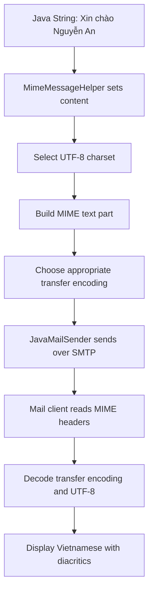

# Default Encoding for Messages in Spring Framework Mail

When an application sends emails containing Vietnamese text, a Java string such as **"Xin chào, tài khoản của bạn đã sẵn sàng!"** must be converted into bytes using explicit encoding rules. If the configuration is inconsistent, the recipient may see replacement characters `�`, question marks `?`, or garbled text such as `Xin chà o`. In **Spring Framework Mail**, the mail sender's **default encoding** property determines the default character set used when constructing certain text parts of an email.

This lesson explains the role of **`JavaMailSenderImpl#setDefaultEncoding(...)`**, the **`spring.mail.default-encoding`** setting in Spring Boot, how `MimeMessageHelper` picks up that encoding, and cases where a charset must be specified explicitly. The goal is to properly send subjects, sender display names, plain text bodies, and HTML bodies containing diacritics while understanding the limits of this setting.

## 1. Why does email need encoding?

A Java string holds Unicode character data. However, an email must be represented as bytes to be stored and transmitted across mail systems. Mail clients need to know how to turn those bytes back into readable text.

For example, business content:

```text
Xin chào Nguyễn An!
Đơn hàng #123 của bạn đã được xác nhận.
```

When creating a MIME text part, the message may carry metadata such as:

```text
Content-Type: text/plain; charset=UTF-8
Content-Transfer-Encoding: quoted-printable
```

or use another **content-transfer-encoding** such as `base64`, depending on the library and content. These headers have different responsibilities:

| Concept | Description | Example |
|---|---|---|
| **Character encoding / charset** | Defines how characters map to bytes and back. | `UTF-8`, `ISO-8859-1` |
| **MIME Content-Type** | Identifies the content type and can specify the charset of a text part. | `text/plain; charset=UTF-8` |
| **Content-Transfer-Encoding** | Defines how each email part's bytes are encoded for transport. | `quoted-printable`, `base64` |
| **Header encoding** | How header values containing non-ASCII characters are represented in mail format. | Encoded-word for `Subject` or display names |
| **SMTP transport encoding** | Protocol and server capabilities for types of data carried over SMTP. | SMTP extensions `8BITMIME`, `SMTPUTF8` |

These layers are related but **not synonymous**. Choosing UTF-8 does not mean raw bytes on the wire always contain visible UTF-8 bytes directly. A MIME library may encode the body part into `base64` or `quoted-printable`, which the mail client then decodes to display the text.

### Flow from Java string to what the recipient sees



If the sender declares a charset that mismatches the actual bytes, the recipient may decode them incorrectly. **Setting the same sensible encoding consistently across message creation** eliminates a common class of bugs.

## 2. What is the sender's "default encoding"?

In Spring, the standard mail sender implementation is:

```java
org.springframework.mail.javamail.JavaMailSenderImpl
```

This class provides the configuration method:

```java
sender.setDefaultEncoding("UTF-8");
```

This property specifies **the default encoding for MIME messages created via the sender when the composing component relies on the sender's default**. In Spring Mail, `JavaMailSenderImpl.createMimeMessage()` creates a Spring-specific message type carrying default encoding metadata. `MimeMessageHelper` can detect and use that metadata when constructed without an explicit charset.

Conceptually:

```text
JavaMailSenderImpl
  └── defaultEncoding = "UTF-8"
        ↓
  mailSender.createMimeMessage()
        ↓
  New MimeMessage carrying default encoding hint
        ↓
  new MimeMessageHelper(message)
        ↓
  helper.setSubject(...) / helper.setText(...)
        ↓
  Text parts are created with the appropriate encoding
```

Key takeaway: **default encoding is a helper setting when composing message content, not a global filter that automatically re-encodes every email passing through SMTP.**

It does not automatically repair MIME parts that were already misencoded earlier, does not force a charset onto every attachment, and does not guarantee that intermediate relays preserve messages unchanged.

### Practical scope of default encoding

| Operation | Effect of default encoding |
|---|---|
| Creating a message via `JavaMailSenderImpl.createMimeMessage()` | The sender can attach the default encoding hint to the created message. |
| Creating `MimeMessageHelper(message)` without passing a charset | The helper can pick up the default encoding from the message created by the Spring sender. |
| `helper.setText(...)` | The helper uses the active encoding to build the text content. |
| `helper.setSubject(...)` | The helper uses the encoding to represent subjects containing non-ASCII characters when needed. |
| `helper.setFrom(address, personal)` | The helper's encoding can be used to encode the display name. |
| Manually creating `new MimeMessage(session)` | Does not automatically carry `JavaMailSenderImpl`'s default encoding metadata. |
| Calling `MimeMessage` APIs directly with an explicit charset | The charset passed to the method is the explicit choice for that operation. |
| Attached PDF/PNG files | Binary data is not converted to UTF-8 just because the message has a default encoding. |
| Email address strings with Unicode in the local-part | Also depends on internationalized email support, especially `SMTPUTF8`. |

## 3. Configuring with Spring Boot: `spring.mail.default-encoding`

If your project uses Spring Boot and `spring-boot-starter-mail`, you can configure it in `application.yml`:

```yaml
spring:
  mail:
    host: smtp.example.net
    port: 587
    username: ${SMTP_USERNAME}
    password: ${SMTP_PASSWORD}
    default-encoding: UTF-8
    properties:
      "[mail.smtp.auth]": true
      "[mail.smtp.starttls.enable]": true
      "[mail.smtp.starttls.required]": true
      "[mail.smtp.connectiontimeout]": 5000
      "[mail.smtp.timeout]": 5000
      "[mail.smtp.writetimeout]": 5000
```

In this configuration:

- `host` and `port` identify the SMTP server the application connects to.
- `username`, `password`, and `mail.smtp.*` properties handle authentication, TLS, and timeouts.
- **`default-encoding: UTF-8`** sets the default encoding applied to the sender.
- `${SMTP_USERNAME}` and `${SMTP_PASSWORD}` reference environment variables, avoiding hardcoding secrets in configuration files.

**`spring.mail.default-encoding` is a Spring Boot property.** It differs from `spring.mail.properties`, which is used to pass settings to Jakarta Mail / the SMTP provider. For example, `mail.smtp.starttls.enable` relates to connection security, not text-part charsets.

In modern versions of Spring Boot, UTF-8 is typically already the default for this property. Even so, **explicitly configuring `UTF-8`** clarifies the project's intent, especially when configuration is composed across multiple profiles or environments.

### `application.properties` example

Equivalent configuration for the encoding setting:

```properties
spring.mail.default-encoding=UTF-8
```

Do not invent a guessed property like `spring.mail.charset`. When using Spring Boot, use the configuration key provided by the framework.

### Environment-specific configuration

Suppose `application.yml` sets UTF-8, while a specific profile overrides it with a different encoding. When running with that profile, the sender's actual configuration can change. If emails show garbled diacritics in only one environment, inspect **the resolved runtime configuration** and how messages are constructed rather than only looking at the default config file in the repository.

Never print SMTP credentials when checking configuration. Encoding can be recorded in a dedicated diagnostic log if needed, while login credentials must remain secret.

## 4. Plain Spring Framework configuration in Java

Not every project uses Spring Boot auto-configuration. When registering `JavaMailSenderImpl` manually, you can call the setter directly:

```java
import java.util.Properties;
import org.springframework.context.annotation.Bean;
import org.springframework.context.annotation.Configuration;
import org.springframework.mail.javamail.JavaMailSender;
import org.springframework.mail.javamail.JavaMailSenderImpl;

@Configuration
public class MailConfiguration {

    @Bean
    public JavaMailSender mailSender() {
        JavaMailSenderImpl sender = new JavaMailSenderImpl();

        sender.setHost("smtp.example.net");
        sender.setPort(587);
        sender.setUsername(System.getenv("SMTP_USERNAME"));
        sender.setPassword(System.getenv("SMTP_PASSWORD"));

        sender.setDefaultEncoding("UTF-8");

        Properties properties = sender.getJavaMailProperties();
        properties.put("mail.smtp.auth", "true");
        properties.put("mail.smtp.starttls.enable", "true");
        properties.put("mail.smtp.starttls.required", "true");
        properties.put("mail.smtp.connectiontimeout", "5000");
        properties.put("mail.smtp.timeout", "5000");
        properties.put("mail.smtp.writetimeout", "5000");

        return sender;
    }
}
```

The example illustrates **sender configuration**; SMTP values must be replaced with your real service details. The goal of `setDefaultEncoding("UTF-8")` is to establish a default convention for emails composed via that sender.

Different sender beans can be configured differently if an application needs separate mail systems. However, when sending content in Vietnamese or multiple languages, **UTF-8 is generally the most consistent and least surprising choice**.

## 5. How does `MimeMessageHelper` receive the encoding from the sender?

Consider the following service:

```java
import jakarta.mail.MessagingException;
import jakarta.mail.internet.MimeMessage;
import org.springframework.mail.javamail.JavaMailSender;
import org.springframework.mail.javamail.MimeMessageHelper;
import org.springframework.stereotype.Service;

@Service
public class VietnameseNoticeService {

    private final JavaMailSender mailSender;

    public VietnameseNoticeService(JavaMailSender mailSender) {
        this.mailSender = mailSender;
    }

    public void sendNotice(String recipient) throws MessagingException {
        MimeMessage message = mailSender.createMimeMessage();

        // No explicit charset passed: uses the default encoding
        // supported by messages created from the Spring sender.
        MimeMessageHelper helper = new MimeMessageHelper(message);

        helper.setFrom("notifications@example.org");
        helper.setTo(recipient);
        helper.setSubject("Xác nhận đăng ký tài khoản");
        helper.setText(
                "Xin chào!\n" +
                "Tài khoản của bạn đã được xác nhận."
        );

        mailSender.send(message);
    }
}
```

If `JavaMailSenderImpl` is configured with default encoding `UTF-8` and the message is created via `mailSender.createMimeMessage()`, the helper can use that value without having to pass `"UTF-8"` on every constructor call.

From a lifecycle perspective:

1. **Sender** holds the default encoding setting.
2. **Message** created by the sender carries configuration metadata that the Spring helper can recognize.
3. **Helper** applies the resolved encoding when building headers/bodies from Java strings.
4. **Jakarta Mail** finalizes the MIME structure and selects an appropriate transfer representation.
5. **Mail client** relies on MIME headers to decode text parts.

### What if you do not use the helper?

The Jakarta Mail API on `MimeMessage` provides overloads that accept an explicit charset:

```java
MimeMessage message = mailSender.createMimeMessage();

message.setSubject("Xác nhận đăng ký", "UTF-8");
message.setText("Xin chào từ ứng dụng!", "UTF-8");

mailSender.send(message);
```

Here, the charset is passed directly to `MimeMessage` methods. **Do not assume every direct setter call without a charset automatically reads the Spring sender's default encoding**, because Spring metadata is primarily supported by `MimeMessageHelper`. When working directly with Jakarta Mail, passing the charset explicitly is the clear choice.

## 6. Default encoding vs. explicit encoding: how to decide

An application can select encoding at **multiple levels**:

- **Sender level:** `JavaMailSenderImpl.setDefaultEncoding("UTF-8")` or `spring.mail.default-encoding: UTF-8`.
- **Helper level:** constructor `new MimeMessageHelper(message, false, "UTF-8")` or multipart constructors with a charset.
- **Individual Jakarta Mail API level:** `MimeMessage`/MIME part overloads accepting a charset.
- **Pre-existing data level:** a `MimeMessage` parsed from a MIME source may already contain parts with their own declared charsets.

Example specifying the charset directly on the helper:

```java
MimeMessage message = mailSender.createMimeMessage();

MimeMessageHelper helper =
        new MimeMessageHelper(message, false, "UTF-8");

helper.setTo("user@example.net");
helper.setSubject("Hóa đơn của bạn");
helper.setText("Đã ghi nhận thanh toán.");
```

The third argument `"UTF-8"` is **explicitly requested for this helper**. It makes the result less dependent on the sender's default configuration.

A quick guide:

| Construction pattern | Where encoding is determined | Meaning |
|---|---|---|
| `new MimeMessageHelper(mailSender.createMimeMessage())` | Default encoding supplied by the Spring sender's message, if present | Convenient when the application uses a unified configuration. |
| `new MimeMessageHelper(message, false, "UTF-8")` | Helper constructor argument | Explicit at the email-composition call site. |
| `new MimeMessageHelper(message, true, "UTF-8")` | Helper constructor argument, with multipart | Same, for complex emails. |
| `message.setText(text, "UTF-8")` | Jakarta Mail setter argument | Explicit for a body set directly. |
| `message.setSubject(subject, "UTF-8")` | Jakarta Mail setter argument | Explicit for the subject. |
| MIME content already having `charset=...` | Each text part's metadata | Do not expect the sender's default to overwrite every pre-built part. |

If the helper has no explicit encoding and the message carries no Spring sender hint, Jakarta Mail/Spring may fall back to library or environment defaults. Never base the correctness of multilingual emails on such uncontrolled assumptions.

**Rule of thumb:** set UTF-8 on the sender as the shared default; in library code, messages created from another source, or when behavior must be independent of sender configuration, specify UTF-8 on the helper or composing API.

## 7. How do the `Subject` header and display name need to be encoded?

Encoding does not apply only to the body.

An email might have:

```text
From: "Cửa hàng Việt" <sales@example.org>
To: customer@example.net
Subject: Xác nhận đơn hàng – tháng 11
```

The display name **"Cửa hàng Việt"** and subject **"Xác nhận đơn hàng – tháng 11"** contain non-ASCII characters. When transmitted through traditional mail systems, they may need to be represented using MIME header encoding syntax, such as encoded-words following the applicable rules.

With `MimeMessageHelper`, you can write:

```java
MimeMessage message = mailSender.createMimeMessage();
MimeMessageHelper helper = new MimeMessageHelper(
        message,
        false,
        "UTF-8"
);

helper.setFrom("sales@example.org", "Cửa hàng Việt");
helper.setTo("customer@example.net");
helper.setSubject("Xác nhận đơn hàng – tháng 11");
helper.setText("Cảm ơn bạn đã mua hàng.");
```

Here:

- `setFrom(address, personal)` accepts **address** and **display name** separately; the helper handles encoding the personal name.
- `setSubject(...)` lets the helper prepare the subject header properly.
- `setText(...)` builds the body using the configured charset.

Do not manually assemble a header string like `From: Cửa hàng Việt <sales@example.org>` and concatenate it with other lines. Using Jakarta Mail/Spring APIs lets the library handle escaping, encoded-words, and formatting details.

### A UTF-8 Subject does not mean the raw header displays literal text

When inspecting the email's **raw source**, the subject may appear in encoded-word form, for example with an illustrative prefix:

```text
Subject: =?UTF-8?B?...?=
```

This can be a valid representation that the mail client decodes into the Unicode subject. **Do not conclude an email is broken just because the raw header does not display literal Vietnamese text.** Check whether the client displays it properly and whether the raw message carries the right encoding.

## 8. How do plain text and HTML bodies use charsets?

`MimeMessageHelper` can create a single text body:

```java
helper.setText("Xin chào! Đây là thông báo của bạn.");
```

Or create **two equivalent representations** of one email:

```java
String plain = """
        Chào bạn!
        Vui lòng kiểm tra thông tin tại https://example.org/account
        """;

String html = """
        <html>
          <body>
            <h1>Chào bạn!</h1>
            <p>Vui lòng kiểm tra thông tin tại
              <a href="https://example.org/account">trang tài khoản</a>.
            </p>
          </body>
        </html>
        """;

helper.setText(plain, html);
```

With the second approach, the helper builds a `multipart/alternative` structure: one `text/plain` part and one `text/html` part. **Each MIME text part can carry its own charset.** When using the helper consistently with UTF-8, both parts are built with the appropriate encoding for the supplied content.

Do not simply add `<meta charset="UTF-8">` to HTML and assume MIME is fully configured. In email, MIME part headers such as `Content-Type: text/html; charset=UTF-8` play a crucial role in how clients interpret the part's bytes. HTML meta tags can help in some contexts, but they do not replace selecting the charset when creating the MIME part.

### With multipart, inline images, and attachments

Example:

```java
import jakarta.mail.MessagingException;
import jakarta.mail.internet.MimeMessage;
import org.springframework.core.io.ClassPathResource;
import org.springframework.mail.javamail.JavaMailSender;
import org.springframework.mail.javamail.MimeMessageHelper;

public void sendCatalog(JavaMailSender mailSender)
        throws MessagingException {

    MimeMessage message = mailSender.createMimeMessage();

    MimeMessageHelper helper = new MimeMessageHelper(
            message,
            MimeMessageHelper.MULTIPART_MODE_MIXED_RELATED,
            "UTF-8"
    );

    helper.setFrom("catalog@example.org", "Cửa hàng Việt");
    helper.setTo("customer@example.net");
    helper.setSubject("Danh mục sản phẩm mới");

    helper.setText(
            "Danh mục đã sẵn sàng. Xem tài liệu đính kèm.",
            "<p>Danh mục đã sẵn sàng.</p>" +
            "" +
            "<p>Xem tài liệu đính kèm.</p>"
    );

    // Set the body before adding inline resources.
    helper.addInline(
            "logo",
            new ClassPathResource("mail/logo.png"),
            "image/png"
    );

    helper.addAttachment(
            "catalog.pdf",
            new ClassPathResource("mail/catalog.pdf"),
            "application/pdf"
    );

    mailSender.send(message);
}
```

In this example:

- **UTF-8 encoding** applies to the text content created by the helper.
- `logo.png` and `catalog.pdf` are **binary data**; their contents are not transcoded using a text charset.
- Attachment filenames, display names, and MIME parameters may require separate **header/parameter encoding mechanisms** when containing international characters.
- `MULTIPART_MODE_MIXED_RELATED` addresses **part structure**, whereas `"UTF-8"` addresses **character encoding**. These two choices are independent.

## 9. Distinguishing default encoding from internationalized email addresses

A setup sending Vietnamese emails commonly encounters two cases:

**Case 1: ASCII address, Unicode display name**

```text
"Cửa hàng Việt" <sales@example.org>
```

This is very common. The display name can be encoded via MIME header encoding while the actual address remains ASCII.

**Case 2: Address local-part contains Unicode**

```text
người@example.org
```

The second case involves **email address internationalization** and SMTP extensions such as `SMTPUTF8`. **`default-encoding=UTF-8` does not automatically make every SMTP server support Unicode inside email addresses.** The addresses, servers, relays, and receiving infrastructure must support it.

Similarly, internationalized domain names may require IDNA/Punycode rules. That is an addressing and infrastructure concern, distinct from choosing UTF-8 to encode bodies and display names.

## 10. Common misconceptions

| Misconception | Correct understanding |
|---|---|
| "My machine runs Windows/Linux with UTF-8, so emails are guaranteed to work." | The charset of each MIME text part and header must be set or resolved properly when constructing the email. |
| "Setting `spring.mail.default-encoding` re-encodes every byte going through SMTP." | This setting provides a default when composing messages via the sender; it does not automatically repair pre-existing parts or alter binary data. |
| "UTF-8 and base64 are the same thing." | UTF-8 encodes **characters into bytes**; base64 is a way to **represent bytes** for transport. |
| "HTML has `<meta charset>`, so MIME does not need a charset." | The MIME text part still needs proper charset declaration/formatting for clients to decode it. |
| "Calling `setSubject(subject)` directly on any `MimeMessage` inherits the sender default." | When calling Jakarta Mail APIs directly, specify the charset via the matching overload; `MimeMessageHelper` is where Spring reads the default from the message. |
| "UTF-8 guarantees addresses with Unicode local-parts send fine." | SMTPUTF8 support across participating systems is also required. |
| "The PDF has garbled Vietnamese because the sender didn't set UTF-8." | If the PDF's internal bytes were generated incorrectly, the email's default encoding cannot fix the file; check the PDF generation pipeline. |
| "Garbled Vietnamese is definitely the SMTP server's fault." | Many issues come from string creation, templates, MIME part charsets, or mail client rendering. |

## 11. Common encoding errors and causes

### 11.1. Body displays `Xin chà o` or replacement characters

This usually signals **decoding bytes with a mismatched charset**. For example, UTF-8 bytes interpreted as another charset produce corrupted text.

How to approach it:

1. Check whether the Java string is already proper Unicode before building the message.
2. Check the `Content-Type` and `charset` of the **specific MIME part** showing the issue.
3. Inspect the raw MIME to distinguish charset from `Content-Transfer-Encoding`.
4. Check whether any intermediate step altered content or read a template with the wrong charset.

If the source string was already corrupted before calling `helper.setText(...)`, configuring the sender to UTF-8 **cannot recover lost characters**.

### 11.2. Body is fine, but Subject has garbled diacritics

This may be a **header encoding** error rather than a body error. Check the usage of `MimeMessageHelper.setSubject(...)` or the `message.setSubject(subject, "UTF-8")` overload, and avoid concatenating raw headers as unencoded strings.

### 11.3. Subject is fine, but sender display name is garbled

Check how `InternetAddress` or `MimeMessageHelper.setFrom(address, personal)` is constructed. The display name must be encoded as header text, separate from the syntax of the actual email address.

### 11.4. HTML is fine, but plain text is garbled

A `multipart/alternative` message has **two separate text parts**. Check the charset headers of both `text/plain` and `text/html`, not just the part the mail client normally renders. Plain text content should be built completely and independently, since some clients only use the text version.

### 11.5. Attachment filenames containing Vietnamese render differently

For example, an attachment named `hóa-đơn-tháng-11.pdf`. This relates to **filename encoding in MIME headers/parameters** and mail client support, alongside the helper's encoding setting. Do not assume `spring.mail.default-encoding=UTF-8` alone guarantees every client displays filenames identically; let the helper handle filenames through the official API and test on target clients.

## 12. Distinguishing source files, templates, databases, and MIME encoding

Even with a properly configured sender, data can pass through many stages:

```text
UTF-8 file/template or DB data
             ↓
Application reads into a Java String
             ↓
Populate template parameters, build email content
             ↓
MimeMessageHelper uses UTF-8 charset
             ↓
Jakarta Mail builds MIME and Content-Transfer-Encoding
             ↓
SMTP transmits the message
             ↓
Mail client decodes and renders
```

At each boundary, handling differs:

| Boundary | What to watch |
|---|---|
| Reading templates from files | Specify the charset when reading files manually; ensure files are saved in the right encoding. |
| Reading data from a database | JDBC/driver and storage settings must preserve Unicode. |
| Rendering HTML/text | Do not double-encode/decode; escape HTML appropriately for input sources. |
| Creating `MimeMessage` | Choose UTF-8 via the sender, helper, or direct API. |
| MIME serialization | The library emits the proper charset header and transfer encoding. |
| Mail client | Rendering, HTML support, and security policies can differ. |

**The sender's default encoding only handles the email composition part.** When source data is already corrupted, you must fix where the data was misencoded earlier.

## 13. When should you use explicit encoding instead of relying on defaults?

In an application with one sender and one UTF-8 convention, configuring `spring.mail.default-encoding=UTF-8` in one place reduces duplication.

However, there are cases where you should pass the charset directly when creating the helper:

- A library module receives a `MimeMessage` from external code without knowing whether it was created by `JavaMailSenderImpl`.
- A pipeline reads a MIME message from an `InputStream` that already has its own structure and charsets.
- A specific email requires an encoding different from the sender's default.
- Code uses Jakarta Mail setters directly and wants the charset visible right where the header/body is set.
- An application has multiple senders with different settings, while one mail service needs uniform behavior.

Example using explicit encoding in the helper:

```java
MimeMessage message = mailSender.createMimeMessage();
MimeMessageHelper helper =
        new MimeMessageHelper(message, false, "UTF-8");
```

This makes the intent clear without requiring readers to look up the sender bean configuration to know which charset the message will use.

### Messages parsed from external sources

Suppose a `MimeMessage` is constructed from an existing MIME email. Some parts may already carry `charset=ISO-8859-1` or another charset from the original source. Changing the sender's default encoding does not mean the library automatically reads, decodes, and rebuilds all those parts in UTF-8.

If business logic needs to **create a new email in UTF-8**, extract content in a controlled way, convert it into valid Unicode strings, and construct a new `MimeMessage` with the desired charset. Avoid blindly "fixing" raw MIME from unknown origins.

## 14. Operations and troubleshooting encoding issues

When a recipient reports garbled diacritics, gather enough evidence to see **which layer failed**. A practical workflow:

1. **Identify the broken piece:** subject, display name, plain body, HTML body, or attachment filename?
2. **Check the data source:** were characters already corrupted before entering the helper, or only after sending?
3. **Inspect the sender configuration:** are `spring.mail.default-encoding` or `JavaMailSenderImpl#getDefaultEncoding()` in the runtime environment what you expect?
4. **Inspect message creation:** was the message created via `mailSender.createMimeMessage()`? Did the helper receive an explicit charset?
5. **Inspect the raw MIME source:** check `Content-Type`, `charset`, `Content-Transfer-Encoding`, and how `Subject` and display names are encoded.
6. **Compare clients:** if the same message renders differently between webmail and mobile, check each client's rendering/decoding rules or parts rewritten by gateways.

You can use a development environment with a local test sink like Mailpit or GreenMail to inspect messages without emailing real users. When logging for diagnostics, avoid recording SMTP passwords, verification codes, personal data, or full attachments.

### A diagnostic example

The application builds:

```java
helper.setSubject("Báo cáo doanh thu tháng 11");
helper.setText("Tổng doanh thu đã được cập nhật.");
```

The recipient sees the body fine, but the subject has broken diacritics. This points to inspecting **how the Subject header is produced**: was it overwritten elsewhere by a direct API call without a charset, or modified by a gateway? The body rendering fine indicates that at least the text part was built/decoded properly; it does not prove all other headers were right.

Conversely, if inside the application the `subject` variable already holds `Báo cáo`, fix the source data reading step. An encoder cannot guess how to accurately reconstruct an already-corrupted string.

## 15. Complete example: Spring Boot app sending Vietnamese content

**Configuration**:

```yaml
spring:
  mail:
    host: smtp.example.net
    port: 587
    username: ${SMTP_USERNAME}
    password: ${SMTP_PASSWORD}
    default-encoding: UTF-8
    properties:
      "[mail.smtp.auth]": true
      "[mail.smtp.starttls.enable]": true
      "[mail.smtp.starttls.required]": true
```

**Service**:

```java
import jakarta.mail.MessagingException;
import jakarta.mail.internet.MimeMessage;
import org.springframework.mail.javamail.JavaMailSender;
import org.springframework.mail.javamail.MimeMessageHelper;
import org.springframework.stereotype.Service;

@Service
public class OrderConfirmationMailService {

    private final JavaMailSender mailSender;

    public OrderConfirmationMailService(JavaMailSender mailSender) {
        this.mailSender = mailSender;
    }

    public void sendConfirmation(String recipient, String orderNumber)
            throws MessagingException {

        MimeMessage message = mailSender.createMimeMessage();

        // Spring helper can use the defaultEncoding
        // of the message created by JavaMailSenderImpl.
        MimeMessageHelper helper = new MimeMessageHelper(message, true);

        helper.setFrom("orders@example.org", "Cửa hàng Việt");
        helper.setTo(recipient);
        helper.setSubject("Xác nhận đơn hàng " + orderNumber);

        String plainText =
                "Đơn hàng " + orderNumber + " đã được xác nhận.\n" +
                "Cảm ơn bạn đã mua hàng.";

        // orderNumber should be validated/escaped appropriately
        // before inserting into real HTML.
        String htmlText =
                "<html><body><h1>Xác nhận đơn hàng</h1>" +
                "<p>Cảm ơn bạn đã mua hàng.</p>" +
                "</body></html>";

        helper.setText(plainText, htmlText);

        mailSender.send(message);
    }
}
```

The example intentionally keeps HTML simple; with user-supplied dynamic data, properly HTML-escape and validate inputs before inserting them into subjects or bodies. When using the helper with a `MimeMessage` created by a UTF-8-configured sender, text/subject/personal name parts are handled by the helper with the configured encoding. To make the charset explicit right in the code, replace:

```java
MimeMessageHelper helper = new MimeMessageHelper(message, true);
```

with:

```java
MimeMessageHelper helper =
        new MimeMessageHelper(message, true, "UTF-8");
```

Both approaches have appropriate uses. The first leverages **centralized default configuration**; the second **pins the encoding explicitly at the composition site**.

## 16. Key takeaways

- **`JavaMailSenderImpl#setDefaultEncoding("UTF-8")`** sets the default character encoding when composing messages via the Spring sender.
- **`spring.mail.default-encoding: UTF-8`** is the corresponding Spring Boot setting, keeping a consistent UTF-8 convention across the application.
- **`MimeMessageHelper`** can inherit the default encoding from messages created by the Spring sender; passing a charset explicitly to the helper constructor gives per-composition control.
- **`MimeMessage#setSubject(..., "UTF-8")`** and **`setText(..., "UTF-8")`** specify the charset when working directly with the Jakarta Mail API.
- **Charset** and **Content-Transfer-Encoding** are two distinct layers; UTF-8 can be combined with base64 or quoted-printable in MIME.
- **Body, subject, display names, and attachment names** have their own encoding rules in email formats; default encoding does not automatically repair binary data or already-corrupted source content.
- **SMTPUTF8** addresses transporting certain internationalized email addresses, not an automatic side effect of setting UTF-8 for content.
- When facing garbled diacritics, identify the exact failing component and trace **source data → Java String → MIME header/part → mail client**.

For most Spring Mail applications sending Vietnamese content, the practical choice is **using UTF-8 as the sender's default and consistently using `MimeMessageHelper` to build text parts**. That keeps configuration clear, maintainable, and isolates encoding issues layer by layer instead of guessing at SMTP settings.
