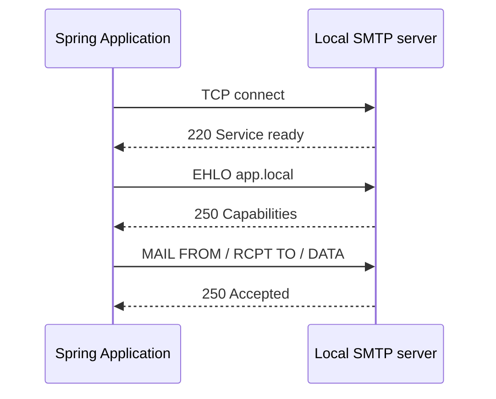
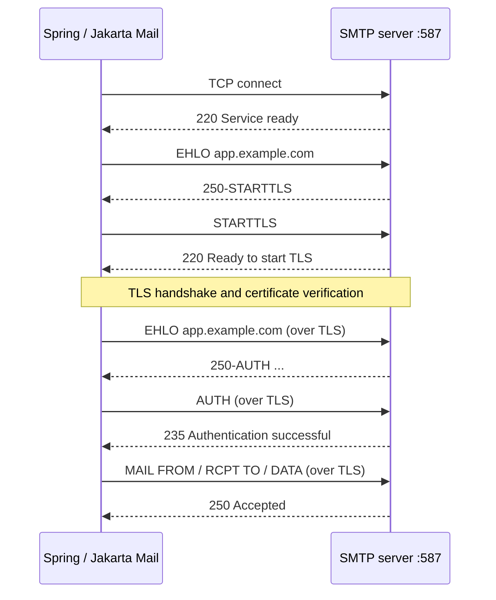
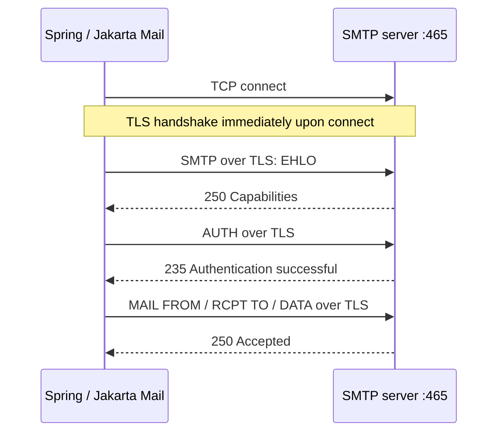
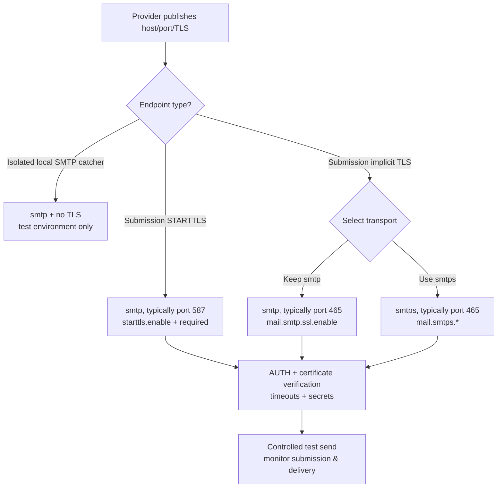

# Protocol `smtp`, `smtps`, and Environment-Based Selection

When configuring email sending in Spring Boot, the two names `smtp` and `smtps` often appear side by side. Sometimes an application sends mail over port 587 yet fails when switching to port 465; other times `spring.mail.protocol=smtps` is set yet `mail.smtp.auth=true` appears to have no effect. The cause usually lies in **confusing Jakarta Mail's transport name with how the TLS session starts**, or using the wrong configuration property group for the chosen transport.

In **Spring Framework Mail**, `JavaMailSender` and `JavaMailSenderImpl` handle sending email through Jakarta Mail. The application selects a transport matching the SMTP server, service port, and environment security policy. This lesson explains the difference between **plain SMTP, SMTP upgraded via STARTTLS, and SMTPS/implicit TLS**, then applies them to local, staging, and production configurations.

## 1. First: how do `smtp` and `smtps` differ?

### 1.1. Both use the SMTP sending protocol

**SMTP (Simple Mail Transfer Protocol)** is the protocol used to submit and relay email. In Jakarta Mail, `smtp` and `smtps` are **transport provider protocol names**:

- **`smtp`**: the SMTP transport. It can connect in plaintext, upgrade the connection via **STARTTLS**, or use **implicit TLS** when the right properties are enabled.
- **`smtps`**: an SMTP transport configured to establish **TLS right from the start of the connection** (*implicit TLS*), typically used with port 465.

Therefore, **`smtps` is not a different email command set replacing SMTP**. Once the TLS channel is established, both sides still exchange SMTP commands such as `EHLO`, `MAIL FROM`, `RCPT TO`, and `DATA`. The main differences are **how the connection is secured at session start** and **which property group Jakarta Mail reads**.

A misconception to avoid: the name `smtps` in Jakarta Mail does not mean every system must set `spring.mail.protocol=smtps` to use port 465. The `smtp` transport can also use port 465 by enabling `mail.smtp.ssl.enable=true`.

### 1.2. SMTP submission vs. SMTP relay

A Spring Boot application typically **submits mail to a sending service** (*message submission*) rather than acting as an Internet mail relay server itself.

| Connection | Common TCP port | Meaning |
|---|---:|---|
| SMTP **server-to-server relay** | **25** | Mail transfer agent relaying email between servers. May use STARTTLS when supported and allowed by policy. |
| SMTP **submission with STARTTLS** | **587** | Client connects, negotiates STARTTLS, then typically authenticates to submit mail. |
| SMTP **submission with implicit TLS** | **465** | TLS channel is established immediately upon connecting; SMTP and authentication follow inside it. |
| Provider-specific SMTP port | e.g., **2525** | Use only when documented by the provider; connection security depends on service documentation. |

The ports in this table are **common conventions**, not rigid rules every server must follow. An internal SMTP server may listen on port 1025 or a custom port. Never choose TLS settings solely from a port number while ignoring provider documentation.

**Port 25 is not a good default choice for a Spring Boot application sending transactional mail to the Internet.** Service providers or operational networks often restrict outbound connections to port 25, and that port primarily serves MTA-to-MTA relaying. For client applications, use the authorized submission service.

## 2. Three common connection patterns

### 2.1. Plain SMTP — unencrypted connection

In a lab environment, an application might connect to a simulated SMTP server over plain TCP:



Characteristics:

- SMTP commands and email data travel over a connection **not protected by TLS**.
- Suitable for an SMTP catcher running **only in a controlled development environment**, such as Mailpit/MailHog/GreenMail; this is not a safe configuration for sending real mail over untrusted networks.
- Disable sending email to external addresses in test environments, or use a service dedicated to capturing and storing test messages.
- If a server requires authentication, never transmit passwords over an unencrypted connection.

This Spring Mail setup typically uses `protocol=smtp` with neither `starttls` nor `ssl` enabled.

### 2.2. SMTP + STARTTLS — start SMTP then upgrade to TLS

STARTTLS is **a command that upgrades an already-established connection** to a TLS channel. It is commonly used for SMTP submission on port 587.



Order to understand:

1. The client opens a TCP connection and reads the SMTP `220` greeting.
2. `EHLO` returns server-supported extensions; when `STARTTLS` is advertised, the client can send the upgrade command.
3. After `220 Ready to start TLS`, both sides perform the TLS handshake and verify the server certificate.
4. Once TLS is established, the client **sends `EHLO` again** to obtain the capabilities active over the secure channel.
5. SMTP AUTH and mail submission commands proceed over TLS if required by the server.

In Jakarta Mail, commonly used properties are:

```properties
mail.smtp.starttls.enable=true
mail.smtp.starttls.required=true
mail.smtp.auth=true
mail.smtp.ssl.checkserveridentity=true
```

The difference between the two STARTTLS properties is critical:

- **`starttls.enable=true`**: allows the transport to use STARTTLS if the server offers it.
- **`starttls.required=true`**: mandates STARTTLS; if the server does not support it or the upgrade fails, sending **must fail** rather than continuing unencrypted.

In real environments using password authentication, set **both enable and required** per security policy. Enabling without requiring can leave an unencrypted path if a server does not advertise STARTTLS, depending on context and setup.

### 2.3. SMTPS / implicit TLS — TLS right on connect

With **implicit TLS**, opening the TCP session immediately begins the **TLS handshake first**. The server does not send a plaintext SMTP `220` greeting waiting for `STARTTLS`.



Two common Jakarta Mail configurations:

1. **`smtp` transport with `mail.smtp.ssl.enable=true`.**
2. **`smtps` transport** with the `mail.smtps.*` property group.

Both can establish an SMTP connection over implicit TLS. Which one you choose should stay consistent with the project's property prefix and config conventions; do not change the protocol name while leaving all old properties untouched.

### 2.4. Quick comparison

| Feature | Plain SMTP (local) | SMTP + STARTTLS | SMTPS / implicit TLS |
|---|---|---|---|
| Typical port | 1025 on internal SMTP catcher | 587 | 465 |
| Connection starts with | Plaintext SMTP | Plaintext SMTP | TLS handshake |
| `STARTTLS` command | No | **Yes** | No |
| Encrypted after connecting | No | Yes, after successful upgrade | Yes, from the start |
| Jakarta Mail transport | `smtp` | `smtp` | `smtp` + SSL or `smtps` |
| Characteristic properties | `mail.smtp.*` | `mail.smtp.starttls.*` | `mail.smtp.ssl.enable` or `mail.smtps.*` |
| Suitable for | Isolated local/testing | Submission when provider requires STARTTLS | Submission when provider requires implicit TLS |

**Both STARTTLS and implicit TLS use TLS**, yet **their configurations cannot be swapped merely by changing the port number**.

## 3. Protocol name in Spring Boot and Jakarta Mail property prefixes

When using `spring-boot-starter-mail`, Spring Boot typically creates a `JavaMailSenderImpl` from `spring.mail.*` properties.

```groovy
dependencies {
    implementation 'org.springframework.boot:spring-boot-starter-mail'
}
```

Related property groups:

| Spring Boot / Jakarta Mail | Function |
|---|---|
| `spring.mail.host` | Host of the outgoing mail server. |
| `spring.mail.port` | TCP connection port. |
| `spring.mail.username` | Authentication account if required by provider. |
| `spring.mail.password` | Authentication secret; may be an app password/token depending on provider. |
| `spring.mail.protocol` | Jakarta Mail transport name, usually `smtp` or `smtps`. |
| `spring.mail.default-encoding` | Default charset aiding MIME message creation, e.g., UTF-8. |
| `spring.mail.properties.*` | Forwards additional properties to the Jakarta Mail Session/transport. |
| `spring.mail.test-connection` | If enabled, Boot tests the mail connection on startup; fits intentional fail-fast setups. |

Example:

```yaml
spring:
  mail:
    host: smtp.example.com
    port: 587
    protocol: smtp
    properties:
      mail:
        smtp:
          auth: true
          starttls:
            enable: true
            required: true
```

Nested keys under `spring.mail.properties` map to full JavaMail properties such as `mail.smtp.starttls.enable`. Spring Boot forwards them to Jakarta Mail, while `spring.mail.protocol` determines which transport the sender selects.

### 3.1. Do not confuse `spring.mail.protocol` with JavaMail Session properties

In Spring Boot, `spring.mail.protocol=smtp` is a setting bound onto `JavaMailSenderImpl`. It is not a command sent over the network.

Jakarta Mail also has a `mail.transport.protocol` property in certain contexts to pick a default transport. However, when using Spring Boot and `JavaMailSenderImpl`, **explicitly configure `spring.mail.protocol`** and manage settings centrally through Spring; mixing multiple mechanisms makes troubleshooting harder.

### 3.2. Why might `mail.smtp.*` have no effect when using `smtps`?

Jakarta Mail uses different namespaces per transport name:

```text
protocol=smtp
    mail.smtp.auth
    mail.smtp.starttls.enable
    mail.smtp.starttls.required
    mail.smtp.ssl.enable
    mail.smtp.ssl.checkserveridentity
    mail.smtp.connectiontimeout

protocol=smtps
    mail.smtps.auth
    mail.smtps.ssl.checkserveridentity
    mail.smtps.connectiontimeout
    mail.smtps.timeout
    mail.smtps.writetimeout
```

The following configuration is **inconsistent**:

```yaml
spring:
  mail:
    protocol: smtps
    port: 465
    properties:
      mail:
        smtp:       # Wrong property group for the smtps transport
          auth: true
          ssl:
            checkserveridentity: true
```

If using `smtps`, place the transport-related properties under `mail.smtps.*`. Conversely, if staying on `protocol=smtp` with `ssl.enable=true`, keep the `mail.smtp.*` prefix.

Note: `spring.mail.username` and `spring.mail.password` remain directly under `spring.mail`; they do not change to `spring.mail.smtps.username`. Only **transport-specific properties** need to change.

## 4. Standard setup: port 587 submission with STARTTLS

This is the common choice for **production applications** when the provider specifies port 587.

```yaml
# application-prod.yml — STARTTLS example
spring:
  mail:
    host: ${MAIL_HOST}
    port: 587
    protocol: smtp
    username: ${MAIL_USERNAME}
    password: ${MAIL_PASSWORD}
    default-encoding: UTF-8
    properties:
      mail:
        smtp:
          auth: true
          starttls:
            enable: true
            required: true
          ssl:
            checkserveridentity: true
          connectiontimeout: 5000
          timeout: 10000
          writetimeout: 10000
```

Explanation:

- `protocol: smtp` selects the Jakarta Mail SMTP transport.
- `port: 587` is the submission port in this example; still verify against provider docs.
- `auth: true` requests SMTP authentication when the transport talks to the server.
- `starttls.enable: true` allows performing the TLS upgrade.
- `starttls.required: true` prevents continuing if the connection cannot be secured with STARTTLS.
- `ssl.checkserveridentity: true` adds hostname verification for the TLS server identity instead of relying solely on CA trust.
- Timeouts are in **milliseconds**, preventing sending threads from hanging indefinitely during network or server issues.

**Do not set `mail.smtp.ssl.enable=true` at the same time when intending to use port 587's STARTTLS flow in this configuration.** That property causes the transport to begin with implicit TLS, which mismatches what a 587 server expects here.

In production, `MAIL_USERNAME` and `MAIL_PASSWORD` must be supplied from the deployment environment or secret store. For providers requiring OAuth2, the application must integrate the provider's token/auth flow; do not assume every service accepts a regular password.

### 4.1. What if the server does not advertise STARTTLS?

With `mail.smtp.starttls.required=true`, JavaMail refuses to proceed if STARTTLS cannot be established. That is the right behavior when sending policy requires TLS.

Do not "quick-fix" the error by disabling `required` in production and allowing credentials over an unencrypted connection. Re-verify **host, port, provider policy, proxy/network, and STARTTLS availability**.

### 4.2. How far does STARTTLS protect content?

STARTTLS protects **the specific connection hop** between Spring Boot and the server it talks to. Once the provider accepts the message, subsequent relaying between mail servers follows its own TLS mechanisms/policies, which may differ from the submission hop. Thus, TLS for SMTP **does not mean end-to-end email encryption** like an E2EE messaging app.

If data is genuinely sensitive, consider sending an access-controlled download link or end-to-end content encryption per business requirements.

## 5. Configuring port 465: two valid approaches

For a server requiring **implicit TLS on 465**, there are two common options. Pick **one approach** and keep the property prefix consistent.

### 5.1. Option A — keep `protocol=smtp` and enable SSL/TLS

```yaml
# Port 465 example, still using smtp transport
spring:
  mail:
    host: ${MAIL_HOST}
    port: 465
    protocol: smtp
    username: ${MAIL_USERNAME}
    password: ${MAIL_PASSWORD}
    default-encoding: UTF-8
    properties:
      mail:
        smtp:
          auth: true
          ssl:
            enable: true
            checkserveridentity: true
          connectiontimeout: 5000
          timeout: 10000
          writetimeout: 10000
```

Characteristics:

- The transport name remains **`smtp`**.
- `mail.smtp.ssl.enable=true` requests **TLS right when opening the connection**.
- Configuration continues using **`mail.smtp.*`** for AUTH, timeouts, and identity checking.
- **No `STARTTLS` required** because the channel is encrypted from the start.

This approach is convenient when an application wants to keep a single `smtp` transport and vary connection settings per profile.

### 5.2. Option B — use `protocol=smtps`

```yaml
# Port 465 example, using smtps transport
spring:
  mail:
    host: ${MAIL_HOST}
    port: 465
    protocol: smtps
    username: ${MAIL_USERNAME}
    password: ${MAIL_PASSWORD}
    default-encoding: UTF-8
    properties:
      mail:
        smtps:
          auth: true
          ssl:
            enable: true
            checkserveridentity: true
          connectiontimeout: 5000
          timeout: 10000
          writetimeout: 10000
```

`smtps` is Jakarta Mail's transport name for SMTP over an implicit TLS connection. Including `mail.smtps.ssl.enable=true` in the example makes the security intent explicit; on the SMTPS transport, implicit TLS is already the default behavior. AUTH, TLS identity check, and timeout options sit under the **`mail.smtps.*`** prefix.

### 5.3. Comparing the two port 465 configurations

| Item | Option A | Option B |
|---|---|---|
| `spring.mail.protocol` | `smtp` | `smtps` |
| Example port | 465 | 465 |
| Security channel | Implicit TLS | Implicit TLS |
| Property group | `mail.smtp.*` | `mail.smtps.*` |
| Enable TLS | `mail.smtp.ssl.enable=true` | SMTPS implicit TLS; `mail.smtps.ssl.enable=true` may be declared explicitly |
| SMTP AUTH | `mail.smtp.auth=true` | `mail.smtps.auth=true` |
| STARTTLS | Not used | Not used |

Neither option is "stronger" merely because of the name `smtps`. What matters is that **the actual session uses TLS with proper certificate verification, valid authentication, and no downgrade**.

## 6. Choosing configuration by environment

When an application runs on a laptop, CI, staging, and production, **host, port, credentials, and sending policy** differ. Use **Spring profiles** and environment variables to isolate runtime values and ensure a debug/plain SMTP setup is never accidentally applied in production.

### 6.1. Local development environment

With a test mail-catching server like Mailpit, the application only needs to send to an SMTP server within a controlled boundary. Example:

```yaml
# application-local.yml
spring:
  mail:
    host: localhost
    port: 1025
    protocol: smtp
    default-encoding: UTF-8
    properties:
      mail:
        smtp:
          auth: false
          starttls:
            enable: false
```

In this example:

- `localhost:1025` is an SMTP server assumed to run on **the same host** as the application.
- No username/password is set because the test server is configured not to require AUTH.
- An unencrypted connection is **only acceptable when isolated inside a development environment**, never for transmitting production data over untrusted networks.
- Emails are stored/viewed in the mail catcher without going out to the Internet.

If **the Spring application runs inside a container** and Mailpit is another container/service on the same Docker Compose network, `localhost` inside the app container refers to **that container itself**. Use the internal DNS service name instead, such as:

```yaml
spring:
  mail:
    host: mailpit
    port: 1025
```

The `mailpit` example only works when a service with that exact name actually exists on the container network. Do not copy this host verbatim into environments without that service.

### 6.2. CI and automated tests

For unit tests, usually **mock `JavaMailSender`** to verify business logic requests sending mail without depending on network connectivity.

For integration tests, you can run an SMTP catcher or mock server supporting the matching protocol to inspect received messages:

- **Plain SMTP catcher**: verifies the application sets the right recipients, subject, and body/attachments in an isolated environment.
- **STARTTLS-capable test SMTP server**: tests a TLS configuration branch in integration tests when test goals require it.
- **Provider sandbox**: used when validating a near-production configuration without delivering mail to real users.

Test accounts and secrets must be separate from production. Never use real production mail-sending accounts inside uncontrolled automated test runs.

### 6.3. Staging

Staging should closely mirror production in **protocol, TLS, authentication mechanism, and secret delivery**, while having **a safe delivery boundary for testing**:

| Item | Staging recommendation |
|---|---|
| Protocol/port | Use the same transport/TLS style planned for production when validating compatibility. |
| Account | Use a dedicated staging or sandbox account with appropriate quotas and permissions. |
| Recipients | Only authorized test mailboxes or policy-redirected destinations. |
| Content | Use synthetic data / scrub personal information. |
| Monitoring | Record submission outcomes, auth/TLS errors, and provider delivery statuses. |

If staging uses a non-TLS SMTP catcher for convenience, that only proves **basic MIME construction/sending**, not that the production TLS configuration works. When you need to validate real TLS, have a test environment matching the intended submission protocol.

### 6.4. Production

Production must follow the SMTP provider's contract:

1. Obtain the published **submission hostname and port**.
2. Confirm whether the transport requires **STARTTLS on 587** or **implicit TLS on 465**.
3. Pick `smtp` or `smtps` consistently and configure the matching property namespace.
4. Require TLS, verifying certificates and hostnames.
5. Configure the provider-supported AUTH mechanism with centralized secret management.
6. Set timeouts, rate limits, retries, and sending status monitoring.
7. Track bounces/DSNs or provider events if business logic needs post-submission delivery outcomes.

A successful send through `JavaMailSender` means the transport reported no error at the moment of the call. It **does not guarantee the message reached the recipient's Inbox**.

### 6.5. Decision matrix

| Environment / scenario | Protocol | Typical port | TLS configuration | Notes |
|---|---|---|---|---|
| Isolated local SMTP catcher | `smtp` | 1025 | No TLS if truly isolated | Development/testing only. |
| Production provider requiring STARTTLS | `smtp` | 587 | `mail.smtp.starttls.enable=true` and `required=true` | Usually paired with SMTP AUTH. |
| Production provider requiring implicit TLS, keeping `smtp` | `smtp` | 465 | `mail.smtp.ssl.enable=true` | Keep `mail.smtp.*` prefix. |
| Production provider requiring implicit TLS, choosing `smtps` | `smtps` | 465 | SMTPS implicit TLS | Use `mail.smtps.*` prefix. |
| Authorized internal relay system | Depends on relay contract | Often 25 or custom port | Per internal server policy | Do not assume relays allow anonymous plaintext. |

**The most reliable selection method is checking the documentation and real capabilities of the SMTP server in use**, then locking in the matching configuration profile.

## 7. Organizing Spring profiles to avoid confusion

A clean, maintainable layout:

```text
src/main/resources/
├── application.yml
├── application-local.yml
├── application-staging.yml
└── application-prod.yml
```

`application.yml` holds shared settings:

```yaml
# application.yml
spring:
  mail:
    default-encoding: UTF-8
```

The local profile defines the SMTP catcher. Staging/prod profiles define real TLS submission configurations.

You can start the app with:

```text
SPRING_PROFILES_ACTIVE=local
SPRING_PROFILES_ACTIVE=staging
SPRING_PROFILES_ACTIVE=prod
```

These are examples of setting environment variables in the runtime environment; the exact mechanism varies across IDEs, shells, containers, and deployment platforms.

### 7.1. Should `MAIL_PROTOCOL` accept both `smtp` and `smtps`?

Technically you can bind:

```yaml
spring:
  mail:
    protocol: ${MAIL_PROTOCOL:smtp}
```

However, changing `MAIL_PROTOCOL` from `smtp` to `smtps` without changing the **prefix** from `mail.smtp.*` to `mail.smtps.*` causes many transport properties to stop matching the active transport.

Therefore, when two environments require **different protocols**, explicit profile configuration is usually clearer:

- STARTTLS profile: `protocol=smtp`, port 587, `mail.smtp.starttls.*`.
- Implicit TLS via `smtp` profile: `protocol=smtp`, port 465, `mail.smtp.ssl.enable`.
- SMTPS profile: `protocol=smtps`, port 465, `mail.smtps.*`.

If environments only differ in host, username, and password while sharing the same TLS mode, use environment variables for those values instead of duplicating entire YAML files.

### 7.2. Never hardcode secrets

Example:

```yaml
spring:
  mail:
    username: ${MAIL_USERNAME}
    password: ${MAIL_PASSWORD}
```

Notes:

- Never commit real secrets to Git or sample files.
- Never print passwords, access tokens, or `Authorization` headers in logs.
- Accounts may require app passwords/OAuth2 or custom mechanisms; follow the provider.
- Revoke/rotate secrets if compromised, and restrict scope and sending permissions.

With many SMTP providers, you also need to verify the sending domain, DKIM/SPF/DMARC, and permission to use the `From` address. Those steps affect message acceptance and deliverability, yet **they do not replace TLS security on the SMTP connection**.

## 8. Creating JavaMailSender in code when dynamic configuration is needed

Normally Spring Boot auto-configuration is sufficient. However, in multi-provider or per-tenant dynamic setups, an application can construct `JavaMailSenderImpl` directly.

Example `smtp` transport over STARTTLS:

```java
import org.springframework.mail.javamail.JavaMailSenderImpl;

import java.util.Properties;

public class MailSenderFactory {

    public static JavaMailSenderImpl startTlsSender(
            String host, int port, String username, String password) {

        JavaMailSenderImpl sender = new JavaMailSenderImpl();
        sender.setHost(host);
        sender.setPort(port);
        sender.setProtocol("smtp");
        sender.setUsername(username);
        sender.setPassword(password);
        sender.setDefaultEncoding("UTF-8");

        Properties props = sender.getJavaMailProperties();
        props.put("mail.smtp.auth", "true");
        props.put("mail.smtp.starttls.enable", "true");
        props.put("mail.smtp.starttls.required", "true");
        props.put("mail.smtp.ssl.checkserveridentity", "true");
        props.put("mail.smtp.connectiontimeout", "5000");
        props.put("mail.smtp.timeout", "10000");
        props.put("mail.smtp.writetimeout", "10000");

        return sender;
    }
}
```

To switch the factory to implicit TLS on 465 using Option A, change to:

```java
sender.setPort(465);
sender.setProtocol("smtp");
props.put("mail.smtp.ssl.enable", "true");
props.put("mail.smtp.ssl.checkserveridentity", "true");
// Do not enable starttls.enable/required for this connection mode.
```

If using `smtps` via Option B:

```java
sender.setPort(465);
sender.setProtocol("smtps");
props.put("mail.smtps.auth", "true");
props.put("mail.smtps.ssl.checkserveridentity", "true");
props.put("mail.smtps.connectiontimeout", "5000");
props.put("mail.smtps.timeout", "10000");
props.put("mail.smtps.writetimeout", "10000");
```

The transitions above illustrate **alternative configurations**, not appending properties onto an existing object already populated with the old mode's properties. When switching protocols, construct a fresh sender/reset the properties and keep only settings valid for the chosen mode.

### 8.1. Creating a sender does not open a connection immediately

Calls such as `new JavaMailSenderImpl()`, `setHost()`, and `setPort()` mainly populate **an object configuration**. Network connections usually occur only when sending or explicitly testing connectivity. Therefore, an application starting cleanly after creating the bean **does not prove SMTP credentials, port, and TLS actually work**.

If you want fail-fast startup, Spring Boot offers `spring.mail.test-connection=true`. Enable it when startup policy requires SMTP availability and the runtime network permits it. For systems that must start even during mail outages, prefer separate health checks and asynchronous sending instead of blocking application startup.

### 8.2. A simple message illustrating sending

```java
import org.springframework.mail.SimpleMailMessage;
import org.springframework.mail.javamail.JavaMailSender;
import org.springframework.stereotype.Service;

@Service
public class EmailNotificationService {

    private final JavaMailSender mailSender;

    public EmailNotificationService(JavaMailSender mailSender) {
        this.mailSender = mailSender;
    }

    public void sendNotification(String recipient) {
        SimpleMailMessage message = new SimpleMailMessage();
        message.setFrom("notifications@example.com");
        message.setTo(recipient);
        message.setSubject("System Notification");
        message.setText("You have a new notification.");

        mailSender.send(message);
    }
}
```

The mail-sending service **does not need to know** whether the port is 587 or 465. Transport configuration belongs to `JavaMailSender`. This is the benefit of separating **email composition logic** from **SMTP connection mechanics**.

## 9. SMTP AUTH, TLS, and certificates are three separate concerns

### 9.1. TLS protects the channel; AUTH authenticates the sender

**TLS** encrypts the connection and helps the application verify it is talking to the intended server. **SMTP AUTH** is the step where the server authenticates the application/account allowed to send.

Do not conflate them:

- Having `mail.smtp.auth=true` **does not** guarantee the connection is encrypted.
- Having STARTTLS or implicit TLS **does not** prove the account is authorized to send.
- A server allowing connection and authentication **does not** guarantee every `From` address will be accepted.
- Accepted SMTP submission **does not** guarantee delivery to the recipient's inbox.

An internal mail relay might authenticate solely by IP address without SMTP AUTH, yet that is **a server-specific policy**. Never drop `auth=true` over the Internet thinking TLS replaces authentication.

### 9.2. Verifying certificate trust and hostname

When Java establishes TLS, the system must:

1. Trust the server's certificate chain against a valid truststore/TLS policy.
2. Verify the certificate is valid and the connected hostname matches the server identity.
3. Negotiate a TLS version and cipher suite supported by both sides.

For Jakarta Mail SMTP, `mail.smtp.ssl.checkserveridentity=true` or `mail.smtps.ssl.checkserveridentity=true` is a useful setting to enforce hostname verification.

Never work around certificate errors with settings such as:

```properties
# NEVER trust all hosts in production
mail.smtp.ssl.trust=*
```

Trusting all hosts or disabling certificate validation weakens detection of man-in-the-middle attackers. When hitting TLS errors, verify DNS, hostname, server certificates, CA/truststore, proxies, and protocol settings first.

### 9.3. Which TLS version?

Java and Jakarta Mail use JSSE to establish TLS. Supported versions depend on the JDK, security policies, and server. If corporate policy requires restricting TLS versions, Jakarta Mail supports settings such as `mail.smtp.ssl.protocols` or `mail.smtps.ssl.protocols`, for example:

```properties
# Illustrative only when confirmed supported by both server and runtime
mail.smtp.ssl.protocols=TLSv1.2 TLSv1.3
```

Do not hardcode a specific TLS version out of habit when the JDK/provider already enforces sound defaults. Pinning the wrong version can break handshakes if a server does not support it. Follow your environment's current security policy.

## 10. Typical errors when choosing the wrong protocol or port

### 10.1. Port 465 with only STARTTLS enabled

Problematic configuration example:

```yaml
spring:
  mail:
    port: 465
    protocol: smtp
    properties:
      mail:
        smtp:
          starttls:
            enable: true
            required: true
```

If the server on 465 only accepts implicit TLS, the app waits for an SMTP banner while the server waits for a TLS ClientHello. The result can be a timeout or connection failure.

**Fix:** with the `smtp` transport, enable `mail.smtp.ssl.enable=true`; or switch to `smtps` and use `mail.smtps.*`. Also cross-check host and provider rules.

### 10.2. Port 587 with implicit TLS enabled

```yaml
spring:
  mail:
    port: 587
    protocol: smtp
    properties:
      mail:
        smtp:
          ssl:
            enable: true
```

If the server on 587 expects SMTP `EHLO` before upgrading via `STARTTLS`, sending a TLS ClientHello right away violates the sequence; handshake failures, timeouts, or "unrecognized SSL message" errors can occur.

**Fix:** disable `mail.smtp.ssl.enable`, and use `mail.smtp.starttls.enable=true` with `required=true` when the server supports STARTTLS.

### 10.3. Protocol is `smtps` yet `mail.smtp.auth` is still used

```yaml
spring:
  mail:
    protocol: smtps
    properties:
      mail:
        smtp:
          auth: true
```

The `smtps` transport reads the corresponding **`mail.smtps.*`** property group. If `mail.smtps.auth=true` is missing, a server requiring AUTH can reject sending.

**Fix:** keep `protocol=smtps` aligned with `mail.smtps.auth`, `mail.smtps.ssl.checkserveridentity`, and matching timeouts.

### 10.4. SMTP reply errors and TLS errors are not the same

| Symptom | Common cause category | What to do |
|---|---|---|
| Connection to 465 times out when using STARTTLS | Implicit TLS / STARTTLS mismatch or network | Verify the exact port and how TLS starts. |
| `SSLException: Unsupported or unrecognized SSL message` | Often seen when trying to start TLS against a plaintext-only endpoint | Cross-check endpoint and TLS mode. |
| `SSLHandshakeException` | Certificate, truststore, hostname, TLS version, or middlebox | Check certificate chain, server name, and JSSE. |
| `530 Must issue STARTTLS first` | Server requires TLS before an SMTP operation | Enable STARTTLS in the right sequence. |
| `535 Authentication failed` | Wrong credentials, AUTH mechanism, or provider policy | Check account, app password/OAuth2, sending rights. |
| `550` / `553` | May involve recipient, sender address, or server policy | Read enhanced code and diagnostics; do not blame TLS immediately. |
| `452` / `4xx` | Temporary failure, quota, or policy depending on case | Classify cause and retry in a controlled way. |
| `552 5.3.4` | Often indicates message exceeds size limit | Check MIME/base64 size and provider limits. |

The displayed error is **an investigative clue**, not sole proof of one cause. For instance, a timeout could stem from a firewall or DNS rather than protocol mismatch. Combine server responses, intended configuration, and actual network connectivity.

### 10.5. Sender starts up fine yet sending still fails

`JavaMailSenderImpl` can be instantiated from YAML without opening a connection immediately. Thus DNS, firewall, certificate, or account errors often appear only when `send(...)` runs.

To make troubleshooting easier:

- Log **environment/profile, protocol, hostname/port**, and error class, redacting username if needed and **never logging passwords/tokens**.
- Jakarta Mail diagnostics can be enabled temporarily in controlled environments to observe SMTP steps, then turned off afterward; traces may contain email addresses, headers, and sensitive content.
- When startup connectivity checks are needed, weigh `spring.mail.test-connection` against application availability requirements.
- If production runs inside a container/VPC, test connectivity **from that exact environment**; succeeding from a laptop does not prove containers can reach SMTP ports.

## 11. Protocol selection workflow when deploying a new service

A sequence that prevents common mistakes:

1. **Read the provider's SMTP submission parameters.** Note host, port, TLS mode, auth mechanism, send limits, and allowed From addresses.
2. **Choose one transport and property prefix.** For 587 STARTTLS: `smtp` + `mail.smtp.*`. For 465 implicit TLS: `smtp` + `mail.smtp.ssl.enable=true` or `smtps` + `mail.smtps.*`.
3. **Separate environments.** Local uses an SMTP catcher; staging uses a sandbox account or test recipient scope; production uses real configuration and secrets.
4. **Enforce appropriate security.** For STARTTLS, set `required=true`; for implicit TLS, initiate TLS from the start and verify certificate/hostname.
5. **Configure timeouts and error handling.** Never let business requests hang indefinitely on mail connections.
6. **Build/send a controlled test message.** Verify recipient, subject, content, and sanitized error logs; avoid sending real user data externally by mistake.
7. **Monitor post-submission.** If delivery outcomes matter, integrate provider webhooks, DSNs, or bounce handling.

Decision example:



## 12. Practical scenarios

### Scenario A — switching from 587 to 465

An application currently uses:

```yaml
spring:
  mail:
    port: 587
    protocol: smtp
    properties:
      mail:
        smtp:
          auth: true
          starttls:
            enable: true
            required: true
```

The provider switches the production endpoint to **465 implicit TLS**. A developer only changes `port: 465`.

Explain:

1. Why might the connection time out?
2. If keeping `protocol=smtp`, which TLS properties must change?
3. If choosing `protocol=smtps`, which property prefixes must change?
4. Why shouldn't you enable both STARTTLS and implicit TLS hoping the library "auto-picks"?

### Scenario B — local sends fine, production fails

Local uses an SMTP catcher at `localhost:1025` with no AUTH/TLS. Production uses provider `smtp.provider.example:587` with STARTTLS and AUTH.

Identify:

- Which settings must differ between local and production.
- Which secrets must never appear in `application.yml` committed to Git.
- Why testing email content with an SMTP catcher does not prove production TLS settings are right.
- How to operate when production temporarily lacks SMTP connectivity yet business logic must record the intent to send.

### Scenario C — `smtps` and wrong property namespace

A service has `spring.mail.protocol=smtps`, port 465, valid username/password, yet only sets `mail.smtp.auth=true`.

Point out what is missing in the configuration and rewrite the YAML using `mail.smtps.auth=true`, `mail.smtps.ssl.checkserveridentity=true`, and timeouts.

### Scenario D — STARTTLS disabled

A server stops advertising `STARTTLS` after `EHLO`. The application only configured `mail.smtp.starttls.enable=true`.

Analyze:

1. Why is setting only `enable` insufficient when policy mandates encryption?
2. How does `mail.smtp.starttls.required=true` change the behavior?
3. In production, should you fix the issue by verifying server/port/TLS or allowing fallback to an unencrypted connection?

### Scenario E — TLS works but sending is rejected

The implicit TLS connection on port 465 succeeds with a valid certificate, yet the SMTP server returns `535 Authentication failed`.

Distinguish the TLS step from the SMTP AUTH step, identify which settings to inspect, and explain why switching from `smtp` to `smtps` will not automatically fix a credential error.

## 13. Key takeaways

- **`smtp` and `smtps` are Jakarta Mail transport names**, both speaking SMTP commands; practical differences lie in how TLS starts and the configuration namespace.
- **587 + STARTTLS:** typically uses `spring.mail.protocol=smtp`, `mail.smtp.starttls.enable=true`, `mail.smtp.starttls.required=true`.
- **465 + implicit TLS:** can use **`smtp` + `mail.smtp.ssl.enable=true`** or **`smtps` + `mail.smtps.*`**.
- **Changing protocol requires reviewing property prefixes.** `mail.smtp.auth` does not substitute for `mail.smtps.auth` once the `smtps` transport is chosen.
- **Local SMTP catchers** can use plaintext in isolated environments; **staging and production** must enforce TLS, authentication, and provider policies.
- **TLS, SMTP AUTH, and final delivery are three separate concepts.** A secure channel does not prove sender authorization; `send(...)` completing does not prove inbox delivery.
- **Good configuration** combines explicit host/port, the right TLS mode, valid certificate/hostname checks, protected secrets, timeouts, and send-error monitoring.

### References for further reading

- **Spring Boot Reference — Sending Email:** `spring.mail.*` properties and `JavaMailSender`.
- **Spring Framework Reference — Email:** `JavaMailSender`, `JavaMailSenderImpl`, and MIME content creation.
- **Jakarta Mail / Angus Mail SMTP Transport Properties:** distinguishing `mail.smtp.*`, `mail.smtps.*`, `starttls.enable`, `ssl.enable`, and `ssl.checkserveridentity`.
- **RFC 5321 — Simple Mail Transfer Protocol:** SMTP commands and delivery model.
- **RFC 3207 — SMTP Service Extension for Secure SMTP over TLS:** STARTTLS mechanism.
- **RFC 6409 — Message Submission for Mail:** message submission model.
- **RFC 8314 — Cleartext Considered Obsolete: Use of TLS for Email Submission and Access:** TLS guidance for submission, including implicit TLS.
- **RFC 4954 — SMTP Service Extension for Authentication:** SMTP AUTH.

Once you understand the distinction between **transport protocol**, **port**, **STARTTLS/implicit TLS**, and **runtime environment**, choosing a Spring Mail configuration becomes a technical decision you can explain, diagnose, and maintain—rather than guessing port numbers until emails go through.
