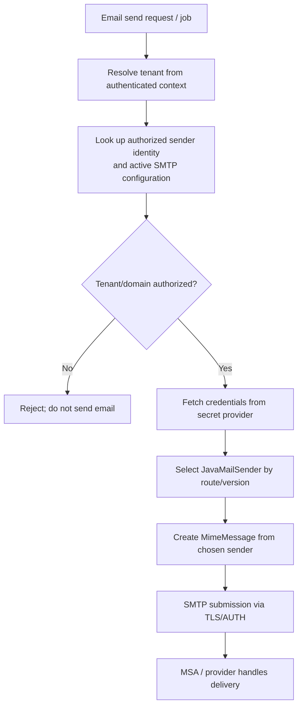
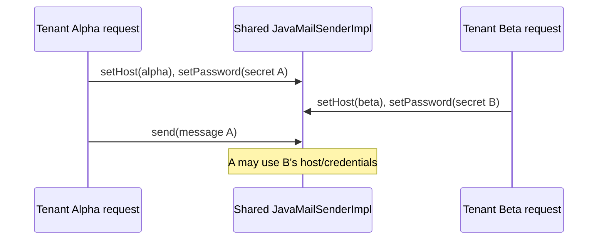
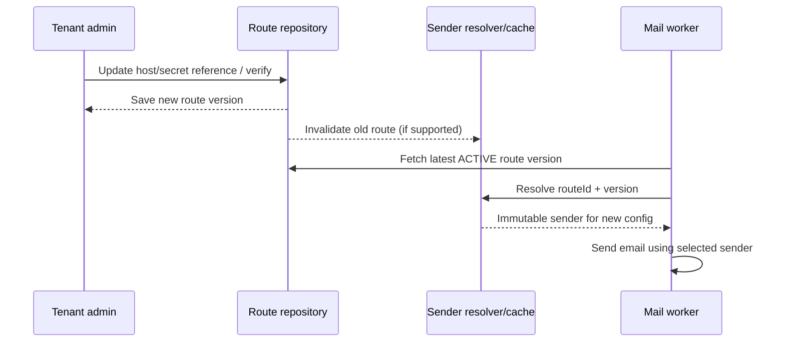
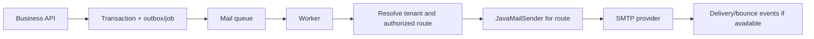

# Dynamic Configuration by Tenant or Sender Domain in Spring Framework Mail

An application serving a single organization usually uses one SMTP server, sending account, and `From` address. Once an application becomes **multi-tenant**, things grow more complex: each customer may use its own email domain, its own SMTP account, or even a different mail provider. For instance, the same Spring invoicing service might need to send from `billing@alpha.example` via Alpha's SMTP and `invoices@beta.example` via Beta's service.

**Dynamic sender configuration** means the application selects the right email-sending configuration **by tenant, sender domain, or authorized sender identity** at task-processing time. Those configurations can live in a database, config service, or secret store and change without modifying business code for each customer.

In Spring Framework Mail, the central class is `JavaMailSender`, typically implemented by `JavaMailSenderImpl`. To prevent cross-tenant sends, the safe design is **routing to a sender configured specifically for each verified sender identity**, rather than mutating `host`, `username`, `password`, or TLS properties on a shared `JavaMailSenderImpl` bean right before each send.

## 1. Why is a static `spring.mail.*` not enough?

Spring Boot can auto-create a `JavaMailSender` from:

```yaml
spring:
  mail:
    host: smtp.provider.example
    port: 587
    username: sender@example.org
    password: ${SMTP_PASSWORD}
    properties:
      "[mail.smtp.auth]": true
      "[mail.smtp.starttls.enable]": true
      "[mail.smtp.starttls.required]": true
```

This configuration fits when every email goes through **one SMTP submission endpoint**. In a multi-tenant SaaS, however, fields can vary per tenant:

| Property | Tenant Alpha | Tenant Beta |
|---|---|---|
| Verified sending domain | `alpha.example` | `beta.example` |
| `From` address | `billing@alpha.example` | `notify@beta.example` |
| SMTP host | `smtp.alpha-provider.example` | `smtp.beta-provider.example` |
| Port | `587` | `465` |
| TLS | STARTTLS required | Implicit TLS |
| SMTP account | Alpha's identity | Beta's identity |
| Secret | Alpha's secret reference | Beta's secret reference |
| Quota, DKIM, policies | Per Alpha | Per Beta |

When a request belongs to Alpha, the application must use **Alpha's entire configuration set**; when a request belongs to Beta, it must use **Beta's entire configuration set**. Never change only the `From` address while keeping the previous tenant's SMTP account: the provider may reject it, or worse, send mail under an unauthorized identity.

### Architecture flow



The routing key is usually **tenant ID** (and optionally `sender identity` or `mail purpose` such as transactional/marketing). The `From` domain is part of sending policy and must never become arbitrary user input letting callers pick any SMTP server.

## 2. Three common sender routing patterns

### 2.1. By tenant

Each tenant maps to one SMTP configuration:

```text
tenant-alpha -> smtp-alpha.example:587 -> billing@alpha.example
tenant-beta  -> smtp-beta.example:465  -> notify@beta.example
```

This fits when each tenant has one primary sending account. When switching between tenants, the application must identify the tenant **from verified principals/claims and authorization checks**, never blindly trusting an arbitrary `tenantId` from a request body.

### 2.2. By verified sender domain or address

A tenant can manage multiple domains or sending addresses:

```text
tenant-alpha:
  billing@alpha.example    -> transactional-route
  support@alpha.example    -> support-route
  news@updates.alpha.example -> marketing-route
```

Here, the system chooses a route based on **a sender identity in the tenant's authorized list**. Users must not be able to supply `From: finance@another-company.example` and make the system send through an arbitrary server.

Domain selection must rely on normalized addresses with verified ownership/usage rights; for internationalized domains, normalize domain names per email/DNS rules. Never use `endsWith("alpha.example")` to match domains, because `fakealpha.example` or malformed input can match incorrectly.

### 2.3. By sending purpose, environment, or provider

The same tenant sometimes splits infrastructure:

| Purpose | Example route | Why split? |
|---|---|---|
| OTP / password reset | Transactional SMTP provider | Prioritize latency, anti-abuse limits |
| Invoices / payment notices | Billing provider | Transaction logs and dedicated sender identity |
| Marketing email | Bulk provider | Separate quotas and unsubscribe policies |
| Development | SMTP sandbox | Prevent test emails from hitting the Internet |

In this case, the routing key can be `(tenantId, mailPurpose, senderIdentity)`. Even if multiple routes share a hostname, **sending permissions and secrets must remain separately managed**.

## 3. Data that belongs in a sender configuration

A configuration record should hold enough data to build an SMTP client without prompting users while a job runs:

| Field | Purpose | Example |
|---|---|---|
| `tenantId` | Owning tenant | `tenant-alpha` |
| `routeId` | Sending configuration identifier | `alpha-transactional` |
| `version` | Version for cache/refresh tracking | `42` |
| `host` | SMTP submission endpoint | `smtp.alpha-provider.example` |
| `port` | TCP port | `587` |
| `protocol` | Jakarta Mail transport | `smtp` |
| `tlsMode` | Required STARTTLS or implicit TLS | `STARTTLS` |
| `smtpUsername` | SMTP AUTH identity | `mailer-alpha` |
| `credentialRef` | Reference to secret, no exposed password | `secrets/mail/alpha/v3` |
| `fromAddress` | Authorized display address | `billing@alpha.example` |
| `replyToAddress` | Reply destination if different from `From` | `help@alpha.example` |
| `envelopeFrom` | SMTP envelope sender if configured separately | `bounce@alpha.example` |
| `status` | Enables/disables config usability | `ACTIVE` |
| `verifiedDomain` | Record or status of domain sending verification | `alpha.example` |

In real systems, configurations may also include provider IDs, quotas, last successful check timestamps, credential expiration dates, retry policies, and SPF/DKIM/DMARC verification metadata.

**Never store plaintext SMTP passwords** in tenant tables or logs. Configuration records should reference a secret managed by a secret manager; the app retrieves the real value only where needed and restricts access by environment.

### Example YAML describing business routes

These are **application-defined settings**, not `spring.mail.*` properties that Spring Boot automatically turns into multiple senders:

```yaml
app:
  tenant-mail:
    routes:
      alpha-transactional:
        tenant-id: tenant-alpha
        from-address: billing@alpha.example
        reply-to-address: support@alpha.example
        host: smtp.alpha-provider.example
        port: 587
        protocol: smtp
        tls-mode: STARTTLS
        smtp-username: alpha-mailer
        credential-ref: secrets/mail/alpha/v3
        version: 42
      beta-transactional:
        tenant-id: tenant-beta
        from-address: notify@beta.example
        host: smtp.beta-provider.example
        port: 465
        protocol: smtp
        tls-mode: IMPLICIT_TLS
        smtp-username: beta-mailer
        credential-ref: secrets/mail/beta/v1
        version: 8
```

With many tenants, a database table or config service is easier to manage than hundreds of YAML blocks. Regardless of source, **configuration data must be validated and stored under strict access control**, never allowing API callers to overwrite arbitrary tenant endpoints and secrets.

## 4. Spring Mail components to use

Spring Framework Mail provides:

- `JavaMailSender`: email-sending interface supporting both `SimpleMailMessage` and `MimeMessage`.
- `JavaMailSenderImpl`: implementation supporting SMTP `host`, `port`, `username`, `password`, `protocol`, and Jakarta Mail properties.
- `MimeMessageHelper`: helper for setting `From`, `To`, `Reply-To`, subject, text/HTML, inline resources, and attachments.

Example route using `smtp` with STARTTLS on 587:

```java
JavaMailSenderImpl sender = new JavaMailSenderImpl();
sender.setHost("smtp.alpha-provider.example");
sender.setPort(587);
sender.setProtocol("smtp");
sender.setUsername("alpha-mailer");
sender.setPassword(secretResolvedForAlpha);

Properties properties = sender.getJavaMailProperties();
properties.put("mail.smtp.auth", "true");
properties.put("mail.smtp.starttls.enable", "true");
properties.put("mail.smtp.starttls.required", "true");
properties.put("mail.smtp.ssl.checkserveridentity", "true");
properties.put("mail.smtp.connectiontimeout", "5000");
properties.put("mail.smtp.timeout", "10000");
properties.put("mail.smtp.writetimeout", "10000");
```

For a 465 route using implicit TLS, keep `protocol="smtp"` and enable `mail.smtp.ssl.enable=true` instead of STARTTLS. Never pick TLS modes by guessing ports; follow the endpoint specification published by the SMTP provider.

### Why not mutate a shared bean right before each send?

Suppose Spring holds a singleton:

```java
@Autowired
JavaMailSenderImpl globalMailSender;
```

If each request calls `globalMailSender.setHost(...)`, `setUsername(...)`, and `setPassword(...)` before `send(...)`, two concurrent requests create a **race condition**:



Even when changing only `From`, the application could send through an account unauthorized for that domain. Dynamically mutating `Properties` on a concurrently used `Session` carries the same risk.

**Principle:** construct a sender from a **complete configuration set**, then **never mutate the configuration of an active sender**. Either instantiate a fresh sender per use or reuse an immutably configured sender cached by `routeId` and `version`.

## 5. Design example: factory creating a sender per route

The code below uses Spring Framework 6+/Spring Boot 3+, Java 17+, and Jakarta Mail. Repository/secret-provider interfaces only illustrate contracts; database queries and secret-manager calls depend on your application architecture. The goal is clarifying **how to isolate configuration and select the right sender when sending**.

### 5.1. Data types and configuration source contracts

```java
package com.example.mail;

public enum TlsMode {
    STARTTLS,
    IMPLICIT_TLS
}
```

```java
package com.example.mail;

public record SmtpRoute(
        String tenantId,
        String routeId,
        long version,
        String host,
        int port,
        TlsMode tlsMode,
        String smtpUsername,
        String credentialRef,
        String fromAddress,
        String replyToAddress,
        String envelopeFrom) {
}
```

```java
package com.example.mail;

// Repository must enforce isolation, ACTIVE status, and sending permission verification.
public interface TenantMailRouteRepository {
    SmtpRoute requireActiveVerifiedRoute(String authorizedTenantId);
}

// Adapter for the secret store; never log secrets.
public interface MailSecretResolver {
    String requireSecret(String credentialRef);
}

// Component resolving tenant from authentication context and checking permissions.
public interface AuthorizedTenantResolver {
    String requireAuthorizedTenantId();
}
```

For a route to qualify as **active and verified**, the repository/policy layer should confirm at minimum: the tenant owns the route, `From`/domain is approved, the SMTP endpoint and auth method are approved, and the secret reference belongs to the tenant's access scope.

### 5.2. Factory creating `JavaMailSenderImpl`

```java
package com.example.mail;

import java.nio.charset.StandardCharsets;
import java.util.Properties;
import org.springframework.mail.javamail.JavaMailSenderImpl;
import org.springframework.stereotype.Component;

@Component
public class TenantMailSenderFactory {

    private final MailSecretResolver secrets;

    public TenantMailSenderFactory(MailSecretResolver secrets) {
        this.secrets = secrets;
    }

    public JavaMailSenderImpl create(SmtpRoute route) {
        if (route.port() < 1 || route.port() > 65535) {
            throw new IllegalArgumentException("Invalid SMTP port");
        }

        // route has already been authorized and validated by the config/policy layer.
        String password = secrets.requireSecret(route.credentialRef());

        JavaMailSenderImpl sender = new JavaMailSenderImpl();
        sender.setHost(route.host());
        sender.setPort(route.port());
        sender.setProtocol("smtp");
        sender.setUsername(route.smtpUsername());
        sender.setPassword(password);
        sender.setDefaultEncoding(StandardCharsets.UTF_8.name());

        Properties props = sender.getJavaMailProperties();
        props.put("mail.smtp.auth", "true");
        props.put("mail.smtp.ssl.checkserveridentity", "true");
        props.put("mail.smtp.connectiontimeout", "5000");
        props.put("mail.smtp.timeout", "10000");
        props.put("mail.smtp.writetimeout", "10000");

        if (route.tlsMode() == TlsMode.STARTTLS) {
            props.put("mail.smtp.starttls.enable", "true");
            props.put("mail.smtp.starttls.required", "true");
        } else if (route.tlsMode() == TlsMode.IMPLICIT_TLS) {
            props.put("mail.smtp.ssl.enable", "true");
        } else {
            throw new IllegalArgumentException("Unsupported TLS mode");
        }

        if (route.envelopeFrom() != null) {
            props.put("mail.smtp.from", route.envelopeFrom());
        }
        return sender;
    }
}
```

Key points:

1. `create(...)` takes **an already-authorized route**, not an arbitrary hostname from a request.
2. `setHost`, `setPort`, `setUsername`, `setPassword`, and all TLS properties are set **before the sender is used**.
3. The example sets `protocol="smtp"` for both TLS modes: port 587 enables required STARTTLS; port 465 enables implicit TLS. Both verify server identity via certificate.
4. Optional `mail.smtp.from` sets the **SMTP envelope sender** for the SMTP transport, distinct from the email's `From` header. Only set it when permitted by the provider and the domain/address is verified.
5. The factory does not store the sender in a singleton mutated per request; each created object carries configuration dedicated to that route.

This example assumes the SMTP provider uses username/password or a matching credential passed that way. If a provider requires OAuth2/XOAUTH2, client certificates, or an HTTP API, build a matching adapter; never assume passing a token into `setPassword(...)` suffices in every case.

### 5.3. Service selecting a route from the authenticated tenant

```java
package com.example.mail;

import jakarta.mail.MessagingException;
import jakarta.mail.internet.MimeMessage;
import java.nio.charset.StandardCharsets;
import org.springframework.mail.javamail.JavaMailSender;
import org.springframework.mail.javamail.MimeMessageHelper;
import org.springframework.stereotype.Service;

@Service
public class TenantNotificationService {

    private final AuthorizedTenantResolver tenants;
    private final TenantMailRouteRepository routes;
    private final TenantMailSenderFactory factory;

    public TenantNotificationService(
            AuthorizedTenantResolver tenants,
            TenantMailRouteRepository routes,
            TenantMailSenderFactory factory) {
        this.tenants = tenants;
        this.routes = routes;
        this.factory = factory;
    }

    public void sendWelcome(String recipient) throws MessagingException {
        // Never trust an arbitrary tenantId from an HTTP request body.
        String tenantId = tenants.requireAuthorizedTenantId();
        SmtpRoute route = routes.requireActiveVerifiedRoute(tenantId);
        JavaMailSender sender = factory.create(route);

        // Create MimeMessage from the exact sender that will execute send().
        MimeMessage message = sender.createMimeMessage();
        MimeMessageHelper helper = new MimeMessageHelper(
                message, StandardCharsets.UTF_8.name());

        helper.setFrom(route.fromAddress());
        if (route.replyToAddress() != null) {
            helper.setReplyTo(route.replyToAddress());
        }
        helper.setTo(recipient);
        helper.setSubject("Welcome");
        helper.setText("Your account has been created.", false);

        sender.send(message);
    }
}
```

This flow enforces three critical boundaries:

- **Authorization:** `AuthorizedTenantResolver` returns the current tenant from authentication/authorization claims. For background jobs, workers must carry authenticated/validated tenant context from the job and verify permissions; never assume every worker has an HTTP security context.
- **Route selection:** `requireActiveVerifiedRoute` picks the tenant's valid route and rejects disabled, unverified, or foreign routes.
- **Message creation + send:** creates `MimeMessage` from the chosen sender and invokes `send(...)` on **that same sender**. Never create a message from sender A and send it with sender B when their `Session` properties differ.

`MessagingException` here relates to MIME construction; SMTP errors during sending are typically wrapped by Spring under the `MailException` hierarchy (e.g., authentication, connection, or send errors). Catch exceptions at the job/service boundary to record status and decide retries properly.

## 6. When one tenant has multiple sending domains

Using `tenantId` alone is no longer enough. Add **senderIdentityId** or **mailPurpose** to the routing key:

```text
Authenticated tenant: tenant-alpha
Purpose:               BILLING
Sender identity:       alpha-billing

Lookup:
  (tenant-alpha, BILLING, alpha-billing)
       -> route alpha-transactional
       -> From billing@alpha.example
       -> SMTP smtp.alpha-provider.example:587
```

An admin UI might let tenants add `support@alpha.example` or `alerts@alerts.alpha.example`. Typical workflow:

1. Tenant requests adding a sending domain or address.
2. System verifies tenant admin rights and supported address constraints.
3. Provider or mail infrastructure requires domain verification and DNS records.
4. Once verified, the route flips to `ACTIVE`; only then can jobs select the new address.
5. If a tenant removes a domain, revokes credentials, or loses authorization, disable the route and invalidate the sender cache.

### Why not pick the sender from the `To` domain?

`To` is the recipient address; the sender must reflect **the tenant and sender identity**, regardless of whether recipients use Gmail, Outlook, or custom domains. If an order from tenant Alpha emails three recipients across different domains, all three still go out through the sender authorized for tenant Alpha.

### Why not use a `From` string from the request as the sole key?

The `From` field can be spoofed if accepted from unprivileged callers. Even with the right domain, a specific address might not be verified or authorized for the SMTP account. Use **a registered sender identity ID**, then read the `From` address from the system's trusted record.

When comparing domain names, parse the email address syntactically, normalize the domain per system policy, and compare canonical values; avoid `contains`/`endsWith` or ad-hoc regexes over raw email strings.

## 7. Sending via multiple providers: how to split responsibilities?

In practice, providers do not all expose identical SMTP routes. Some require SMTP AUTH, some support OAuth2, and some recommend an HTTPS API.

An extensible design can define a business-level interface:

```java
public interface TenantMailTransport {
    void send(MailJob job, SenderIdentity identity);
}
```

And provide adapters:

```text
TenantMailTransport
├── SmtpTenantMailTransport  -> JavaMailSender / Jakarta Mail
└── ApiTenantMailTransport   -> Provider SDK or HTTPS API
```

Route to an adapter based on **the route's provider type**, then apply shared policies such as sending authorization, logging, and error tracking. This is an **architectural extension pattern**, not built-in Spring Framework APIs named `MailJob`/`SenderIdentity`.

When there are only a few static tenants, multiple `@Qualifier` beans can be simpler:

```java
@Bean("alphaMailSender")
JavaMailSender alphaMailSender() {
    // Create and lock SMTP configuration for Alpha.
}

@Bean("betaMailSender")
JavaMailSender betaMailSender() {
    // Create and lock SMTP configuration for Beta.
}
```

This is a **design skeleton**, not complete configuration code. When adding tenants without redeploying the app, a route repository + factory + resolver is usually far more flexible than adding static beans per tenant.

## 8. Caching, configuration changes, and credential rotation

Instantiating `JavaMailSenderImpl` per send is often functionally viable, yet under high load repeatedly decrypting secrets and reading config adds overhead. You can cache fully configured senders.

### How to key the cache

Never cache solely by `tenantId` if a tenant can have multiple routes or mutable settings. Keys should include:

```text
(routeId, configVersion, secretVersion)
```

or an equivalent immutable configuration key. If Alpha's route switches from SMTP provider A to B, increment `configVersion` so new sends pick a sender built from the new config. If credentials rotate without changing other fields, update `secretVersion` or reliably invalidate the cache.

### What should be cached, and what is not cached automatically?

| Component | Cacheable? | Notes |
|---|---|---|
| Verified route record | Yes, with TTL/invalidation | Must expire promptly when sending rights are revoked |
| Immutably configured sender | Yes, by route/version | Never mutate properties of a live sender |
| Secret metadata/version | Yes, per secret manager policy | Needs refresh mechanism on rotation |
| Plaintext SMTP credentials | Minimize retention | Watch RAM lifetime and access controls |
| Open SMTP connections | Not implied by caching sender | `JavaMailSenderImpl` is not a multi-tenant SMTP connection pool |

**Caching a sender object does not mean caching SMTP connections.** Network latency, TLS handshakes, SMTP AUTH, and provider connection limits still apply. Never keep a long-lived SMTP transport connection and share it arbitrarily across tenants with different credentials.

### Route update workflow



An in-flight job may have loaded an older route version before an update. Define a consistent policy: should old configs finish within a grace window or reject immediately when a tenant is suspended? For **revoked sending rights or leaked secrets**, checking authorization close to send time and invalidating caches promptly matters more than raw throughput.

### Serving a large number of tenants

Never cache senders unboundedly for every historical route. Set size limits, TTLs, hit/miss metrics, and eviction policies. For infrequently used routes, creating senders on demand is often simple enough. With thousands of tenants and diverse provider limits, add **per-tenant/per-route** quotas and rate limiting rather than one undifferentiated global cap.

## 9. Keep From, Reply-To, and envelope sender separate

Email involves at least three easily confused concepts:

| Field | Role | Spring / Jakarta Mail configuration |
|---|---|---|
| `From:` | Displayed sender address shown to readers | `MimeMessageHelper.setFrom(...)` |
| `Reply-To:` | Suggested address to receive replies | `MimeMessageHelper.setReplyTo(...)` |
| SMTP `MAIL FROM` | Envelope sender used in transport and bounce handling | Configurable via `mail.smtp.from` on SMTP transport when appropriate |

Suppose a tenant wants invoice emails to display:

```text
From: Billing Alpha <billing@alpha.example>
Reply-To: support@alpha.example
SMTP envelope sender: bounce@alpha.example
```

All three addresses can differ, yet they must comply with sending infrastructure policies and domain permissions. Never assume changing `From:` automatically changes the envelope sender, or that setting `Reply-To:` causes providers to allow arbitrary sender domains.

### SPF, DKIM, and DMARC in multi-tenant systems

A successful SMTP connection only confirms the server accepted submission; receiver trust also depends on:

- **SPF:** identifies authorized sending IPs/services for the SPF-checked domain.
- **DKIM:** verifies cryptographic signatures of the signing domain; providers typically sign per verified setup.
- **DMARC:** checks **alignment** between the `From:` domain and SPF and/or DKIM results per domain policy.

Tenants using custom domains normally must verify DNS records and configure DKIM/SPF/DMARC per provider instructions. Tenant Alpha's SMTP AUTH might succeed while an email claiming `billing@beta.example` still gets rejected or fails domain authentication. **Never treat SMTP AUTH as permission to spoof arbitrary domains.**

### Endpoint and secret security

"Bring your own SMTP server" features are security-sensitive. If an app blindly connects to a user-supplied host and sends credentials, an attacker could:

1. Force the backend to connect to internal network addresses or unauthorized endpoints (SSRF).
2. Point to an attacker-controlled SMTP server to harvest credentials.
3. Trigger unauthorized mail sending or platform abuse.

Therefore, enforce configuration permissions, endpoint verification workflows, allowed hostnames/ports, network egress rules, TLS verification, and secret access controls. Supporting BYO SMTP (tenant-supplied SMTP) requires far stricter connection validation and isolation design than a centralized single-provider setup.

## 10. Processing asynchronous jobs in a multi-tenant system

For transactional notifications, sending emails synchronously inside HTTP requests makes users wait on SMTP networks. A common pattern is persisting a job/outbox record for workers to process.



A job record should hold at least:

| Field | Purpose |
|---|---|
| `jobId` | Task identifier and retry tracking |
| `tenantId` | Ownership and data isolation |
| `senderIdentityId` / `routeId` | Authorized sender identity |
| `recipient` | Recipient address |
| `templateId` and template data | Build content per tenant policy |
| `status`, `attempts`, `nextAttemptAt` | Queue processing and retries |
| `routeVersion` (if required by policy) | Trace which config was selected |
| `providerMessageId` or queue ID (if any) | Look up post-submission processing events |

Depending on policy, a job can **pin `routeVersion`** at creation or **read the latest `ACTIVE` config** at send time. That choice affects queued jobs when a tenant switches providers or gets suspended. Either way, the worker must **verify permissions and route status at the appropriate point**.

Never put SMTP passwords or tokens into queue payloads. Jobs should carry `tenantId`, `routeId`, or an authorized secret reference; only the sending layer fetches credentials when needed.

### A `250` reply is not delivery

When `JavaMailSender.send(...)` returns normally, SMTP submission succeeded. Yet the email can sit in provider queues, be delayed, bounce, or hit spam folders. Distinguish:

- `QUEUED`: job waiting.
- `SUBMITTING`: worker submitting message.
- `SUBMITTED`: MSA accepted the email.
- `DELIVERED`: set only when matching evidence arrives from provider/destination.
- `BOUNCED` / `FAILED`: system received failure signal or gave up.

Never merge `SUBMITTED` and `DELIVERED` into one state merely because `send()` threw no exception.

### Retries, duplicates, and tenant-specific failures

SMTP `4xx` errors generally indicate temporary failures; `5xx` errors indicate permanent rejections. Real operations also face timeouts, TLS handshake failures, AUTH errors, quotas, and provider policies. Retries need failure classification, backoff, attempt caps, and per-tenant quotas.

If the server accepted the message yet the network dropped before the worker got the final reply, retrying can cause **duplicate sends**. SMTP alone offers no exactly-once guarantee. Use `jobId`/internal states to govern retries, and if the provider supports idempotency keys or event correlation, integrate with those mechanisms.

One tenant hitting its quota must not stall every other tenant's queue. Consider partitioning or per-tenant/per-route concurrency limits alongside circuit breakers and per-provider monitoring.

## 11. Testing and observing routing

In development, multiple independent SMTP sinks can test tenant separation:

```text
tenant-alpha -> mailpit-alpha:1025
tenant-beta  -> mailpit-beta:1025
```

This setup is strictly for controlled test environments; sandboxes typically skip AUTH/TLS. In production, each tenant must use its designated TLS mode and credentials.

Scenarios to verify in integration testing:

| Scenario | Expected outcome |
|---|---|
| Tenant Alpha sends email | Message reaches Alpha's SMTP sink/provider with Alpha's authorized `From` |
| Tenant Beta sends concurrently | Message reaches Beta's provider without using Alpha's credentials/endpoint |
| Tenant A requests B's sender identity | Rejected before sending |
| Unverified domain or disabled route | Job does not send through that route |
| Route updates host/credential version | New jobs pick up the new route per policy |
| Misconfigured TLS on a route | Clear failure at handshake; no fallback to plaintext |
| Provider Alpha times out | Failure stays scoped to Alpha without affecting Beta's routing |
| Credential revoked | Cache refreshes/invalidates; no fallback to another tenant's credentials |

Logs should capture `tenantId`, `routeId`, `configVersion`, `jobId`, email type, SMTP outcome, duration, and sanitized error codes. Never log `password`, access tokens, sensitive email bodies, or full SMTP AUTH sessions.

### A subtle routing bug to watch for

The app receives two concurrent jobs:

```text
Job 1: tenant Alpha, From billing@alpha.example
Job 2: tenant Beta,  From notify@beta.example
```

If the app mutates a singleton `JavaMailSenderImpl` per request, both jobs can end up using whichever host/credential was set last. The bug may only appear under concurrent load while single-email manual tests always pass.

An immutable sender per route prevents this class of bug. When failures happen, logging `routeId`/`version` reveals the exact configuration used without exposing secrets.

## 12. Common mistakes and how to fix them

| Mistake | Risk | Recommended approach |
|---|---|---|
| Mutating singleton `setHost`/`setPassword` per request | Race conditions and cross-tenant sends | Select independent senders, immutable once built |
| Reading unverified `tenantId` from request body | One tenant could pick another tenant's route | Resolve tenant from security context and check authorization |
| Accepting SMTP host directly from public input | SSRF, unintended internal connections, credential leaks | Validate configs and enforce egress policies |
| Allowing arbitrary `From` on one SMTP account | Domain spoofing, provider rejections, spam flags | Allow only verified sender identities/domains |
| Switching 587 to 465 without changing TLS mode | Hung connections or handshake failures | 587 + STARTTLS, 465 + implicit TLS per provider |
| Caching only by `tenantId` without invalidation | Stale hosts or secrets persist after updates | Include versions in cache keys, add TTL and invalidation |
| Caching secrets for too long | Stale credentials linger / RAM exposure risk | Manage secret lifecycles and rotation |
| Sharing one `Reply-To`/`From` across tenants | Replies go to the wrong org, lower trust, data leaks | Pull both `From` and `Reply-To` from the authorized route |
| Sending a `MimeMessage` built on sender A through sender B | Mismatched `Session`/transport properties | Create and send the message with the same sender |
| Falling back to Beta's SMTP when Alpha fails | Sends under another tenant's identity | Only fail over to secondary routes **authorized by Alpha** |
| Treating `send()` success as recipient delivery | Wrong business state | Track deliveries/bounces independently |
| Retrying all errors infinitely | Spam, duplicates, quota exhaustion | Classify errors, apply backoff and per-tenant limits |

## 13. Design options and when each fits

| Organization style | Fits best when | Limitations |
|---|---|---|
| Single `JavaMailSender` from `spring.mail.*` | Single provider/sending configuration | Cannot vary host/credentials per tenant without custom logic |
| Multiple fixed `@Qualifier` beans | Few known tenants or providers | Requires bean changes per tenant and lacks dynamic config |
| Factory creating sender per request/job | Tenants change frequently, moderate volume | Re-reads config/secrets repeatedly unless optimized |
| Caching immutable senders by route/version | Many emails reuse the same route configs | Requires invalidation, TTL, secret protection |
| Splitting SMTP/HTTP API transports per provider | Mixed providers and growth needs | Needs unified adapters and event/error mapping |

For a SaaS where tenants manage custom sending domains, **route repository + verification policy + sender factory/resolver** is usually the cleanest foundation. Once stable, add versioned caching, partitioned workers, and per-tenant quotas.

## 14. Frequently asked questions

**Does Spring Boot auto-create one `JavaMailSender` per tenant from `spring.mail.*`?** No. Standard auto-configuration builds one sender from one property set. Multi-tenant sending requires your own routing and bean/sender-object management.

**Can I just change `From` per tenant over the same SMTP provider?** Yes, if the provider permits those domains/addresses and domain authentication is configured. Otherwise, the MSA may reject them or messages fail DMARC. Sharing a hostname does not imply shared sending permissions.

**Do I need a dedicated TCP connection and Jakarta Mail Session per tenant?** Each sender can hold its own configured `Session`, yet you do not need a permanently open SMTP connection per tenant. `JavaMailSenderImpl` is not a connection pool itself. What matters is never sharing mutable credential state across tenants.

**When a tenant changes its SMTP password, must the app restart?** Not necessarily. If configuration loads dynamically and the sender cache supports invalidation/versioning, subsequent jobs use the new credential. Static singletons without refresh logic may require a refresh or restart depending on deployment.

**Should SMTP passwords travel inside job queues?** No. Jobs should carry only tenant/route keys and necessary business data. Authorized workers fetch secrets directly from the secret management system.

**Is selecting a sender by the recipient's email domain right?** No. The recipient domain guides downstream mail routing, not which tenant owns the outbound email. Select the sender from the authenticated tenant and its approved sender identity.

**Can I pick the sender from an API `from=...` parameter?** Only if that value maps to an authorized **sender identity belonging to the current tenant**. Never let arbitrary values grant permission to send from arbitrary domains.

**If tenant A's SMTP fails, can we send via tenant B's credentials to avoid downtime?** No. That violates sending authorization and misrepresents identity. Only fail over to secondary routes established, verified, and authorized for the same tenant/domain.

**When an email sends successfully, should we save the provider message ID?** If the provider returns a tracking ID, store the link between `jobId`, `tenantId`, route, and provider message ID. That helps look up delivery/bounce events; provider queue IDs do not always match the MIME `Message-ID`.

**Can I use `ThreadLocal` to hold tenant ID and swap the sender automatically?** ThreadLocal tenant context can serve as helper plumbing, yet async threads and thread pools can drop or leak context if mismanaged. Pass or restore tenant context explicitly in jobs and re-verify permissions before sending.

## 15. Related technical references

- **Spring Framework Mail:** `JavaMailSender`, `JavaMailSenderImpl`, and `MimeMessageHelper`.
- **Spring Boot Mail:** auto-configuration and `spring.mail.*`, `spring.mail.properties.*`.
- **Jakarta Mail SMTP Transport:** `mail.smtp.auth`, `mail.smtp.starttls.enable`, `mail.smtp.starttls.required`, `mail.smtp.ssl.enable`, `mail.smtp.ssl.checkserveridentity`, and `mail.smtp.from`.
- **RFC 5321 — SMTP:** envelope sender and SMTP mail relay mechanics.
- **RFC 6409 — Message Submission:** role of the SMTP submission agent for clients.
- **RFC 3207 — STARTTLS:** upgrading an SMTP connection to TLS.
- **RFC 8314 — TLS for Email Submission and Access:** implicit TLS submission on port 465.
- **SPF, DKIM, DMARC:** authentication mechanisms governing sending infrastructure and sender domain identity.

---

**Remember:** Dynamic configuration by tenant or sender domain is the problem of **selecting the right sender, credentials, TLS, sending domain, and permissions** for each task. In Spring Framework Mail, resolve the tenant from an authenticated context, look up the active verified route, build or fetch an immutably configured `JavaMailSenderImpl`, and compose and send the message through that same sender. That isolates tenants, enables swapping providers or rotating secrets cleanly, and eliminates cross-tenant sending bugs under concurrent load.
