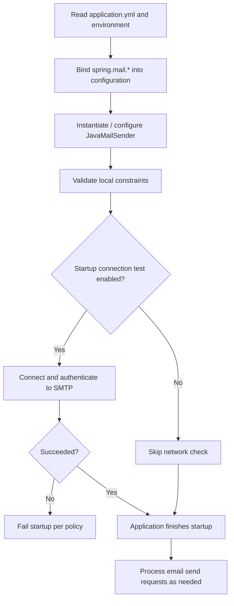

# Early Configuration Validation at Application Startup

A Spring Boot application may start normally, serve HTTP requests, and query the database, only to discover on the very first call to `JavaMailSender.send(...)` that the SMTP hostname is missing, the password is wrong, TLS is misconfigured, or timeouts are missing. If email functionality is critical for the application to operate, discovering the error late exposes users to failures before operations knows the system is unready.

**Early configuration validation at application startup** (*fail-fast mail configuration validation*) catches errors that can be identified upfront. In **Spring Framework Mail**, distinguish checking **in-app configuration values** from **testing an actual connection to the SMTP server**. Both steps provide different evidence and should be chosen based on how critical email is to the system.

This lesson focuses on configuring `JavaMailSender`—especially `JavaMailSenderImpl` and Spring Boot's support via `spring.mail.*`—while outlining the caveats to understand before deciding to block startup when SMTP is unavailable.

## 1. Why validate early?

Consider a service that sends a verification code when a user registers:

```text
Application starts at 09:00
    ↓
Health endpoint reports application ready
    ↓
09:15: user registers an account
    ↓
RegistrationService calls JavaMailSender.send(...)
    ↓
SMTP requires STARTTLS but config did not enable it
    ↓
Email send fails; user never receives the code
```

Connection, authentication, or TLS configuration bugs can exist **before the application receives its first request**. With proper checks during startup, the system can fail immediately upon deployment.

Common benefits:

- **Catch missing config:** hostname, `From` address, SMTP account, or environment variables not provided.
- **Catch invalid values:** out-of-range ports, malformed sender addresses, or missing paired parameters.
- **Catch connection errors early:** DNS fails to resolve, port is closed, TLS handshake fails, or auth fails during connection test.
- **Clear deployment feedback:** the application fails at startup rather than silently failing only after users start sending mail.
- **Separate failure causes:** distinguish static configuration bugs from downstream delivery errors that appear later.

However, not every application should treat SMTP as a hard requirement to run. If email is only an auxiliary feature, requiring a live SMTP connection at startup can take down the entire service during a brief mail provider outage. That is an **operational decision**, not a mandatory Spring Mail requirement.

## 2. Validation layers and what they prove

A validation sequence typically progresses from **cheap and local** to **network-dependent**:

| Layer | Example check | What it proves | What it does not prove |
|---|---|---|---|
| **Load and bind config** | Can `spring.mail.port` parse as an integer? | Config can be read and bound to expected types. | Whether the host exists or is reachable. |
| **Local constraints** | `app.mail.from` is non-blank and a valid email. | Business configuration rules are satisfied. | Whether SMTP allows sending from that address. |
| **Policy consistency** | If username/password auth is enabled, username and secret exist. | Parameter set is not missing app-required fields. | Whether username/password are actually valid. |
| **SMTP connection** | Open connection, run TLS/auth if configured. | Server is reachable and accepts connections per config at test time. | Whether sending a specific message will be accepted. |
| **Send test message** | Send to a dedicated test mailbox. | SMTP accepted the sample send operation. | Whether mail reached the Inbox or bypassed spam filters. |
| **Delivery tracking** | Read delivered/bounced events from provider. | Provides further evidence of delivery progress. | Whether the recipient actually opened and read the email. |

In practice, startup usually fits **the first three or four layers**. Sending real emails on every application startup can generate duplicate mail on every deploy, scale-out, or restart, consume quotas, and still not guarantee final delivery. When you need to test the full sending flow, run controlled integration tests.

### Two concepts to keep distinct

- **Local validation:** reading and checking configuration without touching the SMTP server—for instance, non-empty hostname, required account present, `From` matching policy.
- **Connection test:** attempting to open a session to the SMTP server. This catches DNS, timeout, TLS, and auth errors, yet reflects status only **at the moment of the connection attempt**.

A passing connection test **does not** guarantee later emails will be accepted by the server, relayed to target domains, or delivered to recipients' mailboxes.

## 3. How is Spring Boot configuration prepared during startup?

When using `spring-boot-starter-mail` with matching auto-configuration conditions, Spring Boot can create the `JavaMailSender` bean from `spring.mail.*`. A simplified lifecycle:



The diagram shows logical responsibilities. Exact ordering of bean creation, binding, callbacks, and runners depends on Spring Boot/Spring Framework configuration, yet the key point remains that **bean configuration happens before business email processing**.

A few easy misconceptions:

1. **Having a `JavaMailSender` bean does not mean SMTP connected successfully.** The sender may simply hold parameters to be used later when sending.
2. **Missing mail sender bean** may signal unmet auto-configuration conditions—e.g., no SMTP host configured and no custom sender provided by the app.
3. **Successful binding is not business validation.** A string shaped like an email address can still violate product rules.
4. **Connection tests do not replace sending.** A server may accept connections and auth yet reject `MAIL FROM`, `RCPT TO`, or `DATA` for a specific message.

## 4. Enabling connection testing with `spring.mail.test-connection`

Spring Boot provides the property:

```properties
spring.mail.test-connection=true
```

When the mail sender is auto-configured along a path supporting this feature, the property enables **testing connectivity to the mail server during startup**. For `JavaMailSenderImpl`, the corresponding operation calls `testConnection()` to open and close a transport connection.

Example SMTP submission config over port 587:

```yaml
spring:
  mail:
    host: ${SMTP_HOST}
    port: ${SMTP_PORT:587}
    username: ${SMTP_USERNAME}
    password: ${SMTP_PASSWORD}
    default-encoding: UTF-8

    # Check the mail server at startup:
    test-connection: true

    properties:
      "[mail.smtp.auth]": true
      "[mail.smtp.starttls.enable]": true
      "[mail.smtp.starttls.required]": true
      "[mail.smtp.connectiontimeout]": 5000
      "[mail.smtp.timeout]": 5000
      "[mail.smtp.writetimeout]": 5000

app:
  mail:
    from: no-reply@example.org
    reply-to: support@example.org
```

In this example:

- `SMTP_HOST`, `SMTP_PORT`, `SMTP_USERNAME`, and `SMTP_PASSWORD` come from environment variables or a secret store.
- `test-connection: true` requests a startup connection check when supported by Spring Boot auto-configuration.
- `mail.smtp.auth=true` requires authentication via a mechanism supported by the SMTP provider; the example assumes username/password.
- `mail.smtp.starttls.enable=true` enables upgrading to TLS when supported; `required=true` mandates STARTTLS.
- `mail.smtp.connectiontimeout` and `mail.smtp.timeout` limit connection setup and SMTP response reads; `writetimeout` limits socket writes when transmitting data.
- `app.mail.from` and `app.mail.reply-to` are **custom business properties**, not properties Spring Boot automatically applies as headers on every message.

**Note:** values like `smtp.example.org` or `no-reply@example.org` are placeholders; real apps must use the host, port, TLS mode, and sender identity required by their provider.

### What does `testConnection()` test?

On `JavaMailSenderImpl`, the check asks the transport to establish an SMTP connection using the sender's properties. Depending on configuration and supported mechanisms, this can include:

1. Resolving the hostname and opening a socket to the SMTP server.
2. Receiving the SMTP greeting and exchanging session initialization steps.
3. Establishing TLS or STARTTLS when configured.
4. Performing SMTP authentication if configured.
5. Closing the connection once the check succeeds.

It is **not** a full mail transaction with `MAIL FROM`, `RCPT TO`, and `DATA`, so it does not verify whether the sender address is permitted, whether recipients exist, or mail-service relay policies.

Therefore:

```text
testConnection() succeeds
  → SMTP connection works at startup time

testConnection() succeeds
  ≠ All future emails will send cleanly
  ≠ Emails will reach the recipient's Inbox
```

### Why configure timeouts before enabling startup tests?

If SMTP infrastructure stops responding, a connection check can **slow down or hang startup longer than expected** without finite wait limits. Setting timeouts is an essential part of a fail-fast policy.

Common SMTP timeout properties:

| Jakarta Mail property | Controls | Unit |
|---|---|---|
| `mail.smtp.connectiontimeout` | Time waiting to establish the TCP socket. | Milliseconds |
| `mail.smtp.timeout` | Time waiting to read replies from the socket. | Milliseconds |
| `mail.smtp.writetimeout` | Time waiting to write data over the socket. | Milliseconds |

For example, `5000` equals 5 seconds. That is illustrative only; a single test can involve **multiple network operations and handshakes**, so do not treat `connectiontimeout=5000` as a guarantee that the entire check completes in 5 seconds.

## 5. Connection testing alone is not enough: validate business config

Spring Boot knows `spring.mail.host`, yet it does not know which `From` address your app requires, whether `Reply-To` is needed, or which properties are mandatory for notification flows.

One approach is creating **typed configuration properties** combined with Bean Validation.

### 5.1. Declaring required application properties

```yaml
app:
  mail:
    from: no-reply@example.org
    reply-to: support@example.org
```

Define a record holding the settings:

```java
import jakarta.validation.constraints.Email;
import jakarta.validation.constraints.NotBlank;
import org.springframework.boot.context.properties.ConfigurationProperties;
import org.springframework.validation.annotation.Validated;

@Validated
@ConfigurationProperties(prefix = "app.mail")
public record MailIdentityProperties(
        @NotBlank @Email String from,
        @NotBlank @Email String replyTo
) {
}
```

Register the record for Spring Boot binding:

```java
import org.springframework.boot.SpringApplication;
import org.springframework.boot.autoconfigure.SpringBootApplication;
import org.springframework.boot.context.properties.ConfigurationPropertiesScan;

@SpringBootApplication
@ConfigurationPropertiesScan
public class MailApplication {
    public static void main(String[] args) {
        SpringApplication.run(MailApplication.class, args);
    }
}
```

When either value is missing or violates constraints, binding/validation can fail at startup pointing to the exact property. The example uses `@NotBlank` and `@Email` from **Jakarta Bean Validation**; a validation provider must be on the classpath, usually added in Spring Boot via `spring-boot-starter-validation`.

**`@Email` checks syntax per the Bean Validation provider; it does not verify that the mailbox exists or that the SMTP provider authorizes the sending domain.** Some uncommon RFC-valid address forms may need custom parsing rules.

### 5.2. When stricter address policy is required

For example, the product requires `From` to be **a standard plain ASCII mailbox**, forbidding multiple-recipient lists or display names inside the property:

```java
import jakarta.mail.internet.AddressException;
import jakarta.mail.internet.InternetAddress;

public final class MailAddressPolicy {
    private MailAddressPolicy() {}

    public static void requireOneMailbox(String value, String propertyName) {
        if (value == null || value.isBlank()) {
            throw new IllegalStateException(
                    propertyName + " must not be blank"
            );
        }

        if (value.indexOf('\r') >= 0 || value.indexOf('\n') >= 0) {
            throw new IllegalStateException(
                    propertyName + " contains a line break"
            );
        }

        try {
            InternetAddress[] parsed =
                    InternetAddress.parse(value, true);

            if (parsed.length != 1
                    || parsed[0].isGroup()
                    || parsed[0].getPersonal() != null) {
                throw new IllegalStateException(
                        propertyName + " must contain one mailbox address"
                );
            }

            parsed[0].validate();
        } catch (AddressException exception) {
            throw new IllegalStateException(
                    "Invalid email address in " + propertyName,
                    exception
            );
        }
    }
}
```

This method illustrates **a single-mailbox policy check**, not a universal validator for every internationalized email address. If the product only accepts common `local@domain` addresses, add explicit rules for supported characters/domains.

Never use these syntax checks to infer **sending authorization** or **deliverability**. A syntactically valid address can still be rejected by an SMTP provider due to an unverified domain or missing sender rights.

## 6. Adding a local startup validation step

When simple annotations are insufficient, run configuration validation inside a Spring bean. One way is using `InitializingBean`, invoked by Spring when initializing beans in the application context.

The example below checks **local configuration values** without touching the network. It targets an SMTP submission setup using **username/password**:

```java
import org.springframework.beans.factory.InitializingBean;
import org.springframework.boot.autoconfigure.mail.MailProperties;
import org.springframework.context.annotation.Bean;
import org.springframework.context.annotation.Configuration;

@Configuration
public class MailStartupCheckConfiguration {

    @Bean
    public InitializingBean verifyMailConfiguration(
            MailProperties smtp,
            MailIdentityProperties identity
    ) {
        return () -> {
            if (smtp.getHost() == null || smtp.getHost().isBlank()) {
                throw new IllegalStateException(
                        "Missing spring.mail.host"
                );
            }

            if (smtp.getPort() != null
                    && (smtp.getPort() < 1 || smtp.getPort() > 65535)) {
                throw new IllegalStateException(
                        "spring.mail.port must be between 1 and 65535"
                );
            }

            boolean smtpAuth = Boolean.parseBoolean(
                    smtp.getProperties()
                            .getOrDefault("mail.smtp.auth", "false")
            );

            if (smtpAuth && (isBlank(smtp.getUsername())
                    || isBlank(smtp.getPassword()))) {
                throw new IllegalStateException(
                        "SMTP auth is enabled but credentials are missing"
                );
            }

            MailAddressPolicy.requireOneMailbox(
                    identity.from(), "app.mail.from"
            );
            MailAddressPolicy.requireOneMailbox(
                    identity.replyTo(), "app.mail.reply-to"
            );
        };
    }

    private static boolean isBlank(String value) {
        return value == null || value.isBlank();
    }
}
```

Here, `MailProperties` is **Spring Boot's** configuration class bound from `spring.mail.*`. The example assumes mail auto-configuration is active and `MailIdentityProperties` is registered.

This validation step:

- Catches a missing hostname.
- Checks port bounds if supplied.
- Requires username and password when SMTP AUTH is configured for username/password mode.
- Validates sender and reply-to addresses against the single-mailbox policy.

It **does not touch SMTP**, so it catches many misconfigurations without depending on DNS, networks, or external services.

If a system uses an unauthenticated internal relay, OAuth2, or another login flow, adjust credential checks to match the actual contract. Never assume every SMTP server must have a username and password.

### Where should validation run?

Common mechanisms:

| Mechanism | When it runs | Best suited for |
|---|---|---|
| `@Validated` on `@ConfigurationProperties` | When Spring binds and validates config. | Required values, numeric ranges, string formats, and custom constraints. |
| `InitializingBean` / bean init method | During bean initialization phase. | Cross-property or cross-bean constraints. |
| `ApplicationRunner` / `CommandLineRunner` | After the application context initializes, during Boot runner execution. | Startup checks with custom logging/diagnostics before considering the app ready. |
| `spring.mail.test-connection` | In Spring Boot's startup connection test initialization path. | Fail-fast SMTP connection checks. |
| Health/readiness monitoring | Continuously during operation, not just at startup. | Detecting connectivity changes after the application is already running. |

If an `ApplicationRunner` throws an exception, Spring Boot treats startup as failed, though parts of the application context or web server may already have initialized beforehand. When the goal is **stopping as early as possible before accepting traffic**, combining bind/init-time validation with appropriate readiness probes gives tighter control.

## 7. Without Spring Boot auto-configuration

In plain Spring Framework apps, or when manually defining a sender bean and disabling/extending auto-configuration, never assume `spring.mail.test-connection=true` automatically tests a custom bean.

You can configure `JavaMailSenderImpl` directly:

```java
import java.util.Properties;
import org.springframework.context.annotation.Bean;
import org.springframework.context.annotation.Configuration;
import org.springframework.mail.javamail.JavaMailSenderImpl;

@Configuration
public class StandaloneMailConfiguration {

    @Bean
    public JavaMailSenderImpl mailSender() {
        JavaMailSenderImpl sender = new JavaMailSenderImpl();
        sender.setHost("smtp.example.net");
        sender.setPort(587);
        sender.setUsername(System.getenv("SMTP_USERNAME"));
        sender.setPassword(System.getenv("SMTP_PASSWORD"));
        sender.setDefaultEncoding("UTF-8");

        Properties options = sender.getJavaMailProperties();
        options.put("mail.smtp.auth", "true");
        options.put("mail.smtp.starttls.enable", "true");
        options.put("mail.smtp.starttls.required", "true");
        options.put("mail.smtp.connectiontimeout", "5000");
        options.put("mail.smtp.timeout", "5000");

        return sender;
    }
}
```

To **explicitly** check connectivity at startup, use a separate init callback:

```java
import jakarta.mail.MessagingException;
import org.springframework.beans.factory.InitializingBean;
import org.springframework.context.annotation.Bean;
import org.springframework.context.annotation.Configuration;
import org.springframework.mail.javamail.JavaMailSenderImpl;

@Configuration
public class MailConnectionValidation {

    @Bean
    public InitializingBean checkMailConnectionOnStartup(
            JavaMailSenderImpl mailSender
    ) {
        return () -> {
            try {
                mailSender.testConnection();
            } catch (MessagingException exception) {
                throw new IllegalStateException(
                        "SMTP connection check failed during startup",
                        exception
                );
            }
        };
    }
}
```

`testConnection()` is a method on `JavaMailSenderImpl`, **not on the `JavaMailSender` interface**. Thus the example injects the concrete implementation to invoke the check.

If the application already enables startup testing through Spring Boot, **do not add a duplicate manual check** producing the same result. Either way, verify the bean running the check is active in the intended configuration and environment.

The example uses `System.getenv(...)` for illustration; in real systems, inject properties via Spring's configuration mechanisms or a secret manager rather than hardcoding credentials.

## 8. What happens when a check fails?

Failures generally fall into one of these categories:

| Startup symptom | Likely cause | How to locate |
|---|---|---|
| Cannot bind `spring.mail.port` | Value cannot parse as an integer. | Check profile, environment, and YAML/properties. |
| `JavaMailSender` bean not found | Missing starter, unmet config condition, or custom bean not registered. | Check dependencies and auto-configuration setup. |
| `@NotBlank` on `app.mail.from` fails | Property missing or blank. | Check `app.mail` namespace and environment variables. |
| "Invalid email address" in local validator | Sender/reply-to address violates policy. | Fix config value; do not send test emails to check syntax. |
| DNS / UnknownHost | SMTP hostname cannot resolve in runtime environment. | Check hostname, DNS, internal network. |
| Connection refused / timeout | Wrong port, firewall, network, or server down. | Check TCP route, port, and timeouts. |
| TLS handshake / certificate error | TLS mode mismatch, invalid certificate, or truststore issue. | Check STARTTLS/implicit TLS, trust chain, and security policy. |
| Authentication failed | Wrong credentials, locked account, or server requires another auth method. | Check secrets, account rights, and supported auth mechanisms. |
| Connection test passes yet real send is rejected | Envelope sender, recipient, relay, quota, or message size policy. | Inspect SMTP replies at `MAIL FROM`, `RCPT TO`, `DATA`. |

When failing fast, startup exceptions are recorded by Spring Boot as **startup failures**. Emit helpful messages like "`Missing spring.mail.host`" or "`SMTP connection check failed during startup`" instead of dumping sensitive config values into logs.

In particular, never log passwords, access tokens, SMTP AUTH commands, or decrypted credential text. For operational support, log non-sensitive details like the missing property name, failure phase, exception class, allowed hostname/port, and protocol error code where available.

## 9. Distinguishing port 587 STARTTLS and port 465 implicit TLS

Two common ways to secure SMTP submission connections:

| Setup | Connection flow | Key note |
|---|---|---|
| **587 + STARTTLS** | Starts SMTP session, then upgrades to TLS via `STARTTLS`. | Use `mail.smtp.starttls.enable=true`, plus `required=true` if TLS is mandatory. |
| **465 + implicit TLS** | Establishes TLS immediately when the socket connects. | Typically uses `mail.smtp.ssl.enable=true` per provider config. |

Example when a service requires port 465:

```yaml
spring:
  mail:
    host: ${SMTP_HOST}
    port: 465
    username: ${SMTP_USERNAME}
    password: ${SMTP_PASSWORD}
    test-connection: true
    properties:
      "[mail.smtp.auth]": true
      "[mail.smtp.ssl.enable]": true
      "[mail.smtp.connectiontimeout]": 5000
      "[mail.smtp.timeout]": 5000
```

Never copy port 587's `STARTTLS` settings blindly onto a service requiring **implicit TLS**, or vice versa. If the TLS mode mismatches, connection tests fail even though both host and port exist.

**Disabling certificate checks or turning off TLS "to get past startup" is never the right fix.** Confirm the provider's connection rules and fix truststore/certificates or matching properties.

## 10. Should the application depend on SMTP at startup?

The decision depends on **how critical email is** and your sending architecture.

### When email is mandatory

For example, a dedicated email-sending service that cannot perform its core job without SMTP. You might choose to:

- Validate all required properties at bind time.
- Enable `spring.mail.test-connection=true` to catch connection errors at startup.
- Configure clear finite timeouts.
- Withhold readiness until mandatory startup checks pass.
- Continue monitoring mail provider health at runtime; one startup check does not replace ongoing monitoring.

When SMTP is unreachable, failing startup can match the SLA and deployment model of a dedicated mail service.

### When email is auxiliary

For example, an e-commerce app must still let users browse products and place orders while confirmation emails can go out asynchronously via a worker. Blocking the whole app because SMTP is briefly down widens the blast radius.

A better strategy is:

- Validate **local configuration** at startup.
- Use a durable queue or outbox for mail requests.
- Run sending workers with bounded retries and backoff.
- Monitor SMTP availability separately with metrics/alerts.
- Include SMTP dependency health only in readiness checks of components that strictly require SMTP to serve traffic.

**Startup validation is a failure-boundary decision.** Never tie the entire application's liveness to transient hiccups in an external service; doing so can trigger crash-restart loops whenever the mail provider blips.

## 11. How do early validation and health checks differ?

**Startup validation** runs while the application boots. It catches errors already present at deployment time.

**Health/readiness monitoring** observes service capability over time. It detects when an SMTP server goes down hours after the application started cleanly.

| Mechanism | When it helps | Risk if misused |
|---|---|---|
| Startup bind validation | Catches missing/invalid config right at deploy time. | If optional settings are marked mandatory, the app fails unnecessarily. |
| Startup SMTP connection test | Catches initial connection bugs when email is essential. | Transient provider outages can block rollouts or scale-outs. |
| Readiness check | Routes traffic only when an instance can handle essential work. | Tying overall app readiness to SMTP can disable unrelated features. |
| Liveness check | Detects wedged processes needing restart. | Restarting due to an external SMTP outage rarely fixes the SMTP server. |
| Metrics and alerts | Tracks send failures, latency, timeouts, and long-term delivery health. | Does not replace deploy-time configuration validation. |

With Spring Boot Actuator, you can design appropriate health/monitoring checks, yet **never assume a mail health indicator always exists automatically or behaves identically to `test-connection` in every setup**. Verify which health indicators are registered and what they actually check.

## 12. Why not send a test email on every startup?

An intuitive temptation is calling:

```java
mailSender.send(testMessage);
```

inside a startup runner. That approach has drawbacks:

1. **Creates side effects:** every restart, deployment, or scale-out sends another email.
2. **Time-limited validity:** one successful send does not guarantee the next one succeeds.
3. **Does not prove delivery:** SMTP returning `250` after `DATA` only confirms acceptance for processing; the mail can still bounce or hit spam filters.
4. **Pollutes operational data:** generates test clutter, burns quota, and risks confusion with real mail.
5. **Introduces new failure modes:** blocked test mailboxes, anti-spam rules, or external domain issues can fail startup even when production paths are fine.

To test the full mail pipeline, use **integration tests** with a test mailbox, mock SMTP server, or isolated test environment with clear test data and cleanup rules.

When the goal is "fail startup if SMTP cannot connect and authenticate," `testConnection()` or `spring.mail.test-connection` is far better scoped than sending a real email.

## 13. Different configurations for development, test, and production

Not every environment shares the same SMTP connectivity requirements.

Example in `application.yml`:

```yaml
spring:
  mail:
    default-encoding: UTF-8
    properties:
      "[mail.smtp.connectiontimeout]": 5000
      "[mail.smtp.timeout]": 5000
      "[mail.smtp.writetimeout]": 5000
```

A development profile can point to a local mail catcher:

```yaml
# application-dev.yml
spring:
  mail:
    host: localhost
    port: 1025
    test-connection: false
```

A production profile may require startup verification:

```yaml
# application-prod.yml
spring:
  mail:
    host: ${SMTP_HOST}
    port: ${SMTP_PORT:587}
    username: ${SMTP_USERNAME}
    password: ${SMTP_PASSWORD}
    test-connection: true
    properties:
      "[mail.smtp.auth]": true
      "[mail.smtp.starttls.enable]": true
      "[mail.smtp.starttls.required]": true
```

This only illustrates separation. **Actual rules must match each environment's purpose.** If production uses an outbox and email is not mandatory to serve web traffic, keeping `test-connection=false` at startup while monitoring worker health and SMTP alerts separately can still be the better choice.

In automated tests, avoid forcing test suites to depend on the Internet or public mail services. Use a local mock SMTP server like GreenMail/Mailpit for integration tests, or test doubles of `JavaMailSender` for offline business logic tests.

## 14. Combining validation with runtime error handling

Even with startup validation enabled, the application **still must handle runtime sending failures**. Mail providers can lose connectivity, change policies, lock accounts, or hit quotas after deployment.

Illustrative example:

```java
import org.springframework.mail.MailException;
import org.springframework.mail.javamail.JavaMailSender;
import jakarta.mail.internet.MimeMessage;

public final class MailDispatcher {
    private final JavaMailSender sender;

    public MailDispatcher(JavaMailSender sender) {
        this.sender = sender;
    }

    public void dispatch(MimeMessage message) {
        try {
            sender.send(message);
        } catch (MailException ex) {
            // Record business state and appropriate failure cause.
            // Choose retry / backoff strategy per error type.
            throw ex;
        }
    }
}
```

This shows the boundary between sending and catching errors, not a complete retry system. For high-reliability apps:

- Persist send requests via **a durable queue or transactional outbox**.
- Track states such as *pending*, *attempted*, *SMTP accepted*, and *failed* under an explicit contract.
- Distinguish transient errors from configuration or permanent errors.
- Avoid unbounded retries and account for duplicate risk when SMTP outcomes are uncertain.
- Collect metrics on latency, send counts, and error classes; alert when failure rates climb.
- Track delivery/bounce events separately where supported by the provider.

This makes startup validation and runtime resilience **complement each other**: startup catches initial mistakes, while runtime handling absorbs real-world operational shifts.

## 15. Example deployment workflow

A dedicated notification service might deploy through these stages:

```text
CI / config check
    │
    └── Verify syntax of required properties
              │
              ▼
Spring Boot startup
    │
    ├── Bind spring.mail.*
    ├── Validate app.mail.from and app.mail.reply-to
    ├── Initialize JavaMailSenderImpl
    └── test-connection=true
              │
              ├── fails → report startup failure
              │
              └── succeeds → application ready
                                   │
                                   ▼
                             Mail worker processes queue
                                   │
                             JavaMailSender.send(...)
                                   │
                         ┌─────────┴─────────┐
                         ▼                   ▼
                      Accepted             Failed
                         │                   │
                         ▼                   ▼
                   Track relay          Retry / error handling
                   and delivery
```

### Scenario A: missing SMTP host

The app lacks `SMTP_HOST`. If YAML references this variable as required and resolution finds no value, startup can fail right during config load/bind. If the host is blank, a custom validator catches it. Never assume auto-configuration builds a valid sender when `spring.mail.host` is missing.

### Scenario B: host exists yet password is wrong

Config binds and local validation succeeds. With `test-connection=true`, connecting to SMTP fails at the AUTH step. Fix this by checking secrets, account policies, or login mechanisms—not by editing email content.

### Scenario C: connection test succeeds yet sending is rejected

The app starts up, yet `send(...)` is rejected by the SMTP server because `From` is unverified, the account cannot relay to external domains, or quota is exceeded. This occurs during **the actual sending transaction**; a connection test lacks enough context to detect it.

### Scenario D: SMTP goes down after startup

The app passed startup checks earlier. An hour later, the provider hits a network outage. Rely on runtime monitoring, timeouts, retries, and queues to recover or alert; startup tests cannot predict later outages.

## 16. Common misconceptions

| Misconception | Correct understanding |
|---|---|
| "Spring Boot creating a `JavaMailSender` bean means SMTP login succeeded." | The sender bean may only hold settings; it usually connects only on send or when connection testing is enabled. |
| "`spring.mail.test-connection=true` sends an email to an Inbox." | This property runs **a connection check**, not a real email send. |
| "A passing connection test proves `From` is accepted." | SMTP can still reject the envelope, recipients, or body during a subsequent send transaction. |
| "`@Email` validation proves the mailbox exists." | It only checks syntax per the validator; it performs no DNS, SMTP, or ownership verification. |
| "A missing password must always fail." | Some internal relays do not require username/password; match the actual authentication contract. |
| "No timeouts needed because the check runs once." | Connect/TLS/Auth can stall or hang; timeouts bound waiting. |
| "If SMTP is unreachable, the entire app must fail startup." | This depends on business criticality; some systems should keep running and queue emails. |
| "Mail server was healthy at startup, so runtime needs no error handling." | Networks and server policies can change at any moment. |
| "Protocol debug must be enabled to check credentials." | Protocol-level debug risks leaking secrets; prefer logging safe causes and metadata. |

## 17. Takeaways

To design early mail configuration validation, decide **what can be verified locally**, **when a real SMTP check is needed**, and **which failures must mark the application unready**.

- Use **`@ConfigurationProperties` with `@Validated`** to validate business properties Spring does not automatically understand, such as required `From` or `Reply-To` addresses.
- Use **`spring.mail.test-connection=true`** in Spring Boot when you want a startup SMTP check and auto-configuration supports it.
- With manual sender configuration, **`JavaMailSenderImpl.testConnection()`** allows explicitly checking connectivity in an init callback.
- Configure **`mail.smtp.connectiontimeout`**, **`mail.smtp.timeout`**, and consider `mail.smtp.writetimeout` to prevent indefinite waits.
- **Connection success does not equal email send or delivery success.** `MAIL FROM`/`RCPT TO`/`DATA` transactions and delivery tracking remain separate concerns.
- Decide startup-failure behavior based on **email's role in the system**, avoiding letting transient SMTP blips take down unrelated features.
- Maintain **runtime error handling, queues/retries, and monitoring** even when startup validation is enabled.

A reliable email-sending application catches **foreseeable misconfigurations** as early as possible while still handling **network faults and SMTP changes after startup**. That is the true purpose of early configuration validation in Spring Framework Mail.
