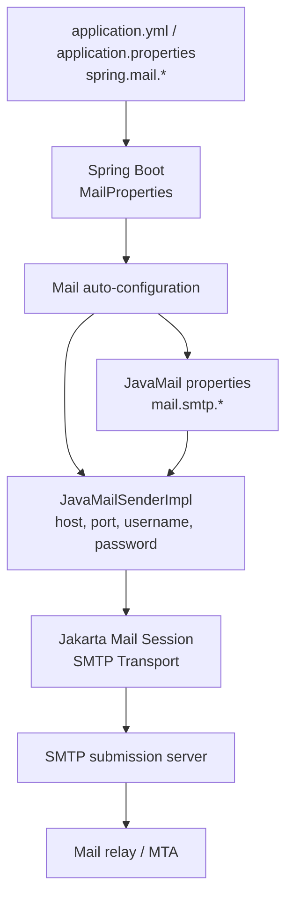

# `spring.mail.properties.*`: Passing properties to Jakarta Mail in Spring Boot

When sending email with Spring Boot, an application usually configures only `spring.mail.host`, `spring.mail.port`, `spring.mail.username`, and `spring.mail.password`. But SMTP has many more behaviors that need to be controlled: **SMTP AUTH, STARTTLS, implicit TLS, connection timeouts, read/write timeouts, the envelope sender address, and authentication mechanisms**. Not all of these settings have a dedicated `spring.mail.*` property. Instead, Spring Boot provides a configuration namespace:

```properties
spring.mail.properties.*
```

Its purpose is to **pass Jakarta Mail properties into the `JavaMailSenderImpl`/mail `Session`**. For example, when you configure:

```properties
spring.mail.properties[mail.smtp.starttls.enable]=true
```

Spring Boot puts the key `mail.smtp.starttls.enable` with the value `true` into Jakarta Mail's properties set. When the SMTP transport runs, it interprets this key itself to decide whether to require upgrading the connection with STARTTLS.

The most important point: **Spring Boot is responsible for binding and passing along the configuration; the Jakarta Mail SMTP provider is responsible for understanding the `mail.smtp.*` keys**. Misspelling a property name may not cause an error right when the application starts, but the SMTP behavior will not be as expected.

## 1. Where `spring.mail.properties.*` sits in the system

A typical email-sending flow:



The responsibilities to distinguish:

1. **Spring Boot externalized configuration** reads YAML, `.properties`, environment variables, or other configuration sources, then binds them into `MailProperties`.
2. **Mail auto-configuration** can create a `JavaMailSenderImpl` when the application has the appropriate dependencies and configuration conditions, and there is no sender bean supplied by the application yet.
3. **`JavaMailSenderImpl`** holds the SMTP endpoint, the login information, and the `javaMailProperties`; it is the Jakarta Mail-based implementation class of `JavaMailSender`.
4. **The Jakarta Mail `Session` and SMTP transport** receive the properties to decide how to connect, authenticate, encrypt, and communicate with the server.
5. **The SMTP server** is what decides whether to support, require, or reject each SMTP behavior according to actual policy.

`spring.mail.properties.*` is not a separate Spring protocol, nor a set of environment variables sent straight to the SMTP server. It is an **internal configuration pathway** from Spring Boot to the mail library running inside the JVM.

### An example distinguishing the two layers

| Property | Which layer? | Purpose |
| --- | --- | --- |
| `spring.mail.host` | Spring Boot | Specifies the SMTP host the sender connects to |
| `spring.mail.port` | Spring Boot | Specifies the SMTP port |
| `spring.mail.username` | Spring Boot | Supplies the account for the sender |
| `spring.mail.password` | Spring Boot | Supplies the login secret for the sender |
| `spring.mail.protocol` | Spring Boot | Chooses the transport protocol, usually `smtp` |
| `spring.mail.default-encoding` | Spring Boot | The default encoding used when creating messages |
| `spring.mail.test-connection` | Spring Boot | Requests a mail connection test at initialization via Boot's mechanism |
| **`spring.mail.properties[mail.smtp.auth]`** | Boot passes it down to Jakarta Mail | Enables the SMTP AUTH mechanism |
| **`spring.mail.properties[mail.smtp.starttls.enable]`** | Boot passes it down to Jakarta Mail | Allows STARTTLS |
| **`spring.mail.properties[mail.smtp.timeout]`** | Boot passes it down to Jakarta Mail | Limits the time spent reading SMTP responses |

Do not write `spring.mail.auth=true` expecting Spring Boot to understand it as the command to enable SMTP AUTH, because the property the SMTP provider uses is **`mail.smtp.auth`**, and it needs to be placed in the `spring.mail.properties` namespace.

## 2. Spring Boot example: Configuring SMTP on port 587

To use mail auto-configuration in a Spring Boot application:

```groovy
// build.gradle
dependencies {
    implementation 'org.springframework.boot:spring-boot-starter-mail'
}
```

An `application.yml` example for SMTP submission using STARTTLS:

```yaml
spring:
  mail:
    host: smtp.provider.example
    port: 587
    protocol: smtp
    username: ${SMTP_USERNAME}
    password: ${SMTP_PASSWORD}
    default-encoding: UTF-8
    properties:
      "[mail.smtp.auth]": "true"
      "[mail.smtp.starttls.enable]": "true"
      "[mail.smtp.starttls.required]": "true"
      "[mail.smtp.ssl.checkserveridentity]": "true"
      "[mail.smtp.connectiontimeout]": "5000"
      "[mail.smtp.timeout]": "10000"
      "[mail.smtp.writetimeout]": "10000"
```

In this example:

- `host` and `port` point to the **SMTP submission server**, not each recipient's MX.
- `username` and `password` are taken from the runtime environment's secret configuration.
- `mail.smtp.auth=true` requires the SMTP transport to use authentication.
- `mail.smtp.starttls.enable=true` allows upgrading SMTP to TLS.
- `mail.smtp.starttls.required=true` requires STARTTLS to be supported, avoiding silently continuing to send unencrypted when the server does not offer STARTTLS.
- `mail.smtp.ssl.checkserveridentity=true` requires verifying the server name in the TLS certificate.
- The three timeout values are in **milliseconds (ms)**.

The keys in square brackets `"[mail.smtp.*]"` are the explicit notation when configuring a Spring Boot `Map<String, String>` in YAML. The square brackets preserve the **key name with its dots intact**; the double quotes are the YAML syntax so that a key containing `[` and `]` is parsed correctly.

In `MailProperties`, the `properties` part is a string map. Therefore you can use string values such as `"true"` and `"5000"`. Jakarta Mail interprets the corresponding value according to the meaning of each key.

### The same configuration in `application.properties`

```properties
spring.mail.host=smtp.provider.example
spring.mail.port=587
spring.mail.protocol=smtp
spring.mail.username=${SMTP_USERNAME}
spring.mail.password=${SMTP_PASSWORD}
spring.mail.default-encoding=UTF-8

spring.mail.properties[mail.smtp.auth]=true
spring.mail.properties[mail.smtp.starttls.enable]=true
spring.mail.properties[mail.smtp.starttls.required]=true
spring.mail.properties[mail.smtp.ssl.checkserveridentity]=true
spring.mail.properties[mail.smtp.connectiontimeout]=5000
spring.mail.properties[mail.smtp.timeout]=10000
spring.mail.properties[mail.smtp.writetimeout]=10000
```

Both examples aim to produce the same Jakarta Mail keys:

```properties
mail.smtp.auth=true
mail.smtp.starttls.enable=true
mail.smtp.starttls.required=true
mail.smtp.ssl.checkserveridentity=true
mail.smtp.connectiontimeout=5000
mail.smtp.timeout=10000
mail.smtp.writetimeout=10000
```

This is the **form of properties passed to Jakarta Mail**, not lines that must be declared independently at the root level of a Spring Boot configuration file.

## 3. Why can YAML be written in several forms?

Spring Boot supports binding rules from configuration sources into a `Map`. With a key like `mail.smtp.timeout`, developers may come across several ways of presenting it, for example:

```yaml
# Way 1: declare the key with dots and explicit square brackets.
spring:
  mail:
    properties:
      "[mail.smtp.timeout]": "10000"
```

or:

```yaml
# Way 2: express it with nested levels.
spring:
  mail:
    properties:
      mail:
        smtp:
          timeout: "10000"
```

Nested structures may be flattened into property names by Spring Boot's binder; however, preserving the dots and special characters of a **map key** needs to be understood according to the binding rules of the Boot version in use. With `spring.mail.properties` and Jakarta Mail keys with full names, **way 1 expresses the intent more directly**: the key is expected to be exactly `mail.smtp.timeout`.

In a `.properties` file, another common form is:

```properties
spring.mail.properties.mail.smtp.timeout=10000
```

Because `spring.mail.properties` is a string map, the key inside is usually assembled into `mail.smtp.timeout`. Even so, the square-bracket form `spring.mail.properties[mail.smtp.timeout]` describes the map key boundary clearly and helps avoid mistaking `mail.smtp.timeout` for an object-level string that Spring Boot would have to predefine.

### Which configuration belongs to Jakarta Mail?

Not every key placed under `spring.mail.properties` is recognized by the SMTP transport. For example:

```yaml
spring:
  mail:
    properties:
      "[mail.smtp.timeout]": "10000"     # The SMTP provider knows this key.
      "[mail.smtp.randomFlag]": "hello" # Not a standard key for configuring SMTP timeout.
```

Spring Boot can put both strings into the map, but the SMTP provider **does not necessarily understand or warn** about `mail.smtp.randomFlag`. Therefore typos such as `mail.smtp.starttls.enabel` can cause the feature not to be enabled as expected, even though the YAML is valid and the application still starts.

## 4. Catalog of commonly used SMTP properties

The keys below belong to the Jakarta Mail SMTP transport; when declaring them through Spring Boot, you need to add the `spring.mail.properties` prefix as shown above.

| Jakarta Mail key | Effect | Example value |
| --- | --- | --- |
| `mail.smtp.auth` | Makes the SMTP transport perform authentication when connecting | `true` |
| `mail.smtp.starttls.enable` | Allows upgrading the connection via the STARTTLS command | `true` |
| `mail.smtp.starttls.required` | Does not continue if STARTTLS cannot be used | `true` |
| `mail.smtp.ssl.enable` | Uses TLS right from the start of the connection (implicit TLS) | `true` |
| `mail.smtp.ssl.checkserveridentity` | Verifies the hostname identity in the TLS certificate | `true` |
| `mail.smtp.connectiontimeout` | Timeout when opening the TCP connection, in ms | `5000` |
| `mail.smtp.timeout` | Timeout when reading from the SMTP socket, in ms | `10000` |
| `mail.smtp.writetimeout` | Timeout when writing to the SMTP socket, in ms | `10000` |
| `mail.smtp.from` | Chooses the envelope sender (`MAIL FROM`) if the transport supports it | `bounces@shop.example` |
| `mail.smtp.auth.mechanisms` | Restricts/selects the SMTP AUTH mechanisms | `XOAUTH2` where the provider supports it |
| `mail.smtp.sendpartial` | Depending on transport policy, allows sending to accepted recipients even if other recipients are rejected | `true` or `false` |
| `mail.smtp.localhost` | The client name used in `EHLO`/HELO in some transport configurations | `app.shop.example` |
| `mail.smtp.quitwait` | Whether to wait for the response to `QUIT` before closing the connection | `true` or `false` |

These properties only take effect **when the specific SMTP transport recognizes them**. Many applications only need a small set: AUTH, STARTTLS/TLS, and timeouts. Features such as `sendpartial` or choosing an AUTH mechanism need a clear need because they change behavior when errors occur.

### `connectiontimeout`, `timeout`, `writetimeout` are different

```text
Application ── TCP connect ──> SMTP server
          ^ connectiontimeout

Application <── SMTP response ── SMTP server
          ^ timeout (reading data)

Application ── write DATA ──> SMTP server
          ^ writetimeout (writing data)
```

- **`mail.smtp.connectiontimeout`** limits the time spent waiting for the network connection to be established.
- **`mail.smtp.timeout`** limits the time spent waiting for data from the socket, for example the server's response.
- **`mail.smtp.writetimeout`** limits the time an SMTP write operation can be stuck.

They are timeouts **at the transport layer**, not a commitment that the entire `mailSender.send()` call finishes within a fixed total time. The time may include DNS, multiple connections, SMTP commands, and other mechanisms; several different timeouts may occur at different steps.

Many versions of the SMTP provider have defaults that do not set strict timeouts. Therefore, declaring finite values is a useful operational measure if the application needs to avoid requests/workers hanging for too long. Choose timeouts based on the network, message size, and the SMTP provider's capabilities; setting them too low can cause false timeouts, especially when attaching large files.

### `mail.smtp.from` differs from the `From:` header

Example:

```yaml
spring:
  mail:
    properties:
      "[mail.smtp.from]": "bounces@shop.example"
```

The application can still set the header:

```java
helper.setFrom("orders@shop.example");
```

When the transport uses `mail.smtp.from`, the `MAIL FROM` command may use `bounces@shop.example`, while the user sees `From: orders@shop.example`. This serves **collecting DSNs/bounces**. Do not write a `Return-Path:` header yourself to replace the envelope configuration; the SMTP provider may also record the envelope sender according to its own policy.

## 5. STARTTLS on 587 and implicit TLS on 465

A common mistake is to use `mail.smtp.starttls.enable` and `mail.smtp.ssl.enable` as if they had the same effect. Both relate to TLS but **TLS begins at different moments**.

### Port 587: SMTP submission with STARTTLS

```yaml
spring:
  mail:
    host: smtp.provider.example
    port: 587
    properties:
      "[mail.smtp.auth]": "true"
      "[mail.smtp.starttls.enable]": "true"
      "[mail.smtp.starttls.required]": "true"
      "[mail.smtp.ssl.checkserveridentity]": "true"
```

On port 587, the client usually connects over SMTP first, uses `EHLO` to learn whether the server supports `STARTTLS`, sends `STARTTLS`, performs the TLS handshake, and then sends `EHLO` again. Setting `required=true` is appropriate when the policy requires that **credentials and email must not be sent if STARTTLS is unavailable**.

### Port 465: SMTP submission over implicit TLS

```yaml
spring:
  mail:
    host: smtp.provider.example
    port: 465
    properties:
      "[mail.smtp.auth]": "true"
      "[mail.smtp.ssl.enable]": "true"
      "[mail.smtp.ssl.checkserveridentity]": "true"
```

On port 465, the client performs the TLS handshake **right from the start**. You should not just change the port from 587 to 465 while keeping the STARTTLS mechanism without configuring the corresponding implicit TLS.

| Criterion | Submission 587 | Submission 465 |
| --- | --- | --- |
| Common TLS mechanism | STARTTLS | Implicit TLS |
| Key properties | `mail.smtp.starttls.enable`, `required` | `mail.smtp.ssl.enable` |
| SMTP AUTH | Usually needed, depends on the provider | Usually needed, depends on the provider |
| Certificate verification | Need to verify the correct server/certificate | Need to verify the correct server/certificate |

Prioritize the provider's official SMTP documentation for the host, port, protection type, AUTH mechanism, and sender policy. `mail.smtp.ssl.trust=*` or turning off hostname verification to mask TLS errors is a dangerous measure because it can make the application trust a spoofed server.

## 6. SMTP AUTH and the difference between credentials and transport configuration

Spring Boot normally uses:

```yaml
spring:
  mail:
    username: ${SMTP_USERNAME}
    password: ${SMTP_PASSWORD}
    properties:
      "[mail.smtp.auth]": "true"
```

`spring.mail.username` and `spring.mail.password` only **supply the login data**. The `mail.smtp.auth=true` key is what requires the SMTP transport to perform the authentication step. If AUTH is missing while the server requires it, the sending side may get an error such as `530 Authentication required` when trying to submit mail.

The following pieces of information are not the same:

| Concept | Example | Meaning |
| --- | --- | --- |
| SMTP username | `service-mail-42` | The account used in AUTH |
| SMTP password/token | secret at runtime | The credential used in AUTH |
| `From:` header | `billing@shop.example` | The displayed sender address |
| SMTP envelope `MAIL FROM` | `bounces@shop.example` | The reverse-path address of the transaction |
| `Reply-To:` | `support@shop.example` | The address suggested for the user to reply to |

A successful SMTP AUTH only tells you the account **was authenticated by the server**. It does not mean the provider allows the use of any `From:` address, or that the recipient will accept the mail. If the server returns `553 Sender not authorized` after AUTH, you need to check sending permission and the verified domain rather than rushing to conclude the password is wrong.

### When the provider uses OAuth2/XOAUTH2

In some infrastructures, traditional passwords are not allowed for SMTP AUTH. When the provider and the Jakarta Mail SMTP transport support SASL XOAUTH2, you may need:

```yaml
spring:
  mail:
    username: ${SMTP_USERNAME}
    password: ${SMTP_ACCESS_TOKEN}
    properties:
      "[mail.smtp.auth]": "true"
      "[mail.smtp.auth.mechanisms]": "XOAUTH2"
```

This is an **illustration of the SMTP transport configuration part**, not the whole OAuth2 solution. The access token must be issued for the correct identity, scope, and audience, be refreshed before it expires, and be protected as a secret. With a long-lived singleton sender, you cannot assume a static token in `spring.mail.password` remains valid forever. Do not force XOAUTH2 if the SMTP provider does not support it.

## 7. Reading back the configuration passed down to Jakarta Mail

After the Spring Boot application has initialized the `JavaMailSenderImpl`, you can inspect the properties stored by the sender to help with diagnosis. An illustrative example:

```java
import java.util.Properties;

import org.springframework.mail.javamail.JavaMailSenderImpl;

public final class SmtpConfigurationInspector {

    private SmtpConfigurationInspector() {
    }

    public static void printSafeTransportSummary(JavaMailSenderImpl sender) {
        Properties props = sender.getJavaMailProperties();

        System.out.println("host=" + sender.getHost());
        System.out.println("port=" + sender.getPort());
        System.out.println("protocol=" + sender.getProtocol());
        System.out.println("smtp.auth=" + props.getProperty("mail.smtp.auth"));
        System.out.println(
                "smtp.starttls.enable=" +
                props.getProperty("mail.smtp.starttls.enable"));
        System.out.println(
                "smtp.timeout=" + props.getProperty("mail.smtp.timeout"));

        // Deliberately do not print sender.getPassword() or the entire Properties.
    }
}
```

The function above is only an **example of manual observation in a development environment**; you should not repeatedly print configuration logs in production. If you need to check, choose only keys that do not contain credentials or tokens. Do not log the entire `spring.mail.properties` map because the application may put sensitive information into other properties.

If you want to observe the bean created by Spring Boot, you can inject `JavaMailSender` and check the implementation type:

```java
import org.springframework.mail.javamail.JavaMailSender;
import org.springframework.mail.javamail.JavaMailSenderImpl;

public class MailInfo {
    public static boolean usesJakartaSender(JavaMailSender sender) {
        return sender instanceof JavaMailSenderImpl;
    }
}
```

In an application with a custom sender, multiple beans, or a JNDI mail session, you should not assert that Boot created a `JavaMailSenderImpl` from YAML without checking the actual configuration. The auto-configuration conditions may no longer hold once a mail sender bean has been declared manually.

### Comparison with plain `JavaMailSenderImpl` configuration

If you do not use Spring Boot auto-configuration, developers can configure Jakarta Mail properties directly:

```java
import java.util.Properties;

import org.springframework.mail.javamail.JavaMailSenderImpl;

JavaMailSenderImpl sender = new JavaMailSenderImpl();
sender.setHost("smtp.provider.example");
sender.setPort(587);
sender.setUsername(smtpUsername); // Taken from runtime secret/config
sender.setPassword(smtpPassword);

Properties props = new Properties();
props.put("mail.smtp.auth", "true");
props.put("mail.smtp.starttls.enable", "true");
props.put("mail.smtp.starttls.required", "true");
props.put("mail.smtp.ssl.checkserveridentity", "true");
props.put("mail.smtp.connectiontimeout", "5000");
props.put("mail.smtp.timeout", "10000");
props.put("mail.smtp.writetimeout", "10000");
sender.setJavaMailProperties(props);
```

Here `smtpUsername` and `smtpPassword` are variables the application has already obtained from a secure configuration source; the example is an initialization snippet in a context where the variables are available, not a standalone Java class. It shows that `spring.mail.properties.*` essentially helps you **avoid manually writing the `props.put(...)` lines** when using Spring Boot.

## 8. Sending email from a service: how do the properties have an effect?

A business service may not need to know directly about `mail.smtp.starttls.enable` or `mail.smtp.timeout`. It just uses `JavaMailSender`:

```java
package com.example.mail;

import org.springframework.beans.factory.annotation.Value;
import org.springframework.mail.SimpleMailMessage;
import org.springframework.mail.javamail.JavaMailSender;
import org.springframework.stereotype.Service;

@Service
public class OrderMailService {

    private final JavaMailSender mailSender;
    private final String fromAddress;

    public OrderMailService(
            JavaMailSender mailSender,
            @Value("${app.mail.from}") String fromAddress) {
        this.mailSender = mailSender;
        this.fromAddress = fromAddress;
    }

    public void sendReadyNotification(String recipient, String orderId) {
        SimpleMailMessage message = new SimpleMailMessage();
        message.setFrom(fromAddress);
        message.setTo(recipient);
        message.setSubject("Order " + orderId + " is ready");
        message.setText("Your order " + orderId + " is ready for pickup.");
        mailSender.send(message);
    }
}
```

And the application configuration:

```yaml
app:
  mail:
    from: notifications@shop.example
```

When `mailSender.send(...)` is called:

1. The sender uses the `host`, `port`, `username`, and `password` that Spring has configured.
2. The SMTP transport reads the `mail.smtp.*` properties from the mail `Session` to decide how to connect, TLS, AUTH, and timeouts.
3. The message is submitted over SMTP; the server may accept or reject the commands.
4. After the relay accepts it, forwarding to the receiving server may continue asynchronously across MTAs.

The settings in `spring.mail.properties.*` affect the **connection and the sending transaction**; they do not change the default body content to HTML, do not turn a `SimpleMailMessage` into a MIME attachment, and do not guarantee delivery to the inbox. For HTML/attachments, use `MimeMessage`/`MimeMessageHelper`, but still with the same transport properties.

## 9. `spring.mail.test-connection`: what does it verify?

Spring Boot has the property:

```yaml
spring:
  mail:
    test-connection: true
```

When mail connection validation is configured and the auto-configuration conditions match, Boot tries to check the mail connection when the application starts. This can help detect early that the host/port, connection, TLS, or authentication is not working.

However:

- The connection check **does not send a real email to the recipient's mailbox**.
- A successful check does not guarantee that the `From:` header, permission to send to a domain, or content policy will be accepted in the `MAIL FROM`, `RCPT TO`, and `DATA` transactions.
- A temporary network/SMTP provider incident at startup may prevent the application from starting as desired when the check is enabled.
- When the application uses a custom mail sender/Session, the result depends on how the bean and auto-configuration are set up.

In a development environment or a system that requires confirming the mail relay before serving business functions, this feature can be useful. For a system where email is only a secondary feature, consider the consequence of turning the SMTP state at startup into a startup condition for the whole application.

## 10. Common errors when passing Jakarta Mail properties

### 10.1. Placing the property at the wrong level

```yaml
# Wrong intent: this is not the JavaMail Session configuration via Boot.
spring:
  mail:
    smtp:
      auth: true
```

To pass the key `mail.smtp.auth` to Jakarta Mail:

```yaml
spring:
  mail:
    properties:
      "[mail.smtp.auth]": "true"
```

If `properties` is missing, the SMTP transport very likely does not have `mail.smtp.auth=true` as expected. When the server requires AUTH, the application may encounter an authentication error or have the relay rejected.

### 10.2. Missing the `mail.smtp.` prefix

```yaml
# Not the key name the SMTP transport expects.
spring:
  mail:
    properties:
      "[smtp.starttls.enable]": "true"
```

`mail.smtp.starttls.enable` is needed:

```yaml
spring:
  mail:
    properties:
      "[mail.smtp.starttls.enable]": "true"
```

Spring Boot does not automatically add `mail.` to arbitrary keys inside the map.

### 10.3. Changing the port but keeping the same TLS type

For example switching from 587 to 465 while still enabling only STARTTLS:

```yaml
spring:
  mail:
    port: 465
    properties:
      "[mail.smtp.starttls.enable]": "true"
```

If the 465 server requires implicit TLS, use `mail.smtp.ssl.enable=true` according to the provider's documentation. A handshake/timeout error from mixing up the TLS mode does not mean the username/password is wrong.

### 10.4. `starttls.enable=true` but TLS not required

If `mail.smtp.starttls.required` is not enabled, the transport may continue connecting without TLS when the server does not advertise STARTTLS, depending on the library and the session state. For a submission carrying credentials, **requiring TLS** and verifying the server identity is a requirement to consider according to the security policy.

### 10.5. Not declaring timeouts

Leaving the defaults can make a send command wait a very long time when the server or network has a problem. You should declare appropriate connection, read, and write limits. Note that timeouts in JavaMail are in **ms**, not seconds.

### 10.6. Confusing `mail.smtp.from` with `spring.mail.username`

`mail.smtp.from` chooses the reverse-path for the SMTP transaction; `spring.mail.username` is the SMTP AUTH login identity. The two values may differ. `mail.smtp.from` does not automatically change the `From:` header the application sets through `helper.setFrom(...)`.

### 10.7. Declaring `mail.smtps.*` but still using the `smtp` protocol

Jakarta Mail has sets of properties tied to the transport protocol. For example, many `mail.smtp.*` properties apply to the `smtp` protocol; when using the `smtps` protocol, the corresponding properties may live under `mail.smtps.*`. For an ordinary Spring Boot application, keeping `spring.mail.protocol=smtp` and using `mail.smtp.ssl.enable=true` on port 465 is the common way to configure implicit TLS.

Do not switch `spring.mail.protocol` to `smtps` on your own and then assume all the `mail.smtp.*` keys still apply identically. You need consistent configuration according to the SMTP provider and the transport in use.

### 10.8. Creating a `JavaMailSender` bean manually and assuming Boot still applies every property

When the application declares its own `JavaMailSender`, Spring Boot's mail auto-configuration may not create the default sender. The `spring.mail.*` properties are therefore not necessarily applied to a hand-written bean.

If you manage the `JavaMailSenderImpl` yourself, configure the host, port, username, password, and JavaMail Properties fully for that bean; or use Boot auto-configuration when it fits. When debugging, check the actual sender that is injected, not just the YAML.

### 10.9. Putting secret values in `spring.mail.properties` and then dumping the whole map

Some providers have additional properties that contain access information. Even if they are bound validly, printing all of `getJavaMailProperties()` or enabling deep debug can leak credentials/tokens. Log only the necessary technical parameters, mask secrets, and restrict who can view the logs.

## 11. Diagnosis by SMTP stage

Errors when sending mail can arise at many layers. The following table helps link symptoms to the configuration you should check:

| Symptom | Property/point to inspect | Reason |
| --- | --- | --- |
| `Connection refused` | `spring.mail.host`, `port`, network/firewall | TCP could not be established, has not reached AUTH |
| Connection hangs for a long time | `mail.smtp.connectiontimeout`, `timeout`, `writetimeout` | Limits may be missing at the connect/read/write step |
| TLS handshake/PKIX failure | STARTTLS/implicit TLS mode, certificate, and hostname | Wrong port/TLS or invalid certificate chain |
| Server does not support STARTTLS | `mail.smtp.starttls.enable`, `required` | If TLS is required, sending must stop instead of downgrading |
| `530 Authentication required` | `mail.smtp.auth`, username/password | AUTH may not have been performed before the send command |
| `535 5.7.x` | Credentials, AUTH mechanism, account policy | AUTH was rejected by the server |
| AUTH passes but `553 Sender unauthorized` | `From:`, envelope sender, domain permission | The account is authenticated but not permitted to send from that address |
| `550` at `RCPT TO` | Recipient, relay permission, destination policy | Not a YAML syntax error or a default timeout |
| `552` when sending content | Message size and server policy | The MIME/attachment may be too large |
| `send()` succeeds but a bounce occurs later | Relay/DSN/provider event | The error appears at a hop after the application has already submitted |

Common Spring exceptions:

- `MailAuthenticationException`: an error recorded at the mail authentication step.
- `MailSendException`: an error while performing the send, which may include an SMTP reply, network, TLS, timeout, or many other causes.
- `MailParseException`: a problem creating/parsing the content or email addresses.

Do not infer that every `MailSendException` means the password is wrong, nor that every `5xx` means the SMTP server is down. When you need precise classification, look at the cause chain, the SMTP code (if any), the rejected command, and the provider's logs.

### Controlled debug enabling

Jakarta Mail can output debug information through `mail.debug`, for example:

```yaml
# Only consider in a controlled diagnostic environment.
spring:
  mail:
    properties:
      "[mail.debug]": "true"
```

Debug can help you see the SMTP communication, but it can also put hostnames, usernames, recipient addresses, or content related to the sending session into logs. Some detailed trace modes even risk exposing AUTH information. Enable it only within a controlled scope, do not share raw logs before removing sensitive information, and **do not log passwords or access tokens**.

For TLS errors, do not fix them by turning off certificate verification or setting trust-all. You need to identify the actual server, the certificate chain, and how TLS is set up per port.

## 12. Per-environment configuration and secret management

Development, testing, and production environments may use different SMTP endpoints. `spring.mail.properties.*` lets each environment choose the right transport behavior without modifying the mail-sending logic.

Example of splitting configuration:

```yaml
# application.yml: common configuration.
spring:
  mail:
    default-encoding: UTF-8
    properties:
      "[mail.smtp.connectiontimeout]": "5000"
      "[mail.smtp.timeout]": "10000"
      "[mail.smtp.writetimeout]": "10000"
```

```yaml
# application-prod.yml: secure submission.
spring:
  mail:
    host: smtp.provider.example
    port: 587
    username: ${SMTP_USERNAME}
    password: ${SMTP_PASSWORD}
    properties:
      "[mail.smtp.auth]": "true"
      "[mail.smtp.starttls.enable]": "true"
      "[mail.smtp.starttls.required]": "true"
      "[mail.smtp.ssl.checkserveridentity]": "true"
```

Note that configuration in a profile can **override** values in the common profile; when using multiple property sources, check the precedence order and the effective values. Specific map keys are bound according to the order of the configuration sources. Do not treat any single profile file as the sole evidence if environment variables, command-line args, or a secret store override it.

In local development you can use an SMTP capture/test server (for example a dedicated endpoint at `localhost:1025`) if the system provides one; that environment may not need AUTH or TLS. Such a configuration only suits a test server managed by the team and **does not apply to public SMTP**.

### Principles for protecting sensitive information

1. Do not commit the SMTP password, app password, or OAuth token into `application.yml`, documents, or screenshots.
2. Store secrets in the environment/secret manager managed by access permissions.
3. Separate test and production credentials; use a service account with the necessary permissions.
4. When rotating secrets, confirm that the instances are using the new version before revoking the old credential.
5. Do not put `spring.mail.password` or all of `spring.mail.properties` into exception messages returned externally.
6. Observe quota, AUTH errors, and sending limits to detect misconfiguration or signs of abuse.

## 13. Three illustrative scenarios

### Scenario A: Username/password set but the server still says "Authentication required"

The application configuration:

```yaml
spring:
  mail:
    host: smtp.provider.example
    port: 587
    username: ${SMTP_USERNAME}
    password: ${SMTP_PASSWORD}
```

If the SMTP transport does not have AUTH enabled appropriately and the server requires authentication, it may refuse to send mail with `530 Authentication required`. You need to add `spring.mail.properties[mail.smtp.auth]=true`, combined with STARTTLS/TLS as the provider requires. Do not just change `From:` or increase the timeout.

### Scenario B: Sending works on 587 but fails immediately when switching to 465

After changing `spring.mail.port: 465`, the application keeps `mail.smtp.starttls.enable=true` and does not enable implicit TLS. The 465 server may be waiting for the TLS handshake as soon as the TCP connection is made, while the client is waiting for the SMTP banner. The result is a timeout or a protocol error.

The solution is to use the 465 configuration with `mail.smtp.ssl.enable=true` and verify the certificate, or go back to port 587 with STARTTLS per the provider's configuration.

### Scenario C: The application starts normally but hangs when sending

A missing timeout can make a send call wait a very long time when the network/server does not respond. Setting limits for connect/read/write in `spring.mail.properties` gives the application an error signal instead of waiting indefinitely according to the transport's behavior.

After a timeout occurs, the system needs to decide on a careful retry: if the timeout happens **after the server has finished receiving `DATA`** but before the client sees the response, the mail delivery status may be unknown. Resending the same notification immediately risks creating duplicate mail; you should use a queue/correlation ID and provider events when available.

## 14. Self-check questions

**1. Is `spring.mail.properties.*` a separate set of SMTP properties defined by Spring Framework?**

No. It is the configuration channel through which Spring Boot passes the appropriate keys down to the Jakarta Mail `Session`/SMTP transport. The `mail.smtp.*` property names and their meaning are defined by the Jakarta Mail SMTP provider.

**2. Why does `spring.mail.properties[mail.smtp.timeout]` have square brackets?**

To make clear that `mail.smtp.timeout` is **a complete key in the map** `spring.mail.properties`, with the dots preserved in the key.

**3. Does `spring.mail.password` automatically replace `mail.smtp.auth=true`?**

You should not assume so. The username/password supply the credentials; `mail.smtp.auth=true` controls whether the SMTP transport uses authentication.

**4. Why must you use `mail.smtp.starttls.required=true` if you want to enforce TLS on port 587?**

Because `starttls.enable` allows upgrading when supported; `required` adds the requirement not to continue when STARTTLS is unavailable according to the transport mechanism.

**5. To use port 465, is it enough to just change `spring.mail.port`?**

No. If the 465 endpoint uses implicit TLS, you must configure `mail.smtp.ssl.enable=true` and verify the server via TLS.

**6. Why can a typo such as `mail.smtp.starttls.enabel` be hard to detect?**

Because Boot can put any string into the map; the SMTP provider does not necessarily report an error for an unknown key. Use the exact key name and confirm the actual sending behavior.

**7. Does `mail.smtp.from` automatically change the `From:` the recipient sees?**

No. It affects the SMTP transport's envelope sender when supported; the `From:` header is separate content of the email.

**8. Does `spring.mail.test-connection=true` guarantee the email reaches the inbox?**

No. It is a test of the sender's connection, not a confirmation of final mail delivery or of the destination domain's anti-spam.

**9. Should you leave `mail.debug=true` on permanently in production?**

No. Enable it only when there is a diagnostic need and with log control, because metadata and sensitive data may be recorded.

## Conclusion

`spring.mail.properties.*` is the **configuration bridge between Spring Boot and Jakarta Mail**: Spring Boot reads the key/value pairs and passes them to the `JavaMailSenderImpl`/`Session`, while the SMTP transport interprets keys such as `mail.smtp.auth`, `mail.smtp.starttls.enable`, `mail.smtp.ssl.enable`, and `mail.smtp.timeout`. Use the exact key names, choose the right TLS mode for port 587 or 465, configure finite timeouts, protect the username/password/token, and check the actual sender when there is a custom bean. Accurate configuration helps the application connect and submit mail more safely; whether the email reaches the inbox still depends on the relay, the destination MTA, and the receiving policy.
