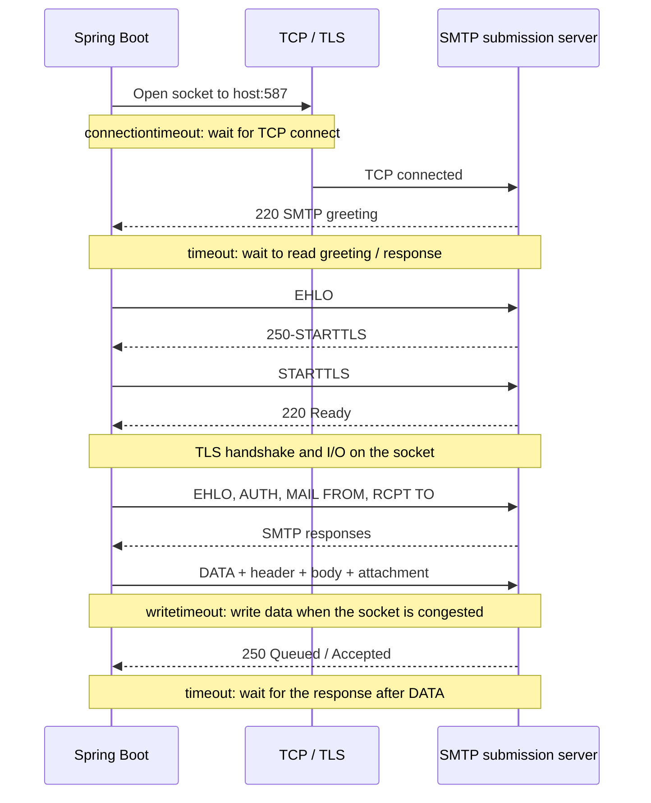
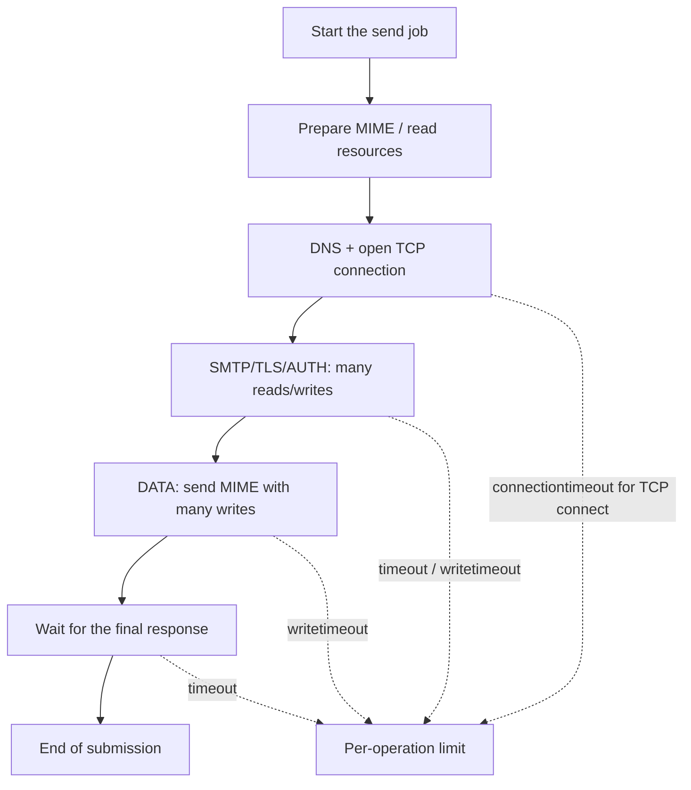
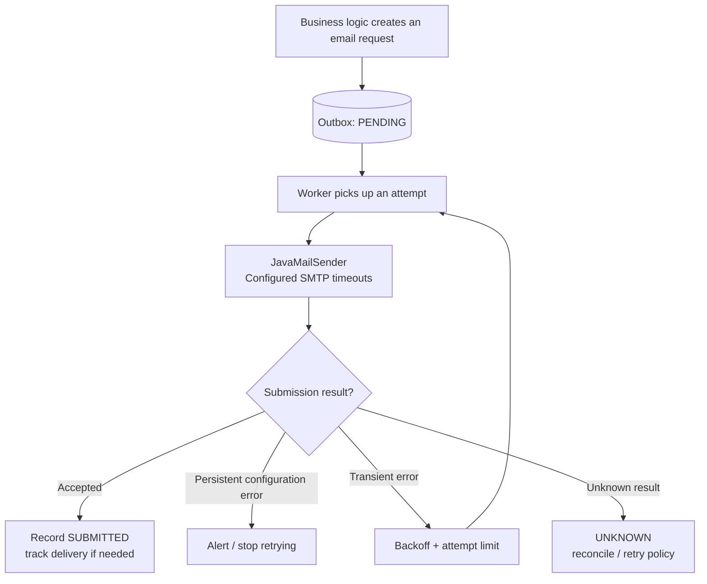

# Configuring timeouts through the mail.smtp.* properties

A Spring Boot service sends an order confirmation email with `JavaMailSender.send(...)`. When the SMTP server is slow to respond or the network connection is interrupted, the call can hang for a very long time. If the send operation is running directly inside an HTTP request, the user waits; if it runs in a worker, a stuck send task can hold a thread and make the notification queue grow longer and longer.

To limit the wait time at the network communication layer, the **Jakarta Mail SMTP transport** provides three important properties:

- **`mail.smtp.connectiontimeout`**: limits the time spent waiting to establish the TCP connection.
- **`mail.smtp.timeout`**: limits the time spent waiting to read data from the SMTP connection.
- **`mail.smtp.writetimeout`**: limits the time a write operation to the connection can be blocked.

In **Spring Framework Mail**, these properties are passed into Jakarta Mail through the `spring.mail.properties` configuration or `JavaMailSenderImpl.getJavaMailProperties()`. They solve **different** problems: you may be able to connect but not receive a response, or you may be able to read responses fine but get stuck while transmitting an email with a large attachment.

This lesson explains the exact meaning of each timeout, how to configure them in Spring Boot, the differences between `smtp` and `smtps`, how to choose values per environment, how to recognize errors, and the limits to keep in mind when sending email in a production system.

## 1. Where do timeouts sit in the email-sending flow?

Suppose the application uses SMTP submission on port 587 with STARTTLS:



In a single send, the application may go through **many reads and writes**, not just one single network operation. Therefore a 10-second timeout **does not mean the entire email will definitely finish sending in 10 seconds**.

### Distinguishing three questions

| Practical question | Related property | Example |
|---|---|---|
| “Can the TCP connection to the SMTP server be opened?” | `mail.smtp.connectiontimeout` | A firewall silently drops TCP packets; the connection never completes. |
| “Already connected, will the server send the next response?” | `mail.smtp.timeout` | The server accepts the connection but does not answer `EHLO` or `DATA`. |
| “The application is sending data, can the socket keep writing?” | `mail.smtp.writetimeout` | The network path is congested, the server stops reading data, the send buffer is full. |

**The unit of all three properties is milliseconds (ms).** A value of `5000` means **5 seconds**, not 5 minutes. In the common Jakarta Mail SMTP transport implementation, timeouts that are not configured default to **waiting indefinitely**; that is why you should set explicit values when the application requires a bounded wait time.

## 2. `mail.smtp.connectiontimeout`: waiting to establish a connection

### 2.1. When it applies

`mail.smtp.connectiontimeout` controls the wait time when the transport tries to **open the TCP connection** to the SMTP host and port.

Example:

```properties
mail.smtp.connectiontimeout=5000
```

If the connection does not complete within the allowed time, the socket layer may raise an exception such as `SocketTimeoutException: Connect timed out`, which is then wrapped in a Jakarta Mail and Spring Mail exception.

Commonly related scenarios:

- The connection passes through a firewall or network ACL that is dropping packets.
- The destination IP address does not respond.
- The network route or the SMTP endpoint is having problems.
- The mail provider cannot accept new connections in a timely manner.

### 2.2. What it does not limit

The connection timeout is **not**:

- A limit on the total time to send an email.
- The time spent waiting for the SMTP `220` banner **after the TCP has connected**.
- The time to upload the body or attachments to the server.
- The time the provider takes to transfer mail from the SMTP submission to the recipient's mailbox.

**DNS resolution** may also occur before the socket connects. Depending on the JVM, operating system, resolver, and network, the domain-name resolution time is not necessarily subject to the exact `connectiontimeout` limit. If the application needs an **end-to-end deadline**, it must manage time at the workflow layer in addition to the transport timeouts.

### 2.3. Connection refused is not the same as connect timeout

Suppose the application connects to `smtp.example.com:587`:

- **Connection refused**: the destination device or network rejects the connection relatively quickly. This may be because no process is listening on the port, a firewall actively refuses, or the endpoint is wrong.
- **Connection timed out**: the connection request does not complete within the wait time.

Both are errors where a connection cannot be opened, but the investigation directions differ. You should not treat every `MailSendException` as “the SMTP server responds slowly”.

## 3. `mail.smtp.timeout`: waiting to read the SMTP response

### 3.1. A successful TCP connection does not mean SMTP is working

An SMTP server may accept TCP but be slow to send:

```text
Client: TCP connected
Server: [does not send the 220 greeting for a long time]
```

Or the server responds to the initial commands but gets stuck after `DATA`:

```text
C: DATA
S: 354 Start mail input
C: [header, body and MIME attachment]
C: .
S: [does not send 250 or an SMTP error]
```

`mail.smtp.timeout` applies to **read operations on the socket**; for a Java socket, this is the kind of limit corresponding to `SO_TIMEOUT`. If, within the allowed time, there is no data to read that is needed for the operation to continue, the read call may fail due to a timeout.

```properties
mail.smtp.timeout=10000
```

This example allows waiting up to about 10 seconds for **a blocked read operation**, not a 10-second clock for the whole SMTP transaction.

### 3.2. Stages that may be affected

- Waiting for the SMTP `220` greeting after the socket has opened.
- Waiting for `250` after `EHLO`.
- Waiting for the response to `STARTTLS` and the related I/O operations.
- Waiting for the response after the SMTP AUTH authentication step.
- Waiting for the `MAIL FROM`, `RCPT TO`, `DATA`, or end-of-data response.
- Waiting for the server's final answer after the MIME part has been sent.

In some TLS connections, the handshake or TLS communication also needs to read data from the socket. The timeout configuration may affect those steps, but **you should not claim `mail.smtp.timeout` is an absolute deadline for the whole TLS handshake**; the socket implementation, the JVM, and the provider still play a role.

### 3.3. Why can the total time still be greater than the read timeout?

Suppose `mail.smtp.timeout=10000` and the server takes 8 seconds to answer each command:

```text
EHLO       : 8 seconds
STARTTLS   : 8 seconds
2nd EHLO   : 8 seconds
AUTH       : 8 seconds
MAIL FROM  : 8 seconds
RCPT TO    : 8 seconds
DATA       : 8 seconds
Final 250  : 8 seconds
```

Each read has data before the 10-second limit, so **the total session can exceed one minute** without any read timeout error. This is the reason to distinguish the **per-operation timeout** from the **deadline for the whole job**.

## 4. `mail.smtp.writetimeout`: waiting to write data to the connection

### 4.1. When is a write operation blocked?

An email is not just a few lines of text. An HTML email can carry many MIME parts, inline images, and PDFs, and after base64 encoding the size can increase significantly. When the client sends a large amount of data, the socket layer can block if:

- The server stops or slows down reading.
- The transmission path is congested and the TCP send buffer is full.
- The network between the application and the server becomes unstable.
- An intermediate device obstructs the data transmission.

```properties
mail.smtp.writetimeout=10000
```

This property targets the **wait time when writing to the socket**, not the permitted file size, a minimum transfer rate, or a countdown clock for the entire email.

### 4.2. A notable implementation mechanism

With the common Jakarta Mail/Angus Mail SMTP provider, the write timeout is implemented by **scheduling the socket to be closed if the write operation does not complete on time**. This implementation may use a `ScheduledExecutorService` or a per-connection thread, creating an **additional resource cost** when the number of concurrent connections is large.

Practical consequences:

1. You should not leave `writetimeout` infinite in a system at risk of prolonged network congestion.
2. You should not set it so low that a legitimate write on a slow connection is cancelled.
3. When sending hundreds of emails in parallel, you need to consider the **worker pool, connection limits, and thread resources** at the same time; a timeout does not replace a concurrency limit.
4. A socket closed due to a write timeout may appear as a `SocketException` or a wrapped I/O error, not necessarily with an easily recognizable `Write timed out` string.

### 4.3. There is no guaranteed sending speed

Suppose an email has a 15 MiB attachment, sent over a very slow connection, but each small write operation still completes within the limit. `writetimeout` may not occur even though **the entire transfer takes many minutes**. It does not enforce a policy like “the email must complete in 30 seconds”.

To limit the **total time of the task**, the application needs its own deadline and cancel/reconcile policy. When a task is cancelled externally, you also must not assume the SMTP command has been rolled back; the server may have already accepted the email before the client stopped waiting.

## 5. Configuring the three timeouts in Spring Boot

### 5.1. Dependency and basic configuration

With Spring Boot using Gradle:

```groovy
dependencies {
    implementation 'org.springframework.boot:spring-boot-starter-mail'
}
```

An `application.yml` example for SMTP submission on port **587 + STARTTLS**:

```yaml
spring:
  mail:
    host: ${MAIL_HOST}
    port: 587
    protocol: smtp
    username: ${MAIL_USERNAME}
    password: ${MAIL_PASSWORD}
    default-encoding: UTF-8
    properties:
      "[mail.smtp.auth]": true
      "[mail.smtp.starttls.enable]": true
      "[mail.smtp.starttls.required]": true
      "[mail.smtp.ssl.checkserveridentity]": true
      "[mail.smtp.connectiontimeout]": 5000
      "[mail.smtp.timeout]": 10000
      "[mail.smtp.writetimeout]": 10000
```

Here:

- `spring.mail.host`, `port`, `username`, `password`, and `protocol` configure the sender created by Spring Boot.
- **`spring.mail.properties`** is the map that holds the properties Spring Boot passes to Jakarta Mail.
- The square brackets around the **`[mail.smtp.*]`** keys are the Spring Boot Binder syntax for map keys that need to keep their dots. When using YAML, the key is placed in double quotes as in the example.
- `5000` is 5 seconds; `10000` is 10 seconds.
- `mail.smtp.starttls.required=true` requires the TLS upgrade to succeed before sending continues.
- `mail.smtp.ssl.checkserveridentity=true` requires checking the TLS identity against the hostname.

These are **illustrative values**; they are not Spring Boot defaults or limits that every SMTP provider requires.

The environment variables `MAIL_HOST`, `MAIL_USERNAME`, and `MAIL_PASSWORD` must be supplied in the runtime environment. Passwords or authentication tokens should not be hardcoded in the repository, Java source, or logs. Use the exact SMTP AUTH mechanism the provider supports.

### 5.2. Nested YAML configuration

Another commonly seen way of writing it:

```yaml
spring:
  mail:
    properties:
      mail:
        smtp:
          connectiontimeout: 5000
          timeout: 10000
          writetimeout: 10000
```

In Spring Boot, what you need to achieve is that the final properties map contains **exactly the three Jakarta Mail keys**:

```properties
mail.smtp.connectiontimeout=5000
mail.smtp.timeout=10000
mail.smtp.writetimeout=10000
```

Using **bracketed map keys** as in the first example makes the meaning of each key clear, especially when the project has many configuration levels. Do not mistakenly write `spring.mail.connectiontimeout`, `spring.mail.timeout`, or `spring.mail.writetimeout` and assume these are standard Spring Boot configurations.

### 5.3. Configuration through `application.properties`

With a properties file:

```properties
spring.mail.host=${MAIL_HOST}
spring.mail.port=587
spring.mail.protocol=smtp
spring.mail.username=${MAIL_USERNAME}
spring.mail.password=${MAIL_PASSWORD}
spring.mail.properties.mail.smtp.auth=true
spring.mail.properties.mail.smtp.starttls.enable=true
spring.mail.properties.mail.smtp.starttls.required=true
spring.mail.properties.mail.smtp.ssl.checkserveridentity=true
spring.mail.properties.mail.smtp.connectiontimeout=5000
spring.mail.properties.mail.smtp.timeout=10000
spring.mail.properties.mail.smtp.writetimeout=10000
```

In a `.properties` file, the syntax is expressed directly with dots. In YAML, to avoid confusing map keys when the dots need to be preserved, you should use the `"[mail.smtp.timeout]"` form as in the `application.yml` example above.

### 5.4. Not an HTTP, database, or scheduler timeout

The three properties above are timeouts **at the SMTP transport**:

| Configuration | Scope |
|---|---|
| `mail.smtp.connectiontimeout` | Socket connect to the SMTP host. |
| `mail.smtp.timeout` | Socket read in the SMTP session. |
| `mail.smtp.writetimeout` | Socket write in the SMTP session. |
| `spring.mvc.async.request-timeout` | Asynchronous request handling in some Spring MVC contexts; does not directly set the SMTP socket timeout. |
| `spring.transaction.default-timeout` | Transaction timeout managed by the transaction manager; does not replace the SMTP socket timeout. |
| Timeout on an HTTP client | Calls to an HTTP API/webhook, does not govern the Jakarta Mail SMTP transport. |

You should not only configure a timeout for the HTTP request and assume that the thread calling `JavaMailSender.send(...)` has definitely stopped writing data to the SMTP socket when the request expires.

## 6. `smtp`, `smtps`, and the timeout namespace

Timeouts need to be attached to the correct **Jakarta Mail transport** in use.

### 6.1. `protocol=smtp` with STARTTLS on 587

```yaml
spring:
  mail:
    protocol: smtp
    port: 587
    properties:
      "[mail.smtp.starttls.enable]": true
      "[mail.smtp.starttls.required]": true
      "[mail.smtp.connectiontimeout]": 5000
      "[mail.smtp.timeout]": 10000
      "[mail.smtp.writetimeout]": 10000
```

This is the common style for an SMTP submission service.

### 6.2. `protocol=smtp` with implicit TLS on 465

The transport is still `smtp`, but TLS is required as soon as the connection is opened:

```yaml
spring:
  mail:
    protocol: smtp
    port: 465
    properties:
      "[mail.smtp.ssl.enable]": true
      "[mail.smtp.ssl.checkserveridentity]": true
      "[mail.smtp.connectiontimeout]": 5000
      "[mail.smtp.timeout]": 10000
      "[mail.smtp.writetimeout]": 10000
```

Because the transport name is still `smtp`, **the timeout prefix remains `mail.smtp.*`**. You need to declare AUTH/credentials additionally if the server requires them.

### 6.3. `protocol=smtps` with implicit TLS on 465

Another option is to use the `smtps` transport:

```yaml
spring:
  mail:
    protocol: smtps
    port: 465
    properties:
      "[mail.smtps.auth]": true
      "[mail.smtps.ssl.checkserveridentity]": true
      "[mail.smtps.connectiontimeout]": 5000
      "[mail.smtps.timeout]": 10000
      "[mail.smtps.writetimeout]": 10000
```

Here, **`mail.smtp.timeout` is not the timeout key that the `smtps` transport looks for**. When changing `spring.mail.protocol` from `smtp` to `smtps`, you must cross-check the properties against the corresponding **`mail.smtps.*`**; avoid the case where the configuration looks complete but the transport still uses default values.

| Transport | Example port | Security | Timeout namespace |
|---|---:|---|---|
| `smtp` | 587 | STARTTLS | `mail.smtp.*` |
| `smtp` | 465 | Implicit TLS if `ssl.enable` is set | `mail.smtp.*` |
| `smtps` | 465 | Implicit TLS | `mail.smtps.*` |
| `smtp` | 1025 | Plain TCP on an isolated SMTP catcher | `mail.smtp.*` |

The port number **does not by itself decide** the property prefix: the prefix depends on the **transport name**, while the TLS mechanism depends on both the transport and the server's properties/port.

## 7. Configuring timeouts with JavaMailSenderImpl

In most Spring Boot applications, using `spring.mail.properties` is enough. When you have to configure the sender in Java, you can set the properties through `JavaMailSenderImpl`.

```java
import java.util.Properties;

import org.springframework.mail.javamail.JavaMailSenderImpl;

public final class MailSenderFactory {

    private MailSenderFactory() {}

    public static JavaMailSenderImpl createStartTlsSender(
            String host,
            String username,
            String password) {

        JavaMailSenderImpl sender = new JavaMailSenderImpl();
        sender.setHost(host);
        sender.setPort(587);
        sender.setProtocol("smtp");
        sender.setUsername(username);
        sender.setPassword(password);
        sender.setDefaultEncoding("UTF-8");

        Properties props = sender.getJavaMailProperties();
        props.put("mail.smtp.auth", "true");
        props.put("mail.smtp.starttls.enable", "true");
        props.put("mail.smtp.starttls.required", "true");
        props.put("mail.smtp.ssl.checkserveridentity", "true");

        props.put("mail.smtp.connectiontimeout", "5000");
        props.put("mail.smtp.timeout", "10000");
        props.put("mail.smtp.writetimeout", "10000");

        return sender;
    }
}
```

In JavaMail `Properties`, a `String` value is the clear choice for representing transport configuration. Spring Boot will bind properties from YAML/properties automatically when using auto-configuration; there is no need to write this factory just to set three timeouts.

If the application declares its own `JavaMailSender` bean, Spring Boot may **no longer create the default bean**. In that case the application must ensure the self-created sender has the full host, protocol, TLS, AUTH, charset, and timeouts. Avoid creating multiple senders and assuming the `spring.mail.*` configuration is definitely applied to all of them.

### Sending email from a service

```java
import org.springframework.mail.SimpleMailMessage;
import org.springframework.mail.javamail.JavaMailSender;
import org.springframework.stereotype.Service;

@Service
public class NotificationMailService {

    private final JavaMailSender mailSender;

    public NotificationMailService(JavaMailSender mailSender) {
        this.mailSender = mailSender;
    }

    public void sendReceipt(String recipient, String orderId) {
        SimpleMailMessage message = new SimpleMailMessage();
        message.setFrom("orders@example.com");
        message.setTo(recipient);
        message.setSubject("Order confirmation " + orderId);
        message.setText("Order " + orderId + " has been recorded.");

        mailSender.send(message);
    }
}
```

**The sending service does not need to read timeouts from YAML or call `Thread.sleep`.** The timeouts take effect at the Jakarta Mail transport layer beneath `JavaMailSender`. Separating the transport configuration from the content logic makes it possible to change the sending environment without modifying business code.

## 8. How should timeout values be chosen?

There is no single triple of numbers that is right for every system. The appropriate timeout depends on:

- Network latency from the application to the SMTP server.
- Whether the SMTP server is on the same internal network, in the same cloud region, or at an external provider.
- The actual load of the sending system, the number of concurrent connections, and the sending frequency.
- Whether the email is short text or has many MIME parts/large attachments.
- The SLA of the user or the worker.
- How the application retries, queues, and tracks status.

### Illustrative configurations

| Environment | Connect | Read | Write | Interpretation |
|---|---:|---:|---:|---|
| Local with an SMTP catcher on the same machine | 2,000 ms | 5,000 ms | 5,000 ms | Helps quickly detect a wrong local configuration or an SMTP catcher that is not running. |
| Staging connecting to an external provider | 5,000 ms | 10,000 ms | 10,000 ms | A starting level for observing latency in integration testing. |
| Production sending small transactional email | 5,000 ms | 10,000–20,000 ms | 10,000–20,000 ms | Must be measured in practice before being fixed into an SLA. |
| Production with large attachments | Depends on network distance | Depends on SMTP responses | Consider wider values per the transmission path characteristics | Need to look at message limits and traffic, not just raise timeouts. |

The numbers in the table are **illustrative suggestions**, not defaults from RFCs, Spring Boot, Jakarta Mail, or the requirements of a specific SMTP provider.

### 8.1. Do not set timeouts too small

A value of `mail.smtp.timeout=500` may be fine in a deliberate failure test but can very easily make real SMTP fail when the network has latency or the provider is under high load. A timeout that is too short creates:

- Many false errors because valid operations have not yet completed.
- Increased retries that make congestion worse.
- The risk of **duplicate sending** when the server has accepted the mail but the application loses the connection before reading the response.
- Difficulty distinguishing a transient network incident from a business-data error.

### 8.2. Do not set timeouts too large

A timeout that is too large can hold the application's threads for a long time when the server/network has a problem. If the application sends directly inside an HTTP request, the user waits; if in a worker, stuck tasks can occupy all available workers.

A practical solution is to combine **bounded network timeouts + a job queue + a concurrency limit + conditional retry**, rather than just picking one extremely large number to avoid every error.

### 8.3. User processing time differs from mail processing time

Suppose the account-registration API needs to respond within 1 second but sending the email may take 15 seconds. You should not force the SMTP timeout to 1 second just to try to make the mail operation “keep up” with the HTTP request. An appropriate design may be:

1. Save the registration data and the intent to send email in the same durable process.
2. Return the business result to the user per the SLA.
3. A worker processes the email through `JavaMailSender` with appropriate timeouts.
4. Record errors and retry per policy, updating the delivery status if needed.

That is the difference between the **HTTP request SLA** and the **SMTP communication policy**.

## 9. A timeout is not the maximum total time of `send()`

This is the most important limit to understand:

> **The three `mail.smtp.*timeout` properties do not create a single deadline for the entire email-sending call.**

Suppose:

```text
connectiontimeout =  5 seconds
timeout           = 10 seconds
writetimeout      = 10 seconds
```

You cannot infer:

```text
Total send time <= 5 + 10 + 10 = 25 seconds   (WRONG)
```

Because:

1. There are **many reads** of SMTP responses.
2. There are **many writes**, especially with large attachments.
3. DNS lookup, TLS handshake, MIME creation, and file reading can each contribute their own time.
4. Some operations progress slowly but still complete each time within the limit.
5. The OS/JVM layer, the socket, and the provider may behave differently in error situations.

A more accurate model:



If you need a business deadline, you can set a **processing deadline for the job** outside the SMTP transport. But be aware that **cancelling a `Future` or interrupting a thread does not necessarily immediately close a blocked socket**. And when the job expires, the sending status may be **unknown**, because the SMTP server has received the mail but the application has not yet seen `250`. Retry design must account for that possibility.

## 10. How do timeouts affect business correctness?

### 10.1. Errors before the server accepts the mail

For example `connectiontimeout` occurs before the TCP socket can be opened. The application has no evidence that the server has received the email; the system may treat this as a failed connection attempt and retry per operational rules.

However, do not equate every timeout with a connect timeout: for an error **reading the response** after the `DATA` part has been sent, the situation is entirely different.

### 10.2. A read error after DATA has been fully sent

```text
Client -> Server: DATA
Server -> Client: 354 Start mail input
Client -> Server: [sends the entire MIME message]
Client -> Server: .
Server: received it and put the mail into the queue
Client: did not receive the 250 response due to a network timeout
```

The application may encounter `SocketTimeoutException: Read timed out` but **the email has actually been accepted by the server**. Resending the whole email immediately may cause the recipient to see two copies.

This is the **ambiguous submission** problem: the client has not been able to determine the final result of the send. You need to:

- Store the `attemptId`, `notificationId`, and the send time.
- Record a classification of `UNKNOWN` or `SUBMISSION_UNCERTAIN` when you are not sure whether the server accepted it.
- If the provider has a message ID/query API/idempotency key, use them to reconcile.
- Design retry according to policy, recognizing that plain SMTP **does not guarantee exactly-once by itself**.
- For business processes very sensitive to duplicate sending, design a dedicated flow and make a clear trade-off between lost notifications and repeated sends.

### 10.3. A write timeout in the middle of transmitting mail

If the connection is closed while transmitting `DATA`, there is usually no final acceptance response yet. But from the application's perspective, **not every I/O error proves for certain that the server did nothing with the message**. You need to record the time, the stage if known, and sanitized logs; you should not conclude “absolutely safe to retry” based only on the exception name.

### 10.4. Timeouts do not handle asynchronous bounces

An email may be accepted by the SMTP submission and then, a few minutes later, rejected by the destination server because the address does not exist or because of its receiving policy. At that point, none of the three timeouts relates to the final outcome.

To track **delivery**, the application needs to handle bounces/DSNs or webhook events provided by the provider. `JavaMailSender.send(...)` and its timeouts only track the part the application knows about during submission.

## 11. Catching and classifying errors in Spring Mail

Spring Mail has exceptions such as `MailAuthenticationException`, `MailSendException`, and the parent class `MailException`. They may wrap exceptions from Jakarta Mail, Java sockets, or TLS.

An example illustrating the handling boundaries:

```java
import org.springframework.mail.MailAuthenticationException;
import org.springframework.mail.MailException;
import org.springframework.mail.MailSendException;
import org.springframework.mail.SimpleMailMessage;
import org.springframework.mail.javamail.JavaMailSender;
import org.springframework.stereotype.Service;

@Service
public class AccountMailSender {

    private final JavaMailSender mailSender;
    private final MailAttemptRepository attempts;

    public AccountMailSender(
            JavaMailSender mailSender,
            MailAttemptRepository attempts) {
        this.mailSender = mailSender;
        this.attempts = attempts;
    }

    public void sendVerification(
            String notificationId,
            String recipient,
            String verificationLink) {

        SimpleMailMessage message = new SimpleMailMessage();
        message.setFrom("security@example.com");
        message.setTo(recipient);
        message.setSubject("Verify your account");
        message.setText("Open the verification link: " + verificationLink);

        try {
            mailSender.send(message);
            attempts.markSubmitted(notificationId);
        } catch (MailAuthenticationException ex) {
            attempts.markConfigurationError(notificationId);
            throw ex;
        } catch (MailSendException ex) {
            // Cannot conclude it is safe to retry from the exception name.
            attempts.markNeedsInvestigation(notificationId);
            throw ex;
        } catch (MailException ex) {
            attempts.markNeedsInvestigation(notificationId);
            throw ex;
        }
    }
}
```

`MailAttemptRepository` in the example is an abstraction **defined by the application itself**; the methods `markSubmitted`, `markConfigurationError`, and `markNeedsInvestigation` are business examples, not available in Spring Mail. For a system that needs high reliability, note that the send intent and the attempt status should live in an outbox/worker with its own transaction, rather than being handled solely inside an HTTP request.

Important:

1. **`MailAuthenticationException`** usually points to account configuration/authentication mechanism; retrying unchanged with the same wrong password is useless.
2. **`MailSendException`** covers many sending errors; a `SocketTimeoutException` may appear in the cause chain or in per-message error information.
3. You should not parse exception strings such as `"Read timed out"` to use as the **sole evidence** that the email has not been accepted.
4. Do not store the verification link containing a token, passwords, or sensitive email content verbatim in logs or error events.
5. Success of `send(...)` is the submission result the transport observed, **not `DELIVERED` in the recipient's mailbox**.

### 11.1. What information is useful to log?

| Field | Why it is needed |
|---|---|
| `notificationId` / `attemptId` | Reconcile a send without logging the mail content. |
| SMTP host, port, protocol | Identify which endpoint the connection went to. |
| Environment profile | Distinguish local, staging, and production. |
| Configured timeouts | Know the limits that the send actually used. |
| Exception type and root cause | Distinguish connection, read, write, TLS, AUTH, and data errors. |
| Attempt duration and result | Track latency, timeout rate, and anomalies. |
| Provider message ID, if any | Reconcile later delivery events. |

Do not write **passwords, bearer tokens, the SMTP AUTH exchange, OTP content, verification links containing tokens**, or attachments to logs. When enabling Jakarta Mail's SMTP debug to investigate, you must control the access level and how long it is on, because the trace may contain sensitive information.

## 12. Worker and retry design together with timeouts

Timeouts are one part of **resilience**, not the whole solution.



Some principles:

- **Concurrency limit**: each send may hold a connection and network resources. Do not let the number of workers grow without bound just because SMTP is slow.
- **Exponential backoff + jitter**: avoid many workers retrying all at once when the provider has an incident.
- **Error classification**: a transient network error differs from a wrong-authentication error or a permanent rejection.
- **Job deadline**: separate from the socket timeouts; you need to store history and status when interrupted.
- **Idempotency and reconciliation**: help reduce duplicate sending, but ordinary SMTP does not provide an exactly-once mechanism for the business.
- **Limit on the number and duration of retries**: avoid endlessly retrying an email that has been failing for a long time.
- **Attachment source management**: the file must exist/be readable when the worker runs, not only when the HTTP request uploaded the file.

Note that **`@Async` is not a durable queue**. It helps move work to another executor but does not store the job across restarts, does not retry in a controlled way, and does not resolve the uncertainty when the SMTP server has received the mail but the client timed out.

## 13. Diagnosing each kind of timeout

### 13.1. Commonly seen symptoms

| Symptom | Cause group to check | Investigation direction |
|---|---|---|
| `Connect timed out` | TCP connect does not complete | Host/port, DNS, firewall, security group, VPN, outbound policy. |
| `Connection refused` | The endpoint actively refuses the connection | Is the server listening on the right port? Does the network ACL return a reset? |
| `Read timed out` after connecting | The SMTP server does not respond in time | Check the `EHLO`, `AUTH`, `DATA` stages, TLS, server latency. |
| Socket closed error when sending a large MIME | May be a write timeout, reset, or network drop | Check `writetimeout`, MIME size, quota, server and network logs. |
| `SSLHandshakeException` | TLS certificate/trust/hostname/version | Check the correct port and TLS type, CA/truststore, hostname; do not disable certificate verification. |
| `530 Must issue STARTTLS first` | The server requires a TLS upgrade | Enable `starttls.enable` and `required` on the appropriate endpoint. |
| `535 Authentication failed` | Wrong account, token, or AUTH mechanism | Check sending permission and the authentication mechanism; increasing timeouts usually does not solve it. |
| `552 5.3.4` | Message too large per the server's limit | Check the MIME/base64 and quota, not just the original file size. |
| `250` accepted but the user does not see the mail | Spam filtering, delayed delivery, bounce after submission | Track DSN/webhook and provider status. |

**Not every error containing the word “timeout” is caused by the same property.** You need to determine whether the error occurred in the TCP connection, the SMTP read, the MIME write, TLS, or at the application/job layer.

### 13.2. A practical investigation process

1. **Confirm the effective configuration**: environment/profile, `spring.mail.protocol`, host, port, and the `mail.smtp.*` or `mail.smtps.*` properties.
2. **Confirm the network path** from the very host/container running the application; a developer machine being able to connect is not enough to prove production can connect.
3. **Classify the stage where the error occurred** based on the exception and safe telemetry.
4. **Cross-check the TLS type**: port 587 is usually STARTTLS, 465 usually implicit TLS; adjust per the provider's actual parameters.
5. **Check AUTH and provider policy** if the error appears after a successful connection.
6. **Measure the latency distribution** per provider, email type, and time window; do not choose timeouts from a single send.
7. **Adjust timeouts and the retry policy**, then observe the error rate/latency to assess the impact.

If the application runs behind a proxy, a service mesh, or a NAT gateway, you also need to account for the idle-timeout policy and outbound rules of those layers. Intermediate network mechanisms can cut connections regardless of which timeouts JavaMail is using.

### 13.3. The difference between a timeout and an SMTP error code

A timeout is usually an **I/O or connection error**: the client does not receive a needed response in time. An SMTP code such as `421`, `451`, `535`, or `552` is a **valid response sent back by the server**, stating the cause according to the protocol.

Example:

```text
S: 451 4.3.0 Temporary server failure
```

The application has received reply data, so this is not a “read timeout” just because the send failed. Conversely:

```text
C: DATA
S: 354 Start mail input
C: [send data and end DATA]
S: [no response until the socket read timeout]
```

In the second case, there is no final SMTP code to determine whether the server accepted or rejected. Retry handling therefore needs to be more careful.

## 14. Experimenting with timeout behavior

To learn and verify in a project, you can distinguish three groups of experiments:

| Group | How to simulate | What to observe |
|---|---|---|
| Connect timeout | A destination that does not respond to TCP, or a controlled network fault | The time from opening the connection until the exception is received. |
| Read timeout | A test SMTP server that accepts the connection but delays the greeting or the answer to a command | The exception when there is no read response on time. |
| Write timeout | A test SMTP server that accepts the connection but stops reading while the application sends sufficiently large content | The write may be blocked, the socket is closed by the timeout. |

A simple SMTP catcher usually helps check the **email content**, but does not necessarily have features to fully simulate every network error. If you want a controlled timeout test, you can use an SMTP test server or a network fault proxy in a test environment and provide a repeatable delay scenario.

You should not depend on a third party's real SMTP server to deliberately cause connection errors or congest the service. Simulating faults belongs in an environment you are permitted to control.

### 14.1. Measuring the total send time

A small example to measure the **actual duration** of an attempt:

```java
import org.springframework.mail.MailException;

long startNanos = System.nanoTime();
try {
    mailSender.send(message);
    // Record the accepted-submission status.
} catch (MailException ex) {
    // Record the failed/unknown status depending on the cause.
    throw ex;
} finally {
    long elapsedMillis =
            (System.nanoTime() - startNanos) / 1_000_000L;
    metrics.recordSmtpAttemptDuration(elapsedMillis);
}
```

In this example, `message` is a mail object that has already been created and `metrics` is the application's measurement component, not a standard built-in API with that name. `System.nanoTime()` is suitable for measuring the **duration** of an operation within the process.

The measured result includes the many steps that `send(...)` performs. It helps assess the actual latency distribution instead of assuming the total time equals a configured timeout.

### 14.2. Which metrics to measure?

- **SMTP attempt duration**: p50, p95, p99 per provider and email type.
- **Connect/read/write timeout counts**: only classify when the exception/cause and telemetry are reliable enough.
- **Authentication/TLS failure rate**: configuration and security errors differ from pure timeouts.
- **Attempts retried** and **unknown outcomes**: help recognize the impact when retries are reactive.
- **Queue wait time** and **worker utilization**: show whether slow SMTP causes the system to congest.
- **Submission acceptance rate**: different from the rate of successful delivery to mailboxes.

Limit the number of labels (cardinality) in the metrics system. Avoid using recipient email addresses, whole exception messages, or tokens as metric labels.

## 15. Common configuration mistakes

### 15.1. Setting only one timeout

```yaml
spring:
  mail:
    properties:
      "[mail.smtp.connectiontimeout]": 5000
```

This example only limits the TCP connect. After connecting, **read or write may wait too long** if they have no corresponding timeouts. You should evaluate all three properties according to the application's characteristics.

### 15.2. Confusing ms with seconds

```properties
mail.smtp.timeout=5
```

A value of **5 ms** is very small for an ordinary network. To get 5 seconds, use **`5000`**.

### 15.3. Confusing `smtp` with `smtps`

`spring.mail.protocol=smtps` but configuring only `mail.smtp.timeout` will not affect the read timeout configuration that the `smtps` transport needs under its namespace. If you use the `smtps` transport, use `mail.smtps.timeout`, `mail.smtps.connectiontimeout`, and `mail.smtps.writetimeout`.

### 15.4. Is the timeout equal to the total send time?

No. Socket timeouts apply to kinds of I/O operations, and do not define a fixed total limit for `send()`. You need a deadline at the task layer and rules for handling uncertain results if the business requires it.

### 15.5. Using timeouts to fix TLS or AUTH errors

Increasing `mail.smtp.timeout` cannot fix a wrong host/port, missing STARTTLS, an untrusted certificate, or a rejected SMTP password. You need to read the exception type and the security configuration.

### 15.6. Retrying every timeout without limit

A read timeout after `DATA` can occur even though the mail has been accepted by the server. Retrying the whole email may create duplicate mail. You must limit retries, store the attempt history, and reconcile when possible.

### 15.7. A “correct” configuration locally, copied verbatim into production

A local SMTP catcher may use port 1025, no AUTH/TLS, and low latency. Production has port 587/465, TLS, AUTH, quota, and different latency. You need a separate profile for operational values, but must keep the general principles of finite timeouts and error handling.

## 16. Self-practice exercises

### Exercise 1 — Identify the corresponding timeout

An application connecting to `smtp.example.com:587` encounters the following scenarios in turn:

1. The TCP connection cannot be established within 5 seconds.
2. The connection succeeds but the `220` greeting is not received.
3. The server answers every command normally, but stops reading when the client sends a large PDF file.

Determine which `mail.smtp.*` property is directly related to each scenario and explain why.

### Exercise 2 — Write the YAML for production

Given the requirements:

- Protocol `smtp`, port 587, STARTTLS mandatory.
- TCP connect at most 4 seconds.
- Wait to read at most 12 seconds per operation.
- Wait to write at most 15 seconds per operation.
- Verify the TLS hostname, use environment variables for credentials.

Write the corresponding `application-prod.yml`, using the `"[mail.smtp.*]"` map keys to pass the exact properties to Jakarta Mail.

### Exercise 3 — Why is 25 seconds a wrong conclusion?

A service uses `connectiontimeout=5000`, `timeout=10000`, `writetimeout=10000`. A colleague asserts “the total email send cannot exceed 25 seconds”.

Give a sequence of SMTP commands in which the server answers each after 8 seconds to prove this is not true.

### Exercise 4 — Switching to `smtps`

The service is using `protocol=smtp`, port 587, and the three `mail.smtp.*timeout` keys. The provider moves the endpoint to port 465 with implicit TLS; the operations team chooses `protocol=smtps`.

Determine which timeout, AUTH, and TLS identity-check keys need their namespace changed, and explain why changing only the port is not enough.

### Exercise 5 — Timeout after DATA

The application has finished sending a confirmation email. Right after that, a read timeout occurs while waiting for `250`, but the SMTP provider may have already placed the mail in the queue.

Propose an appropriate business status, the data to store for reconciliation, a retry strategy, and how to avoid asserting “the email was definitely not sent”.

### Exercise 6 — A blocked HTTP request

A REST API receives an order request and then calls `mailSender.send(...)` directly. When the SMTP provider is slow, the API exceeds its SLA and there are many concurrent requests.

Point out the benefits of the three socket timeouts, their remaining limits, and how to use an outbox/worker to reduce the impact on user experience.

## 17. Key takeaways and references

In **Spring Boot / Spring Framework Mail**, the three Jakarta Mail properties to know are:

| Property | Effect | Unit |
|---|---|---|
| `mail.smtp.connectiontimeout` | TCP connect timeout | Millisecond |
| `mail.smtp.timeout` | Socket read timeout | Millisecond |
| `mail.smtp.writetimeout` | Socket write timeout | Millisecond |

With the `smtp` transport, place them in `spring.mail.properties` under the corresponding keys. With the `smtps` transport, use the `mail.smtps.*` namespace. For an application that sends real email, combine timeouts with **TLS, SMTP AUTH, concurrency limits, controlled retry, and storing the sending status**.

Most importantly, **socket timeouts are not a total deadline for `send()`, and a timeout does not guarantee the SMTP server has not received the email**. When reliability is needed, you must distinguish connection errors, read/write errors, authentication errors, unknown submission results, and asynchronous delivery events.

**References to consult when implementing:**

- **Spring Boot Reference — Sending Email:** `spring.mail.*`, timeout configuration through `spring.mail.properties`, and connection checking.
- **Spring Framework Reference — Email:** `JavaMailSender`, `JavaMailSenderImpl`, `SimpleMailMessage`, and MIME mail.
- **Jakarta Mail / Angus Mail — SMTP Transport Properties:** `mail.smtp.connectiontimeout`, `timeout`, `writetimeout`, along with the `mail.smtps.*` properties.
- **Java SE Socket API:** the concepts of connect timeout and `SO_TIMEOUT` for read operations on a socket.
- **RFC 5321 — Simple Mail Transfer Protocol:** SMTP commands, responses, and the delivery flow.
- **RFC 3207 — SMTP Service Extension for Secure SMTP over TLS:** STARTTLS.

From these principles, a Spring application can set **reasonable and observable wait-time limits**, while keeping the responsibility of each layer correct: Jakarta Mail protects the network operations, Spring Mail builds/sends the message, and the business workflow is responsible for retry, status, and user experience.
