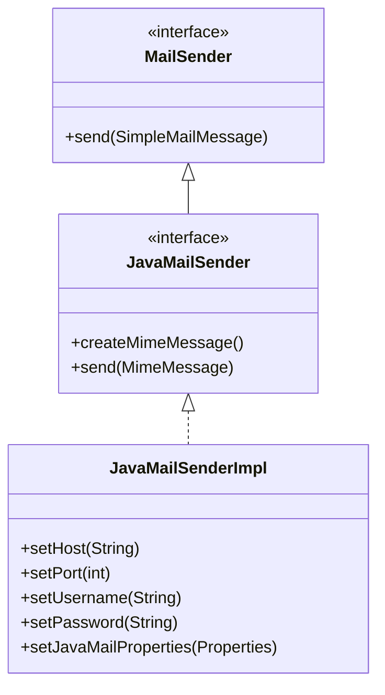
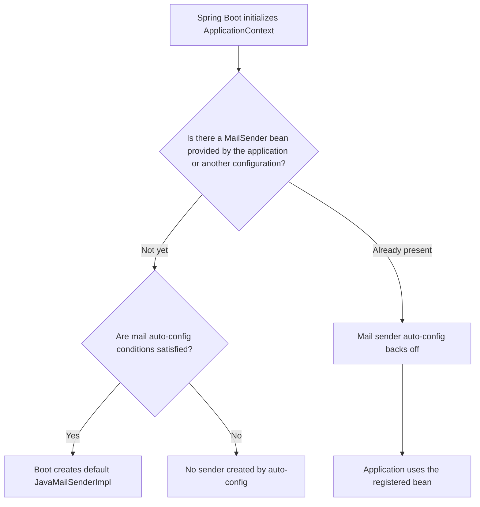

# Overriding auto-config with a custom JavaMailSender bean

In a Spring Boot application, adding `spring-boot-starter-mail` and declaring `spring.mail.*` is usually enough for Spring Boot to create a `JavaMailSender` bean. This mechanism fits when the application uses a single SMTP server with standard configuration. However, sometimes the system needs to take control of building the sender itself: using multiple SMTP accounts, attaching specialized transport configuration, using an existing Jakarta Mail `Session`, or replacing the transport with a controlled implementation in a test environment.

In those cases, you can **declare your own `JavaMailSender` bean**. This is a case where Spring Boot auto-configuration **backs off**: if the application already provides a suitable bean, Spring Boot generally does not create the default mail sender bean. Understanding this mechanism properly helps avoid errors from two competing beans, assuming `spring.mail.*` properties still apply automatically, or inadvertently dropping TLS, timeouts, and charset when moving from auto-config to manual configuration.

This lesson explains how to override auto-config with a custom `JavaMailSender` bean, how to retain values from `MailProperties`, how to inject properly in services, the multi-sender scenario, handling special configurations, and observing auto-configuration conditions. The examples use Java 21, Spring Boot 3.x, Spring Framework 6.x, and Jakarta Mail.

## 1. First, what does Spring Boot's auto-configuration do?

When the appropriate mail libraries are on the classpath and the configuration conditions are satisfied, Spring Boot can create a bean of type `JavaMailSenderImpl` — the Jakarta Mail-based implementation of the `JavaMailSender` interface.

With a simple application:

```groovy
dependencies {
    implementation 'org.springframework.boot:spring-boot-starter-mail'
}
```

and configuration:

```yaml
spring:
  mail:
    host: localhost
    port: 1025
    default-encoding: UTF-8
    properties:
      "[mail.smtp.auth]": "false"

app:
  mail:
    from: demo@example.test
```

a service can inject:

```java
import org.springframework.mail.javamail.JavaMailSender;
import org.springframework.stereotype.Service;

@Service
public class DemoMailService {
    private final JavaMailSender mailSender;

    public DemoMailService(JavaMailSender mailSender) {
        this.mailSender = mailSender;
    }
}
```

If auto-config is triggered, the application usually receives a `JavaMailSenderImpl` that already has the host, port, and corresponding properties. For a test environment, a simulated SMTP server such as Mailpit can listen on `localhost:1025` and display messages through a web UI at `localhost:8025`.

You should not think that **merely having the dependency guarantees the sender appears**: auto-config also depends on conditions regarding the classpath, existing beans, and configuration such as an SMTP host or a mail session via a supported configuration path.

### 1.1. Related interfaces



In Spring Framework Mail:

- `MailSender` is the abstraction for sending simple text emails with `SimpleMailMessage`.
- `JavaMailSender` extends `MailSender` to send MIME, HTML, and attachments.
- `JavaMailSenderImpl` is the common implementation that connects to SMTP via Jakarta Mail.

When you create a bean of type `JavaMailSenderImpl` yourself, that bean can still be injected where `MailSender` or `JavaMailSender` is requested.

## 2. The "back off" mechanism when a custom MailSender bean exists

Spring Boot auto-configurations usually have conditions like `@ConditionalOnMissingBean`. In the mail configuration of common Spring Boot 3.x releases, `MailSenderAutoConfiguration` has a condition that **only proceeds when the context does not yet have a `MailSender` bean**. `JavaMailSender` extends `MailSender`, so a `JavaMailSender` bean registered by the application itself satisfies the condition of having a mail sender bean and makes Boot's default bean creation step aside.

Minimal example:

```java
package com.example.mail.config;

import org.springframework.context.annotation.Bean;
import org.springframework.context.annotation.Configuration;
import org.springframework.mail.javamail.JavaMailSender;
import org.springframework.mail.javamail.JavaMailSenderImpl;

@Configuration(proxyBeanMethods = false)
public class CustomMailConfiguration {

    @Bean
    JavaMailSender mailSender() {
        JavaMailSenderImpl sender = new JavaMailSenderImpl();
        sender.setHost("localhost");
        sender.setPort(1025);
        sender.setDefaultEncoding("UTF-8");
        return sender;
    }
}
```

If the application scans/registers this configuration, the `mailSender` bean owned by the application will be used when services inject `JavaMailSender`. Spring Boot does not need to create an additional default `JavaMailSenderImpl` for the same purpose.

**A very important point:** this is not an operation of "overriding a duplicate bean name definition" in the sense of enabling `spring.main.allow-bean-definition-overriding=true`. The standard mechanism is **auto-config sees the bean already exists and backs off**. There is no need to enable bean definition overriding just to declare your own sender.



### 2.1. Must the bean name be mailSender?

No. Backing off is mainly determined by the **bean type and auto-config conditions**, not by a requirement to name the bean `mailSender`.

Example:

```java
@Bean("outboundEmailSender")
JavaMailSender outboundEmailSender() {
    JavaMailSenderImpl sender = new JavaMailSenderImpl();
    sender.setHost("localhost");
    sender.setPort(1025);
    return sender;
}
```

The bean named `outboundEmailSender` still has type `JavaMailSender`. A service injecting by type `JavaMailSender` will normally receive this bean if it is the sole candidate.

The bean name becomes important again when the application uses `@Qualifier`, injection by name, or when there are multiple beans of the same type.

### 2.2. Why can a simple MailSender bean make JavaMailSender disappear?

Suppose the application registers a custom implementation that implements only the `MailSender` interface:

```java
@Bean
MailSender simpleOnlyMailSender() {
    return new CustomTextMailSender();
}
```

where `CustomTextMailSender` is a class **defined by the application itself**. When that `MailSender` bean is present, auto-configuration may back off, yet the custom bean **is not a `JavaMailSender`**. A service that needs `MimeMessage`/`JavaMailSender` may then hit a missing-bean error.

This leads to a rule: **if the application injects `JavaMailSender` anywhere, declare a bean with the `JavaMailSender` interface or an implementation of it**. Do not assume Boot will quietly create an extra `JavaMailSender` just because your custom bean lacks MIME capability.

### 2.3. Distinguishing bean override from property override

| Requirement | Solution to consider | Separate bean needed? |
|---|---|---|
| Change SMTP host/port | `spring.mail.host` / `spring.mail.port` | Usually no |
| Enable STARTTLS, set socket timeouts | `spring.mail.properties[...]` | Usually no |
| Change username/password per environment | Environment variables or secret manager | Usually no |
| Change default charset | `spring.mail.default-encoding` | Usually no |
| Choose different providers by mail type | Multiple senders and a routing service | Usually yes |
| Use a Jakarta Mail Session created outside Spring Boot | Existing JNDI configuration or custom sender depending on constraints | Case-by-case |
| Create a custom transport/test-specific sender | Custom bean by profile/test configuration | Possibly |
| Want to "override the mailSender bean name" | Use back off via a properly typed bean | No need to enable bean-definition-overriding |

If you only want to change the host or timeouts, a custom bean usually adds maintenance responsibility without bringing benefits. Switch to a custom bean only when you need control beyond ordinary configuration.

## 3. An easily missed issue: spring.mail.* does not automatically apply to a custom bean

When Boot creates the default bean, Boot reads `MailProperties` and applies the corresponding values. When **you create `JavaMailSenderImpl` yourself**, Spring only manages that bean's lifecycle. It **does not automatically call `setHost`, `setPassword`, or `setJavaMailProperties` on your custom bean** just because `application.yml` contains `spring.mail.*`.

Example configuration:

```yaml
spring:
  mail:
    host: smtp.example.test
    port: 587
    username: ${SMTP_USERNAME}
    password: ${SMTP_PASSWORD}
    default-encoding: UTF-8
    properties:
      "[mail.smtp.auth]": "true"
      "[mail.smtp.starttls.enable]": "true"
      "[mail.smtp.starttls.required]": "true"
      "[mail.smtp.connectiontimeout]": "5000"
      "[mail.smtp.timeout]": "10000"
      "[mail.smtp.writetimeout]": "10000"
```

If the custom bean only does:

```java
@Bean
JavaMailSender mailSender() {
    return new JavaMailSenderImpl();
}
```

then the host, port, credentials, STARTTLS, and timeouts in YAML **do not flow into that object automatically**. The implementation also has its own defaults; connections may point to the wrong server or lack the expected security.

To retain the configuration from Spring Boot, you can inject a `MailProperties` object already bound from `spring.mail.*` and then apply the values explicitly.

## 4. Creating a custom JavaMailSender bean and retaining MailProperties

### 4.1. Full configuration

Here is a practical example when the application needs to own the bean itself while keeping Spring Boot's externalized configuration:

```java
package com.example.mail.config;

import java.util.Properties;

import org.springframework.boot.autoconfigure.mail.MailProperties;
import org.springframework.boot.context.properties.EnableConfigurationProperties;
import org.springframework.context.annotation.Bean;
import org.springframework.context.annotation.Configuration;
import org.springframework.mail.javamail.JavaMailSender;
import org.springframework.mail.javamail.JavaMailSenderImpl;

@Configuration(proxyBeanMethods = false)
@EnableConfigurationProperties(MailProperties.class)
public class CustomMailConfiguration {

    @Bean
    JavaMailSender mailSender(MailProperties mailProperties) {
        if (mailProperties.getHost() == null
                || mailProperties.getHost().isBlank()) {
            throw new IllegalStateException(
                    "spring.mail.host is required by CustomMailConfiguration");
        }

        JavaMailSenderImpl sender = new JavaMailSenderImpl();
        sender.setHost(mailProperties.getHost());

        if (mailProperties.getPort() != null) {
            sender.setPort(mailProperties.getPort());
        }
        if (mailProperties.getProtocol() != null) {
            sender.setProtocol(mailProperties.getProtocol());
        }
        if (mailProperties.getUsername() != null) {
            sender.setUsername(mailProperties.getUsername());
        }
        if (mailProperties.getPassword() != null) {
            sender.setPassword(mailProperties.getPassword());
        }
        if (mailProperties.getDefaultEncoding() != null) {
            sender.setDefaultEncoding(
                    mailProperties.getDefaultEncoding().name());
        }

        Properties transport = new Properties();
        transport.putAll(mailProperties.getProperties());

        // Add default values only if the configuration has not specified them.
        transport.putIfAbsent("mail.smtp.connectiontimeout", "5000");
        transport.putIfAbsent("mail.smtp.timeout", "10000");
        transport.putIfAbsent("mail.smtp.writetimeout", "10000");

        sender.setJavaMailProperties(transport);
        return sender;
    }
}
```

Explanation of the decisions in the example:

1. `@Configuration` registers the configuration class in the Spring context.
2. `@Bean` registers the exact bean the application wants to use.
3. The `JavaMailSender` return type makes MIME support clear at the dependency-injection boundary.
4. `MailProperties` holds the values Spring Boot binds from `spring.mail.*`.
5. `setHost`, `setPort`, `setUsername`, `setPassword`, `setProtocol`, and `setDefaultEncoding` are applied explicitly.
6. `setJavaMailProperties` receives detailed Jakarta Mail properties such as `mail.smtp.auth` and `mail.smtp.starttls.required`.
7. `putIfAbsent` only adds timeouts when the environment has not supplied them, avoiding accidentally overwriting values specified by operations.

**Why `@EnableConfigurationProperties(MailProperties.class)`?** When a custom `MailSender` bean makes mail auto-config back off, you should not assume that very auto-config still registers the `MailProperties` bean for you. This annotation ensures the configuration properties object is registered/bound in the self-managed configuration. If the system already has another place registering `MailProperties`, Spring Boot has an appropriate mechanism for managing configuration properties; the important thing is to avoid depending on side effects of an auto-config that has backed off.

The example intentionally requires `spring.mail.host`. It serves the **SMTP host-based style**, without yet having a branch for using a mail session from JNDI. If the application uses a JNDI Session, you should make a separate configuration branch clear instead of letting this bean silently pick unsuitable defaults.

### 4.2. Reading configuration from the environment

An illustrative production configuration:

```yaml
spring:
  mail:
    host: ${SMTP_HOST}
    port: ${SMTP_PORT:587}
    protocol: smtp
    username: ${SMTP_USERNAME}
    password: ${SMTP_PASSWORD}
    default-encoding: UTF-8
    properties:
      "[mail.smtp.auth]": "true"
      "[mail.smtp.starttls.enable]": "true"
      "[mail.smtp.starttls.required]": "true"
      "[mail.smtp.connectiontimeout]": "5000"
      "[mail.smtp.timeout]": "10000"
      "[mail.smtp.writetimeout]": "10000"

app:
  mail:
    from: ${MAIL_FROM}
```

Password values must come from a secret manager, environment variables, or an access-controlled secret management mechanism. Do not commit passwords into source or log configuration after binding. On SMTP submission port 587, STARTTLS must be supported by the server and configured to require the upgrade per security policy. With implicit TLS on port 465, configure the corresponding SSL rather than merely changing the port number.

**Note:** `MailProperties` also contains other settings such as `jndi-name` and `test-connection` depending on the Boot version. The self-managed example above **does not copy every branch of default auto-config**, but instead implements a specific host-based SMTP contract. This is an important responsibility when defining your own bean: know exactly which parts were kept and which parts must be built yourself if required.

### 4.3. What if you only need custom timeouts or charset?

Usually there is no need to create a bean yourself just because you want to change the three timeouts:

```yaml
spring:
  mail:
    host: ${SMTP_HOST}
    port: 587
    properties:
      "[mail.smtp.connectiontimeout]": "5000"
      "[mail.smtp.timeout]": "10000"
      "[mail.smtp.writetimeout]": "10000"
```

Boot can apply these properties when creating the default `JavaMailSenderImpl`. Keep auto-config if the requirement is solved solely by external configuration. A self-built bean is more suitable when you need to **change how the sender is created or chosen**, not just change one SMTP value.

## 5. Using a custom bean in a service

Once the bean is successfully registered, services inject it as usual:

```java
package com.example.mail.service;

import jakarta.mail.MessagingException;
import jakarta.mail.internet.MimeMessage;

import org.springframework.beans.factory.annotation.Value;
import org.springframework.mail.javamail.JavaMailSender;
import org.springframework.mail.javamail.MimeMessageHelper;
import org.springframework.stereotype.Service;

@Service
public class NotificationMailService {

    private final JavaMailSender mailSender;
    private final String fromAddress;

    public NotificationMailService(
            JavaMailSender mailSender,
            @Value("${app.mail.from}") String fromAddress) {
        this.mailSender = mailSender;
        this.fromAddress = fromAddress;
    }

    public void sendWelcome(String recipient) throws MessagingException {
        MimeMessage message = mailSender.createMimeMessage();
        MimeMessageHelper helper =
                new MimeMessageHelper(message, true, "UTF-8");

        helper.setFrom(fromAddress);
        helper.setTo(recipient);
        helper.setSubject("Welcome");
        helper.setText(
                "Your account has been created.",
                "<p>Your account has been <strong>created</strong>.</p>");

        mailSender.send(message);
    }
}
```

In cases where only plain text is sent, a service can also inject `MailSender` and send `SimpleMailMessage`. The `JavaMailSenderImpl` bean implements both interfaces, so two separate beans are not mandatory.

**Distinguishing configuration from behavior:** replacing the bean does not change the meaning of `send()`. The method returning normally indicates the send completed according to the transport in use; it does not prove the email reached the inbox or was read. In addition, Spring Mail does not automatically provide a durable queue, long-term retry, or exactly-once guarantees solely because of a custom bean.

## 6. Adding custom behavior: applying controlled configuration

### 6.1. Profile-based configuration

In practice, different mail senders are often needed in local and production environments:

```java
package com.example.mail.config;

import org.springframework.context.annotation.Bean;
import org.springframework.context.annotation.Configuration;
import org.springframework.context.annotation.Profile;
import org.springframework.mail.javamail.JavaMailSender;
import org.springframework.mail.javamail.JavaMailSenderImpl;

@Configuration(proxyBeanMethods = false)
@Profile("local")
class LocalMailConfiguration {

    @Bean
    JavaMailSender localMailSender() {
        JavaMailSenderImpl sender = new JavaMailSenderImpl();
        sender.setHost("localhost");
        sender.setPort(1025);
        sender.setDefaultEncoding("UTF-8");
        return sender;
    }
}
```

With the `local` profile active, this bean will be registered. If another profile does not register any custom bean and mail auto-config has sufficient configuration, Spring Boot can use the default sender. This is a reasonable way to use profiles when local needs a fake SMTP, while production still wants to keep auto-config.

However, if both the local bean and the production bean are activated together due to overlapping profile settings, injection can become ambiguous. Organize profiles and configuration conditions clearly.

### 6.2. Adding operational properties to a custom sender

In a custom bean, you can apply timeouts, charset, protocol, and configuration limits from a centralized source. Jakarta Mail properties with the `mail.smtp.*` prefix are usually placed in `Properties`:

```java
Properties transport = new Properties();
transport.setProperty("mail.smtp.auth", "true");
transport.setProperty("mail.smtp.starttls.enable", "true");
transport.setProperty("mail.smtp.starttls.required", "true");
transport.setProperty("mail.smtp.connectiontimeout", "5000");
transport.setProperty("mail.smtp.timeout", "10000");
transport.setProperty("mail.smtp.writetimeout", "10000");

sender.setJavaMailProperties(transport);
```

These lines are **part of the bean creation method** after host, port, and username/password have been set. They do not create TLS certificates themselves, do not verify the From domain, and do not replace credential-protection policies. If the system allows changing those values via `spring.mail.properties`, use that source instead of hardcoding every value in Java.

### 6.3. Should you create your own subclass of JavaMailSenderImpl?

You can create a subclass if there is an extension point genuinely supported by the API, but you should not subclass just to insert logs containing emails or to rebuild SMTP logic. For metrics/tracing needs, it is usually easier to control by using a **wrapping service/gateway** around `JavaMailSender`:

```text
BusinessService
    |
    v
MailDeliveryGateway (metrics / policy / retry coordination)
    |
    v
JavaMailSender
    |
    v
Jakarta Mail / SMTP
```

This layering keeps the SMTP implementation simple and avoids mixing observability, retry, and state storage into the configuration bean. If you build a wrapper implementing `JavaMailSender` yourself, you must implement all interface methods and understand the impact on `JavaMailSenderImpl`; most cases do not need to go that far.

## 7. Multiple JavaMailSenders in the same ApplicationContext

An application may need:

- A transactional sender using SMTP provider A for order confirmations and security notifications.
- A campaign sender using SMTP provider B for informational messages consented to by recipients.

In that case, the application can create **two `JavaMailSender` beans**. The existence of either one is already enough for default auto-config to back off under the bean condition; Spring Boot **does not automatically create a "third sender"** just because you defined multiple beans.

### 7.1. Naming multiple beans

An example factory helping the two beans share important settings:

```java
package com.example.mail.config;

import java.util.Properties;

import org.springframework.beans.factory.annotation.Value;
import org.springframework.context.annotation.Bean;
import org.springframework.context.annotation.Configuration;
import org.springframework.context.annotation.Primary;
import org.springframework.mail.javamail.JavaMailSender;
import org.springframework.mail.javamail.JavaMailSenderImpl;

@Configuration(proxyBeanMethods = false)
public class MultiSenderConfiguration {

    @Bean("transactionalMailSender")
    @Primary
    JavaMailSender transactionalMailSender(
            @Value("${app.mail.transactional.host}") String host,
            @Value("${app.mail.transactional.username}") String username,
            @Value("${app.mail.transactional.password}") String password) {
        return smtpSender(host, username, password);
    }

    @Bean("campaignMailSender")
    JavaMailSender campaignMailSender(
            @Value("${app.mail.campaign.host}") String host,
            @Value("${app.mail.campaign.username}") String username,
            @Value("${app.mail.campaign.password}") String password) {
        return smtpSender(host, username, password);
    }

    private static JavaMailSender smtpSender(
            String host, String username, String password) {
        JavaMailSenderImpl sender = new JavaMailSenderImpl();
        sender.setHost(host);
        sender.setPort(587);
        sender.setUsername(username);
        sender.setPassword(password);
        sender.setDefaultEncoding("UTF-8");

        Properties properties = new Properties();
        properties.setProperty("mail.smtp.auth", "true");
        properties.setProperty("mail.smtp.starttls.enable", "true");
        properties.setProperty("mail.smtp.starttls.required", "true");
        properties.setProperty("mail.smtp.connectiontimeout", "5000");
        properties.setProperty("mail.smtp.timeout", "10000");
        properties.setProperty("mail.smtp.writetimeout", "10000");
        sender.setJavaMailProperties(properties);
        return sender;
    }
}
```

This is an example of two providers both using port 587 and STARTTLS. If each provider has its own port, protocol, TLS, or limits, **do not apply the factory mechanically**. You can create a separate `@ConfigurationProperties` group for each sender, validate values, and keep secrets in an appropriate managed source.

Application configuration:

```yaml
app:
  mail:
    transactional:
      host: ${TRANSACTIONAL_SMTP_HOST}
      username: ${TRANSACTIONAL_SMTP_USERNAME}
      password: ${TRANSACTIONAL_SMTP_PASSWORD}
    campaign:
      host: ${CAMPAIGN_SMTP_HOST}
      username: ${CAMPAIGN_SMTP_USERNAME}
      password: ${CAMPAIGN_SMTP_PASSWORD}
```

With custom properties like `app.mail.transactional.*`, the configuration code must **actively bind and apply** them. They are not the standard `spring.mail.*` namespace.

### 7.2. Selecting a sender with Qualifier

Service sending transactional notifications:

```java
package com.example.mail.service;

import org.springframework.beans.factory.annotation.Qualifier;
import org.springframework.mail.javamail.JavaMailSender;
import org.springframework.stereotype.Service;

@Service
public class TransactionalNotificationService {

    private final JavaMailSender mailSender;

    public TransactionalNotificationService(
            @Qualifier("transactionalMailSender")
            JavaMailSender mailSender) {
        this.mailSender = mailSender;
    }
}
```

The campaign-sending service uses:

```java
public CampaignMailService(
        @Qualifier("campaignMailSender") JavaMailSender mailSender) {
    this.mailSender = mailSender;
}
```

The `CampaignMailService` snippet is **an illustrative constructor**, which needs to be placed inside a corresponding class when used.

`@Primary` marks the preferred sender when injecting by type without a specific qualifier. `@Qualifier` picks the exact bean by name/qualifier. **`@Primary` does not decide whether auto-config backs off**; it only helps Spring choose an injection candidate among beans of the same type.

### 7.3. Common errors when there are multiple senders

| Symptom | Possible cause | How to handle |
|---|---|---|
| `NoUniqueBeanDefinitionException` | Multiple `JavaMailSender`s, ambiguous injection | Use `@Qualifier` or an appropriate `@Primary` |
| Mail goes through the wrong provider | Service injects an unexpected default/primary sender | Use explicit qualifiers and test the configuration |
| Second sender lacks TLS | Factory or custom configuration missed properties | Apply full configuration, check each bean |
| Assuming Boot auto-creates a default bean alongside two custom beans | Not understanding the back-off condition | Register all needed senders with custom configuration |
| Mixing marketing sender with transactional | No clear business/routing boundary | Design a service that picks the sender by notification type |

When there are multiple accounts, rate limits and bounces/suppressions can also be managed by provider, domain, and mail type. Simply adding two beans does not by itself create safe routing, quota, or failover mechanisms.

## 8. Using a Jakarta Mail Session outside auto-config

In an application server environment, `jakarta.mail.Session` may be pre-created by the container and published via JNDI. Spring Boot supports a mail session configuration path depending on the version's conditions; if a suitable `spring.mail.jndi-name` mechanism is already used, you may **not need a custom bean**.

When manual integration is required, `JavaMailSenderImpl` has the `setSession(Session)` API:

```java
import jakarta.mail.Session;
import org.springframework.mail.javamail.JavaMailSenderImpl;

JavaMailSenderImpl sender = new JavaMailSenderImpl();
sender.setSession(existingJakartaMailSession);
```

In which `existingJakartaMailSession` is an actual object obtained from the container/JNDI or configured by another component. This variable does not appear by itself if there is no lookup/session bean mechanism.

When supplying a Session yourself, you need to understand **who owns host, port, AUTH, TLS, and credentials**. Setters on `JavaMailSenderImpl` and settings inside `Session` may interact according to the implementation's order/priority. Do not mix multiple configuration sources without determining the effective values.

In addition, Spring Boot 3.x uses the `jakarta.mail.*` namespace. Older examples using `javax.mail.Session` belong to the previous generation of the library and cannot be copied onto the same classpath expecting them to work unchanged.

## 9. How to diagnose why auto-config did or did not create a sender

When the application starts, you should not guess auto-config behavior solely from YAML file names. Spring Boot has a mechanism to report the conditions of each auto-configuration.

### 9.1. Enabling the condition evaluation report

In a development environment, you can run the application with the debug option:

```bash
java -jar app.jar --debug
```

Spring Boot will put the auto-config condition report into the logs according to the logging configuration. Look for sections related to `MailSenderAutoConfiguration` and the corresponding configuration class to see why it matched or did not match.

Common reasons:

- There is a `MailSender` bean created by the application, so the missing-bean condition is no longer satisfied.
- The required Jakarta Mail/Spring Mail classes are not yet on the classpath.
- The configuration needed for Boot to choose the default mail sender path is not yet present.
- Conditions of the JNDI branch or the SMTP host branch do not match.
- Auto-configuration was explicitly excluded.

If the application has Spring Boot Actuator and the conditions endpoint is appropriately configured/permitted, you can view the info via `/actuator/conditions` in a protected environment. Do not expose internal diagnostic endpoints on the public Internet.

### 9.2. Distinguishing four typical startup errors

**A. JavaMailSender bean not found**

Example:

```text
No qualifying bean of type
'org.springframework.mail.javamail.JavaMailSender' available
```

The cause may be that the custom configuration was not component-scanned/imported, a bean implementing only `MailSender` caused Boot to back off, or the conditions for creating the default sender were insufficient.

**B. Multiple beans of the same type**

```text
NoUniqueBeanDefinitionException:
expected single matching bean but found 2
```

This is a dependency selection issue. Specify `@Qualifier` or `@Primary` explicitly, avoiding solving it by enabling bean-definition-overriding.

**C. Duplicate bean name registration**

A custom bean named `mailSender` and another bean with the same name from two application configurations can cause a duplicate bean definition error. The auto-config back-off mechanism does not resolve conflicts between **two self-owned configurations**. Rename reasonably or remove the duplicate configuration; do not carelessly enable overriding to hide the error.

**D. Sender exists but cannot connect to SMTP**

For example, `MailSendException` reports a connect or timeout error on the very first send. Check whether the custom bean actually applies `host`, `port`, `username`, `password`, `mail.smtp.auth`, TLS, and timeouts. Do not blindly assume YAML is bound onto a self-created bean.

### 9.3. Checking the effective configuration of JavaMailSenderImpl

In a test with access to the Spring context, you can observe some **non-sensitive** properties:

```java
import org.springframework.context.ApplicationContext;
import org.springframework.mail.javamail.JavaMailSender;
import org.springframework.mail.javamail.JavaMailSenderImpl;

JavaMailSender sender = context.getBean(JavaMailSender.class);

if (sender instanceof JavaMailSenderImpl impl) {
    System.out.println("SMTP host: " + impl.getHost());
    System.out.println("SMTP port: " + impl.getPort());
    System.out.println("Mail protocol: " + impl.getProtocol());
}
```

Here `context` is an `ApplicationContext` obtained from a test or a component provided by Spring; the snippet is not a standalone program with a pre-existing `context` variable. Do not log passwords, the Session authentication object, or all of `JavaMailProperties` in production because they may contain sensitive data.

If there are multiple senders, fetch the bean by name:

```java
JavaMailSender sender = context.getBean(
        "transactionalMailSender", JavaMailSender.class);
```

Observing values at runtime helps confirm the actual bean type and configuration, rather than just looking at `application.yml`.

## 10. Testing custom configuration without sending real email

For bean configuration, the most effective testing focuses on **which bean is created**, **which properties have been applied**, and only then SMTP integration tests. There is no need to send real Internet email just to prove `@Bean` works.

### 10.1. Testing ApplicationContext initialization

Example with JUnit and Spring Boot Test:

```java
package com.example.mail.config;

import static org.assertj.core.api.Assertions.assertThat;

import org.junit.jupiter.api.Test;
import org.springframework.beans.factory.annotation.Autowired;
import org.springframework.boot.test.context.SpringBootTest;
import org.springframework.context.ApplicationContext;
import org.springframework.mail.javamail.JavaMailSender;
import org.springframework.mail.javamail.JavaMailSenderImpl;

@SpringBootTest(properties = {
        "spring.mail.host=localhost",
        "spring.mail.port=1025",
        "spring.mail.default-encoding=UTF-8",
        "spring.mail.properties[mail.smtp.auth]=false",
        "spring.mail.properties[mail.smtp.connectiontimeout]=2500"
})
class CustomMailConfigurationTest {

    @Autowired
    ApplicationContext context;

    @Test
    void customSenderIsRegisteredAndUsesProperties() {
        String[] names =
                context.getBeanNamesForType(JavaMailSender.class);
        assertThat(names).containsExactly("mailSender");

        JavaMailSender sender = context.getBean(JavaMailSender.class);
        assertThat(sender).isInstanceOf(JavaMailSenderImpl.class);

        JavaMailSenderImpl impl = (JavaMailSenderImpl) sender;
        assertThat(impl.getHost()).isEqualTo("localhost");
        assertThat(impl.getPort()).isEqualTo(1025);
        assertThat(impl.getJavaMailProperties()
                .getProperty("mail.smtp.connectiontimeout"))
                .isEqualTo("2500");
    }
}
```

Conditions of the example: `CustomMailConfiguration` must be scanned/imported by the test application, and the test context must not register any other sender. The `containsExactly("mailSender")` assertion fits **a single-sender example**; if the application validly has multiple senders, the expectation needs adjustment.

This test only creates the context and reads properties. It does not connect to SMTP and does not send real mail. If `spring.mail.test-connection=true` is in use and the corresponding auto-configuration validation is triggered, Spring Boot may proactively attempt to connect at startup; in unit/context tests, keep connection testing intentional.

### 10.2. Integration testing via simulated SMTP

To test the real adapter and custom configuration:

1. Start Mailpit or a similar SMTP test server.
2. Use a test profile containing `spring.mail.host=localhost`, `port=1025`.
3. Inject `JavaMailSender` and send a `SimpleMailMessage` or `MimeMessage`.
4. Observe the message via the test UI/API, checking From, To, Subject, and UTF-8 content.
5. Simulate an unavailable SMTP server to observe timeouts/transport errors, if required by the test.

Example using Docker in a development environment:

```bash
docker run --rm --name mailpit -p 1025:1025 -p 8025:8025 axllent/mailpit
```

If the application runs in another container, `localhost` points to the application container itself; you need to use the container network's service/DNS name to connect to the SMTP test server.

### 10.3. What configuration testing does not prove yet

| Test | Confirmed | Not yet confirmed |
|---|---|---|
| Reading bean from context | Spring registers a suitable bean, injection works | SMTP actually accepts mail |
| Comparing host/port/properties | Desired values have been applied | Production network/TLS/credentials are valid |
| Sending via simulated SMTP | Serialization and test connection path work | Production domain is verified, mail reaches Internet inboxes |
| Sending via provider sandbox | Configuration and SMTP/API mechanism with provider match | All external addresses receive mail |
| Receiving delivery/bounce events | Post-processing tracking from provider | The recipient actually read the content |

Keep production credentials out of tests and avoid using real customer mailboxes in automated testing.

## 11. Errors when deploying a custom bean and how to fix them

### 11.1. Custom bean is not scanned

The class has `@Configuration` but sits outside the scanned packages, or has not been imported. Spring does not know about the bean so it may use default auto-config or report a missing sender depending on conditions. Place the class in a scanned application package, or import the configuration explicitly.

### 11.2. Creating JavaMailSenderImpl while ignoring MailProperties

A `new JavaMailSenderImpl()` does not automatically pull host, TLS, and credentials from `application.yml`. Attach the needed values manually or inject the bound `MailProperties`.

### 11.3. Forgetting @EnableConfigurationProperties

If you inject `MailProperties` from a custom bean and expect the backed-off auto-config to still register it, the context may lack `MailProperties`. Register configuration properties explicitly with `@EnableConfigurationProperties(MailProperties.class)` in the self-managed configuration.

### 11.4. Thinking @Primary replaces auto-config

`@Primary` only resolves injection priority when multiple suitable beans exist. Backing off is a condition on auto-configuration and an existing bean. Do not use `@Primary` to fix an erroneous duplicate configuration.

### 11.5. Using spring.main.allow-bean-definition-overriding to solve errors

Allowing bean definition overriding can let one configuration silently replace another based on registration order, making results hard to predict. When writing a custom sender, prefer the standard back-off mechanism and fix the names/ownership of duplicate beans.

### 11.6. Having MailSender but missing JavaMailSender

A fake/wrapper implementing only `MailSender` can prevent Boot from creating the default sender, while a MIME service still demands `JavaMailSender`. Provide a properly typed bean or adjust the injection to match needs.

### 11.7. Copying security configuration wrongly

If moving a Boot configuration to Java and forgetting `mail.smtp.starttls.required`, enabling AUTH wrongly, or omitting timeouts, the custom implementation may behave differently from before. Security parameters need to be placed in the source configuration and applied consistently.

### 11.8. Confusing SMTP 465 with 587

STARTTLS usually uses port 587; implicit TLS usually uses port 465. Do not just change the port while keeping an incompatible TLS configuration. Check the provider contract.

### 11.9. Opening an SMTP connection in @Bean to prove configuration

Calling `sender.testConnection()` directly inside a `@Bean` method can stop the application from starting when the SMTP provider has a temporary incident. You can intentionally choose fail-fast for some systems, but this must be an explicit decision in operational design. Creating an ordinary `JavaMailSenderImpl` itself does not need to send email right at context startup.

### 11.10. Adding retry directly into the bean's setter/factory

The configuration bean is responsible for creating the transport. Retry by notification type, deadlines, deduplication, and recipient status belong to the delivery workflow layer. A properly created singleton bean still does not guarantee notifications are not lost if the JVM stops.

## 12. Real-world scenario: moving from default to a custom bean

Suppose the application previously used:

```yaml
spring:
  mail:
    host: smtp.old-provider.test
    port: 587
    username: ${SMTP_USERNAME}
    password: ${SMTP_PASSWORD}
    properties:
      "[mail.smtp.auth]": "true"
      "[mail.smtp.starttls.enable]": "true"
      "[mail.smtp.starttls.required]": "true"
```

Initially Spring Boot automatically created `JavaMailSenderImpl`. Later the development team needed to add fixed timeouts if not yet configured, ensure UTF-8 charset, and have room to expand for multiple providers.

A change roadmap:

**Step 1 — Identify the existing bean.** Observe the `JavaMailSender` type bean and effective configuration in the test environment. Record host, port, protocol, encoding, TLS, AUTH, timeouts.

**Step 2 — Choose ownership.** Create an application-owned `@Configuration`, declare `@Bean JavaMailSender`, and register `MailProperties` explicitly if binding is needed.

**Step 3 — Keep important settings.** Apply host, port, credentials, charset, and all `spring.mail.properties`. Add timeouts using `putIfAbsent` or a clear configuration policy. Avoid hardcoding secrets.

**Step 4 — Verify Spring Boot backs off.** Run context tests/condition reports to be sure only the expected sender exists. Do not enable bean-definition-overriding as a default workaround.

**Step 5 — Test SMTP in a controlled environment.** Send one text mail and one MIME mail to a simulated SMTP, checking sender, recipient, Unicode content, and reproducible timeout errors.

**Step 6 — If multiple senders are needed, expand intentionally.** Create separate beans per provider, use `@Qualifier` in services, and attach routing policies and quotas for each mail type.

**Step 7 — Keep reliability boundaries.** Outbox, retry, monitoring, bounces, suppressions, and idempotency are delivery workflow responsibilities. Do not infer these capabilities merely from having a custom bean created.

## 13. Practice exercises

### Part A — Observe auto-configuration before overriding

Create a Spring Boot application with `spring-boot-starter-mail` and `spring.mail.host=localhost`. Inject `JavaMailSender` into a service and note the actual bean type in a test. Enable the condition report to find `MailSenderAutoConfiguration`.

### Part B — Add a custom JavaMailSender bean

Register `@Configuration` and a `@Bean JavaMailSender` returning `JavaMailSenderImpl`. Set host/port to a simulated SMTP. Restart the application and confirm the service can still inject the sender while Boot does not create an additional default bean.

### Part C — Retain application.yml configuration

Move host, port, encoding, TLS, and timeouts to `spring.mail.*`. Use `@EnableConfigurationProperties(MailProperties.class)` and code that applies the configuration to the custom bean. Prove with a context test that changing `spring.mail.port` gives the bean the new port without editing Java.

### Part D — Add a second sender

Create `transactionalMailSender` and `campaignMailSender`. Use `@Qualifier` to choose the right sender in each service. Try removing the qualifier to observe the multi-bean case without a default choice and resolve it with an appropriate qualifier or primary.

### Part E — Explore three failure cases

1. Declare a fake `MailSender` while a service requires `JavaMailSender`; explain why the MIME bean can be missing.
2. Create a custom bean but omit `setJavaMailProperties`; observe the difference in TLS/timeouts compared to YAML.
3. Configure a non-existent host and call `send()` in an integration test with timeouts; distinguish transport errors from bean registration errors.

### Part F — Describe responsibility boundaries

Design a diagram for an application that creates orders, writes an outbox, and then uses a worker to send email. Place `JavaMailSender` at the transport layer, without using it as a place to store delivery state or perform infinite retries. State clearly that an SMTP relay accepting an email does not mean the recipient has read it.

## 14. Summary of mechanisms to grasp

When an application defines its own `JavaMailSender` bean, Spring Boot can **yield the right to create the mail sender** under the `@ConditionalOnMissingBean` condition. This is Spring Boot's normal extension mechanism and does not require enabling bean definition overriding. The bean name does not have to be `mailSender`, but the bean type and auto-config conditions must match.

Once you own the bean yourself, you also take responsibility for **host, port, protocol, authentication, TLS, timeouts, and charset**. `spring.mail.*` values only take effect on a custom bean when code actively reads and applies them, such as through a registered/bound `MailProperties`. If there are multiple senders, `@Qualifier` and `@Primary` solve the problem of selecting the bean for services; they do not replace the back-off mechanism.

A complete implementation needs to observe the actual bean in the ApplicationContext, verify the configuration on an SMTP test server, and keep a separate delivery workflow for retry, status, duplicate-send prevention, and post-send events. Understanding those boundaries well helps override Spring Boot mail auto-configuration intentionally while maintaining safety and operability.
