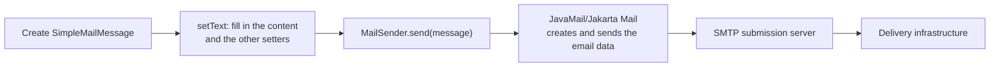
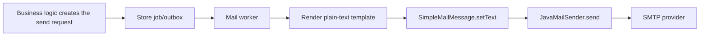

# Setting Plain Text Content in Spring Framework Mail

When sending a registration confirmation email, an order status notification, a verification code, or a schedule reminder, a Spring application does not necessarily have to produce HTML. In many situations, **plain text** is the right choice: the content is easy to read, does not depend on the browser or the HTML rendering engine of the email application, is convenient for short notifications, and makes the display easy to control.

In **Spring Framework Mail**, the simplest way to set this kind of content is to create a `SimpleMailMessage` and call:

```java
message.setText("Hello! Your account has been created.");
```

The `setText(...)` method takes a Java `String` as the email **body**. It does not set the message subject, does not specify the recipients, and does not itself establish an SMTP connection. Those parts are set with other setters and are sent through `MailSender`/`JavaMailSender`.

This lesson focuses on using `SimpleMailMessage.setText(...)` for its intended purpose, composing multi-line text, preserving Vietnamese and Unicode, distinguishing text/plain from HTML, managing message templates, and organizing the email sending flow in a Spring application.

## 1. What is plain text?

An email with a `text/plain` body contains characters that are interpreted as **text**, and does not require the mail client to render HTML tags or apply CSS.

Example of the content the recipient sees:

```text
Hello Minh,

Order DH-2026-081 has been confirmed.
Total payment: 320.000 ₫

You can view the details in your account.

Best regards,
Support Team
```

This is a string of characters with line breaks and blank lines. When sent as text/plain, the recipient sees these lines of text (how lines break or wrap may differ depending on the device and the mail reading application).

In contrast, if you put the following string into a text/plain email:

```html
<h2>Order confirmed</h2>
<p>Hello <strong>Minh</strong>!</p>
```

the mail client will usually display the **HTML tag characters literally**. They do not turn into a large heading or bold text on their own. To display HTML as an interface, you must create a `text/html` MIME part, usually through `MimeMessageHelper.setText(html, true)`.

Similarly, a Markdown string such as `**Important**`, `# Heading`, or `[View order](https://example.org)` is still just text when sent as text/plain. Some mail clients automatically detect links and turn them into clickable links, but there is no guarantee that they interpret Markdown.

### Why is plain text still useful?

| Advantage | Meaning in real email |
|---|---|
| Less dependent on the display environment | Readable in many mail clients and command-line tools |
| Easy to produce content | No need for HTML templates, CSS, or image resources |
| Suitable for short notifications | OTP, business status, system alerts |
| Easy to provide an accessible version | A text version can be useful when users do not want to or cannot use HTML |
| Does not depend on loading external images | The main content is available in the message body |
| Easy to store, look up, and inspect | The data is mostly a string of characters and line breaks |

Plain text **does not by itself guarantee that the email is delivered successfully, does not by itself prevent spam, and does not replace encryption of sensitive data**. Deliverability also depends on the SMTP infrastructure, the sending domain configuration, the sender's reputation, and the receiving side's policies.

## 2. `SimpleMailMessage` and `setText(...)`

`SimpleMailMessage` is the object that represents a simple email in Spring, with fields such as the sender, recipients, subject, sent date, and **plain text content**.

The smallest example with real information:

```java
import org.springframework.mail.SimpleMailMessage;

SimpleMailMessage message = new SimpleMailMessage();
message.setFrom("notifications@example.org");
message.setTo("customer@example.net");
message.setSubject("Account confirmation");
message.setText("Hello! Your account has been created.");
```

The code above **only creates a message object**; it has not sent the message yet. To send through the configured SMTP server:

```java
mailSender.send(message);
```

Here, `mailSender` is a bean implementing Spring's `MailSender` or `JavaMailSender`; in an application using the Spring Boot mail starter, it is usually the `JavaMailSender` bean configured from `spring.mail.*`.

### Commonly used setters

| Method | What it sets | Example |
|---|---|---|
| `setFrom(String)` | Displayed sender address | `notifications@example.org` |
| `setTo(String...)` | One or more direct recipients | `customer@example.net` |
| `setCc(String...)` | Public carbon copy recipients | `team@example.org` |
| `setBcc(String...)` | Hidden carbon copy recipients | `audit@example.org` |
| `setReplyTo(String)` | Address suggested for receiving replies | `support@example.org` |
| `setSubject(String)` | Message subject | `Account confirmation` |
| **`setText(String)`** | **text/plain body** | `Order confirmed.` |
| `setSentDate(Date)` | Time the message was issued, as declared by the sender | `new Date()` |

`setText(...)` controls only the body. If you want to change `From` or `Subject`, you must set the corresponding fields. Do not insert `Subject: ...` or `To: ...` lines at the beginning of the body string hoping they become email headers; they will just be part of the content the recipient reads.

### `setText(...)` differs from `send(...)`

The two methods belong to two stages:



`setText(...)` is an in-memory operation; it does not call the network or check whether the recipient exists. `send(...)` is what performs the email sending communication, and that method may throw an error from the `MailException` family when sending fails.

Even when `send(...)` finishes normally, that usually only means the submission server has **accepted the email for further processing**; it does not guarantee the message has reached the final inbox or that the recipient has read it.

## 3. Setting multi-line content

A text/plain email becomes easier to read when it is divided into clear paragraphs. In Java, there are two common ways: line break characters in a string, or a **text block**.

### Approach 1: join lines with `\n`

```java
String body = "Hello Minh,\n"
        + "\n"
        + "Your order has been confirmed.\n"
        + "Order ID: DH-081\n"
        + "Total payment: 320.000 ₫\n"
        + "\n"
        + "Thank you for using our service.\n"
        + "Support Team";

message.setText(body);
```

In a Java string, `\n` represents the line break character. Two consecutive line breaks create a **blank line** to separate paragraphs. This approach suits programs using older Java or content of only a few lines.

### Approach 2: Java text block for long message templates

With Java 17+ (or Java versions that support text blocks), you can write:

```java
String body = """
        Hello Minh,

        Your order has been confirmed.
        Order ID: DH-081
        Total payment: 320.000 ₫

        Thank you for using our service.
        Support Team
        """;

message.setText(body);
```

A text block makes the source code look close to the actual email content. Java handles the indentation used for aligning the code; the line breaks and whitespace inside the content can still affect the result. Place meaningful whitespace deliberately, especially for forms with columns or signatures.

### No need to replace `\n` with `\r\n` yourself

SMTP uses line rules at the transport layer. When setting the content for `SimpleMailMessage`, the application should provide a normal Java string, using `\n` for lines if needed, so that Jakarta Mail handles the appropriate MIME/SMTP representation.

Hard-coding `\r\n` everywhere is not a condition for `setText(...)` to work. If data is read from multiple operating systems, you can normalize line breaks at the **content layer** when needed; avoid arbitrary transformations that destroy the format users intentionally entered.

### Spaces, indentation, and long line breaks

Mail reading applications may display text/plain with different fonts and widths; a client may wrap long lines on its own. Therefore:

- Write short paragraphs, with blank lines between blocks.
- Avoid building multi-column tables that depend absolutely on whitespace if the email targets mobile devices.
- Write the full URL on its own line when the link is important; some clients may automatically turn a URL into a clickable link.
- Do not rely on CSS, colors, bold text, HTML bullets, or responsive layout in a text/plain body.
- For lists, simple symbols such as `-` and sequence numbers are usually easy to read.

Example of a text layout that does not need HTML:

```text
Order information
------------------
Order ID:   DH-081
Status:     Confirmed

Next steps:
1. We prepare your order.
2. You will be notified when it is shipped.

Support: support@example.org
```

This is a format for humans to read, not a data structure that a machine can reliably parse. When exchanging data between systems, use an API or a dedicated data format instead of trying to parse the email body.

## 4. Vietnamese, Unicode, and charset

Plain text content is **not limited to ASCII**. User names, addresses, and notifications may contain Vietnamese: `Đã xác nhận`, `Cảm ơn bạn`, `320.000 ₫`.

In Java, `String` holds Unicode characters. However, when the message is turned into an email message, the data needs to be encoded into bytes using a **charset** and an appropriate `Content-Transfer-Encoding` method.

Example of a MIME representation (illustrative only; actual headers may differ):

```text
MIME-Version: 1.0
Content-Type: text/plain; charset=UTF-8
Content-Transfer-Encoding: quoted-printable

Xin ch=C3=A0o b=E1=BA=A1n!
```

This is still a **plain text email**. `quoted-printable` is just a way of encoding bytes for transmission over email; a recipient with a suitable client will see the content `Xin chào bạn!`, not the `=C3=...` strings.

### Set UTF-8 for Spring Boot Mail

In `application.yml` you can declare:

```yaml
spring:
  mail:
    default-encoding: UTF-8
```

The `spring.mail.default-encoding` property is used by the mail sending mechanism in Spring Boot/Jakarta Mail when building the message. In a plain Spring Framework application using `JavaMailSenderImpl`, you can set:

```java
JavaMailSenderImpl sender = new JavaMailSenderImpl();
sender.setDefaultEncoding("UTF-8");
```

Setting the encoding helps reduce the risk of the development and deployment environments using different defaults. In addition, you need to make sure the **data source** (template files, database, API) also uses an appropriate encoding. If the text was decoded incorrectly from the start, choosing UTF-8 when sending cannot recover already-corrupted characters.

### When to use `MimeMessageHelper` with UTF-8?

If you need clear control over the MIME message, you can use the following instead of `SimpleMailMessage`:

```java
MimeMessage mimeMessage = mailSender.createMimeMessage();
MimeMessageHelper helper = new MimeMessageHelper(
        mimeMessage, false, "UTF-8");

helper.setFrom("notifications@example.org");
helper.setTo("customer@example.net");
helper.setSubject("Order confirmed");
helper.setText("Hello! Your order has been confirmed.", false);

mailSender.send(mimeMessage);
```

Note the `false` parameter of `setText(body, false)`: it means the **content is not HTML**, i.e. it should be represented as text/plain. This is still a plain text email, even though the message is created with `MimeMessage`.

## 5. Configuring Spring Boot to send simple mail

A Spring Boot application using Spring Mail usually adds the mail starter.

With Gradle:

```groovy
dependencies {
    implementation 'org.springframework.boot:spring-boot-starter-mail'
}
```

With Maven:

```xml
<dependency>
    <groupId>org.springframework.boot</groupId>
    <artifactId>spring-boot-starter-mail</artifactId>
</dependency>
```

Next, configure the SMTP submission server provided by your organization or email provider. Example with **port 587 and mandatory STARTTLS**:

```yaml
spring:
  mail:
    host: ${SMTP_HOST}
    port: 587
    protocol: smtp
    username: ${SMTP_USERNAME}
    password: ${SMTP_PASSWORD}
    default-encoding: UTF-8
    properties:
      "[mail.smtp.auth]": true
      "[mail.smtp.starttls.enable]": true
      "[mail.smtp.starttls.required]": true
      "[mail.smtp.ssl.checkserveridentity]": true
      "[mail.smtp.connectiontimeout]": 5000
      "[mail.smtp.timeout]": 10000
      "[mail.smtp.writetimeout]": 10000

app:
  mail:
    from: ${MAIL_FROM}
```

Meaning of the main configuration groups:

| Group | Role |
|---|---|
| `host`, `port`, `protocol` | Choose the SMTP server and how to connect |
| `username`, `password` | SMTP AUTH identity as required by the server |
| `default-encoding` | Default charset when creating mail content |
| `mail.smtp.starttls.enable` | Allow upgrading SMTP to TLS |
| `mail.smtp.starttls.required` | Do not continue if STARTTLS fails |
| `mail.smtp.ssl.checkserveridentity` | Check the hostname in the TLS certificate |
| The timeouts | Limit the time for establishing a connection, reading, and writing |
| `app.mail.from` | A property **defined by the application itself** for the sender address |

The environment variables `SMTP_HOST`, `SMTP_USERNAME`, `SMTP_PASSWORD`, and `MAIL_FROM` must be provided through an appropriate configuration/secret management place. Do not put real passwords in the repository or dump the entire SMTP AUTH transcript to the log.

If the provider requires **port 465 with implicit TLS**, you must change to `port: 465` and enable `"[mail.smtp.ssl.enable]": true` according to their policy, instead of reusing the default way of starting STARTTLS on port 587. Configuring a text/plain email does not change the rules for choosing ports or authentication.

### Local testing with an SMTP sink

In a development environment, you can point Spring to an SMTP sink such as Mailpit. For example, if the tool is listening on `localhost:1025`:

```yaml
# application-local.yml — use only in a controlled test environment
spring:
  mail:
    host: localhost
    port: 1025
    protocol: smtp
    default-encoding: UTF-8
    properties:
      "[mail.smtp.auth]": false
      "[mail.smtp.starttls.enable]": false

app:
  mail:
    from: local@example.test
```

This local configuration without TLS/without AUTH is not suitable for a public SMTP server. If the application runs in a container different from the SMTP sink, `localhost` is the application's own container; in that case you need to use a service hostname that can be resolved in the container network.

## 6. A Spring service that sends plain text email

An example `@Service` that uses `JavaMailSender` to send an order confirmation notification. `JavaMailSender` extends Spring's mail sending capability and is provided by Spring Boot when the mail starter and the appropriate configuration are enabled.

```java
package com.example.notification;

import java.math.BigDecimal;
import java.text.NumberFormat;
import java.util.Locale;
import org.springframework.beans.factory.annotation.Value;
import org.springframework.mail.SimpleMailMessage;
import org.springframework.mail.javamail.JavaMailSender;
import org.springframework.stereotype.Service;

@Service
public class OrderConfirmationMailService {

    private final JavaMailSender mailSender;
    private final String fromAddress;

    public OrderConfirmationMailService(
            JavaMailSender mailSender,
            @Value("${app.mail.from}") String fromAddress) {
        this.mailSender = mailSender;
        this.fromAddress = fromAddress;
    }

    public void sendConfirmation(
            String recipient,
            String customerName,
            String orderCode,
            BigDecimal totalAmount) {

        String displayName = customerName == null
                || customerName.isBlank()
                ? "there"
                : customerName.strip().replaceAll("\\s+", " ");

        String total = NumberFormat
                .getCurrencyInstance(Locale.forLanguageTag("vi-VN"))
                .format(totalAmount);

        String body = """
                Hello %s,

                Your order %s has been confirmed.
                Total payment: %s

                We will notify you when the order is handed over.
                If you need support, please contact support@example.org.

                Best regards,
                The Store Team
                """.formatted(displayName, orderCode, total);

        SimpleMailMessage message = new SimpleMailMessage();
        message.setFrom(fromAddress);
        message.setTo(recipient);
        message.setSubject("Order confirmation " + orderCode);
        message.setText(body);

        mailSender.send(message);
    }
}
```

In the service above:

1. `@Value("${app.mail.from}")` reads the configured sender address. This is the **From header**, not the SMTP host.
2. `SimpleMailMessage` holds the message data in memory; each send creates a new object, avoiding mixing data between requests.
3. `NumberFormat` formats the amount for the reader; the displayed value may depend on the locale.
4. The text block creates content with clear paragraphs, blank lines, and a signature.
5. `setSubject(...)` sets the subject; **`setText(body)` sets the text/plain content**.
6. `mailSender.send(message)` sends the email through the configured SMTP transport, without turning the text content into HTML.

This sample uses a Java text block and `String.formatted(...)`, which suits Java 17+. When working with older Java versions, you can replace them with string concatenation using `\n` and the corresponding `String.format(...)`.

The `orderCode`, `recipient`, and `totalAmount` in the example are assumed to have passed business validation. In a real implementation, you need to validate the data, limit the length, and format the strings that are allowed to appear in the email. If `orderCode` comes directly from user input, do not put an arbitrary string containing line breaks into the subject without controlling it.

### Why create a new SimpleMailMessage for each send?

`SimpleMailMessage` is a **mutable** object. If you use a singleton bean and call `setTo(...)`, `setSubject(...)`, `setText(...)` across many concurrently running requests, the content for different recipients may overlap.

Example of what **not to do**:

```java
// Do not share one mutable SimpleMailMessage and change its data on each request.
private final SimpleMailMessage sharedMessage = new SimpleMailMessage();

public void send(String to, String body) {
    sharedMessage.setTo(to);
    sharedMessage.setText(body);
    mailSender.send(sharedMessage);
}
```

If two threads change `sharedMessage` at the same time, the content and the recipient of the email may not belong to the same request. Create a **new message for each send**, or use `new SimpleMailMessage(template)` to copy the template configuration and then fill in the individual fields.

## 7. Using plain text message templates

When an application has dozens of types of notifications, you should not put all the content into strings scattered across controllers or business services. You can manage **text templates** separately by email type and language.

Example file `src/main/resources/mail/order-confirmed.txt`:

```text
Hello {customerName},

Order {orderCode} has been confirmed.
Total payment: {total}.

You can view the order status in your account.

Best regards,
Support Team
```

This is just **a self-defined text content template**, not Spring Mail's default syntax. The application needs a mechanism to read the template file and replace the placeholders `{customerName}`, `{orderCode}`, `{total}` with real data.

Example of a simple render service:

```java
public String renderOrderConfirmation(
        String template,
        String customerName,
        String orderCode,
        String total) {

    return template
            .replace("{customerName}", customerName)
            .replace("{orderCode}", orderCode)
            .replace("{total}", total);
}
```

This `String.replace(...)` approach is only suitable for small templates that are **controlled by the application**, with no complex syntax and no need for context-specific escaping. For multilingual templates or ones with many conditions, you can use a template engine or a clearer content management mechanism. In that case, the rendered content must still be sent with `setText(renderedText)` if the goal is text/plain.

### A risk of chained replace

If user data contains a string resembling a placeholder (for example, the customer name is `"{orderCode}"`), subsequent `replace(...)` calls may inadvertently modify the data that was just inserted. For systems that need accuracy, use a template engine that replaces placeholders **once based on the template structure**, or use `String.formatted(...)` on a fixed template of the application.

For content whose origin and integrity must be guaranteed, you should store the **template ID/version** with the job information. When the template is updated between job creation and sending, the system needs to know whether it will render with the latest version or the version fixed for the job.

### Message templates with dynamic values and line breaks

Useful presentation rules:

- Each email should have one **main action or piece of information** that is easy to see in the first paragraph.
- Separate each paragraph with a blank line; avoid having all the information on one long line.
- Format dates, times, and amounts according to the desired locale/time zone before inserting them into the body.
- When sending links, use trustworthy URLs generated by the system; do not assemble arbitrary hostnames from recipient input.
- Keep support information and signatures consistent across templates.
- If there is long or multi-line user-entered content, decide clearly whether to keep the line breaks, limit the length, or put it in a quoted block.

## 8. Distinguishing content, subject, and recipient addresses

Many email composition errors come from confusing `setText` with the header setters:

```java
SimpleMailMessage message = new SimpleMailMessage();

message.setFrom("orders@example.org");            // From header
message.setTo("customer@example.net");             // To header
message.setReplyTo("support@example.org");         // Reply-To header
message.setSubject("Order confirmed");              // Subject header
message.setText("Thank you for your order!");       // Plain-text body
```

Do not put address or subject data as lines of text in `setText(...)` to replace the headers:

```java
// This is still just the body; it does NOT create a real To/Subject.
message.setText("""
        To: customer@example.net
        Subject: Order confirmed

        Thank you for your order!
        """);
```

If the corresponding `setTo(...)` or `setSubject(...)` is missing, having `To:` and `Subject:` lines in the body does not help SMTP know the recipients or the message metadata.

### Multiple recipient addresses

`SimpleMailMessage` supports multiple recipients:

```java
message.setTo("customer1@example.net", "customer2@example.net");
message.setCc("accounting@example.org");
message.setBcc("audit@example.org");
```

However, for emails containing each customer's own data, you usually need to **create a separate message for each recipient**. Sending the same body to multiple people in `To` may expose addresses and personal information unnecessarily.

The `Bcc` address is a mechanism to hide the recipient list in the displayed content, but it does not replace permission management, the purpose of sending, and data protection regulations.

## 9. How does `SimpleMailMessage` differ from `MimeMessage`?

`SimpleMailMessage` is a very reasonable choice when you **only need a plain text email**. When requirements go beyond simple text content, `MimeMessage` and `MimeMessageHelper` let you create multipart MIME.

| Need | `SimpleMailMessage` | `MimeMessage` + `MimeMessageHelper` |
|---|---|---|
| text/plain body | `setText(body)` | `setText(body, false)` |
| Subject/To/From/Reply-To | Yes | Yes |
| Vietnamese/Unicode | Yes, needs appropriate SMTP encoding | Yes, charset can be specified explicitly when building the MIME |
| HTML | No dedicated HTML API | `setText(html, true)` |
| text/plain and text/html together | No | `setText(plain, html)` |
| Attachment | No | `addAttachment(...)` |
| Inline CID images | No | `addInline(...)` |
| Custom MIME headers | Not a strength | Can operate directly on the `MimeMessage` |
| Simplicity | Very suitable for short notifications | Suitable for presentation requirements or complex MIME |

### Example of creating the same text/plain body with MimeMessageHelper

```java
import jakarta.mail.internet.MimeMessage;
import org.springframework.mail.javamail.MimeMessageHelper;

MimeMessage mimeMessage = mailSender.createMimeMessage();
MimeMessageHelper helper = new MimeMessageHelper(
        mimeMessage, false, "UTF-8");

helper.setFrom("notifications@example.org");
helper.setTo("customer@example.net");
helper.setSubject("Notification");
helper.setText("Hello!\nYour task has been completed.", false);

mailSender.send(mimeMessage);
```

The `false` parameter passed to the helper constructor above is the choice to **not create multipart**; the `false` parameter in `setText(body, false)` is the choice to **not use HTML**. They are two parameters of two different APIs that happen to both use a boolean value.

If you want to send **both text/plain and text/html** so the client can pick the suitable version:

```java
MimeMessage mimeMessage = mailSender.createMimeMessage();
MimeMessageHelper helper = new MimeMessageHelper(
        mimeMessage, true, "UTF-8");

helper.setFrom("notifications@example.org");
helper.setTo("customer@example.net");
helper.setSubject("Notification");
helper.setText(
        "The order has been confirmed.",
        "<p><strong>The order</strong> has been confirmed.</p>");

mailSender.send(mimeMessage);
```

This version creates an email with a choice of displaying text and HTML. It is no longer a pure `SimpleMailMessage`, although it still provides plain text content for clients that do not display HTML.

**Version note:** the examples use `jakarta.mail` imports (Spring Framework 6+, Spring Boot 3+). Spring Framework 5/Spring Boot 2 projects usually use `javax.mail` imports; use the correct dependency for your project.

## 10. Sending links, verification codes, and important information

### Links in text/plain

To let the recipient open a confirmation page, you can put the URL directly:

```text
Hello,

You have requested a password reset.

Open the following link to continue:
https://example.org/reset/abc123

The link is valid for only 15 minutes.
If you did not make this request, please ignore this email.
```

Many mail clients will automatically detect URLs. However, **there is no labeled link syntax like HTML** in plain text; use an easily recognizable URL with enough context.

The token in a password reset URL is sensitive information. The system needs to generate a token with appropriate randomness, an expiration, a usage limit, and send it only to a recipient with the right to receive it. Avoid writing URLs containing tokens to public business logs. Do not create links with an arbitrary hostname from the request's `Host` header unless it is controlled.

### OTP or verification code

Example of short content:

```text
Your verification code: 482913

The code is valid for 5 minutes.
Do not share this code with anyone.

If you did not request a code, please ignore this email.
```

The point to remember is not whether the format has colors, but **the accuracy of the code, the expiration, the recipient, the purpose of verification, and the limit on the number of attempts**. Plain text makes the code easy to copy, but does not make email an end-to-end secure channel.

### Notifications with user-entered content

If you need to put notes or a user name into an email, treat that data as untrusted:

- Check the length limit and an appropriate character set before rendering.
- Consider whether to allow line break characters in names or order codes.
- Do not let user text pass itself off as an administrative command or change the meaning of a transaction notification.
- Do not put unprocessed user data into **headers** (From/To/Subject); the risk in headers differs from merely displaying content in the body.
- Do not embed user-entered HTML into a text/plain email expecting it to be rendered safely in every situation; if you later switch to HTML, you must escape correctly for the context.

## 11. Some common errors

| Symptom | Possible cause | How to handle |
|---|---|---|
| Email shows `<b>...` instead of bold text | An HTML string was sent as plain text | If you need HTML, use `MimeMessageHelper.setText(html, true)` |
| Email shows `**Important**` literally | Markdown is not interpreted in text/plain | Write clear text or switch to an HTML email when needed |
| Paragraphs run together | The body contains no line break characters or blank lines | Use `\n`, a text block, or a template with line breaks |
| Multiple spaces are altered when displayed | The mail client has its own wrapping/display behavior | Avoid layouts that need absolute column width |
| Vietnamese characters are corrupted | Wrong charset in the source, template, or when creating the MIME | Use UTF-8 consistently and configure `default-encoding` |
| Wrong `Subject` or recipient | Text was put in the body instead of the header, or the input data is wrong | Use `setSubject`/`setTo` with controlled data |
| Content of two customers is mixed | One mutable `SimpleMailMessage` is shared between threads | Create a new message for each send |
| Exception on `send(...)` | SMTP auth/TLS/network/policy or invalid message data | Look at the cause in `MailException` and the filtered SMTP log |
| `send(...)` reports no error but the recipient has not seen the message | The MSA accepted it but it has not been delivered, or it is delayed/bounced/spam | Check provider events, queue/bounce, and the receiving side |
| Message too long, hard to read on a phone | Paragraphs are not split up, URLs or text tables are too wide | Shorten lines, split paragraphs, and optimize the main information |
| The text/plain version lacks information compared to HTML | The two versions are rendered from inconsistent sources | Use the same business data and the same content generation logic |

### If `setText(...)` has run but the email is not received?

Do not conclude that the body is the only cause. Distinguish between:

1. **Object creation:** are the `From`, `To`, `Subject`, and `Text` values valid?
2. **SMTP connection:** does the application reach the correct host/port, and use TLS and AUTH as the provider requires?
3. **Submission:** what result does the server return after receiving the message?
4. **Delivery:** does the sending system deliver the message to the destination server, or report a bounce/deferral?
5. **Display:** is the email in spam/quarantine, or is part of the content truncated/hidden by the client?

`setText(...)` helps prepare the body; it has no responsibility for sending by itself or confirming that the message reached the recipient.

## 12. Designing and operating simple mail in an application

### Send email at the service layer

A controller should call a dedicated email service instead of initializing an SMTP client itself and assembling the body in many places. The service can:

1. Receive business data that has been authenticated and authorized.
2. Choose the message template with the right purpose and locale.
3. Render the plain text string.
4. Create a new `SimpleMailMessage`.
5. Set the sender/recipient/subject/body.
6. Call `mailSender.send(...)` or convert it into a job for asynchronous processing.

This helps keep templates consistent, limits repeated configuration, and makes it easy to observe errors for each type of notification.

### Asynchronous sending and queues

For important notifications or large volumes, you can write the send request into a **queue or transactional outbox**, and then let a worker send it later:



A job should have a `jobId`, the recipient, the message template code, the data to render, the status, and the number of send attempts. Do not write the SMTP password or authentication tokens into the queue payload. If the business data may change while the worker runs, you need to define clearly whether to use the data fixed at job creation time or the latest data.

### Handling send errors

Spring Mail has exceptions from the `MailException` family, for example authentication, transmission, or server errors. You can handle them at the worker/service boundary to log and decide on retry:

```java
import org.springframework.mail.MailException;

try {
    mailSender.send(message);
    // The send step is complete according to the SMTP response.
} catch (MailException ex) {
    // Log the jobId and the necessary error code; do not log passwords/sensitive body.
    // Decide on retry based on the error type and the provider's policy.
    throw ex;
}
```

Do not retry every error indefinitely. Temporary errors (network loss, busy server, some SMTP `4xx` responses) may need backoff. Authentication errors, wrong addresses, or policy violations (`5xx` in many cases) usually need the cause to be fixed.

Note: if the MSA has accepted the message but the connection is lost before the application reads the response, a retry may cause the recipient to receive **two copies of the email**. SMTP does not guarantee exactly-once on its own; for important tasks, you should manage the `jobId`, the number of attempts, and the provider status to reduce the risk of duplicates.

### Readability and privacy

Plain text is easy to view on many devices, but you still need to comply with the system's way of transmitting information. Do not put passwords, unnecessary personal data, long-lived tokens, or detailed financial information in an email just because the body is simple. Check the recipient's rights before calling `setTo(...)`.

Do not write the entire email content containing sensitive information to the debug log. If you need to observe, you can log the `jobId`, the template name, an appropriately protected recipient address, the submission status, and a filtered error code.

## 13. Complete example: a schedule reminder email

To see the whole way of creating a body with `setText(...)`, consider a schedule reminder email that has complete information but does not need HTML:

```java
import java.time.ZonedDateTime;
import java.time.format.DateTimeFormatter;
import java.util.Locale;
import org.springframework.mail.SimpleMailMessage;

ZonedDateTime appointmentTime = /* the appointment time has been determined */;

String formattedTime = appointmentTime.format(
        DateTimeFormatter.ofPattern("HH:mm, dd/MM/yyyy", Locale.forLanguageTag("vi-VN")));

String body = """
        Hello,

        This is a reminder email for your appointment.

        Time: %s
        Location: 2nd floor, reception office

        Please arrive 10 minutes before the appointment time.
        If you need to change the schedule, contact support@example.org.

        Best regards,
        Reception Department
        """.formatted(formattedTime);

SimpleMailMessage message = new SimpleMailMessage();
message.setFrom("reminders@example.org");
message.setTo("customer@example.net");
message.setSubject("Appointment reminder");
message.setText(body);

mailSender.send(message);
```

This example assumes `appointmentTime` has been obtained from business data with the correct time zone. For emails sent to users in multiple time zones, you should display the **time and the time zone clearly**, for example `15:00 (UTC+07:00)`, avoiding writing only a local time that the recipient does not know how to map.

Text/plain content can also contain lists or sections separated by characters, but prefer writing that is easy to read, ordered, and not dependent on absolute layout.

## 14. Frequently asked questions

**Does `SimpleMailMessage.setText(...)` send the email by itself?** No. It only assigns the body string to the object. You must call `mailSender.send(message)` to submit the message to the SMTP server.

**Can I assign Vietnamese directly in `setText(...)`?** Yes. Java `String` supports Unicode. Make sure the data source and the MIME creation configuration use UTF-8 consistently to reduce display errors.

**Is `setText(...)` HTML or text/plain by default?** With `SimpleMailMessage`, the content is **plain text**. To send HTML, use `MimeMessage`/`MimeMessageHelper` and mark the content as HTML.

**Can I use line breaks in `setText(...)`?** Yes. Use `\n` in the string or a Java text block. The mail client may re-wrap long lines to fit the screen size.

**Can I send file attachments with `SimpleMailMessage`?** There is no corresponding attachment API on this type of message. For attachments or inline images, you need `MimeMessage` and `MimeMessageHelper`.

**Must I set `Content-Type` by hand when sending text/plain?** Normally no. Spring/Jakarta Mail handles converting `SimpleMailMessage` into an email message with appropriate MIME metadata. Charset configuration should be done through the sender when needed.

**What if I want to send an email with both text/plain and HTML?** Use `MimeMessageHelper.setText(plainText, htmlText)` to create two alternative versions for the same message.

**Do I need to base64-encode manually before calling `setText(...)`?** No. You provide a normal text string; the MIME library chooses and applies the appropriate transfer representation. Base64/quoted-printable are email-layer details, not something to add to the body.

**Can I use `SimpleMailMessage` as a singleton bean to send every email?** Not if you change the recipient/subject/body per request. A mutable object may be overwritten between threads; create a new instance for each send.

**What if the recipient sees a URL that is not clickable?** Some mail clients automatically linkify URLs but not all. You can put the URL clearly on its own line; if the requirement is an interface with a button, you need an HTML version.

**If the email does not reach the recipient, is it because of the text/plain body?** You cannot conclude that. You need to check the SMTP submission, TLS/AUTH, provider policy, bounce, spam, and the handling on the receiving side.

**Can adding `setText(...)` change the `Subject`?** No. `setText` only assigns the body; the subject must be set through `setSubject`.

## 15. Related technical documents

- **Spring Framework Mail — `SimpleMailMessage`:** the API that represents a simple email, including `setText`, `setFrom`, `setTo`, and `setSubject`.
- **Spring Framework Mail — `MailSender` and `JavaMailSender`:** the mail sending API and how Spring integrates with Jakarta Mail.
- **Spring Framework Mail — `MimeMessageHelper`:** the advanced option when you need HTML, both plain text and HTML, or attachments.
- **Spring Boot Mail:** `spring.mail.*` and `spring.mail.default-encoding` for SMTP and charset configuration.
- **RFC 2045–2049 (MIME):** the principles of the `text/plain` content type, charset, and content transfer encoding.
- **RFC 5322 (Internet Message Format):** the concepts of header and body of an email message.

---

**Implementation takeaways:** `SimpleMailMessage.setText(String)` takes the **entire plain text body**, including Vietnamese characters, line breaks, and paragraphs produced by the application. Use `setSubject`, `setTo`, `setFrom` for the corresponding fields; create a new message for each email; configure SMTP/TLS/UTF-8 correctly and then call `JavaMailSender.send(...)`. When you need HTML, multiple content versions, or attachments, switch to `MimeMessage` and `MimeMessageHelper`.
